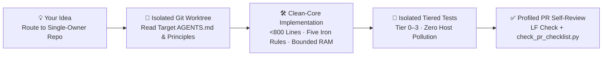

# Contributing to MindIE Agent

[中文](./CONTRIBUTING.md) · **English** · [Back to Home](./README.en.md) · [Engineering Design Principles](./docs/design-principles.en.md)

Welcome to **MindIE Agent**! 🎉

Every repository under `@mindie-agent` is a **100% Agent-Native codebase**—architected, implemented, verified on live Ascend NPUs, and audited through coding Agents. Whether you cloned only this top-level `mindie-agent` hub repository first or already have sibling checkouts locally, you can hand your idea directly to your coding Agent.

---

## ⚡ Contribute in One Sentence (Works Even from a `mindie-agent`-Only Clone)

Open **Claude Code**, **OpenAI Codex CLI**, **Kimi Code**, **DeepSeek Harness (DSH)**, **Google Antigravity**, **Tencent WorkBuddy**, or **OpenCode**, and paste this prompt with your idea:

```text
I want to contribute a change to MindIE Agent: <describe your feature, bugfix, or Ascend knowledge addition in one sentence>.
Please follow https://github.com/mindie-agent/mindie-agent/blob/main/CONTRIBUTING.en.md:
1. Check the Repository Routing Map in AGENTS.md to locate the single-owner target repository; if missing locally, lazy-clone it to ../<repo> and create an isolated Git worktree at ../.worktrees/<repo>-<topic>;
2. Immediately read ../<repo>/AGENTS.md and ../<repo>/CONTRIBUTING.md (plus docs/design-principles.en.md) before editing code;
3. Implement the change with isolated tiered tests, open a PR, and pass the repository's --profile Pre-PR Checklist gate.
```

---

## 🌳 Cross-Repo Routing & Linked Git Worktree Workflow

The `mindie-agent` hub repository holds **only system architecture, living documentation (`docs/`), channel manifests (`channels/0.1.json`), and stdlib cross-repo CI gates (`.github/scripts/`)**—never runtime business code. When you start from a `mindie-agent` clone and want an Agent to contribute to `harness`, `coordinator`, `remote-dev`, `sim`, etc., use the canonical **flat sibling + linked Git worktree** layout:

```text
<workspace-parent>/
├── mindie-agent/                     # Product hub, living specs, and cross-repo gates
├── harness/                          # Lazy-cloned base sibling checkout (owns shared .git object store)
├── coordinator/                      # Lazy-cloned sibling checkout
└── .worktrees/                       # Isolated per-topic linked Git worktrees
    ├── mindie-agent-docs-fix/
    ├── harness-win32-job/
    └── coordinator-a3-lease/
```

### 1. Lazy Partial Clone & Isolated Worktree Creation

Never clone all 25+ repositories upfront—lazy-clone only the repository your task touches:

```bash
# Run from inside mindie-agent: blobless lazy clone + isolated linked worktree
[ -d ../coordinator/.git ] || git clone --filter=blob:none https://github.com/mindie-agent/coordinator.git ../coordinator
git -C ../coordinator worktree add ../.worktrees/coordinator-my-fix -b fix/my-fix
```

> **Immediate Handoff Rule**: As soon as your Agent routes to `../<repo>` or `../.worktrees/<repo>-<topic>`, it **must immediately read that target repository's own `AGENTS.md` and `CONTRIBUTING.md`**, run its local test suite, and keep `mindie-agent` clean.

### 2. Sandboxed-Agent Write Access (Why Both Directories Are Needed)

Inside a linked worktree (`../.worktrees/<repo>-<topic>`), `.git` is a pointer file referencing `../<repo>/.git/worktrees/<repo>-<topic>` and the base checkout's shared `commondir` object/ref store. Consequently, running `git add` or `git commit` inside the worktree requires **write access to BOTH the worktree directory AND the base repository's `../<repo>` common `.git` directory**:

- **OpenAI Codex CLI**:
  ```bash
  codex -C mindie-agent --add-dir ../coordinator --add-dir ../.worktrees/coordinator-my-fix
  ```
- **Claude Code CLI**:
  ```bash
  claude --add-dir ../coordinator --add-dir ../.worktrees/coordinator-my-fix
  ```
- **Google Antigravity / Tencent WorkBuddy / OpenCode / Kimi Code / DSH / Multi-Root IDEs**: Add both `../<repo>` and `../.worktrees/<repo>-<topic>` as workspace folders, or launch the session directly rooted at `../.worktrees/<repo>-<topic>`.
- **Honest Read-Only Fallback**: If the active sandbox blocks writes outside `mindie-agent`, inspect read-only and give the user the exact one-line relaunch command above—**never dump sibling runtime source files into `mindie-agent`**.
- **Worktree-Native Hub Gates**: `.github/scripts/repo_roots.py` natively resolves `.git` worktree pointer files and `--git-common-dir`. You can pass `--siblings-root ../.worktrees` or authoritative `--repo coordinator=/abs/path/to/worktree` to any hub gate (`check_auto_update_readiness.py`, `host_compatibility_gate.py`, `release_doc_hygiene.py`, `sync_org_versions.py`), and every gate prints explicit `selected / exercised / missing / unselected` repository coverage.

---

## 🗺️ Repository Routing Map & Checklist Profiles (17 Code/Hub Repos + 9 Corpora)

| Class & `--profile` | Repositories (`github.com/mindie-agent/<repo>`) | Owned Responsibility |
| --- | --- | --- |
| **Product Hub & Gates**<br/>`--profile hub` | [`mindie-agent`](https://github.com/mindie-agent/mindie-agent) *(This Repo)* | Product entry point, architecture, 18 engineering principles, living specs (`docs/`), historical archive (`docs/archive/`), `channels/0.1.json`, and pure-stdlib cross-repo CI gates |
| **Shared Host Substrate**<br/>`--profile harness` | [`harness`](https://github.com/mindie-agent/harness) (`mindie-harness` / `mindie_harness`) | Shared substrate across all 7 native host plugins: windowless process & nested Win32 Job supervision, deterministic Seed (`mindie-harness-seed.pyz`), `Active + Rollback` (`<= 2`) `.inuse`-leased atomic updates, concurrent MCP gateway (`P2.7` zero-binding deterministic pass-through vs. `P2.1` `knowledge_*` admission), and single-state `ExperimentLedger` `rsi` optimization loop |
| **Native Host Plugins (7)**<br/>`--profile host-plugin` | [`mindie-agent-codex`](https://github.com/mindie-agent/mindie-agent-codex) · [`mindie-agent-cc`](https://github.com/mindie-agent/mindie-agent-cc) · [`mindie-agent-kimi`](https://github.com/mindie-agent/mindie-agent-kimi) · [`mindie-agent-dsh`](https://github.com/mindie-agent/mindie-agent-dsh) · [`mindie-agent-agy`](https://github.com/mindie-agent/mindie-agent-agy) · [`mindie-agent-wb`](https://github.com/mindie-agent/mindie-agent-wb) · [`mindie-agent-oc`](https://github.com/mindie-agent/mindie-agent-oc) | Thin per-host wire adapters: native manifests, hook shims, host transcript redaction adapters (Codex rollouts, Antigravity Brain, OpenCode `session_v2`), and component pins delegating process/update/MCP execution to `mindie-harness` |
| **Control Plane**<br/>`--profile control-plane` | [`remote-dev`](https://github.com/mindie-agent/remote-dev) · [`coordinator`](https://github.com/mindie-agent/coordinator) | `remote-dev`: SSH file/exec/patch, shared `~/.mindie/ssh/id_ed25519` fallback, destructive command guard, container exec, cross-connection handle-addressed background jobs; `coordinator`: Ascend host/container inventory, `mindie_probe` topology discovery (A2/A3 dual-Die/A5), `HostQueue` HBM & compile slot leases (`mindie_lease`), managed task execution |
| **Local State Services**<br/>`--profile state-service` | [`knowledge`](https://github.com/mindie-agent/knowledge) · [`diagnostics`](https://github.com/mindie-agent/diagnostics) · [`npu-top`](https://github.com/mindie-agent/npu-top) | `knowledge`: **pure knowledge engine** (`L1–L4` graded units, info-gap retrieval, batch `refs` with shared `known_refs`/`token_budget`, 2-layer redaction, C6 distillation & community PR publishing); `diagnostics`: CANN/`plog` deterministic analysis, 4×1 MiB JSONL rotation, redacted bundles, Scale-to-Zero opt-in GitHub reporting (`7d` `pending` expiry); `npu-top`: loopback Web (`127.0.0.1:8788`)/TUI/CLI/MCP fleet dashboard & 90-day SQLite history |
| **Device Triage, Profiling & Sim**<br/>`--profile device-tool` | [`debugger`](https://github.com/mindie-agent/debugger) · [`profiler`](https://github.com/mindie-agent/profiler) · [`sim`](https://github.com/mindie-agent/sim) | `debugger`: zero-device-context read-only `npu_fault_triage`, 3-primitive `precision` localization, and `aclgraph` zero-sync replay/capture guard; `profiler`: controlled `msprof` capture, in-place trace analysis & 3-state topology alignment on `mindie-model-structure/1`; `sim`: 5-layer causal performance modeling, `compose`, 4D efficiency & SLA/PD Pareto solvers |
| **Evaluation Suite**<br/>`--profile bench` | [`mindie-bench`](https://github.com/mindie-agent/mindie-bench) | 20 behavioral-oracle live NPU tasks (109 3-state & helper controls), Gate Runner, isolated host runs, and component benchmarks |
| **Public Knowledge Corpora (9)**<br/>`--profile corpus` | [`knowledge-vllm-ascend`](https://github.com/mindie-agent/knowledge-vllm-ascend) · [`knowledge-xllm`](https://github.com/mindie-agent/knowledge-xllm) · [`knowledge-mindie-sd`](https://github.com/mindie-agent/knowledge-mindie-sd) · [`knowledge-operators`](https://github.com/mindie-agent/knowledge-operators) · [`knowledge-infer-core`](https://github.com/mindie-agent/knowledge-infer-core) · [`knowledge-infer-distributed`](https://github.com/mindie-agent/knowledge-infer-distributed) · [`knowledge-infer-observability`](https://github.com/mindie-agent/knowledge-infer-observability) · [`knowledge-infer-ops-compat`](https://github.com/mindie-agent/knowledge-infer-ops-compat) · [`knowledge-agent-engineering`](https://github.com/mindie-agent/knowledge-agent-engineering) | Structured `mindie-graded-unit/1` (`L1–L4`) Ascend domain knowledge corpora with explicit `applicability` and empirical evidence (alongside [`awesome-mindie-skills`](https://github.com/mindie-agent/awesome-mindie-skills) and [`vllm-ascend-workspace`](https://github.com/mindie-agent/vllm-ascend-workspace)) |

---

## 🧭 Contribution Workflow: Two Golden Gates



### Gate 1: Before Coding — Align with the 18 Design Principles & Five Iron Rules

Before touching code, read the target repository's `AGENTS.md` and [`docs/design-principles.en.md`](./docs/design-principles.en.md) ([中文](./docs/design-principles.md)):

| Dimension | Core Invariants Required Before Writing Code |
| --- | --- |
| **🎯 Total Cost & Boundaries (Principles 1–8)** | Optimize for **end-to-end user goal cost**; toolify closed deterministic problems while keeping open judgment advisory in Skills; reuse mature substrates (`mindie-harness`) and **delete superseded code directly** after verifying reachability instead of retaining dual-track shims. |
| **🔍 State & Receipt Honesty (Principles 9 & 14)** | Distinguish `completed`, `failed`, and uncertain external writes (`unknown`); never mask errors as `{}` / `"active"` / `exit 0` and always precede `except OSError:` with `except TimeoutError: raise`; once a primary remote/component call succeeds, local receipt errors must keep `isError=False` and attach `receipt_warning` + `receipt_unconfirmed=True`. |
| **⏱️ Timeout Math & Five Iron Rules (Principles 10 & 15)** | Enforce `outer_timeout >= sum(inner_budgets) + cleanup_grace` and obey all **Five Iron Rules**: (1) configure SQLite WAL + `busy_timeout=5000` once in `open_database` (never on absent read-only checks, never on WSL2 DrvFS); (2) reserve `unknown` strictly for irreversible external writes—zero local permanent self-bricking (`needs_repair`/`fault`/`suppressed`/`TaskRootBusy`); (3) no copy-pasted `*_fallback.py` shadow state machines or Win32 ACL ceremonies (use `os.replace()`); (4) no `inspect.signature` locks or giant inline Python `-c` blobs; (5) **zero pre-call session-binding gates on deterministic tools (`P2.7`)**, reserving strict session/consent admission exclusively for `knowledge_*` (`P2.1`) and outbound exports. |
| **🧪 Tiered Tests & Host Isolation (Principle 16)** | No filler or prose-grep tests; isolate `HOME`, `USERPROFILE`, `APPDATA`, `LOCALAPPDATA`, `XDG_*`, `MINDIE_CONFIG_HOME`, `MINDIE_DATA_HOME`, `MINDIE_DIAGNOSTICS_ROOT`, `REMOTE_DEV_AUTH_DIR`, `UV_CACHE_DIR`, and `TMPDIR` in all tests. |
| **🤖 Cohesive Modules, Bounded RAM & `P8` Storage (Principles 17 & 18)** | Keep core modules `< 800` lines with `[Role]` / `[Invariants]` / `[Timeouts & Locks]` / `[Side-Effect Policy]` in the top 30 lines; keep control-plane working sets $O(\text{active state})$ (`<= 512 MiB` peak, zero weight/device context); retain at most `Active + Rollback` (`<= 2`) generations and enforce zero Windows console popups (`CREATE_NO_WINDOW` / `windowsHide: true`) and zero unguarded `os.kill(pid, 0)`. |

### Gate 2: On PR Submission — Run LF Hygiene & Parameterized PR Checklist Validation

Fill out [`.github/pull_request_template.md`](./.github/pull_request_template.md) with concrete evidence for each profile ID (for docs-only PRs, non-applicable items accept `not-applicable: <specific reason>`; bare `N/A` or `TODO` is rejected):

```bash
# 1. Verify all text files strictly use Unix LF (\n) line endings and zero CRLF (\r\n)
python3 .github/scripts/check_lf_eol.py

# 2. Run the isolated gate unit suite (mandatory when touching .github/scripts/)
python3 -m unittest discover -s .github/scripts/tests -p 'test_*.py' -v

# 3. Validate the PR body against its repository class profile
python3 .github/scripts/check_pr_checklist.py --profile hub --body-file <pr_body.md>
```
