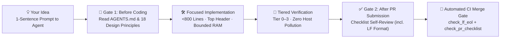

# Contributing to MindIE Agent

[中文](./CONTRIBUTING.md) · **English** · [Back to Home](./README.en.md) · [Engineering Design Principles](./docs/design-principles.en.md)

Welcome to **MindIE Agent**! 🎉

Unlike traditional open-source repositories built around manual human workflows, every repository under `@mindie-agent` is a **100% Agent-Native codebase**—architected, implemented, tested on live Ascend NPUs, and reviewed by coding Agents.

So the easiest way to contribute is simple: **hand your idea to your coding Agent**, and let it read the design principles, write the code, run the tiered tests, and complete the PR self-review checklist for you.

---

## ⚡ Contribute in One Sentence (Agent-First Workflow)

No need to read through a dozen architecture docs yourself first. Open **Claude Code**, **OpenAI Codex CLI**, **Kimi Code**, **DeepSeek Harness**, or **Google Antigravity**, and paste this prompt with your idea:

```text
I want to contribute a change to MindIE Agent: <describe your feature, bugfix, or Ascend knowledge addition in one sentence>.
Please follow https://github.com/mindie-agent/mindie-agent/blob/main/CONTRIBUTING.en.md:
1. Read AGENTS.md and docs/design-principles.en.md before writing any code;
2. Implement the change with tiered tests, open a PR, and complete the Pre-PR Checklist self-review and verification evidence in .github/pull_request_template.md.
```

<details>
<summary>🤖 <b>AI Agent Contribution Playbook (Click to expand / Automatically parsed by AI Agents)</b></summary>

> **Instructions for AI Agents**: When the user asks you to develop a feature, fix a bug, or open a PR across any MindIE Agent repository, execute the following five steps end-to-end without offloading manual ceremony onto the user:
>
> #### Step 1: Read the Design Principles Before Coding (Pre-Coding Gate)
> 1. Read the repository's [`AGENTS.md`](./AGENTS.md) and [`docs/design-principles.en.md`](./docs/design-principles.en.md) first, loading only the domain architecture doc relevant to your current task (progressive disclosure—do not preload every doc into context).
> 2. Verify the single-responsibility repository boundary (see the "Repository Routing Map" below). Never copy-paste `*_fallback.py` or `*_bootstrap.py` shadow state machines across repositories.
>
> #### Step 2: Implement Changes Against Core Engineering Invariants
> 1. **Inner-Loop Efficiency (Principle 1)**: Edit files directly in the active checkout and verify the affected scope—never invent intermediate freeze directories or audit ceremony files.
> 2. **Fail-Visible Semantics & State Honesty (Principle 9 & 14)**: Distinguish `completed`, `failed`, and uncertain external writes (`unknown`). Never mask failures as `{}` / `"active"` / `exit 0` via `except Exception:`, and never let `except OSError:` swallow `TimeoutError`.
> 3. **Timeout Arithmetic & Four Anti Over-Defensive Iron Rules (Principle 10 & 15)**: Enforce `outer_timeout >= sum(inner_budgets) + cleanup_grace`; configure SQLite with WAL + `busy_timeout=5000` once with zero hot-path `.owner`/schema reflection; abolish local permanent self-bricking (`fault`/`suppressed`/`TaskRootBusy`); ban giant inline Python string blobs (remote workers must be standalone `.py` modules).
> 4. **Agent-Native Module & Commenting Standards (Principle 17)**: Keep core modules `< 800` lines with a four-part contract header (`[Role]`, `[Invariants]`, `[Timeouts & Locks]`, `[Side-Effect Policy]`) in the first 30 lines, and focus comments on business invariants and hardware/protocol boundaries.
> 5. **Bounded Memory/VRAM & Spec-Driven Placement (Principle 18)**: Keep main-loop working sets $O(\text{active state})$, stream files `> 50 MB`, and keep routine single-process peak RAM `<= 512 MiB` (`> 1 GiB` is treated as a bug). Keep the control plane zero-weight/zero-device-context, and route heavy workloads by matching local vs. remote hardware specs (never hardcode `sys.platform`).
>
> #### Step 3: Run Tiered Verification (Tier 0 – Tier 3)
> 1. Follow [`docs/testing-architecture.en.md`](./docs/testing-architecture.en.md): every test must verify real business or hardware domain logic (no filler type checks, hypothetical `chmod`/`symlink` tests, or prose-grepping tests).
> 2. Strictly isolate `MINDIE_DIAGNOSTICS_ROOT`, `MINDIE_DIAGNOSTICS_CONFIG`, and `$HOME` via `conftest.py` / temporary directories—**zero pollution of host `~/.local`, `~/.config`, or system LaunchAgent/systemd services**.
>
> #### Step 4: Open the PR & Complete the Pre-PR Checklist Self-Review (Including Format Hygiene)
> 1. Populate the PR description using [`.github/pull_request_template.md`](./.github/pull_request_template.md).
> 2. After submitting/updating the PR, review the final `git diff` against every item in the Pre-PR Checklist (`1–8`, `9`, `10–11`, `12–13`, `14` design items, plus **`15. PR Format Hygiene`**—verifying that all repository text files strictly use Unix `LF` `\n` line endings and zero Windows `CRLF` `\r\n`), check all boxes (`- [x]`), and fill in concrete review notes under **`- **自查结论与证据**：`** plus executed test commands under **`## 验证结果 (Verification)`**.
> 3. Run the local and CI gate scripts (`python3 .github/scripts/check_lf_eol.py` and `python3 .github/scripts/check_pr_checklist.py --body-file <pr_body.md>`) and confirm the `PR Checklist & LF Line-Ending Gate` workflow passes before reporting back.

</details>

---

## 🧭 How It Works: Two Golden Gates

To keep 13+ repositories clean, fast, and free of defensive bloat during rapid iteration, our contribution workflow cleanly separates **Design Principles** (read before coding) from **PR Format & Engineering Hygiene** (checked in the PR Checklist):



### Gate 1: Before Coding — Read the Design Principles First

Before touching a single line of code, your Agent must read **[`AGENTS.md`](./AGENTS.md)** and **[`docs/design-principles.en.md`](./docs/design-principles.en.md)** ([中文](./docs/design-principles.md)). Design principles focus on architecture, boundaries, and fault semantics—preventing 90% of rework upfront:

| Design Dimension | Baseline Design Rules Your Agent Must Follow While Coding |
| --- | --- |
| **🎯 Total Cost & Boundaries (Principles 1–8)** | Optimize for **end-to-end user goal cost**; toolify closed deterministic problems while keeping open judgment advisory in Skills; reuse native host/OS/mature tools first, and **directly delete replaced legacy code** instead of keeping dual-track shims. |
| **🔍 Fail-Visible & Timeout Math (Principles 9–15)** | Errors must remain visible to the caller—never swallow failures as `{}` / `"active"` / `exit 0`; enforce `outer_timeout >= sum(inner_budgets) + cleanup_grace`; obey all four anti-over-defensive iron rules. |
| **🧪 Tiered Tests & Host Isolation (Principle 16)** | No filler or prose-grep tests; verify across Tier 0 (`<5s` in-memory) through Tier 3 (standing A2/A3 live NPU clusters); strictly isolate `$HOME` and `MINDIE_DIAGNOSTICS_ROOT` so tests never pollute the host machine. |
| **🤖 Agent-Native Modules & Comments (Principle 17)** | Keep core modules `< 800` lines (single `view_file` window friendly) with `[Role]` / `[Invariants]` / `[Timeouts & Locks]` / `[Side-Effect Policy]` in the top 30 lines; document business invariants and hardware/protocol quirks rather than excusing defensive bloat. |
| **⚡ Bounded Memory/VRAM & Spec Placement (Principle 18)** | Keep main-loop working sets $O(\text{active state})$ with routine peak RAM `<= 512 MiB` (`> 1 GiB` is a code bug); keep the control plane zero-weight/zero-device-context; route heavy workloads by matching real local vs. remote hardware specs without hardcoding `sys.platform`. |

### Gate 2: On & After PR Submission — Complete the Checklist Self-Review (Including Format Hygiene)

Development and file-format hygiene rules—such as enforcing Unix `LF` (`\n`) line endings and prohibiting Windows `CRLF` (`\r\n`)—belong in the **PR Checklist ([`.github/pull_request_template.md`](./.github/pull_request_template.md))** and automated CI gate ([`.github/workflows/pr-checklist.yml`](./.github/workflows/pr-checklist.yml)). When opening or updating a PR, your Agent must audit its final diff and complete the checklist:

1. **`## 变更摘要 (Summary)`**: Summarize what problem the PR solves and what changed.
2. **`## 设计原则 Review (Pre-PR Checklist)`**:
   - Audit the final diff against the five design principle groups (`1–8`, `9`, `10–11`, `12–13`, `14`) plus **`15. 仓库工程与文件格式规范（PR Format Hygiene）`** (verifying all text files strictly use Unix `LF` `\n` line endings with zero Windows `CRLF` `\r\n`, and Python cross-platform text/script writes pass `newline="\n"`);
   - Check every item (`- [x]`) and provide concrete review evidence under **`- **自查结论与证据**：`** (CI automatically rejects empty fields or placeholders like `TODO` / `N/A` / `None`).
3. **`## 验证结果 (Verification)`**: Record the actual test commands executed and their pass/timing output.
4. **Pass Both Automated Gate Scripts**:
   ```bash
   # 1. Verify all text files use Unix LF (\n) and zero Windows CRLF (\r\n)
   python3 .github/scripts/check_lf_eol.py

   # 2. Verify all Pre-PR Checklist items are checked with substantive evidence
   python3 .github/scripts/check_pr_checklist.py --body-file <pr_body.md>
   ```

---

## 🗺️ Repository Routing Map (Where Should the PR Go?)

Each repository under `@mindie-agent` has a single, clear responsibility:

| What You Want to Contribute | Target Repository |
| --- | --- |
| **System architecture, engineering design principles, release contracts, top-level docs** | [`mindie-agent`](https://github.com/mindie-agent/mindie-agent) *(This Repo)* |
| **Claude Code / Codex / Kimi / DSH / Antigravity native plugin adapters & lifecycle hooks** | [`mindie-agent-cc`](https://github.com/mindie-agent/mindie-agent-cc) · [`mindie-agent-codex`](https://github.com/mindie-agent/mindie-agent-codex) · [`mindie-agent-kimi`](https://github.com/mindie-agent/mindie-agent-kimi) · [`mindie-agent-dsh`](https://github.com/mindie-agent/mindie-agent-dsh) · [`mindie-agent-agy`](https://github.com/mindie-agent/mindie-agent-agy) |
| **Ascend domain knowledge units (`L1–L4` rules, SOPs, workflows, kernel/inference optimizations)** | [`knowledge-vllm-ascend`](https://github.com/mindie-agent/knowledge-vllm-ascend) · [`knowledge-operators`](https://github.com/mindie-agent/knowledge-operators) · [`knowledge-infer-core`](https://github.com/mindie-agent/knowledge-infer-core) and the other public corpora |
| **Knowledge retrieval engine, condition matching, redaction & distillation flywheel** | [`knowledge`](https://github.com/mindie-agent/knowledge) |
| **Remote SSH/container execution, multi-agent NPU leases, live dashboard, CANN fault triage** | [`remote-dev`](https://github.com/mindie-agent/remote-dev) · [`coordinator`](https://github.com/mindie-agent/coordinator) · [`npu-top`](https://github.com/mindie-agent/npu-top) · [`diagnostics`](https://github.com/mindie-agent/diagnostics) |
| **Ascend `msprof` profiling analysis (`profiler`) & roofline / network simulation (`sim`)** | [`profiler`](https://github.com/mindie-agent/profiler) · [`sim`](https://github.com/mindie-agent/sim) |
| **End-to-end live NPU benchmark tasks, Oracles & component benchmark suites** | [`mindie-bench`](https://github.com/mindie-agent/mindie-bench) |
