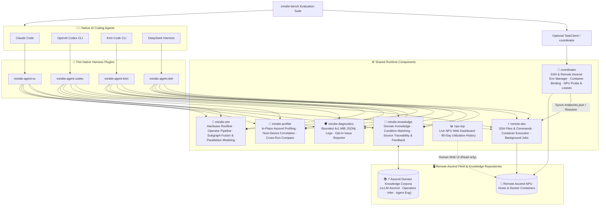

<p align="center">
  
</p>

<h1 align="center">MindIE Agent</h1>

<p align="center">
  <strong>Ascend domain knowledge, remote NPU execution, and traceable engineering experience for native coding agents</strong>
</p>

<p align="center">
  <a href="https://github.com/mindie-agent/mindie-agent/blob/main/docs/releases/0.0.3.en.md"></a>
  <a href="https://github.com/mindie-agent/mindie-agent-cc"></a>
  <a href="https://github.com/mindie-agent/mindie-agent-codex"></a>
  <a href="https://github.com/mindie-agent/mindie-agent-kimi"></a>
  <a href="https://github.com/mindie-agent/mindie-agent-dsh"></a>
  <a href="https://github.com/mindie-agent/awesome-mindie-skills"></a>
</p>

<p align="center">
  <a href="./README.md">中文</a> · <strong>English</strong> · <a href="#-zero-friction-one-sentence-install">⚡ 1-Sentence Install</a> · <a href="#-why-mindie-agent">✨ Why MindIE Agent</a> · <a href="#️-architecture--experience-flywheel">🏗️ Architecture</a> · <a href="#-how-to-use-after-installation-trigger-modes--examples">🔥 Workflows</a> · <a href="#-repository-ecosystem">📦 Ecosystem</a> · <a href="#-current-release--benchmark-results-v003">🚀 v0.0.3 Benchmarks</a> · <a href="./docs/README.en.md">📚 Docs</a>
</p>

---

## ⚡ Zero-Friction One-Sentence Install

### Option 1: Just Paste the Link to Your Agent (Recommended ✨)

No need to memorize CLI flags. Open **Claude Code**, **OpenAI Codex CLI**, **Kimi Code**, or **DeepSeek Harness**, and paste this single sentence into your chat:

```text
Please install MindIE Agent for me: https://github.com/mindie-agent/mindie-agent
```

When your Agent reads this page, it will automatically verify a **stable `gh` (GitHub CLI) channel**, detect its own host environment, and execute the **Agent Auto-Install Playbook** below—completing plugin registration and runtime initialization. Installation requires neither a Star nor a Fork.

<details>
<summary>🤖 <b>Agent Auto-Install Playbook (Click to expand / Automatically parsed by AI Agents)</b></summary>

> **Instructions for AI Agents**: When the user asks you to install `mindie-agent`, do **not** ask them to read documentation manually. Execute the following four steps in order:
>
> #### Step 1: Verify prerequisites & the `gh` GitHub channel (Hard Requirement)
> **A stable, authenticated GitHub CLI (`gh`) channel is a hard requirement for MindIE Agent**—it powers plugin marketplace fetches, locked release verification, `knowledge-vllm-ascend` corpus sync, automated community PR publication (via `gh api` and `!gh auth git-credential`), and optional issue reporting. Run in the terminal first:
> ```bash
> git --version && uv --version && gh --version
> gh auth status
> GH_USER=$(gh api user --jq .login) && echo "GitHub channel verified for account: $GH_USER"
> gh auth setup-git
> ```
> - **Hard Gate (Never skip or silently ignore failures; a DSH `0.0.3`-only install without community contribution may skip the `gh` gate but still needs `git` and `uv`)**:
>   - If `gh` is missing: assist the user in installing GitHub CLI for their OS first (macOS: `brew install gh`; Windows: `winget install --id GitHub.cli`; Ubuntu / WSL: `sudo apt update && sudo apt install -y gh`).
>   - If `gh auth status` is not logged in, the token is invalid, or `gh api user` cannot reach GitHub: **do not proceed to the next step**—guide the user to complete `gh auth login` (or set a valid `GH_TOKEN`) and run `gh auth setup-git` until `gh api user --jq .login` reliably returns their GitHub username.
>
> #### Step 2: Preserve consent and prepare contribution targets only when needed
> Installation registers the plugin needed by the current host. It requires neither a Star nor a Fork. Starring the project is the user's choice.
>
> Community contribution is off by default. Only after the user enables contribution to a target corpus `<owner/repo>` should you create or reuse that corpus's personal Fork and bind `<GH_USER>/<repo>` as the push target. Do not Fork the main repository, plugin repositories or all domain repositories as an installation step.
>
> #### Step 3: Identify your host environment & install the matching plugin
> Run the **single matching branch** for your host CLI (check `claude --version`, `codex --version`, `kimi --version`, or `dsh --version` if unsure):
>
> - **Branch A — If you are running inside Claude Code (`CLAUDECODE` env or `claude` CLI)**:
>   ```bash
>   claude plugin marketplace add "https://github.com/mindie-agent/mindie-agent-cc.git#v0.0.3"
>   claude plugin install mindie-agent@mindie-agent-cc --scope user
>   claude --init-only
>   claude plugin list --json
>   claude mcp list
>   ```
>   *Verification*: Confirm `claude plugin list --json` shows `mindie-agent@mindie-agent-cc` (`0.0.3`) enabled and `claude mcp list` shows both `mindie-knowledge` and `remote-dev` as `Connected`.
>
> - **Branch B — If you are running inside OpenAI Codex CLI (`CODEX_CI` / `CODEX_THREAD_ID` env or `codex` CLI)**:
>   ```bash
>   codex plugin marketplace add https://github.com/mindie-agent/mindie-agent-codex.git --ref v0.0.3
>   codex plugin add mindie-agent@mindie-agent --json
>   codex plugin list --json
>   ```
>   *Verification*: Confirm `codex plugin list --json` shows `mindie-agent@mindie-agent` (`0.0.3`) enabled. Let the user know that starting a new session will trigger `SessionStart` to build the locked runtime.
>
> - **Branch C — If you are running inside Kimi Code CLI (`KIMI_CODE_HOME` env or `kimi` CLI)**:
>   ```bash
>   MINDIE_TMP="${TMPDIR:-/tmp}/mindie-agent-kimi-install"
>   rm -rf "$MINDIE_TMP"
>   git clone --depth 1 --branch v0.0.3 https://github.com/mindie-agent/mindie-agent-kimi.git "$MINDIE_TMP"
>   SETUP_OUT=$(python3 "$MINDIE_TMP/scripts/setup.py")
>   echo "$SETUP_OUT"
>   NATIVE_PKG=$(printf '%s\n' "$SETUP_OUT" | python3 -c 'import sys, json; text=sys.stdin.read(); data=json.loads(text[text.find("{"):]); print(data["native_package"])')
>   python3 "$MINDIE_TMP/scripts/install_kimi_plugin.py" --kimi-home "${KIMI_CODE_HOME:-$HOME/.kimi-code}" --plugin-root "$NATIVE_PKG"
>   ```
>   *Verification*: Confirm `install_kimi_plugin.py` succeeds and let the user know they can use `/mindie-agent` inside Kimi Code.
>
> - **Branch D — If you are running inside DeepSeek Harness (DSH; `DSH_PROFILE` / `DSH_HOME`, or the `dsh` CLI)**:
>   ```bash
>   MINDIE_TMP="${TMPDIR:-/tmp}/mindie-agent-dsh-install"
>   rm -rf "$MINDIE_TMP"
>   git clone --depth 1 --branch v0.0.3 https://github.com/mindie-agent/mindie-agent-dsh.git "$MINDIE_TMP"
>   uv --native-tls run --quiet --no-project --python 3.11 "$MINDIE_TMP/scripts/setup.py"
>   ```
>   Then install and enable in the DSH Web **Plugins** page:
>   ```text
>   git+https://github.com/mindie-agent/mindie-agent-dsh.git#v0.0.3
>   ```
>   Inside a DSH session that has the `plugin_manager` tool, the same step is:
>   ```text
>   plugin_manager(action="install_bundle", target="git+https://github.com/mindie-agent/mindie-agent-dsh.git#v0.0.3")
>   ```
>   *Verification*: `setup.py` reports `status: ready`, components `knowledge 0.13.0 / remote-dev 0.10.4 / diagnostics 0.5.1`, and `knowledge.status: ready`; the Plugins page shows `mindie-agent-dsh` enabled. Tell the user to open a **new session** and use `/mindie-agent`.
>
> - **Branch E — If you are running inside Cursor or another generic MCP client (standalone `remote-dev` SSH toolset)**:
>   Add `remote-dev` to `.mcp.json` (or `.cursor/mcp.json`):
>   ```json
>   {
>     "mcpServers": {
>       "remote-dev": {
>         "type": "stdio",
>         "command": "uvx",
>         "args": ["--from", "git+https://github.com/mindie-agent/remote-dev@v0.10.4", "remote-dev", "server"]
>       }
>     }
>   }
>   ```
>
> #### Step 4: Report back to the user
> Once finished, report:
> 1. The verified `gh` GitHub channel and authenticated account, where applicable;
> 2. Which plugin and version were installed and verified;
> 3. That users only need the single `/mindie-agent` entry to invoke Ascend domain knowledge & Skills, while `remote-dev` remote NPU tools trigger automatically by default;
> 4. That **community knowledge sharing** and **automated fault reporting** are **off by default (opt-in)**; if community sharing is enabled later, the Agent will automatically Fork the corresponding target knowledge repository (e.g., `mindie-agent/knowledge-vllm-ascend` -> `$GH_USER/knowledge-vllm-ascend`) on demand.

</details>

### Option 2: One-Line Terminal Install for Humans

> **Hard Prerequisite**: Ensure `git`, `uv`, and an authenticated **`gh` (GitHub CLI)** are installed. The DSH `0.0.3` row below does not require `gh` because it enables no contribution or reporting path. Before installing a plugin, run this one-liner to **verify your GitHub channel**:
> ```bash
> gh auth status && gh auth setup-git
> ```

Then pick the one-liner for your coding agent:

| Coding Agent | One-Line Terminal Command | Plugin Repo |
| --- | --- | --- |
| **Claude Code** | `claude plugin marketplace add "https://github.com/mindie-agent/mindie-agent-cc.git#v0.0.3" && claude plugin install mindie-agent@mindie-agent-cc --scope user && claude --init-only` | [`mindie-agent-cc`](https://github.com/mindie-agent/mindie-agent-cc) |
| **OpenAI Codex CLI** | `codex plugin marketplace add https://github.com/mindie-agent/mindie-agent-codex.git --ref v0.0.3 && codex plugin add mindie-agent@mindie-agent --json` | [`mindie-agent-codex`](https://github.com/mindie-agent/mindie-agent-codex) |
| **Kimi Code CLI** | `git clone --branch v0.0.3 https://github.com/mindie-agent/mindie-agent-kimi.git && cd mindie-agent-kimi && python3 scripts/setup.py` | [`mindie-agent-kimi`](https://github.com/mindie-agent/mindie-agent-kimi) |
| **DeepSeek Harness (DSH)** | `git clone --depth 1 --branch v0.0.3 https://github.com/mindie-agent/mindie-agent-dsh.git /tmp/mindie-agent-dsh && uv --native-tls run --quiet --no-project --python 3.11 /tmp/mindie-agent-dsh/scripts/setup.py`, then enable `git+https://github.com/mindie-agent/mindie-agent-dsh.git#v0.0.3` on the DSH **Plugins** page | [`mindie-agent-dsh`](https://github.com/mindie-agent/mindie-agent-dsh) |
| **NPU Dashboard Only (`npu-top`)** | `uvx --native-tls --from "https://github.com/mindie-agent/npu-top/releases/download/v0.2.1/npu_top-0.2.1-py3-none-any.whl" npu-top serve` | [`npu-top`](https://github.com/mindie-agent/npu-top) |

---

## ✨ Why MindIE Agent?

MindIE Agent brings domain knowledge and remote development tools into your existing Claude Code, Codex, Kimi Code, or DSH session. Work toward `0.0.3` focuses on **vLLM-Ascend and operators**, covering new model bring-up (0-day adaptation), model and operator performance tuning, and fault diagnosis. See the [architecture](./docs/architecture.en.md) and release records below for implementation and acceptance details.

| Capability | What it helps you do |
| --- | --- |
| **Condition-matched domain knowledge** | Retrieve hardware constraints, diagnostic SOPs, troubleshooting workflows, and operator optimizations matched against your framework version, NPU model, and workload shapes, with traceable source commits |
| **Remote NPU development and validation** | Use [`remote-dev`](https://github.com/mindie-agent/remote-dev) to edit files, apply patches, run commands, manage long-running background jobs, and inspect logs across SSH hosts and Docker containers |
| **Profiling analysis & performance modeling** | Use [`profiler`](https://github.com/mindie-agent/profiler) for in-place Ascend profiling analysis and cross-run comparison, and [`sim`](https://github.com/mindie-agent/sim) for roofline bounds, memory bandwidth limits, and operator pipeline modeling |
| **Resource coordination and fault diagnosis** | Use [`coordinator`](https://github.com/mindie-agent/coordinator) for NPU and port leases, [`npu-top`](https://github.com/mindie-agent/npu-top) for live cluster monitoring, and [`diagnostics`](https://github.com/mindie-agent/diagnostics) for local fault logging |
| **Experience distillation & reuse** | Redact and save troubleshooting records within your authorized project scope, distill verified fixes into reusable knowledge entries, and optionally contribute them back to the community |

Plugins preserve your host agent's native session and tool loop, loading domain knowledge on demand. See the [knowledge system](./docs/knowledge-system.en.md) for details.

---

## 🏗️ Architecture & Experience Flywheel

### 1. Modular Layered Architecture

MindIE Agent combines **thin native client plugins** with **decoupled shared runtime components**:



### 2. Continuous Engineering & Knowledge Loop

```mermaid
sequenceDiagram
  autonumber
  actor Dev as Developer
  participant Agent as Coding Agent (Claude / Codex / Kimi / DSH)
  participant Know as mindie-knowledge (Local Service)
  participant NPU as remote-dev (Remote Ascend Container)
  participant Repo as Public Knowledge Repo (knowledge-vllm-ascend, etc.)

  Dev->>Agent: Invoke /mindie-agent + engineering goal (Bring-up / Kernel Dev / Testing / Tuning)
  Agent->>Know: 1. Query by hardware & workload conditions, load matched rules & references
  Agent->>NPU: 2. Edit code, sync patches, and run tests in the target container
  NPU-->>Agent: Return build, accuracy, and performance results with log paths
  Agent-->>Dev: 3. Deliver verified changes and test summary; optionally record feedback
  Note over Agent,Know: Runs only when authorized by local configuration
  Agent->>Know: 4. Redact and archive session troubleshooting records
  Agent->>Know: 5. Distill verified fixes into reusable knowledge entries
  Note over Know,Repo: Triggered only when community sharing is enabled
  Know->>Repo: 6. Submit reviewed entries via PR for downstream sync
```

---

## 🔥 How to Use After Installation (Trigger Modes & Examples)

MindIE Agent is built around **simplicity and progressive disclosure**—from the user's perspective, **there is only ONE command to remember: `/mindie-agent`**. You never need to memorize internal subcommands (such as `:init` or `:status`); operational context is loaded on demand:

| Capability Module | Trigger Mode | How It Works |
| --- | --- | --- |
| **🧠 Ascend Domain Knowledge & Skills**<br/>(`mindie-knowledge` + Domain Skills) | **Manual Trigger**<br/>(Unified `/mindie-agent` entry) | Whether you are adapting a new model in `vLLM-Ascend`, writing `AscendC` / `Triton` kernels, adding accuracy tests, or tuning performance, type **`/mindie-agent <your task>`** (or `$mindie-agent` in Codex). Setup, status checks, and preference changes also go through `/mindie-agent` + natural language. |
| **⚡ Remote Ascend Server Development & Testing**<br/>(`remote-dev` SSH / Container Toolset) | **Default Auto-Trigger**<br/>(Always-on MCP, no slash command needed) | `remote-dev` is active by default. Whenever you mention a remote server, container, or NPU build/test command in normal conversation, your Agent **automatically calls** `remote_read`, `remote_edit`, `remote_bash`, and background job tools. |
| **🔄 Experience Distillation & Community Sharing**<br/>(Redaction, distillation, and review) | **Configured capture; verified milestones** | Session records are redacted and archived within your authorized project scope. Verified fixes and optimization results can be distilled into reusable knowledge entries and shared when community contribution is enabled. |

### Copy-Paste Usage Examples

#### 💡 Example 1: Manually Invoke `/mindie-agent` for Feature Design, Kernel Development & Test Authoring
```text
/mindie-agent I want to design and implement a custom fused operator in vllm-ascend (with Triton / AscendC kernel support) and add unit + accuracy tests. Check MindIE knowledge and existing conventions to propose the design and test plan.
```
> **What happens**: The Agent selects the relevant domain, matches your hardware and framework conditions, and loads the corresponding constraints, reference implementations, and verification checklists.

#### 💡 Example 2: Default Auto-Triggered `remote-dev` for Remote Ascend Container Coding & Testing
```text
Connect to the vllm-dev container on host 192.0.2.21 (port 22), sync my new operator implementation and unit tests into /workspace/vllm-ascend, and run the full pytest accuracy and benchmark suite on the NPU.
```
> **What happens**: Without needing any slash command, your Agent automatically uses `remote_read`, `remote_edit`, and `remote_bash` inside the remote `vllm-dev` container over pooled SSH, turning long build and test runs into managed background jobs with live log streaming.

#### 💡 Example 3: Joint `/mindie-agent` + `remote-dev` Optimization with Experience Distillation
```text
/mindie-agent Using Ascend inference and kernel tuning experience, help me profile decode latency bottlenecks on our remote NPU dev machine, pull the key profiling metrics, and verify an optimization patch.
```
> **What happens**: The Agent combines domain knowledge with remote execution to pinpoint the bottleneck, then verifies numerical accuracy and latency speedup on the NPU. Verified conclusions can be distilled into reusable knowledge entries for future sessions.

---

## 📦 Repository Ecosystem

Every repository under `@mindie-agent` has a clean, single-purpose boundary and can be used together or standalone:

### 1. Product Entry, Benchmarks & Community Catalogue

| Repository | Role |
| --- | --- |
| **[`mindie-agent`](https://github.com/mindie-agent/mindie-agent)** *(This Repo)* | Product entry point, system architecture, engineering design principles, release compatibility contracts, and release records |
| **[`mindie-bench`](https://github.com/mindie-agent/mindie-bench)** | End-to-end evaluation harness and live NPU benchmark suite: real engineering tasks, accuracy/performance verification, isolated host runs, component benchmarks, and cross-task reuse evaluation |
| **[`awesome-mindie-skills`](https://github.com/mindie-agent/awesome-mindie-skills)** | Curated catalogue of open-source Agent Skills for the Ascend NPU AI Infra workflow (covering `vLLM-Ascend`, `AscendC`/`Triton` kernels, accuracy testing, and profiling) |
| **[`vllm-ascend-workspace`](https://github.com/mindie-agent/vllm-ascend-workspace)** | Lightweight customizable local workspace for `vLLM` + `vLLM-Ascend` development with isolated task Git Worktrees and MindIE Agent integration |

### 2. Native Harness Plugins

| Repository | Host Client | Role |
| --- | --- | --- |
| **[`mindie-agent-cc`](https://github.com/mindie-agent/mindie-agent-cc)** | **Claude Code** | Native Claude Code plugin: lifecycle hooks, MCP stdio bridges, and pinned runtime management |
| **[`mindie-agent-codex`](https://github.com/mindie-agent/mindie-agent-codex)** | **OpenAI Codex CLI** | Native OpenAI Codex CLI plugin: marketplace packaging, session redaction, and background service management |
| **[`mindie-agent-kimi`](https://github.com/mindie-agent/mindie-agent-kimi)** | **Kimi Code CLI** | Native Kimi Code plugin: atomic version switching, redacted session capture, and MCP bridging |
| **[`mindie-agent-dsh`](https://github.com/mindie-agent/mindie-agent-dsh)** | **DeepSeek Harness (DSH)** | Native DSH plugin: `/mindie-agent`, knowledge tools, lifecycle bridging, and `remote-dev` integration |

### 3. Shared Runtime Components

| Repository | Package / CLI | Role |
| --- | --- | --- |
| **[`knowledge`](https://github.com/mindie-agent/knowledge)** | `mindie-knowledge` | Graded knowledge unit (L1–L4) management, condition-matched retrieval, multi-domain shard routing, source-pinned feedback, two-layer redaction, and community PR publishing |
| **[`remote-dev`](https://github.com/mindie-agent/remote-dev)** | `remote-dev` | SSH file and command tools, container execution, background jobs, pooled connections, and artifact transfer |
| **[`coordinator`](https://github.com/mindie-agent/coordinator)** | `mindie-coordinator` | SSH & remote Ascend environment manager: host/key inventory, container binding & provisioning, NPU/server probing (`mindie_probe`), NPU/port lease arbitration (`mindie_lease`), and managed task execution |
| **[`profiler`](https://github.com/mindie-agent/profiler)** | `mindie-profiler` / `mindie_profiler` | Ascend profiling collection and in-place analysis component: controlled capture, `inventory / analyze / correlate / compare / sql` trace analysis, memory breakdown, and cross-run comparison CLI |
| **[`sim`](https://github.com/mindie-agent/sim)** | `mindie-sim` / `mindie_sim` | Ascend performance modeling and roofline simulator: multi-SKU A2/A3/A5 hardware specs, `H2D`/`D2H`/`D2D` transfer bounds, Cube/Vector/MTE pipeline scheduling solver, subgraph fusion estimator, and distributed parallelism modeling |
| **[`npu-top`](https://github.com/mindie-agent/npu-top)** | `npu-top` | Human-facing Ascend NPU observability dashboard: live web UI (`127.0.0.1:8788`) and 90-day SQLite utilization history (sharing `coordinator`'s `machines.json`) |
| **[`diagnostics`](https://github.com/mindie-agent/diagnostics)** | `mindie-diagnostics` / `mindie_diagnostics` | Local fault logging and diagnostics component: CANN/`plog` deterministic error analysis, bounded 4×1 MiB JSONL rotation, redacted support bundles, and opt-in GitHub Issue reporting |

### 4. Public Domain Knowledge Corpora

All public knowledge corpora follow the `mindie-graded-unit/1` graded schema (`L1` Canonical Facts & Constraints · `L2` Standard Operating Procedures · `L3` Multi-Stage Workflows · `L4` Optimization Patterns) with explicit applicability conditions and verification evidence:

| Repository | Domain (`domain`) | Scope & Coverage |
| --- | --- | --- |
| **[`knowledge-vllm-ascend`](https://github.com/mindie-agent/knowledge-vllm-ascend)** | `vllm-ascend` | `vLLM-Ascend` engineering corpus: 0-day model bring-up, PD disaggregation, MoE EP/MC2, quantization, speculative decoding, ACLGraph/TorchAir, and plugin architecture tuning |
| **[`knowledge-operators`](https://github.com/mindie-agent/knowledge-operators)** | `operators` | Ascend operators corpus: 910B / 910C (A3) / 950 (A5) hardware constraints, `AscendC`, `Triton-Ascend`, TBE/AKG compilation troubleshooting, FlashAttention/MLA, and Matmul/MoE fusion tuning |
| **[`knowledge-infer-core`](https://github.com/mindie-agent/knowledge-infer-core)** | `infer-core` | Ascend inference serving & engine core corpus: MindIE Server / Service / LLM / Motor configuration, batch scheduling, KV cache management, sampling, and multimodal serving |
| **[`knowledge-infer-distributed`](https://github.com/mindie-agent/knowledge-infer-distributed)** | `infer-distributed` | Distributed inference & collective communication corpus: HCCL troubleshooting, RoCE/HCCS topology & ranktable validation, SHMEM, and multi-node DP/TP/EP/PP/CP parallelism |
| **[`knowledge-infer-observability`](https://github.com/mindie-agent/knowledge-infer-observability)** | `infer-observability` | Inference observability, diagnostics & benchmarking corpus: CANN/`plog`/device fault root-cause analysis, `msprof` profiling workflows, accuracy alignment, and latency/throughput measurement SOPs |
| **[`knowledge-infer-ops-compat`](https://github.com/mindie-agent/knowledge-infer-ops-compat)** | `infer-ops-compat` | Graph compilation, custom op registration & migration compatibility corpus: TorchAir/ACLGraph capture & guard debugging, custom operator integration, CUDA-to-Ascend migration, and runtime compatibility |
| **[`knowledge-agent-engineering`](https://github.com/mindie-agent/knowledge-agent-engineering)** | `agent-engineering` | Agent engineering & governance corpus: multi-agent orchestration, knowledge distillation & quality governance, two-layer privacy redaction gates, CI publication checks, and benchmark evaluation |

---

## 🧭 Engineering Design Philosophy

MindIE Agent is guided by a cohesive set of **[Engineering Design Principles](./docs/design-principles.en.md)** ([中文](./docs/design-principles.md)) forged through real-world Ascend engineering:

- **Optimize for Total User Goal Cost**: Reliability mechanisms must reduce total comprehension, waiting, and debugging cost—never imposing ceremony on ordinary tasks for rare edge cases.
- **Zero Cognitive Load & On-Demand Intervention**: Tools absorb internal state complexity; Skills stay informational; Knowledge remains advisory with explicit evidence and applicability conditions.
- **Reuse Mature Mechanisms First**: Leverage native host, OS, and mature component capabilities first, and delete obsolete compatibility shims cleanly when upgrading.
- **Transparent State & Fail-Visible Semantics**: Explicitly distinguish completed work, failure, and uncertain external side effects (`unknown`)—never masking failures or blindly replaying uncertain writes.

---

## 🚀 Current Release & Benchmark Results (v0.0.3)

The current release is **[`v0.0.3`](./docs/releases/0.0.3.en.md)** ([中文发布说明](./docs/releases/0.0.3.md) · [Component Value Report](./docs/releases/0.0.3/component-value-results.md) · [12-Repo Benchmark Summary](./docs/releases/0.0.3/benchmark-results.md)). `0.0.3` ships a unified `0.0.3` release across the product and all four native host plugins (Claude Code / OpenAI Codex / Kimi Code / DeepSeek Harness), introduces L1–L4 progressive disclosure with bounded token budgets, adds the `profiler` and `sim` components, and delivers formal benchmark and component-value verification across all twelve code repositories:

| Component / Benchmark Suite | Version | Measured Gains & Key Takeaways |
| --- | --- | --- |
| **⚡ `remote-dev` Remote Container & Long-Job Execution** | `v0.10.4` | On live Ascend tasks, `quarot` quantization bugfix solves **`3/3` runs** and cuts 3-run total delivery time from `747.31s` to **`550.89s`** (**`1.025x` speedup**); passes all patch-parser, tool-protocol, and record-serialization release benchmarks in `v0.10.4` |
| **🎯 `coordinator` Multi-Agent Anti-Collision & A5 Preflight** | `v0.6.2` | Across 3 two-agent contention runs: active listeners double from `3` to **`6`**, port conflicts drop **`3 → 0`**, duplicate device selections drop **`3 → 0`**, and handoff after release completes in **`~1.9 ms`**; adds Ascend A5 topology and HCCL/RoCE preflight checks |
| **🔬 `profiler` Slow-Rank / Slow-Link & Memory Attribution** | `v0.5.0` | In-place read-only `msprof` analysis (`~7.6 ms`) **100% distinguishes slow-link (`Comm`) from slow-rank (`Attention`) bottlenecks**; attributes **`9.9 GB` (99%) of a `10.0 GB` peak allocation** to known memory buckets with **`50 MB` (0.5% < 10% target) explicit residual** and zero SQLite mutation |
| **📐 `sim` Operator Pipeline, Subgraph Screening & A3 Modeling** | `v0.7.0` | Predicts Ascend A3 Qwen2.5-7B-Instruct `c=1` whole-network TPOT at **`15.06 ms`** vs. **`15.71 ms` measured** (**`-4.14%` error**, within `±15%` gate); identifies **`2.0 MiB` removable GM traffic** and **`5.0 μs` critical-path savings** while rejecting UB-overflowing subgraph candidates |
| **📊 `npu-top` & 🛡️ `diagnostics` Observability & Triage** | `v0.2.1` / `v0.5.1` | `npu-top` verifies `24/24` physical NPUs, `16/16` process mappings, and `3/3` live container attributions; `diagnostics` adds deterministic CANN/`plog` triage that **100% pinpoints root-cause `Rank 3` (`aicore_memory_or_tiling`) and separates cascading `HCCL` timeout `Rank 7`** with **`3/3` redaction passes** |
| **🧠 `knowledge` Progressive Disclosure & Closed-Loop Flywheel** | `v0.13.0` | All 7 public Ascend corpora ready; passes 21/21 P0–P4 progressive-disclosure checks with single-task reading bounded at **`4,814–5,599` tokens (`< 8,000` ceiling)** and **`+77,280` to `+89,120` tokens** net multi-task benefit at `k=8` |

---

## 📚 Documentation Center

See **[`docs/README.en.md`](./docs/README.en.md)** (**[中文文档中心](./docs/README.md)**) for the complete documentation suite:

| Topic | 中文 | English |
| --- | --- | --- |
| **`v0.0.3` Release & Benchmark Report (Current)** | [docs/releases/0.0.3.md](./docs/releases/0.0.3.md) | [docs/releases/0.0.3.en.md](./docs/releases/0.0.3.en.md) |
| **`v0.0.2` Release & Benchmark Report** | [docs/releases/0.0.2.md](./docs/releases/0.0.2.md) | [docs/releases/0.0.2.en.md](./docs/releases/0.0.2.en.md) |
| **System Architecture & Domain Boundaries** | [docs/architecture.md](./docs/architecture.md) | [docs/architecture.en.md](./docs/architecture.en.md) |
| **Engineering Design Principles** | [docs/design-principles.md](./docs/design-principles.md) | [docs/design-principles.en.md](./docs/design-principles.en.md) |
| **Knowledge & Experience System** | [docs/knowledge-system.md](./docs/knowledge-system.md) | [docs/knowledge-system.en.md](./docs/knowledge-system.en.md) |
| **Context, Experience & Exploration Design** | [docs/knowledge-context-and-exploration.md](./docs/knowledge-context-and-exploration.md) | [docs/knowledge-context-and-exploration.en.md](./docs/knowledge-context-and-exploration.en.md) |
| **Agent-Facing Profiler System Design (`mindie-profiler`)** | [docs/profiler-system.md](./docs/profiler-system.md) | [docs/profiler-system.en.md](./docs/profiler-system.en.md) |
| **Agent-Facing NPU Performance Modeling & Simulation (`mindie-sim`)** | [docs/simulation-system.md](./docs/simulation-system.md) | — |
| **Core Implementation & Knowledge Evolution Design** | [docs/core-implementation-and-geak-evolution-design.md](./docs/core-implementation-and-geak-evolution-design.md) | — |
| **Harness Boundary, Consent & Lifecycle** | [docs/harness-boundary-and-lifecycle.md](./docs/harness-boundary-and-lifecycle.md) | [docs/harness-boundary-and-lifecycle.en.md](./docs/harness-boundary-and-lifecycle.en.md) |
| **Native Runtime Reuse** | [docs/native-runtime-reuse.md](./docs/native-runtime-reuse.md) | [docs/native-runtime-reuse.en.md](./docs/native-runtime-reuse.en.md) |
| **Release Compatibility & Silent Update** | [docs/release-compatibility-and-update.md](./docs/release-compatibility-and-update.md) | [docs/release-compatibility-and-update.en.md](./docs/release-compatibility-and-update.en.md) |
| **Structured Diagnostics & Issue Reporting** | [docs/diagnostics-and-reporting.md](./docs/diagnostics-and-reporting.md) | [docs/diagnostics-and-reporting.en.md](./docs/diagnostics-and-reporting.en.md) |
| **Tiered Testing Architecture** | [docs/testing-architecture.md](./docs/testing-architecture.md) | [docs/testing-architecture.en.md](./docs/testing-architecture.en.md) |
| **L1–L4 Tiered Knowledge & System Testing Plan** | [docs/knowledge-tiered-testing-plan.md](./docs/knowledge-tiered-testing-plan.md) | — |
| **Roadmap & Next Steps** | [docs/next-steps.md](./docs/next-steps.md) | [docs/next-steps.en.md](./docs/next-steps.en.md) |
| **`v0.0.1` Release Record** | [docs/releases/0.0.1.md](./docs/releases/0.0.1.md) | [docs/releases/0.0.1.en.md](./docs/releases/0.0.1.en.md) |

---

## 📊 Repository & Download Statistics

<p align="center">
  <a href="https://github.com/mindie-agent/mindie-agent/blob/telemetry-data/README.md">
    
  </a>
</p>
