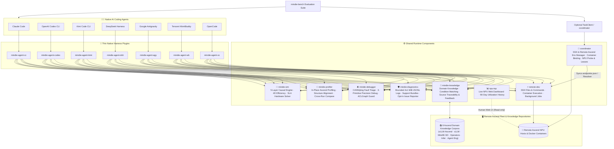
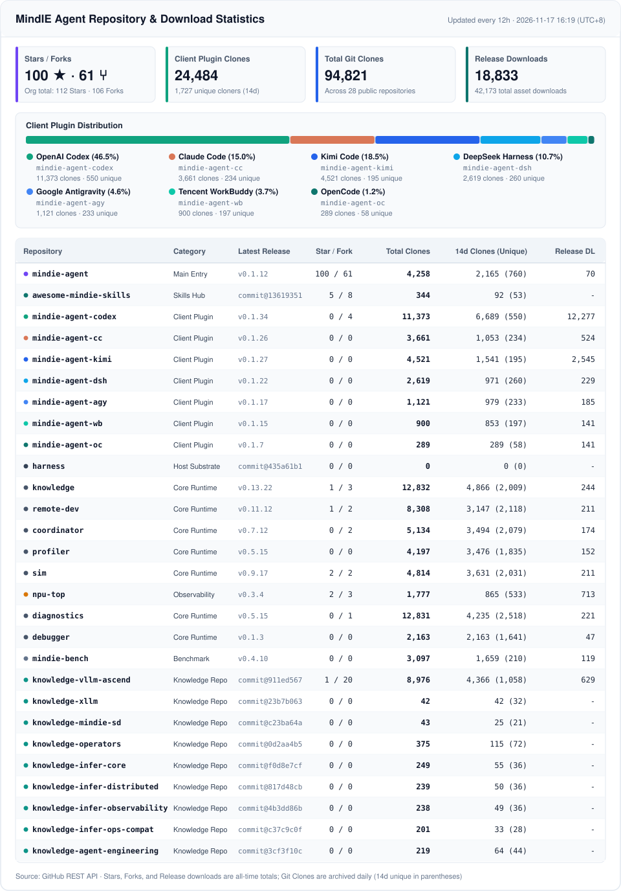

<p align="center">
  
</p>

<h1 align="center">MindIE Agent</h1>

<p align="center">
  <strong>Turn Ascend engineering pitfalls into your Agent's default experience: silent zero-command startup, install without <code>gh</code>, and one-sentence remote NPU access</strong>
</p>

<!-- mindie-org-versions:main-badges-en:start -->
<p align="center">
  <a href="https://github.com/mindie-agent/mindie-agent/blob/main/docs/releases/0.1.17.en.md"></a>
  <a href="https://github.com/mindie-agent/mindie-agent-cc"></a>
  <a href="https://github.com/mindie-agent/mindie-agent-codex"></a>
  <a href="https://github.com/mindie-agent/mindie-agent-kimi"></a>
  <a href="https://github.com/mindie-agent/mindie-agent-dsh"></a>
  <a href="https://github.com/mindie-agent/mindie-agent-agy"></a>
  <a href="https://github.com/mindie-agent/mindie-agent-wb"></a>
  <a href="https://github.com/mindie-agent/mindie-agent-oc"></a>
  <a href="https://github.com/mindie-agent/awesome-mindie-skills"></a>
</p>
<!-- mindie-org-versions:main-badges-en:end -->

<p align="center">
  <a href="./README.md">中文</a> · <strong>English</strong> · <a href="#-zero-friction-one-sentence-install-agent-only-">⚡ 1-Sentence Install</a> · <a href="#-before-vs-after-real-ascend-engineering-pain-points">🩹 Before vs After</a> · <a href="#-why-mindie-agent">✨ Why MindIE Agent</a> · <a href="#️-architecture--experience-flywheel">🏗️ Architecture</a> · <a href="#-workflows-non-blocking-task-continuity--examples">🔥 Workflows</a> · <a href="#-repository-ecosystem">📦 Ecosystem</a> · <a href="#-contributing-let-your-agent-do-it-too">🤝 Contributing</a> · <a href="#-010-milestone--benchmark-record">🚀 v0.1.0 Benchmarks</a> · <a href="./docs/README.en.md">📚 Docs</a>
</p>

---

## 🩹 Before vs After: Real Ascend Engineering Pain Points

No architecture diagrams or internal schemas yet—here is what MindIE Agent actually changes for an Ascend developer, understandable in 15 seconds:

| Before (real pain) | After (how MindIE Agent fixes it) |
| --- | --- |
| **CUDA API hallucination and the same pitfalls rediscovered forever**: the Agent forces CUDA/GPU habits onto Ascend and invents `torch_npu` / `AscendC` / `HCCL` APIs from memory; alignment, graph-capture, and collective-deadlock traps you already hit are re-learned from scratch in the next session | **Chip- and framework-conditioned `L1–L4` Ascend knowledge with pitfall records**: 9 domain corpora covering `vLLM-Ascend` / `xLLM` / `MindIE-SD` / `AscendC` / `Triton`, matched by silicon model, framework version, and input conditions; `L1` hard constraints are inherited and rejected attempts are reused, loaded on demand so your context never overflows |
| **Constant terminal hopping to hand-run SSH / `scp` / `docker exec` for every test**: every new machine means hunting IPs, passwords, container names, and Python paths, and the Agent stops at "connect first and tell me the output" | **One-sentence `remote_auth` that silently installs the public key, saves your default dev host, and discovers NPUs/containers**: all 7 hosts expose 1:1 isomorphic native remote tools (cutting 55%–60% of mixed aliases), then reconnect with zero IP/password arguments for files, patches, long jobs, and artifacts |
| **Thousands of lines of CANN `plog` guessed by hand and performance tuned by feel**: errors surface only as `EZ9999` / `507015`, and tuning means trying parameters repeatedly without knowing whether the bottleneck is a slow card, a slow link, or operator memory access | **Zero-device-context `npu_fault_triage` and 3-primitive precision localization from `debugger` + in-place `msprof` analysis from `profiler` + 5-layer causal 4D efficiency breakdown and SLA hardware sizing from `sim`**: root cause first (including slow-card vs. slow-link separation and the first divergent layer), then a verifiable optimization direction and hardware ratio |
| **Restricted intranet or no appetite for `gh` / install blocked by GitHub gates**: installing a tool forces a GitHub sign-in, a token, and proxy setup, and a single failed step blocks everything | **`local-only` (private local distillation) and `read-only` (pure read-only retrieval) need no `gh` at all and upload nothing**: the public corpus syncs over clean anonymous HTTPS; only `contribute` community co-building reuses `gh` (PRs and allowlisted fault reports), and you can switch tiers anytime |

> Internal protocols and schemas are implementation details—they live in [Architecture](#️-architecture--experience-flywheel) and [Repository Ecosystem](#-repository-ecosystem) below, away from first-screen attention.

---

## ⚡ Zero-Friction One-Sentence Install (Agent-Only ☕)

Put down the terminal—don't memorize CLI flags or copy-paste setup scripts by hand. Since MindIE Agent is built for AI coding Agents, **we only accept installation by your Agent**.

Open **Claude Code**, **OpenAI Codex CLI**, **Kimi Code**, **DeepSeek Harness**, **Google Antigravity**, **Tencent WorkBuddy**, or **OpenCode**, and toss this single sentence into your chat:

```text
Please install MindIE Agent for me: https://github.com/mindie-agent/mindie-agent
```

Your Agent reads this page and completes host detection, plugin registration, shared runtime provisioning, and the 3-question onboarding—no flag memorization required. If you prefer to drive the terminal yourself, or want to hand your Agent a deterministic entry point, both humans and AI Agents share **one** bootstrap command:

```bash
uv run https://github.com/mindie-agent/mindie-agent/releases/latest/download/install.py --host auto
```

> **Intranet / offline environments**: point at a local mirror and skip online verification—still with zero `git clone`:
> ```bash
> uv run ./install.py --host auto --channel-base-url /path/to/mirror --offline
> ```

<details>
<summary>🤖 <b>Agent Auto-Install Playbook (Click to expand / Automatically parsed by AI Agents)</b></summary>

> **Instructions for AI Agents**: When the user asks you to install `mindie-agent`, never make them read docs or hand-copy flags. Execute the following four steps and report the real outcome in one line after each step.

> #### Step 1: Check `uv` (`git` for corpus sync) & Optional `gh` Readiness (Decoupled, Never Blocking!)
>
> `uv` is the only hard prerequisite; `git` is needed only for syncing public knowledge corpora. `gh` is recommended only for `contribute` community co-building (automated PRs and allowlisted fault reporting) and is **never an installation hard gate**:
> ```bash
> uv --version && git --version
> gh --version && gh auth status --hostname github.com
> ```
> - **`gh` missing, unauthenticated, or intentionally skipped on a restricted network**: installation proceeds normally, Step 2 reports `gh_authenticated: false`, and `local-only` is recommended. All local capabilities and read-only retrieval remain fully available (only outbound PRs/Issues are absent).
> - **Sign-in, enterprise VPN, or Personal Access Token (PAT) required**: follow the [GitHub sign-in flow](docs/enterprise-network.en.md#github-sign-in-flow). Let `gh` own the credentials, and never run `git config --global` or `git config --system` to mutate global Git configuration.

> #### Step 2: Run the Deterministic Bootstrap & Register the Host Plugin
>
> One shared command performs host probing, release-channel verification, and shared runtime provisioning:
> ```bash
> uv run https://github.com/mindie-agent/mindie-agent/releases/latest/download/install.py --host auto --json
> ```
> It will:
> - probe active/installed hosts (`codex | cc | kimi | dsh | agy | wb | oc`; or pass `--host <host>` to target only the active session host);
> - verify `release-channel.json` and the `< 3 MB` prebuilt `mindie-wheels-bundle.tar.gz` against `SHA256SUMS` (**zero `git clone`**);
> - provision the shared `mindie-harness` runtime in the shared data directory (later updates only cut over generations, never reinstall);
> - probe `gh` inside a disposable `GH_CONFIG_DIR` copy, never mutating or polluting the user's global `~/.config/gh`;
> - emit machine-readable `detected_hosts`, `configured_hosts`, `gh_authenticated`, `gh_account`, `recommended_tier`, and `next_questions` for the next step.
>
> Intranet/offline mirror: `uv run ./install.py --host auto --channel-base-url /path/to/mirror --offline`.
>
> Register the single active host from `detected_hosts` (never multiple, and never pre-fork any repository):
>
> | Host (session markers first) | Native plugin registration entry & success criterion | Pinned version |
> | --- | --- | --- |
> | **Claude Code** (`CLAUDECODE`) | [mindie-agent-cc Quick Start](https://github.com/mindie-agent/mindie-agent-cc/blob/v0.1.31/README.en.md#quick-start); `mindie-agent@mindie-agent-cc` enabled in `claude plugin list --json` | `mindie-agent-cc v0.1.31` |
> | **OpenAI Codex CLI** (`CODEX_THREAD_ID` / `CODEX_CI`) | [mindie-agent-codex Quick Start](https://github.com/mindie-agent/mindie-agent-codex/blob/v0.1.39/README.en.md#quick-start); `mindie-agent@mindie-agent` enabled in `codex plugin list --json` | `mindie-agent-codex v0.1.39` |
> | **Kimi Code CLI** (`KIMI_CODE_HOME`) | [mindie-agent-kimi Quick Start](https://github.com/mindie-agent/mindie-agent-kimi/blob/v0.1.32/README.en.md#quick-start) | `mindie-agent-kimi v0.1.32` |
> | **DeepSeek Harness / DSH** (`DSH_PROFILE` / `DSH_HOME`) | [mindie-agent-dsh Quick Start](https://github.com/mindie-agent/mindie-agent-dsh/blob/v0.1.27/README.en.md#quick-start) | `mindie-agent-dsh v0.1.27` |
> | **Google Antigravity** (`~/.gemini/antigravity*` / `AGY_APP_DATA_DIR`) | [mindie-agent-agy Quick Start](https://github.com/mindie-agent/mindie-agent-agy/blob/v0.1.21/README.en.md#quick-start-one-sentence-agent-install); Clone the pinned `v0.1.21` tag and run the install page's `setup.py init` | `mindie-agent-agy v0.1.21` |
> | **Tencent WorkBuddy / CodeBuddy** (app bundle + `~/.workbuddy`) | [mindie-agent-wb Installation](https://github.com/mindie-agent/mindie-agent-wb/blob/v0.1.19/README.en.md#installation); `setup.py init --install-wb` + `codebuddy plugin validate` | `mindie-agent-wb v0.1.19` |
> | **OpenCode** (`OPENCODE_SESSION_ID`) | [mindie-agent-oc Installation & Upgrades](https://github.com/mindie-agent/mindie-agent-oc/blob/v0.1.11/README.en.md#2-installation--upgrades); dual-channel `opencode plugin add` or npm package `@mindie-agent/oc@0.1.11` | `mindie-agent-oc v0.1.11` |
> | **Cursor / generic MCP client** (remote substrate only) | Register the stdio server per the [remote-dev README](https://github.com/mindie-agent/remote-dev/blob/v0.11.14/README.md) | `remote-dev@v0.11.14` |
>
> The current plugin versions are Codex `v0.1.39`, Claude Code `v0.1.31`, Kimi Code `v0.1.32`, DSH `v0.1.27`, Google Antigravity `v0.1.21`, Tencent WorkBuddy `v0.1.19`, and OpenCode `v0.1.11`, matching [`channels/0.1.json`](./channels/0.1.json) and the formal Release tags on each host's install page. `install.py` provisions shared runtime components in one pass—no per-repo clone required.

> #### Step 3: Pop Up the 3 Native Interactive Questions (`ask_question` / `question` / `AskUserQuestion` / `request_user_input`)
>
> Right after plugin registration, **immediately invoke the current host's native question tool** (never just print plain text asking the user to type commands):
> - **Google Antigravity** → native `ask_question`; **OpenCode** → native `question`; **Claude Code / Tencent WorkBuddy / Kimi Code** → native `AskUserQuestion`; **OpenAI Codex CLI / App** → native `request_user_input`; **DeepSeek Harness (DSH)** → the native question tool available in-session, otherwise a numbered choice card (`[1]` / `[2]`).
>
> **Q1. Local Development Workspace**
> - `(Recommended) Initialize vllm-ascend-workspace in current directory`
> - `Keep current directory as workspace`
> - `Use an existing workspace directory`
>
> **Q2. Experience & Privacy Mode (dynamic `gh`-aware ordering)**
>
> When `gh_authenticated: true` (`recommended_tier == "contribute"`):
> - `(Recommended) contribute — local distillation + community co-building PRs and allowlisted fault reporting`
> - `local-only — local private experience only (zero outbound upload)`
> - `read-only — read-only retrieval only`
>
> When `gh_authenticated: false` (`recommended_tier == "local-only"`):
> - `(Recommended) local-only — local private experience (no gh, zero outbound upload)`
> - `read-only — read-only retrieval (no gh)`
> - Note: `contribute` can be enabled anytime later once `gh` is authenticated—no reinstall needed.
>
> All three choices persist through `setup.py sharing --enable|--local-only|--disable` (updating `mindie-consent.json`, `mindie-community.json`, and `diagnostics.json` together).
>
> **Q3. Connect the First Ascend NPU Dev Host (optional, one-step SSH setup)**
> - `(Recommended) Connect now`: ask only for the IP and username. In lab setups that provide a password, the Agent calls `remote_auth(action="setup", host=..., user=..., password=..., save_default=True, discover=True)` to install the public key silently, save the default host, and discover NPUs/containers in one shot.
>   - **High-security zero-trace password entry**: the user provides only IP and username; the Agent fills 100% of known flags (exact Python path, real IP, port `22`, user, `--save-default`, `--discover`, a leading space to skip shell history, and zero `<IP>` / `<USER>` placeholders), placing the standalone `--password` at the very end so the user only needs **Copy → Space → Paste → Enter** (or lets `--password` trigger the interactive hidden prompt):
>     ```bash
>      /abs/path/to/python -m remote_dev auth setup --host 192.0.2.21 --port 22 --user root --save-default --discover --password
>     ```
>   - `192.0.2.21` is a documentation placeholder only; **never put a real password into CLI examples, logs, or chat text**.
> - `Skip for now (connect anytime later when needed)`.

> #### Step 4: Run the `mindie_doctor` Readiness Card & a Polite 1-Line Star Postscript
> - Invoke `mindie_doctor` once to display the clean readiness summary: runtime generation, privacy tier (`contribute` / `local-only` / `read-only`), default remote NPU connectivity, and `gh` channel status—under `local-only` / `read-only`, `optional_unconfigured` is completely healthy and must not be reported as a fault.
> - End the summary with only a **single** polite, non-intrusive postscript about starring (never one of the 3 popup questions, and never starring without explicit approval):
>   - *"If MindIE Agent helps your workflow and `gh` is signed in, just say the word anytime if you'd like to star `mindie-agent/mindie-agent` ⭐."*
> - After reporting, the user can start immediately: no slash-command activation, just natural language.

</details>

---

## ✨ Why MindIE Agent?

MindIE Agent brings domain knowledge and remote development tools into your existing Claude Code, Codex, Kimi Code, DSH, Google Antigravity, Tencent WorkBuddy, or OpenCode session across `vLLM-Ascend` / `vLLM-Omni`, `xLLM` (`xllm` / `xllm-ops` / `xllm-service` / `xllm-workflow`), `MindIE-SD`, Ascend operators, and distributed inference—covering new model bring-up (0-day adaptation), model and operator performance tuning, and fault diagnosis. See the [architecture](./docs/architecture.en.md) and release records below for implementation and acceptance details.

| Capability | What it helps you do |
| --- | --- |
| **Condition-matched domain knowledge** | Retrieve hardware constraints, diagnostic SOPs, troubleshooting workflows, and operator optimizations on demand—supporting batch `refs` explanation with shared `known_refs` and `token_budget`, plus `rejected_history` and `affected_components` provenance |
| **Remote NPU development and validation** | Use [`remote-dev`](https://github.com/mindie-agent/remote-dev) to edit files, apply patches, run commands, manage long-running background jobs, and inspect logs across SSH hosts and Docker containers with destructive-command safety guards and shared `~/.mindie/ssh/id_ed25519` credential fallback |
| **Profiling analysis & performance modeling** | Use [`profiler`](https://github.com/mindie-agent/profiler) for in-place Ascend `msprof` analysis, `analyze_profiling --structure` 3-state topology alignment (`aligned / declared_only / unattributed_observed`), and `auto_segment_decode_forwards`; use [`sim`](https://github.com/mindie-agent/sim) to model hardware resources, operator families, subgraphs, pure-model costs, and serving constraints (`DP × TP × EP × PP × DCP / DSA-CP / PCP` & PD disaggregation) with network-tier utilization, DeepEP, AFD, multi-tier KV/expert offload, 4D efficiency breakdown (`Cube_MFU / Vec_MFU / MBU / Link_Util / CV_Overlap`), and 30ms SLA hardware scaling |
| **Resource coordination, NPU debugging & diagnostics** | Use [`coordinator`](https://github.com/mindie-agent/coordinator) for per-Die HBM leases, compile slot budgets, and port arbitration, [`npu-top`](https://github.com/mindie-agent/npu-top) for live A2/A3/A5 cluster monitoring with `~/.mindie/ssh` fallback, [`debugger`](https://github.com/mindie-agent/debugger) for target CANN/`plog` fault triage, 3-primitive precision/memory-stomp localization, and `ACLGraph` debugging, and [`diagnostics`](https://github.com/mindie-agent/diagnostics) for local fault logging and bounded 2-attempt outbound issue reconciliation |
| **Experience distillation & reuse** | Redact and save troubleshooting records within your authorized project scope, distill verified fixes into reusable knowledge entries, and optionally contribute them back to the community |

Plugins preserve your host agent's native session and tool loop, loading domain knowledge on demand. See the [knowledge system](./docs/knowledge-system.en.md) for details.

---

## 🏗️ Architecture & Experience Flywheel

### 1. Modular Layered Architecture

MindIE Agent combines **thin native client plugins** with **decoupled shared runtime components**:



### 2. Continuous Engineering & Knowledge Loop

```mermaid
sequenceDiagram
  autonumber
  actor Dev as Developer
  participant Agent as Coding Agent (Claude / Codex / Kimi / DSH / Antigravity / WorkBuddy / OpenCode)
  participant Know as mindie-knowledge (Local Service)
  participant NPU as remote-dev (Remote Ascend Container)
  participant Repo as Public Knowledge Repo (knowledge-vllm-ascend, etc.)

  Dev->>Agent: Describe engineering goal in natural language (Bring-up / Kernel Dev / Testing / Tuning)
  Agent->>Know: 1. Query by hardware & workload conditions, load matched rules & references
  Agent->>NPU: 2. Edit code, sync patches, and run tests in the target container
  NPU-->>Agent: Return build, accuracy, and performance results with log paths
  Agent-->>Dev: 3. Deliver verified changes and test summary; optionally record feedback
  Note over Agent,Know: Runs silently only when community sharing is enabled and cwd matches authorized project scope
  Agent->>Know: 4. Redact and archive session troubleshooting records
  Agent->>Know: 5. Distill verified fixes into reusable knowledge entries
  Note over Know,Repo: Triggered only when community sharing is enabled
  Know->>Repo: 6. Submit reviewed entries via PR for downstream sync
```

---

## 🔥 Workflows: Non-Blocking Task Continuity & Examples

MindIE Agent is built around **zero-ceremony usability and progressive disclosure**—once installed and enabled, **there are NO slash commands to memorize or type**. Simply talk to your coding Agent in natural language; both main agents and subagents invoke tools and load graded domain context silently on demand.

- **🛟 Non-blocking task continuity is a hard rule**: every MindIE tool (`remote-dev`, `coordinator`, `knowledge`, `profiler`, `sim`, `debugger`, `mindie_doctor`) is an **accelerator, never a roadblock**. If any helper errors out or hits an environment mismatch, the Agent logs the original error honestly in one line (reconciling read-only first when an external write is uncertain) and immediately continues the user's task via native `ssh`/`scp` or task-local scripts—**without stopping to ask the user to debug the plugin**.
- **🩺 Unified health check**: `mindie_doctor` is the single read-only health check across all 7 hosts, reporting runtime generation, privacy tier, default remote NPU, and `gh` channel status in one card; it creates zero directories/SQLite databases on empty installs and is always safe to call.

| Capability Module | Trigger Mode | How It Works |
| --- | --- | --- |
| **🧠 Ascend Domain Knowledge & Skills**<br/>(`mindie-knowledge` + Domain Skills) | **Silent Default-On**<br/>(Semantic on-demand routing) | When adapting a model in `vLLM-Ascend`, writing `AscendC` / `Triton` kernels, adding accuracy tests, or tuning performance, just state your task naturally—main agents and subagents automatically query `L1–L4` units, read cited prerequisites, record feedback, and distill verified fixes, while unrelated non-Ascend coding stays completely untouched. |
| **⚡ Remote Ascend Execution & Deterministic Tools**<br/>(`remote-dev` / `coordinator` / `profiler` / `sim` / `debugger` / `diagnostics`) | **Silent Default-On**<br/>(Zero pre-call session binding) | Whenever you mention a remote server, container, NPU probe/lease, profiling trace, roofline simulation, CANN/`ACLGraph` fault debugging, or factual status check, your Agent (including subagents and scheduled automations) calls the corresponding MCP tools directly. |
| **🔄 Experience Distillation & Community Sharing**<br/>(Redaction, distillation, and review) | **Configure consent once; silent within authorized project scope** | The privacy tier (`mindie-consent.json`) is configured once and persists across sessions. Only when the tier is `contribute` or `local-only` AND your working directory is inside your authorized `project_roots` does `Stop` redact and capture dialogue in the background (`read-only` and outside authorized scopes exit in `< 100ms` with zero action); everything captured under `local-only` stays strictly local. |
| **🩺 Unified Health Check with Recovery Hints**<br/>(`mindie_doctor` / `mindie-doctor/1`) | **Silent Default-On**<br/>(strictly read-only, zero side effects) | Ask "is the environment healthy right now?" and the Agent calls `mindie_doctor` to summarize runtime generation, privacy tier, default remote NPU connectivity, and `gh` channel status—clearly separating `optional_unconfigured` from real probe errors and suggesting the next actionable step. |

### Copy-Paste Usage Examples

#### 💡 Example 1: Feature Design, Fused Kernel Development & Test Authoring
```text
I want to design and implement a custom fused operator in vllm-ascend (with Triton / AscendC kernel support) and add unit + accuracy tests. Check existing conventions and Ascend operator guidelines to propose the design and test plan.
```
> **What happens**: The Agent automatically matches the Ascend context, queries `L1–L4` units against your hardware and framework conditions, and loads the relevant constraints, reference patterns, and verification checklists.

#### 💡 Example 2: Remote Ascend Container Coding, Lease Allocation & Live NPU Testing
```text
Connect to the vllm-dev container on host 192.0.2.21 (port 22), sync my new operator implementation and unit tests into /workspace/vllm-ascend, acquire an idle NPU lease, and run the full pytest accuracy and benchmark suite.
```
> **What happens**: Your Agent acquires a conflict-free NPU lease via `coordinator` and uses `remote_read`, `remote_edit`, and `remote_bash` inside the remote `vllm-dev` container over pooled SSH, turning long build and test runs into managed background jobs with live log streaming.

#### 💡 Example 3: Joint Knowledge + Profiling + Remote Optimization with Silent Distillation
```text
Help me profile decode latency bottlenecks on our remote NPU dev machine, compare key msprof metrics against the Roofline model to pinpoint the root cause, and verify an optimization patch.
```
> **What happens**: The Agent combines domain knowledge with remote execution to pinpoint the bottleneck, then verifies numerical accuracy and latency speedup on the NPU. Verified conclusions can be distilled into reusable knowledge entries for future sessions.

---

## 📦 Repository Ecosystem

Every repository under `@mindie-agent` has a clean, single-purpose boundary and can be used together or standalone:

<!-- mindie-org-versions:main-ecosystem-en:start -->
### 1. Product Entry, Benchmarks & Community Catalogue

| Repository | Version | Role |
| --- | --- | --- |
| **[`mindie-agent`](https://github.com/mindie-agent/mindie-agent)** *(This Repo)* | [`v0.1.17`](https://github.com/mindie-agent/mindie-agent/releases/tag/v0.1.17) | Product entry point, system architecture, engineering design principles, release compatibility contracts, and release records |
| **[`mindie-bench`](https://github.com/mindie-agent/mindie-bench)** | [`v0.4.14`](https://github.com/mindie-agent/mindie-bench/releases/tag/v0.4.14) | End-to-end evaluation harness and live NPU benchmark suite: 20 behavioral-oracle tasks (109 3-state & helper controls), Gate Runner, isolated host runs, component benchmarks, and cross-task reuse evaluation |
| **[`awesome-mindie-skills`](https://github.com/mindie-agent/awesome-mindie-skills)** | [`main`](https://github.com/mindie-agent/awesome-mindie-skills) | Curated catalogue of open-source Agent Skills for the Ascend NPU AI Infra workflow (covering `vLLM-Ascend`, `AscendC`/`Triton` kernels, accuracy testing, and profiling) |
| **[`vllm-ascend-workspace`](https://github.com/mindie-agent/vllm-ascend-workspace)** | [`main`](https://github.com/mindie-agent/vllm-ascend-workspace) | Lightweight customizable local workspace for `vLLM` + `vLLM-Ascend` development with isolated task Git Worktrees and MindIE Agent integration |

### 2. Native Harness Plugins

| Repository | Host Client | Version | Role |
| --- | --- | --- | --- |
| **[`mindie-agent-cc`](https://github.com/mindie-agent/mindie-agent-cc)** | **Claude Code** | [`v0.1.31`](https://github.com/mindie-agent/mindie-agent-cc/releases/tag/v0.1.31) | Native Claude Code plugin: lifecycle hooks, MCP stdio bridges, and pinned runtime management |
| **[`mindie-agent-codex`](https://github.com/mindie-agent/mindie-agent-codex)** | **OpenAI Codex CLI** | [`v0.1.39`](https://github.com/mindie-agent/mindie-agent-codex/releases/tag/v0.1.39) | Native OpenAI Codex CLI plugin: marketplace packaging, session redaction, and background service management |
| **[`mindie-agent-kimi`](https://github.com/mindie-agent/mindie-agent-kimi)** | **Kimi Code CLI** | [`v0.1.32`](https://github.com/mindie-agent/mindie-agent-kimi/releases/tag/v0.1.32) | Native Kimi Code plugin: atomic version switching, redacted session capture, and MCP bridging |
| **[`mindie-agent-dsh`](https://github.com/mindie-agent/mindie-agent-dsh)** | **DeepSeek Harness (DSH)** | [`v0.1.27`](https://github.com/mindie-agent/mindie-agent-dsh/releases/tag/v0.1.27) | Native DSH plugin: silent semantic Ascend Skill, default-enabled knowledge & component tools, and `remote-dev` integration |
| **[`mindie-agent-agy`](https://github.com/mindie-agent/mindie-agent-agy)** | **Google Antigravity** | [`v0.1.21`](https://github.com/mindie-agent/mindie-agent-agy/releases/tag/v0.1.21) | Native Google Antigravity plugin: silent default-enabled knowledge & shared component MCP, native remote tool aliases, and opt-in Brain transcript redaction |
| **[`mindie-agent-wb`](https://github.com/mindie-agent/mindie-agent-wb)** | **Tencent WorkBuddy** | [`v0.1.19`](https://github.com/mindie-agent/mindie-agent-wb/releases/tag/v0.1.19) | Native Tencent WorkBuddy / CodeBuddy plugin: dual-surface mounting (WorkBuddy Connector + CodeBuddy native plugin), silent default-on tools & knowledge, and shared component MCP bridge |
| **[`mindie-agent-oc`](https://github.com/mindie-agent/mindie-agent-oc)** | **OpenCode** | [`v0.1.11`](https://github.com/mindie-agent/mindie-agent-oc/releases/tag/v0.1.11) | Native OpenCode plugin: dual-channel distribution (`github:mindie-agent/mindie-agent-oc` + `@mindie-agent/oc`), silent default-on tools & knowledge, and SQLite `session_v2` transcript redaction |

### 3. Shared Harness Substrate & Runtime Components

| Repository | Package / CLI | Version | Role |
| --- | --- | --- | --- |
| **[`harness`](https://github.com/mindie-agent/harness)** | `mindie-harness` / `mindie_harness` | [`v0.1.4`](https://github.com/mindie-agent/harness/releases/tag/v0.1.4) | Shared substrate across all 7 native host plugins: windowless process & nested Win32 Job supervision, deterministic cold-start Seed, two-generation (`Active + Rollback`) `.inuse`-leased atomic updates, concurrent zero-binding MCP gateway, and single-state `ExperimentLedger` RSI optimization loop |
| **[`knowledge`](https://github.com/mindie-agent/knowledge)** | `mindie-knowledge` | [`v0.13.24`](https://github.com/mindie-agent/knowledge/releases/tag/v0.13.24) | Graded knowledge unit (L1–L4) management, information-gap retrieval, batch `refs` explanation with shared `known_refs` & `token_budget`, `rejected_history` & `affected_components` provenance, two-layer redaction, and community PR publishing |
| **[`remote-dev`](https://github.com/mindie-agent/remote-dev)** | `remote-dev` | [`v0.11.14`](https://github.com/mindie-agent/remote-dev/releases/tag/v0.11.14) | SSH file and command tools, shared user-private `~/.mindie/ssh/id_ed25519` credential fallback & public-key management, destructive command safety guard, container execution, cross-connection handle-addressed background jobs, and artifact transfer |
| **[`coordinator`](https://github.com/mindie-agent/coordinator)** | `mindie-coordinator` | [`v0.7.13`](https://github.com/mindie-agent/coordinator/releases/tag/v0.7.13) | SSH & remote Ascend environment manager: host/key inventory, container binding & provisioning, NPU topology probing (`mindie_probe`, A2/A3 dual-Die/A5), `HostQueue` per-Die HBM lease & compile slot budgets (`mindie_lease`), and managed task execution |
| **[`profiler`](https://github.com/mindie-agent/profiler)** | `mindie-profiler` / `mindie_profiler` | [`v0.5.16`](https://github.com/mindie-agent/profiler/releases/tag/v0.5.16) | Ascend profiling collection and in-place analysis component: controlled capture, `inventory / analyze / correlate / compare / sql / camodel / kernels` trace analysis, `analyze_profiling --structure` 3-state topology alignment on `mindie-model-structure/1`, and Decode/Prefill segmentation |
| **[`sim`](https://github.com/mindie-agent/sim)** | `mindie-sim` / `mindie_sim` | [`v0.9.18`](https://github.com/mindie-agent/sim/releases/tag/v0.9.18) | Hardware-neutral 5-layer causal performance modeling component: unifies hardware resources, operator families, subgraphs, pure-model costs, and serving constraints (`DP × TP × EP × PP × DCP / DSA-CP / PCP` & PD disaggregation) with `compose` synthesis, 4D efficiency breakdown, SLA/PD Pareto solvers, and A2/A3/A5 calibration |
| **[`npu-top`](https://github.com/mindie-agent/npu-top)** | `npu-top` | [`v0.3.5`](https://github.com/mindie-agent/npu-top/releases/tag/v0.3.5) | Human-facing Ascend NPU observability dashboard: supports A2 / A3 / A5 fleet monitoring with shared `coordinator` `machines.json` and `~/.mindie/ssh` credential fallback, providing a loopback web UI (`127.0.0.1:8788`), TUI, CLI/MCP, and streaming 90-day SQLite utilization history |
| **[`diagnostics`](https://github.com/mindie-agent/diagnostics)** | `mindie-diagnostics` / `mindie_diagnostics` | [`v0.5.17`](https://github.com/mindie-agent/diagnostics/releases/tag/v0.5.17) | Local fault logging and diagnostics component: CANN/`plog` deterministic error analysis, bounded 4×1 MiB JSONL rotation, redacted support bundles, and Scale-to-Zero on-demand opt-in GitHub Issue reporting (with `7d` unsent `pending` expiry) |
| **[`debugger`](https://github.com/mindie-agent/debugger)** | `mindie-debugger` / `mindie_debugger` | [`v0.1.4`](https://github.com/mindie-agent/debugger/releases/tag/v0.1.4) | Target Ascend NPU fault triage and precision debugging component: zero-incidental-device-context read-only CANN/`plog` fault triage (`npu_fault_triage`), 3-primitive precision/memory-stomp localization (`precision`), and `ACLGraph` zero-sync in-graph replay dumping & capture guard (`aclgraph`) |

### 4. Public Domain Knowledge Corpora

All public knowledge corpora follow the `mindie-graded-unit/1` graded schema (`L1` Canonical Facts & Constraints · `L2` Standard Operating Procedures · `L3` Multi-Stage Workflows · `L4` Optimization Patterns) with explicit applicability conditions and verification evidence:

| Repository | Domain (`domain`) | Units & Pinned Commit | Scope & Coverage |
| --- | --- | --- | --- |
| **[`knowledge-vllm-ascend`](https://github.com/mindie-agent/knowledge-vllm-ascend)** | `vllm-ascend` | 101 units · [`9a614ccd`](https://github.com/mindie-agent/knowledge-vllm-ascend/tree/9a614ccda3a82ab863be72edec92ada219af5112) | `vLLM-Ascend` & `vLLM-Omni` engineering corpus: 0-day model bring-up, PD disaggregation, MoE EP/MC2, quantization, speculative decoding, ACLGraph/TorchAir, and `vllm-omni` multi-stage omni-modality pipeline tuning |
| **[`knowledge-xllm`](https://github.com/mindie-agent/knowledge-xllm)** | `xllm` | 24 units · [`23b7b063`](https://github.com/mindie-agent/knowledge-xllm/tree/23b7b0636cfb050ee88e339ecd69aea6f95cae30) | `xLLM` full-stack (`xllm` / `xllm-ops` / `xllm-service` / `xllm-workflow`) Ascend corpus: C++ native `ModelRegistry`, `xTensor` VMM 2 MB physical page pools, piecewise ACLGraph, 48 AscendC custom ops & A5 (`dav-c310`) TileLang AOT kernels, PD disaggregation, and `OneRec` recommendation pipelines |
| **[`knowledge-mindie-sd`](https://github.com/mindie-agent/knowledge-mindie-sd)** | `mindie-sd` | 24 units · [`c23ba64a`](https://github.com/mindie-agent/knowledge-mindie-sd/tree/c23ba64ab6c210da5ff34d1f5cdb27eb8e81154e) | `Ascend/MindIE-SD` (`mindiesd`) diffusion acceleration framework corpus: block-sparse attention (`RainFusion` / `Ada-BSA` / `EagleQBSA`), cross-step caching (`DiTCache` / `Cache-DiT` / `TaylorSeer`), timestep-aware quantization + `Laurel`, Ulysses/Ring/CFG hybrid parallelism, and S0–S6 auto-optimization gates |
| **[`knowledge-operators`](https://github.com/mindie-agent/knowledge-operators)** | `operators` | 105 units · [`57c823f6`](https://github.com/mindie-agent/knowledge-operators/tree/57c823f665e3e256edad90375ba8a2c2f9470b38) | Ascend operators corpus: 910B / 910C (A3) / 950 (A5) hardware constraints, `AscendC`, `Triton-Ascend`, TileLang, PyPTO, Catlass, FlashAttention/MLA, and Matmul/MoE fusion |
| **[`knowledge-infer-core`](https://github.com/mindie-agent/knowledge-infer-core)** | `infer-core` | 105 units · [`f0d8e7cf`](https://github.com/mindie-agent/knowledge-infer-core/tree/f0d8e7cf3edf41399395f41fd5a42e7b37847264) | Ascend inference serving & engine core corpus: `cann-recipes-infer` 26 model optimization recipes, 16 `model-infer-*` skills, common acceleration modules, and `Ascend/msagent` quantization/accuracy diagnosis workflows |
| **[`knowledge-infer-distributed`](https://github.com/mindie-agent/knowledge-infer-distributed)** | `infer-distributed` | 40 units · [`8dd96914`](https://github.com/mindie-agent/knowledge-infer-distributed/tree/8dd9691454e5eca094c60350080a06fb89ae34db) | Distributed inference & collective communication corpus: HCCL troubleshooting, RoCE/HCCS topology, SHMEM, Mooncake/Yuanrong transport, and multi-node `DP/TP/EP/PP/DCP/DSA-CP/PCP` plus DiT hybrid parallelism & power-cap mitigation |
| **[`knowledge-infer-observability`](https://github.com/mindie-agent/knowledge-infer-observability)** | `infer-observability` | 41 units · [`9288cbb1`](https://github.com/mindie-agent/knowledge-infer-observability/tree/9288cbb1266835ac515cbe6dd0f0cd040dada30b) | Inference observability, diagnostics & benchmarking corpus: CANN/`plog`/device fault triage, `msprof` profiling workflows, analytic simulation, Window A/B/A `perf-gate`, and 3-tier image/video `accuracy-gate` protocols |
| **[`knowledge-infer-ops-compat`](https://github.com/mindie-agent/knowledge-infer-ops-compat)** | `infer-ops-compat` | 34 units · [`c37c9c0f`](https://github.com/mindie-agent/knowledge-infer-ops-compat/tree/c37c9c0f559a27c63948aabc1f5b092de54b8c78) | Graph compilation, custom op registration & migration compatibility corpus: TorchAir/ACLGraph capture, `torch_npu._inductor` pattern pass development, two-stage integration, CUDA-to-Ascend migration, and cluster deployment |
| **[`knowledge-agent-engineering`](https://github.com/mindie-agent/knowledge-agent-engineering)** | `agent-engineering` | 32 units · [`3cf3f10c`](https://github.com/mindie-agent/knowledge-agent-engineering/tree/3cf3f10c2c35b801d06b7f410ce2d105e1f31ff1) | Agent engineering & governance corpus: multi-agent orchestration, SOTA exploration loops, `ais_bench` coreset compression, automated Git bisect, `kb-lint` governance, two-layer privacy redaction gates, and benchmark evaluation |
<!-- mindie-org-versions:main-ecosystem-en:end -->

---

## 🧭 Engineering Design Philosophy

MindIE Agent is guided by **18 pragmatic [Engineering Design Principles](./docs/design-principles.en.md)** ([中文](./docs/design-principles.md)) forged through real-world Ascend engineering:

- **Optimize for Total User Goal Cost**: Reliability mechanisms must reduce total comprehension, waiting, and debugging cost—never imposing ceremony on ordinary tasks for rare edge cases.
- **Zero Cognitive Load & On-Demand Intervention**: Tools absorb internal state complexity; Skills stay informational; Knowledge remains advisory with explicit evidence and applicability conditions.
- **Reuse Mature Mechanisms First**: Leverage native host, OS, and mature component capabilities first, and delete obsolete compatibility shims cleanly when upgrading.
- **Transparent State & Fail-Visible Semantics**: Explicitly distinguish completed work, failure, and uncertain external side effects (`unknown`)—never masking failures or blindly replaying uncertain writes.
- **Agent-Native Structure & Bounded Resource Discipline**: Keep core modules `< 800` lines with a four-part contract header in the top 30 lines, and keep resident memory/VRAM strictly bounded with spec-driven local vs. remote placement.

---

## 🤝 Contributing (Let Your Agent Do It Too)

Just like installation, contributing new features, bugfixes, or Ascend domain knowledge to MindIE Agent is **designed to be handed directly to your coding Agent** (every repository under `@mindie-agent` is 100% written, tested, and maintained by Agents).

To keep 13+ repositories clean, fast, and free of over-defensive bloat or host pollution, contributing Agents follow **two mandatory gates** (see **[`CONTRIBUTING.en.md`](./CONTRIBUTING.en.md)** · **[中文](./CONTRIBUTING.md)**):

1. **📖 Before Coding: Read the Design Principles First** — Before touching code, your Agent must read [`AGENTS.md`](./AGENTS.md) and [`docs/design-principles.en.md`](./docs/design-principles.en.md) to align on single-purpose boundaries, fail-visible semantics, timeout arithmetic, the four anti-over-defensive iron rules, `< 800`-line modules with top headers, and bounded memory/VRAM design rules.
2. **✅ After PR Submission: Complete the Pre-PR Checklist Self-Review (Including Format Hygiene)** — After submitting a PR, your Agent must audit its final `git diff` against [`.github/pull_request_template.md`](./.github/pull_request_template.md) (checking all items `1–8` through `15`, including repository formatting hygiene such as mandatory Unix `LF` `\n` line endings, and filling in concrete review evidence and executed test results) and pass the automated CI gates ([`check_lf_eol.py`](./.github/scripts/check_lf_eol.py) + [`check_pr_checklist.py`](./.github/scripts/check_pr_checklist.py)).

To contribute, simply copy and send this prompt to your Agent:

```text
I want to contribute a change to MindIE Agent: <describe your feature, bugfix, or Ascend knowledge addition in one sentence>.
Please follow https://github.com/mindie-agent/mindie-agent/blob/main/CONTRIBUTING.en.md:
1. Read AGENTS.md and docs/design-principles.en.md before writing any code;
2. Implement the change with tiered tests, open a PR, and complete the Pre-PR Checklist self-review and verification evidence in .github/pull_request_template.md.
```

---

## 🚀 0.1.0 Milestone & Benchmark Record

- **Recent `0.1` Track Highlights** (exact release pins in [`channels/0.1.json`](./channels/0.1.json)):
  - **`0.1.12` / `0.1.11` / `0.1.10` / `0.1.8` Maintenance & Loop Hardening Patches**: [**0.1.12**](./docs/releases/0.1.12.en.md) ([中文](./docs/releases/0.1.12.md)) hardens Windows Scheduled Task service launchers in `knowledge 0.13.14` and `diagnostics 0.5.8` by validating the PE GUI subsystem before spawn so console launchers cannot pop visible windows; [**0.1.11**](./docs/releases/0.1.11.en.md) ([中文](./docs/releases/0.1.11.md)) binds the active interpreter and content-addressed payload generation atomically across Google Antigravity and Tencent WorkBuddy in-place upgrades; [**0.1.10**](./docs/releases/0.1.10.en.md) ([中文](./docs/releases/0.1.10.md)) completes first-time `remote_auth(action="setup")` password-to-key onboarding and enforces cross-host task continuity; and [**0.1.8**](./docs/releases/0.1.8.en.md) ([中文](./docs/releases/0.1.8.md)) consolidates the RSI state machine onto a single authoritative `ExperimentLedger`, doubles default graded retrieval token budgets, and achieves `6/6` real-task `G4` closure across all six hosts.
  - **`0.1.7` Patch: Native Tencent WorkBuddy Plugin, Standalone `mindie-debugger` Component, Configurable `mindie-sim` Modeling, 9-Corpus Synchronization & 100% Real `vllm-ascend` 8-Component `G0–G5` Benchmark ([0.1.7 Release Notes](./docs/releases/0.1.7.en.md) · [中文](./docs/releases/0.1.7.md) · [V2 Benchmark Report](./docs/releases/0.1.7/g0-g5-vllm-ascend-v2-report.en.md) · [144-Trial Summary JSON](./docs/releases/0.1.7/g0-g5-vllm-ascend-v2-summary.json))**: Introduces the sixth official native host plugin [`mindie-agent-wb v0.1.19`](https://github.com/mindie-agent/mindie-agent-wb) (Tencent WorkBuddy / CodeBuddy Agent CLI, supporting dual-surface mounting as both a WorkBuddy Connector and a CodeBuddy native plugin) and launches the eighth standalone shared runtime component [`mindie-debugger v0.1.0`](https://github.com/mindie-agent/debugger) (providing target Ascend NPU `npu_fault_triage` CANN/`plog` root-cause triage, `precision` 3-primitive precision/memory-stomp localization, and `aclgraph` zero-sync in-graph replay dumping & capture guards, cleanly decoupled from [`diagnostics v0.5.5`](https://github.com/mindie-agent/diagnostics) which handles Agent local rotation logs and issue reporting); publishes [`mindie-sim v0.9.2`](https://github.com/mindie-agent/sim) (network-tier effective bandwidth utilization, DeepEP low-latency/high-throughput modes, AFD Attention–FFN disaggregation, multi-tier KV/expert offload, Ascend 950PR/950DT hardware profiles, and online serving arrival modeling), [`mindie-profiler v0.5.6`](https://github.com/mindie-agent/profiler) (`export-calibration` one-click simulation calibration bundle export), [`knowledge v0.13.10`](https://github.com/mindie-agent/knowledge), [`coordinator v0.7.3`](https://github.com/mindie-agent/coordinator), [`remote-dev v0.11.4`](https://github.com/mindie-agent/remote-dev), [`npu-top v0.3.1`](https://github.com/mindie-agent/npu-top), and [`mindie-bench v0.4.6`](https://github.com/mindie-agent/mindie-bench), updates all 6 native host plugins (`Codex v0.1.17`, `Claude Code v0.1.13`, `Kimi v0.1.13`, `DSH v0.1.12`, `Google Antigravity v0.1.3`, `Tencent WorkBuddy v0.1.2`) with forward-compatible SemVer intervals, expands public domain knowledge to 9 corpora (adding `knowledge-xllm` and `knowledge-mindie-sd`, totaling `493` graded units), and completes the **V2 100% real `vllm_ascend/...` 8-component & `G0–G5` benchmark across 34 tasks and 144 trials (100% Three-Gate audit compliance)**: `mindie-debugger` lifts DSH solve rate from **`80.0% -> 100.0%`** (`D4` ACLGraph `0.0 -> 1.0`) and cuts Codex L2 debugging time by **`-33.8%` (`1.51x`)** and output tokens by **`-39.5%`**; `mindie-sim` + `mindie-profiler` cuts MLA Decode optimization tokens by **`-17.5%`**; `coordinator` + `npu-top` speeds up dual-Die binding & ModelSlim header preflight TTFE by **`1.86x–2.46x`**; across 6 core `vllm-ascend` L2 tasks, overall solve rate doubles from **`25.0% -> 50.0%` (DSH `16.7% -> 50.0%`, `3.0x` lift)**; `G3` cross-task distillation on the new KDA Varlen Chunk pair achieves **`1.30x` speedup (`-23.2%`)** on DSH and **`-35.7%` turns / `-36.5%` tokens** on Codex; and `G4` RSI exploration on MLA Prolog fusion jumps from **`G0 = 0.0 -> G2 = 1.0 -> G4 = 1.0`** on DSH (**`G4` beats `G2` by `1.19x` time and `-20.4%` tokens**).
  - **`0.1.6` Patch: Automatic-Update Readiness Gates, 3-Chip Multi-Regime Calibration & 5-Host Compatibility ([0.1.6 Release Notes](./docs/releases/0.1.6.en.md) · [中文](./docs/releases/0.1.6.md))**: Delivers `mindie-knowledge v0.13.8` monotonic unit revision advancement and repair tolerance, `mindie-coordinator v0.7.1` native Antigravity session discovery, `mindie-sim v0.9.1` `async_scheduling` delayed HBM release and `compose` Case synthesizer, and `mindie-profiler v0.5.5` 1,653-profile A2/A3/A5 100% `<= 10%` in-sample multi-regime calibration.
  - **`0.1.5` Patch: Native Google Antigravity Plugin & Full `G0–G5` Benchmark Verification ([0.1.5 Release Notes](./docs/releases/0.1.5.en.md) · [中文](./docs/releases/0.1.5.md))**: Introduces the fifth official native host plugin [`mindie-agent-agy v0.1.21`](https://github.com/mindie-agent/mindie-agent-agy) (Google Antigravity), completing adaptation across shared runtime components with native Antigravity tool aliases, `AGY_CONVERSATION_ID` lease propagation, and Brain transcript redaction; delivers the full `G0–G5` benchmark evaluation on zero-spoiler colloquial developer bug-report prompts (1-sentence model + config + symptom + raw traceback/log path) across DSH (`deepseek-flash` / `max`) and Codex (`gpt-6.1-sol` / `xhigh`): on the 48-trial L2 primary matrix, `G2` lifts pass rate **4.0x from `12.5% (2/16)` on `G0/G1` to `50.0% (8/16)`** while cutting latency by **`21.2%–47.1%`** (`vllm-ascend` core tasks `0.0% → 37.5%` / DSH `50.0%`, 4 component tasks `25.0% → 62.5%` / Codex `75.0%`); on live A3 NPU L3, `G1` (`remote-dev`) unlocks live verification (`0.0 → 1.0`); on `G3` cross-task distillation, DSH jumps **`0.0 → 1.0`** on Partial RoPE and Codex cuts tool calls by **`58.5%–63.4%`** and wall time by **`-19.8%`** on SFA MTP; on `G4` RSI exploration, Codex achieves **`0.0 → 1.0` (`-27.8%`)** on `dsv4-sparse-mla` and **`-30.9%` speedup** on `triton-spatial-norm`; and on `G5` 5-episode evolution (`82 → 83 → 84` units), Codex verifies zero regression and **`-19.8%` faster (`153.29s`)** execution after accumulating both positive and negative boundary units.
  - **`0.1.4` Patch & Core Component Upgrades ([0.1.4 Release Notes](./docs/releases/0.1.4.en.md) · [中文](./docs/releases/0.1.4.md) · [Auto-Update Acceptance](./docs/releases/0.1.4/automatic-update-acceptance.json) · [Knowledge Retrieval & Dual-Host Convergence](./docs/audits/2026-10-29-knowledge-p0.md))**: Delivers information-gap retrieval across all four hosts, shared explanation budgets, exact prerequisite citations, and automated managed-component upgrades; on the natural-language `mindie-bench` task suite, **both DSH (`deepseek-flash` / `max`) and Codex (`gpt-6.1-sol` / `xhigh`) achieve `6/6` natural `completed_pass`** across single-site SFA, two-site DSpark, and complex Profiler reconciliation tasks (DSH complex task converges in **17 calls / `67.05s`** vs. previous 50-call budget exhaustion, and Codex drops from `410.30s` to **16 calls / `132.97s`**); aligns with formal releases `mindie-sim v0.8.1` (5-layer unified causal modeling, 4D efficiency breakdown, 30ms SLA hardware scaling solver, converged across 280 Decode + 15 Prefill cases), `mindie-profiler v0.5.3` (`mindie-model-structure/1` topology-guided alignment & automatic Decode segmentation, 856-case DSH fleet replay at `841/856 = 98.25%` overall and `546/561 = 97.33%` on independent held-out cases within `<= 15%` error), and `remote-dev v0.11.2`.
  - **`0.1.3` / `0.1.2` / `0.1.1` Patches**: [**0.1.3**](./docs/releases/0.1.3.en.md) completes the three-server MCP surface (`knowledge`, `remote`, `components`) across all four hosts; [**0.1.2**](./docs/releases/0.1.2.en.md) delivers shared cross-process user-private SSH credentials and key management ([SSH Acceptance](./docs/releases/0.1.2/ssh-auth-acceptance.json)); [**0.1.1**](./docs/releases/0.1.1.en.md) delivers per-session manual `/mindie-agent` activation, whole-delivery token budget estimation, dual-Die placement, and the `G5` dev pilot report ([Pilot Report](./docs/releases/0.1.1/benchmark-pilot.en.md) · [Native Update Acceptance](./docs/releases/0.1.1/native-update-acceptance.json)).

> **2026-10-29 Behavioral Oracle Hardening & Zero-Model Historical Archive Re-evaluation ([Full Audit & Re-evaluation Report](./docs/audits/2026-10-23-mindie-bench-integrity.md))**:
> Following the audit of legacy static source-matching verifiers, `mindie-bench` hardened all **20 benchmark task oracles into real subprocess behavioral verifiers** and verified **109 three-state and helper-variant controls** (`base` must fail, `negative_control` must fail, `gold` must pass; `all_three_state_and_helpers_passed = true`). Without making any new model calls and preserving original wall times and token ledgers, we re-evaluated all **74 primary trials** with recorded candidate diffs in `agent-trials-109.json`:
> - **Re-evaluated Ledger**: `49` historical passing trials were confirmed by behavioral execution (`completed_pass -> 1.0`), while `5` historical failures and `1` `unknown` trial recovered under behavioral execution—yielding **`55` behavioral passes (`reward = 1.0`)**, **`18` behavioral assertion failures (`reward = 0.0`)**, and **`1` `unmeasured` trial (`unsupported_cpu_execution`)**.
> - **Evidence Scope Boundaries**: Each of the 20 tasks is explicitly tagged by its execution substrate—8 CPU behavioral reproduction tasks (`cpu_behavior`), 4 controlled component fixture tasks (`controlled_offline_fixture`), 4 G4 operator-fusion tensor & ablation contract tasks (`controlled_cpu_tensor_and_ablation_contract`), 2 CPU RoPE tensor correctness tasks (`cpu_tensor_correctness`), and 2 live Ascend NPU RoPE tensor correctness tasks (`npu_tensor_correctness`). The original `v0.1.0` benchmark summary is retained below for historical traceability.

The latest feature milestone is **[`v0.1.0`](./docs/releases/0.1.0.en.md)** ([中文发布说明](./docs/releases/0.1.0.md) · [18-Task Full Benchmark Report](./docs/releases/0.1.0/value-results.md) · [109-Trial Redacted Manifest (`agent-trials-109.json`)](./docs/releases/0.1.0/agent-trials-109.json) · [Component Benchmark Manifest (`value-results.json`)](./docs/releases/0.1.0/value-results.json) · [Author's Note & Design Philosophy](./docs/releases/0.1.0/design-philosophy.en.md) · [`channels/0.1.json`](./channels/0.1.json)). `v0.1.0` marks MindIE Agent's evolution from the `0.0.1` prototype into an intelligent R&D and verification substrate for Ascend NPU AI Infra, covering 18 engineering tasks, `109` primary trials, all 7 shared runtime components, and 3 hardware platforms × 4 host plugins:

1. **`mindie-bench` Dual-Model (`codex + home/codex/gpt-6.1-sol (xhigh)` & `dsh + deepseek-flash (max)`) Controlled Ablation Across 18 Engineering Tasks & `109` End-to-End Trials (`G0 → G1 → G2 → G3 → G4`, Including Live `Ascend950DT` NPUs)**:
   - **`G0 → G1 → G2` (`remote-dev` + `knowledge` L1–L4 Progressive Disclosure)**: Accelerates cross-module L2/L3 vague troubleshooting tasks by **`1.80x – 2.77x`**, cuts token consumption by **`15% – 76%`**, and bounds single-task knowledge reading to **`4,814–5,599` tokens (`< 8,000` ceiling)** (note: when a local single-file traceback is already self-contained, extra `knowledge_query` round-trips can incur negative latency deltas; see [`value-results.md`](./docs/releases/0.1.0/value-results.md) for the full distribution);
   - **`G2 → G3` (`Stop` Capture + `C6` Structured Experience Distillation Flywheel)**: On sibling L2 and live L3 black-box `.so` NPU transfer tasks (`rotary_dim=64 → 32`), lifts `codex (xhigh)` first-pass solve rate from **`0% (0/3 across G0/G1/G2) → 100% (1/1 on G3)`** (**`3.44x` speedup** on live L3 NPU with `codex xhigh`; `dsh` solved `G0–G3` and reduced L3 delivery latency from `217.5s` to `171.9s`);
   - **`G2 → G4` (`mode="reuse" → mode="explore"` De-Biased Exploration + Leave-One-Out Ablation)**: Achieves **`G0 (0/8, 0%) / G2 (0/8, 0%) → G4 (8/8, 100%)`** across 2 operator problem families × L2/L3 = 4 fusion tasks × 2 models (with `knowledge_gradient = "near_exact"` factor-graph exploration guidance).
   - **Evaluation Scope & Reproducibility Note**: The `109` trials represent an author-constructed controlled ablation benchmark (`repetitions = 1` per cell; `home/codex/gpt-6.1-sol` and `deepseek-flash` are internal metering-relay aliases that external users can replace with public API endpoints). All 109 primary trials plus 55 supplementary/retry receipts are published in [`agent-trials-109.json`](./docs/releases/0.1.0/agent-trials-109.json), and the 2026-10-29 behavioral re-evaluation ledger is documented in [`docs/audits/2026-10-23-mindie-bench-integrity.md`](./docs/audits/2026-10-23-mindie-bench-integrity.md).
2. **Real Agent Closed-Loop & Component Benchmarks Across All 7 Shared Runtime Components (`profiler`, `sim`, `diagnostics`, `coordinator`, `npu-top`, `remote-dev`, `knowledge`)**:
   - On 4 dedicated component repair tasks, both models lift solve rate from **`75% (3/4) → 100% (4/4)`**, reduce total delivery time by **`-17.1% to -33.8%`**, and cut output tokens by **`-25.2% to -34.1%`**:

| Component / Benchmark Suite | Version | Measured Gains & Key Takeaways |
| --- | --- | --- |
| **⚡ `remote-dev` Remote Container & Long-Job Execution** | `v0.10.4` → `v0.11.2` | On L2/L3 live Ascend tasks, delivers **`1.55x – 2.06x` speedups** over bare host baselines on `dspark-mrv2` / `l3-dspark-mrv2` and solves `quarot` quantization bugfix **`3/3` runs**; `v0.11.2` adds shared cross-process `~/.mindie/ssh/id_ed25519` credential fallback, key maintenance, and destructive-command safety guards |
| **🎯 `coordinator` Multi-Agent Anti-Collision & A5 Preflight** | `v0.6.2` → `v0.7.0` | Accelerates real Agent multi-Die lease repair tasks by **`1.17x – 2.08x`**; under 2-agent contention, eliminates port conflicts (**`3 → 0`**) and duplicate device selections (**`3 → 0`**) with **`~1.9 ms`** lease handoff; adds Ascend A2/A3 dual-Die/A5 topology, HCCL/RoCE preflight, per-Die HBM lease budgets, and compile slot controls |
| **🔬 `profiler` Slow-Rank / Slow-Link & Structure Alignment** | `v0.5.0` → `v0.5.3` | Lifts real Agent `msprof` straggler/HBM repair solve rate from **`0% (G0) → 100% (G2)`** across both models (**`-29.7% to -34.6%` faster**); in-place read-only analysis (`~7.6 ms`) **100% separates slow-link (`Comm`) from slow-rank (`Attention`)** and attributes **`99%` of peak HBM**; `v0.5.3` adds `analyze_profiling --structure` 3-state alignment (`aligned / declared_only / unattributed_observed`), `auto_segment_decode_forwards`, and 856-case fleet replay verification |
| **📐 `sim` 5-Layer Causal Modeling & SLA Hardware Scaling** | `v0.7.0` → `v0.8.1` | **100% adopted by both models** in `v0.1.0` tasks for subgraph fusion screening and A3 Qwen2.5-7B TPOT prediction (**`-4.14%`**); `v0.8.1` unifies all 5 modeling layers (`DP × TP × EP × PP × DCP / DSA-CP / PCP` & PD disaggregation) with 4D efficiency breakdown (`Cube_MFU / Vec_MFU / MBU / Link_Util / CV_Overlap`) and 30ms SLA scaling solver, converging on **280 Decode + 15 Prefill cases** and achieving **`841/856 = 98.25%` overall (`546/561 = 97.33%` on independent held-out cases) within `<= 15%` error** across the **856-case DSH fleet benchmark** (see [Simulation System Design](./docs/simulation-system.md)) |
| **📊 `npu-top` & 🛡️ `diagnostics` Observability & Triage** | `v0.3.0` / `v0.5.4` | Accelerates real Agent 8-rank cascading `plog` triage by **`1.31x – 1.82x`** with **`-34.2% to -37.6%` fewer output tokens**, **100% pinpointing root-cause `Rank 3` (`aicore_memory_or_tiling`) and separating cascading `Rank 7` timeouts**; `npu-top` supports A2/A3/A5 + `~/.mindie/ssh` fallback, and `diagnostics` enforces bounded 2-attempt outbound issue reconciliation |
| **🧠 `knowledge` Progressive Disclosure & Closed-Loop Flywheel** | `v0.13.0` → `v0.13.7` | All 7 public Ascend corpora (`450` graded `L1–L4` units) ready; supports batch `refs` explanation with shared `known_refs` and `token_budget`, plus `rejected_history` and `affected_components` provenance, bounding single-task reading at **`4,814–5,599` tokens (`< 8,000` ceiling)** and powering `100%` solve rates on `G3` black-box transfer and `G4` `mode="explore"` fusion tasks |

3. **3-Platform (`macOS` / `Windows WSL2` / `Windows 11 PowerShell`) × 4-Plugin Full-Matrix Verification**:
   - Completed end-to-end onboarding and full regression suites across all 3 OS hardware platforms and all 4 native host plugins (Claude Code / OpenAI Codex / Kimi Code / DeepSeek Harness), passing **`15,595+` tests (`0 failed`)**.

---

## 📚 Documentation Center

See **[`docs/README.en.md`](./docs/README.en.md)** (**[中文文档中心](./docs/README.md)**) for the complete documentation suite:

| Topic | 中文 | English |
| --- | --- | --- |
| **`v0.1.15` Patch Notes: Silent Default-On Across All 7 Hosts & Zero-Binding Knowledge MCP (Current)** | [docs/releases/0.1.15.md](./docs/releases/0.1.15.md) | [docs/releases/0.1.15.en.md](./docs/releases/0.1.15.en.md) |
| **`v0.1.14` Patch Notes: Clean Runtime `SKILL.md` Boundary & Antigravity Default-Enabled Mode** | [docs/releases/0.1.14.md](./docs/releases/0.1.14.md) | [docs/releases/0.1.14.en.md](./docs/releases/0.1.14.en.md) |
| **`v0.1.13` Patch Notes: Clean-Architecture Convergence, Shared `mindie-harness` Substrate & 7-Host Alignment** | [docs/releases/0.1.13.md](./docs/releases/0.1.13.md) | [docs/releases/0.1.13.en.md](./docs/releases/0.1.13.en.md) |
| **`v0.1.12` Patch Notes: Windows Background Knowledge & Diagnostics Service Entry Fixes** | [docs/releases/0.1.12.md](./docs/releases/0.1.12.md) | [docs/releases/0.1.12.en.md](./docs/releases/0.1.12.en.md) |
| **`v0.1.11` / `v0.1.10` Patch Notes: In-Place Runtime Upgrade Continuity & First-Time SSH Onboarding** | [0.1.11](./docs/releases/0.1.11.md) · [0.1.10](./docs/releases/0.1.10.md) | [0.1.11](./docs/releases/0.1.11.en.md) · [0.1.10](./docs/releases/0.1.10.en.md) |
| **`v0.1.8` Patch Notes: Unified Single-State RSI Engine & 6-Host `G4` Real-Task Verification** | [docs/releases/0.1.8.md](./docs/releases/0.1.8.md) · [A/B Report](./docs/releases/0.1.8/rsi-e2e-auto-switch-ab-report.md) | [docs/releases/0.1.8.en.md](./docs/releases/0.1.8.en.md) |
| **`v0.1.7` Patch Notes: Native Tencent WorkBuddy Plugin, `mindie-debugger` Component, Configurable `mindie-sim`, 9 Corpora & V2 8-Component `G0–G5` Benchmark** | [docs/releases/0.1.7.md](./docs/releases/0.1.7.md) · [实测报告](./docs/releases/0.1.7/g0-g5-vllm-ascend-v2-report.md) | [docs/releases/0.1.7.en.md](./docs/releases/0.1.7.en.md) · [Benchmark Report](./docs/releases/0.1.7/g0-g5-vllm-ascend-v2-report.en.md) |
| **`v0.1.6` Patch Notes: Auto-Update Readiness Gates, 3-Chip Calibration & 5-Host Compatibility** | [docs/releases/0.1.6.md](./docs/releases/0.1.6.md) | [docs/releases/0.1.6.en.md](./docs/releases/0.1.6.en.md) |
| **`v0.1.5` Patch Notes: Native Google Antigravity Plugin & Full `G0–G5` Benchmarks** | [docs/releases/0.1.5.md](./docs/releases/0.1.5.md) | [docs/releases/0.1.5.en.md](./docs/releases/0.1.5.en.md) |
| **`v0.1.4` Patch Notes: On-Demand Knowledge & Managed Updates** | [docs/releases/0.1.4.md](./docs/releases/0.1.4.md) | [docs/releases/0.1.4.en.md](./docs/releases/0.1.4.en.md) |
| **`v0.1.3` Patch Notes: 4-Host MCP Completeness & `profiler 0.5.1`** | [docs/releases/0.1.3.md](./docs/releases/0.1.3.md) | [docs/releases/0.1.3.en.md](./docs/releases/0.1.3.en.md) |
| **`v0.1.2` Patch Notes & SSH Authentication Acceptance** | [docs/releases/0.1.2.md](./docs/releases/0.1.2.md) · [认证验收](./docs/releases/0.1.2/ssh-auth-acceptance.json) | [docs/releases/0.1.2.en.md](./docs/releases/0.1.2.en.md) · [SSH Acceptance](./docs/releases/0.1.2/ssh-auth-acceptance.json) |
| **`v0.1.1` Patch Notes & Dev Pilot Report** | [docs/releases/0.1.1.md](./docs/releases/0.1.1.md) · [试点报告](./docs/releases/0.1.1/benchmark-pilot.md) | [docs/releases/0.1.1.en.md](./docs/releases/0.1.1.en.md) · [Pilot Report](./docs/releases/0.1.1/benchmark-pilot.en.md) |
| **`v0.1.0` Official Release & Full Benchmark Report** | [docs/releases/0.1.0.md](./docs/releases/0.1.0.md) · [实测报告](./docs/releases/0.1.0/value-results.md) | [docs/releases/0.1.0.en.md](./docs/releases/0.1.0.en.md) · [Benchmark Report](./docs/releases/0.1.0/value-results.md) |
| **`v0.1.0` Author's Note & Architectural Philosophy** | [docs/releases/0.1.0/design-philosophy.md](./docs/releases/0.1.0/design-philosophy.md) | [docs/releases/0.1.0/design-philosophy.en.md](./docs/releases/0.1.0/design-philosophy.en.md) |
| **`v0.0.3` Release & Benchmark Report** | [docs/releases/0.0.3.md](./docs/releases/0.0.3.md) | [docs/releases/0.0.3.en.md](./docs/releases/0.0.3.en.md) |
| **`v0.0.2` Release & Benchmark Report** | [docs/releases/0.0.2.md](./docs/releases/0.0.2.md) | [docs/releases/0.0.2.en.md](./docs/releases/0.0.2.en.md) |
| **System Architecture & Domain Boundaries** | [docs/architecture.md](./docs/architecture.md) | [docs/architecture.en.md](./docs/architecture.en.md) |
| **Engineering Design Principles** | [docs/design-principles.md](./docs/design-principles.md) | [docs/design-principles.en.md](./docs/design-principles.en.md) |
| **Contributing Guide (Agent-First Workflow & PR Self-Review Gate)** | [CONTRIBUTING.md](./CONTRIBUTING.md) | [CONTRIBUTING.en.md](./CONTRIBUTING.en.md) |
| **Knowledge & Experience System** | [docs/knowledge-system.md](./docs/knowledge-system.md) | [docs/knowledge-system.en.md](./docs/knowledge-system.en.md) |
| **Agent-Facing Profiler System Design (`mindie-profiler`)** | [docs/profiler-system.md](./docs/profiler-system.md) | [docs/profiler-system.en.md](./docs/profiler-system.en.md) |
| **Agent-Facing General Performance Modeling (`mindie-sim`)** | [docs/simulation-system.md](./docs/simulation-system.md) | — |
| **2026-10-29 Benchmark Oracle Hardening & Archive Re-evaluation Report** | [docs/audits/2026-10-23-mindie-bench-integrity.md](./docs/audits/2026-10-23-mindie-bench-integrity.md) | — |
| **Harness Boundary, Consent & Lifecycle** | [docs/harness-boundary-and-lifecycle.md](./docs/harness-boundary-and-lifecycle.md) | [docs/harness-boundary-and-lifecycle.en.md](./docs/harness-boundary-and-lifecycle.en.md) |
| **Native Runtime Reuse** | [docs/native-runtime-reuse.md](./docs/native-runtime-reuse.md) | [docs/native-runtime-reuse.en.md](./docs/native-runtime-reuse.en.md) |
| **Release Compatibility & Silent Update** | [docs/release-compatibility-and-update.md](./docs/release-compatibility-and-update.md) | [docs/release-compatibility-and-update.en.md](./docs/release-compatibility-and-update.en.md) |
| **Structured Diagnostics & Issue Reporting** | [docs/diagnostics-and-reporting.md](./docs/diagnostics-and-reporting.md) | [docs/diagnostics-and-reporting.en.md](./docs/diagnostics-and-reporting.en.md) |
| **Tiered Testing Architecture** | [docs/testing-architecture.md](./docs/testing-architecture.md) | [docs/testing-architecture.en.md](./docs/testing-architecture.en.md) |
| **Historical Postmortems & Anti-Regression Guardrails (`P1–P8`)** | [docs/historical-issues-and-guardrails.md](./docs/historical-issues-and-guardrails.md) | [docs/historical-issues-and-guardrails.en.md](./docs/historical-issues-and-guardrails.en.md) |
| **Historical Architecture, Wave & Testing Archive (`docs/archive/`)** | [docs/archive/README.md](./docs/archive/README.md) | [docs/archive/README.md](./docs/archive/README.md) |
| **`v0.0.1` Release Record** | [docs/releases/0.0.1.md](./docs/releases/0.0.1.md) | [docs/releases/0.0.1.en.md](./docs/releases/0.0.1.en.md) |

---

## 📊 Repository & Download Statistics

<p align="center">
  <a href="https://github.com/mindie-agent/mindie-agent/blob/telemetry-data/README.md">
    
  </a>
</p>
