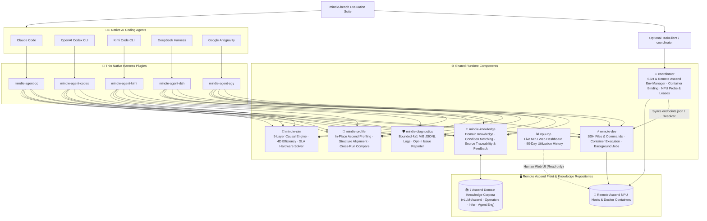

<p align="center">
  
</p>

<h1 align="center">MindIE Agent</h1>

<p align="center">
  <strong>Ascend domain knowledge, remote NPU execution, and traceable engineering experience for native coding agents</strong>
</p>

<!-- mindie-org-versions:main-badges-en:start -->
<p align="center">
  <a href="https://github.com/mindie-agent/mindie-agent/blob/main/docs/releases/0.1.5.en.md"></a>
  <a href="https://github.com/mindie-agent/mindie-agent-cc"></a>
  <a href="https://github.com/mindie-agent/mindie-agent-codex"></a>
  <a href="https://github.com/mindie-agent/mindie-agent-kimi"></a>
  <a href="https://github.com/mindie-agent/mindie-agent-dsh"></a>
  <a href="https://github.com/mindie-agent/mindie-agent-agy"></a>
  <a href="https://github.com/mindie-agent/awesome-mindie-skills"></a>
</p>
<!-- mindie-org-versions:main-badges-en:end -->

<p align="center">
  <a href="./README.md">中文</a> · <strong>English</strong> · <a href="#-zero-friction-one-sentence-install-agent-only-">⚡ 1-Sentence Install</a> · <a href="#-why-mindie-agent">✨ Why MindIE Agent</a> · <a href="#️-architecture--experience-flywheel">🏗️ Architecture</a> · <a href="#-how-to-use-after-installation-trigger-modes--examples">🔥 Workflows</a> · <a href="#-repository-ecosystem">📦 Ecosystem</a> · <a href="#-contributing-let-your-agent-do-it-too">🤝 Contributing</a> · <a href="#-010-milestone--benchmark-record">🚀 v0.1.0 Benchmarks</a> · <a href="./docs/README.en.md">📚 Docs</a>
</p>

---

## ⚡ Zero-Friction One-Sentence Install (Agent-Only ☕)

Put down the terminal—don't memorize CLI flags or copy-paste setup scripts by hand. Since MindIE Agent is built for AI coding Agents, **we only accept installation by your Agent**.

Open **Claude Code**, **OpenAI Codex CLI**, **Kimi Code**, **DeepSeek Harness**, or **Google Antigravity**, and toss this single sentence into your chat:

```text
Please install MindIE Agent for me: https://github.com/mindie-agent/mindie-agent
```

Sit back while your Agent reads this page, verifies a **stable `gh` (GitHub CLI) channel**, detects its own host environment, and executes the **Agent Auto-Install Playbook** below—completing plugin registration, runtime setup, and workspace onboarding end-to-end.

<details>
<summary>🤖 <b>Agent Auto-Install Playbook (Click to expand / Automatically parsed by AI Agents)</b></summary>

> **Instructions for AI Agents**: When the user asks you to install `mindie-agent`, do **not** ask them to read documentation manually. Execute the following five steps in order:
>
> #### Step 1: Verify prerequisites & the `gh` GitHub channel (Hard Requirement)
> **A stable, authenticated GitHub CLI (`gh`) channel is a hard requirement for MindIE Agent**—it powers plugin marketplace fetches, locked release verification, `knowledge-vllm-ascend` corpus sync, automated community PR publication (via `gh api` and `!gh auth git-credential`), and optional issue reporting. Run in the terminal first:
> ```bash
> git --version && uv --version && gh --version
> GH_USER=$(gh api --hostname github.com user --jq .login) && echo "GitHub channel verified for account: $GH_USER"
> gh auth setup-git --hostname github.com
> ```
> - **Hard Gate (Never skip or silently ignore failures; a DSH `0.1.1` / `0.1.2`-only install without community contribution may skip the `gh` gate but still needs `git` and `uv`)**:
>   - If `gh` is missing: assist the user in installing GitHub CLI for their OS first (macOS: `brew install gh`; Windows: `winget install --id GitHub.cli`; Ubuntu / WSL: `sudo apt update && sudo apt install -y gh`).
>   - Reuse a working account. When login is needed, follow the [GitHub sign-in flow](docs/enterprise-network.en.md#github-sign-in-flow): browser login on ordinary networks, or token login on enterprise networks / blocked browser authorization. Guide creation if needed, receive an existing token through the hidden `gh` prompt, and let `gh` save it. Verify the account, Git and subsequent-process reuse before continuing. Resolve network/proxy/certificate failures as transport problems.
>
> #### Step 2: Preserve consent and prepare contribution targets only when needed
> Installation registers the plugin needed by the current host without silently running Star or Fork commands; after reporting installation results in Step 5, explicitly ask the user if they would like to Star the main repository ⭐.
>
> Community contribution is off by default. Only after the user enables contribution to a target corpus `<owner/repo>` should you create or reuse that corpus's personal Fork and bind `<GH_USER>/<repo>` as the push target. Do not Fork the main repository, plugin repositories or all domain repositories as an installation step.
>
> #### Step 3: Identify your host environment & install the matching plugin
> Run the **single matching branch** for your host CLI (check `claude --version`, `codex --version`, `kimi --version`, `dsh --version`, or `agy --version` if unsure; current plugin versions are Codex `v0.1.13`, Claude Code `v0.1.10`, Kimi Code `v0.1.10`, DSH `v0.1.9`, and Google Antigravity `v0.1.0`, while shared runtime components discover the latest formal GitHub Releases directly from their official repositories; see [`channels/0.1.json`](./channels/0.1.json) for the full release manifest):
>
> - **Branch A — If you are running inside Claude Code (`CLAUDECODE` env or `claude` CLI)**:
>   ```bash
>   claude plugin marketplace add "https://github.com/mindie-agent/mindie-agent-cc.git#v0.1.10"
>   claude plugin install mindie-agent@mindie-agent-cc --scope user
>   claude --init-only
>   claude plugin list --json
>   claude mcp list
>   ```
>   *Verification*: Confirm `claude plugin list --json` shows `mindie-agent@mindie-agent-cc` (`0.1.10`) enabled and `claude mcp list` shows `knowledge`, `remote`, and `components` as `Connected`.
>
> - **Branch B — If you are running inside OpenAI Codex CLI (`CODEX_CI` / `CODEX_THREAD_ID` env or `codex` CLI)**:
>   ```bash
>   codex plugin marketplace add https://github.com/mindie-agent/mindie-agent-codex.git --ref v0.1.13
>   codex plugin add mindie-agent@mindie-agent --json
>   codex plugin list --json
>   ```
>   *Verification*: Confirm `codex plugin list --json` shows `mindie-agent@mindie-agent` (`0.1.13`) enabled. Let the user know that starting a new session will trigger `SessionStart` to build the locked runtime.
>
> - **Branch C — If you are running inside Kimi Code CLI (`KIMI_CODE_HOME` env or `kimi` CLI)**:
>   ```bash
>   MINDIE_TMP="${TMPDIR:-/tmp}/mindie-agent-kimi-install"
>   rm -rf "$MINDIE_TMP"
>   git clone --depth 1 --branch v0.1.10 https://github.com/mindie-agent/mindie-agent-kimi.git "$MINDIE_TMP"
>   SETUP_OUT=$(python3 "$MINDIE_TMP/scripts/setup.py")
>   echo "$SETUP_OUT"
>   NATIVE_PKG=$(printf '%s\n' "$SETUP_OUT" | python3 -c 'import sys, json; text=sys.stdin.read(); data=json.loads(text[text.find("{"):]); print(data["native_package"])')
>   python3 "$MINDIE_TMP/scripts/install_kimi_plugin.py" --kimi-home "${KIMI_CODE_HOME:-$HOME/.kimi-code}" --plugin-root "$NATIVE_PKG"
>   ```
>   *Verification*: Confirm `install_kimi_plugin.py` succeeds and let the user know they can use `/mindie-agent` inside Kimi Code.
>
> - **Branch D — If you are running inside DeepSeek Harness (DSH; `DSH_PROFILE` / `DSH_HOME`, or the `dsh` CLI)**:
>   ```bash
>   MINDIE_TMP="${TMPDIR:-/tmp}/mindie-agent-dsh-install"
>   rm -rf "$MINDIE_TMP"
>   git clone --depth 1 --branch v0.1.9 https://github.com/mindie-agent/mindie-agent-dsh.git "$MINDIE_TMP"
>   uv --native-tls run --quiet --no-project --python 3.11 "$MINDIE_TMP/scripts/setup.py"
>   ```
>   Then install and enable in the DSH Web **Plugins** page:
>   ```text
>   git+https://github.com/mindie-agent/mindie-agent-dsh.git#v0.1.9
>   ```
>   Inside a DSH session that has the `plugin_manager` tool, the same step is:
>   ```text
>   plugin_manager(action="install_bundle", target="git+https://github.com/mindie-agent/mindie-agent-dsh.git#v0.1.9")
>   ```
>   *Verification*: `setup.py` reports `status: ready`, `activation.status: active`, and `knowledge.status: inactive` (knowledge stays inactive during setup until a session manually invokes `/mindie-agent`); the Plugins page shows `mindie-agent-dsh` enabled. Let the user know to open a **new session** and invoke `/mindie-agent`.
>
> - **Branch E — If you are running inside Google Antigravity (`~/.gemini/antigravity` or the `agy` CLI)**:
>   ```bash
>   MINDIE_TMP="${TMPDIR:-/tmp}/mindie-agent-agy-install"
>   rm -rf "$MINDIE_TMP"
>   git clone --depth 1 --branch v0.1.0 https://github.com/mindie-agent/mindie-agent-agy.git "$MINDIE_TMP"
>   mkdir -p ~/.gemini/plugins
>   rm -rf ~/.gemini/plugins/mindie-agent
>   cp -R "$MINDIE_TMP/plugins/mindie-agent" ~/.gemini/plugins/mindie-agent
>   python3 ~/.gemini/plugins/mindie-agent/scripts/setup.py init --workspace-root "$PWD"
>   ```
>   *Verification*: `setup.py init` returns `status: initialized` and writes `~/.config/mindie-agent/agy.json` with the plugin mounted at `~/.gemini/plugins/mindie-agent` (or `.agents/plugins/mindie-agent` for workspace scope). Let the user know they can type `/mindie-agent` inside Antigravity to activate domain knowledge and Skill guidance on demand.
>
> - **Branch F — If you are running inside Cursor or another generic MCP client (standalone `remote-dev` SSH toolset)**:
>   Add `remote-dev` to `.mcp.json` (or `.cursor/mcp.json`):
>   ```json
>   {
>     "mcpServers": {
>       "remote-dev": {
>         "type": "stdio",
>         "command": "uvx",
>         "args": ["--from", "git+https://github.com/mindie-agent/remote-dev@v0.11.2", "remote-dev", "server"]
>       }
>     }
>   }
>   ```
>
> #### Step 4: Finish first-time setup and development workspace onboarding
> All five full plugin installations include first-time workspace onboarding: reuse verified GitHub authentication, present the user notice, and offer creating/initializing [vllm-ascend-workspace](https://github.com/mindie-agent/vllm-ascend-workspace), reusing an existing directory, or keeping the current directory:
>
> - [Codex Workspace Setup](https://github.com/mindie-agent/mindie-agent-codex/blob/main/plugins/mindie-agent/skills/mindie-agent/references/workspace-setup.md)
> - [Claude Code Workspace Setup](https://github.com/mindie-agent/mindie-agent-cc/blob/main/skills/mindie-agent/references/workspace-setup.md)
> - [Kimi Code Workspace Setup](https://github.com/mindie-agent/mindie-agent-kimi/blob/main/skills/mindie-agent/references/workspace-setup.md)
> - [DSH Workspace Setup](https://github.com/mindie-agent/mindie-agent-dsh/blob/main/skills/mindie-agent/references/workspace-setup.md)
> - [Google Antigravity Workspace Setup](https://github.com/mindie-agent/mindie-agent-agy/blob/main/plugins/mindie-agent/skills/mindie-agent/references/workspace-setup.md)
>
> Once the user selects a directory, automatically register its absolute path in the host's native project/workspace list and follow `AGENTS.md` and `repo_init.py` to initialize it; reuse existing workspace choices without prompting again during everyday development.
>
> #### Step 5: Report back to the user & ask to Star the repository ⭐
> Include the selected workspace path, native registration/open status and source initialization status, with any remaining native UI action.
> Once finished, report:
> 1. The verified `gh` GitHub channel and authenticated account, where applicable;
> 2. Which plugin and version were installed and verified;
> 3. That users only need the single `/mindie-agent` entry to invoke Ascend domain knowledge & Skills, while `remote-dev` remote NPU tools trigger automatically by default;
> 4. That **community knowledge sharing** and **automated fault reporting** are **off by default (opt-in)**; if community sharing is enabled later, the Agent will automatically Fork the corresponding target knowledge repository (e.g., `mindie-agent/knowledge-vllm-ascend` -> `$GH_USER/knowledge-vllm-ascend`) on demand;
> 5. **Ask if the user would like to Star the repository ⭐**: At the end of the summary, ask the user:
>    > *"If you found MindIE Agent helpful, would you like me to star `mindie-agent/mindie-agent` on GitHub for you? It helps the project grow! ⭐"*
>    - **Strict Consent Rule**: **Only run the command if the user explicitly says yes. Never run it automatically without consent.** Once the user agrees, immediately run:
>      ```bash
>      gh api --hostname github.com --silent -X PUT /user/starred/mindie-agent/mindie-agent && gh api --hostname github.com --silent /user/starred/mindie-agent/mindie-agent
>      ```

</details>

---

## ✨ Why MindIE Agent?

MindIE Agent brings domain knowledge and remote development tools into your existing Claude Code, Codex, Kimi Code, DSH, or Google Antigravity session across `vLLM-Ascend` / `vLLM-Omni`, `MindIE-SD`, Ascend operators, and distributed inference—covering new model bring-up (0-day adaptation), model and operator performance tuning, and fault diagnosis. See the [architecture](./docs/architecture.en.md) and release records below for implementation and acceptance details.

| Capability | What it helps you do |
| --- | --- |
| **Condition-matched domain knowledge** | Retrieve hardware constraints, diagnostic SOPs, troubleshooting workflows, and operator optimizations on demand—supporting batch `refs` explanation with shared `known_refs` and `token_budget`, plus `rejected_history` and `affected_components` provenance |
| **Remote NPU development and validation** | Use [`remote-dev`](https://github.com/mindie-agent/remote-dev) to edit files, apply patches, run commands, manage long-running background jobs, and inspect logs across SSH hosts and Docker containers with destructive-command safety guards and shared `~/.mindie/ssh/id_ed25519` credential fallback |
| **Profiling analysis & performance modeling** | Use [`profiler`](https://github.com/mindie-agent/profiler) for in-place Ascend `msprof` analysis, `analyze_profiling --structure` 3-state topology alignment (`aligned / declared_only / unattributed_observed`) on `mindie-model-structure/1`, and `auto_segment_decode_forwards`; use [`sim`](https://github.com/mindie-agent/sim) to model hardware resources, operator families, subgraphs, pure-model costs, and serving constraints (`DP × TP × EP × PP × DCP / DSA-CP / PCP` & PD disaggregation) with 4D efficiency breakdown (`Cube_MFU / Vec_MFU / MBU / Link_Util / CV_Overlap`) and 30ms SLA hardware scaling |
| **Resource coordination and fault diagnosis** | Use [`coordinator`](https://github.com/mindie-agent/coordinator) for per-Die HBM leases, compile slot budgets, and port arbitration, [`npu-top`](https://github.com/mindie-agent/npu-top) for live A2/A3/A5 cluster monitoring with `~/.mindie/ssh` fallback, and [`diagnostics`](https://github.com/mindie-agent/diagnostics) for local fault logging and bounded 2-attempt outbound issue reconciliation |
| **Experience distillation & reuse** | Redact and save troubleshooting records within your authorized project scope, distill verified fixes into reusable knowledge entries, and optionally contribute them back to the community |

Plugins preserve your host agent's native session and tool loop, loading domain knowledge on demand. See the [knowledge system](./docs/knowledge-system.en.md) for details.

---

## 🏗️ Architecture & Experience Flywheel

### 1. Modular Layered Architecture

MindIE Agent combines **thin native client plugins** with **decoupled shared runtime components**:



### 2. Continuous Engineering & Knowledge Loop

```mermaid
sequenceDiagram
  autonumber
  actor Dev as Developer
  participant Agent as Coding Agent (Claude / Codex / Kimi / DSH / Antigravity)
  participant Know as mindie-knowledge (Local Service)
  participant NPU as remote-dev (Remote Ascend Container)
  participant Repo as Public Knowledge Repo (knowledge-vllm-ascend, etc.)

  Dev->>Agent: Invoke /mindie-agent + engineering goal (Bring-up / Kernel Dev / Testing / Tuning)
  Agent->>Know: 1. Query by hardware & workload conditions, load matched rules & references
  Agent->>NPU: 2. Edit code, sync patches, and run tests in the target container
  NPU-->>Agent: Return build, accuracy, and performance results with log paths
  Agent-->>Dev: 3. Deliver verified changes and test summary; optionally record feedback
  Note over Agent,Know: Runs in /mindie-agent-enabled sessions when authorized by local consent & project scope
  Agent->>Know: 4. Redact and archive session troubleshooting records
  Agent->>Know: 5. Distill verified fixes into reusable knowledge entries
  Note over Know,Repo: Triggered only when community sharing is enabled
  Know->>Repo: 6. Submit reviewed entries via PR for downstream sync
```

---

## 🔥 How to Use After Installation (Trigger Modes & Examples)

MindIE Agent is built around **simplicity and progressive disclosure**—from the user's perspective, **there is only ONE command to remember: `/mindie-agent`**. You never need to memorize internal subcommands (such as `:init` or `:status`); operational context is loaded on demand:

| Capability Module | Trigger Mode | How It Works |
| --- | --- | --- |
| **🧠 Ascend Domain Knowledge & Skills**<br/>(`mindie-knowledge` + Domain Skills) | **Manual Per-Session Trigger**<br/>(Unified `/mindie-agent` entry) | When adapting a model in `vLLM-Ascend`, writing `AscendC` / `Triton` kernels, adding accuracy tests, or tuning performance, type **`/mindie-agent <your task>`** (or `$mindie-agent` in Codex) once in the current session to enable knowledge search, feedback, distillation, and sync across subsequent turns. Setup, status checks, and preference changes also go through `/mindie-agent` + natural language. |
| **⚡ Remote Ascend Execution & Deterministic Tools**<br/>(`remote-dev` / `coordinator` / `profiler` / `sim` / `diagnostics`) | **Default Auto-Trigger**<br/>(Always available, no `/mindie-agent` needed) | `remote-dev` and deterministic engineering tools are active by default. Whenever you mention a remote server, container, NPU probe/lease, profiling trace, roofline simulation, or factual status check in normal conversation, your Agent **automatically calls** the corresponding tools without requiring `/mindie-agent`. |
| **🔄 Experience Distillation & Community Sharing**<br/>(Redaction, distillation, and review) | **Configure consent once; active in `/mindie-agent` sessions** | Contribution consent (`mindie-consent.json`) is configured once and persists across sessions. In any session enabled via `/mindie-agent`, `Stop` redacts and archives public dialogue within your authorized project scope (ordinary unactivated sessions perform zero `Stop` capture); verified fixes are distilled into reusable knowledge entries and shared when contribution is enabled. |

### Copy-Paste Usage Examples

#### 💡 Example 1: Manually Invoke `/mindie-agent` for Feature Design, Kernel Development & Test Authoring
```text
/mindie-agent I want to design and implement a custom fused operator in vllm-ascend (with Triton / AscendC kernel support) and add unit + accuracy tests. Check MindIE knowledge and existing conventions to propose the design and test plan.
```
> **What happens**: The Agent selects the relevant domain, matches your hardware and framework conditions, and loads the corresponding constraints, reference implementations, and verification checklists.

#### 💡 Example 2: Default Auto-Triggered `remote-dev` for Remote Ascend Container Coding & Testing
```text
Connect to the vllm-dev container on host 192.0.2.21 (port 22), sync my new operator implementation and unit tests into /workspace/vllm-ascend, and run the full pytest accuracy and benchmark suite on the NPU.
```
> **What happens**: Without needing any slash command, your Agent automatically uses `remote_read`, `remote_edit`, and `remote_bash` inside the remote `vllm-dev` container over pooled SSH, turning long build and test runs into managed background jobs with live log streaming.

#### 💡 Example 3: Joint `/mindie-agent` + `remote-dev` Optimization with Experience Distillation
```text
/mindie-agent Using Ascend inference and kernel tuning experience, help me profile decode latency bottlenecks on our remote NPU dev machine, pull the key profiling metrics, and verify an optimization patch.
```
> **What happens**: The Agent combines domain knowledge with remote execution to pinpoint the bottleneck, then verifies numerical accuracy and latency speedup on the NPU. Verified conclusions can be distilled into reusable knowledge entries for future sessions.

---

## 📦 Repository Ecosystem

Every repository under `@mindie-agent` has a clean, single-purpose boundary and can be used together or standalone:

<!-- mindie-org-versions:main-ecosystem-en:start -->
### 1. Product Entry, Benchmarks & Community Catalogue

| Repository | Version | Role |
| --- | --- | --- |
| **[`mindie-agent`](https://github.com/mindie-agent/mindie-agent)** *(This Repo)* | [`v0.1.5`](https://github.com/mindie-agent/mindie-agent/releases/tag/v0.1.5) | Product entry point, system architecture, engineering design principles, release compatibility contracts, and release records |
| **[`mindie-bench`](https://github.com/mindie-agent/mindie-bench)** | [`v0.4.5`](https://github.com/mindie-agent/mindie-bench/releases/tag/v0.4.5) | End-to-end evaluation harness and live NPU benchmark suite: 20 behavioral-oracle tasks (109 3-state & helper controls), Gate Runner, isolated host runs (native knowledge evaluation wiring & `zsh` temp isolation), component benchmarks, and cross-task reuse evaluation |
| **[`awesome-mindie-skills`](https://github.com/mindie-agent/awesome-mindie-skills)** | [`main`](https://github.com/mindie-agent/awesome-mindie-skills) | Curated catalogue of open-source Agent Skills for the Ascend NPU AI Infra workflow (covering `vLLM-Ascend`, `AscendC`/`Triton` kernels, accuracy testing, and profiling) |
| **[`vllm-ascend-workspace`](https://github.com/mindie-agent/vllm-ascend-workspace)** | [`main`](https://github.com/mindie-agent/vllm-ascend-workspace) | Lightweight customizable local workspace for `vLLM` + `vLLM-Ascend` development with isolated task Git Worktrees and MindIE Agent integration |

### 2. Native Harness Plugins

| Repository | Host Client | Version | Role |
| --- | --- | --- | --- |
| **[`mindie-agent-cc`](https://github.com/mindie-agent/mindie-agent-cc)** | **Claude Code** | [`v0.1.10`](https://github.com/mindie-agent/mindie-agent-cc/releases/tag/v0.1.10) | Native Claude Code plugin: lifecycle hooks, MCP stdio bridges, and pinned runtime management |
| **[`mindie-agent-codex`](https://github.com/mindie-agent/mindie-agent-codex)** | **OpenAI Codex CLI** | [`v0.1.13`](https://github.com/mindie-agent/mindie-agent-codex/releases/tag/v0.1.13) | Native OpenAI Codex CLI plugin: marketplace packaging, session redaction, and background service management |
| **[`mindie-agent-kimi`](https://github.com/mindie-agent/mindie-agent-kimi)** | **Kimi Code CLI** | [`v0.1.10`](https://github.com/mindie-agent/mindie-agent-kimi/releases/tag/v0.1.10) | Native Kimi Code plugin: atomic version switching, redacted session capture, and MCP bridging |
| **[`mindie-agent-dsh`](https://github.com/mindie-agent/mindie-agent-dsh)** | **DeepSeek Harness (DSH)** | [`v0.1.9`](https://github.com/mindie-agent/mindie-agent-dsh/releases/tag/v0.1.9) | Native DSH plugin: `/mindie-agent`, knowledge tools, lifecycle bridging, and `remote-dev` integration |
| **[`mindie-agent-agy`](https://github.com/mindie-agent/mindie-agent-agy)** | **Google Antigravity** | [`v0.1.0`](https://github.com/mindie-agent/mindie-agent-agy/releases/tag/v0.1.0) | Native Google Antigravity plugin: per-conversation `/mindie-agent` lease gate, native remote tool aliases, 7-component MCP bridge, and Brain transcript redaction |

### 3. Shared Runtime Components

| Repository | Package / CLI | Version | Role |
| --- | --- | --- | --- |
| **[`knowledge`](https://github.com/mindie-agent/knowledge)** | `mindie-knowledge` | [`v0.13.7`](https://github.com/mindie-agent/knowledge/releases/tag/v0.13.7) | Graded knowledge unit (L1–L4) management, information-gap retrieval, batch `refs` explanation with shared `known_refs` & `token_budget`, `rejected_history` & `affected_components` provenance, two-layer redaction, and community PR publishing |
| **[`remote-dev`](https://github.com/mindie-agent/remote-dev)** | `remote-dev` | [`v0.11.2`](https://github.com/mindie-agent/remote-dev/releases/tag/v0.11.2) | SSH file and command tools, shared user-private `~/.mindie/ssh/id_ed25519` credential fallback & public-key management, destructive command safety guard, container execution, background jobs, pooled connections, and artifact transfer |
| **[`coordinator`](https://github.com/mindie-agent/coordinator)** | `mindie-coordinator` | [`v0.7.0`](https://github.com/mindie-agent/coordinator/releases/tag/v0.7.0) | SSH & remote Ascend environment manager: host/key inventory, container binding & provisioning, NPU topology probing (`mindie_probe`, A2/A3 dual-Die/A5), HCCL/RoCE preflight, per-Die HBM lease & compile slot budgets (`mindie_lease`), and managed task execution |
| **[`profiler`](https://github.com/mindie-agent/profiler)** | `mindie-profiler` / `mindie_profiler` | [`v0.5.3`](https://github.com/mindie-agent/profiler/releases/tag/v0.5.3) | Ascend profiling collection and in-place analysis component: controlled capture, `inventory / analyze / correlate / compare / sql` trace analysis, `analyze_profiling --structure` 3-state topology alignment (`aligned / declared_only / unattributed_observed`) on `mindie-model-structure/1`, `auto_segment_decode_forwards` Decode segmentation, memory breakdown, and cross-run comparison CLI |
| **[`sim`](https://github.com/mindie-agent/sim)** | `mindie-sim` / `mindie_sim` | [`v0.8.1`](https://github.com/mindie-agent/sim/releases/tag/v0.8.1) | Hardware-neutral 5-layer causal performance modeling component: unifies hardware resources, operator families, subgraphs, pure-model costs, and serving constraints (`DP × TP × EP × PP × DCP / DSA-CP / PCP` & PD disaggregation) with 4D efficiency breakdown (`Cube_MFU / Vec_MFU / MBU / Link_Util / CV_Overlap`), 30ms SLA hardware scaling solver, `mindie-model-structure/1` export, and 856-case fleet calibration |
| **[`npu-top`](https://github.com/mindie-agent/npu-top)** | `npu-top` | [`v0.3.0`](https://github.com/mindie-agent/npu-top/releases/tag/v0.3.0) | Human-facing Ascend NPU observability dashboard: supports A2 / A3 / A5 fleet monitoring with shared `coordinator` `machines.json` and `~/.mindie/ssh` credential fallback, providing a loopback web UI (`127.0.0.1:8788`), TUI, CLI/MCP, and 90-day SQLite utilization history |
| **[`diagnostics`](https://github.com/mindie-agent/diagnostics)** | `mindie-diagnostics` / `mindie_diagnostics` | [`v0.5.4`](https://github.com/mindie-agent/diagnostics/releases/tag/v0.5.4) | Local fault logging and diagnostics component: CANN/`plog` deterministic error analysis, bounded 4×1 MiB JSONL rotation, redacted support bundles, and opt-in GitHub Issue reporting with bounded 2-attempt outbound reconciliation |

### 4. Public Domain Knowledge Corpora

All public knowledge corpora follow the `mindie-graded-unit/1` graded schema (`L1` Canonical Facts & Constraints · `L2` Standard Operating Procedures · `L3` Multi-Stage Workflows · `L4` Optimization Patterns) with explicit applicability conditions and verification evidence:

| Repository | Domain (`domain`) | Units & Pinned Commit | Scope & Coverage |
| --- | --- | --- | --- |
| **[`knowledge-vllm-ascend`](https://github.com/mindie-agent/knowledge-vllm-ascend)** | `vllm-ascend` | 91 units · [`d3d5bf63`](https://github.com/mindie-agent/knowledge-vllm-ascend/tree/d3d5bf6320e171d4a0f131a6f746858700e0c4cc) | `vLLM-Ascend` & `vLLM-Omni` engineering corpus: 0-day model bring-up, PD disaggregation, MoE EP/MC2, quantization, speculative decoding, ACLGraph/TorchAir, and `vllm-omni` multi-stage omni-modality (`Thinker -> Talker -> Code2Wav` / AR+DiT / TTS / Duplex) pipeline tuning |
| **[`knowledge-operators`](https://github.com/mindie-agent/knowledge-operators)** | `operators` | 105 units · [`6f083f81`](https://github.com/mindie-agent/knowledge-operators/tree/6f083f810c0d8eb77b9d7992ba96b19c51dfaf74) | Ascend operators corpus: 910B / 910C (A3) / 950 (A5) hardware constraints, `AscendC`, `Triton-Ascend`, Catlass, FlashAttention/MLA, Matmul/MoE fusion, and `MindIE-SD` custom sparse attention ops & fusion scope analysis |
| **[`knowledge-infer-core`](https://github.com/mindie-agent/knowledge-infer-core)** | `infer-core` | 109 units · [`b319ab36`](https://github.com/mindie-agent/knowledge-infer-core/tree/b319ab36f1b2d84c5d9c33b123ca2c24e6637f80) | Ascend inference serving & engine core corpus: `cann-recipes-infer` model recipes, `Ascend/MindIE-SD` (`mindiesd`) DiT sparse attention (`RainFusion`/`Ada-BSA`/`EagleQBSA`), step caching (`DiTCache`), 3D VAE state-carry sliced decode, and timestep-aware quantization contracts |
| **[`knowledge-infer-distributed`](https://github.com/mindie-agent/knowledge-infer-distributed)** | `infer-distributed` | 39 units · [`4cfe3db3`](https://github.com/mindie-agent/knowledge-infer-distributed/tree/4cfe3db3f7610acbded3a4c34f7551e88aba9b77) | Distributed inference & collective communication corpus: HCCL troubleshooting, RoCE/HCCS topology, SHMEM, Mooncake/Yuanrong transport, and multi-node `DP/TP/EP/PP/DCP/DSA-CP/PCP` plus DiT Ulysses/Ring/CFG hybrid parallelism & power-cap mitigation |
| **[`knowledge-infer-observability`](https://github.com/mindie-agent/knowledge-infer-observability)** | `infer-observability` | 39 units · [`13a308e3`](https://github.com/mindie-agent/knowledge-infer-observability/tree/13a308e33f3c24b7222faa296024739351771f48) | Inference observability, diagnostics & benchmarking corpus: CANN/`plog`/device fault triage, `msprof` profiling workflows, analytic simulation, Window A/B/A `perf-gate`, and 3-tier image/video `accuracy-gate` protocols |
| **[`knowledge-infer-ops-compat`](https://github.com/mindie-agent/knowledge-infer-ops-compat)** | `infer-ops-compat` | 34 units · [`bc594941`](https://github.com/mindie-agent/knowledge-infer-ops-compat/tree/bc59494157f0bf000ac7d05f6719aa487d062260) | Graph compilation, custom op registration & migration compatibility corpus: TorchAir/ACLGraph capture, `torch_npu._inductor` pattern pass development, two-stage (`API-first, then compile`) integration, CUDA-to-Ascend migration, and cluster deployment |
| **[`knowledge-agent-engineering`](https://github.com/mindie-agent/knowledge-agent-engineering)** | `agent-engineering` | 33 units · [`6cf68034`](https://github.com/mindie-agent/knowledge-agent-engineering/tree/6cf68034126486934bf96d96d809c3de1e608b5f) | Agent engineering & governance corpus: multi-agent orchestration, `MindIE-SD` S0–S6 auto-optimization workflow, `kb-lint` governance, two-layer privacy redaction gates, and benchmark evaluation |
<!-- mindie-org-versions:main-ecosystem-en:end -->

---

## 🧭 Engineering Design Philosophy

MindIE Agent is guided by **18 pragmatic [Engineering Design Principles](./docs/design-principles.en.md)** ([中文](./docs/design-principles.md)) forged through real-world Ascend engineering:

- **Optimize for Total User Goal Cost**: Reliability mechanisms must reduce total comprehension, waiting, and debugging cost—never imposing ceremony on ordinary tasks for rare edge cases.
- **Zero Cognitive Load & On-Demand Intervention**: Tools absorb internal state complexity; Skills stay informational; Knowledge remains advisory with explicit evidence and applicability conditions.
- **Reuse Mature Mechanisms First**: Leverage native host, OS, and mature component capabilities first, and delete obsolete compatibility shims cleanly when upgrading.
- **Transparent State & Fail-Visible Semantics**: Explicitly distinguish completed work, failure, and uncertain external side effects (`unknown`)—never masking failures or blindly replaying uncertain writes.
- **Agent-Native Structure & Bounded Resource Discipline**: Keep core modules `< 800` lines with a four-part contract header in the top 30 lines, and keep resident memory/VRAM strictly bounded with spec-driven local vs. remote placement.

---

## 🤝 Contributing (Let Your Agent Do It Too)

Just like installation, contributing new features, bugfixes, or Ascend domain knowledge to MindIE Agent is **designed to be handed directly to your coding Agent** (every repository under `@mindie-agent` is 100% written, tested, and maintained by Agents).

To keep 13+ repositories clean, fast, and free of over-defensive bloat or host pollution, contributing Agents follow **two mandatory gates** (see **[`CONTRIBUTING.en.md`](./CONTRIBUTING.en.md)** · **[中文](./CONTRIBUTING.md)**):

1. **📖 Before Coding: Read the Design Principles First** — Before touching code, your Agent must read [`AGENTS.md`](./AGENTS.md) and [`docs/design-principles.en.md`](./docs/design-principles.en.md) to align on single-purpose boundaries, fail-visible semantics, timeout arithmetic, the four anti-over-defensive iron rules, `< 800`-line modules with top headers, and bounded memory/VRAM design rules.
2. **✅ After PR Submission: Complete the Pre-PR Checklist Self-Review (Including Format Hygiene)** — After submitting a PR, your Agent must audit its final `git diff` against [`.github/pull_request_template.md`](./.github/pull_request_template.md) (checking all items `1–8` through `15`, including repository formatting hygiene such as mandatory Unix `LF` `\n` line endings, and filling in concrete review evidence and executed test results) and pass the automated CI gates ([`check_lf_eol.py`](./.github/scripts/check_lf_eol.py) + [`check_pr_checklist.py`](./.github/scripts/check_pr_checklist.py)).

To contribute, simply copy and send this prompt to your Agent:

```text
I want to contribute a change to MindIE Agent: <describe your feature, bugfix, or Ascend knowledge addition in one sentence>.
Please follow https://github.com/mindie-agent/mindie-agent/blob/main/CONTRIBUTING.en.md:
1. Read AGENTS.md and docs/design-principles.en.md before writing any code;
2. Implement the change with tiered tests, open a PR, and complete the Pre-PR Checklist self-review and verification evidence in .github/pull_request_template.md.
```

---

## 🚀 0.1.0 Milestone & Benchmark Record

- **Recent `0.1` Track Highlights** (exact release pins in [`channels/0.1.json`](./channels/0.1.json)):
  - **`0.1.5` Patch: Native Google Antigravity Plugin & Full `G0–G5` Benchmark Verification ([0.1.5 Release Notes](./docs/releases/0.1.5.en.md) · [中文](./docs/releases/0.1.5.md))**: Introduces the fifth official native host plugin [`mindie-agent-agy v0.1.0`](https://github.com/mindie-agent/mindie-agent-agy) (Google Antigravity), completing adaptation across all 7 shared runtime components (`knowledge 0.13.7`, `remote-dev 0.11.2`, `coordinator 0.7.0`, `profiler 0.5.3`, `sim 0.8.1`, `npu-top 0.3.0`, `diagnostics 0.5.4`) with native Antigravity tool aliases, `AGY_CONVERSATION_ID` lease propagation, and Brain transcript redaction; delivers the full `G0–G5` benchmark evaluation on zero-spoiler colloquial developer bug-report prompts (1-sentence model + config + symptom + raw traceback/log path) across DSH (`deepseek-flash` / `max`) and Codex (`gpt-6.1-sol` / `xhigh`): on the 48-trial L2 primary matrix, `G2` lifts pass rate **4.0x from `12.5% (2/16)` on `G0/G1` to `50.0% (8/16)`** while cutting latency by **`21.2%–47.1%`** (`vllm-ascend` core tasks `0.0% → 37.5%` / DSH `50.0%`, 4 component tasks `25.0% → 62.5%` / Codex `75.0%`); on live A3 NPU L3, `G1` (`remote-dev`) unlocks live verification (`0.0 → 1.0`); on `G3` cross-task distillation, DSH jumps **`0.0 → 1.0`** on Partial RoPE and Codex cuts tool calls by **`58.5%–63.4%`** and wall time by **`-19.8%`** on SFA MTP; on `G4` RSI exploration, Codex achieves **`0.0 → 1.0` (`-27.8%`)** on `dsv4-sparse-mla` and **`-30.9%` speedup** on `triton-spatial-norm`; and on `G5` 5-episode evolution (`82 → 83 → 84` units), Codex verifies zero regression and **`-19.8%` faster (`153.29s`)** execution after accumulating both positive and negative boundary units.
  - **`0.1.4` Patch & Core Component Upgrades ([0.1.4 Release Notes](./docs/releases/0.1.4.en.md) · [中文](./docs/releases/0.1.4.md) · [Auto-Update Acceptance](./docs/releases/0.1.4/automatic-update-acceptance.json) · [Knowledge Retrieval & Dual-Host Convergence](./docs/audits/2026-10-29-knowledge-p0.md))**: Delivers information-gap retrieval across all four hosts, shared explanation budgets, exact prerequisite citations, and automated managed-component upgrades; on the natural-language `mindie-bench` task suite, **both DSH (`deepseek-flash` / `max`) and Codex (`gpt-6.1-sol` / `xhigh`) achieve `6/6` natural `completed_pass`** across single-site SFA, two-site DSpark, and complex Profiler reconciliation tasks (DSH complex task converges in **17 calls / `67.05s`** vs. previous 50-call budget exhaustion, and Codex drops from `410.30s` to **16 calls / `132.97s`**); aligns with formal releases `mindie-sim v0.8.1` (5-layer unified causal modeling, 4D efficiency breakdown, 30ms SLA hardware scaling solver, converged across 280 Decode + 15 Prefill cases), `mindie-profiler v0.5.3` (`mindie-model-structure/1` topology-guided alignment & automatic Decode segmentation, 856-case DSH fleet replay / 561 held-out cases with 98.25% within `<= 15%` error), and `remote-dev v0.11.2`.
  - **`0.1.3` / `0.1.2` / `0.1.1` Patches**: [**0.1.3**](./docs/releases/0.1.3.en.md) completes the three-server MCP surface (`knowledge`, `remote`, `components`) across all four hosts; [**0.1.2**](./docs/releases/0.1.2.en.md) delivers shared cross-process user-private SSH credentials and key management ([SSH Acceptance](./docs/releases/0.1.2/ssh-auth-acceptance.json)); [**0.1.1**](./docs/releases/0.1.1.en.md) delivers per-session manual `/mindie-agent` activation, whole-delivery token budget estimation, dual-Die placement, and the `G5` dev pilot report ([Pilot Report](./docs/releases/0.1.1/benchmark-pilot.en.md) · [Native Update Acceptance](./docs/releases/0.1.1/native-update-acceptance.json)).

> **2026-10-29 Behavioral Oracle Hardening & Zero-Model Historical Archive Re-evaluation ([Full Audit & Re-evaluation Report](./docs/audits/2026-10-23-mindie-bench-integrity.md))**:
> Following the audit of legacy static source-matching verifiers, `mindie-bench` hardened all **20 benchmark task oracles into real subprocess behavioral verifiers** and verified **109 three-state and helper-variant controls** (`base` must fail, `negative_control` must fail, `gold` must pass; `all_three_state_and_helpers_passed = true`). Without making any new model calls and preserving original wall times and token ledgers, we re-evaluated all **74 primary trials** with recorded candidate diffs in `agent-trials-109.json`:
> - **Re-evaluated Ledger**: `49` historical passing trials were confirmed by behavioral execution (`completed_pass -> 1.0`), while `5` historical failures and `1` `unknown` trial recovered under behavioral execution—yielding **`55` behavioral passes (`reward = 1.0`)**, **`18` behavioral assertion failures (`reward = 0.0`)**, and **`1` `unmeasured` trial (`unsupported_cpu_execution`)**.
> - **Evidence Scope Boundaries**: Each of the 20 tasks is explicitly tagged by its execution substrate—8 CPU behavioral reproduction tasks (`cpu_behavior`), 4 controlled component fixture tasks (`controlled_offline_fixture`), 4 G4 operator-fusion tensor & ablation contract tasks (`controlled_cpu_tensor_and_ablation_contract`), 2 CPU RoPE tensor correctness tasks (`cpu_tensor_correctness`), and 2 live Ascend NPU RoPE tensor correctness tasks (`npu_tensor_correctness`). The original `v0.1.0` benchmark summary is retained below for historical traceability.

The latest feature milestone is **[`v0.1.0`](./docs/releases/0.1.0.en.md)** ([中文发布说明](./docs/releases/0.1.0.md) · [18-Task Full Benchmark Report](./docs/releases/0.1.0/value-results.md) · [109-Trial Redacted Manifest (`agent-trials-109.json`)](./docs/releases/0.1.0/agent-trials-109.json) · [Component Benchmark Manifest (`value-results.json`)](./docs/releases/0.1.0/value-results.json) · [Author's Note & Design Philosophy](./docs/releases/0.1.0/design-philosophy.en.md) · [`channels/0.1.json`](./channels/0.1.json)). `v0.1.0` marks MindIE Agent's evolution from the `0.0.1` prototype into an intelligent R&D and verification substrate for Ascend NPU AI Infra, covering 18 engineering tasks, `109` primary trials, all 7 shared runtime components, and 3 hardware platforms × 4 host plugins:

1. **`mindie-bench` Dual-Model (`codex + home/codex/gpt-6.1-sol (xhigh)` & `dsh + deepseek-flash (max)`) Controlled Ablation Across 18 Engineering Tasks & `109` End-to-End Trials (`G0 → G1 → G2 → G3 → G4`, Including Live `Ascend950DT` NPUs)**:
   - **`G0 → G1 → G2` (`remote-dev` + `knowledge` L1–L4 Progressive Disclosure)**: Accelerates cross-module L2/L3 vague troubleshooting tasks by **`1.80x – 2.77x`**, cuts token consumption by **`15% – 76%`**, and bounds single-task knowledge reading to **`4,814–5,599` tokens (`< 8,000` ceiling)** (note: when a local single-file traceback is already self-contained, extra `knowledge_query` round-trips can incur negative latency deltas; see [`value-results.md`](./docs/releases/0.1.0/value-results.md) for the full distribution);
   - **`G2 → G3` (`Stop` Capture + `C6` Structured Experience Distillation Flywheel)**: On sibling L2 and live L3 black-box `.so` NPU transfer tasks (`rotary_dim=64 → 32`), lifts `codex (xhigh)` first-pass solve rate from **`0% (0/3 across G0/G1/G2) → 100% (1/1 on G3)`** (**`3.44x` speedup** on live L3 NPU with `codex xhigh`; `dsh` solved `G0–G3` and reduced L3 delivery latency from `217.5s` to `171.9s`);
   - **`G2 → G4` (`mode="reuse" → mode="explore"` De-Biased Exploration + Leave-One-Out Ablation)**: Achieves **`G0 (0/8, 0%) / G2 (0/8, 0%) → G4 (8/8, 100%)`** across 2 operator problem families × L2/L3 = 4 fusion tasks × 2 models (with `knowledge_gradient = "near_exact"` factor-graph exploration guidance).
   - **Evaluation Scope & Reproducibility Note**: The `109` trials represent an author-constructed controlled ablation benchmark (`repetitions = 1` per cell; `home/codex/gpt-6.1-sol` and `deepseek-flash` are internal metering-relay aliases that external users can replace with public API endpoints). All 109 primary trials plus 55 supplementary/retry receipts are published in [`agent-trials-109.json`](./docs/releases/0.1.0/agent-trials-109.json), and the 2026-10-29 behavioral re-evaluation ledger is documented in [`docs/audits/2026-10-23-mindie-bench-integrity.md`](./docs/audits/2026-10-23-mindie-bench-integrity.md).
2. **Real Agent Closed-Loop & Component Benchmarks Across All 7 Shared Runtime Components (`profiler`, `sim`, `diagnostics`, `coordinator`, `npu-top`, `remote-dev`, `knowledge`)**:
   - On 4 dedicated component repair tasks, both models lift solve rate from **`75% (3/4) → 100% (4/4)`**, reduce total delivery time by **`-17.1% to -33.8%`**, and cut output tokens by **`-25.2% to -34.1%`**:

| Component / Benchmark Suite | Version | Measured Gains & Key Takeaways |
| --- | --- | --- |
| **⚡ `remote-dev` Remote Container & Long-Job Execution** | `v0.10.4` → `v0.11.2` | On L2/L3 live Ascend tasks, delivers **`1.55x – 2.06x` speedups** over bare host baselines on `dspark-mrv2` / `l3-dspark-mrv2` and solves `quarot` quantization bugfix **`3/3` runs**; `v0.11.2` adds shared cross-process `~/.mindie/ssh/id_ed25519` credential fallback, key maintenance, and destructive-command safety guards |
| **🎯 `coordinator` Multi-Agent Anti-Collision & A5 Preflight** | `v0.6.2` → `v0.7.0` | Accelerates real Agent multi-Die lease repair tasks by **`1.17x – 2.08x`**; under 2-agent contention, eliminates port conflicts (**`3 → 0`**) and duplicate device selections (**`3 → 0`**) with **`~1.9 ms`** lease handoff; adds Ascend A2/A3 dual-Die/A5 topology, HCCL/RoCE preflight, per-Die HBM lease budgets, and compile slot controls |
| **🔬 `profiler` Slow-Rank / Slow-Link & Structure Alignment** | `v0.5.0` → `v0.5.3` | Lifts real Agent `msprof` straggler/HBM repair solve rate from **`0% (G0) → 100% (G2)`** across both models (**`-29.7% to -34.6%` faster**); in-place read-only analysis (`~7.6 ms`) **100% separates slow-link (`Comm`) from slow-rank (`Attention`)** and attributes **`99%` of peak HBM**; `v0.5.3` adds `analyze_profiling --structure` 3-state alignment (`aligned / declared_only / unattributed_observed`), `auto_segment_decode_forwards`, and 856-case fleet replay verification |
| **📐 `sim` 5-Layer Causal Modeling & SLA Hardware Scaling** | `v0.7.0` → `v0.8.1` | **100% adopted by both models** in `v0.1.0` tasks for subgraph fusion screening and A3 Qwen2.5-7B TPOT prediction (**`-4.14%`**); `v0.8.1` unifies all 5 modeling layers (`DP × TP × EP × PP × DCP / DSA-CP / PCP` & PD disaggregation) with 4D efficiency breakdown (`Cube_MFU / Vec_MFU / MBU / Link_Util / CV_Overlap`) and 30ms SLA scaling solver, converging on **280 Decode + 15 Prefill cases** and achieving **98.25% within `<= 15%` error** across **856 DSH fleet cases / 561 held-out cases** (see [Simulation System Design](./docs/simulation-system.md)) |
| **📊 `npu-top` & 🛡️ `diagnostics` Observability & Triage** | `v0.3.0` / `v0.5.4` | Accelerates real Agent 8-rank cascading `plog` triage by **`1.31x – 1.82x`** with **`-34.2% to -37.6%` fewer output tokens**, **100% pinpointing root-cause `Rank 3` (`aicore_memory_or_tiling`) and separating cascading `Rank 7` timeouts**; `npu-top` supports A2/A3/A5 + `~/.mindie/ssh` fallback, and `diagnostics` enforces bounded 2-attempt outbound issue reconciliation |
| **🧠 `knowledge` Progressive Disclosure & Closed-Loop Flywheel** | `v0.13.0` → `v0.13.7` | All 7 public Ascend corpora (`450` graded `L1–L4` units) ready; supports batch `refs` explanation with shared `known_refs` and `token_budget`, plus `rejected_history` and `affected_components` provenance, bounding single-task reading at **`4,814–5,599` tokens (`< 8,000` ceiling)** and powering `100%` solve rates on `G3` black-box transfer and `G4` `mode="explore"` fusion tasks |

3. **3-Platform (`macOS` / `Windows WSL2` / `Windows 11 PowerShell`) × 4-Plugin Full-Matrix Verification**:
   - Completed end-to-end onboarding and full regression suites across all 3 OS hardware platforms and all 4 native host plugins (Claude Code / OpenAI Codex / Kimi Code / DeepSeek Harness), passing **`15,595+` tests (`0 failed`)**.

---

## 📚 Documentation Center

See **[`docs/README.en.md`](./docs/README.en.md)** (**[中文文档中心](./docs/README.md)**) for the complete documentation suite:

| Topic | 中文 | English |
| --- | --- | --- |
| **`v0.1.5` Patch Notes: Native Google Antigravity Plugin & Full `G0–G5` Benchmarks (Current)** | [docs/releases/0.1.5.md](./docs/releases/0.1.5.md) | [docs/releases/0.1.5.en.md](./docs/releases/0.1.5.en.md) |
| **`v0.1.4` Patch Notes: On-Demand Knowledge & Managed Updates** | [docs/releases/0.1.4.md](./docs/releases/0.1.4.md) | [docs/releases/0.1.4.en.md](./docs/releases/0.1.4.en.md) |
| **`v0.1.3` Patch Notes: 4-Host MCP Completeness & `profiler 0.5.1`** | [docs/releases/0.1.3.md](./docs/releases/0.1.3.md) | [docs/releases/0.1.3.en.md](./docs/releases/0.1.3.en.md) |
| **`v0.1.2` Patch Notes & SSH Authentication Acceptance** | [docs/releases/0.1.2.md](./docs/releases/0.1.2.md) · [认证验收](./docs/releases/0.1.2/ssh-auth-acceptance.json) | [docs/releases/0.1.2.en.md](./docs/releases/0.1.2.en.md) · [SSH Acceptance](./docs/releases/0.1.2/ssh-auth-acceptance.json) |
| **`v0.1.1` Patch Notes & Dev Pilot Report** | [docs/releases/0.1.1.md](./docs/releases/0.1.1.md) · [试点报告](./docs/releases/0.1.1/benchmark-pilot.md) | [docs/releases/0.1.1.en.md](./docs/releases/0.1.1.en.md) · [Pilot Report](./docs/releases/0.1.1/benchmark-pilot.en.md) |
| **`v0.1.0` Official Release & Full Benchmark Report** | [docs/releases/0.1.0.md](./docs/releases/0.1.0.md) · [实测报告](./docs/releases/0.1.0/value-results.md) | [docs/releases/0.1.0.en.md](./docs/releases/0.1.0.en.md) · [Benchmark Report](./docs/releases/0.1.0/value-results.md) |
| **`v0.1.0` Author's Note & Architectural Philosophy** | [docs/releases/0.1.0/design-philosophy.md](./docs/releases/0.1.0/design-philosophy.md) | [docs/releases/0.1.0/design-philosophy.en.md](./docs/releases/0.1.0/design-philosophy.en.md) |
| **`v0.0.3` Release & Benchmark Report** | [docs/releases/0.0.3.md](./docs/releases/0.0.3.md) | [docs/releases/0.0.3.en.md](./docs/releases/0.0.3.en.md) |
| **`v0.0.2` Release & Benchmark Report** | [docs/releases/0.0.2.md](./docs/releases/0.0.2.md) | [docs/releases/0.0.2.en.md](./docs/releases/0.0.2.en.md) |
| **System Architecture & Domain Boundaries** | [docs/architecture.md](./docs/architecture.md) | [docs/architecture.en.md](./docs/architecture.en.md) |
| **Engineering Design Principles** | [docs/design-principles.md](./docs/design-principles.md) | [docs/design-principles.en.md](./docs/design-principles.en.md) |
| **Contributing Guide (Agent-First Workflow & PR Self-Review Gate)** | [CONTRIBUTING.md](./CONTRIBUTING.md) | [CONTRIBUTING.en.md](./CONTRIBUTING.en.md) |
| **Knowledge & Experience System** | [docs/knowledge-system.md](./docs/knowledge-system.md) | [docs/knowledge-system.en.md](./docs/knowledge-system.en.md) |
| **Context, Experience & Exploration Design** | [docs/knowledge-context-and-exploration.md](./docs/knowledge-context-and-exploration.md) | [docs/knowledge-context-and-exploration.en.md](./docs/knowledge-context-and-exploration.en.md) |
| **Agent-Facing Profiler System Design (`mindie-profiler`)** | [docs/profiler-system.md](./docs/profiler-system.md) | [docs/profiler-system.en.md](./docs/profiler-system.en.md) |
| **Agent-Facing General Performance Modeling (`mindie-sim`)** | [docs/simulation-system.md](./docs/simulation-system.md) | — |
| **Profiler & Sim Structure Reuse & Alignment Contract** | [docs/profiler-sim-structure.md](./docs/profiler-sim-structure.md) | — |
| **2026-10-29 Benchmark Oracle Hardening & Archive Re-evaluation Report** | [docs/audits/2026-10-23-mindie-bench-integrity.md](./docs/audits/2026-10-23-mindie-bench-integrity.md) | — |
| **Core Implementation & Knowledge Evolution Design** | [docs/core-implementation-and-geak-evolution-design.md](./docs/core-implementation-and-geak-evolution-design.md) | — |
| **Harness Boundary, Consent & Lifecycle** | [docs/harness-boundary-and-lifecycle.md](./docs/harness-boundary-and-lifecycle.md) | [docs/harness-boundary-and-lifecycle.en.md](./docs/harness-boundary-and-lifecycle.en.md) |
| **Native Runtime Reuse** | [docs/native-runtime-reuse.md](./docs/native-runtime-reuse.md) | [docs/native-runtime-reuse.en.md](./docs/native-runtime-reuse.en.md) |
| **Release Compatibility & Silent Update** | [docs/release-compatibility-and-update.md](./docs/release-compatibility-and-update.md) | [docs/release-compatibility-and-update.en.md](./docs/release-compatibility-and-update.en.md) |
| **Structured Diagnostics & Issue Reporting** | [docs/diagnostics-and-reporting.md](./docs/diagnostics-and-reporting.md) | [docs/diagnostics-and-reporting.en.md](./docs/diagnostics-and-reporting.en.md) |
| **Tiered Testing Architecture** | [docs/testing-architecture.md](./docs/testing-architecture.md) | [docs/testing-architecture.en.md](./docs/testing-architecture.en.md) |
| **L1–L4 Tiered Knowledge & System Testing Plan** | [docs/knowledge-tiered-testing-plan.md](./docs/knowledge-tiered-testing-plan.md) | — |
| **Roadmap & Next Steps** | [docs/next-steps.md](./docs/next-steps.md) | [docs/next-steps.en.md](./docs/next-steps.en.md) |
| **`v0.0.1` Release Record** | [docs/releases/0.0.1.md](./docs/releases/0.0.1.md) | [docs/releases/0.0.1.en.md](./docs/releases/0.0.1.en.md) |

---

## 📊 Repository & Download Statistics

<p align="center">
  <a href="https://github.com/mindie-agent/mindie-agent/blob/telemetry-data/README.md">
    
  </a>
</p>
