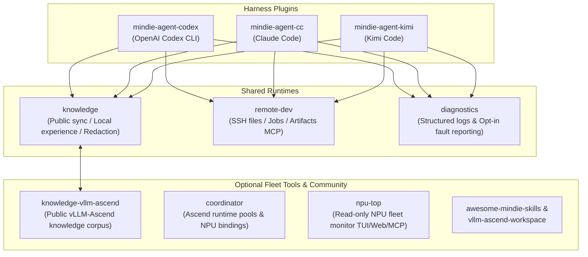

  

# MindIE Agent

[中文](README.md)

**Agent Capabilities, Curated Domain Knowledge, and Remote Execution Tooling for Ascend Inference Engineering**

MindIE Agent brings Ascend inference engineering capabilities—**curated `vLLM-Ascend` domain knowledge, local task experience indexing, privacy-redacted community sharing, and SSH-backed remote NPU execution**—directly into your daily AI coding agent ([OpenAI Codex CLI](https://github.com/mindie-agent/mindie-agent-codex), [Claude Code](https://github.com/mindie-agent/mindie-agent-cc), and [Kimi Code](https://github.com/mindie-agent/mindie-agent-kimi)) as native plugins.

Work directly inside your own business repositories and native agent sessions—no custom wrapper shell, no mandatory daily ceremony, and no intrusion into your unrelated skills or MCP configurations.

---

## Key Features

- **Native Harness Plugins, Zero Workflow Friction**: Runs natively inside your existing agent sessions and business checkouts without mandatory per-task activation or closing steps, while preserving all unrelated user skills, plugins, and MCP servers.
- **Two-Layer Knowledge & Experience Loop**:
  - **Curated Public Corpus ([`knowledge-vllm-ascend`](https://github.com/mindie-agent/knowledge-vllm-ascend))**: Retrieve evidence-gated `vLLM-Ascend` engineering packages and primary reference materials on demand.
  - **Local Experience & Independent Feedback ([`knowledge`](https://github.com/mindie-agent/knowledge))**: Deterministically projects and redacts public conversation turns without a body-rewriting LLM, uses a lightweight native model strictly to generate structured retrieval navigation, and records independent usefulness feedback (`helpful` / `not_helpful`).
- **SSH Remote Ascend Development ([`remote-dev`](https://github.com/mindie-agent/remote-dev))**: Editor-semantics remote file tools (`read`/`write`/`edit`/`apply_patch`/`glob`/`grep`/`ls`), resilient background jobs, live log streaming, and artifact transfers over SSH to remote Ascend NPU containers.
- **Privacy-First & Structured Observability ([`diagnostics`](https://github.com/mindie-agent/diagnostics))**: Fail-closed deterministic redaction and Gitleaks scanning protect every outbound path. Fault reporting and community knowledge sharing use independent, explicit opt-in consent—nothing is uploaded by default.

---

## Quick Start

Choose the entry point that matches your AI coding client or workflow:

| Scenario | Entry Repository | Notes |
|---|---|---|
| **OpenAI Codex CLI Users** | **[`mindie-agent-codex`](https://github.com/mindie-agent/mindie-agent-codex)** | `v0.0.1` released for macOS, native Windows, and Windows WSL |
| **Claude Code Users** | **[`mindie-agent-cc`](https://github.com/mindie-agent/mindie-agent-cc)** | `v0.0.1` released for macOS, native Windows, and Windows WSL |
| **Kimi Code Users** | **[`mindie-agent-kimi`](https://github.com/mindie-agent/mindie-agent-kimi)** | Native Kimi Code adapter (outside the `0.0.1` initial release matrix) |
| **Standalone Agent Skills** | **[`awesome-mindie-skills`](https://github.com/mindie-agent/awesome-mindie-skills)** | Community catalogue of standalone Agent Skills for Ascend inference engineering |
| **Local Multi-Task Workspace** | **[`vllm-ascend-workspace`](https://github.com/mindie-agent/vllm-ascend-workspace)** | Lightweight Git worktree workspace scaffold for `vllm` and `vllm-ascend` |

### Installation & Update Lifecycle

1. **Install Once**: Follow the one-line installation command in [`mindie-agent-codex`](https://github.com/mindie-agent/mindie-agent-codex) or [`mindie-agent-cc`](https://github.com/mindie-agent/mindie-agent-cc) to install the immutable `v0.0.1` release through the host's native plugin manager.
2. **Daily Engineering**: Work normally in your business repository. The plugin ensures the local knowledge service on session start and captures eligible task experience on turn completion (no collection occurs before you configure a contribution choice, and missing configuration vs. explicit disablement are reported distinctly).
3. **Silent Compatible Updates**: More than 24 hours after the last successful check, the next natural use asynchronously checks for the highest ordinary Release compatible with your installed Harness version, prepares it in the background, and switches atomically when idle—retaining existing authorization without prompting or requiring a manual reload.

---

## Ecosystem Architecture & Component Ownership

MindIE Agent is organized into focused, independently versioned repositories coupled through verified release locks:

| Repository | Role & Ownership |
|---|---|
| [`mindie-agent`](https://github.com/mindie-agent/mindie-agent) | Product entry, system architecture, domain boundaries, nine design principles, and release records |
| [`mindie-agent-codex`](https://github.com/mindie-agent/mindie-agent-codex) | Native OpenAI Codex CLI plugin, lifecycle hooks, and task integration (`v0.0.1`) |
| [`mindie-agent-cc`](https://github.com/mindie-agent/mindie-agent-cc) | Native Claude Code plugin, lifecycle hooks, and task integration (`v0.0.1`) |
| [`mindie-agent-kimi`](https://github.com/mindie-agent/mindie-agent-kimi) | Native Kimi Code adapter, lifecycle hooks, and local model integration |
| [`knowledge`](https://github.com/mindie-agent/knowledge) | Shared knowledge and experience runtime: public sync, local search, redaction, and usefulness feedback |
| [`knowledge-vllm-ascend`](https://github.com/mindie-agent/knowledge-vllm-ascend) | Canonical public engineering knowledge feed for `vLLM-Ascend` |
| [`remote-dev`](https://github.com/mindie-agent/remote-dev) | SSH-backed remote file operations, patching, managed background jobs, and artifact transfers |
| [`diagnostics`](https://github.com/mindie-agent/diagnostics) | Structured local diagnostics, redacted support bundles, and opt-in GitHub Issue fault reporting |
| [`coordinator`](https://github.com/mindie-agent/coordinator) | Opt-in loopback MCP coordinator for Ascend task leases, ready containers, and exclusive NPU bindings |
| [`npu-top`](https://github.com/mindie-agent/npu-top) | Loopback-only read-only Ascend NPU fleet monitor (TUI, Web UI, CLI, and MCP) |
| [`awesome-mindie-skills`](https://github.com/mindie-agent/awesome-mindie-skills) | Community catalogue of standalone Agent Skills for Ascend inference engineering |
| [`vllm-ascend-workspace`](https://github.com/mindie-agent/vllm-ascend-workspace) | Local Git worktree workspace scaffold for `vllm` and `vllm-ascend` development |

---

## Documentation Index

All core architecture, design principle, contract, and release documents in [`docs/`](docs/README.en.md) are maintained in both English and Chinese:

- **Documentation Index**: [English (`docs/README.en.md`)](docs/README.en.md) · [中文 (`docs/README.md`)](docs/README.md)
- **Design Principles**: [Nine Design Principles](docs/design-principles.en.md) · [九条设计原则](docs/design-principles.md)
- **System Architecture**: [Architecture & Domain Boundaries](docs/architecture.en.md) · [系统架构与领域边界](docs/architecture.md)
- **Knowledge & Experience System**: [Knowledge & Experience Loop](docs/knowledge-system.en.md) · [知识与经验闭环设计](docs/knowledge-system.md)
- **Harness Boundary & Lifecycle**: [Harness Boundary & Lifecycle Contract](docs/harness-boundary-and-lifecycle.en.md) · [Harness 边界与生命周期](docs/harness-boundary-and-lifecycle.md)
- **Release Compatibility & Silent Update**: [Paired Releases & Silent Updates](docs/release-compatibility-and-update.en.md) · [发布兼容与静默更新](docs/release-compatibility-and-update.md)
- **Diagnostics & Fault Reporting**: [Diagnostics & Opt-In Issue Reporting](docs/diagnostics-and-reporting.en.md) · [日志、故障定位与自动 Issue](docs/diagnostics-and-reporting.md)
- **Native Runtime Reuse**: [Native Plugin Managers, Hooks & Process Trees](docs/native-runtime-reuse.en.md) · [原生更新、Hook 与进程管理复用](docs/native-runtime-reuse.md)
- **Releases & Roadmap**:
  - [`0.0.1` Release Record](docs/releases/0.0.1.en.md) · [`0.0.1` 发布记录](docs/releases/0.0.1.md)
  - [Roadmap & Next Steps](docs/next-steps.en.md) · [后续迭代](docs/next-steps.md)

---

## Current Release Status & Notes (`v0.0.1`)

- **Supported Matrix**: The `v0.0.1` ordinary Release covers six host/platform combinations (`Codex` and `Claude Code` across `macOS`, `native Windows`, and `Windows WSL`), locking `mindie-knowledge v0.9.5`, `mindie-remote-dev v0.11.0`, and `vaws-dfx v0.4.1`. See the [`0.0.1` Release Record](docs/releases/0.0.1.en.md) for exact supported Harness version ranges and verification evidence.
- **Known Host Limitation**: In OpenAI Codex CLI, interrupting a child agent may leave a pending tool invocation or started remote command running because the host does not deliver the interruption to the child's in-flight tool call. This accepted `0.0.1` limitation is documented without adding intrusive process-hunting workarounds; persistent remote jobs continue to be managed through `remote-dev`.
- **Transparency**: End-to-end business benchmarks are tracked separately; `0.0.1` makes no quantitative claim regarding task quality or cost reduction. The [User Notice](https://github.com/mindie-agent/mindie-agent-codex/blob/main/plugins/mindie-agent/skills/mindie-agent/references/user-notice.md) explains the scope of public materials, deterministic redaction boundaries, and the permanence of public Git history.

---

## Contributing

Please read the organization [Contributing Guide](https://github.com/mindie-agent/.github/blob/main/CONTRIBUTING.en.md) and the [Nine Design Principles](docs/design-principles.en.md). Every development Pull Request must be reviewed against all nine design principles prior to submission and include the review record in the PR description.
