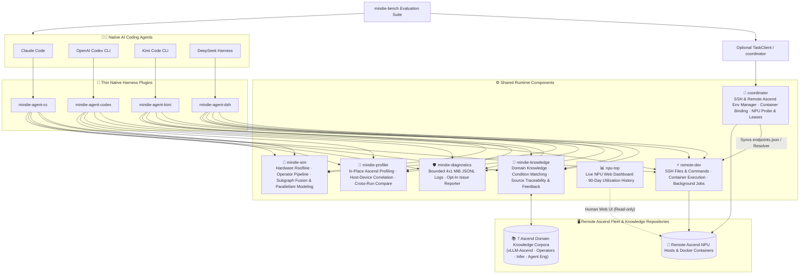

<p align="center">
  
</p>

<h1 align="center">MindIE Agent</h1>

<p align="center">
  <strong>Ascend domain knowledge, remote NPU execution, and traceable engineering experience for native coding agents</strong>
</p>

<p align="center">
  <a href="https://github.com/mindie-agent/mindie-agent/blob/main/docs/releases/0.1.2.en.md"></a>
  <a href="https://github.com/mindie-agent/mindie-agent-cc"></a>
  <a href="https://github.com/mindie-agent/mindie-agent-codex"></a>
  <a href="https://github.com/mindie-agent/mindie-agent-kimi"></a>
  <a href="https://github.com/mindie-agent/mindie-agent-dsh"></a>
  <a href="https://github.com/mindie-agent/awesome-mindie-skills"></a>
</p>

<p align="center">
  <a href="./README.md">中文</a> · <strong>English</strong> · <a href="#-zero-friction-one-sentence-install-agent-only-">⚡ 1-Sentence Install</a> · <a href="#-why-mindie-agent">✨ Why MindIE Agent</a> · <a href="#️-architecture--experience-flywheel">🏗️ Architecture</a> · <a href="#-how-to-use-after-installation-trigger-modes--examples">🔥 Workflows</a> · <a href="#-repository-ecosystem">📦 Ecosystem</a> · <a href="#-contributing-let-your-agent-do-it-too">🤝 Contributing</a> · <a href="#-010-milestone--benchmark-record">🚀 v0.1.0 Benchmarks</a> · <a href="./docs/README.en.md">📚 Docs</a>
</p>

---

## ⚡ Zero-Friction One-Sentence Install (Agent-Only ☕)

Put down the terminal—don't memorize CLI flags or copy-paste setup scripts by hand. Since MindIE Agent is built for AI coding Agents, **we only accept installation by your Agent**.

Open **Claude Code**, **OpenAI Codex CLI**, **Kimi Code**, or **DeepSeek Harness**, and toss this single sentence into your chat:

```text
Please install MindIE Agent for me: https://github.com/mindie-agent/mindie-agent
```

Sit back while your Agent reads this page, verifies a **stable `gh` (GitHub CLI) channel**, detects its own host environment, and executes the **Agent Auto-Install Playbook** below—completing plugin registration, runtime setup, and workspace onboarding end-to-end (no Star or Fork required).

<details>
<summary>🤖 <b>Agent Auto-Install Playbook (Click to expand / Automatically parsed by AI Agents)</b></summary>

> **Instructions for AI Agents**: When the user asks you to install `mindie-agent`, do **not** ask them to read documentation manually. Execute the following four steps in order:
>
> #### Step 1: Verify prerequisites & the `gh` GitHub channel (Hard Requirement)
> **A stable, authenticated GitHub CLI (`gh`) channel is a hard requirement for MindIE Agent**—it powers plugin marketplace fetches, locked release verification, `knowledge-vllm-ascend` corpus sync, automated community PR publication (via `gh api` and `!gh auth git-credential`), and optional issue reporting. Run in the terminal first:
> ```bash
> git --version && uv --version && gh --version
> GH_USER=$(gh api --hostname github.com user --jq .login) && echo "GitHub channel verified for account: $GH_USER"
> gh auth setup-git --hostname github.com
> ```
> - **Hard Gate (Never skip or silently ignore failures; a DSH `0.1.1` / `0.1.2`-only install without community contribution may skip the `gh` gate but still needs `git` and `uv`)**:
>   - If `gh` is missing: assist the user in installing GitHub CLI for their OS first (macOS: `brew install gh`; Windows: `winget install --id GitHub.cli`; Ubuntu / WSL: `sudo apt update && sudo apt install -y gh`).
>   - Reuse a working account. When login is needed, follow the [GitHub sign-in flow](docs/enterprise-network.en.md#github-sign-in-flow): browser login on ordinary networks, or token login on enterprise networks / blocked browser authorization. Guide creation if needed, receive an existing token through the hidden `gh` prompt, and let `gh` save it. Verify the account, Git and subsequent-process reuse before continuing. Resolve network/proxy/certificate failures as transport problems.
>
> #### Step 2: Preserve consent and prepare contribution targets only when needed
> Installation registers the plugin needed by the current host. It requires neither a Star nor a Fork. Starring the project is the user's choice.
>
> Community contribution is off by default. Only after the user enables contribution to a target corpus `<owner/repo>` should you create or reuse that corpus's personal Fork and bind `<GH_USER>/<repo>` as the push target. Do not Fork the main repository, plugin repositories or all domain repositories as an installation step.
>
> #### Step 3: Identify your host environment & install the matching plugin
> Run the **single matching branch** for your host CLI (check `claude --version`, `codex --version`, `kimi --version`, or `dsh --version` if unsure; this composition uses Codex `v0.1.12`, Claude Code `v0.1.8`, Kimi Code `v0.1.7`, and DSH `v0.1.6`. Runtime components discover formal GitHub Releases directly from their official repositories while [`channels/0.1.json`](./channels/0.1.json) records the verified product combination):
>
> - **Branch A — If you are running inside Claude Code (`CLAUDECODE` env or `claude` CLI)**:
>   ```bash
>   claude plugin marketplace add "https://github.com/mindie-agent/mindie-agent-cc.git#v0.1.8"
>   claude plugin install mindie-agent@mindie-agent-cc --scope user
>   claude --init-only
>   claude plugin list --json
>   claude mcp list
>   ```
>   *Verification*: Confirm `claude plugin list --json` shows `mindie-agent@mindie-agent-cc` (`0.1.8`) enabled and `claude mcp list` shows both `mindie-knowledge` and `remote-dev` as `Connected`.
>
> - **Branch B — If you are running inside OpenAI Codex CLI (`CODEX_CI` / `CODEX_THREAD_ID` env or `codex` CLI)**:
>   ```bash
>   codex plugin marketplace add https://github.com/mindie-agent/mindie-agent-codex.git --ref v0.1.12
>   codex plugin add mindie-agent@mindie-agent --json
>   codex plugin list --json
>   ```
>   *Verification*: Confirm `codex plugin list --json` shows `mindie-agent@mindie-agent` (`0.1.12`) enabled. Let the user know that starting a new session will trigger `SessionStart` to build the locked runtime.
>
> - **Branch C — If you are running inside Kimi Code CLI (`KIMI_CODE_HOME` env or `kimi` CLI)**:
>   ```bash
>   MINDIE_TMP="${TMPDIR:-/tmp}/mindie-agent-kimi-install"
>   rm -rf "$MINDIE_TMP"
>   git clone --depth 1 --branch v0.1.7 https://github.com/mindie-agent/mindie-agent-kimi.git "$MINDIE_TMP"
>   SETUP_OUT=$(python3 "$MINDIE_TMP/scripts/setup.py")
>   echo "$SETUP_OUT"
>   NATIVE_PKG=$(printf '%s\n' "$SETUP_OUT" | python3 -c 'import sys, json; text=sys.stdin.read(); data=json.loads(text[text.find("{"):]); print(data["native_package"])')
>   python3 "$MINDIE_TMP/scripts/install_kimi_plugin.py" --kimi-home "${KIMI_CODE_HOME:-$HOME/.kimi-code}" --plugin-root "$NATIVE_PKG"
>   ```
>   *Verification*: Confirm `install_kimi_plugin.py` succeeds and let the user know they can use `/mindie-agent` inside Kimi Code.
>
> - **Branch D — If you are running inside DeepSeek Harness (DSH; `DSH_PROFILE` / `DSH_HOME`, or the `dsh` CLI)**:
>   ```bash
>   MINDIE_TMP="${TMPDIR:-/tmp}/mindie-agent-dsh-install"
>   rm -rf "$MINDIE_TMP"
>   git clone --depth 1 --branch v0.1.6 https://github.com/mindie-agent/mindie-agent-dsh.git "$MINDIE_TMP"
>   uv --native-tls run --quiet --no-project --python 3.11 "$MINDIE_TMP/scripts/setup.py"
>   ```
>   Then install and enable in the DSH Web **Plugins** page:
>   ```text
>   git+https://github.com/mindie-agent/mindie-agent-dsh.git#v0.1.6
>   ```
>   Inside a DSH session that has the `plugin_manager` tool, the same step is:
>   ```text
>   plugin_manager(action="install_bundle", target="git+https://github.com/mindie-agent/mindie-agent-dsh.git#v0.1.6")
>   ```
>   *Verification*: `setup.py` reports `status: ready`, `activation.status: active`, components `mindie-knowledge 0.13.3 / remote-dev 0.11.1 / mindie-diagnostics 0.5.4`, and `knowledge.status: inactive` (knowledge stays inactive during setup until a session manually invokes `/mindie-agent`); the Plugins page shows `mindie-agent-dsh` enabled. Tell the user to open a **new session** and use `/mindie-agent`.
>
> - **Branch E — If you are running inside Cursor or another generic MCP client (standalone `remote-dev` SSH toolset)**:
>   Add `remote-dev` to `.mcp.json` (or `.cursor/mcp.json`):
>   ```json
>   {
>     "mcpServers": {
>       "remote-dev": {
>         "type": "stdio",
>         "command": "uvx",
>         "args": ["--from", "git+https://github.com/mindie-agent/remote-dev@v0.11.1", "remote-dev", "server"]
>       }
>     }
>   }
>   ```
>
> #### Step 4: Finish first-time setup and development workspace onboarding
> Normal installation of all four full plugins includes this step, even when contribution is disabled. Reuse verified GitHub authentication, present the existing user notice, then offer creating and initializing [vllm-ascend-workspace](https://github.com/mindie-agent/vllm-ascend-workspace), reusing a directory, or keeping the current directory:
>
> - [Codex Workspace Setup](https://github.com/mindie-agent/mindie-agent-codex/blob/main/plugins/mindie-agent/skills/mindie-agent/references/workspace-setup.md)
> - [Claude Code Workspace Setup](https://github.com/mindie-agent/mindie-agent-cc/blob/main/skills/mindie-agent/references/workspace-setup.md)
> - [Kimi Code Workspace Setup](https://github.com/mindie-agent/mindie-agent-kimi/blob/main/skills/mindie-agent/references/workspace-setup.md)
> - [DSH Workspace Setup](https://github.com/mindie-agent/mindie-agent-dsh/blob/main/skills/mindie-agent/references/workspace-setup.md)
>
> Approval to create or reuse includes automatically adding the selected absolute path through the current harness's native project/workspace entry and checking the result. Do not ask separately for registration. Follow the checkout's `AGENTS.md` and `repo_init.py`, preserving saved fork configuration; initialization can finish later. Reuse existing choices without repeating onboarding during ordinary tasks.
>
> #### Step 5: Report back to the user
> Include the selected workspace path, native registration/open status and source initialization status, with any remaining native UI action.
> Once finished, report:
> 1. The verified `gh` GitHub channel and authenticated account, where applicable;
> 2. Which plugin and version were installed and verified;
> 3. That users only need the single `/mindie-agent` entry to invoke Ascend domain knowledge & Skills, while `remote-dev` remote NPU tools trigger automatically by default;
> 4. That **community knowledge sharing** and **automated fault reporting** are **off by default (opt-in)**; if community sharing is enabled later, the Agent will automatically Fork the corresponding target knowledge repository (e.g., `mindie-agent/knowledge-vllm-ascend` -> `$GH_USER/knowledge-vllm-ascend`) on demand.

</details>

---

## ✨ Why MindIE Agent?

MindIE Agent brings domain knowledge and remote development tools into your existing Claude Code, Codex, Kimi Code, or DSH session across `vLLM-Ascend` / `vLLM-Omni`, `MindIE-SD`, Ascend operators, and distributed inference—covering new model bring-up (0-day adaptation), model and operator performance tuning, and fault diagnosis. See the [architecture](./docs/architecture.en.md) and release records below for implementation and acceptance details.

| Capability | What it helps you do |
| --- | --- |
| **Condition-matched domain knowledge** | Retrieve hardware constraints, diagnostic SOPs, troubleshooting workflows, and operator optimizations matched against your framework version, NPU model, and workload shapes, with traceable source commits |
| **Remote NPU development and validation** | Use [`remote-dev`](https://github.com/mindie-agent/remote-dev) to edit files, apply patches, run commands, manage long-running background jobs, and inspect logs across SSH hosts and Docker containers |
| **Profiling analysis & performance modeling** | Use [`profiler`](https://github.com/mindie-agent/profiler) for in-place Ascend profiling analysis and cross-run comparison, and [`sim`](https://github.com/mindie-agent/sim) for roofline bounds, memory bandwidth limits, and operator pipeline modeling |
| **Resource coordination and fault diagnosis** | Use [`coordinator`](https://github.com/mindie-agent/coordinator) for NPU and port leases, [`npu-top`](https://github.com/mindie-agent/npu-top) for live cluster monitoring, and [`diagnostics`](https://github.com/mindie-agent/diagnostics) for local fault logging |
| **Experience distillation & reuse** | Redact and save troubleshooting records within your authorized project scope, distill verified fixes into reusable knowledge entries, and optionally contribute them back to the community |

Plugins preserve your host agent's native session and tool loop, loading domain knowledge on demand. See the [knowledge system](./docs/knowledge-system.en.md) for details.

---

## 🏗️ Architecture & Experience Flywheel

### 1. Modular Layered Architecture

MindIE Agent combines **thin native client plugins** with **decoupled shared runtime components**:



### 2. Continuous Engineering & Knowledge Loop

```mermaid
sequenceDiagram
  autonumber
  actor Dev as Developer
  participant Agent as Coding Agent (Claude / Codex / Kimi / DSH)
  participant Know as mindie-knowledge (Local Service)
  participant NPU as remote-dev (Remote Ascend Container)
  participant Repo as Public Knowledge Repo (knowledge-vllm-ascend, etc.)

  Dev->>Agent: Invoke /mindie-agent + engineering goal (Bring-up / Kernel Dev / Testing / Tuning)
  Agent->>Know: 1. Query by hardware & workload conditions, load matched rules & references
  Agent->>NPU: 2. Edit code, sync patches, and run tests in the target container
  NPU-->>Agent: Return build, accuracy, and performance results with log paths
  Agent-->>Dev: 3. Deliver verified changes and test summary; optionally record feedback
  Note over Agent,Know: Runs in /mindie-agent-enabled sessions when authorized by local consent & project scope
  Agent->>Know: 4. Redact and archive session troubleshooting records
  Agent->>Know: 5. Distill verified fixes into reusable knowledge entries
  Note over Know,Repo: Triggered only when community sharing is enabled
  Know->>Repo: 6. Submit reviewed entries via PR for downstream sync
```

---

## 🔥 How to Use After Installation (Trigger Modes & Examples)

MindIE Agent is built around **simplicity and progressive disclosure**—from the user's perspective, **there is only ONE command to remember: `/mindie-agent`**. You never need to memorize internal subcommands (such as `:init` or `:status`); operational context is loaded on demand:

| Capability Module | Trigger Mode | How It Works |
| --- | --- | --- |
| **🧠 Ascend Domain Knowledge & Skills**<br/>(`mindie-knowledge` + Domain Skills) | **Manual Per-Session Trigger**<br/>(Unified `/mindie-agent` entry) | When adapting a model in `vLLM-Ascend`, writing `AscendC` / `Triton` kernels, adding accuracy tests, or tuning performance, type **`/mindie-agent <your task>`** (or `$mindie-agent` in Codex) once in the current session to enable knowledge search, feedback, distillation, and sync across subsequent turns. Setup, status checks, and preference changes also go through `/mindie-agent` + natural language. |
| **⚡ Remote Ascend Execution & Deterministic Tools**<br/>(`remote-dev` / `coordinator` / `profiler` / `sim` / `diagnostics`) | **Default Auto-Trigger**<br/>(Always available, no `/mindie-agent` needed) | `remote-dev` and deterministic engineering tools are active by default. Whenever you mention a remote server, container, NPU probe/lease, profiling trace, roofline simulation, or factual status check in normal conversation, your Agent **automatically calls** the corresponding tools without requiring `/mindie-agent`. |
| **🔄 Experience Distillation & Community Sharing**<br/>(Redaction, distillation, and review) | **Configure consent once; active in `/mindie-agent` sessions** | Contribution consent (`mindie-consent.json`) is configured once and persists across sessions. In any session enabled via `/mindie-agent`, `Stop` redacts and archives public dialogue within your authorized project scope (ordinary unactivated sessions perform zero `Stop` capture); verified fixes are distilled into reusable knowledge entries and shared when contribution is enabled. |

### Copy-Paste Usage Examples

#### 💡 Example 1: Manually Invoke `/mindie-agent` for Feature Design, Kernel Development & Test Authoring
```text
/mindie-agent I want to design and implement a custom fused operator in vllm-ascend (with Triton / AscendC kernel support) and add unit + accuracy tests. Check MindIE knowledge and existing conventions to propose the design and test plan.
```
> **What happens**: The Agent selects the relevant domain, matches your hardware and framework conditions, and loads the corresponding constraints, reference implementations, and verification checklists.

#### 💡 Example 2: Default Auto-Triggered `remote-dev` for Remote Ascend Container Coding & Testing
```text
Connect to the vllm-dev container on host 192.0.2.21 (port 22), sync my new operator implementation and unit tests into /workspace/vllm-ascend, and run the full pytest accuracy and benchmark suite on the NPU.
```
> **What happens**: Without needing any slash command, your Agent automatically uses `remote_read`, `remote_edit`, and `remote_bash` inside the remote `vllm-dev` container over pooled SSH, turning long build and test runs into managed background jobs with live log streaming.

#### 💡 Example 3: Joint `/mindie-agent` + `remote-dev` Optimization with Experience Distillation
```text
/mindie-agent Using Ascend inference and kernel tuning experience, help me profile decode latency bottlenecks on our remote NPU dev machine, pull the key profiling metrics, and verify an optimization patch.
```
> **What happens**: The Agent combines domain knowledge with remote execution to pinpoint the bottleneck, then verifies numerical accuracy and latency speedup on the NPU. Verified conclusions can be distilled into reusable knowledge entries for future sessions.

---

## 📦 Repository Ecosystem

Every repository under `@mindie-agent` has a clean, single-purpose boundary and can be used together or standalone:

### 1. Product Entry, Benchmarks & Community Catalogue

| Repository | Role |
| --- | --- |
| **[`mindie-agent`](https://github.com/mindie-agent/mindie-agent)** *(This Repo)* | Product entry point, system architecture, engineering design principles, release compatibility contracts, and release records |
| **[`mindie-bench`](https://github.com/mindie-agent/mindie-bench)** | End-to-end evaluation harness and live NPU benchmark suite: real engineering tasks, accuracy/performance verification, isolated host runs, component benchmarks, and cross-task reuse evaluation |
| **[`awesome-mindie-skills`](https://github.com/mindie-agent/awesome-mindie-skills)** | Curated catalogue of open-source Agent Skills for the Ascend NPU AI Infra workflow (covering `vLLM-Ascend`, `AscendC`/`Triton` kernels, accuracy testing, and profiling) |
| **[`vllm-ascend-workspace`](https://github.com/mindie-agent/vllm-ascend-workspace)** | Lightweight customizable local workspace for `vLLM` + `vLLM-Ascend` development with isolated task Git Worktrees and MindIE Agent integration |

### 2. Native Harness Plugins

| Repository | Host Client | Role |
| --- | --- | --- |
| **[`mindie-agent-cc`](https://github.com/mindie-agent/mindie-agent-cc)** | **Claude Code** | Native Claude Code plugin: lifecycle hooks, MCP stdio bridges, and pinned runtime management |
| **[`mindie-agent-codex`](https://github.com/mindie-agent/mindie-agent-codex)** | **OpenAI Codex CLI** | Native OpenAI Codex CLI plugin: marketplace packaging, session redaction, and background service management |
| **[`mindie-agent-kimi`](https://github.com/mindie-agent/mindie-agent-kimi)** | **Kimi Code CLI** | Native Kimi Code plugin: atomic version switching, redacted session capture, and MCP bridging |
| **[`mindie-agent-dsh`](https://github.com/mindie-agent/mindie-agent-dsh)** | **DeepSeek Harness (DSH)** | Native DSH plugin: `/mindie-agent`, knowledge tools, lifecycle bridging, and `remote-dev` integration |

### 3. Shared Runtime Components

| Repository | Package / CLI | Role |
| --- | --- | --- |
| **[`knowledge`](https://github.com/mindie-agent/knowledge)** | `mindie-knowledge` | Graded knowledge unit (L1–L4) management, condition-matched retrieval, multi-domain shard routing, source-pinned feedback, two-layer redaction, and community PR publishing |
| **[`remote-dev`](https://github.com/mindie-agent/remote-dev)** | `remote-dev` | SSH file and command tools, container execution, background jobs, pooled connections, and artifact transfer |
| **[`coordinator`](https://github.com/mindie-agent/coordinator)** | `mindie-coordinator` | SSH & remote Ascend environment manager: host/key inventory, container binding & provisioning, NPU/server probing (`mindie_probe`), NPU/port lease arbitration (`mindie_lease`), and managed task execution |
| **[`profiler`](https://github.com/mindie-agent/profiler)** | `mindie-profiler` / `mindie_profiler` | Ascend profiling collection and in-place analysis component: controlled capture, `inventory / analyze / correlate / compare / sql` trace analysis, memory breakdown, and cross-run comparison CLI |
| **[`sim`](https://github.com/mindie-agent/sim)** | `mindie-sim` / `mindie_sim` | Ascend performance modeling and roofline simulator: multi-SKU A2/A3/A5 hardware specs, `H2D`/`D2H`/`D2D` transfer bounds, Cube/Vector/MTE pipeline scheduling solver, subgraph fusion estimator, and distributed parallelism modeling |
| **[`npu-top`](https://github.com/mindie-agent/npu-top)** | `npu-top` | Human-facing Ascend NPU observability dashboard: live web UI (`127.0.0.1:8788`) and 90-day SQLite utilization history (sharing `coordinator`'s `machines.json`) |
| **[`diagnostics`](https://github.com/mindie-agent/diagnostics)** | `mindie-diagnostics` / `mindie_diagnostics` | Local fault logging and diagnostics component: CANN/`plog` deterministic error analysis, bounded 4×1 MiB JSONL rotation, redacted support bundles, and opt-in GitHub Issue reporting |

### 4. Public Domain Knowledge Corpora

All public knowledge corpora follow the `mindie-graded-unit/1` graded schema (`L1` Canonical Facts & Constraints · `L2` Standard Operating Procedures · `L3` Multi-Stage Workflows · `L4` Optimization Patterns) with explicit applicability conditions and verification evidence:

| Repository | Domain (`domain`) | Scope & Coverage |
| --- | --- | --- |
| **[`knowledge-vllm-ascend`](https://github.com/mindie-agent/knowledge-vllm-ascend)** | `vllm-ascend` | `vLLM-Ascend` & `vLLM-Omni` engineering corpus (`91` units): 0-day model bring-up, PD disaggregation, MoE EP/MC2, quantization, speculative decoding, ACLGraph/TorchAir, and `vllm-omni` multi-stage omni-modality (`Thinker -> Talker -> Code2Wav` / AR+DiT / TTS / Duplex) pipeline tuning |
| **[`knowledge-operators`](https://github.com/mindie-agent/knowledge-operators)** | `operators` | Ascend operators corpus (`105` units): 910B / 910C (A3) / 950 (A5) hardware constraints, `AscendC`, `Triton-Ascend`, Catlass, FlashAttention/MLA, Matmul/MoE fusion, and `MindIE-SD` custom sparse attention ops & fusion scope analysis |
| **[`knowledge-infer-core`](https://github.com/mindie-agent/knowledge-infer-core)** | `infer-core` | Ascend inference serving & engine core corpus (`109` units): `cann-recipes-infer` model recipes, `Ascend/MindIE-SD` (`mindiesd`) DiT sparse attention (`RainFusion`/`Ada-BSA`/`EagleQBSA`), step caching (`DiTCache`), 3D VAE state-carry sliced decode, and timestep-aware quantization contracts |
| **[`knowledge-infer-distributed`](https://github.com/mindie-agent/knowledge-infer-distributed)** | `infer-distributed` | Distributed inference & collective communication corpus (`39` units): HCCL troubleshooting, RoCE/HCCS topology, SHMEM, Mooncake/Yuanrong transport, and multi-node DP/TP/EP/PP/CP plus DiT Ulysses/Ring/CFG hybrid parallelism & power-cap mitigation |
| **[`knowledge-infer-observability`](https://github.com/mindie-agent/knowledge-infer-observability)** | `infer-observability` | Inference observability, diagnostics & benchmarking corpus (`39` units): CANN/`plog`/device fault triage, `msprof` profiling workflows, analytic simulation, Window A/B/A `perf-gate`, and 3-tier image/video `accuracy-gate` protocols |
| **[`knowledge-infer-ops-compat`](https://github.com/mindie-agent/knowledge-infer-ops-compat)** | `infer-ops-compat` | Graph compilation, custom op registration & migration compatibility corpus (`34` units): TorchAir/ACLGraph capture, `torch_npu._inductor` pattern pass development, two-stage (`API-first, then compile`) integration, CUDA-to-Ascend migration, and cluster deployment |
| **[`knowledge-agent-engineering`](https://github.com/mindie-agent/knowledge-agent-engineering)** | `agent-engineering` | Agent engineering & governance corpus (`33` units): multi-agent orchestration, `MindIE-SD` S0–S6 auto-optimization workflow, `kb-lint` governance, two-layer privacy redaction gates, and benchmark evaluation |

---

## 🧭 Engineering Design Philosophy

MindIE Agent is guided by **18 pragmatic [Engineering Design Principles](./docs/design-principles.en.md)** ([中文](./docs/design-principles.md)) forged through real-world Ascend engineering:

- **Optimize for Total User Goal Cost**: Reliability mechanisms must reduce total comprehension, waiting, and debugging cost—never imposing ceremony on ordinary tasks for rare edge cases.
- **Zero Cognitive Load & On-Demand Intervention**: Tools absorb internal state complexity; Skills stay informational; Knowledge remains advisory with explicit evidence and applicability conditions.
- **Reuse Mature Mechanisms First**: Leverage native host, OS, and mature component capabilities first, and delete obsolete compatibility shims cleanly when upgrading.
- **Transparent State & Fail-Visible Semantics**: Explicitly distinguish completed work, failure, and uncertain external side effects (`unknown`)—never masking failures or blindly replaying uncertain writes.
- **Agent-Native Structure & Bounded Resource Discipline**: Keep core modules `< 800` lines with a four-part contract header in the top 30 lines, and keep resident memory/VRAM strictly bounded with spec-driven local vs. remote placement.

---

## 🤝 Contributing (Let Your Agent Do It Too)

Just like installation, contributing new features, bugfixes, or Ascend domain knowledge to MindIE Agent is **designed to be handed directly to your coding Agent** (every repository under `@mindie-agent` is 100% written, tested, and maintained by Agents).

To keep 13+ repositories clean, fast, and free of over-defensive bloat or host pollution, contributing Agents follow **two mandatory gates** (see **[`CONTRIBUTING.en.md`](./CONTRIBUTING.en.md)** · **[中文](./CONTRIBUTING.md)**):

1. **📖 Before Coding: Read the Design Principles First** — Before touching code, your Agent must read [`AGENTS.md`](./AGENTS.md) and [`docs/design-principles.en.md`](./docs/design-principles.en.md) to align on single-purpose boundaries, fail-visible semantics, timeout arithmetic, the four anti-over-defensive iron rules, `< 800`-line modules with top headers, and bounded memory/VRAM design rules.
2. **✅ After PR Submission: Complete the Pre-PR Checklist Self-Review (Including Format Hygiene)** — After submitting a PR, your Agent must audit its final `git diff` against [`.github/pull_request_template.md`](./.github/pull_request_template.md) (checking all items `1–8` through `15`, including repository formatting hygiene such as mandatory Unix `LF` `\n` line endings, and filling in concrete review evidence and executed test results) and pass the automated CI gates ([`check_lf_eol.py`](./.github/scripts/check_lf_eol.py) + [`check_pr_checklist.py`](./.github/scripts/check_pr_checklist.py)).

To contribute, simply copy and send this prompt to your Agent:

```text
I want to contribute a change to MindIE Agent: <describe your feature, bugfix, or Ascend knowledge addition in one sentence>.
Please follow https://github.com/mindie-agent/mindie-agent/blob/main/CONTRIBUTING.en.md:
1. Read AGENTS.md and docs/design-principles.en.md before writing any code;
2. Implement the change with tiered tests, open a PR, and complete the Pre-PR Checklist self-review and verification evidence in .github/pull_request_template.md.
```

---

The current `0.1` maintenance patch **[0.1.2](./docs/releases/0.1.2.en.md)** ([中文](./docs/releases/0.1.2.md) · [SSH acceptance](./docs/releases/0.1.2/ssh-auth-acceptance.json)) shares saved SSH passwords, key installation, and recovery across development, coordination, and monitoring processes, chats, and plugins. `remote-dev 0.11.1` also fixes SSH discovery with Git for Windows 2.56.0. All 19 real SSH tests pass on macOS, Windows PowerShell (including inherited Git Bash PATH), and WSL2. [`channels/0.1.json`](./channels/0.1.json) records the component and plugin versions; the acceptance record distinguishes existing-installation upgrades from host catalog refresh.

The previous `0.1` maintenance patch **[0.1.1](./docs/releases/0.1.1.en.md)** ([中文](./docs/releases/0.1.1.md) · [0.1.1 Dev Pilot Report](./docs/releases/0.1.1/benchmark-pilot.en.md) · [中文试点报告](./docs/releases/0.1.1/benchmark-pilot.md) · [Pilot Evidence (`benchmark-pilot.json`)](./docs/releases/0.1.1/benchmark-pilot.json) · [4-Host Native Update Acceptance (`native-update-acceptance.json`)](./docs/releases/0.1.1/native-update-acceptance.json)) covers per-session manual `/mindie-agent` knowledge activation, whole-delivery token budget estimation and exploration pass-through, physical Die & HBM headroom placement, bounded diagnostic intake, captured kernel cost contracts, behavior-executed task verifiers, the `HTTP/1.1 chunked` settlement close-race fix, and the `release-kind=patch` release pipeline (all 8 shared runtime and evaluation components—`knowledge 0.13.3`, `remote-dev 0.10.6`, `diagnostics 0.5.2`, `sim 0.7.1`, `coordinator 0.6.3`, `profiler 0.5.0`, `npu-top 0.2.1`, and `mindie-bench 0.4.4`—and all 4 native host plugins `0.1.2` are formally published on GitHub Releases, byte-verified, verified across the 12-repository `release_gate` preflight, and closed on macOS `arm64` formal native session & update acceptance, with the offline CPU engineering reproduction and `G5` dev pilot report archived alongside). The section below retains the historical `0.1.0` record.

## 🚀 0.1.0 Milestone & Benchmark Record

> **Benchmark Evidence Correction (2026-10-24):** Historical solve rates, speedups, and token savings in this section and in the `0.1.0` value benchmark report are **suspended as current product acceptance claims**. Six task verifiers previously accepted nonfunctional source changes, and the strategy-selection pilot's legacy default executor synthesized continuation outcomes and costs from its private judge. Passing soundness checks on the repaired verifiers does not retroactively rejudge historical trials, and component fixtures, deterministic replays, simulations, and live NPU measurements each carry distinct evidence boundaries. See **[Parallel Architecture Review & Fixes (2026-10-24)](./docs/architecture-review-20261024.md)**.

The latest feature milestone is **[`v0.1.0`](./docs/releases/0.1.0.en.md)** ([中文发布说明](./docs/releases/0.1.0.md) · [18-Task Full Benchmark Report](./docs/releases/0.1.0/value-results.md) · [109-Trial Redacted Manifest (`agent-trials-109.json`)](./docs/releases/0.1.0/agent-trials-109.json) · [Component Benchmark Manifest (`value-results.json`)](./docs/releases/0.1.0/value-results.json) · [Author's Note & Design Philosophy](./docs/releases/0.1.0/design-philosophy.en.md) · [`channels/0.1.json`](./channels/0.1.json)). `v0.1.0` marks MindIE Agent's evolution from the `0.0.1` prototype into an intelligent R&D and verification substrate for Ascend NPU AI Infra (establishing the [`channels/0.1.json`](./channels/0.1.json) Release Channel Manifest contract to record verified product combinations and verifying `v0.0.3` locked plugin auto-updates; independent runtime component updates discover formal GitHub Releases directly from each official component repository and cut over when idle after verifying immutable tag SHAs, `pyproject.toml` versions, and `benchmark-results.json`), with historical records for 18 engineering tasks, `109` primary trials, all 7 shared runtime components, and 3 hardware platforms × 4 host plugins. The figures below are retained for traceability under the correction above; benefit comparisons require rejudgment:

1. **`mindie-bench` Dual-Model (`codex + home/codex/gpt-6.1-sol (xhigh)` & `dsh + deepseek-flash (max)`) Controlled Ablation Across 18 Engineering Tasks & `109` End-to-End Trials (`G0 → G1 → G2 → G3 → G4`, Including Live `Ascend950DT` NPUs)**:
   - **`G0 → G1 → G2` (`remote-dev` + `knowledge` L1–L4 Progressive Disclosure)**: Accelerates cross-module L2/L3 vague troubleshooting tasks by **`1.80x – 2.77x`**, cuts token consumption by **`15% – 76%`**, and bounds single-task knowledge reading to **`4,814–5,599` tokens (`< 8,000` ceiling)** (note: when a local single-file traceback is already self-contained, extra `knowledge_query` round-trips can incur negative latency deltas; see [`value-results.md`](./docs/releases/0.1.0/value-results.md) for the full distribution);
   - **`G2 → G3` (`Stop` Capture + `C6` Structured Experience Distillation Flywheel)**: On sibling L2 and live L3 black-box `.so` NPU transfer tasks (`rotary_dim=64 → 32`), lifts `codex (xhigh)` first-pass solve rate from **`0% (0/3 across G0/G1/G2) → 100% (1/1 on G3)`** (**`3.44x` speedup** on live L3 NPU with `codex xhigh`; `dsh` solved `G0–G3` and reduced L3 delivery latency from `217.5s` to `171.9s`);
   - **`G2 → G4` (`mode="reuse" → mode="explore"` De-Biased Exploration + Leave-One-Out Ablation)**: Achieves **`G0 (0/8, 0%) / G2 (0/8, 0%) → G4 (8/8, 100%)`** across 2 operator problem families × L2/L3 = 4 fusion tasks × 2 models (with `knowledge_gradient = "near_exact"` factor-graph exploration guidance).
   - **Evaluation Scope & Reproducibility Note**: The `109` trials represent an author-constructed controlled ablation benchmark (`repetitions = 1` per cell; `home/codex/gpt-6.1-sol` and `deepseek-flash` are internal metering-relay aliases that external users can replace with public API endpoints). All 109 primary trials plus 55 supplementary/retry receipts are published in [`agent-trials-109.json`](./docs/releases/0.1.0/agent-trials-109.json).
2. **Real Agent Closed-Loop & Component Benchmarks Across All 7 Shared Runtime Components (`profiler`, `sim`, `diagnostics`, `coordinator`, `npu-top`, `remote-dev`, `knowledge`)**:
   - On 4 dedicated component repair tasks, both models lift solve rate from **`75% (3/4) → 100% (4/4)`**, reduce total delivery time by **`-17.1% to -33.8%`**, and cut output tokens by **`-25.2% to -34.1%`**:

| Component / Benchmark Suite | Version | Measured Gains & Key Takeaways |
| --- | --- | --- |
| **⚡ `remote-dev` Remote Container & Long-Job Execution** | `v0.10.4` | On L2/L3 live Ascend tasks, delivers **`1.55x – 2.06x` speedups** over bare host baselines on `dspark-mrv2` / `l3-dspark-mrv2` and solves `quarot` quantization bugfix **`3/3` runs**; passes all patch-parser, tool-protocol, and record-serialization benchmarks |
| **🎯 `coordinator` Multi-Agent Anti-Collision & A5 Preflight** | `v0.6.2` | Accelerates real Agent multi-Die lease repair tasks by **`1.17x – 2.08x`**; under 2-agent contention, eliminates port conflicts (**`3 → 0`**) and duplicate device selections (**`3 → 0`**) with **`~1.9 ms`** lease handoff; adds Ascend A5 topology and HCCL/RoCE preflight checks |
| **🔬 `profiler` Slow-Rank / Slow-Link & Memory Attribution** | `v0.5.0` | Lifts real Agent `msprof` straggler/HBM repair solve rate from **`0% (G0) → 100% (G2)`** across both models (**`-29.7% to -34.6%` faster**); in-place read-only analysis (`~7.6 ms`) **100% separates slow-link (`Comm`) from slow-rank (`Attention`)** and attributes **`99%` of `10.0 GB` peak HBM** (**`0.5% < 10%` residual gate**) |
| **📐 `sim` Operator Pipeline, Subgraph Screening & A3 Modeling** | `v0.7.0` | **100% adopted by both models** to predict Ascend A3 Qwen2.5-7B-Instruct `c=1` whole-network TPOT at **`15.06 ms`** vs. **`15.71 ms` measured** (**`-4.14%` error**, within `±15%` gate), identify **`2.0 MiB` removable GM traffic**, and reject `192 KiB` UB-overflowing subgraph candidates |
| **📊 `npu-top` & 🛡️ `diagnostics` Observability & Triage** | `v0.2.1` / `v0.5.1` | Accelerates real Agent 8-rank cascading `plog` triage by **`1.31x – 1.82x`** with **`-34.2% to -37.6%` fewer output tokens**, **100% pinpointing root-cause `Rank 3` (`aicore_memory_or_tiling`) and separating cascading `Rank 7` timeouts**; `npu-top` verifies `24/24` physical NPUs and live container attribution |
| **🧠 `knowledge` Progressive Disclosure & Closed-Loop Flywheel** | `v0.13.0` | All 7 public Ascend corpora (`450` graded `L1–L4` units) ready; bounds single-task reading at **`4,814–5,599` tokens (`< 8,000` ceiling)** and powers `100%` solve rates on `G3` black-box transfer and `G4` `mode="explore"` fusion tasks |

3. **3-Platform (`macOS` / `Windows WSL2` / `Windows 11 PowerShell`) × 4-Plugin Full-Matrix Verification**:
   - Completed end-to-end onboarding and full regression suites across all 3 OS hardware platforms and all 4 native host plugins (Claude Code / OpenAI Codex / Kimi Code / DeepSeek Harness), passing **`15,595+` tests (`0 failed`)**.

---

## 📚 Documentation Center

See **[`docs/README.en.md`](./docs/README.en.md)** (**[中文文档中心](./docs/README.md)**) for the complete documentation suite:

| Topic | 中文 | English |
| --- | --- | --- |
| **`v0.1.2` Patch Notes & SSH Authentication Acceptance (Current)** | [docs/releases/0.1.2.md](./docs/releases/0.1.2.md) · [认证验收](./docs/releases/0.1.2/ssh-auth-acceptance.json) | [docs/releases/0.1.2.en.md](./docs/releases/0.1.2.en.md) · [SSH Acceptance](./docs/releases/0.1.2/ssh-auth-acceptance.json) |
| **`v0.1.1` Patch Notes & Dev Pilot Report** | [docs/releases/0.1.1.md](./docs/releases/0.1.1.md) · [试点报告](./docs/releases/0.1.1/benchmark-pilot.md) | [docs/releases/0.1.1.en.md](./docs/releases/0.1.1.en.md) · [Pilot Report](./docs/releases/0.1.1/benchmark-pilot.en.md) |
| **`v0.1.0` Official Release & Full Benchmark Report** | [docs/releases/0.1.0.md](./docs/releases/0.1.0.md) · [实测报告](./docs/releases/0.1.0/value-results.md) | [docs/releases/0.1.0.en.md](./docs/releases/0.1.0.en.md) · [Benchmark Report](./docs/releases/0.1.0/value-results.md) |
| **`v0.1.0` Author's Note & Architectural Philosophy** | [docs/releases/0.1.0/design-philosophy.md](./docs/releases/0.1.0/design-philosophy.md) | [docs/releases/0.1.0/design-philosophy.en.md](./docs/releases/0.1.0/design-philosophy.en.md) |
| **`v0.0.3` Release & Benchmark Report** | [docs/releases/0.0.3.md](./docs/releases/0.0.3.md) | [docs/releases/0.0.3.en.md](./docs/releases/0.0.3.en.md) |
| **`v0.0.2` Release & Benchmark Report** | [docs/releases/0.0.2.md](./docs/releases/0.0.2.md) | [docs/releases/0.0.2.en.md](./docs/releases/0.0.2.en.md) |
| **System Architecture & Domain Boundaries** | [docs/architecture.md](./docs/architecture.md) | [docs/architecture.en.md](./docs/architecture.en.md) |
| **Engineering Design Principles** | [docs/design-principles.md](./docs/design-principles.md) | [docs/design-principles.en.md](./docs/design-principles.en.md) |
| **Contributing Guide (Agent-First Workflow & PR Self-Review Gate)** | [CONTRIBUTING.md](./CONTRIBUTING.md) | [CONTRIBUTING.en.md](./CONTRIBUTING.en.md) |
| **Knowledge & Experience System** | [docs/knowledge-system.md](./docs/knowledge-system.md) | [docs/knowledge-system.en.md](./docs/knowledge-system.en.md) |
| **Context, Experience & Exploration Design** | [docs/knowledge-context-and-exploration.md](./docs/knowledge-context-and-exploration.md) | [docs/knowledge-context-and-exploration.en.md](./docs/knowledge-context-and-exploration.en.md) |
| **Agent-Facing Profiler System Design (`mindie-profiler`)** | [docs/profiler-system.md](./docs/profiler-system.md) | [docs/profiler-system.en.md](./docs/profiler-system.en.md) |
| **Agent-Facing NPU Performance Modeling & Simulation (`mindie-sim`)** | [docs/simulation-system.md](./docs/simulation-system.md) | — |
| **Core Implementation & Knowledge Evolution Design** | [docs/core-implementation-and-geak-evolution-design.md](./docs/core-implementation-and-geak-evolution-design.md) | — |
| **Harness Boundary, Consent & Lifecycle** | [docs/harness-boundary-and-lifecycle.md](./docs/harness-boundary-and-lifecycle.md) | [docs/harness-boundary-and-lifecycle.en.md](./docs/harness-boundary-and-lifecycle.en.md) |
| **Native Runtime Reuse** | [docs/native-runtime-reuse.md](./docs/native-runtime-reuse.md) | [docs/native-runtime-reuse.en.md](./docs/native-runtime-reuse.en.md) |
| **Release Compatibility & Silent Update** | [docs/release-compatibility-and-update.md](./docs/release-compatibility-and-update.md) | [docs/release-compatibility-and-update.en.md](./docs/release-compatibility-and-update.en.md) |
| **Structured Diagnostics & Issue Reporting** | [docs/diagnostics-and-reporting.md](./docs/diagnostics-and-reporting.md) | [docs/diagnostics-and-reporting.en.md](./docs/diagnostics-and-reporting.en.md) |
| **Tiered Testing Architecture** | [docs/testing-architecture.md](./docs/testing-architecture.md) | [docs/testing-architecture.en.md](./docs/testing-architecture.en.md) |
| **L1–L4 Tiered Knowledge & System Testing Plan** | [docs/knowledge-tiered-testing-plan.md](./docs/knowledge-tiered-testing-plan.md) | — |
| **Roadmap & Next Steps** | [docs/next-steps.md](./docs/next-steps.md) | [docs/next-steps.en.md](./docs/next-steps.en.md) |
| **`v0.0.1` Release Record** | [docs/releases/0.0.1.md](./docs/releases/0.0.1.md) | [docs/releases/0.0.1.en.md](./docs/releases/0.0.1.en.md) |

---

## 📊 Repository & Download Statistics

<p align="center">
  <a href="https://github.com/mindie-agent/mindie-agent/blob/telemetry-data/README.md">
    
  </a>
</p>
