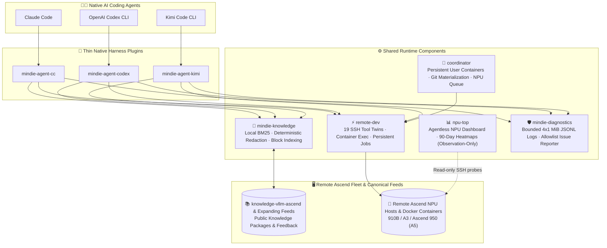
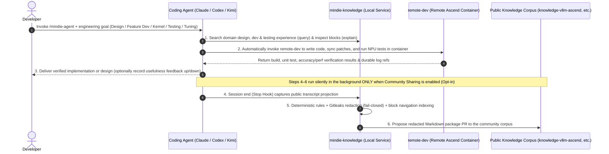

<p align="center">
  
</p>

<h1 align="center">MindIE Agent</h1>

<p align="center">
  <strong>The Unified Agent Capability Platform for Ascend NPU AI Infra — Spanning Architecture Design, Feature Development, Kernel Implementation, Testing & Self-Evolving Engineering Memory</strong>
</p>

<p align="center">
  <a href="https://github.com/mindie-agent/mindie-agent/blob/main/docs/releases/0.0.1.en.md"></a>
  <a href="https://github.com/mindie-agent/mindie-agent-cc"></a>
  <a href="https://github.com/mindie-agent/mindie-agent-codex"></a>
  <a href="https://github.com/mindie-agent/mindie-agent-kimi"></a>
  <a href="https://github.com/mindie-agent/awesome-mindie-skills"></a>
</p>

<p align="center">
  <a href="./README.md">中文</a> · <strong>English</strong> · <a href="#-zero-friction-one-sentence-install">⚡ 1-Sentence Install</a> · <a href="#-why-mindie-agent">✨ Why MindIE Agent</a> · <a href="#️-architecture--experience-flywheel">🏗️ Architecture</a> · <a href="#-how-to-use-after-installation-trigger-modes--examples">🔥 Workflows</a> · <a href="#-repository-ecosystem">📦 Ecosystem</a> · <a href="./docs/README.en.md">📚 Docs</a>
</p>

---

## ⚡ Zero-Friction One-Sentence Install

### Option 1: Just Paste the Link to Your Agent (Recommended ✨)

No need to memorize CLI flags. Open **Claude Code**, **OpenAI Codex CLI**, or **Kimi Code**, and paste this single sentence into your chat:

```text
Please install MindIE Agent for me: https://github.com/mindie-agent/mindie-agent
```

When your Agent reads this page, it will automatically detect its own host environment and execute the **Agent Auto-Install Playbook** below.

<details>
<summary>🤖 <b>Agent Auto-Install Playbook (Click to expand / Automatically parsed by AI Agents)</b></summary>

> **Instructions for AI Agents**: When the user asks you to install `mindie-agent`, do **not** ask them to read documentation manually. Detect which coding agent environment you are running inside and execute the matching branch below:
>
> #### Step 1: Check prerequisites & identify your host environment
> Verify `git --version && uv --version`, then run the **single matching branch** for your host CLI (check `claude --version`, `codex --version`, or `kimi --version` if unsure):
>
> - **Branch A — If you are running inside Claude Code (`CLAUDECODE` env or `claude` CLI)**:
>   ```bash
>   claude plugin marketplace add "https://github.com/mindie-agent/mindie-agent-cc.git#v0.0.1"
>   claude plugin install mindie-agent@mindie-agent-cc --scope user
>   claude --init-only
>   claude plugin list --json
>   claude mcp list
>   ```
>   *Verification*: Confirm `claude plugin list --json` shows `mindie-agent@mindie-agent-cc` (`0.0.1`) enabled and `claude mcp list` shows both `mindie-knowledge` and `remote-dev` as `Connected`.
>
> - **Branch B — If you are running inside OpenAI Codex CLI (`CODEX_CI` / `CODEX_THREAD_ID` env or `codex` CLI)**:
>   ```bash
>   codex plugin marketplace add https://github.com/mindie-agent/mindie-agent-codex.git --ref v0.0.1
>   codex plugin add mindie-agent@mindie-agent --json
>   codex plugin list --json
>   ```
>   *Verification*: Confirm `codex plugin list --json` shows `mindie-agent@mindie-agent` (`0.0.1`) enabled. Let the user know that starting a new session will trigger `SessionStart` to build the locked runtime.
>
> - **Branch C — If you are running inside Kimi Code CLI (`KIMI_CODE_HOME` env or `kimi` CLI)**:
>   ```bash
>   MINDIE_TMP="${TMPDIR:-/tmp}/mindie-agent-kimi-install"
>   rm -rf "$MINDIE_TMP"
>   git clone --depth 1 https://github.com/mindie-agent/mindie-agent-kimi.git "$MINDIE_TMP"
>   SETUP_OUT=$(python3 "$MINDIE_TMP/scripts/setup.py")
>   echo "$SETUP_OUT"
>   NATIVE_PKG=$(printf '%s\n' "$SETUP_OUT" | python3 -c 'import sys, json; text=sys.stdin.read(); data=json.loads(text[text.find("{"):]); print(data["native_package"])')
>   python3 "$MINDIE_TMP/scripts/install_kimi_plugin.py" --kimi-home "${KIMI_CODE_HOME:-$HOME/.kimi-code}" --plugin-root "$NATIVE_PKG"
>   ```
>   *Verification*: Confirm `install_kimi_plugin.py` succeeds and let the user know they can use `/mindie-agent` inside Kimi Code.
>
> - **Branch D — If you are running inside Cursor or another generic MCP client (standalone `remote-dev` SSH toolset)**:
>   Add `remote-dev` to `.mcp.json` (or `.cursor/mcp.json`):
>   ```json
>   {
>     "mcpServers": {
>       "remote-dev": {
>         "type": "stdio",
>         "command": "uvx",
>         "args": ["--from", "git+https://github.com/mindie-agent/remote-dev@main", "remote-dev", "server"]
>       }
>     }
>   }
>   ```
>
> #### Step 2: Report back to the user
> Once finished, report:
> 1. Which plugin and version were installed and verified;
> 2. That users only need the single `/mindie-agent` entry to invoke Ascend domain knowledge & Skills, while `remote-dev` remote NPU tools trigger automatically by default;
> 3. That **community knowledge sharing** and **automated fault reporting** are **off by default (opt-in)** to protect private code and internal endpoints.

</details>

### Option 2: One-Line Terminal Install for Humans

Prefer running commands yourself? Pick the one-liner for your coding agent:

| Coding Agent | One-Line Terminal Command | Plugin Repo |
| --- | --- | --- |
| **Claude Code** | `claude plugin marketplace add "https://github.com/mindie-agent/mindie-agent-cc.git#v0.0.1" && claude plugin install mindie-agent@mindie-agent-cc --scope user && claude --init-only` | [`mindie-agent-cc`](https://github.com/mindie-agent/mindie-agent-cc) |
| **OpenAI Codex CLI** | `codex plugin marketplace add https://github.com/mindie-agent/mindie-agent-codex.git --ref v0.0.1 && codex plugin add mindie-agent@mindie-agent --json` | [`mindie-agent-codex`](https://github.com/mindie-agent/mindie-agent-codex) |
| **Kimi Code CLI** | `git clone https://github.com/mindie-agent/mindie-agent-kimi.git && cd mindie-agent-kimi && python3 scripts/setup.py` | [`mindie-agent-kimi`](https://github.com/mindie-agent/mindie-agent-kimi) |
| **NPU Dashboard Only (`npu-top`)** | `uvx --from "https://github.com/mindie-agent/npu-top/releases/download/v0.1.6/npu_top-0.1.6-py3-none-any.whl" npu-top serve` | [`npu-top`](https://github.com/mindie-agent/npu-top) |

---

## ✨ Why MindIE Agent?

MindIE Agent is built to provide **a unified Agent capability platform across the entire Ascend NPU AI Infra lifecycle — spanning architecture design, feature development, operator implementation, testing & verification, performance tuning, and debugging**.

Today, the ecosystem features deep, battle-tested knowledge and Skills for **`vLLM-Ascend` development & testing** as well as **`AscendC` and `Triton` kernel development**, and is actively expanding to cover broader Ascend AI Infra domains.

| Dimension | Without MindIE Agent ❌ | With MindIE Agent ✅ |
| --- | --- | --- |
| **Ascend AI Infra Domain Memory** | Re-explaining Ascend software/hardware constraints, `vLLM-Ascend` architecture, or `AscendC`/`Triton` kernel rules every session | Automatic sync of [`knowledge-vllm-ascend`](https://github.com/mindie-agent/knowledge-vllm-ascend) domain packages with instant local BM25 search + on-demand block reading across design, development, testing, and debugging |
| **Remote NPU & Container Execution** | Brittle ad-hoc `ssh` / `docker exec` one-liners, disconnected local editing vs. remote NPU testing, and lost logs when long jobs time out | [`remote-dev`](https://github.com/mindie-agent/remote-dev) provides 19 remote twins of local `Read`/`Edit`/`Bash`/`Grep` tools that operate directly inside existing NPU Docker containers |
| **Engineering Experience Capture & Privacy** | Hard-won design, kernel development, testing, and tuning insights vanish when the chat closes—or stay locked away for fear of leaking internal IPs and tokens | Opt-in capture with deterministic redaction + Gitleaks scanning—preserving complete verbatim engineering material without LLM rewriting |
| **Workflow Intrusion** | Forced into heavy wrapper scaffolds or invasive global configuration changes | **Zero daily ceremony**: works on demand inside your existing Git repositories and native agent sessions |

---

## 🏗️ Architecture & Experience Flywheel

### 1. Modular Layered Architecture

MindIE Agent combines **thin native client plugins** with **decoupled shared runtime components**:



### 2. Self-Evolving AI Infra Engineering Loop



---

## 🔥 How to Use After Installation (Trigger Modes & Examples)

MindIE Agent is built around **simplicity and progressive disclosure**—from the user's perspective, **there is only ONE command to remember: `/mindie-agent`**. You never need to memorize internal subcommands (such as `:init` or `:status`); operational context is progressively disclosed only to the Agent when needed:

| Capability Module | Trigger Mode | How It Works |
| --- | --- | --- |
| **🧠 Ascend Infra Knowledge, Experience & Skill System**<br/>(`mindie-knowledge` + Domain Skills) | **Manual Trigger**<br/>(Unified `/mindie-agent` entry) | Whether you are designing a new feature, developing in `vLLM-Ascend`, writing `AscendC` / `Triton` kernels, building tests, or tuning performance, type **`/mindie-agent <your task>`** (or `$mindie-agent` in Codex). Setup, status checks, and preference changes also go through `/mindie-agent` + natural language. |
| **⚡ Remote Ascend Server Development & Testing**<br/>(`remote-dev` SSH / Container Toolset) | **Default Auto-Trigger**<br/>(Always-on MCP, no slash command needed) | `remote-dev` is active by default. Whenever you mention a remote server, container, or NPU build/test command in normal conversation, your Agent **automatically calls** `remote_read`, `remote_edit`, `remote_bash`, and background job tools. |
| **🔄 Engineering Experience Capture & Community Loop**<br/>(`Stop` Auto-Capture + Gitleaks Redaction) | **Silent Background Run**<br/>(Set once, zero daily friction) | Once enabled during initial setup, session takeaways are **automatically redacted locally and packaged into a knowledge PR in the background** when a session ends—zero extra steps during your daily design, coding, and testing work. |

### Copy-Paste Usage Examples

#### 💡 Example 1: Manually Invoke `/mindie-agent` for Feature Design, Kernel Development & Test Authoring
```text
/mindie-agent I want to design and implement a custom fused operator in vllm-ascend (with Triton / AscendC kernel support) and add unit + accuracy tests. Check MindIE knowledge and existing conventions to propose the design and test plan.
```
> **What happens**: Typing `/mindie-agent` activates the MindIE Agent skill and knowledge workflow. Your Agent queries [`knowledge-vllm-ascend`](https://github.com/mindie-agent/knowledge-vllm-ascend) via `mindie-knowledge`, inspects the `PACKAGE.md` block outline, and reads the relevant architecture conventions, operator integration patterns, and reference test setups.

#### 💡 Example 2: Default Auto-Triggered `remote-dev` for Remote Ascend Container Coding & Testing
```text
Connect to the vllm-dev container on host 192.0.2.21 (port 22), sync my new operator implementation and unit tests into /workspace/vllm-ascend, and run the full pytest accuracy and benchmark suite on the NPU.
```
> **What happens**: Without needing any slash command, your Agent automatically uses `remote_read`, `remote_edit`, and `remote_bash` inside the remote `vllm-dev` container over pooled SSH, turning long build and test runs into managed background jobs with live log streaming.

#### 💡 Example 3: Joint `/mindie-agent` + `remote-dev` Optimization with Silent Background Knowledge Capture
```text
/mindie-agent Using Ascend inference and kernel tuning experience, help me profile decode latency bottlenecks on our remote NPU dev machine, pull the key profiling metrics, and verify an optimization patch.
```
> **What happens**: Your Agent combines domain knowledge/skills from `/mindie-agent` with live remote execution via `remote-dev`. If community sharing was enabled during initial setup, the `Stop` hook silently captures, redacts, and packages the verified engineering session in the background when the session ends.

---

## 📦 Repository Ecosystem

Every repository under `@mindie-agent` has a clean, single-purpose boundary and can be used together or standalone:

### 1. Product Entry & Community Catalogue

| Repository | Role |
| --- | --- |
| **[`mindie-agent`](https://github.com/mindie-agent/mindie-agent)** *(This Repo)* | Product entry point, system architecture, engineering design principles, release compatibility contracts, and release records |
| **[`awesome-mindie-skills`](https://github.com/mindie-agent/awesome-mindie-skills)** | Curated catalogue of open-source Agent Skills for the full Ascend NPU AI Infra workflow (currently covering `vLLM-Ascend`, `AscendC`/`Triton` kernels, accuracy testing, and profiling, with more domains expanding) |

### 2. Native Harness Plugins

| Repository | Host Client | Role |
| --- | --- | --- |
| **[`mindie-agent-cc`](https://github.com/mindie-agent/mindie-agent-cc)** | **Claude Code** | Native Claude Code plugin: lifecycle hooks, MCP stdio bridges, and pinned runtime management |
| **[`mindie-agent-codex`](https://github.com/mindie-agent/mindie-agent-codex)** | **OpenAI Codex CLI** | Native OpenAI Codex CLI plugin: marketplace packaging, incremental rollout redaction, and service continuity |
| **[`mindie-agent-kimi`](https://github.com/mindie-agent/mindie-agent-kimi)** | **Kimi Code CLI** | Native Kimi Code plugin: atomic generation updates, public transcript projection capture, and MCP bridging |

### 3. Shared Runtime Components

| Repository | Package / CLI | Role |
| --- | --- | --- |
| **[`knowledge`](https://github.com/mindie-agent/knowledge)** | `mindie-knowledge` | Shared knowledge runtime: local SQLite/BM25 retrieval, fail-closed redaction, block indexing, Git PR publishing, and feedback |
| **[`knowledge-vllm-ascend`](https://github.com/mindie-agent/knowledge-vllm-ascend)** | *(Markdown Corpus)* | Canonical public knowledge packages and usefulness feedback for `vLLM-Ascend`, operator development, and NPU testing (expanding to broader Ascend AI Infra domains) |
| **[`remote-dev`](https://github.com/mindie-agent/remote-dev)** | `remote-dev` | SSH remote development substrate: 19 local tool twins, existing Docker container execution, pooled RPC, and artifact streaming |
| **[`coordinator`](https://github.com/mindie-agent/coordinator)** | `mindie-coordinator` | Local control plane: persistent user containers (`mindie-<user>`), Git snapshot materialization, and host NPU queue arbitration |
| **[`npu-top`](https://github.com/mindie-agent/npu-top)** | `npu-top` | Agentless Ascend NPU observability dashboard: live web UI, bounded 90-day SQLite heatmaps, and read-only Agent CLI/MCP tools |
| **[`diagnostics`](https://github.com/mindie-agent/diagnostics)** | `mindie-diagnostics` | Model-free observability substrate: bounded 4×1 MiB JSONL rotation, offline redacted bundles, and opt-in GitHub Issue reporting |

---

## 🧭 Engineering Design Philosophy

MindIE Agent is guided by a cohesive set of **[Engineering Design Principles](./docs/design-principles.en.md)** ([中文](./docs/design-principles.md)) forged through real-world Ascend engineering:

- **Optimize for Total User Goal Cost**: Reliability mechanisms must reduce total comprehension, waiting, and debugging cost—never imposing ceremony on ordinary tasks for rare edge cases.
- **Zero Cognitive Load & On-Demand Intervention**: Tools absorb internal state complexity; Skills stay informational; Knowledge remains advisory with explicit evidence and applicability bounds.
- **Reuse Proven Mechanisms, Build Only for Proven Gaps**: Leverage native host, OS, and mature component capabilities first, and delete replaced state machines cleanly when upgrading.
- **Honest Observability & Fail-Visible Semantics**: Explicitly distinguish completed work, failure, and uncertain external side effects (`unknown`)—never fabricating success or blindly replaying uncertain writes.

---

## 📚 Documentation Center

See **[`docs/README.en.md`](./docs/README.en.md)** (**[中文文档中心](./docs/README.md)**) for the complete documentation suite:

| Topic | 中文 | English |
| --- | --- | --- |
| **System Architecture & Domain Boundaries** | [docs/architecture.md](./docs/architecture.md) | [docs/architecture.en.md](./docs/architecture.en.md) |
| **Engineering Design Principles** | [docs/design-principles.md](./docs/design-principles.md) | [docs/design-principles.en.md](./docs/design-principles.en.md) |
| **Knowledge & Experience System** | [docs/knowledge-system.md](./docs/knowledge-system.md) | [docs/knowledge-system.en.md](./docs/knowledge-system.en.md) |
| **Harness Boundary, Consent & Lifecycle** | [docs/harness-boundary-and-lifecycle.md](./docs/harness-boundary-and-lifecycle.md) | [docs/harness-boundary-and-lifecycle.en.md](./docs/harness-boundary-and-lifecycle.en.md) |
| **Native Runtime Reuse** | [docs/native-runtime-reuse.md](./docs/native-runtime-reuse.md) | [docs/native-runtime-reuse.en.md](./docs/native-runtime-reuse.en.md) |
| **Release Compatibility & Silent Update** | [docs/release-compatibility-and-update.md](./docs/release-compatibility-and-update.md) | [docs/release-compatibility-and-update.en.md](./docs/release-compatibility-and-update.en.md) |
| **Structured Diagnostics & Issue Reporting** | [docs/diagnostics-and-reporting.md](./docs/diagnostics-and-reporting.md) | [docs/diagnostics-and-reporting.en.md](./docs/diagnostics-and-reporting.en.md) |
| **Roadmap & Next Steps** | [docs/next-steps.md](./docs/next-steps.md) | [docs/next-steps.en.md](./docs/next-steps.en.md) |
| **`v0.0.1` Release Record** | [docs/releases/0.0.1.md](./docs/releases/0.0.1.md) | [docs/releases/0.0.1.en.md](./docs/releases/0.0.1.en.md) |
