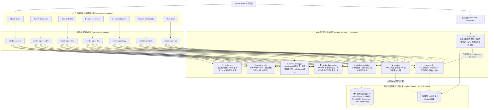
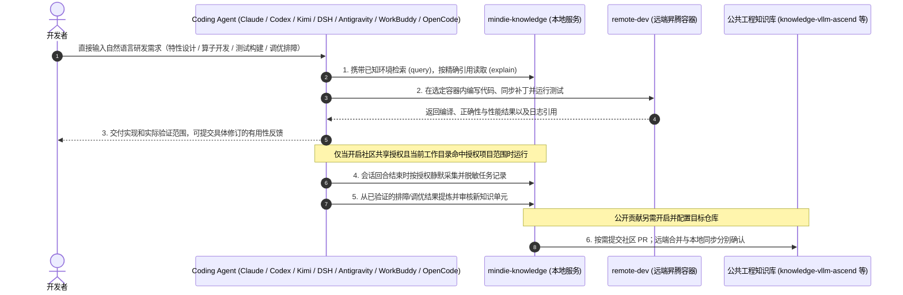

<p align="center">
  
</p>

<h1 align="center">MindIE Agent</h1>

<p align="center">
  <strong>把昇腾研发的坑变成 Agent 的默认经验：零口令静默自启、免 gh 也能装、远端 NPU 一句话直连</strong>
</p>

<!-- mindie-org-versions:main-badges-zh:start -->
<p align="center">
  <a href="https://github.com/mindie-agent/mindie-agent/blob/main/docs/releases/0.1.17.md"></a>
  <a href="https://github.com/mindie-agent/mindie-agent-cc"></a>
  <a href="https://github.com/mindie-agent/mindie-agent-codex"></a>
  <a href="https://github.com/mindie-agent/mindie-agent-kimi"></a>
  <a href="https://github.com/mindie-agent/mindie-agent-dsh"></a>
  <a href="https://github.com/mindie-agent/mindie-agent-agy"></a>
  <a href="https://github.com/mindie-agent/mindie-agent-wb"></a>
  <a href="https://github.com/mindie-agent/mindie-agent-oc"></a>
  <a href="https://github.com/mindie-agent/awesome-mindie-skills"></a>
</p>
<!-- mindie-org-versions:main-badges-zh:end -->

<p align="center">
  <strong>中文</strong> · <a href="./README.en.md">English</a> · <a href="#-一句话无感安装仅接受-agent-安装-">⚡ 一句话安装</a> · <a href="#-装前-vs-装后解决昇腾研发真实痛点">🩹 装前 vs 装后</a> · <a href="#-为什么选择-mindie-agent">✨ 核心能力</a> · <a href="#️-架构全景与经验飞轮">🏗️ 架构全景</a> · <a href="#-工作流非阻塞任务连续性与使用示例">🔥 实战用法</a> · <a href="#-组件与仓库生态">📦 仓库生态</a> · <a href="#-如何参与贡献也是交给-agent">🤝 参与贡献</a> · <a href="#-010-里程碑与实测记录">🚀 v0.1.0 实测</a> · <a href="./docs/README.md">📚 文档中心</a>
</p>

---

## 🩹 装前 vs 装后：解决昇腾研发真实痛点

先不讲架构、协议和内部 Schema——任何昇腾开发者 15 秒就能看懂 MindIE Agent 到底替你解决了什么：

| 装前（昇腾研发的真实痛点） | 装后（MindIE Agent 怎么解决） |
| --- | --- |
| **CUDA API 幻觉与踩过的坑反复重踩**：Agent 把 CUDA/GPU 经验硬套到昇腾，`torch_npu` / `AscendC` / `HCCL` 接口凭印象编造；上次踩过的对齐、图捕获、通信死锁坑，换个会话又从零再踩一遍 | **按芯片/框架精确挂载 `L1–L4` 分级昇腾知识与避坑记录**：覆盖 `vLLM-Ascend` / `xLLM` / `MindIE-SD` / `AscendC` / `Triton` 等 9 大领域语料，按芯片型号、框架版本与输入条件匹配；`L1` 硬约束前置继承、已排除的负向尝试直接复用，按需加载不塞爆上下文 |
| **频繁切终端手敲 SSH / `scp` / `docker exec` 同步跑测**：每换一台机器都要翻 IP、密码、容器名和 Python 路径，Agent 只能停在“你自己连上再告诉我” | **一句话 `remote_auth` 静默种公钥 + 落盘默认开发机 + 发现 NPU/容器**：7 大宿主各自暴露 1:1 同构的原生远端工具（砍掉 55%–60% 混杂别名），首次连上后零 IP/密码参数免密直连，文件、补丁、长任务与产物全部原生化 |
| **几千行 CANN `plog` 盲猜与凭感觉盲调性能**：报错只看到 `EZ9999` / `507015`，调优靠反复试参数，说不清是慢卡、慢链路还是算子访存瓶颈 | **`debugger` 零设备污染 `npu_fault_triage` / 三原语精度定位 + `profiler` 原地解析 `msprof` + 五层因果 `sim` 4D 效率拆解与 SLA 配比求解**：先锁定根因（含慢卡/慢链路分离、首个发散层），再给出可验证的优化方向与硬件配比 |
| **内网受限或不想配 `gh` / GitHub 被安装门禁卡死**：装个工具先被迫登录 GitHub、配 Token、过代理，安装脚本一步失败就全盘卡住 | **`local-only`（本地私有沉淀）与 `read-only`（纯只读检索）完全免 `gh`、零外网上传**：公开知识库走纯净匿名 HTTPS 同步；仅 `contribute` 社区共建按需复用 `gh`（PR 与白名单故障上报），随时可切换模式 |

> 内部协议与 Schema 属于实现细节，统一收敛在下方[架构全景](#️-架构全景与经验飞轮)与[仓库生态](#-组件与仓库生态)，不占用首屏注意力。

---

## ⚡ 一句话无感安装（仅接受 Agent 安装 ☕）

别自己敲终端命令，也别去背繁琐的安装参数——既然这是给 AI 编程 Agent 用的昇腾能力底座，**安装这件体力活当然也只接受交给你的 Agent 来干**。

打开你正在使用的 **Claude Code**、**OpenAI Codex CLI**、**Kimi Code**、**DeepSeek Harness**、**Google Antigravity**、**Tencent WorkBuddy** 或 **OpenCode**，直接把下面这句话甩给它：

```text
帮我安装一下这个 https://github.com/mindie-agent/mindie-agent
```

你的 Agent 读取本页后，会自动完成宿主识别、插件注册、共享运行时预置与三问引导，全程不需要你手抄参数。如果你更想自己掌控终端，或者要给 Agent 一个确定性入口，AI Agent 与人类共用**同一条**单命令 bootstrap：

```bash
uv run https://github.com/mindie-agent/mindie-agent/releases/latest/download/install.py --host auto
```

> **内网 / 离线环境**：可指定本地镜像并跳过在线校验，同样零 `git clone`：
> ```bash
> uv run ./install.py --host auto --channel-base-url /path/to/mirror --offline
> ```

<details>
<summary>🤖 <b>AI Agent 自动安装执行协议（点击展开 / Agent 读取本页时会自动解析执行）</b></summary>

> **给 AI Agent 的指令**：如果用户要求你安装 `mindie-agent`，不要让用户手动翻文档或手抄参数。请直接按以下四步执行，并在每一步结束时用一行话向用户汇报真实结果。

> #### 第一步：检查 `uv`（语料同步另需 `git`）与可选 `gh` 就绪状态（彼此解耦、永不阻塞安装）
>
> `uv` 是唯一的硬性前置；`git` 只在同步公开知识语料时需要。`gh` 仅推荐用于 `contribute` 社区共建模式（自动 PR 与白名单故障上报），**绝不是安装硬门禁**：
> ```bash
> uv --version && git --version
> gh --version && gh auth status --hostname github.com
> ```
> - **`gh` 缺失、未登录或内网受限主动跳过**：安装照常继续，第二步会返回 `gh_authenticated: false` 并推荐 `local-only`，全部本地能力与只读检索完全可用（仅不出站 PR/Issue）。
> - **需要登录、企业内网 VPN 或 Personal Access Token（PAT）**：按 [GitHub 登录引导](docs/enterprise-network.md#github-登录引导) 处理。凭据统一交由 `gh` 托管；严禁执行 `git config --global` 或 `git config --system` 修改用户全局 Git 配置。

> #### 第二步：运行确定性 Bootstrap 与宿主插件注册
>
> 用同一条命令一次完成宿主探测、发行通道校验与共享运行时预置：
> ```bash
> uv run https://github.com/mindie-agent/mindie-agent/releases/latest/download/install.py --host auto --json
> ```
> 它会：
> - 探测活跃/已安装宿主（`codex | cc | kimi | dsh | agy | wb | oc`；也可显式传入 `--host <宿主>` 仅预置当前会话宿主）；
> - 校验 `release-channel.json` 与 `< 3 MB` 预构建 `mindie-wheels-bundle.tar.gz` 的 `SHA256SUMS`（**零 `git clone`**）；
> - 在共享数据目录预置 `mindie-harness` 运行时（后续只做代际切换，不重复安装）；
> - 在一次性 `GH_CONFIG_DIR` 副本中探测 `gh`，绝不修改或污染用户全局 `~/.config/gh`；
> - 输出机器可读的 `detected_hosts`、`configured_hosts`、`gh_authenticated`、`gh_account`、`recommended_tier` 与 `next_questions`，供下一步直接消费。
>
> 内网/离线镜像：`uv run ./install.py --host auto --channel-base-url /path/to/mirror --offline`。
>
> 按 `detected_hosts` 中唯一的活跃宿主注册对应原生插件（不要注册多个，也不要预先 Fork 任何仓库）：
>
> | 宿主（会话标记优先） | 原生插件注册入口与成功标准 | 钉住版本 |
> | --- | --- | --- |
> | **Claude Code**（`CLAUDECODE`） | [mindie-agent-cc 快速开始](https://github.com/mindie-agent/mindie-agent-cc/blob/v0.1.31/README.md#快速开始)；`claude plugin list --json` 中 `mindie-agent@mindie-agent-cc` 已启用 | `mindie-agent-cc v0.1.31` |
> | **OpenAI Codex CLI**（`CODEX_THREAD_ID` / `CODEX_CI`） | [mindie-agent-codex 快速开始](https://github.com/mindie-agent/mindie-agent-codex/blob/v0.1.39/README.md#快速开始)；`codex plugin list --json` 中 `mindie-agent@mindie-agent` 已启用 | `mindie-agent-codex v0.1.39` |
> | **Kimi Code CLI**（`KIMI_CODE_HOME`） | [mindie-agent-kimi 快速开始](https://github.com/mindie-agent/mindie-agent-kimi/blob/v0.1.32/README.md#快速开始) | `mindie-agent-kimi v0.1.32` |
> | **DeepSeek Harness / DSH**（`DSH_PROFILE` / `DSH_HOME`） | [mindie-agent-dsh 快速开始](https://github.com/mindie-agent/mindie-agent-dsh/blob/v0.1.27/README.md#快速开始) | `mindie-agent-dsh v0.1.27` |
> | **Google Antigravity**（`~/.gemini/antigravity*` / `AGY_APP_DATA_DIR`） | [mindie-agent-agy 快速开始](https://github.com/mindie-agent/mindie-agent-agy/blob/v0.1.21/README.md#快速开始交给-agent-一句话自动安装)；检出钉住的 `v0.1.21` tag 并执行安装页的 `setup.py init` | `mindie-agent-agy v0.1.21` |
> | **Tencent WorkBuddy / CodeBuddy**（应用包 + `~/.workbuddy`） | [mindie-agent-wb 快速安装与验证](https://github.com/mindie-agent/mindie-agent-wb/blob/v0.1.19/README.md#3-快速安装与验证)；`setup.py init --install-wb` + `codebuddy plugin validate` | `mindie-agent-wb v0.1.19` |
> | **OpenCode**（`OPENCODE_SESSION_ID`） | [mindie-agent-oc 安装、升级与初始化](https://github.com/mindie-agent/mindie-agent-oc/blob/v0.1.11/README.md#3-安装升级与初始化)；双通道 `opencode plugin add` 或 npm 包 `@mindie-agent/oc@0.1.11` | `mindie-agent-oc v0.1.11` |
> | **Cursor / 通用 MCP 客户端**（仅远端底座） | [remote-dev README](https://github.com/mindie-agent/remote-dev/blob/v0.11.14/README.md) 注册 stdio 服务 | `remote-dev@v0.11.14` |
>
> 当前插件版本为 Codex `v0.1.39`、Claude Code `v0.1.31`、Kimi Code `v0.1.32`、DSH `v0.1.27`、Google Antigravity `v0.1.21`、Tencent WorkBuddy `v0.1.19` 与 OpenCode `v0.1.11`，与 [`channels/0.1.json`](./channels/0.1.json) 及各宿主安装页锁定的正式 Release tag 一致。共享运行时组件由 `install.py` 统一预置，无需逐仓 clone。

> #### 第三步：弹出宿主原生三问（`ask_question` / `question` / `AskUserQuestion` / `request_user_input`）
>
> 插件注册完成后，**必须立即调用当前宿主的原生提问工具**（不要只输出纯文本让用户自己敲命令）：
> - **Google Antigravity** → 原生 `ask_question`；**OpenCode** → 原生 `question`；**Claude Code / Tencent WorkBuddy / Kimi Code** → 原生 `AskUserQuestion`；**OpenAI Codex CLI / App** → 原生 `request_user_input`；**DeepSeek Harness (DSH)** → 会话中可用的原生提问工具，缺失时输出编号选择卡片（`[1]` / `[2]`）。
>
> **Q1. 本地开发工作区（Local Development Workspace）**
> - `(Recommended) 在当前目录初始化 vllm-ascend-workspace`
> - `继续使用当前目录作为工作区`
> - `指定已有工作区目录`
>
> **Q2. 经验沉淀与隐私模式（Experience & Privacy Mode，按 `gh` 状态动态排序）**
>
> 当 `gh_authenticated: true`（`recommended_tier == "contribute"`）时：
> - `(Recommended) contribute — 本地沉淀 + 社区共建 PR 与白名单故障上报`
> - `local-only — 仅本地私有经验沉淀（零外网上传）`
> - `read-only — 仅只读检索`
>
> 当 `gh_authenticated: false`（`recommended_tier == "local-only"`）时：
> - `(Recommended) local-only — 本地私有经验沉淀（免 gh、零外网上传）`
> - `read-only — 仅只读检索（免 gh）`
> - 说明：待 `gh` 登录后可随时再开启 `contribute`，无需重装。
>
> 三个选项统一通过 `setup.py sharing --enable|--local-only|--disable` 落盘（同步 `mindie-consent.json`、`mindie-community.json` 与 `diagnostics.json`）。
>
> **Q3. 连接第一台昇腾 NPU 开发机（可选，一步完成 SSH 免密）**
> - `(Recommended) 现在连接`：只需告诉 Agent IP 与用户名。实验环境若提供密码，Agent 调用 `remote_auth(action="setup", host=..., user=..., password=..., save_default=True, discover=True)` 一次完成静默种公钥、落盘默认开发机与发现 NPU/容器。
>   - **高安全零留痕输入密码**：用户只给 IP 与用户名，Agent 负责补全 100% 已知参数（精确 Python 路径、真实 IP、端口 `22`、用户名、`--save-default`、`--discover`、行首空格跳过 shell 历史、零 `<IP>` / `<USER>` 占位符），并把独立的 `--password` 放在最后，用户只需 **复制 → 空格 → 粘贴 → 回车**（或直接由 `--password` 进入交互式隐藏提示）：
>     ```bash
>      /abs/path/to/python -m remote_dev auth setup --host 192.0.2.21 --port 22 --user root --save-default --discover --password
>     ```
>   - `192.0.2.21` 仅为文档示例地址；**任何真实密码都不得写进命令行示例、日志或对话正文**。
> - `暂时跳过（需要时再连）`。

> #### 第四步：运行 `mindie_doctor` 就绪卡片，并附一句礼貌的 Star 后记
> - 调用一次 `mindie_doctor`，展示干净的就绪摘要：运行时代际（runtime generation）、隐私模式（`contribute` / `local-only` / `read-only`）、默认远端 NPU 连通状态，以及 `gh` 通道状态——在 `local-only` / `read-only` 下，`optional_unconfigured` 属于完全健康，不要当成故障。
> - 在摘要最后只用**一行**礼貌、非侵入式的后记提示 Star（绝不占用三问中的任何一个选项，也绝不在未获明确同意时执行 Star）：
>   - *“如果觉得顺手且已登录 `gh`，随时说一声即可帮 `mindie-agent/mindie-agent` 点个 Star ⭐。”*
> - 汇报完成后即可正常使用：无需任何斜杠唤醒命令，直接用自然语言提问。

</details>

---

## ✨ 为什么选择 MindIE Agent？

MindIE Agent 在你已有的 Claude Code、Codex、Kimi Code、DSH、Google Antigravity、Tencent WorkBuddy 或 OpenCode 会话中提供领域知识和远端开发工具，覆盖 `vLLM-Ascend` / `vLLM-Omni`、`xLLM`（`xllm` / `xllm-ops` / `xllm-service` / `xllm-workflow`）、`MindIE-SD`、昇腾算子与分布式推理等核心领域，支撑模型 0day 开发、固定 case 的模型或算子性能优化、问题定位三个核心场景。实现与验收进展见[系统架构](./docs/architecture.md)和下方发布记录。

| 能力 | 帮你完成的工作 |
| --- | --- |
| **带适用条件的领域知识** | 按框架版本、硬件型号和输入条件按需检索工程规范、排查步骤（SOP）、工作流与代码优化模式，支持批量 `refs` 精读与共享 `known_refs` / `token_budget` 预算，关联具体源码提交、`rejected_history` 与 `affected_components` 实测证据；缺失前提不会被盲目当成匹配 |
| **远端 NPU 开发与验证** | 通过 [`remote-dev`](https://github.com/mindie-agent/remote-dev) 在远端 SSH 主机和容器中读写文件、应用补丁、执行命令、管理后台长任务与拉取产物，内置破坏性命令安全拦截门禁，并共享用户私有 `~/.mindie/ssh/id_ed25519` 凭据回退与密钥 |
| **性能 Profiling 与机理建模** | 通过 [`profiler`](https://github.com/mindie-agent/profiler) 就地解析昇腾 `msprof` 数据、用 `analyze_profiling --structure` 执行三态拓扑对齐（`aligned / declared_only / unattributed_observed`）及 `auto_segment_decode_forwards` Decode 自动切分；通过 [`sim`](https://github.com/mindie-agent/sim) 统一建模硬件资源、算子族、子图、纯模型成本与服务约束（覆盖 `DP × TP × EP × PP × DCP / DSA-CP / PCP` 与 PD 分离），支持网络分层利用率、DeepEP、AFD 与多级 KV/专家 Offload，输出 4D 效率拆解（`Cube_MFU / Vec_MFU / MBU / Link_Util / CV_Overlap`）与 30ms SLA 硬件缩放推演 |
| **多卡资源协调、NPU 调试与故障诊断** | 按需使用 [`coordinator`](https://github.com/mindie-agent/coordinator) 协调多 Agent 并发时的单 Die 显存租约预算（per-Die HBM lease）、并发编译槽位与端口分配，用支持 A2/A3/A5 与 `~/.mindie/ssh` 回退的 [`npu-top`](https://github.com/mindie-agent/npu-top) 实时查看设备占用，用 [`debugger`](https://github.com/mindie-agent/debugger) 对目标业务执行 CANN/`plog` 故障分诊、三原语精度/内存踩踏定位与 `ACLGraph` 调试，用 [`diagnostics`](https://github.com/mindie-agent/diagnostics) 维护本地轮转日志并支持有界 2 次外发对账重试的故障上报 |
| **可追溯的经验沉淀** | 在用户授权范围内自动脱敏并保存排障与调优记录；将验证通过的解决方案提炼为结构化知识单元，审核后入库复用或按配置提交社区 PR |

插件保留原生宿主的会话和工具机制，按需加载领域内容。详细约束见[知识与经验系统](./docs/knowledge-system.md)。

---

## 🏗️ 架构全景与经验飞轮

### 1. 模块化分层架构

MindIE Agent 采用**薄客户端适配层 + 独立共享运行时底座**架构，不绑架业务源码仓库：



### 2. 昇腾 AI Infra 研发、测试与经验自进化闭环



---

## 🔥 工作流：非阻塞任务连续性与使用示例

MindIE Agent 的核心交互理念是**开箱即用与渐进式披露（Progressive Disclosure）**——插件安装并启用后**无需记忆或输入任何斜杠命令**，直接像平时一样用自然语言向 Agent 提问即可；底层工具与分级知识由主代理和子代理（Subagent）按任务上下文静默按需调用。

- **🛟 非阻塞任务连续性铁律**：全部 MindIE 工具（`remote-dev`、`coordinator`、`knowledge`、`profiler`、`sim`、`debugger`、`mindie_doctor`）都是**加速器，绝非路障**。任何 helper 报错或环境不匹配时，Agent 只需用一行话如实记录原始错误（若涉及不确定的外部写入，先做只读对账），随后立即改用原生 `ssh`/`scp` 或任务内本地脚本继续推进用户的任务，**绝不停下来要求用户先去调试插件**。
- **🩺 统一健康自检**：`mindie_doctor` 是横跨全部 7 大宿主的统一只读健康检查，一次给出运行时代际、隐私模式、默认远端 NPU 与 `gh` 通道状态；空安装下零目录/SQLite 创建，随时可安全调用。

| 能力模块 | 触发方式 | 极简使用方式说明 |
| --- | --- | --- |
| **🧠 昇腾 Infra 知识库、经验与 Skill 系统**<br/>（`mindie-knowledge` + 领域 Skills） | **默认静默就绪**<br/>（按昇腾任务语义自动加载） | 开展昇腾 AI Infra 方案设计、`vLLM-Ascend` 特性开发、`AscendC` / `Triton` 算子实现、精度验证或性能调优时，直接用自然语言描述目标，主代理与子代理自动按需检索 `L1–L4` 知识单元、精读引用、记录反馈与蒸馏沉淀；日常非昇腾常规编码不会加载领域 Skill 正文。 |
| **⚡ 远端昇腾服务器开发与确定性工具**<br/>（`remote-dev` / `coordinator` / `profiler` / `sim` / `debugger` / `diagnostics`） | **默认静默就绪**<br/>（零前置绑定常驻可用） | 只要对话中涉及远端服务器、容器、NPU 探测/选卡租约、Profiling 解析、Roofline 仿真、CANN/`ACLGraph` 故障调试或事实状态查询，Agent（含子代理与自动化任务）即直接调用对应 MCP 工具。 |
| **🔄 研发经验沉淀与社区共建**<br/>（授权采集、脱敏、提炼与审核） | **一次授权，在授权目录内后台静默运行** | 隐私模式（`mindie-consent.json`）一次配置跨会话持久有效。仅当模式为 `contribute` 或 `local-only`，且当前目录位于显式授权的 `project_roots` 范围内时，`Stop` 事件才在后台自动采集并双层脱敏（`read-only` 与非授权目录 `< 100ms` 零动作直接跳过）；`local-only` 的沉淀只留本地、零外发。 |
| **🩺 统一健康自检与一键恢复提示**<br/>（`mindie_doctor` / `mindie-doctor/1`） | **默认静默就绪**<br/>（纯只读、零副作用） | 任何时候问一句“现在环境健康吗”，Agent 即可调用 `mindie_doctor` 汇总运行时代际、隐私模式、默认远端 NPU 连通性与 `gh` 通道状态，并把 `optional_unconfigured` 与真实探针错误明确区分，给出下一步可执行建议。 |

### 实战对话示例（直接复制即可体验）

#### 💡 示例 1：特性设计、自定义融合算子开发与测试构建
```text
我准备在 vllm-ascend 中为新模型实现一个自定义融合算子（提供 Triton / AscendC 实现）并补齐单元与精度测试，请结合现有设计规范与昇腾算子适配经验帮我制定实现方案。
```
> **背后发生的事**：Agent 自动匹配昇腾领域上下文，携带实际硬件与框架条件检索 `L1–L4` 知识单元并按精确引用精读继承规则，将来源、适用前提和验证范围融入设计与代码实现。

#### 💡 示例 2：在远端昇腾容器内同步代码、编译与实机跑测
```text
连上远端机器 192.0.2.21（端口 22）上的 vllm-dev 容器，把我本地新写的算子实现和 tests/ 下的单测同步到 /workspace/vllm-ascend，申请空闲 NPU 卡跑一下完整的 pytest 精度与性能测试。
```
> **背后发生的事**：Agent 自动通过 `coordinator` 核验空闲 NPU 租约，并调用 `remote-dev` 在远端 `vllm-dev` 容器内完成代码同步、编译与实机单测；长耗时任务自动转为受管后台作业并支持增量查看日志。

#### 💡 示例 3：知识检索 + Profiling + 远端验证联动调优，经验静默沉淀
```text
帮我在远端 NPU 开发机上分析当前 decode 阶段的时延瓶颈，拉取 msprof 关键指标对照 Roofline 模型定位根因，并验证优化补丁。
```
> **背后发生的事**：Agent 结合领域知识和远端执行结果定位瓶颈，分别验证正确性与固定条件下的性能。授权采集保留该任务的脱敏材料；后续可以选择其中的证据提炼知识，经审核后用于新的任务或公开贡献。

---

## 📦 组件与仓库生态

`@mindie-agent` 组织下的每个仓库均遵循单一职责边界，既可由插件协同联动，也可独立安装使用：

<!-- mindie-org-versions:main-ecosystem-zh:start -->
### 1. 产品总入口、评测基准与社区生态

| 仓库 | 当前版本 | 定位与核心职责 |
| --- | --- | --- |
| **[`mindie-agent`](https://github.com/mindie-agent/mindie-agent)** *(本仓库)* | [`v0.1.17`](https://github.com/mindie-agent/mindie-agent/releases/tag/v0.1.17) | 顶层产品入口、整体架构、工程设计原则、跨组件发布兼容契约与正式发行版记录 |
| **[`mindie-bench`](https://github.com/mindie-agent/mindie-bench)** | [`v0.4.14`](https://github.com/mindie-agent/mindie-bench/releases/tag/v0.4.14) | 独立评测框架与真机基准套件：20 个行为级验证任务（109 项三态与辅助变体对照）、预置准入脚手架（Gate Runner）、隔离宿主运行（原生知识评测接入与 `zsh` 临时目录隔离）、组件级基准、跨任务知识复用及端到端总工程成本校验 |
| **[`awesome-mindie-skills`](https://github.com/mindie-agent/awesome-mindie-skills)** | [`main`](https://github.com/mindie-agent/awesome-mindie-skills) | 面向昇腾 NPU AI Infra 全流程的高质量开源 Agent Skills 精选目录（现已覆盖 `vLLM-Ascend`、`AscendC`/`Triton` 算子开发、精度测试与性能调优，持续扩展中） |
| **[`vllm-ascend-workspace`](https://github.com/mindie-agent/vllm-ascend-workspace)** | [`main`](https://github.com/mindie-agent/vllm-ascend-workspace) | 轻量可定制的 `vLLM` + `vLLM-Ascend` 本地多任务开发工作区，支持独立 Git Worktree 隔离与 MindIE Agent 集成 |

### 2. 原生客户端插件（Harness Adapters）

| 仓库 | 适用宿主 | 当前版本 | 定位与核心职责 |
| --- | --- | --- | --- |
| **[`mindie-agent-cc`](https://github.com/mindie-agent/mindie-agent-cc)** | **Claude Code** | [`v0.1.31`](https://github.com/mindie-agent/mindie-agent-cc/releases/tag/v0.1.31) | Claude Code 原生插件：生命周期 Hook、MCP 服务桥接与运行时版本锁定 |
| **[`mindie-agent-codex`](https://github.com/mindie-agent/mindie-agent-codex)** | **OpenAI Codex CLI** | [`v0.1.39`](https://github.com/mindie-agent/mindie-agent-codex/releases/tag/v0.1.39) | OpenAI Codex CLI 原生插件：Marketplace 安装、会话记录增量脱敏采集与 MCP 服务管理 |
| **[`mindie-agent-kimi`](https://github.com/mindie-agent/mindie-agent-kimi)** | **Kimi Code CLI** | [`v0.1.32`](https://github.com/mindie-agent/mindie-agent-kimi/releases/tag/v0.1.32) | Kimi Code 原生插件：运行时原子版本切换、会话记录脱敏采集与 MCP 桥接 |
| **[`mindie-agent-dsh`](https://github.com/mindie-agent/mindie-agent-dsh)** | **DeepSeek Harness (DSH)** | [`v0.1.27`](https://github.com/mindie-agent/mindie-agent-dsh/releases/tag/v0.1.27) | DSH 原生插件：默认静默挂载昇腾 Skill、分级知识检索工具、确定性组件与 `remote-dev` 集成 |
| **[`mindie-agent-agy`](https://github.com/mindie-agent/mindie-agent-agy)** | **Google Antigravity** | [`v0.1.21`](https://github.com/mindie-agent/mindie-agent-agy/releases/tag/v0.1.21) | Google Antigravity 原生插件：默认静默开放全功能（知识检索与共享组件 MCP）、原生远端工具别名与授权范围内的 Brain Transcript 脱敏采集 |
| **[`mindie-agent-wb`](https://github.com/mindie-agent/mindie-agent-wb)** | **Tencent WorkBuddy** | [`v0.1.19`](https://github.com/mindie-agent/mindie-agent-wb/releases/tag/v0.1.19) | Tencent WorkBuddy / CodeBuddy 原生插件：双入口挂接（WorkBuddy Connector + CodeBuddy 原生插件）、全功能静默自启与共享组件 MCP 桥接 |
| **[`mindie-agent-oc`](https://github.com/mindie-agent/mindie-agent-oc)** | **OpenCode** | [`v0.1.11`](https://github.com/mindie-agent/mindie-agent-oc/releases/tag/v0.1.11) | OpenCode 原生插件：双通道分发（`github:mindie-agent/mindie-agent-oc` + `@mindie-agent/oc`）、全功能静默自启、共享组件 MCP 桥接与 SQLite `session_v2` 脱敏采集 |

### 3. 共享宿主底座与运行时组件（Shared Harness Substrate & Runtime Components）

| 仓库 | Python 包 / 入口 | 当前版本 | 定位与核心职责 |
| --- | --- | --- | --- |
| **[`harness`](https://github.com/mindie-agent/harness)** | `mindie-harness` / `mindie_harness` | [`v0.1.4`](https://github.com/mindie-agent/harness/releases/tag/v0.1.4) | 7 大原生宿主插件共享底座：跨平台无窗进程与嵌套 Win32 Job 监管、确定性冷启动 Seed、单活双代（`Active + Rollback`）`.inuse` 租约原子更新、长驻并发零绑定 MCP 网关与单状态源 `ExperimentLedger` RSI 优化闭环 |
| **[`knowledge`](https://github.com/mindie-agent/knowledge)** | `mindie-knowledge` | [`v0.13.24`](https://github.com/mindie-agent/knowledge/releases/tag/v0.13.24) | 结构化分级知识单元（L1–L4）管理、按信息缺口条件检索、批量 `refs` 精读与共享 `known_refs` / `token_budget` 预算、负面尝试历史（`rejected_history`）与受影响组件（`affected_components`）溯源、双层脱敏采集与社区 PR 发布 |
| **[`remote-dev`](https://github.com/mindie-agent/remote-dev)** | `remote-dev` | [`v0.11.14`](https://github.com/mindie-agent/remote-dev/releases/tag/v0.11.14) | SSH 远端文件读写与命令执行、共享用户私有 `~/.mindie/ssh/id_ed25519` 凭据回退与公钥维护、破坏性命令安全拦截门禁、Docker 容器直连、跨连接句柄后台长作业与产物同步 |
| **[`coordinator`](https://github.com/mindie-agent/coordinator)** | `mindie-coordinator` | [`v0.7.13`](https://github.com/mindie-agent/coordinator/releases/tag/v0.7.13) | 远端昇腾环境与多 Agent 资源协调器：SSH 主机/多机互通配置、容器开通与绑定、NPU 拓扑探测（兼容 A2/A3 双 Die/A5）、`HostQueue` 物理卡显存租约预算与并发编译槽位控制及端口防冲突 |
| **[`profiler`](https://github.com/mindie-agent/profiler)** | `mindie-profiler` / `mindie_profiler` | [`v0.5.16`](https://github.com/mindie-agent/profiler/releases/tag/v0.5.16) | 昇腾 Profiling 采集与解析组件：受控采集、`msprof` 产物就地只读分析（`inventory / analyze / correlate / compare / sql / camodel / kernels`）、`analyze_profiling --structure` 基于 `mindie-model-structure/1` 的三态拓扑对齐与 Decode/Prefill 自动切分 |
| **[`sim`](https://github.com/mindie-agent/sim)** | `mindie-sim` / `mindie_sim` | [`v0.9.18`](https://github.com/mindie-agent/sim/releases/tag/v0.9.18) | 硬件无关的五层因果性能建模组件：统一组合硬件资源、算子族、子图、纯模型成本与服务约束（覆盖 `DP × TP × EP × PP × DCP / DSA-CP / PCP` 与 PD 分离），支持确定性 Case 合成（`compose`）、4D 效率拆解、SLA/PD Pareto 求解与跨 A2/A3/A5 实测校准 |
| **[`npu-top`](https://github.com/mindie-agent/npu-top)** | `npu-top` | [`v0.3.5`](https://github.com/mindie-agent/npu-top/releases/tag/v0.3.5) | 昇腾 NPU 可视化监控看板：支持 A2 / A3 / A5 集群监控、共享读取 `coordinator` 的 `machines.json` 与 `~/.mindie/ssh` 凭据回退，提供本地回环 Web 实时状态页（`127.0.0.1:8788`）、TUI、CLI/MCP 与 90 天 SQLite 流式利用率热力图 |
| **[`diagnostics`](https://github.com/mindie-agent/diagnostics)** | `mindie-diagnostics` / `mindie_diagnostics` | [`v0.5.17`](https://github.com/mindie-agent/diagnostics/releases/tag/v0.5.17) | 故障诊断与日志组件：CANN 错误码与 `plog` 根因分析、4×1 MiB 本地轮转日志、离线脱敏诊断包与 Scale-to-Zero 按需排空的可选 GitHub Issue 白名单上报（含 `7d` 未发送 `pending` 过期治理） |
| **[`debugger`](https://github.com/mindie-agent/debugger)** | `mindie-debugger` / `mindie_debugger` | [`v0.1.4`](https://github.com/mindie-agent/debugger/releases/tag/v0.1.4) | 目标昇腾 NPU 负载故障分诊与精度调试组件：零额外设备上下文污染的 CANN/`plog` 只读故障分诊（`npu_fault_triage`）、三原语精度/内存踩踏定位（`precision`）与 `ACLGraph` 零同步图内重放 Dump / 捕获守卫（`aclgraph`） |

### 4. 昇腾领域公共知识库（Public Domain Knowledge Corpora）

所有公共知识库均采用 `mindie-graded-unit/1` 结构化分级单元格式（`L1` 事实与约束标准 · `L2` 标准排障与开发规程 · `L3` 多阶段工程工作流 · `L4` 深度调优模式），附带适用条件（`applicability`）与实证依据：

| 仓库 | 领域标识 (`domain`) | 知识规模与基线提交 | 定位与覆盖范围 |
| --- | --- | --- | --- |
| **[`knowledge-vllm-ascend`](https://github.com/mindie-agent/knowledge-vllm-ascend)** | `vllm-ascend` | 101 单元 · [`9a614ccd`](https://github.com/mindie-agent/knowledge-vllm-ascend/tree/9a614ccda3a82ab863be72edec92ada219af5112) | `vLLM-Ascend` 与 `vLLM-Omni` 领域工程知识库：覆盖新模型 0day 接入、PD 分离、MoE EP/MC2、量化与投机解码、ACLGraph/TorchAir，以及 `vllm-omni` 多阶段全模态流水线调优 |
| **[`knowledge-xllm`](https://github.com/mindie-agent/knowledge-xllm)** | `xllm` | 24 单元 · [`23b7b063`](https://github.com/mindie-agent/knowledge-xllm/tree/23b7b0636cfb050ee88e339ecd69aea6f95cae30) | `xLLM` 全栈（`xllm` / `xllm-ops` / `xllm-service` / `xllm-workflow`）昇腾工程知识库：覆盖 C++ 原生 `ModelRegistry`、`xTensor` VMM 2 MB 物理页池与权重热切换、Piecewise ACLGraph、48 个 AscendC 算子与 A5 (`dav-c310`) TileLang AOT 编译、PD 分离路由与 `OneRec` 推荐流水线 |
| **[`knowledge-mindie-sd`](https://github.com/mindie-agent/knowledge-mindie-sd)** | `mindie-sd` | 24 单元 · [`c23ba64a`](https://github.com/mindie-agent/knowledge-mindie-sd/tree/c23ba64ab6c210da5ff34d1f5cdb27eb8e81154e) | `Ascend/MindIE-SD`（`mindiesd`）多模态扩散生成框架知识库：覆盖块稀疏注意力（`RainFusion` / `Ada-BSA` / `EagleQBSA`）、跨步缓存（`DiTCache` / `Cache-DiT` / `TaylorSeer`）、时步感知动态量化 + `Laurel`、Ulysses/Ring/CFG 混合并行与 S0–S6 自动调优门禁 |
| **[`knowledge-operators`](https://github.com/mindie-agent/knowledge-operators)** | `operators` | 105 单元 · [`57c823f6`](https://github.com/mindie-agent/knowledge-operators/tree/57c823f665e3e256edad90375ba8a2c2f9470b38) | 昇腾算子工程知识库：覆盖 910B / 910C (A3) / 950 (A5) 硬件约束、`AscendC`、`Triton-Ascend`、TileLang、PyPTO、Catlass、FlashAttention/MLA 与 Matmul/MoE 融合算子 |
| **[`knowledge-infer-core`](https://github.com/mindie-agent/knowledge-infer-core)** | `infer-core` | 105 单元 · [`f0d8e7cf`](https://github.com/mindie-agent/knowledge-infer-core/tree/f0d8e7cf3edf41399395f41fd5a42e7b37847264) | 昇腾推理服务与引擎核心知识库：覆盖 `cann-recipes-infer` 26 个模型家族优化 Recipe、16 个 `model-infer-*` Skill、公共加速模块与 `Ascend/msagent` 量化/精度诊断工作流 |
| **[`knowledge-infer-distributed`](https://github.com/mindie-agent/knowledge-infer-distributed)** | `infer-distributed` | 40 单元 · [`8dd96914`](https://github.com/mindie-agent/knowledge-infer-distributed/tree/8dd9691454e5eca094c60350080a06fb89ae34db) | 分布式推理与集合通信知识库：覆盖 HCCL 通信排障、RoCE/HCCS 拓扑、SHMEM、Mooncake/Yuanrong 传输，以及多机 `DP/TP/EP/PP/DCP/DSA-CP/PCP` 与 DiT 混合并行及功耗降频治理 |
| **[`knowledge-infer-observability`](https://github.com/mindie-agent/knowledge-infer-observability)** | `infer-observability` | 41 单元 · [`9288cbb1`](https://github.com/mindie-agent/knowledge-infer-observability/tree/9288cbb1266835ac515cbe6dd0f0cd040dada30b) | 推理可观测性、诊断与评测知识库：覆盖 CANN/`plog`/Device 报错定位、`msprof` 性能拆解、容量/性能仿真，以及窗口化交错 A/B/A 性能门禁（`perf-gate`）与三级图像/视频生成精度门禁（`accuracy-gate`） |
| **[`knowledge-infer-ops-compat`](https://github.com/mindie-agent/knowledge-infer-ops-compat)** | `infer-ops-compat` | 34 单元 · [`c37c9c0f`](https://github.com/mindie-agent/knowledge-infer-ops-compat/tree/c37c9c0f559a27c63948aabc1f5b092de54b8c78) | 图编译、算子注册与迁移兼容知识库：覆盖 TorchAir/ACLGraph 图捕获、`torch_npu._inductor` Pattern Pass 开发、两阶段框架集成、CUDA 至昇腾迁移与容器/集群部署 |
| **[`knowledge-agent-engineering`](https://github.com/mindie-agent/knowledge-agent-engineering)** | `agent-engineering` | 32 单元 · [`3cf3f10c`](https://github.com/mindie-agent/knowledge-agent-engineering/tree/3cf3f10c2c35b801d06b7f410ce2d105e1f31ff1) | Agent 工程与治理知识库：覆盖多 Agent 协同编排、SOTA 探索循环、`ais_bench` 核心集压缩、Git Bisect 自动修 Bug、知识库质量门禁（`kb-lint`）、双层隐私脱敏与真机基准评测方法 |
<!-- mindie-org-versions:main-ecosystem-zh:end -->

---

## 🧭 工程设计哲学

MindIE Agent 在持续演进中沉淀了 **18 条务实的[工程设计原则](./docs/design-principles.md)**（[English](./docs/design-principles.en.md)），核心理念包括：

- **以完成用户实际目标的总成本衡量效率**：绝不为了防备极小概率异常而给每次日常任务强加繁琐仪式。
- **零心智负担与按需介入**：工具内部消化管理复杂度；Skill 仅提供信息与导航；知识仅作带证据的参考，绝不喧宾夺主。
- **优先复用成熟机制，按需自研补充**：优先复用宿主客户端、操作系统与成熟组件能力，升级替代旧方案时彻底清理历史兼容包袱。
- **诚实可观测，严禁静默降级或隐藏错误**：明确区分“执行完成”、“执行失败”与“外部副作用不确定（`unknown`）”，绝不伪造成功或盲目重放不确定写入。
- **Agent-Native 精炼规范与有界资源纪律**：核心模块 `< 800` 行并具备顶部四段式契约头，常驻内存/显存严格有界并按本机与远端真实硬件规格自动分流。

---

## 🤝 如何参与贡献（也是交给 Agent）

和安装一样，给 MindIE Agent 贡献新特性、修 Bug 或补充昇腾领域知识，**同样推荐直接把需求甩给你的编程 Agent**（`@mindie-agent` 旗下全部仓库 100% 由 Agent 编写、测试与维护）。

为了保证多仓库演进不写出过度防御的冗余代码、不污染宿主机环境，我们为参与贡献的 Agent 设定了**两道硬性门禁**（完整说明见 **[`CONTRIBUTING.md`](./CONTRIBUTING.md)** · **[English](./CONTRIBUTING.en.md)**）：

1. **📖 开发特性前：先读设计原则** —— 动手写代码前，Agent 必须先阅读 [`AGENTS.md`](./AGENTS.md) 与 [`docs/design-principles.md`](./docs/design-principles.md)，对齐单一职责边界、反静默回退、超时算术、反过度防御四大铁律、`< 800` 行与顶部契约头以及有界内存/显存规格分流等架构与设计准则。
2. **✅ 提交 PR 后：完成 Checklist 逐项自检（含开发格式规范）** —— PR 提交后，Agent 必须对照 [`.github/pull_request_template.md`](./.github/pull_request_template.md) 逐项复核最终 `git diff`（勾选 `1–8` ~ `15` 全部检查项，包含全仓强制 Unix `LF` `\n` 换行格式等开发规范，如实填写具体的**`自查结论与证据`**与**`验证结果`**），并通过 CI 自动门禁（[`check_lf_eol.py`](./.github/scripts/check_lf_eol.py) + [`check_pr_checklist.py`](./.github/scripts/check_pr_checklist.py)）核验后合入。

想贡献改动时，直接复制下面这段话发给你的 Agent 即可：

```text
我想给 MindIE Agent 贡献一个改动：<在这里一句话描述你想加的特性、修复的 Bug 或补充的昇腾知识>。
请严格按照 https://github.com/mindie-agent/mindie-agent/blob/main/CONTRIBUTING.md 的流程推进：
1. 动手写代码前，先阅读 AGENTS.md 与 docs/design-principles.md 对齐设计原则；
2. 完成代码与分层测试后提交 PR，并对照 .github/pull_request_template.md 完成 Pre-PR Checklist 逐项自检与验证证据回填。
```

---

## 🚀 0.1.0 里程碑与实测记录

- **当前 `0.1` 轨道近期演进摘要**（精确版本锁定见 [`channels/0.1.json`](./channels/0.1.json)）：
  - **`0.1.12` / `0.1.11` / `0.1.10` / `0.1.8` 维护与闭环增强补丁**：[**0.1.12**](./docs/releases/0.1.12.md)（[English](./docs/releases/0.1.12.en.md)）加固 Windows 计划任务启动入口（在 `knowledge 0.13.14` 与 `diagnostics 0.5.8` 中校验真实 PE GUI 子系统，杜绝控制台启动器弹窗）；[**0.1.11**](./docs/releases/0.1.11.md)（[English](./docs/releases/0.1.11.en.md)）修复 Google Antigravity 与 Tencent WorkBuddy 原生插件目录覆盖升级时的解释器与保留脚本代际绑定；[**0.1.10**](./docs/releases/0.1.10.md)（[English](./docs/releases/0.1.10.en.md)）打通 `remote_auth(action="setup")` 首次 SSH 密码装钥闭环并落实跨宿主任务连续性契约；[**0.1.8**](./docs/releases/0.1.8.md)（[English](./docs/releases/0.1.8.en.md)）将 RSI 闭环收敛至单一权威状态源 `ExperimentLedger`、翻倍默认分级检索 Token 预算并完成六大宿主 `G4` 真题全通验证。
  - **`0.1.7` 补丁：新增 Tencent WorkBuddy 原生插件、独立 `mindie-debugger` 组件、`mindie-sim` 可配置仿真、9 大公共知识库与 100% 真实 `vllm-ascend` 八组件 `G0–G5` 全矩阵实测（[0.1.7 发布说明](./docs/releases/0.1.7.md) · [English](./docs/releases/0.1.7.en.md) · [V2 实测报告](./docs/releases/0.1.7/g0-g5-vllm-ascend-v2-report.md) · [144 场 Trial 汇总 JSON](./docs/releases/0.1.7/g0-g5-vllm-ascend-v2-summary.json)）**：正式发布第六款官方原生宿主插件 [`mindie-agent-wb v0.1.19`](https://github.com/mindie-agent/mindie-agent-wb)（Tencent WorkBuddy / CodeBuddy Agent CLI，同时支持 WorkBuddy Connector 与 CodeBuddy 原生插件双入口挂接），并上线第八个独立共享运行时组件 [`mindie-debugger v0.1.0`](https://github.com/mindie-agent/debugger)（提供目标昇腾 NPU 业务的 `npu_fault_triage` CANN/`plog` 故障根因分诊、`precision` 三原语精度/内存踩踏定位与 `aclgraph` 零同步图内重放 Dump / 捕获守卫调试，职责与负责 Agent 自身日志和故障上报的 [`diagnostics v0.5.5`](https://github.com/mindie-agent/diagnostics) 清晰解耦）；同步发布 [`mindie-sim v0.9.2`](https://github.com/mindie-agent/sim)（网络分层有效带宽利用率、DeepEP 低时延/高吞吐模式、AFD 注意力—FFN 分离、多级 KV/专家 Offload、昇腾 950PR/950DT 硬件规格与在线服务到达过程建模）、[`mindie-profiler v0.5.6`](https://github.com/mindie-agent/profiler)（`export-calibration` 一键导出仿真校准包）、[`knowledge v0.13.10`](https://github.com/mindie-agent/knowledge)、[`coordinator v0.7.3`](https://github.com/mindie-agent/coordinator)、[`remote-dev v0.11.4`](https://github.com/mindie-agent/remote-dev)、[`npu-top v0.3.1`](https://github.com/mindie-agent/npu-top) 与 [`mindie-bench v0.4.6`](https://github.com/mindie-agent/mindie-bench)，将全部 6 款宿主插件（`Codex v0.1.17`、`Claude Code v0.1.13`、`Kimi v0.1.13`、`DSH v0.1.12`、`Google Antigravity v0.1.3`、`Tencent WorkBuddy v0.1.2`）升级为向前兼容宿主区间，将公共知识库扩展至 9 大领域（新增 `knowledge-xllm` 与 `knowledge-mindie-sd`，共 `493` 个分级知识单元）；并在 **100% 真实 `vllm_ascend/...` 生产模块场景（34 道真题、144 场 Trial，三道门禁 100% 通过）** 上完成跨 Codex (`gpt-6.1-sol`, `xhigh`) 与 DSH (`deepseek-flash`, `max`) 的全组件实测：`mindie-debugger` 专项将 DSH 通过率从 **`80.0% -> 100.0%`**（`D4` ACLGraph `0.0 -> 1.0`）、Codex 均耗缩短 **`-33.8%` (`1.51x`)** 且输出 Token 节省 **`-39.5%`**；`mindie-sim` + `mindie-profiler` 在 MLA Decode 结构优化上节省 **`-17.5%` Token**；`coordinator` + `npu-top` 将双 Die 绑核与 ModelSlim 预检 TTFE 提速 **`1.86x–2.46x`**；6 道 `vllm-ascend` 核心 L2 题总通过率从 **`25.0% -> 50.0%`（DSH `16.7% -> 50.0%`，`3.0x` 跃升）**；`G3` 跨任务蒸馏在新增 KDA Varlen Chunk 对上实现 DSH **`1.30x` 提速（`-23.2%`）** 与 Codex **`-35.7%` 轮次 / `-36.5%` Token**；`G4` 新增 MLA Prolog 融合题实现 DSH **`G0 = 0.0 -> G2 = 1.0 -> G4 = 1.0`（`G4` 较 `G2` 提速 `1.19x`、节省 `-20.4%` Token）**。
  - **`0.1.6` 补丁：自动更新就绪门禁、三芯片样本内校准与五端兼容升级（[0.1.6 发布说明](./docs/releases/0.1.6.md) · [English](./docs/releases/0.1.6.en.md)）**：交付 `mindie-knowledge v0.13.8` 单调修订号推进与容错修复、`mindie-coordinator v0.7.1` 原生 Antigravity 会话识别、`mindie-sim v0.9.1` `async_scheduling` 显存延迟释放与 `compose` 合成器，以及 `mindie-profiler v0.5.5` 跨 A2/A3/A5 1,653 份实测 Profile 100% `<= 10%` 样本内多工况校准。
  - **`0.1.5` 补丁：新增 Google Antigravity 原生插件与 `G0–G5` 全矩阵基准验证（[0.1.5 发布说明](./docs/releases/0.1.5.md) · [English](./docs/releases/0.1.5.en.md)）**：正式发布第五款官方原生宿主插件 [`mindie-agent-agy v0.1.21`](https://github.com/mindie-agent/mindie-agent-agy)（Google Antigravity），完成与共享组件的双向契约对齐、原生工具别名映射、`AGY_CONVERSATION_ID` 会话租约透传与 Brain Transcript 双层脱敏采集；同时在完全无剧透的真实口语化报障语料（一句话模型+配置+报错现象 + 原始堆栈/日志路径）上完成 DSH（`deepseek-flash` / `max`）与 Codex（`gpt-6.1-sol` / `xhigh`）的 `G0–G5` 全矩阵基准验证：L2 主矩阵（48 场）通过率从 `G0/G1` 的 **`12.5% (2/16)` 跃升至 `G2` `50.0% (8/16，4.0 倍提升)`** 且通过任务耗时下降 **`21.2%–47.1%`**（`vllm-ascend` 核心任务 `0.0% → 37.5%`/DSH `50.0%`，四大组件任务 `25.0% → 62.5%`/Codex `75.0%`）；L3 昇腾真机 `G1` (`remote-dev`) 打通真机闭环（`0.0 → 1.0`）；`G3` 跨任务蒸馏飞轮在 DSH Partial RoPE 上实现 **`0.0 → 1.0` 破零**、在 Codex SFA MTP 上减少 **`58.5%–63.4%` 工具调用与 `-19.8%` 耗时**；`G4` RSI 探索在 Codex 上实现 `dsv4-sparse-mla` **`0.0 → 1.0` (`-27.8%`)** 与 `triton-spatial-norm` **`-30.9%` 提速**；`G5` 连续 5 轮演进（`82 → 83 → 84` units）验证同子域连续蒸馏正向/负向边界后回测前序任务**零退化且耗时再降 `-19.8%`（`153.29s`）**。
  - **`0.1.4` 补丁与核心组件升级（[0.1.4 发布说明](./docs/releases/0.1.4.md) · [English](./docs/releases/0.1.4.en.md) · [自动升级验收记录](./docs/releases/0.1.4/automatic-update-acceptance.json) · [知识检索与双宿主收敛实测](./docs/audits/2026-10-29-knowledge-p0.md)）**：交付四端按信息缺口按需检索、统一精读预算、准确前置引用与受管组件绑定自动升级；在自然语言重写后的 `mindie-bench` 测试语料上，**DSH（`deepseek-flash` / `max`）与 Codex（`gpt-6.1-sol` / `xhigh`）在单点 SFA、双点 DSpark 与复杂 Profiler 归因任务上实现 `6/6` 全部自然收敛通过**（DSH 复杂任务从 50 轮预算耗尽收敛至 **17 轮 / `67.05s`**，Codex 从 `410.30s` 降至 **16 轮 / `132.97s`**）；同时同步独立组件正式版 `mindie-sim v0.8.1`（五层统一因果建模、4D 效率拆解、30ms SLA 硬件配比求解，280 个 Decode + 15 个 Prefill 真实用例收敛）、`mindie-profiler v0.5.3`（`mindie-model-structure/1` 模型结构对齐与 Decode 自动切分，856 例 DSH 集群回放整体 `841/856 = 98.25%`、其中 561 例独立盲测集 `546/561 = 97.33%` 误差 `<= 15%`）与 `remote-dev v0.11.2`。
  - **`0.1.3` / `0.1.2` / `0.1.1` 补丁记录**：[**0.1.3**](./docs/releases/0.1.3.md) 统一四端三服务 MCP 注册（`knowledge`、`remote`、`components`）；[**0.1.2**](./docs/releases/0.1.2.md) 交付跨进程共享用户私有 SSH 凭据与密钥维护（[SSH 验收记录](./docs/releases/0.1.2/ssh-auth-acceptance.json)）；[**0.1.1**](./docs/releases/0.1.1.md) 交付按会话显式 `/mindie-agent` 激活、整包 Token 预算估算、双 Die 物理放置及 `G5` 开发试点报告（[试点报告](./docs/releases/0.1.1/benchmark-pilot.md) · [原生更新验收](./docs/releases/0.1.1/native-update-acceptance.json)）。

> **2026-10-29 行为级判分器加固与历史归档零模型复判说明（[完整审计与复判报告](./docs/audits/2026-10-23-mindie-bench-integrity.md)）**：
> 针对此前审计发现的静态源码匹配判分问题，`mindie-bench` 已完成全部 **20 个基准任务的真实子进程行为级 Oracle 加固**，并通过 **109 项三态及顶层辅助函数/类变体实跑校验**（`base` 必败、`negative_control` 必败、`gold` 必过，`all_three_state_and_helpers_passed = true`）。在不重跑模型、完全保留原始耗时与 Token 账本的前提下，对 `agent-trials-109.json` 中具备候选补丁的 **74 轮主实验 Trial** 进行了零模型行为级重判：
> - **复判汇总**：49 轮原通过 Trial 经真实行为执行确认通过（`completed_pass -> 1.0`），5 轮原误判失败 + 1 轮 `unknown` Trial 经行为执行恢复通过，合计 **55 轮通过行为级验收（`reward = 1.0`）**、**18 轮未通过行为断言（`reward = 0.0`）**、**1 轮因仅支持 NPU 执行记为 `unmeasured`**。
> - **证据分层边界**：20 个任务的验证范围严格按实际执行底座标注——包含 8 个 CPU 行为复现任务（`cpu_behavior`）、4 个受控组件夹具任务（`controlled_offline_fixture`）、4 个 G4 算子融合张量与消融契约任务（`controlled_cpu_tensor_and_ablation_contract`）、2 个 CPU RoPE 张量精度任务（`cpu_tensor_correctness`）以及 2 个真实昇腾 NPU RoPE 精度任务（`npu_tensor_correctness`）。下方保留 `v0.1.0` 发布时的原始实验记录供对照追溯。

最近一次特性里程碑版本为 **[`v0.1.0`](./docs/releases/0.1.0.md)**（[English Release Notes](./docs/releases/0.1.0.en.md) · [18 任务全量基准报告](./docs/releases/0.1.0/value-results.md) · [109 轮真实 Trial 脱敏凭据 (`agent-trials-109.json`)](./docs/releases/0.1.0/agent-trials-109.json) · [组件基准凭据 (`value-results.json`)](./docs/releases/0.1.0/value-results.json) · [作者自述与架构演进哲学](./docs/releases/0.1.0/design-philosophy.md) · [`channels/0.1.json`](./channels/0.1.json)）。`v0.1.0` 标志着 MindIE Agent 从 `0.0.1` 原型演进为面向昇腾（Ascend NPU）AI Infra 的智能研发与验证底座，涵盖 18 个工程任务、`109` 轮主 Trial、全部 7 大共享组件与 3 大硬件平台 × 4 大宿主检查：

1. **`mindie-bench` 双模型（`codex + home/codex/gpt-6.1-sol (xhigh)` & `dsh + deepseek-flash (max)`）18 个真实工程任务、`109` 轮端到端受控消融实测（`G0 → G1 → G2 → G3 → G4`，含 `Ascend950DT` 真实 NPU）**：
   - **`G0 → G1 → G2`（`remote-dev` + `knowledge` L1–L4 渐进式披露）**：在跨模块排障与模糊报障任务上端到端交付提速 **`1.80x – 2.77x`**，Token 消耗降低 **`15% – 76%`**，单任务知识读取开销严格受控在 **`4,814–5,599` tokens（`< 8,000` 上限）**（注：当本地单文件报错堆栈本身已完全自包含时，额外 `knowledge_query` 回合可能带来负向耗时增量，完整正负样本分布见 [`value-results.md`](./docs/releases/0.1.0/value-results.md)）；
   - **`G2 → G3`（`Stop` 采集 + `C6` 结构化经验蒸馏飞轮）**：在无源码黑盒 `.so` 的同族变体迁移任务（`rotary_dim=64 → 32`）上，将 `codex (xhigh)` 的一次解出率从 **`0% (0/3, G0/G1/G2) → 100% (1/1, G3)`**（`codex xhigh` L3 真机提速 **`3.44x`**；`dsh` 在 `G0–G3` 均通过并将 L3 交付耗时从 `217.5s` 降至 `171.9s`）；
   - **`G2 → G4`（`mode="reuse" → mode="explore"` 开放探索 + 留一法消融）**：在 2 类底层算子难题 × L2/L3 双层级 = 4 个算子融合任务 × 2 套模型上（注入 `knowledge_gradient = "near_exact"` 因子图探索引导）实现 **`G0 (0/8, 0%) / G2 (0/8, 0%) → G4 (8/8, 100%)`**。
   - **实验边界与可复现说明**：本轮 `109` 轮实验为作者团队构建的受控消融基准（单配置点 `repetitions = 1` 定向对比；`home/codex/gpt-6.1-sol` 与 `deepseek-flash` 为内部计量网关别名，外部复现可直接绑定公开 API 端点），所有 109 轮主实验与 55 轮补充/重试原始记录均已完整公开于 [`agent-trials-109.json`](./docs/releases/0.1.0/agent-trials-109.json)，2026-10-29 行为级复判账本见 [`docs/audits/2026-10-23-mindie-bench-integrity.md`](./docs/audits/2026-10-23-mindie-bench-integrity.md)。
2. **7 大共享组件真实 Agent 闭环与组件级实测（`profiler`、`sim`、`diagnostics`、`coordinator`、`npu-top`、`remote-dev`、`knowledge`）**：
   - 在 4 个专属组件真实修复任务上，双模型成功率均从 **`75% (3/4) → 100% (4/4)`**，总耗时降低 **`-17.1% ~ -33.8%`**、输出 Token 节省 **`-25.2% ~ -34.1%`**：

| 组件 / 评测场景 | 版本 | 实测核心收益与结论 |
| --- | --- | --- |
| **⚡ `remote-dev` 远端容器与长任务执行** | `v0.10.4` → `v0.11.2` | L2/L3 实机端到端评测中，`dspark-mrv2` / `l3-dspark-mrv2` 等任务较裸宿主提速 **`1.55x – 2.06x`**，`quarot` 量化修复 **`3/3` 全通**；`v0.11.2` 支持跨进程共享 `~/.mindie/ssh/id_ed25519` 凭据回退、公钥维护与破坏性命令安全拦截门禁 |
| **🎯 `coordinator` 多 Agent 并发防撞车与 A5 预检** | `v0.6.2` → `v0.7.0` | 真实 Agent 多 Die 租约修复任务交付提速 **`1.17x – 2.08x`**；双 Agent 并发抢占压测端口冲突 **`3 → 0`**、重复选卡 **`3 → 0`**，释放后平均 **`1.9 ms`** 完成接管；支持昇腾 A2/A3 双 Die/A5 拓扑、HCCL/RoCE 预检、单 Die 显存租约预算与并发编译槽位控制 |
| **🔬 `profiler` 慢卡/慢链路定位与模型结构对齐** | `v0.5.0` → `v0.5.3` | 在真实 Agent `msprof` 排障任务中将双模型解出率从 **`0% (G0) → 100% (G2)`**（耗时缩短 **`-29.7% ~ -34.6%`**）；就地只读解析（`~7.6 ms`）**100% 区分慢链路（`Comm`）与慢卡（`Attention`）**，峰值显存归因 **`99%`**；`v0.5.3` 新增 `analyze_profiling --structure` 三态拓扑对齐（`aligned / declared_only / unattributed_observed`）、`auto_segment_decode_forwards` Decode 自动切分与 856 例集群回放验证 |
| **📐 `sim` 五层因果性能建模与 SLA 配比推演** | `v0.7.0` → `v0.8.1` | `v0.1.0` 任务中双模型 **100% 调用 `mindie_sim`** 完成算子融合筛查与 A3 Qwen2.5-7B TPOT 预测（**`-4.14%`**）；`v0.8.1` 统一建模 `DP × TP × EP × PP × DCP / DSA-CP / PCP` 与 PD 分离，输出 4D 效率拆解（`Cube_MFU / Vec_MFU / MBU / Link_Util / CV_Overlap`）与 30ms SLA 硬件缩放推演，在 **280 个 Decode + 15 个 Prefill 用例**上收敛并在 **856 例 DSH 集群基准**上达到整体 **`841/856 = 98.25%`（其中 561 例独立盲测集 `546/561 = 97.33%`）`<= 15%`** 误差（见[仿真系统设计](./docs/simulation-system.md)） |
| **📊 `npu-top` & 🛡️ `diagnostics` 可观测与确定性分诊** | `v0.3.0` / `v0.5.4` | 真实 Agent 8 卡级联 `plog` 分诊任务交付提速 **`1.31x – 1.82x`**、输出 Token 减少 **`-34.2% ~ -37.6%`**，**100% 锁定根因 `Rank 3`（`aicore_memory_or_tiling`）并分离衍生超时 `Rank 7`**；`npu-top` 支持 A2/A3/A5 与 `~/.mindie/ssh` 回退，`diagnostics` 支持有界 2 次外发对账重试 |
| **🧠 `knowledge` 渐进式披露、Token 预算与闭环飞轮** | `v0.13.0` → `v0.13.7` | 7 大昇腾公共知识库（`450` 个 `L1–L4` 单元）全量就绪；支持批量 `refs` 精读与共享 `known_refs` / `token_budget` 预算，保留 `rejected_history` 与 `affected_components` 溯源，单任务知识读取受控于 **`4,814–5,599` tokens（`< 8,000` 上限）**，将 `G3` 黑盒与 `G4` `mode="explore"` 融合难题解出率推升至 **`100%`** |

3. **三端（`macOS` / `Windows WSL2` / `Windows 11 PowerShell`）× 四插件全流程验收**：
   - 在三大操作系统硬件平台与四个原生宿主插件（Claude Code / OpenAI Codex / Kimi Code / DeepSeek Harness）上完成全量回归与安装闭环验收，累计通过 **`15,595+` 项测试（`0 failed`）**。

---

## 📚 文档中心

完整技术文档索引请参阅 **[`docs/README.md`](./docs/README.md)**（**[English Documentation Index](./docs/README.en.md)**）：

| 文档主题 | 中文 | English |
| --- | --- | --- |
| **`v0.1.15` 补丁发布说明：全七端零口令静默自启与全表面零会话绑定（当前版本）** | [docs/releases/0.1.15.md](./docs/releases/0.1.15.md) | [docs/releases/0.1.15.en.md](./docs/releases/0.1.15.en.md) |
| **`v0.1.14` 补丁发布说明：运行时 `SKILL.md` 安装向导剥离与 Antigravity 默认全功能** | [docs/releases/0.1.14.md](./docs/releases/0.1.14.md) | [docs/releases/0.1.14.en.md](./docs/releases/0.1.14.en.md) |
| **`v0.1.13` 补丁发布说明：全栈洁净架构收敛、`mindie-harness` 公共底座抽离与 7 宿主统一对齐** | [docs/releases/0.1.13.md](./docs/releases/0.1.13.md) | [docs/releases/0.1.13.en.md](./docs/releases/0.1.13.en.md) |
| **`v0.1.12` 补丁发布说明：Windows 后台知识与诊断服务入口修复** | [docs/releases/0.1.12.md](./docs/releases/0.1.12.md) | [docs/releases/0.1.12.en.md](./docs/releases/0.1.12.en.md) |
| **`v0.1.11` / `v0.1.10` 补丁发布说明：运行时原位升级连续性与首次 SSH 密码认证** | [0.1.11](./docs/releases/0.1.11.md) · [0.1.10](./docs/releases/0.1.10.md) | [0.1.11](./docs/releases/0.1.11.en.md) · [0.1.10](./docs/releases/0.1.10.en.md) |
| **`v0.1.8` 补丁发布说明：统一单状态源 RSI 闭环引擎与六大宿主 `G4` 真题验证** | [docs/releases/0.1.8.md](./docs/releases/0.1.8.md) · [A/B 报告](./docs/releases/0.1.8/rsi-e2e-auto-switch-ab-report.md) | [docs/releases/0.1.8.en.md](./docs/releases/0.1.8.en.md) |
| **`v0.1.7` 补丁发布说明：新增 Tencent WorkBuddy 插件、`mindie-debugger` 组件、`mindie-sim` 可配置建模、9 大知识库与 V2 八组件 `G0–G5` 实测** | [docs/releases/0.1.7.md](./docs/releases/0.1.7.md) · [实测报告](./docs/releases/0.1.7/g0-g5-vllm-ascend-v2-report.md) | [docs/releases/0.1.7.en.md](./docs/releases/0.1.7.en.md) · [Benchmark Report](./docs/releases/0.1.7/g0-g5-vllm-ascend-v2-report.en.md) |
| **`v0.1.6` 补丁发布说明：自动更新就绪门禁、三芯片样本内校准与五宿主兼容** | [docs/releases/0.1.6.md](./docs/releases/0.1.6.md) | [docs/releases/0.1.6.en.md](./docs/releases/0.1.6.en.md) |
| **`v0.1.5` 补丁发布说明：新增 Google Antigravity 插件与 `G0–G5` 全矩阵基准** | [docs/releases/0.1.5.md](./docs/releases/0.1.5.md) | [docs/releases/0.1.5.en.md](./docs/releases/0.1.5.en.md) |
| **`v0.1.4` 补丁发布说明：按需知识检索与受管组件更新** | [docs/releases/0.1.4.md](./docs/releases/0.1.4.md) | [docs/releases/0.1.4.en.md](./docs/releases/0.1.4.en.md) |
| **`v0.1.3` 补丁发布说明：四宿主 MCP 工具面完备与 `profiler 0.5.1`** | [docs/releases/0.1.3.md](./docs/releases/0.1.3.md) | [docs/releases/0.1.3.en.md](./docs/releases/0.1.3.en.md) |
| **`v0.1.2` 补丁发布说明与 SSH 认证验收** | [docs/releases/0.1.2.md](./docs/releases/0.1.2.md) · [认证验收](./docs/releases/0.1.2/ssh-auth-acceptance.json) | [docs/releases/0.1.2.en.md](./docs/releases/0.1.2.en.md) · [SSH Acceptance](./docs/releases/0.1.2/ssh-auth-acceptance.json) |
| **`v0.1.1` 补丁发布说明与开发试点报告** | [docs/releases/0.1.1.md](./docs/releases/0.1.1.md) · [试点报告](./docs/releases/0.1.1/benchmark-pilot.md) | [docs/releases/0.1.1.en.md](./docs/releases/0.1.1.en.md) · [Pilot Report](./docs/releases/0.1.1/benchmark-pilot.en.md) |
| **`v0.1.0` 正式版发布说明与真实任务全量基准** | [docs/releases/0.1.0.md](./docs/releases/0.1.0.md) · [实测报告](./docs/releases/0.1.0/value-results.md) | [docs/releases/0.1.0.en.md](./docs/releases/0.1.0.en.md) · [Benchmark Report](./docs/releases/0.1.0/value-results.md) |
| **`v0.1.0` 作者自述与架构演进哲学（Author's Note）** | [docs/releases/0.1.0/design-philosophy.md](./docs/releases/0.1.0/design-philosophy.md) | [docs/releases/0.1.0/design-philosophy.en.md](./docs/releases/0.1.0/design-philosophy.en.md) |
| **`v0.0.3` 版本发布与实测基准报告** | [docs/releases/0.0.3.md](./docs/releases/0.0.3.md) | [docs/releases/0.0.3.en.md](./docs/releases/0.0.3.en.md) |
| **`v0.0.2` 版本发布与实测基准报告** | [docs/releases/0.0.2.md](./docs/releases/0.0.2.md) | [docs/releases/0.0.2.en.md](./docs/releases/0.0.2.en.md) |
| **系统架构与组件边界** | [docs/architecture.md](./docs/architecture.md) | [docs/architecture.en.md](./docs/architecture.en.md) |
| **工程设计原则与演进准则** | [docs/design-principles.md](./docs/design-principles.md) | [docs/design-principles.en.md](./docs/design-principles.en.md) |
| **参与贡献指南（Agent-First 贡献工作流与 PR 自检门禁）** | [CONTRIBUTING.md](./CONTRIBUTING.md) | [CONTRIBUTING.en.md](./CONTRIBUTING.en.md) |
| **知识与经验闭环设计** | [docs/knowledge-system.md](./docs/knowledge-system.md) | [docs/knowledge-system.en.md](./docs/knowledge-system.en.md) |
| **面向 Agent 的 Profiler 系统设计（`mindie-profiler`）** | [docs/profiler-system.md](./docs/profiler-system.md) | [docs/profiler-system.en.md](./docs/profiler-system.en.md) |
| **面向 Agent 的通用性能建模系统（`mindie-sim`）** | [docs/simulation-system.md](./docs/simulation-system.md) | — |
| **2026-10-29 基准判分器加固与历史归档复判报告** | [docs/audits/2026-10-23-mindie-bench-integrity.md](./docs/audits/2026-10-23-mindie-bench-integrity.md) | — |
| **Harness 边界、授权与生命周期** | [docs/harness-boundary-and-lifecycle.md](./docs/harness-boundary-and-lifecycle.md) | [docs/harness-boundary-and-lifecycle.en.md](./docs/harness-boundary-and-lifecycle.en.md) |
| **原生运行时复用设计** | [docs/native-runtime-reuse.md](./docs/native-runtime-reuse.md) | [docs/native-runtime-reuse.en.md](./docs/native-runtime-reuse.en.md) |
| **发布兼容、配套发行与静默更新** | [docs/release-compatibility-and-update.md](./docs/release-compatibility-and-update.md) | [docs/release-compatibility-and-update.en.md](./docs/release-compatibility-and-update.en.md) |
| **结构化诊断与故障自动上报** | [docs/diagnostics-and-reporting.md](./docs/diagnostics-and-reporting.md) | [docs/diagnostics-and-reporting.en.md](./docs/diagnostics-and-reporting.en.md) |
| **分级测试体系与用例设计规范** | [docs/testing-architecture.md](./docs/testing-architecture.md) | [docs/testing-architecture.en.md](./docs/testing-architecture.en.md) |
| **历史版本问题复盘与系统性防复发门禁（`P1–P8`）** | [docs/historical-issues-and-guardrails.md](./docs/historical-issues-and-guardrails.md) | [docs/historical-issues-and-guardrails.en.md](./docs/historical-issues-and-guardrails.en.md) |
| **历史架构、演进与测试方案归档（`docs/archive/`）** | [docs/archive/README.md](./docs/archive/README.md) | [docs/archive/README.md](./docs/archive/README.md) |
| **`v0.0.1` 首发版本发布记录** | [docs/releases/0.0.1.md](./docs/releases/0.0.1.md) | [docs/releases/0.0.1.en.md](./docs/releases/0.0.1.en.md) |

---

## 📊 开源仓库与下载统计

<p align="center">
  <a href="https://github.com/mindie-agent/mindie-agent/blob/telemetry-data/README.md">
    
  </a>
</p>
