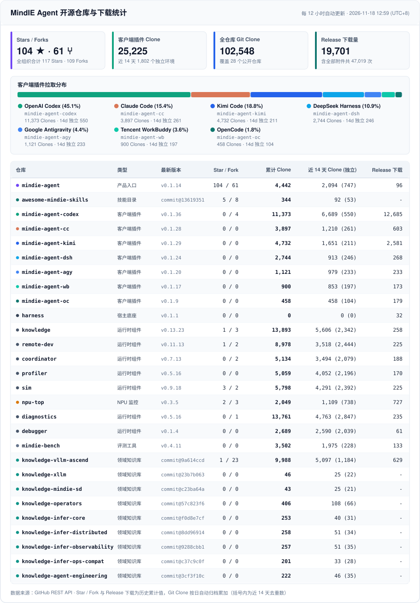

# 📊 MindIE Agent 开源仓库与下载统计

> **最近更新**：`2026-11-21 03:20 (UTC+8)` · 每 12 小时通过 GitHub Actions 自动同步。

## 仓库统计明细

| 类型 | 仓库 | 最新版本 | Stars | Forks | 累计 Clone | 近 14 天 Clone (独立) | 近 14 天浏览 (独立) | Release 下载 (含附件) |
| --- | --- | --- | ---: | ---: | ---: | ---: | ---: | ---: |
| 产品入口 | [`mindie-agent`](https://github.com/mindie-agent/mindie-agent) | `v0.1.17` | 108 | 62 | **4,989** | 2,017 (563) | 1,051 (336) | 361 (912) |
| 技能目录 | [`awesome-mindie-skills`](https://github.com/mindie-agent/awesome-mindie-skills) | `commit@13619351` | 5 | 8 | **351** | 73 (45) | 70 (26) | 0 (0) |
| 客户端插件 | [`mindie-agent-codex`](https://github.com/mindie-agent/mindie-agent-codex) | `v0.1.40` | 0 | 5 | **13,781** | 8,115 (604) | 108 (35) | 13,561 (14,114) |
| 客户端插件 | [`mindie-agent-cc`](https://github.com/mindie-agent/mindie-agent-cc) | `v0.1.32` | 0 | 0 | **4,444** | 1,494 (368) | 10 (5) | 722 (1,229) |
| 客户端插件 | [`mindie-agent-kimi`](https://github.com/mindie-agent/mindie-agent-kimi) | `v0.1.33` | 0 | 0 | **5,117** | 1,874 (246) | 25 (5) | 2,695 (3,242) |
| 客户端插件 | [`mindie-agent-dsh`](https://github.com/mindie-agent/mindie-agent-dsh) | `v0.1.28` | 0 | 0 | **3,093** | 978 (273) | 48 (27) | 365 (858) |
| 客户端插件 | [`mindie-agent-agy`](https://github.com/mindie-agent/mindie-agent-agy) | `v0.1.22` | 0 | 0 | **1,483** | 1,159 (247) | 17 (17) | 279 (618) |
| 客户端插件 | [`mindie-agent-wb`](https://github.com/mindie-agent/mindie-agent-wb) | `v0.1.20` | 0 | 0 | **1,230** | 1,054 (207) | 7 (7) | 235 (534) |
| 客户端插件 | [`mindie-agent-oc`](https://github.com/mindie-agent/mindie-agent-oc) | `v0.1.12` | 0 | 0 | **754** | 754 (188) | 48 (2) | 254 (516) |
| 宿主底座 | [`harness`](https://github.com/mindie-agent/harness) | `v0.1.8` | 0 | 1 | **1,388** | 1,388 (794) | 2 (2) | 344 (1,119) |
| 运行时组件 | [`knowledge`](https://github.com/mindie-agent/knowledge) | `v0.13.25` | 1 | 3 | **15,480** | 6,308 (2,697) | 46 (13) | 481 (4,954) |
| 运行时组件 | [`remote-dev`](https://github.com/mindie-agent/remote-dev) | `v0.11.15` | 1 | 2 | **10,351** | 4,335 (2,857) | 20 (12) | 448 (4,648) |
| 运行时组件 | [`coordinator`](https://github.com/mindie-agent/coordinator) | `v0.7.14` | 0 | 2 | **6,138** | 4,191 (2,549) | 10 (2) | 398 (3,992) |
| 运行时组件 | [`profiler`](https://github.com/mindie-agent/profiler) | `v0.5.17` | 0 | 0 | **6,291** | 5,042 (2,691) | 47 (18) | 381 (3,712) |
| 运行时组件 | [`sim`](https://github.com/mindie-agent/sim) | `v0.9.19` | 3 | 2 | **7,265** | 5,385 (2,860) | 155 (42) | 438 (3,990) |
| NPU 监控 | [`npu-top`](https://github.com/mindie-agent/npu-top) | `v0.3.5` | 2 | 3 | **2,509** | 1,507 (1,001) | 1 (1) | 918 (2,873) |
| 运行时组件 | [`diagnostics`](https://github.com/mindie-agent/diagnostics) | `v0.5.17` | 0 | 1 | **15,462** | 5,643 (3,323) | 1 (1) | 440 (4,679) |
| 运行时组件 | [`debugger`](https://github.com/mindie-agent/debugger) | `v0.1.4` | 0 | 0 | **3,623** | 3,322 (2,501) | 8 (5) | 252 (3,404) |
| 评测工具 | [`mindie-bench`](https://github.com/mindie-agent/mindie-bench) | `v0.4.24` | 0 | 0 | **4,295** | 2,611 (242) | 11 (5) | 401 (1,148) |
| 领域知识库 | [`knowledge-vllm-ascend`](https://github.com/mindie-agent/knowledge-vllm-ascend) | `commit@9a614ccd` | 1 | 25 | **10,642** | 5,144 (1,203) | 103 (24) | 629 (629) |
| 领域知识库 | [`knowledge-xllm`](https://github.com/mindie-agent/knowledge-xllm) | `commit@23b7b063` | 0 | 0 | **51** | 16 (13) | 2 (2) | 0 (0) |
| 领域知识库 | [`knowledge-mindie-sd`](https://github.com/mindie-agent/knowledge-mindie-sd) | `commit@c23ba64a` | 0 | 0 | **48** | 17 (14) | 2 (1) | 0 (0) |
| 领域知识库 | [`knowledge-operators`](https://github.com/mindie-agent/knowledge-operators) | `commit@57c823f6` | 0 | 0 | **413** | 66 (44) | 13 (6) | 0 (0) |
| 领域知识库 | [`knowledge-infer-core`](https://github.com/mindie-agent/knowledge-infer-core) | `commit@f0d8e7cf` | 0 | 0 | **258** | 24 (19) | 8 (1) | 0 (0) |
| 领域知识库 | [`knowledge-infer-distributed`](https://github.com/mindie-agent/knowledge-infer-distributed) | `commit@8dd96914` | 0 | 0 | **263** | 42 (25) | 24 (4) | 0 (0) |
| 领域知识库 | [`knowledge-infer-observability`](https://github.com/mindie-agent/knowledge-infer-observability) | `commit@9288cbb1` | 0 | 0 | **263** | 43 (27) | 7 (2) | 0 (0) |
| 领域知识库 | [`knowledge-infer-ops-compat`](https://github.com/mindie-agent/knowledge-infer-ops-compat) | `commit@c37c9c0f` | 0 | 0 | **205** | 23 (18) | 2 (1) | 0 (0) |
| 领域知识库 | [`knowledge-agent-engineering`](https://github.com/mindie-agent/knowledge-agent-engineering) | `commit@3cf3f10c` | 0 | 0 | **226** | 22 (17) | 1 (1) | 0 (0) |
| **合计** | **28 个公开仓库** | — | **121** | **114** | **120,413** | **62,647** | — | **23,602** (57,171) |

## 数据文件

- [`dashboard.zh.svg`](./dashboard.zh.svg)：中文统计看板 SVG
- [`dashboard.en.svg`](./dashboard.en.svg)：英文统计看板 SVG
- [`telemetry-history.json`](./telemetry-history.json)：按日归档累加的历史统计 JSON
