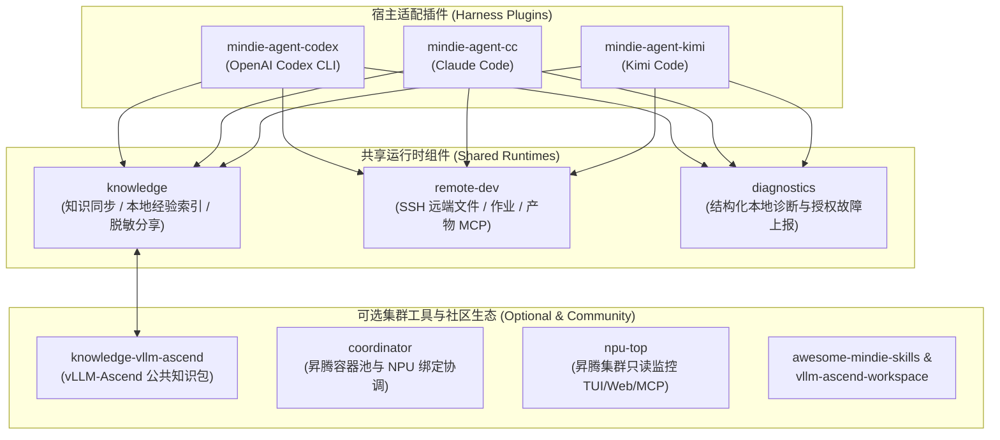

  

# MindIE Agent

[English](README.en.md)

**面向昇腾（Ascend）推理工程的智能体能力、领域知识闭环与远端开发工具链**

MindIE Agent 将昇腾推理开发（如 `vLLM-Ascend` 算子适配、远端 NPU 容器调试、精度比对与性能调优）所需的**领域知识检索、本地任务经验闭环、隐私脱敏分享与 SSH 远端执行能力**，以原生插件的形式接入开发者日常使用的 AI 编程客户端（[OpenAI Codex CLI](https://github.com/mindie-agent/mindie-agent-codex)、[Claude Code](https://github.com/mindie-agent/mindie-agent-cc) 与 [Kimi Code](https://github.com/mindie-agent/mindie-agent-kimi)）。

你无需切换工作流或托管业务源码仓库——直接在自己的业务仓库与原生 Agent 会话中使用即可。

---

## 核心特性

- **原生宿主插件，零心智负担接入**：安装后直接在业务仓库的日常会话中生效，不强制任何日常激活或收尾命令，不改写用户已有的其他 Skill、Plugin 或 MCP 配置。
- **双层知识与经验闭环**：
  - **公共领域知识库（[`knowledge-vllm-ascend`](https://github.com/mindie-agent/knowledge-vllm-ascend)）**：按需检索经过证据门禁校验的 `vLLM-Ascend` 工程知识包与原始参考材料。
  - **本地经验沉淀与独立反馈（[`knowledge`](https://github.com/mindie-agent/knowledge)）**：由确定性程序筛选并严格脱敏公开对话块，利用原生小模型生成结构化检索导航，支持跨任务经验复用与独立的有用性反馈（`helpful` / `not_helpful`）。
- **SSH 远端 NPU 开发底座（[`remote-dev`](https://github.com/mindie-agent/remote-dev)）**：提供编辑器语义的远端文件读写、补丁应用、受管后台作业、日志流式追踪与产物同步，支持本机无 NPU 环境直连远端昇腾容器。
- **隐私优先与故障可观测（[`diagnostics`](https://github.com/mindie-agent/diagnostics)）**：所有外发通道均执行确定性隐私规则与 Gitleaks 脱敏拦截；组件故障诊断与社区知识贡献分别独立授权，默认不替用户开启任何自动外发。

---

## 快速开始

根据你正在使用的 AI 编程客户端或开发场景选择入口：

| 使用场景 | 推荐入口 | 说明 |
|---|---|---|
| **OpenAI Codex CLI 用户** | **[`mindie-agent-codex`](https://github.com/mindie-agent/mindie-agent-codex)** | 首发 `v0.0.1` 已发布，支持 macOS、原生 Windows 与 Windows WSL |
| **Claude Code 用户** | **[`mindie-agent-cc`](https://github.com/mindie-agent/mindie-agent-cc)** | 首发 `v0.0.1` 已发布，支持 macOS、原生 Windows 与 Windows WSL |
| **Kimi Code 用户** | **[`mindie-agent-kimi`](https://github.com/mindie-agent/mindie-agent-kimi)** | 独立 Kimi Code 原生适配层（不在 `0.0.1` 首发矩阵内） |
| **按需安装独立 Agent Skills** | **[`awesome-mindie-skills`](https://github.com/mindie-agent/awesome-mindie-skills)** | 面向昇腾推理工程的开源 Agent Skills 精选目录（调试、压测、迁移等） |
| **搭建本地多任务开发工作区** | **[`vllm-ascend-workspace`](https://github.com/mindie-agent/vllm-ascend-workspace)** | 为 `vllm` + `vllm-ascend` 提供基于 Git Worktree 的多任务隔离开发脚手架 |

### 插件安装与自动更新机制

1. **首次安装**：按照 [`mindie-agent-codex`](https://github.com/mindie-agent/mindie-agent-codex) 或 [`mindie-agent-cc`](https://github.com/mindie-agent/mindie-agent-cc) 首页的一行安装命令，通过宿主原生插件市场安装固定的 `v0.0.1` 正式版本。
2. **日常使用**：在你的业务仓库中正常发起任务。插件在会话启动时准备本地知识服务，在回合结束时自动整理合格任务的经验导航（若尚未开启社区贡献则不会外发，未配置与显式停用状态清晰区分）。
3. **静默兼容更新**：距离上次成功检查超过 24 小时后，下一次自然使用会在后台异步检查当前宿主版本支持的最高正式 Release，后台准备完成后于空闲时原子切换，保留已有授权配置且无需手动重载。

---

## 仓库生态与架构分工

MindIE Agent 采用清晰的职责解耦架构，各组件仓库独立演进并通过锁定版本配套发布：

| 仓库 | 定位与职责 |
|---|---|
| [`mindie-agent`](https://github.com/mindie-agent/mindie-agent) | 产品总入口、整体架构、领域边界、九条设计原则与版本发布记录 |
| [`mindie-agent-codex`](https://github.com/mindie-agent/mindie-agent-codex) | OpenAI Codex CLI 原生插件、生命周期 Hook 与任务接入（`v0.0.1`） |
| [`mindie-agent-cc`](https://github.com/mindie-agent/mindie-agent-cc) | Claude Code 原生插件、生命周期 Hook 与任务接入（`v0.0.1`） |
| [`mindie-agent-kimi`](https://github.com/mindie-agent/mindie-agent-kimi) | Kimi Code 原生适配层、Hook 与本地模型适配 |
| [`knowledge`](https://github.com/mindie-agent/knowledge) | 共享知识与经验运行时：公共知识同步、本地检索、隐私脱敏与有用性反馈 |
| [`knowledge-vllm-ascend`](https://github.com/mindie-agent/knowledge-vllm-ascend) | `vLLM-Ascend` 领域公共工程知识包仓库（正式 Feed 源） |
| [`remote-dev`](https://github.com/mindie-agent/remote-dev) | 基于 SSH 的远端文件读写、补丁、受管后台作业与产物同步 MCP/CLI |
| [`diagnostics`](https://github.com/mindie-agent/diagnostics) | 组件结构化日志、隐私脱敏支持包与显式授权的 GitHub Issue 故障上报 |
| [`coordinator`](https://github.com/mindie-agent/coordinator) | 昇腾主机可选本地回环 MCP 协调器（任务身份、就绪容器池与独占 NPU 绑定） |
| [`npu-top`](https://github.com/mindie-agent/npu-top) | 仅监听本地回环的昇腾 NPU 集群只读观测工具（TUI / Web / CLI / MCP） |
| [`awesome-mindie-skills`](https://github.com/mindie-agent/awesome-mindie-skills) | 面向昇腾推理工程的开源 Agent Skills 精选目录 |
| [`vllm-ascend-workspace`](https://github.com/mindie-agent/vllm-ascend-workspace) | 面向 `vllm` 与 `vllm-ascend` 的本地开发工作区脚手架 |

---

## 文档导航

本仓库 `docs/` 目录维护 MindIE Agent 的核心架构、设计原则、子系统规范与正式发布记录（均提供中英双语版本）：

- **索引与总览**：[文档目录（中文）](docs/README.md) · [Documentation Index (English)](docs/README.en.md)
- **核心设计原则**：[九条设计原则](docs/design-principles.md) · [Nine Design Principles](docs/design-principles.en.md)
- **总体架构**：[系统架构与领域边界](docs/architecture.md) · [System Architecture](docs/architecture.en.md)
- **知识与经验系统**：[知识与经验闭环设计](docs/knowledge-system.md) · [Knowledge & Experience System](docs/knowledge-system.en.md)
- **宿主边界与生命周期**：[Harness 边界与生命周期契约](docs/harness-boundary-and-lifecycle.md) · [Harness Boundary & Lifecycle](docs/harness-boundary-and-lifecycle.en.md)
- **发布兼容与静默更新**：[配套发布与静默更新规范](docs/release-compatibility-and-update.md) · [Release Compatibility & Silent Update](docs/release-compatibility-and-update.en.md)
- **诊断与故障上报**：[日志、故障定位与自动 Issue 规范](docs/diagnostics-and-reporting.md) · [Diagnostics & Fault Reporting](docs/diagnostics-and-reporting.en.md)
- **原生运行时复用**：[原生插件管理、Hook 与进程树复用说明](docs/native-runtime-reuse.md) · [Native Runtime & Process Reuse](docs/native-runtime-reuse.en.md)
- **发布记录与后续规划**：
  - [`0.0.1` 正式发布记录](docs/releases/0.0.1.md) · [`0.0.1` Release Record](docs/releases/0.0.1.en.md)
  - [路线图与后续迭代](docs/next-steps.md) · [Roadmap & Next Steps](docs/next-steps.en.md)

---

## 当前版本状态与已知说明（`v0.0.1`）

- **支持矩阵**：首发 `v0.0.1` 覆盖 `Codex` / `Claude Code` × `macOS` / `原生 Windows` / `Windows WSL` 六个宿主与平台组合，配套锁定 `mindie-knowledge v0.9.5`、`mindie-remote-dev v0.11.0` 与 `vaws-dfx v0.4.1`。精确支持的宿主版本区间与六组合验收证据见 [`0.0.1` 发布记录](docs/releases/0.0.1.md)。
- **已知宿主限制**：在 OpenAI Codex CLI 中，当子代理（Child Agent）被中断时，宿主可能未将中断信号送达待处理的工具调用，导致本地辅助进程或已启动的远端命令继续运行。该限制已记录在发布说明中，插件不引入破坏边界的私有进程猎杀机制，持久后台作业仍通过 `remote-dev` 独立生命周期管理。
- **诚实声明**：业务效果基准评测（Benchmark）独立推进，当前版本不作任务质量或成本收益的量化宣称。[用户须知](https://github.com/mindie-agent/mindie-agent-codex/blob/main/plugins/mindie-agent/skills/mindie-agent/references/user-notice.md)详细说明了公开材料范围、规则脱敏边界与公开 Git 历史不可撤回特性。

---

## 参与贡献

请先阅读组织级[贡献指南](https://github.com/mindie-agent/.github/blob/main/CONTRIBUTING.md)与本仓库的[九条设计原则](docs/design-principles.md)。所有开发类 Pull Request 在提交前均须对照九条设计原则完成逐条审查，并在 PR 描述中附上审查记录。
