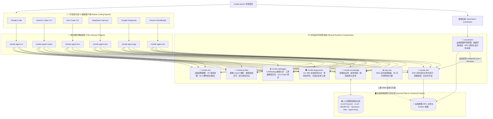
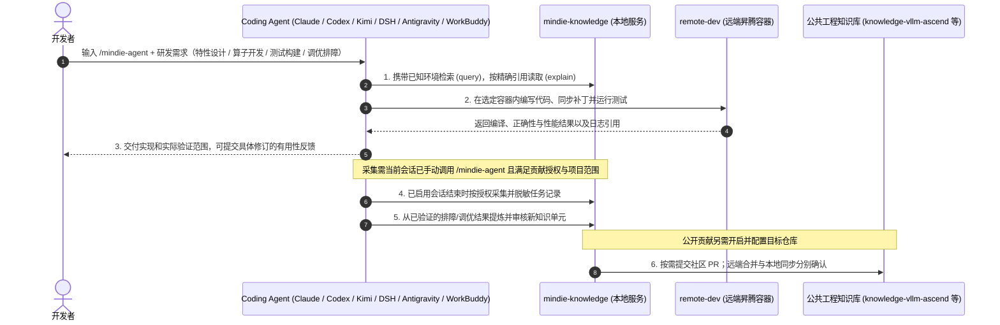
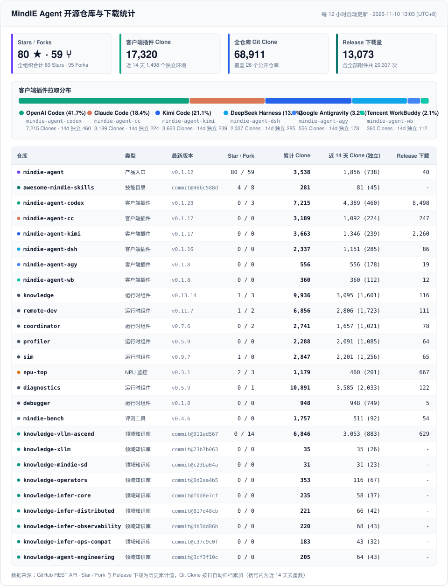

<p align="center">
  
</p>

<h1 align="center">MindIE Agent</h1>

<p align="center">
  <strong>为原生编程 Agent 提供昇腾领域知识、远端 NPU 执行与可追溯的工程经验</strong>
</p>

<!-- mindie-org-versions:main-badges-zh:start -->
<p align="center">
  <a href="https://github.com/mindie-agent/mindie-agent/blob/main/docs/releases/0.1.12.md"></a>
  <a href="https://github.com/mindie-agent/mindie-agent-cc"></a>
  <a href="https://github.com/mindie-agent/mindie-agent-codex"></a>
  <a href="https://github.com/mindie-agent/mindie-agent-kimi"></a>
  <a href="https://github.com/mindie-agent/mindie-agent-dsh"></a>
  <a href="https://github.com/mindie-agent/mindie-agent-agy"></a>
  <a href="https://github.com/mindie-agent/mindie-agent-wb"></a>
  <a href="https://github.com/mindie-agent/awesome-mindie-skills"></a>
</p>
<!-- mindie-org-versions:main-badges-zh:end -->

<p align="center">
  <strong>中文</strong> · <a href="./README.en.md">English</a> · <a href="#-一句话无感安装仅接受-agent-安装-">⚡ 一句话安装</a> · <a href="#-为什么选择-mindie-agent">✨ 核心能力</a> · <a href="#️-架构全景与经验飞轮">🏗️ 架构全景</a> · <a href="#-装好之后怎么用触发方式与使用示例">🔥 实战用法</a> · <a href="#-组件与仓库生态">📦 仓库生态</a> · <a href="#-如何参与贡献也是交给-agent">🤝 参与贡献</a> · <a href="#-010-里程碑与实测记录">🚀 v0.1.0 实测</a> · <a href="./docs/README.md">📚 文档中心</a>
</p>

---

## ⚡ 一句话无感安装（仅接受 Agent 安装 ☕）

别自己敲终端命令，也别去背繁琐的安装参数——既然这是给 AI 编程 Agent 用的昇腾能力底座，**安装这件体力活当然也只接受交给你的 Agent 来干**。

打开你正在使用的 **Claude Code**、**OpenAI Codex CLI**、**Kimi Code**、**DeepSeek Harness**、**Google Antigravity** 或 **Tencent WorkBuddy**，直接把下面这句话甩给它：

```text
帮我安装一下这个 https://github.com/mindie-agent/mindie-agent
```

剩下的事就不用管了：你的 Agent 读取本页后，会自动校验 **`gh`（GitHub CLI）稳定交互通道**、识别自身宿主环境并执行下方的**自动安装协议**，一步到位完成插件注册、运行时初始化与工作区引导。

<details>
<summary>🤖 <b>AI Agent 自动安装执行协议（点击展开 / Agent 读取本页时会自动解析执行）</b></summary>

> **给 AI Agent 的指令**：如果用户要求你安装 `mindie-agent`，请不要让用户手动翻文档，直接按以下五步在终端依次执行：
>
> #### 第一步：检查基础工具与 `gh` GitHub 交互通道（硬性前置指标）
> **稳定的 GitHub 交互通道（已安装并登录 `gh` CLI）是 MindIE Agent 的硬性指标**——插件版本拉取、锁定发行版校验、`knowledge-vllm-ascend` 知识源同步、经验闭环自动提交 PR（底层通过 `gh api` 与进程级 `!gh auth git-credential` 驱动，不修改全局 `~/.gitconfig`）以及组件故障上报均依赖该通道。请先在终端运行：
> ```bash
> git --version && uv --version && gh --version
> GH_USER=$(gh api --hostname github.com user --jq .login) && echo "GitHub channel verified for account: $GH_USER"
> ```
> - **门禁要求（严禁跳过或静默忽略；仅安装 DSH `0.1.1` / `0.1.2` 且不启用社区贡献时可跳过 `gh` 门禁，但仍需 `git` 与 `uv`）**：
>   - 若未安装 `gh`：请先按宿主系统协助安装（macOS：`brew install gh`；Windows：`winget install --id GitHub.cli`；Ubuntu / WSL：`sudo apt update && sudo apt install -y gh`）。
>   - 账号读取成功时直接复用已有认证。需要登录时按 [GitHub 登录引导](docs/enterprise-network.md#github-登录引导) 处理：普通网络使用浏览器，企业网络或浏览器授权受阻时优先 Token；已有 Token 就通过 `gh` 隐藏提示输入，没有则引导创建。由 `gh` 保存凭据，验证账号、Git 及后续进程复用后继续安装。网络、代理或证书失败先修复传输，不把它们当作 Token 失效。严禁执行 `git config --global` 或 `git config --system` 修改用户全局 Git 配置。
>
> #### 第二步：保留用户授权，按需准备贡献目标
> 安装过程只注册当前宿主所需的插件，不未经询问静默执行 Star 或 Fork；插件安装验证完成后，在第五步立即调用当前宿主的**原生交互式提问工具**弹出选项，询问本地开发工作区选择、是否开启社区共享与故障上报，以及是否顺手给项目点个 Star ⭐。
>
> 社区贡献默认关闭。用户明确开启目标知识库 `<owner/repo>` 的贡献后，才通过 `setup.py sharing --enable` 自动创建或复用该知识库的个人 Fork，并绑定 `<GH_USER>/<repo>` 作为推送目标。不要因安装而 Fork 主仓、插件仓或所有领域仓库。
>
> #### 第三步：识别你所在的宿主客户端并安装对应插件
> 只安装当前宿主对应的一个插件。打开该适配器仓库的安装页，执行其中的 Agent 自动安装协议。本页保留宿主识别、版本钉和安装页链接。当前插件版本为 Codex `v0.1.21`、Claude Code `v0.1.17`、Kimi Code `v0.1.17`、DSH `v0.1.16`、Google Antigravity `v0.1.8` 与 Tencent WorkBuddy `v0.1.8`，与 [`channels/0.1.json`](./channels/0.1.json) 以及 Codex、DSH harness `main` 安装页上的正式 tag 一致。共享组件由各插件从官方 GitHub Release 发现。
>
> 按下面的顺序选定唯一分支，命中即停止。当前进程的会话标记优先于本机 CLI：有 `CODEX_THREAD_ID` 或 `CODEX_CI` 就选分支 B，即使 `claude --version` 也能成功。不要按列表顺序取第一个 `--version` 成功项。
>
> 1. 当前进程有 `CODEX_THREAD_ID` 或 `CODEX_CI` → 分支 B。
> 2. 当前进程有 `CLAUDECODE` → 分支 A。
> 3. 当前对话就在 Google Antigravity 或 Tencent WorkBuddy 中 → 分支 E 或 F。用应用包和数据目录确认；PATH 上没有 `agy` 或 `cbc`。
> 4. 当前进程有 `DSH_PROFILE` 或 `DSH_HOME` → 分支 D。
> 5. 当前进程有 `KIMI_CODE_HOME` → 分支 C。只认进程环境里的变量，不把磁盘上的 `~/.kimi-code` 当成会话。
> 6. 以上都没有时，再用各分支写出的 `codex --version`、`claude --version`、`kimi --version`、`dsh --version` 和应用包探测。多个入口同时存在时询问用户。
>
> - **分支 A — Claude Code**：安装页：[mindie-agent-cc 快速开始](https://github.com/mindie-agent/mindie-agent-cc/blob/v0.1.17/README.md#快速开始)。Claude Code 成功标准：`v0.1.17`（`claude plugin list --json` 里 `mindie-agent@mindie-agent-cc` 已启用）。
> - **分支 B — OpenAI Codex CLI**：安装页：[mindie-agent-codex 快速开始](https://github.com/mindie-agent/mindie-agent-codex/blob/v0.1.21/README.md#快速开始)。Codex 安装 ref 与成功标准：`v0.1.21`（`codex plugin list --json` 里 `mindie-agent@mindie-agent` 已启用，并执行 `setup.py` 完成同会话运行时就绪）。
> - **分支 C — Kimi Code CLI**：安装页：[mindie-agent-kimi 快速开始](https://github.com/mindie-agent/mindie-agent-kimi/blob/v0.1.17/README.md#快速开始)。
> - **分支 D — DeepSeek Harness（DSH）**：安装页：[mindie-agent-dsh 快速开始](https://github.com/mindie-agent/mindie-agent-dsh/blob/v0.1.16/README.md#快速开始)。
> - **分支 E — Google Antigravity**：macOS 应用包 `/Applications/Antigravity.app`（也查找 `~/Applications/Antigravity.app`），以及用户数据目录 `~/.gemini/antigravity`（或 `~/.gemini/antigravity-cli`、`~/.gemini/antigravity-ide`、`AGY_APP_DATA_DIR`）。安装页：[mindie-agent-agy 快速开始](https://github.com/mindie-agent/mindie-agent-agy/blob/v0.1.8/README.md#快速开始交给-agent-一句话自动安装)。检出钉住的 `v0.1.8` tag，将 `plugins/mindie-agent` 复制到 `~/.gemini/config/plugins/mindie-agent`，并使用 `uv run --no-project --python 3.13 ~/.gemini/config/plugins/mindie-agent/scripts/setup.py init --workspace-root "$(pwd)"` 完成持久化源码基线（`agy-source`）与运行时环境（`agy-venv`）初始化。
> - **分支 F — Tencent WorkBuddy / CodeBuddy**：应用包内的 `codebuddy`，路径为 `/Applications/WorkBuddy.app/Contents/Resources/app.asar.unpacked/cli/bin/codebuddy` 或 `~/Applications/WorkBuddy.app/Contents/Resources/app.asar.unpacked/cli/bin/codebuddy`，或已存在的绝对路径 `MINDIE_WB_BIN`；配置目录为 `~/.workbuddy`（绝对路径的 `WORKBUDDY_CONFIG_DIR` / `CODEBUDDY_CONFIG_DIR` 优先）。在钉住的 tag 检出上通过 `uv run --no-project --python 3.13` 执行安装页中的 `setup.py init --install-wb`，并用该页给出的 `codebuddy plugin validate` 核验。安装页：[mindie-agent-wb 快速安装与验证](https://github.com/mindie-agent/mindie-agent-wb/blob/v0.1.8/README.md#3-快速安装与验证)。
> - **分支 G — Cursor 或其他通用 MCP 客户端**（只要 SSH 远端底座 `remote-dev`）：按 [`remote-dev` README](https://github.com/mindie-agent/remote-dev/blob/v0.11.6/README.md) 注册 stdio 服务，来源钉为 `remote-dev@v0.11.6`。
>
> 选定唯一分支后，按该安装页的协议安装上面钉住的 tag，随后立即进入第四步与第五步完成原生交互式引导。
>
> #### 第四步：了解开发工作区引导规范
> 六种完整插件安装后均支持首次工作区配置：复用已验证的 GitHub 认证，介绍用户须知，并提供创建/初始化 [vllm-ascend-workspace](https://github.com/mindie-agent/vllm-ascend-workspace)、复用已有目录或继续当前工作区的选项：
>
> - [Codex 工作区引导](https://github.com/mindie-agent/mindie-agent-codex/blob/main/plugins/mindie-agent/skills/mindie-agent/references/workspace-setup.md)
> - [Claude Code 工作区引导](https://github.com/mindie-agent/mindie-agent-cc/blob/main/skills/mindie-agent/references/workspace-setup.md)
> - [Kimi Code 工作区引导](https://github.com/mindie-agent/mindie-agent-kimi/blob/main/skills/mindie-agent/references/workspace-setup.md)
> - [DSH 工作区引导](https://github.com/mindie-agent/mindie-agent-dsh/blob/main/skills/mindie-agent/references/workspace-setup.md)
> - [Google Antigravity 工作区引导](https://github.com/mindie-agent/mindie-agent-agy/blob/main/plugins/mindie-agent/skills/mindie-agent/references/workspace-setup.md)
> - [Tencent WorkBuddy 工作区引导](https://github.com/mindie-agent/mindie-agent-wb/blob/main/plugins/mindie-agent/skills/mindie-agent/references/workspace-setup.md)
>
> #### 第五步：弹出宿主原生交互式提问（开发工作区、社区共享与顺手点个 Star ⭐）并完成绑定
> 插件安装与校验完成后，先通过 `setup.py sharing --status` 检查当前配置状态；若尚未记录用户授权选择（`needs_onboarding_prompt: true`），**必须立即调用当前宿主的原生提问工具弹出交互卡片**（不要只输出纯文本让用户自己敲命令）：
> - **Google Antigravity**：调用原生 **`ask_question`** 工具；
> - **Claude Code / Tencent WorkBuddy / Kimi Code**：调用原生 **`AskUserQuestion`** 工具；
> - **OpenAI Codex CLI / App**：调用原生 **`request_user_input`** 工具；
> - **DeepSeek Harness (DSH)**：优先调用会话中可用的原生提问工具，若无则输出标准三项编号选择卡片（`[1]` / `[2]`）等待用户回复。
>
> 一次性向用户询问以下 3 个问题（推荐项置顶）：
> 1. **本地开发工作区（Local Development Workspace）**：
>    - `(Recommended) 在当前目录初始化 vllm-ascend-workspace`
>    - `继续使用当前目录作为工作区`
>    - `指定已有工作区目录`
> 2. **社区知识共享与自动故障上报（Community Sharing & Fault Reporting）**：
>    - `(Recommended) 开启社区共享与故障上报`（自动按需 Fork `mindie-agent/knowledge-vllm-ascend` 并在授权项目范围内同步脱敏经验与诊断上报）
>    - `仅保持本地模式（关闭外发共享与故障上报）`
> 3. **顺手给 MindIE Agent 点个 GitHub Star 吗？ ⭐（GitHub Star）**：
>    - `(Recommended) 好，点个 Star ⭐`（在 GitHub 上 star `mindie-agent/mindie-agent` 支持一下项目）
>    - `先不用`（直接开始使用）
>
> **收到用户在原生弹窗中的选择后，按严格顺序执行落盘并汇报**：
> 1. **先确定并初始化工作区路径 `WORKSPACE_ROOT`**（并将绝对路径登记到宿主原生工作区列表）；
> 2. **执行统一共享配置命令 `setup.py sharing`**：
>    - 若用户选择开启共享：运行 `setup.py sharing --enable --project-root "$WORKSPACE_ROOT"`（自动解析 GitHub 账号、按需 Fork 目标知识库并同时更新 `mindie-community.json`、`mindie-consent.json` 与 `diagnostics.json`）；
>    - 若用户选择关闭共享：运行 `setup.py sharing --disable`；
> 3. **按用户意愿点上 Star ⭐（严禁未经同意静默执行）**：仅当用户在第 3 题中明确选择点个 Star 时，执行：
>    ```bash
>    gh api --hostname github.com --silent -X PUT /user/starred/mindie-agent/mindie-agent && gh api --hostname github.com --silent /user/starred/mindie-agent/mindie-agent
>    ```
> 4. **向用户汇报最终结果**：简要汇总已验证的 `gh` 账号、已安装的插件及版本、工作区路径、`setup.py sharing --status` 的共享/上报状态及 Star 状态，并提醒日常只需通过 `/mindie-agent` 唤醒领域知识与 Skill（`remote-dev` 默认自动触发）。

</details>

---

## ✨ 为什么选择 MindIE Agent？

MindIE Agent 在你已有的 Claude Code、Codex、Kimi Code、DSH、Google Antigravity 或 Tencent WorkBuddy 会话中提供领域知识和远端开发工具，覆盖 `vLLM-Ascend` / `vLLM-Omni`、`xLLM`（`xllm` / `xllm-ops` / `xllm-service` / `xllm-workflow`）、`MindIE-SD`、昇腾算子与分布式推理等核心领域，支撑模型 0day 开发、固定 case 的模型或算子性能优化、问题定位三个核心场景。实现与验收进展见[系统架构](./docs/architecture.md)和下方发布记录。

| 能力 | 帮你完成的工作 |
| --- | --- |
| **带适用条件的领域知识** | 按框架版本、硬件型号和输入条件按需检索工程规范、排查步骤（SOP）、工作流与代码优化模式，支持批量 `refs` 精读与共享 `known_refs` / `token_budget` 预算，关联具体源码提交、`rejected_history` 与 `affected_components` 实测证据；缺失前提不会被盲目当成匹配 |
| **远端 NPU 开发与验证** | 通过 [`remote-dev`](https://github.com/mindie-agent/remote-dev) 在远端 SSH 主机和容器中读写文件、应用补丁、执行命令、管理后台长任务与拉取产物，内置破坏性命令安全拦截门禁，并共享用户私有 `~/.mindie/ssh/id_ed25519` 凭据回退与密钥 |
| **性能 Profiling 与机理建模** | 通过 [`profiler`](https://github.com/mindie-agent/profiler) 就地解析昇腾 `msprof` 数据、用 `analyze_profiling --structure` 基于 `mindie-model-structure/1` 执行三态拓扑对齐（`aligned / declared_only / unattributed_observed`）及 `auto_segment_decode_forwards` Decode 自动切分；通过 [`sim`](https://github.com/mindie-agent/sim) 统一建模硬件资源、算子族、子图、纯模型成本与服务约束（覆盖 `DP × TP × EP × PP × DCP / DSA-CP / PCP` 与 PD 分离），支持网络分层利用率、DeepEP、AFD 与多级 KV/专家 Offload，输出 4D 效率拆解（`Cube_MFU / Vec_MFU / MBU / Link_Util / CV_Overlap`）与 30ms SLA 硬件缩放推演 |
| **多卡资源协调、NPU 调试与故障诊断** | 按需使用 [`coordinator`](https://github.com/mindie-agent/coordinator) 协调多 Agent 并发时的单 Die 显存租约预算（per-Die HBM lease）、并发编译槽位与端口分配，用支持 A2/A3/A5 与 `~/.mindie/ssh` 回退的 [`npu-top`](https://github.com/mindie-agent/npu-top) 实时查看设备占用，用 [`debugger`](https://github.com/mindie-agent/debugger) 对目标业务执行 CANN/`plog` 故障分诊、三原语精度/内存踩踏定位与 `ACLGraph` 调试，用 [`diagnostics`](https://github.com/mindie-agent/diagnostics) 维护本地轮转日志并支持有界 2 次外发对账重试的故障上报 |
| **可追溯的经验沉淀** | 在用户授权范围内自动脱敏并保存排障与调优记录；将验证通过的解决方案提炼为结构化知识单元，审核后入库复用或按配置提交社区 PR |

插件保留原生宿主的会话和工具机制，按需加载领域内容。详细约束见[知识与经验系统](./docs/knowledge-system.md)。

---

## 🏗️ 架构全景与经验飞轮

### 1. 模块化分层架构

MindIE Agent 采用**薄客户端适配层 + 独立共享运行时底座**架构，不绑架业务源码仓库：



### 2. 昇腾 AI Infra 研发、测试与经验自进化闭环



---

## 🔥 装好之后怎么用？（触发方式与使用示例）

MindIE Agent 的核心交互理念是**极简易用与渐进式披露（Progressive Disclosure）**——对用户而言，**从头到尾只需要知道 `/mindie-agent` 这一个入口**，不需要记忆任何复杂的子命令（如 `:init`、`:status` 等），底层上下文只在 Agent 需要时按需向 Agent 渐进式披露：

| 能力模块 | 触发方式 | 极简使用方式说明 |
| --- | --- | --- |
| **🧠 昇腾 Infra 知识库、经验与 Skill 系统**<br/>（`mindie-knowledge` + 领域 Skills） | **当前会话手动触发**<br/>（统一入口 `/mindie-agent`） | 在开展昇腾 AI Infra 方案设计、`vLLM-Ascend` 特性开发、`AscendC` / `Triton` 算子实现、测试验证或性能调优时，在当前聊天显式输入一次 **`/mindie-agent` + 你的需求描述**（Codex 中也可输入 `$mindie-agent`），本会话后续轮次即持续启用知识检索、反馈、蒸馏与同步。首次配置、查看状态或开关共享同样只需输入 `/mindie-agent` 加自然语言。 |
| **⚡ 远端昇腾服务器开发与确定性工具**<br/>（`remote-dev` / `coordinator` / `profiler` / `sim` / `diagnostics`） | **默认自动触发**<br/>（常驻可用，无需 `/mindie-agent`） | `remote-dev` 及确定性工程工具默认处于就绪状态。日常对话中只要提到远端服务器、容器、NPU 探测/监控、Profiling 解析、Roofline 仿真或事实状态查询，Agent 就会**默认自动调用**对应工具，无需先输入 `/mindie-agent`。 |
| **🔄 研发经验沉淀与社区共建**<br/>（授权采集、脱敏、提炼与审核） | **授权一次配置，在 `/mindie-agent` 会话中自动运行** | 贡献授权（`mindie-consent.json`）一次配置跨会话持久有效。在已通过 `/mindie-agent` 启用的会话中，`Stop` 事件自动采集并脱敏授权项目范围内的公开对话（未调用 `/mindie-agent` 的普通会话不触发采集）；新知识从显式选定的已验证证据提炼并经审核入库与发布。 |

### 实战对话示例（直接复制即可体验）

#### 💡 示例 1：手动输入 `/mindie-agent` 辅助特性设计、算子开发与测试构建
```text
/mindie-agent 我准备在 vllm-ascend 中为新模型实现一个自定义融合算子（提供 Triton / AscendC 实现）并补齐单元与精度测试，请结合知识库里的现有设计规范、算子适配经验帮我制定实现方案。
```
> **背后发生的事**：Agent 根据任务选择领域，携带实际环境条件检索，再按精确引用读取相关单元及其继承规则。知识中的来源、适用前提和验证范围会随内容保留，供实现与测试时核对。

#### 💡 示例 2：日常对话默认触发 `remote-dev`，在远端昇腾容器内开发编译与跑测
```text
连上远端机器 192.0.2.21（端口 22）上的 vllm-dev 容器，把我本地新写的算子实现和 tests/ 下的单测同步到 /workspace/vllm-ascend，在 NPU 上跑一下完整的 pytest 精度与性能测试。
```
> **背后发生的事**：无需输入任何斜杠命令，Agent 默认自动调用 `remote-dev` 的 `remote_read`、`remote_edit` 与 `remote_bash` 在远端 `vllm-dev` 容器内完成代码同步、编译与 NPU 实机单测；长耗时编译或测试会自动转为受管后台作业并支持实时看日志。

#### 💡 示例 3：`/mindie-agent` + `remote-dev` 联动调优，研发经验后台静默沉淀
```text
/mindie-agent 结合昇腾推理与算子调优经验，帮我在远端 NPU 开发机上分析当前 decode 阶段的时延瓶颈，拉取 Profiling 关键指标并验证优化补丁。
```
> **背后发生的事**：Agent 结合领域知识和远端执行结果定位瓶颈，分别验证正确性与固定条件下的性能。授权采集保留该任务的脱敏材料；后续可以选择其中的证据提炼知识，经审核后用于新的任务或公开贡献。

---

## 📦 组件与仓库生态

`@mindie-agent` 组织下的每个仓库均遵循单一职责边界，既可由插件协同联动，也可独立安装使用：

<!-- mindie-org-versions:main-ecosystem-zh:start -->
### 1. 产品总入口、评测基准与社区生态

| 仓库 | 当前版本 | 定位与核心职责 |
| --- | --- | --- |
| **[`mindie-agent`](https://github.com/mindie-agent/mindie-agent)** *(本仓库)* | [`v0.1.12`](https://github.com/mindie-agent/mindie-agent/releases/tag/v0.1.12) | 顶层产品入口、整体架构、工程设计原则、跨组件发布兼容契约与正式发行版记录 |
| **[`mindie-bench`](https://github.com/mindie-agent/mindie-bench)** | [`v0.4.6`](https://github.com/mindie-agent/mindie-bench/releases/tag/v0.4.6) | 独立评测框架与真机基准套件：20 个行为级验证任务（109 项三态与辅助变体对照）、预置准入脚手架（Gate Runner）、隔离宿主运行（原生知识评测接入与 `zsh` 临时目录隔离）、组件级基准、跨任务知识复用及端到端总工程成本校验 |
| **[`awesome-mindie-skills`](https://github.com/mindie-agent/awesome-mindie-skills)** | [`main`](https://github.com/mindie-agent/awesome-mindie-skills) | 面向昇腾 NPU AI Infra 全流程的高质量开源 Agent Skills 精选目录（现已覆盖 `vLLM-Ascend`、`AscendC`/`Triton` 算子开发、精度测试与性能调优，持续扩展中） |
| **[`vllm-ascend-workspace`](https://github.com/mindie-agent/vllm-ascend-workspace)** | [`main`](https://github.com/mindie-agent/vllm-ascend-workspace) | 轻量可定制的 `vLLM` + `vLLM-Ascend` 本地多任务开发工作区，支持独立 Git Worktree 隔离与 MindIE Agent 集成 |

### 2. 原生客户端插件（Harness Adapters）

| 仓库 | 适用宿主 | 当前版本 | 定位与核心职责 |
| --- | --- | --- | --- |
| **[`mindie-agent-cc`](https://github.com/mindie-agent/mindie-agent-cc)** | **Claude Code** | [`v0.1.17`](https://github.com/mindie-agent/mindie-agent-cc/releases/tag/v0.1.17) | Claude Code 原生插件：生命周期 Hook、MCP 服务桥接与运行时版本锁定 |
| **[`mindie-agent-codex`](https://github.com/mindie-agent/mindie-agent-codex)** | **OpenAI Codex CLI** | [`v0.1.21`](https://github.com/mindie-agent/mindie-agent-codex/releases/tag/v0.1.21) | OpenAI Codex CLI 原生插件：Marketplace 安装、会话记录增量脱敏采集与 MCP 服务管理 |
| **[`mindie-agent-kimi`](https://github.com/mindie-agent/mindie-agent-kimi)** | **Kimi Code CLI** | [`v0.1.17`](https://github.com/mindie-agent/mindie-agent-kimi/releases/tag/v0.1.17) | Kimi Code 原生插件：运行时原子版本切换、会话记录脱敏采集与 MCP 桥接 |
| **[`mindie-agent-dsh`](https://github.com/mindie-agent/mindie-agent-dsh)** | **DeepSeek Harness (DSH)** | [`v0.1.16`](https://github.com/mindie-agent/mindie-agent-dsh/releases/tag/v0.1.16) | DSH 原生插件：`/mindie-agent` Skill、知识检索工具、生命周期桥接与 `remote-dev` 集成 |
| **[`mindie-agent-agy`](https://github.com/mindie-agent/mindie-agent-agy)** | **Google Antigravity** | [`v0.1.8`](https://github.com/mindie-agent/mindie-agent-agy/releases/tag/v0.1.8) | Google Antigravity 原生插件：`/mindie-agent` 会话租约门控、原生远端工具别名、8 大共享组件 MCP 桥接与 Brain Transcript 脱敏采集 |
| **[`mindie-agent-wb`](https://github.com/mindie-agent/mindie-agent-wb)** | **Tencent WorkBuddy** | [`v0.1.8`](https://github.com/mindie-agent/mindie-agent-wb/releases/tag/v0.1.8) | Tencent WorkBuddy / CodeBuddy 原生插件：双入口挂接（WorkBuddy Connector + CodeBuddy 原生插件）、`/mindie-agent` 会话门控与 8 大共享组件 MCP 桥接 |

### 3. 共享运行时组件底座（Shared Runtime Components）

| 仓库 | Python 包 / 入口 | 当前版本 | 定位与核心职责 |
| --- | --- | --- | --- |
| **[`knowledge`](https://github.com/mindie-agent/knowledge)** | `mindie-knowledge` | [`v0.13.14`](https://github.com/mindie-agent/knowledge/releases/tag/v0.13.14) | 结构化分级知识单元（L1–L4）管理、按信息缺口条件检索、批量 `refs` 精读与共享 `known_refs` / `token_budget` 预算、负面尝试历史（`rejected_history`）与受影响组件（`affected_components`）溯源、双层脱敏采集与社区 PR 发布 |
| **[`remote-dev`](https://github.com/mindie-agent/remote-dev)** | `remote-dev` | [`v0.11.6`](https://github.com/mindie-agent/remote-dev/releases/tag/v0.11.6) | SSH 远端文件读写与命令执行、共享用户私有 `~/.mindie/ssh/id_ed25519` 凭据回退与公钥维护、破坏性命令安全拦截门禁、Docker 容器直连、后台长作业管理、连接复用与产物同步 |
| **[`coordinator`](https://github.com/mindie-agent/coordinator)** | `mindie-coordinator` | [`v0.7.5`](https://github.com/mindie-agent/coordinator/releases/tag/v0.7.5) | 远端昇腾环境与多 Agent 资源协调器：SSH 主机/多机互通配置、容器开通与绑定、NPU 拓扑探测（兼容 A2/A3 双 Die/A5）、HCCL/RoCE 预检、单 Die 显存租约预算与并发编译槽位控制及端口防冲突 |
| **[`profiler`](https://github.com/mindie-agent/profiler)** | `mindie-profiler` / `mindie_profiler` | [`v0.5.6`](https://github.com/mindie-agent/profiler/releases/tag/v0.5.6) | 昇腾 Profiling 采集与解析组件：受控采集、`msprof` 产物就地只读分析（`inventory / analyze / correlate / compare / sql / camodel / kernels`）、`analyze_profiling --structure` 基于 `mindie-model-structure/1` 的三态拓扑对齐（`aligned / declared_only / unattributed_observed`）与 Decode/Prefill 自动切分、显存拆解及跨版本对比 CLI |
| **[`sim`](https://github.com/mindie-agent/sim)** | `mindie-sim` / `mindie_sim` | [`v0.9.4`](https://github.com/mindie-agent/sim/releases/tag/v0.9.4) | 硬件无关的五层因果性能建模组件：统一组合硬件资源、算子族、子图、纯模型成本与服务约束（覆盖 `DP × TP × EP × PP × DCP / DSA-CP / PCP` 与 PD 分离），支持确定性 Case 合成（`compose`）、`async_scheduling` 显存延迟释放、4D 效率拆解（`Cube_MFU / Vec_MFU / MBU / Link_Util / CV_Overlap`）、SLA/PD Pareto 求解（`sla / sweep`）、多 DP 偏斜屏障力学（`skew`）及 Wave 5 跨 A2/A3/A5 1,653 份实测 Profile 100% <=10% 样本内校准与独立 856 例 DSH 集群评测（整体 841/856=98.25%，其中 561 例 Held-out 盲测 546/561=97.33% <=15%） |
| **[`npu-top`](https://github.com/mindie-agent/npu-top)** | `npu-top` | [`v0.3.1`](https://github.com/mindie-agent/npu-top/releases/tag/v0.3.1) | 昇腾 NPU 可视化监控看板：支持 A2 / A3 / A5 集群监控、共享读取 `coordinator` 的 `machines.json` 与 `~/.mindie/ssh` 凭据回退，提供本地回环 Web 实时状态页（`127.0.0.1:8788`）、TUI、CLI/MCP 与 90 天 SQLite 利用率热力图 |
| **[`diagnostics`](https://github.com/mindie-agent/diagnostics)** | `mindie-diagnostics` / `mindie_diagnostics` | [`v0.5.8`](https://github.com/mindie-agent/diagnostics/releases/tag/v0.5.8) | 故障诊断与日志组件：支持 CANN 错误码与 `plog` 根因分析、4×1 MiB 本地轮转日志、离线脱敏诊断包与带 2 次有界外发对账重试的可选 GitHub Issue 白名单上报 |
| **[`debugger`](https://github.com/mindie-agent/debugger)** | `mindie-debugger` / `mindie_debugger` | [`v0.1.0`](https://github.com/mindie-agent/debugger/releases/tag/v0.1.0) | 目标昇腾 NPU 负载故障分诊与精度调试组件：CANN/`plog` 确定性故障根因分诊（`npu_fault_triage`）、三原语精度/内存踩踏定位（`precision`：`npu-watch` / `call-repro` / `lockstep-diff`）与 `ACLGraph` 零同步图内重放 Dump / 捕获守卫 / 静态地址追踪（`aclgraph`） |

### 4. 昇腾领域公共知识库（Public Domain Knowledge Corpora）

所有公共知识库均采用 `mindie-graded-unit/1` 结构化分级单元格式（`L1` 事实与约束标准 · `L2` 标准排障与开发规程 · `L3` 多阶段工程工作流 · `L4` 深度调优模式），附带适用条件（`applicability`）与实证依据：

| 仓库 | 领域标识 (`domain`) | 知识规模与基线提交 | 定位与覆盖范围 |
| --- | --- | --- | --- |
| **[`knowledge-vllm-ascend`](https://github.com/mindie-agent/knowledge-vllm-ascend)** | `vllm-ascend` | 97 单元 · [`911ed567`](https://github.com/mindie-agent/knowledge-vllm-ascend/tree/911ed567a1011e6ee6578f008c522bde4ac55b4e) | `vLLM-Ascend` 与 `vLLM-Omni` 领域工程知识库：覆盖新模型 0day 接入、PD 分离、MoE EP/MC2、量化与投机解码、ACLGraph/TorchAir，以及 `vllm-omni` 多阶段全模态（`Thinker -> Talker -> Code2Wav` / AR+DiT / TTS / Duplex）流水线调优 |
| **[`knowledge-xllm`](https://github.com/mindie-agent/knowledge-xllm)** | `xllm` | 24 单元 · [`23b7b063`](https://github.com/mindie-agent/knowledge-xllm/tree/23b7b0636cfb050ee88e339ecd69aea6f95cae30) | `xLLM` 全栈（`xllm` / `xllm-ops` / `xllm-service` / `xllm-workflow`）昇腾工程知识库：覆盖 C++ 原生 `ModelRegistry`、`xTensor` VMM 2 MB 物理页池与权重热切换、Piecewise ACLGraph、MTP/Eagle-3/Suffix 投机解码、48 个 AscendC 算子与 A5 (`dav-c310`) TileLang AOT 编译、Brpc/etcd/Mooncake PD 分离路由与 `OneRec` 生成式推荐流水线 |
| **[`knowledge-mindie-sd`](https://github.com/mindie-agent/knowledge-mindie-sd)** | `mindie-sd` | 24 单元 · [`c23ba64a`](https://github.com/mindie-agent/knowledge-mindie-sd/tree/c23ba64ab6c210da5ff34d1f5cdb27eb8e81154e) | `Ascend/MindIE-SD`（`mindiesd`）多模态扩散生成框架知识库：覆盖 `AttentionConfig`/`Register` 派发、块稀疏注意力（`RainFusion` V1–V3 / `Ada-BSA` / `EagleQBSA`）、跨步缓存（`DiTCache` / `Cache-DiT` / `TaylorSeer`）、时步感知动态量化 + `Laurel`、Ulysses/Ring/CFG 混合并行、3D 因果 VAE 状态切片解码、`torch_npu._inductor` 图编译及 S0–S6 自动调优门禁 |
| **[`knowledge-operators`](https://github.com/mindie-agent/knowledge-operators)** | `operators` | 103 单元 · [`0d2aa4b5`](https://github.com/mindie-agent/knowledge-operators/tree/0d2aa4b5387cf3f8d5c46a0703b43dd0adda9c4c) | 昇腾算子工程知识库：覆盖 910B / 910C (A3) / 950 (A5) 硬件约束、`AscendC`、`Triton-Ascend`、TileLang、PyPTO、Catlass、FlashAttention/MLA 与 Matmul/MoE 融合算子 |
| **[`knowledge-infer-core`](https://github.com/mindie-agent/knowledge-infer-core)** | `infer-core` | 105 单元 · [`f0d8e7cf`](https://github.com/mindie-agent/knowledge-infer-core/tree/f0d8e7cf3edf41399395f41fd5a42e7b37847264) | 昇腾推理服务与引擎核心知识库：覆盖 `cann-recipes-infer` 26 个模型家族优化 Recipe、16 个 `model-infer-*` Skill、公共加速模块与 `Ascend/msagent` 量化/精度诊断工作流 |
| **[`knowledge-infer-distributed`](https://github.com/mindie-agent/knowledge-infer-distributed)** | `infer-distributed` | 39 单元 · [`817d48cb`](https://github.com/mindie-agent/knowledge-infer-distributed/tree/817d48cbf5dae80d607292d486cc07b30c405aa6) | 分布式推理与集合通信知识库：覆盖 HCCL 通信排障、RoCE/HCCS 拓扑、SHMEM、Mooncake/Yuanrong 传输，以及多机 `DP/TP/EP/PP/DCP/DSA-CP/PCP` 与 DiT Ulysses/Ring/CFG 混合并行及功耗降频治理 |
| **[`knowledge-infer-observability`](https://github.com/mindie-agent/knowledge-infer-observability)** | `infer-observability` | 39 单元 · [`4b3dd86b`](https://github.com/mindie-agent/knowledge-infer-observability/tree/4b3dd86b365c9e588a1eb47df7dcc6437fdf8a89) | 推理可观测性、诊断与评测知识库：覆盖 CANN/`plog`/Device 报错定位、`msprof` 性能拆解、容量/性能仿真，以及窗口化交错 A/B/A 性能门禁（`perf-gate`）与三级图像/视频生成精度门禁（`accuracy-gate`） |
| **[`knowledge-infer-ops-compat`](https://github.com/mindie-agent/knowledge-infer-ops-compat)** | `infer-ops-compat` | 34 单元 · [`c37c9c0f`](https://github.com/mindie-agent/knowledge-infer-ops-compat/tree/c37c9c0f559a27c63948aabc1f5b092de54b8c78) | 图编译、算子注册与迁移兼容知识库：覆盖 TorchAir/ACLGraph 图捕获、`torch_npu._inductor` Pattern Pass 开发、两阶段（API 优先→图编译）框架集成、CUDA 至昇腾迁移与容器/集群部署 |
| **[`knowledge-agent-engineering`](https://github.com/mindie-agent/knowledge-agent-engineering)** | `agent-engineering` | 32 单元 · [`3cf3f10c`](https://github.com/mindie-agent/knowledge-agent-engineering/tree/3cf3f10c2c35b801d06b7f410ce2d105e1f31ff1) | Agent 工程与治理知识库：覆盖多 Agent 协同编排、SOTA 探索循环、`ais_bench` 核心集压缩、Git Bisect 自动修 Bug、知识库质量门禁（`kb-lint`）、双层隐私脱敏与真机基准评测方法 |
<!-- mindie-org-versions:main-ecosystem-zh:end -->

---

## 🧭 工程设计哲学

MindIE Agent 在持续演进中沉淀了 **18 条务实的[工程设计原则](./docs/design-principles.md)**（[English](./docs/design-principles.en.md)），核心理念包括：

- **以完成用户实际目标的总成本衡量效率**：绝不为了防备极小概率异常而给每次日常任务强加繁琐仪式。
- **零心智负担与按需介入**：工具内部消化管理复杂度；Skill 仅提供信息与导航；知识仅作带证据的参考，绝不喧宾夺主。
- **优先复用成熟机制，按需自研补充**：优先复用宿主客户端、操作系统与成熟组件能力，升级替代旧方案时彻底清理历史兼容包袱。
- **诚实可观测，严禁静默降级或隐藏错误**：明确区分“执行完成”、“执行失败”与“外部副作用不确定（`unknown`）”，绝不伪造成功或盲目重放不确定写入。
- **Agent-Native 精炼规范与有界资源纪律**：核心模块 `< 800` 行并具备顶部四段式契约头，常驻内存/显存严格有界并按本机与远端真实硬件规格自动分流。

---

## 🤝 如何参与贡献（也是交给 Agent）

和安装一样，给 MindIE Agent 贡献新特性、修 Bug 或补充昇腾领域知识，**同样推荐直接把需求甩给你的编程 Agent**（`@mindie-agent` 旗下全部仓库 100% 由 Agent 编写、测试与维护）。

为了保证多仓库演进不写出过度防御的冗余代码、不污染宿主机环境，我们为参与贡献的 Agent 设定了**两道硬性门禁**（完整说明见 **[`CONTRIBUTING.md`](./CONTRIBUTING.md)** · **[English](./CONTRIBUTING.en.md)**）：

1. **📖 开发特性前：先读设计原则** —— 动手写代码前，Agent 必须先阅读 [`AGENTS.md`](./AGENTS.md) 与 [`docs/design-principles.md`](./docs/design-principles.md)，对齐单一职责边界、反静默回退、超时算术、反过度防御四大铁律、`< 800` 行与顶部契约头以及有界内存/显存规格分流等架构与设计准则。
2. **✅ 提交 PR 后：完成 Checklist 逐项自检（含开发格式规范）** —— PR 提交后，Agent 必须对照 [`.github/pull_request_template.md`](./.github/pull_request_template.md) 逐项复核最终 `git diff`（勾选 `1–8` ~ `15` 全部检查项，包含全仓强制 Unix `LF` `\n` 换行格式等开发规范，如实填写具体的**`自查结论与证据`**与**`验证结果`**），并通过 CI 自动门禁（[`check_lf_eol.py`](./.github/scripts/check_lf_eol.py) + [`check_pr_checklist.py`](./.github/scripts/check_pr_checklist.py)）核验后合入。

想贡献改动时，直接复制下面这段话发给你的 Agent 即可：

```text
我想给 MindIE Agent 贡献一个改动：<在这里一句话描述你想加的特性、修复的 Bug 或补充的昇腾知识>。
请严格按照 https://github.com/mindie-agent/mindie-agent/blob/main/CONTRIBUTING.md 的流程推进：
1. 动手写代码前，先阅读 AGENTS.md 与 docs/design-principles.md 对齐设计原则；
2. 完成代码与分层测试后提交 PR，并对照 .github/pull_request_template.md 完成 Pre-PR Checklist 逐项自检与验证证据回填。
```

---

## 🚀 0.1.0 里程碑与实测记录

- **当前 `0.1` 轨道近期演进摘要**（精确版本锁定见 [`channels/0.1.json`](./channels/0.1.json)）：
  - **`0.1.7` 补丁：新增 Tencent WorkBuddy 原生插件、独立 `mindie-debugger` 组件、`mindie-sim` 可配置仿真、9 大公共知识库与 100% 真实 `vllm-ascend` 八组件 `G0–G5` 全矩阵实测（[0.1.7 发布说明](./docs/releases/0.1.7.md) · [English](./docs/releases/0.1.7.en.md) · [V2 实测报告](./docs/releases/0.1.7/g0-g5-vllm-ascend-v2-report.md) · [144 场 Trial 汇总 JSON](./docs/releases/0.1.7/g0-g5-vllm-ascend-v2-summary.json)）**：正式发布第六款官方原生宿主插件 [`mindie-agent-wb v0.1.8`](https://github.com/mindie-agent/mindie-agent-wb)（Tencent WorkBuddy / CodeBuddy Agent CLI，同时支持 WorkBuddy Connector 与 CodeBuddy 原生插件双入口挂接），并上线第八个独立共享运行时组件 [`mindie-debugger v0.1.0`](https://github.com/mindie-agent/debugger)（提供目标昇腾 NPU 业务的 `npu_fault_triage` CANN/`plog` 故障根因分诊、`precision` 三原语精度/内存踩踏定位与 `aclgraph` 零同步图内重放 Dump / 捕获守卫调试，职责与负责 Agent 自身日志和故障上报的 [`diagnostics v0.5.5`](https://github.com/mindie-agent/diagnostics) 清晰解耦）；同步发布 [`mindie-sim v0.9.2`](https://github.com/mindie-agent/sim)（网络分层有效带宽利用率、DeepEP 低时延/高吞吐模式、AFD 注意力—FFN 分离、多级 KV/专家 Offload、昇腾 950PR/950DT 硬件规格与在线服务到达过程建模）、[`mindie-profiler v0.5.6`](https://github.com/mindie-agent/profiler)（`export-calibration` 一键导出仿真校准包）、[`knowledge v0.13.10`](https://github.com/mindie-agent/knowledge)、[`coordinator v0.7.3`](https://github.com/mindie-agent/coordinator)、[`remote-dev v0.11.4`](https://github.com/mindie-agent/remote-dev)、[`npu-top v0.3.1`](https://github.com/mindie-agent/npu-top) 与 [`mindie-bench v0.4.6`](https://github.com/mindie-agent/mindie-bench)，将全部 6 款宿主插件（`Codex v0.1.17`、`Claude Code v0.1.13`、`Kimi v0.1.13`、`DSH v0.1.12`、`Google Antigravity v0.1.3`、`Tencent WorkBuddy v0.1.2`）升级为向前兼容宿主区间，将公共知识库扩展至 9 大领域（新增 `knowledge-xllm` 与 `knowledge-mindie-sd`，共 `493` 个分级知识单元）；并在 **100% 真实 `vllm_ascend/...` 生产模块场景（34 道真题、144 场 Trial，三道门禁 100% 通过）** 上完成跨 Codex (`gpt-6.1-sol`, `xhigh`) 与 DSH (`deepseek-flash`, `max`) 的全组件实测：`mindie-debugger` 专项将 DSH 通过率从 **`80.0% -> 100.0%`**（`D4` ACLGraph `0.0 -> 1.0`）、Codex 均耗缩短 **`-33.8%` (`1.51x`)** 且输出 Token 节省 **`-39.5%`**；`mindie-sim` + `mindie-profiler` 在 MLA Decode 结构优化上节省 **`-17.5%` Token**；`coordinator` + `npu-top` 将双 Die 绑核与 ModelSlim 预检 TTFE 提速 **`1.86x–2.46x`**；6 道 `vllm-ascend` 核心 L2 题总通过率从 **`25.0% -> 50.0%`（DSH `16.7% -> 50.0%`，`3.0x` 跃升）**；`G3` 跨任务蒸馏在新增 KDA Varlen Chunk 对上实现 DSH **`1.30x` 提速（`-23.2%`）** 与 Codex **`-35.7%` 轮次 / `-36.5%` Token**；`G4` 新增 MLA Prolog 融合题实现 DSH **`G0 = 0.0 -> G2 = 1.0 -> G4 = 1.0`（`G4` 较 `G2` 提速 `1.19x`、节省 `-20.4%` Token）**。
  - **`0.1.6` 补丁：自动更新就绪门禁、Wave 5 多芯片校准与五端兼容升级（[0.1.6 发布说明](./docs/releases/0.1.6.md) · [English](./docs/releases/0.1.6.en.md)）**：交付 `mindie-knowledge v0.13.8` 单调修订号推进与容错修复、`mindie-coordinator v0.7.1` 原生 Antigravity 会话识别、`mindie-sim v0.9.1` `async_scheduling` 显存延迟释放与 `compose` 合成器，以及 `mindie-profiler v0.5.5` Wave 5 跨 A2/A3/A5 1,653 份实测 Profile 100% `<= 10%` 样本内校准。
  - **`0.1.5` 补丁：新增 Google Antigravity 原生插件与 `G0–G5` 全矩阵基准验证（[0.1.5 发布说明](./docs/releases/0.1.5.md) · [English](./docs/releases/0.1.5.en.md)）**：正式发布第五款官方原生宿主插件 [`mindie-agent-agy v0.1.8`](https://github.com/mindie-agent/mindie-agent-agy)（Google Antigravity），完成与共享组件的双向契约对齐、原生工具别名映射、`AGY_CONVERSATION_ID` 会话租约透传与 Brain Transcript 双层脱敏采集；同时在完全无剧透的真实口语化报障语料（一句话模型+配置+报错现象 + 原始堆栈/日志路径）上完成 DSH（`deepseek-flash` / `max`）与 Codex（`gpt-6.1-sol` / `xhigh`）的 `G0–G5` 全矩阵基准验证：L2 主矩阵（48 场）通过率从 `G0/G1` 的 **`12.5% (2/16)` 跃升至 `G2` `50.0% (8/16，4.0 倍提升)`** 且通过任务耗时下降 **`21.2%–47.1%`**（`vllm-ascend` 核心任务 `0.0% → 37.5%`/DSH `50.0%`，四大组件任务 `25.0% → 62.5%`/Codex `75.0%`）；L3 昇腾真机 `G1` (`remote-dev`) 打通真机闭环（`0.0 → 1.0`）；`G3` 跨任务蒸馏飞轮在 DSH Partial RoPE 上实现 **`0.0 → 1.0` 破零**、在 Codex SFA MTP 上减少 **`58.5%–63.4%` 工具调用与 `-19.8%` 耗时**；`G4` RSI 探索在 Codex 上实现 `dsv4-sparse-mla` **`0.0 → 1.0` (`-27.8%`)** 与 `triton-spatial-norm` **`-30.9%` 提速**；`G5` 连续 5 轮演进（`82 → 83 → 84` units）验证同子域连续蒸馏正向/负向边界后回测前序任务**零退化且耗时再降 `-19.8%`（`153.29s`）**。
  - **`0.1.4` 补丁与核心组件升级（[0.1.4 发布说明](./docs/releases/0.1.4.md) · [English](./docs/releases/0.1.4.en.md) · [自动升级验收记录](./docs/releases/0.1.4/automatic-update-acceptance.json) · [知识检索与双宿主收敛实测](./docs/audits/2026-10-29-knowledge-p0.md)）**：交付四端按信息缺口按需检索、统一精读预算、准确前置引用与受管组件绑定自动升级；在自然语言重写后的 `mindie-bench` 测试语料上，**DSH（`deepseek-flash` / `max`）与 Codex（`gpt-6.1-sol` / `xhigh`）在单点 SFA、双点 DSpark 与复杂 Profiler 归因任务上实现 `6/6` 全部自然收敛通过**（DSH 复杂任务从 50 轮预算耗尽收敛至 **17 轮 / `67.05s`**，Codex 从 `410.30s` 降至 **16 轮 / `132.97s`**）；同时同步独立组件正式版 `mindie-sim v0.8.1`（五层统一因果建模、4D 效率拆解、30ms SLA 硬件配比求解，280 个 Decode + 15 个 Prefill 真实用例收敛）、`mindie-profiler v0.5.3`（`mindie-model-structure/1` 模型结构对齐与 Decode 自动切分，856 例 DSH 集群回放整体 `841/856 = 98.25%`、其中 561 例独立盲测集 `546/561 = 97.33%` 误差 `<= 15%`）与 `remote-dev v0.11.2`。
  - **`0.1.3` / `0.1.2` / `0.1.1` 补丁记录**：[**0.1.3**](./docs/releases/0.1.3.md) 统一四端三服务 MCP 注册（`knowledge`、`remote`、`components`）；[**0.1.2**](./docs/releases/0.1.2.md) 交付跨进程共享用户私有 SSH 凭据与密钥维护（[SSH 验收记录](./docs/releases/0.1.2/ssh-auth-acceptance.json)）；[**0.1.1**](./docs/releases/0.1.1.md) 交付按会话显式 `/mindie-agent` 激活、整包 Token 预算估算、双 Die 物理放置及 `G5` 开发试点报告（[试点报告](./docs/releases/0.1.1/benchmark-pilot.md) · [原生更新验收](./docs/releases/0.1.1/native-update-acceptance.json)）。

> **2026-10-29 行为级判分器加固与历史归档零模型复判说明（[完整审计与复判报告](./docs/audits/2026-10-23-mindie-bench-integrity.md)）**：
> 针对此前审计发现的静态源码匹配判分问题，`mindie-bench` 已完成全部 **20 个基准任务的真实子进程行为级 Oracle 加固**，并通过 **109 项三态及顶层辅助函数/类变体实跑校验**（`base` 必败、`negative_control` 必败、`gold` 必过，`all_three_state_and_helpers_passed = true`）。在不重跑模型、完全保留原始耗时与 Token 账本的前提下，对 `agent-trials-109.json` 中具备候选补丁的 **74 轮主实验 Trial** 进行了零模型行为级重判：
> - **复判汇总**：49 轮原通过 Trial 经真实行为执行确认通过（`completed_pass -> 1.0`），5 轮原误判失败 + 1 轮 `unknown` Trial 经行为执行恢复通过，合计 **55 轮通过行为级验收（`reward = 1.0`）**、**18 轮未通过行为断言（`reward = 0.0`）**、**1 轮因仅支持 NPU 执行记为 `unmeasured`**。
> - **证据分层边界**：20 个任务的验证范围严格按实际执行底座标注——包含 8 个 CPU 行为复现任务（`cpu_behavior`）、4 个受控组件夹具任务（`controlled_offline_fixture`）、4 个 G4 算子融合张量与消融契约任务（`controlled_cpu_tensor_and_ablation_contract`）、2 个 CPU RoPE 张量精度任务（`cpu_tensor_correctness`）以及 2 个真实昇腾 NPU RoPE 精度任务（`npu_tensor_correctness`）。下方保留 `v0.1.0` 发布时的原始实验记录供对照追溯。

最近一次特性里程碑版本为 **[`v0.1.0`](./docs/releases/0.1.0.md)**（[English Release Notes](./docs/releases/0.1.0.en.md) · [18 任务全量基准报告](./docs/releases/0.1.0/value-results.md) · [109 轮真实 Trial 脱敏凭据 (`agent-trials-109.json`)](./docs/releases/0.1.0/agent-trials-109.json) · [组件基准凭据 (`value-results.json`)](./docs/releases/0.1.0/value-results.json) · [作者自述与架构演进哲学](./docs/releases/0.1.0/design-philosophy.md) · [`channels/0.1.json`](./channels/0.1.json)）。`v0.1.0` 标志着 MindIE Agent 从 `0.0.1` 原型演进为面向昇腾（Ascend NPU）AI Infra 的智能研发与验证底座，涵盖 18 个工程任务、`109` 轮主 Trial、全部 7 大共享组件与 3 大硬件平台 × 4 大宿主检查：

1. **`mindie-bench` 双模型（`codex + home/codex/gpt-6.1-sol (xhigh)` & `dsh + deepseek-flash (max)`）18 个真实工程任务、`109` 轮端到端受控消融实测（`G0 → G1 → G2 → G3 → G4`，含 `Ascend950DT` 真实 NPU）**：
   - **`G0 → G1 → G2`（`remote-dev` + `knowledge` L1–L4 渐进式披露）**：在跨模块排障与模糊报障任务上端到端交付提速 **`1.80x – 2.77x`**，Token 消耗降低 **`15% – 76%`**，单任务知识读取开销严格受控在 **`4,814–5,599` tokens（`< 8,000` 上限）**（注：当本地单文件报错堆栈本身已完全自包含时，额外 `knowledge_query` 回合可能带来负向耗时增量，完整正负样本分布见 [`value-results.md`](./docs/releases/0.1.0/value-results.md)）；
   - **`G2 → G3`（`Stop` 采集 + `C6` 结构化经验蒸馏飞轮）**：在无源码黑盒 `.so` 的同族变体迁移任务（`rotary_dim=64 → 32`）上，将 `codex (xhigh)` 的一次解出率从 **`0% (0/3, G0/G1/G2) → 100% (1/1, G3)`**（`codex xhigh` L3 真机提速 **`3.44x`**；`dsh` 在 `G0–G3` 均通过并将 L3 交付耗时从 `217.5s` 降至 `171.9s`）；
   - **`G2 → G4`（`mode="reuse" → mode="explore"` 开放探索 + 留一法消融）**：在 2 类底层算子难题 × L2/L3 双层级 = 4 个算子融合任务 × 2 套模型上（注入 `knowledge_gradient = "near_exact"` 因子图探索引导）实现 **`G0 (0/8, 0%) / G2 (0/8, 0%) → G4 (8/8, 100%)`**。
   - **实验边界与可复现说明**：本轮 `109` 轮实验为作者团队构建的受控消融基准（单配置点 `repetitions = 1` 定向对比；`home/codex/gpt-6.1-sol` 与 `deepseek-flash` 为内部计量网关别名，外部复现可直接绑定公开 API 端点），所有 109 轮主实验与 55 轮补充/重试原始记录均已完整公开于 [`agent-trials-109.json`](./docs/releases/0.1.0/agent-trials-109.json)，2026-10-29 行为级复判账本见 [`docs/audits/2026-10-23-mindie-bench-integrity.md`](./docs/audits/2026-10-23-mindie-bench-integrity.md)。
2. **7 大共享组件真实 Agent 闭环与组件级实测（`profiler`、`sim`、`diagnostics`、`coordinator`、`npu-top`、`remote-dev`、`knowledge`）**：
   - 在 4 个专属组件真实修复任务上，双模型成功率均从 **`75% (3/4) → 100% (4/4)`**，总耗时降低 **`-17.1% ~ -33.8%`**、输出 Token 节省 **`-25.2% ~ -34.1%`**：

| 组件 / 评测场景 | 版本 | 实测核心收益与结论 |
| --- | --- | --- |
| **⚡ `remote-dev` 远端容器与长任务执行** | `v0.10.4` → `v0.11.2` | L2/L3 实机端到端评测中，`dspark-mrv2` / `l3-dspark-mrv2` 等任务较裸宿主提速 **`1.55x – 2.06x`**，`quarot` 量化修复 **`3/3` 全通**；`v0.11.2` 支持跨进程共享 `~/.mindie/ssh/id_ed25519` 凭据回退、公钥维护与破坏性命令安全拦截门禁 |
| **🎯 `coordinator` 多 Agent 并发防撞车与 A5 预检** | `v0.6.2` → `v0.7.0` | 真实 Agent 多 Die 租约修复任务交付提速 **`1.17x – 2.08x`**；双 Agent 并发抢占压测端口冲突 **`3 → 0`**、重复选卡 **`3 → 0`**，释放后平均 **`1.9 ms`** 完成接管；支持昇腾 A2/A3 双 Die/A5 拓扑、HCCL/RoCE 预检、单 Die 显存租约预算与并发编译槽位控制 |
| **🔬 `profiler` 慢卡/慢链路定位与模型结构对齐** | `v0.5.0` → `v0.5.3` | 在真实 Agent `msprof` 排障任务中将双模型解出率从 **`0% (G0) → 100% (G2)`**（耗时缩短 **`-29.7% ~ -34.6%`**）；就地只读解析（`~7.6 ms`）**100% 区分慢链路（`Comm`）与慢卡（`Attention`）**，峰值显存归因 **`99%`**；`v0.5.3` 新增 `analyze_profiling --structure` 三态拓扑对齐（`aligned / declared_only / unattributed_observed`）、`auto_segment_decode_forwards` Decode 自动切分与 856 例集群回放验证 |
| **📐 `sim` 五层因果性能建模与 SLA 配比推演** | `v0.7.0` → `v0.8.1` | `v0.1.0` 任务中双模型 **100% 调用 `mindie_sim`** 完成算子融合筛查与 A3 Qwen2.5-7B TPOT 预测（**`-4.14%`**）；`v0.8.1` 统一建模 `DP × TP × EP × PP × DCP / DSA-CP / PCP` 与 PD 分离，输出 4D 效率拆解（`Cube_MFU / Vec_MFU / MBU / Link_Util / CV_Overlap`）与 30ms SLA 硬件缩放推演，在 **280 个 Decode + 15 个 Prefill 用例**上收敛并在 **856 例 DSH 集群基准**上达到整体 **`841/856 = 98.25%`（其中 561 例独立盲测集 `546/561 = 97.33%`）`<= 15%`** 误差（见[仿真系统设计](./docs/simulation-system.md)） |
| **📊 `npu-top` & 🛡️ `diagnostics` 可观测与确定性分诊** | `v0.3.0` / `v0.5.4` | 真实 Agent 8 卡级联 `plog` 分诊任务交付提速 **`1.31x – 1.82x`**、输出 Token 减少 **`-34.2% ~ -37.6%`**，**100% 锁定根因 `Rank 3`（`aicore_memory_or_tiling`）并分离衍生超时 `Rank 7`**；`npu-top` 支持 A2/A3/A5 与 `~/.mindie/ssh` 回退，`diagnostics` 支持有界 2 次外发对账重试 |
| **🧠 `knowledge` 渐进式披露、Token 预算与闭环飞轮** | `v0.13.0` → `v0.13.7` | 7 大昇腾公共知识库（`450` 个 `L1–L4` 单元）全量就绪；支持批量 `refs` 精读与共享 `known_refs` / `token_budget` 预算，保留 `rejected_history` 与 `affected_components` 溯源，单任务知识读取受控于 **`4,814–5,599` tokens（`< 8,000` 上限）**，将 `G3` 黑盒与 `G4` `mode="explore"` 融合难题解出率推升至 **`100%`** |

3. **三端（`macOS` / `Windows WSL2` / `Windows 11 PowerShell`）× 四插件全流程验收**：
   - 在三大操作系统硬件平台与四个原生宿主插件（Claude Code / OpenAI Codex / Kimi Code / DeepSeek Harness）上完成全量回归与安装闭环验收，累计通过 **`15,595+` 项测试（`0 failed`）**。

---

## 📚 文档中心

完整技术文档索引请参阅 **[`docs/README.md`](./docs/README.md)**（**[English Documentation Index](./docs/README.en.md)**）：

| 文档主题 | 中文 | English |
| --- | --- | --- |
| **`v0.1.7` 补丁发布说明：新增 Tencent WorkBuddy 插件、`mindie-debugger` 组件、`mindie-sim` 可配置建模、9 大知识库与 V2 八组件 `G0–G5` 实测（当前版本）** | [docs/releases/0.1.7.md](./docs/releases/0.1.7.md) · [实测报告](./docs/releases/0.1.7/g0-g5-vllm-ascend-v2-report.md) | [docs/releases/0.1.7.en.md](./docs/releases/0.1.7.en.md) · [Benchmark Report](./docs/releases/0.1.7/g0-g5-vllm-ascend-v2-report.en.md) |
| **`v0.1.6` 补丁发布说明：自动更新就绪门禁、Wave 5 多芯片校准与五宿主兼容** | [docs/releases/0.1.6.md](./docs/releases/0.1.6.md) | [docs/releases/0.1.6.en.md](./docs/releases/0.1.6.en.md) |
| **`v0.1.5` 补丁发布说明：新增 Google Antigravity 插件与 `G0–G5` 全矩阵基准** | [docs/releases/0.1.5.md](./docs/releases/0.1.5.md) | [docs/releases/0.1.5.en.md](./docs/releases/0.1.5.en.md) |
| **`v0.1.4` 补丁发布说明：按需知识检索与受管组件更新** | [docs/releases/0.1.4.md](./docs/releases/0.1.4.md) | [docs/releases/0.1.4.en.md](./docs/releases/0.1.4.en.md) |
| **`v0.1.3` 补丁发布说明：四宿主 MCP 工具面完备与 `profiler 0.5.1`** | [docs/releases/0.1.3.md](./docs/releases/0.1.3.md) | [docs/releases/0.1.3.en.md](./docs/releases/0.1.3.en.md) |
| **`v0.1.2` 补丁发布说明与 SSH 认证验收** | [docs/releases/0.1.2.md](./docs/releases/0.1.2.md) · [认证验收](./docs/releases/0.1.2/ssh-auth-acceptance.json) | [docs/releases/0.1.2.en.md](./docs/releases/0.1.2.en.md) · [SSH Acceptance](./docs/releases/0.1.2/ssh-auth-acceptance.json) |
| **`v0.1.1` 补丁发布说明与开发试点报告** | [docs/releases/0.1.1.md](./docs/releases/0.1.1.md) · [试点报告](./docs/releases/0.1.1/benchmark-pilot.md) | [docs/releases/0.1.1.en.md](./docs/releases/0.1.1.en.md) · [Pilot Report](./docs/releases/0.1.1/benchmark-pilot.en.md) |
| **`v0.1.0` 正式版发布说明与真实任务全量基准** | [docs/releases/0.1.0.md](./docs/releases/0.1.0.md) · [实测报告](./docs/releases/0.1.0/value-results.md) | [docs/releases/0.1.0.en.md](./docs/releases/0.1.0.en.md) · [Benchmark Report](./docs/releases/0.1.0/value-results.md) |
| **`v0.1.0` 作者自述与架构演进哲学（Author's Note）** | [docs/releases/0.1.0/design-philosophy.md](./docs/releases/0.1.0/design-philosophy.md) | [docs/releases/0.1.0/design-philosophy.en.md](./docs/releases/0.1.0/design-philosophy.en.md) |
| **`v0.0.3` 版本发布与实测基准报告** | [docs/releases/0.0.3.md](./docs/releases/0.0.3.md) | [docs/releases/0.0.3.en.md](./docs/releases/0.0.3.en.md) |
| **`v0.0.2` 版本发布与实测基准报告** | [docs/releases/0.0.2.md](./docs/releases/0.0.2.md) | [docs/releases/0.0.2.en.md](./docs/releases/0.0.2.en.md) |
| **系统架构与组件边界** | [docs/architecture.md](./docs/architecture.md) | [docs/architecture.en.md](./docs/architecture.en.md) |
| **工程设计原则与演进准则** | [docs/design-principles.md](./docs/design-principles.md) | [docs/design-principles.en.md](./docs/design-principles.en.md) |
| **参与贡献指南（Agent-First 贡献工作流与 PR 自检门禁）** | [CONTRIBUTING.md](./CONTRIBUTING.md) | [CONTRIBUTING.en.md](./CONTRIBUTING.en.md) |
| **知识与经验闭环设计** | [docs/knowledge-system.md](./docs/knowledge-system.md) | [docs/knowledge-system.en.md](./docs/knowledge-system.en.md) |
| **上下文分层、经验演化与开放探索设计** | [docs/knowledge-context-and-exploration.md](./docs/knowledge-context-and-exploration.md) | [docs/knowledge-context-and-exploration.en.md](./docs/knowledge-context-and-exploration.en.md) |
| **面向 Agent 的 Profiler 系统设计（`mindie-profiler`）** | [docs/profiler-system.md](./docs/profiler-system.md) | [docs/profiler-system.en.md](./docs/profiler-system.en.md) |
| **面向 Agent 的通用性能建模系统（`mindie-sim`）** | [docs/simulation-system.md](./docs/simulation-system.md) | — |
| **Profiler 与 Sim 的结构复用与实测对齐契约** | [docs/profiler-sim-structure.md](./docs/profiler-sim-structure.md) | — |
| **2026-10-29 基准判分器加固与历史归档复判报告** | [docs/audits/2026-10-23-mindie-bench-integrity.md](./docs/audits/2026-10-23-mindie-bench-integrity.md) | — |
| **核心能力落地与知识持续演进设计** | [docs/core-implementation-and-geak-evolution-design.md](./docs/core-implementation-and-geak-evolution-design.md) | — |
| **Harness 边界、授权与生命周期** | [docs/harness-boundary-and-lifecycle.md](./docs/harness-boundary-and-lifecycle.md) | [docs/harness-boundary-and-lifecycle.en.md](./docs/harness-boundary-and-lifecycle.en.md) |
| **原生运行时复用设计** | [docs/native-runtime-reuse.md](./docs/native-runtime-reuse.md) | [docs/native-runtime-reuse.en.md](./docs/native-runtime-reuse.en.md) |
| **发布兼容、配套发行与静默更新** | [docs/release-compatibility-and-update.md](./docs/release-compatibility-and-update.md) | [docs/release-compatibility-and-update.en.md](./docs/release-compatibility-and-update.en.md) |
| **结构化诊断与故障自动上报** | [docs/diagnostics-and-reporting.md](./docs/diagnostics-and-reporting.md) | [docs/diagnostics-and-reporting.en.md](./docs/diagnostics-and-reporting.en.md) |
| **分级测试体系与用例设计规范** | [docs/testing-architecture.md](./docs/testing-architecture.md) | [docs/testing-architecture.en.md](./docs/testing-architecture.en.md) |
| **L1–L4 知识与系统能力分级测试方案** | [docs/knowledge-tiered-testing-plan.md](./docs/knowledge-tiered-testing-plan.md) | — |
| **演进路线与下一步重点** | [docs/next-steps.md](./docs/next-steps.md) | [docs/next-steps.en.md](./docs/next-steps.en.md) |
| **`v0.0.1` 首发版本发布记录** | [docs/releases/0.0.1.md](./docs/releases/0.0.1.md) | [docs/releases/0.0.1.en.md](./docs/releases/0.0.1.en.md) |

---

## 📊 开源仓库与下载统计

<p align="center">
  <a href="https://github.com/mindie-agent/mindie-agent/blob/telemetry-data/README.md">
    
  </a>
</p>
