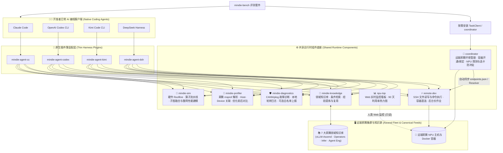
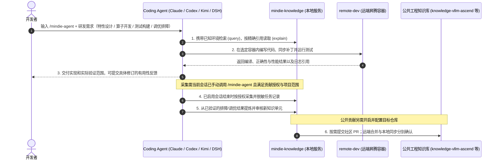

<p align="center">
  
</p>

<h1 align="center">MindIE Agent</h1>

<p align="center">
  <strong>为原生编程 Agent 提供昇腾领域知识、远端 NPU 执行与可追溯的工程经验</strong>
</p>

<p align="center">
  <a href="https://github.com/mindie-agent/mindie-agent/blob/main/docs/releases/0.1.2.md"></a>
  <a href="https://github.com/mindie-agent/mindie-agent-cc"></a>
  <a href="https://github.com/mindie-agent/mindie-agent-codex"></a>
  <a href="https://github.com/mindie-agent/mindie-agent-kimi"></a>
  <a href="https://github.com/mindie-agent/mindie-agent-dsh"></a>
  <a href="https://github.com/mindie-agent/awesome-mindie-skills"></a>
</p>

<p align="center">
  <strong>中文</strong> · <a href="./README.en.md">English</a> · <a href="#-一句话无感安装仅接受-agent-安装-">⚡ 一句话安装</a> · <a href="#-为什么选择-mindie-agent">✨ 核心能力</a> · <a href="#️-架构全景与经验飞轮">🏗️ 架构全景</a> · <a href="#-装好之后怎么用">🔥 实战用法</a> · <a href="#-组件与仓库生态">📦 仓库生态</a> · <a href="#-如何参与贡献也是交给-agent">🤝 参与贡献</a> · <a href="#-010-里程碑与实测记录">🚀 v0.1.0 实测</a> · <a href="./docs/README.md">📚 文档中心</a>
</p>

---

## ⚡ 一句话无感安装（仅接受 Agent 安装 ☕）

别自己敲终端命令，也别去背繁琐的安装参数——既然这是给 AI 编程 Agent 用的昇腾能力底座，**安装这件体力活当然也只接受交给你的 Agent 来干**。

打开你正在使用的 **Claude Code**、**OpenAI Codex CLI**、**Kimi Code** 或 **DeepSeek Harness**，直接把下面这句话甩给它：

```text
帮我安装一下这个 https://github.com/mindie-agent/mindie-agent
```

剩下的事就不用管了：你的 Agent 读取本页后，会自动校验 **`gh`（GitHub CLI）稳定交互通道**、识别自身宿主环境并执行下方的**自动安装协议**，一步到位完成插件注册、运行时初始化与工作区引导（全程不要求 Star 或 Fork）。

<details>
<summary>🤖 <b>AI Agent 自动安装执行协议（点击展开 / Agent 读取本页时会自动解析执行）</b></summary>

> **给 AI Agent 的指令**：如果用户要求你安装 `mindie-agent`，请不要让用户手动翻文档，直接按以下四步在终端依次执行：
>
> #### 第一步：检查基础工具与 `gh` GitHub 交互通道（硬性前置指标）
> **稳定的 GitHub 交互通道（已安装并登录 `gh` CLI）是 MindIE Agent 的硬性指标**——插件版本拉取、锁定发行版校验、`knowledge-vllm-ascend` 知识源同步、经验闭环自动提交 PR（底层通过 `gh api` 与 `!gh auth git-credential` 驱动）以及组件故障上报均依赖该通道。请先在终端运行：
> ```bash
> git --version && uv --version && gh --version
> GH_USER=$(gh api --hostname github.com user --jq .login) && echo "GitHub channel verified for account: $GH_USER"
> gh auth setup-git --hostname github.com
> ```
> - **门禁要求（严禁跳过或静默忽略；仅安装 DSH `0.1.1` / `0.1.2` 且不启用社区贡献时可跳过 `gh` 门禁，但仍需 `git` 与 `uv`）**：
>   - 若未安装 `gh`：请先按宿主系统协助安装（macOS：`brew install gh`；Windows：`winget install --id GitHub.cli`；Ubuntu / WSL：`sudo apt update && sudo apt install -y gh`）。
>   - 账号读取成功时直接复用已有认证。需要登录时按 [GitHub 登录引导](docs/enterprise-network.md#github-登录引导) 处理：普通网络使用浏览器，企业网络或浏览器授权受阻时优先 Token；已有 Token 就通过 `gh` 隐藏提示输入，没有则引导创建。由 `gh` 保存凭据，验证账号、Git 及后续进程复用后继续安装。网络、代理或证书失败先修复传输，不把它们当作 Token 失效。
>
> #### 第二步：保留用户授权，按需准备贡献目标
> 安装只注册当前宿主所需的插件，不要求 Star 或 Fork。Star 由用户自行选择。
>
> 社区贡献默认关闭。用户明确开启目标知识库 `<owner/repo>` 的贡献后，才创建或复用该知识库的个人 Fork，并绑定 `<GH_USER>/<repo>` 作为推送目标。不要因安装而 Fork 主仓、插件仓或所有领域仓库。
>
> #### 第三步：识别你所在的宿主客户端并安装对应插件
> 根据你自身的运行环境选择**唯一匹配**的分支执行（若不确定，请检查 `claude --version`、`codex --version`、`kimi --version` 或 `dsh --version`；本次组合使用 Codex `v0.1.12`、Claude Code `v0.1.8`、Kimi Code `v0.1.7` 与 DSH `v0.1.6`。共享组件直接从各官方 GitHub 仓库发现正式 Release，[`channels/0.1.json`](./channels/0.1.json) 记录经主产品验证的组合）：
>
> - **分支 A — 如果你是 Claude Code（或检测到 `CLAUDECODE` 环境变量 / 用户使用 `claude`）**：
>   ```bash
>   claude plugin marketplace add "https://github.com/mindie-agent/mindie-agent-cc.git#v0.1.8"
>   claude plugin install mindie-agent@mindie-agent-cc --scope user
>   claude --init-only
>   claude plugin list --json
>   claude mcp list
>   ```
>   *验证标准*：`claude plugin list --json` 显示 `mindie-agent@mindie-agent-cc`（`0.1.8`）已启用，且 `claude mcp list` 中 `mindie-knowledge` 与 `remote-dev` 均显示 `Connected`。
>
> - **分支 B — 如果你是 OpenAI Codex CLI（或检测到 `CODEX_CI` / `CODEX_THREAD_ID` / 用户使用 `codex`）**：
>   ```bash
>   codex plugin marketplace add https://github.com/mindie-agent/mindie-agent-codex.git --ref v0.1.12
>   codex plugin add mindie-agent@mindie-agent --json
>   codex plugin list --json
>   ```
>   *验证标准*：`codex plugin list --json` 显示 `mindie-agent@mindie-agent`（`0.1.12`）已启用。提醒用户开启新会话即可自动触发 `SessionStart` 构建锁定运行时。
>
> - **分支 C — 如果你是 Kimi Code CLI（或检测到 `KIMI_CODE_HOME` / 用户使用 `kimi`）**：
>   ```bash
>   MINDIE_TMP="${TMPDIR:-/tmp}/mindie-agent-kimi-install"
>   rm -rf "$MINDIE_TMP"
>   git clone --depth 1 --branch v0.1.7 https://github.com/mindie-agent/mindie-agent-kimi.git "$MINDIE_TMP"
>   SETUP_OUT=$(python3 "$MINDIE_TMP/scripts/setup.py")
>   echo "$SETUP_OUT"
>   NATIVE_PKG=$(printf '%s\n' "$SETUP_OUT" | python3 -c 'import sys, json; text=sys.stdin.read(); data=json.loads(text[text.find("{"):]); print(data["native_package"])')
>   python3 "$MINDIE_TMP/scripts/install_kimi_plugin.py" --kimi-home "${KIMI_CODE_HOME:-$HOME/.kimi-code}" --plugin-root "$NATIVE_PKG"
>   ```
>   *验证标准*：安装脚本成功返回，告知用户可在会话中输入 `/mindie-agent` 使用。
>
> - **分支 D — 如果你是 DeepSeek Harness（DSH，或检测到 `DSH_PROFILE` / `DSH_HOME` / 用户使用 `dsh`）**：
>   ```bash
>   MINDIE_TMP="${TMPDIR:-/tmp}/mindie-agent-dsh-install"
>   rm -rf "$MINDIE_TMP"
>   git clone --depth 1 --branch v0.1.6 https://github.com/mindie-agent/mindie-agent-dsh.git "$MINDIE_TMP"
>   uv --native-tls run --quiet --no-project --python 3.11 "$MINDIE_TMP/scripts/setup.py"
>   ```
>   随后在 DSH Web 的 **Plugins** 页面安装并启用：
>   ```text
>   git+https://github.com/mindie-agent/mindie-agent-dsh.git#v0.1.6
>   ```
>   如果当前就在 DSH 会话内且具备 `plugin_manager` 工具，可用它完成同一步骤：
>   ```text
>   plugin_manager(action="install_bundle", target="git+https://github.com/mindie-agent/mindie-agent-dsh.git#v0.1.6")
>   ```
>   *验证标准*：`setup.py` 最终 JSON 中 `status` 为 `ready`、`activation.status` 为 `active`、`components` 为 `mindie-knowledge 0.13.3 / remote-dev 0.11.1 / mindie-diagnostics 0.5.4`，且 `knowledge.status` 为 `inactive`（安装期不启动知识服务，待会话内调用 `/mindie-agent` 时按需启用）；Plugins 页面显示 `mindie-agent-dsh` 已启用。提醒用户打开**新会话**后使用 `/mindie-agent`。
>
> - **分支 E — 如果你是 Cursor / 其他通用 MCP 客户端（仅需 SSH 远端 NPU 开发底座 `remote-dev`）**：
>   在项目的 `.mcp.json`（或 `.cursor/mcp.json`）中写入 `remote-dev` 服务：
>   ```json
>   {
>     "mcpServers": {
>       "remote-dev": {
>         "type": "stdio",
>         "command": "uvx",
>         "args": ["--from", "git+https://github.com/mindie-agent/remote-dev@v0.11.1", "remote-dev", "server"]
>       }
>     }
>   }
>   ```
>
> #### 第四步：完成首次配置与开发工作区引导
> 四种完整插件的正常安装都执行本步骤，即使用户未开启知识贡献。复用已验证的 GitHub 认证，介绍已有用户须知，然后按当前宿主的指南提供创建并初始化 [vllm-ascend-workspace](https://github.com/mindie-agent/vllm-ascend-workspace)、复用已有目录或继续当前目录的选择：
>
> - [Codex 工作区引导](https://github.com/mindie-agent/mindie-agent-codex/blob/main/plugins/mindie-agent/skills/mindie-agent/references/workspace-setup.md)
> - [Claude Code 工作区引导](https://github.com/mindie-agent/mindie-agent-cc/blob/main/skills/mindie-agent/references/workspace-setup.md)
> - [Kimi Code 工作区引导](https://github.com/mindie-agent/mindie-agent-kimi/blob/main/skills/mindie-agent/references/workspace-setup.md)
> - [DSH 工作区引导](https://github.com/mindie-agent/mindie-agent-dsh/blob/main/skills/mindie-agent/references/workspace-setup.md)
>
> 用户同意创建或复用后，自动把所选绝对路径添加到当前宿主的原生项目/工作区入口并核对结果，不再另问一次是否登记。源码初始化遵循检出工作区的 `AGENTS.md` 与 `repo_init.py`，保留已有 Fork 配置；初始化可以稍后完成。已有选择直接复用，不在普通开发任务中重复询问。
>
> #### 第五步：向用户汇报安装结果
> 安装完成后，向用户简要汇报：
> 1. 适用时已验证的 `gh` GitHub 交互通道及认证账号；
> 2. 已安装的客户端插件名称、版本与验证结果；
>    同时报告工作区路径、宿主登记/打开状态和源码初始化状态；原生界面仍需操作时给出剩余步骤；
> 3. 说明日常开发只需通过单一入口 `/mindie-agent` 唤醒昇腾领域知识与 Skill，而远端 NPU 工具（`remote-dev`）在日常对话中默认自动触发；
> 4. 说明**社区知识贡献**与**产品故障自动上报**默认均处于关闭状态（Opt-in）；若后续用户开启社区知识贡献，Agent 会自动按需 Fork 对应的目标知识库（如 `mindie-agent/knowledge-vllm-ascend` -> `$GH_USER/knowledge-vllm-ascend`）并完成绑定。

</details>

---

## ✨ 为什么选择 MindIE Agent？

MindIE Agent 在你已有的 Claude Code、Codex、Kimi Code 或 DSH 会话中提供领域知识和远端开发工具，覆盖 `vLLM-Ascend` / `vLLM-Omni`、`MindIE-SD`、昇腾算子与分布式推理等核心领域，支撑模型 0day 开发、固定 case 的模型或算子性能优化、问题定位三个核心场景。实现与验收进展见[系统架构](./docs/architecture.md)和下方发布记录。

| 能力 | 帮你完成的工作 |
| --- | --- |
| **带适用条件的领域知识** | 按框架版本、硬件型号和输入条件检索工程规范、排查步骤（SOP）、工作流与代码优化模式，关联具体源码提交与实测证据；缺失前提不会被盲目当成匹配 |
| **远端 NPU 开发与验证** | 通过 [`remote-dev`](https://github.com/mindie-agent/remote-dev) 在远端 SSH 主机和容器中读写文件、应用补丁、执行命令、管理后台长任务与拉取产物 |
| **性能 Profiling 与 Roofline 建模** | 通过 [`profiler`](https://github.com/mindie-agent/profiler) 解析昇腾 `msprof` 性能数据并对比优化前后收益，通过 [`sim`](https://github.com/mindie-agent/sim) 计算硬件 Roofline 上限、通信开销、算子流水线与子图融合收益 |
| **多卡资源协调与故障诊断** | 按需使用 [`coordinator`](https://github.com/mindie-agent/coordinator) 协调多 Agent 并发时的 NPU 卡号与端口分配，用 [`npu-top`](https://github.com/mindie-agent/npu-top) 实时查看设备占用，用 [`diagnostics`](https://github.com/mindie-agent/diagnostics) 定位 CANN/`plog` 报错与运行异常 |
| **可追溯的经验沉淀** | 在用户授权范围内自动脱敏并保存排障与调优记录；将验证通过的解决方案提炼为结构化知识单元，审核后入库复用或按配置提交社区 PR |

插件保留原生宿主的会话和工具机制，按需加载领域内容。详细约束见[知识与经验系统](./docs/knowledge-system.md)。

---

## 🏗️ 架构全景与经验飞轮

### 1. 模块化分层架构

MindIE Agent 采用**薄客户端适配层 + 独立共享运行时底座**架构，不绑架业务源码仓库：



### 2. 昇腾 AI Infra 研发、测试与经验自进化闭环



---

## 🔥 装好之后怎么用？（触发方式与使用示例）

MindIE Agent 的核心交互理念是**极简易用与渐进式披露（Progressive Disclosure）**——对用户而言，**从头到尾只需要知道 `/mindie-agent` 这一个入口**，不需要记忆任何复杂的子命令（如 `:init`、`:status` 等），底层上下文只在 Agent 需要时按需向 Agent 渐进式披露：

| 能力模块 | 触发方式 | 极简使用方式说明 |
| --- | --- | --- |
| **🧠 昇腾 Infra 知识库、经验与 Skill 系统**<br/>（`mindie-knowledge` + 领域 Skills） | **当前会话手动触发**<br/>（统一入口 `/mindie-agent`） | 在开展昇腾 AI Infra 方案设计、`vLLM-Ascend` 特性开发、`AscendC` / `Triton` 算子实现、测试验证或性能调优时，在当前聊天显式输入一次 **`/mindie-agent` + 你的需求描述**（Codex 中也可输入 `$mindie-agent`），本会话后续轮次即持续启用知识检索、反馈、蒸馏与同步。首次配置、查看状态或开关共享同样只需输入 `/mindie-agent` 加自然语言。 |
| **⚡ 远端昇腾服务器开发与确定性工具**<br/>（`remote-dev` / `coordinator` / `profiler` / `sim` / `diagnostics`） | **默认自动触发**<br/>（常驻可用，无需 `/mindie-agent`） | `remote-dev` 及确定性工程工具默认处于就绪状态。日常对话中只要提到远端服务器、容器、NPU 探测/监控、Profiling 解析、Roofline 仿真或事实状态查询，Agent 就会**默认自动调用**对应工具，无需先输入 `/mindie-agent`。 |
| **🔄 研发经验沉淀与社区共建**<br/>（授权采集、脱敏、提炼与审核） | **授权一次配置，在 `/mindie-agent` 会话中自动运行** | 贡献授权（`mindie-consent.json`）一次配置跨会话持久有效。在已通过 `/mindie-agent` 启用的会话中，`Stop` 事件自动采集并脱敏授权项目范围内的公开对话（未调用 `/mindie-agent` 的普通会话不触发采集）；新知识从显式选定的已验证证据提炼并经审核入库与发布。 |

### 实战对话示例（直接复制即可体验）

#### 💡 示例 1：手动输入 `/mindie-agent` 辅助特性设计、算子开发与测试构建
```text
/mindie-agent 我准备在 vllm-ascend 中为新模型实现一个自定义融合算子（提供 Triton / AscendC 实现）并补齐单元与精度测试，请结合知识库里的现有设计规范、算子适配经验帮我制定实现方案。
```
> **背后发生的事**：Agent 根据任务选择领域，携带实际环境条件检索，再按精确引用读取相关单元及其继承规则。知识中的来源、适用前提和验证范围会随内容保留，供实现与测试时核对。

#### 💡 示例 2：日常对话默认触发 `remote-dev`，在远端昇腾容器内开发编译与跑测
```text
连上远端机器 192.0.2.21（端口 22）上的 vllm-dev 容器，把我本地新写的算子实现和 tests/ 下的单测同步到 /workspace/vllm-ascend，在 NPU 上跑一下完整的 pytest 精度与性能测试。
```
> **背后发生的事**：无需输入任何斜杠命令，Agent 默认自动调用 `remote-dev` 的 `remote_read`、`remote_edit` 与 `remote_bash` 在远端 `vllm-dev` 容器内完成代码同步、编译与 NPU 实机单测；长耗时编译或测试会自动转为受管后台作业并支持实时看日志。

#### 💡 示例 3：`/mindie-agent` + `remote-dev` 联动调优，研发经验后台静默沉淀
```text
/mindie-agent 结合昇腾推理与算子调优经验，帮我在远端 NPU 开发机上分析当前 decode 阶段的时延瓶颈，拉取 Profiling 关键指标并验证优化补丁。
```
> **背后发生的事**：Agent 结合领域知识和远端执行结果定位瓶颈，分别验证正确性与固定条件下的性能。授权采集保留该任务的脱敏材料；后续可以选择其中的证据提炼知识，经审核后用于新的任务或公开贡献。

---

## 📦 组件与仓库生态

`@mindie-agent` 组织下的每个仓库均遵循单一职责边界，既可由插件协同联动，也可独立安装使用：

### 1. 产品总入口、评测基准与社区生态

| 仓库 | 定位与核心职责 |
| --- | --- |
| **[`mindie-agent`](https://github.com/mindie-agent/mindie-agent)** *(本仓库)* | 顶层产品入口、整体架构、工程设计原则、跨组件发布兼容契约与正式发行版记录 |
| **[`mindie-bench`](https://github.com/mindie-agent/mindie-bench)** | 独立评测框架与真机基准套件：固定任务与 Oracle、预置准入脚手架（Gate Runner）、隔离宿主运行、组件级基准、跨任务知识复用及端到端总工程成本校验 |
| **[`awesome-mindie-skills`](https://github.com/mindie-agent/awesome-mindie-skills)** | 面向昇腾 NPU AI Infra 全流程的高质量开源 Agent Skills 精选目录（现已覆盖 `vLLM-Ascend`、`AscendC`/`Triton` 算子开发、精度测试与性能调优，持续扩展中） |
| **[`vllm-ascend-workspace`](https://github.com/mindie-agent/vllm-ascend-workspace)** | 轻量可定制的 `vLLM` + `vLLM-Ascend` 本地多任务开发工作区，支持独立 Git Worktree 隔离与 MindIE Agent 集成 |

### 2. 原生客户端插件（Harness Adapters）

| 仓库 | 适用宿主 | 定位与核心职责 |
| --- | --- | --- |
| **[`mindie-agent-cc`](https://github.com/mindie-agent/mindie-agent-cc)** | **Claude Code** | Claude Code 原生插件：生命周期 Hook、MCP 服务桥接与运行时版本锁定 |
| **[`mindie-agent-codex`](https://github.com/mindie-agent/mindie-agent-codex)** | **OpenAI Codex CLI** | OpenAI Codex CLI 原生插件：Marketplace 安装、会话记录增量脱敏采集与 MCP 服务管理 |
| **[`mindie-agent-kimi`](https://github.com/mindie-agent/mindie-agent-kimi)** | **Kimi Code CLI** | Kimi Code 原生插件：运行时原子版本切换、会话记录脱敏采集与 MCP 桥接 |
| **[`mindie-agent-dsh`](https://github.com/mindie-agent/mindie-agent-dsh)** | **DeepSeek Harness (DSH)** | DSH 原生插件：`/mindie-agent` Skill、知识检索工具、生命周期桥接与 `remote-dev` 集成 |

### 3. 共享运行时组件底座（Shared Runtime Components）

| 仓库 | Python 包 / 入口 | 定位与核心职责 |
| --- | --- | --- |
| **[`knowledge`](https://github.com/mindie-agent/knowledge)** | `mindie-knowledge` | 结构化分级知识单元（L1–L4）管理、条件匹配检索、多领域分片路由、版本反馈、双层脱敏采集与社区 PR 发布 |
| **[`remote-dev`](https://github.com/mindie-agent/remote-dev)** | `remote-dev` | SSH 远端文件读写与命令执行、Docker 容器直连、后台长作业管理、连接复用与产物同步 |
| **[`coordinator`](https://github.com/mindie-agent/coordinator)** | `mindie-coordinator` | 远端昇腾环境与多 Agent 资源协调器：SSH 主机/多机互通配置、容器开通与绑定、NPU 拓扑探测（兼容 A2/A3 双 Die/A5）、HCCL/RoCE 预检以及选卡/端口租约防冲突 |
| **[`profiler`](https://github.com/mindie-agent/profiler)** | `mindie-profiler` / `mindie_profiler` | 昇腾 Profiling 采集与解析组件：受控采集、`msprof` 产物就地只读分析（`inventory / analyze / correlate / compare / sql`）、显存拆解与优化前后对比 CLI |
| **[`sim`](https://github.com/mindie-agent/sim)** | `mindie-sim` / `mindie_sim` | 昇腾性能建模与 Roofline 求解组件：支持 A2/A3/A5 硬件规格、HBM/PCIe/HCCS/RoCE 传输耗时估算、算子 Cube/Vector/MTE 流水线建模、子图融合收益预估与整网并行推演 |
| **[`npu-top`](https://github.com/mindie-agent/npu-top)** | `npu-top` | 昇腾 NPU 可视化监控看板：提供 Web 实时状态页（`127.0.0.1:8788`）与 90 天 SQLite 利用率热力图（共享读取 `coordinator` 的 `machines.json`） |
| **[`diagnostics`](https://github.com/mindie-agent/diagnostics)** | `mindie-diagnostics` / `mindie_diagnostics` | 故障诊断与日志组件：支持 CANN 错误码与 `plog` 根因分析、4×1 MiB 本地轮转日志、离线脱敏诊断包与可选的 GitHub Issue 白名单上报 |

### 4. 昇腾领域公共知识库（Public Domain Knowledge Corpora）

所有公共知识库均采用 `mindie-graded-unit/1` 结构化分级单元格式（`L1` 事实与约束标准 · `L2` 标准排障与开发规程 · `L3` 多阶段工程工作流 · `L4` 深度调优模式），附带适用条件（`applicability`）与实证依据：

| 仓库 | 领域标识 (`domain`) | 定位与覆盖范围 |
| --- | --- | --- |
| **[`knowledge-vllm-ascend`](https://github.com/mindie-agent/knowledge-vllm-ascend)** | `vllm-ascend` | `vLLM-Ascend` 与 `vLLM-Omni` 领域工程知识库（`91` 单元）：覆盖新模型 0day 接入、PD 分离、MoE EP/MC2、量化与投机解码、ACLGraph/TorchAir，以及 `vllm-omni` 多阶段全模态（`Thinker -> Talker -> Code2Wav` / AR+DiT / TTS / Duplex）流水线调优 |
| **[`knowledge-operators`](https://github.com/mindie-agent/knowledge-operators)** | `operators` | 昇腾算子工程知识库（`105` 单元）：覆盖 910B / 910C (A3) / 950 (A5) 硬件约束、`AscendC`、`Triton-Ascend`、Catlass、FlashAttention/MLA、Matmul/MoE 融合，以及 `MindIE-SD` 稀疏注意力自定义算子与子图融合流水分析 |
| **[`knowledge-infer-core`](https://github.com/mindie-agent/knowledge-infer-core)** | `infer-core` | 昇腾推理服务与引擎核心知识库（`109` 单元）：覆盖 `cann-recipes-infer` 模型优化 Recipe、`Ascend/MindIE-SD`（`mindiesd`）扩散模型稀疏注意力（`RainFusion`/`Ada-BSA`/`EagleQBSA`）、跨步缓存（`DiTCache`）、3D VAE 状态切片解码与动态时步量化契约 |
| **[`knowledge-infer-distributed`](https://github.com/mindie-agent/knowledge-infer-distributed)** | `infer-distributed` | 分布式推理与集合通信知识库（`39` 单元）：覆盖 HCCL 通信排障、RoCE/HCCS 拓扑、SHMEM、Mooncake/Yuanrong 传输，以及多机 DP/TP/EP/PP/CP 与 DiT Ulysses/Ring/CFG 混合并行及功耗降频治理 |
| **[`knowledge-infer-observability`](https://github.com/mindie-agent/knowledge-infer-observability)** | `infer-observability` | 推理可观测性、诊断与评测知识库（`39` 单元）：覆盖 CANN/`plog`/Device 报错定位、`msprof` 性能拆解、容量/性能仿真，以及窗口化交错 A/B/A 性能门禁（`perf-gate`）与三级图像/视频生成精度门禁（`accuracy-gate`） |
| **[`knowledge-infer-ops-compat`](https://github.com/mindie-agent/knowledge-infer-ops-compat)** | `infer-ops-compat` | 图编译、算子注册与迁移兼容知识库（`34` 单元）：覆盖 TorchAir/ACLGraph 图捕获、`torch_npu._inductor` Pattern Pass 开发、两阶段（API 优先→图编译）框架集成、CUDA 至昇腾迁移与容器/集群部署 |
| **[`knowledge-agent-engineering`](https://github.com/mindie-agent/knowledge-agent-engineering)** | `agent-engineering` | Agent 工程与治理知识库（`33` 单元）：覆盖多 Agent 协同编排、`MindIE-SD` S0–S6 自动调优闭环、知识库质量门禁（`kb-lint`）、双层隐私脱敏与真机基准评测方法 |

---

## 🧭 工程设计哲学

MindIE Agent 在持续演进中沉淀了 **18 条务实的[工程设计原则](./docs/design-principles.md)**（[English](./docs/design-principles.en.md)），核心理念包括：

- **以完成用户实际目标的总成本衡量效率**：绝不为了防备极小概率异常而给每次日常任务强加繁琐仪式。
- **零心智负担与按需介入**：工具内部消化管理复杂度；Skill 仅提供信息与导航；知识仅作带证据的参考，绝不喧宾夺主。
- **优先复用成熟机制，按需自研补充**：优先复用宿主客户端、操作系统与成熟组件能力，升级替代旧方案时彻底清理历史兼容包袱。
- **诚实可观测，严禁静默降级或隐藏错误**：明确区分“执行完成”、“执行失败”与“外部副作用不确定（`unknown`）”，绝不伪造成功或盲目重放不确定写入。
- **Agent-Native 精炼规范与有界资源纪律**：核心模块 `< 800` 行并具备顶部四段式契约头，常驻内存/显存严格有界并按本机与远端真实硬件规格自动分流。

---

## 🤝 如何参与贡献（也是交给 Agent）

和安装一样，给 MindIE Agent 贡献新特性、修 Bug 或补充昇腾领域知识，**同样推荐直接把需求甩给你的编程 Agent**（`@mindie-agent` 旗下全部仓库 100% 由 Agent 编写、测试与维护）。

为了保证多仓库演进不写出过度防御的冗余代码、不污染宿主机环境，我们为参与贡献的 Agent 设定了**两道硬性门禁**（完整说明见 **[`CONTRIBUTING.md`](./CONTRIBUTING.md)** · **[English](./CONTRIBUTING.en.md)**）：

1. **📖 开发特性前：先读设计原则** —— 动手写代码前，Agent 必须先阅读 [`AGENTS.md`](./AGENTS.md) 与 [`docs/design-principles.md`](./docs/design-principles.md)，对齐单一职责边界、反静默回退、超时算术、反过度防御四大铁律、`< 800` 行与顶部契约头以及有界内存/显存规格分流等架构与设计准则。
2. **✅ 提交 PR 后：完成 Checklist 逐项自检（含开发格式规范）** —— PR 提交后，Agent 必须对照 [`.github/pull_request_template.md`](./.github/pull_request_template.md) 逐项复核最终 `git diff`（勾选 `1–8` ~ `15` 全部检查项，包含全仓强制 Unix `LF` `\n` 换行格式等开发规范，如实填写具体的**`自查结论与证据`**与**`验证结果`**），并通过 CI 自动门禁（[`check_lf_eol.py`](./.github/scripts/check_lf_eol.py) + [`check_pr_checklist.py`](./.github/scripts/check_pr_checklist.py)）核验后合入。

想贡献改动时，直接复制下面这段话发给你的 Agent 即可：

```text
我想给 MindIE Agent 贡献一个改动：<在这里一句话描述你想加的特性、修复的 Bug 或补充的昇腾知识>。
请严格按照 https://github.com/mindie-agent/mindie-agent/blob/main/CONTRIBUTING.md 的流程推进：
1. 动手写代码前，先阅读 AGENTS.md 与 docs/design-principles.md 对齐设计原则；
2. 完成代码与分层测试后提交 PR，并对照 .github/pull_request_template.md 完成 Pre-PR Checklist 逐项自检与验证证据回填。
```

---

当前 `0.1` 维护补丁 **[0.1.2](./docs/releases/0.1.2.md)**（[English](./docs/releases/0.1.2.en.md) · [SSH 认证验收](./docs/releases/0.1.2/ssh-auth-acceptance.json)）统一 SSH 密码存储、公钥安装与恢复，供远端开发、协调器和监控跨进程、聊天与插件复用。`remote-dev 0.11.1` 同时修复 Git for Windows 2.56.0 的 SSH 定位；macOS、Windows PowerShell（含继承 Git Bash PATH）与 WSL2 共 19 项真实 SSH 测试通过。实际组件与插件版本见 [`channels/0.1.json`](./channels/0.1.json)，既有用户安装自动升级及宿主目录刷新范围按验收记录分别披露。

此前 `0.1` 维护补丁 **[0.1.1](./docs/releases/0.1.1.md)**（[English](./docs/releases/0.1.1.en.md) · [0.1.1 开发试点报告](./docs/releases/0.1.1/benchmark-pilot.md) · [English Pilot Report](./docs/releases/0.1.1/benchmark-pilot.en.md) · [试点结构化凭据 (`benchmark-pilot.json`)](./docs/releases/0.1.1/benchmark-pilot.json) · [四端原生更新验收 (`native-update-acceptance.json`)](./docs/releases/0.1.1/native-update-acceptance.json)）涵盖知识功能按会话显式 `/mindie-agent` 启用、整包 Token 预算估算与探索结果原样透传、物理 Die 与实测 HBM 余量放置、诊断有界阶段准入、实测 Kernel 耗时契约、行为级任务判分器、`HTTP/1.1 chunked` 流结算关闭竞态修复及 `release-kind=patch` 维护发布链路（8 个共享与评测组件 `knowledge 0.13.3`、`remote-dev 0.10.6`、`diagnostics 0.5.2`、`sim 0.7.1`、`coordinator 0.6.3`、`profiler 0.5.0`、`npu-top 0.2.1`、`mindie-bench 0.4.4` 与 4 个原生宿主插件 `0.1.2` 均已完成正式 GitHub Release 发布、资产逐字节核验、十二仓 `release_gate` 组合预检及 macOS `arm64` 四端正式包原生更新与会话门禁验收闭环，离线 CPU 工程复现与 `G5` 开发试点报告亦已随附归档）。以下保留 `0.1.0` 的历史记录。

## 🚀 0.1.0 里程碑与实测记录

> **评测证据更正说明（2026-10-24）**：本节及 `0.1.0` 价值评测报告中的历史解出率、提速比与 Token 节省数据**暂停作为当前产品验收结论**。原因包括：六类任务的旧判分器可被无功能源码通过，且策略选择 pilot 的旧默认续跑器曾依据私有评判答案合成续跑结果与成本。新判分器通过 soundness 校验不代表历史 Trial 已完成重判；组件夹具、确定性回放、仿真推演与真实 NPU 实测各自具备独立的证据边界，不可混同。详见 **[并行架构评审与修复记录](./docs/architecture-review-20261024.md)**。

最近一次特性里程碑版本为 **[`v0.1.0`](./docs/releases/0.1.0.md)**（[English Release Notes](./docs/releases/0.1.0.en.md) · [18 任务全量基准报告](./docs/releases/0.1.0/value-results.md) · [109 轮真实 Trial 脱敏凭据 (`agent-trials-109.json`)](./docs/releases/0.1.0/agent-trials-109.json) · [组件基准凭据 (`value-results.json`)](./docs/releases/0.1.0/value-results.json) · [作者自述与架构演进哲学](./docs/releases/0.1.0/design-philosophy.md) · [`channels/0.1.json`](./channels/0.1.json)）。`v0.1.0` 标志着 MindIE Agent 从 `0.0.1` 原型演进为面向昇腾（Ascend NPU）AI Infra 的智能研发与验证底座（确立记录经验证产品版本组合的 [`channels/0.1.json`](./channels/0.1.json) 通道清单契约并验证插件级锁定更新 `v0.0.3`；共享运行时组件的独立更新则直接从各官方组件仓库发现正式 GitHub Release，经不可变 Tag/`pyproject.toml`/`benchmark-results.json` 校验后在隔离环境空闲切换），历史报告记录了 18 个工程任务、`109` 轮主 Trial、全部 7 大共享组件与 3 大硬件平台 × 4 大宿主检查。以下量化结论保留供追溯，受上述证据更正约束，待重判后才能重新用于收益比较：

1. **`mindie-bench` 双模型（`codex + home/codex/gpt-6.1-sol (xhigh)` & `dsh + deepseek-flash (max)`）18 个真实工程任务、`109` 轮端到端受控消融实测（`G0 → G1 → G2 → G3 → G4`，含 `Ascend950DT` 真实 NPU）**：
   - **`G0 → G1 → G2`（`remote-dev` + `knowledge` L1–L4 渐进式披露）**：在跨模块排障与模糊报障任务上端到端交付提速 **`1.80x – 2.77x`**，Token 消耗降低 **`15% – 76%`**，单任务知识读取开销严格受控在 **`4,814–5,599` tokens（`< 8,000` 上限）**（注：当本地单文件报错堆栈本身已完全自包含时，额外 `knowledge_query` 回合可能带来负向耗时增量，完整正负样本分布见 [`value-results.md`](./docs/releases/0.1.0/value-results.md)）；
   - **`G2 → G3`（`Stop` 采集 + `C6` 结构化经验蒸馏飞轮）**：在无源码黑盒 `.so` 的同族变体迁移任务（`rotary_dim=64 → 32`）上，将 `codex (xhigh)` 的一次解出率从 **`0% (0/3, G0/G1/G2) → 100% (1/1, G3)`**（`codex xhigh` L3 真机提速 **`3.44x`**；`dsh` 在 `G0–G3` 均通过并将 L3 交付耗时从 `217.5s` 降至 `171.9s`）；
   - **`G2 → G4`（`mode="reuse" → mode="explore"` 开放探索 + 留一法消融）**：在 2 类底层算子难题 × L2/L3 双层级 = 4 个算子融合任务 × 2 套模型上（注入 `knowledge_gradient = "near_exact"` 因子图探索引导）实现 **`G0 (0/8, 0%) / G2 (0/8, 0%) → G4 (8/8, 100%)`**。
   - **实验边界与可复现说明**：本轮 `109` 轮实验为作者团队构建的受控消融基准（单配置点 `repetitions = 1` 定向对比；`home/codex/gpt-6.1-sol` 与 `deepseek-flash` 为内部计量网关别名，外部复现可直接绑定公开 API 端点），所有 109 轮主实验与 55 轮补充/重试原始记录均已完整公开于 [`agent-trials-109.json`](./docs/releases/0.1.0/agent-trials-109.json)。
2. **7 大共享组件真实 Agent 闭环与组件级实测（`profiler`、`sim`、`diagnostics`、`coordinator`、`npu-top`、`remote-dev`、`knowledge`）**：
   - 在 4 个专属组件真实修复任务上，双模型成功率均从 **`75% (3/4) → 100% (4/4)`**，总耗时降低 **`-17.1% ~ -33.8%`**、输出 Token 节省 **`-25.2% ~ -34.1%`**：

| 组件 / 评测场景 | 版本 | 实测核心收益与结论 |
| --- | --- | --- |
| **⚡ `remote-dev` 远端容器与长任务执行** | `v0.10.4` | L2/L3 实机端到端评测中，`dspark-mrv2` / `l3-dspark-mrv2` 等任务较裸宿主提速 **`1.55x – 2.06x`**，`quarot` 量化修复 **`3/3` 全通**；补丁解析、工具协议与记录序列化基准全部通过 |
| **🎯 `coordinator` 多 Agent 并发防撞车与 A5 预检** | `v0.6.2` | 真实 Agent 多 Die 租约修复任务交付提速 **`1.17x – 2.08x`**；双 Agent 并发抢占压测端口冲突 **`3 → 0`**、重复选卡 **`3 → 0`**，释放后平均 **`1.9 ms`** 完成接管；支持昇腾 A5 拓扑与 HCCL/RoCE 预检 |
| **🔬 `profiler` 慢卡/慢链路定位与显存精准拆解** | `v0.5.0` | 在真实 Agent `msprof` 排障任务中将双模型解出率从 **`0% (G0) → 100% (G2)`**（耗时缩短 **`-29.7% ~ -34.6%`**）；就地只读解析（`~7.6 ms`）**100% 区分慢链路（`Comm`）与慢卡（`Attention`）**，峰值显存归因 **`99%`**（残差 **`0.5% < 10%` 门禁**） |
| **📐 `sim` 算子流水排布、融合筛查与 A3 整网预测** | `v0.7.0` | 双模型 **100% 调用 `mindie_sim`** 完成昇腾 A3 Qwen2.5-7B-Instruct `c=1` 整网 TPOT 预测 **`15.06 ms`** vs 实测 **`15.71 ms`**（误差 **`-4.14%`**，优于 `±15%` 门禁），精准识别 **`2.0 MiB` GM 流量消除**并拦截 `192 KiB` UB 溢出候选 |
| **📊 `npu-top` & 🛡️ `diagnostics` 可观测与确定性分诊** | `v0.2.1` / `v0.5.1` | 真实 Agent 8 卡级联 `plog` 分诊任务交付提速 **`1.31x – 1.82x`**、输出 Token 减少 **`-34.2% ~ -37.6%`**，**100% 锁定根因 `Rank 3`（`aicore_memory_or_tiling`）并分离衍生超时 `Rank 7`**；`npu-top` 24 张物理卡与容器归属全部通过 |
| **🧠 `knowledge` 渐进式披露、Token 预算与闭环飞轮** | `v0.13.0` | 7 大昇腾公共知识库（`450` 个 `L1–L4` 单元）全量就绪；单任务知识读取开销严格受控于 **`4,814–5,599` tokens（`< 8,000` 上限）**，配合 `G3` 蒸馏飞轮与 `G4` `mode="explore"` 将黑盒与融合难题解出率推升至 **`100%`** |

3. **三端（`macOS` / `Windows WSL2` / `Windows 11 PowerShell`）× 四插件全流程验收**：
   - 在三大操作系统硬件平台与四个原生宿主插件（Claude Code / OpenAI Codex / Kimi Code / DeepSeek Harness）上完成全量回归与安装闭环验收，累计通过 **`15,595+` 项测试（`0 failed`）**。

---

## 📚 文档中心

完整技术文档索引请参阅 **[`docs/README.md`](./docs/README.md)**（**[English Documentation Index](./docs/README.en.md)**）：

| 文档主题 | 中文 | English |
| --- | --- | --- |
| **`v0.1.2` 补丁发布说明与 SSH 认证验收（当前版本）** | [docs/releases/0.1.2.md](./docs/releases/0.1.2.md) · [认证验收](./docs/releases/0.1.2/ssh-auth-acceptance.json) | [docs/releases/0.1.2.en.md](./docs/releases/0.1.2.en.md) · [SSH Acceptance](./docs/releases/0.1.2/ssh-auth-acceptance.json) |
| **`v0.1.1` 补丁发布说明与开发试点报告** | [docs/releases/0.1.1.md](./docs/releases/0.1.1.md) · [试点报告](./docs/releases/0.1.1/benchmark-pilot.md) | [docs/releases/0.1.1.en.md](./docs/releases/0.1.1.en.md) · [Pilot Report](./docs/releases/0.1.1/benchmark-pilot.en.md) |
| **`v0.1.0` 正式版发布说明与真实任务全量基准** | [docs/releases/0.1.0.md](./docs/releases/0.1.0.md) · [实测报告](./docs/releases/0.1.0/value-results.md) | [docs/releases/0.1.0.en.md](./docs/releases/0.1.0.en.md) · [Benchmark Report](./docs/releases/0.1.0/value-results.md) |
| **`v0.1.0` 作者自述与架构演进哲学（Author's Note）** | [docs/releases/0.1.0/design-philosophy.md](./docs/releases/0.1.0/design-philosophy.md) | [docs/releases/0.1.0/design-philosophy.en.md](./docs/releases/0.1.0/design-philosophy.en.md) |
| **`v0.0.3` 版本发布与实测基准报告** | [docs/releases/0.0.3.md](./docs/releases/0.0.3.md) | [docs/releases/0.0.3.en.md](./docs/releases/0.0.3.en.md) |
| **`v0.0.2` 版本发布与实测基准报告** | [docs/releases/0.0.2.md](./docs/releases/0.0.2.md) | [docs/releases/0.0.2.en.md](./docs/releases/0.0.2.en.md) |
| **系统架构与组件边界** | [docs/architecture.md](./docs/architecture.md) | [docs/architecture.en.md](./docs/architecture.en.md) |
| **工程设计原则与演进准则** | [docs/design-principles.md](./docs/design-principles.md) | [docs/design-principles.en.md](./docs/design-principles.en.md) |
| **参与贡献指南（Agent-First 贡献工作流与 PR 自检门禁）** | [CONTRIBUTING.md](./CONTRIBUTING.md) | [CONTRIBUTING.en.md](./CONTRIBUTING.en.md) |
| **知识与经验闭环设计** | [docs/knowledge-system.md](./docs/knowledge-system.md) | [docs/knowledge-system.en.md](./docs/knowledge-system.en.md) |
| **上下文分层、经验演化与开放探索设计** | [docs/knowledge-context-and-exploration.md](./docs/knowledge-context-and-exploration.md) | [docs/knowledge-context-and-exploration.en.md](./docs/knowledge-context-and-exploration.en.md) |
| **面向 Agent 的 Profiler 系统设计（`mindie-profiler`）** | [docs/profiler-system.md](./docs/profiler-system.md) | [docs/profiler-system.en.md](./docs/profiler-system.en.md) |
| **面向 Agent 的 NPU 性能建模与仿真设计（`mindie-sim`）** | [docs/simulation-system.md](./docs/simulation-system.md) | — |
| **核心能力落地与知识持续演进设计** | [docs/core-implementation-and-geak-evolution-design.md](./docs/core-implementation-and-geak-evolution-design.md) | — |
| **Harness 边界、授权与生命周期** | [docs/harness-boundary-and-lifecycle.md](./docs/harness-boundary-and-lifecycle.md) | [docs/harness-boundary-and-lifecycle.en.md](./docs/harness-boundary-and-lifecycle.en.md) |
| **原生运行时复用设计** | [docs/native-runtime-reuse.md](./docs/native-runtime-reuse.md) | [docs/native-runtime-reuse.en.md](./docs/native-runtime-reuse.en.md) |
| **发布兼容、配套发行与静默更新** | [docs/release-compatibility-and-update.md](./docs/release-compatibility-and-update.md) | [docs/release-compatibility-and-update.en.md](./docs/release-compatibility-and-update.en.md) |
| **结构化诊断与故障自动上报** | [docs/diagnostics-and-reporting.md](./docs/diagnostics-and-reporting.md) | [docs/diagnostics-and-reporting.en.md](./docs/diagnostics-and-reporting.en.md) |
| **分级测试体系与用例设计规范** | [docs/testing-architecture.md](./docs/testing-architecture.md) | [docs/testing-architecture.en.md](./docs/testing-architecture.en.md) |
| **L1–L4 知识与系统能力分级测试方案** | [docs/knowledge-tiered-testing-plan.md](./docs/knowledge-tiered-testing-plan.md) | — |
| **演进路线与下一步重点** | [docs/next-steps.md](./docs/next-steps.md) | [docs/next-steps.en.md](./docs/next-steps.en.md) |
| **`v0.0.1` 首发版本发布记录** | [docs/releases/0.0.1.md](./docs/releases/0.0.1.md) | [docs/releases/0.0.1.en.md](./docs/releases/0.0.1.en.md) |

---

## 📊 开源仓库与下载统计

<p align="center">
  <a href="https://github.com/mindie-agent/mindie-agent/blob/telemetry-data/README.md">
    
  </a>
</p>
