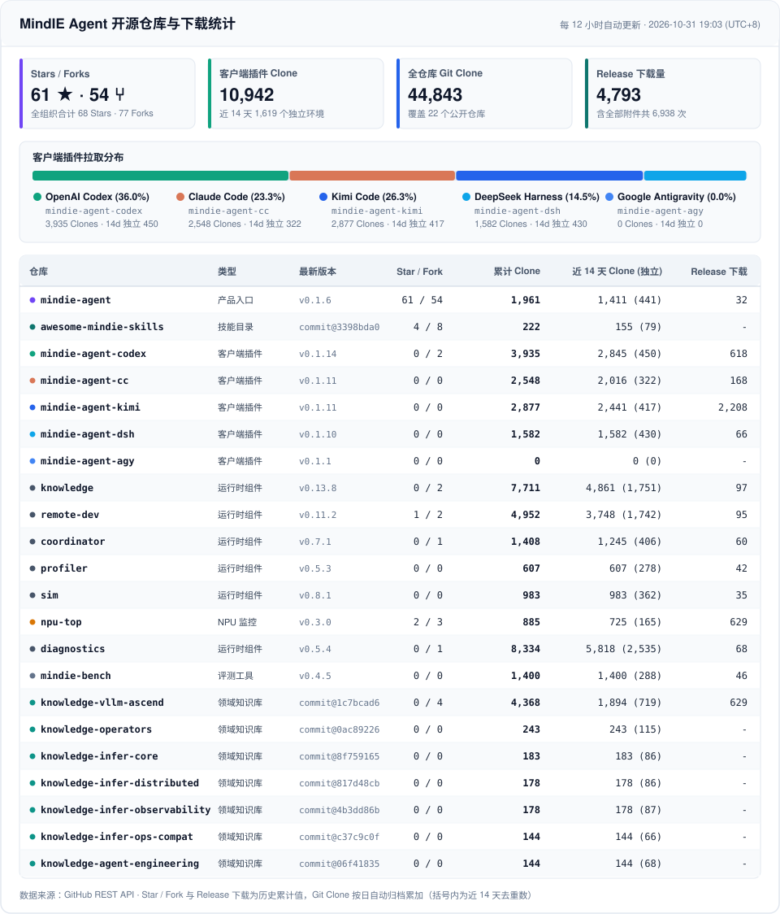

# 📊 MindIE Agent 开源仓库与下载统计

> **最近更新**：`2026-10-31 21:57 (UTC+8)` · 每 12 小时通过 GitHub Actions 自动同步。

## 仓库统计明细

| 类型 | 仓库 | 最新版本 | Stars | Forks | 累计 Clone | 近 14 天 Clone (独立) | 近 14 天浏览 (独立) | Release 下载 (含附件) |
| --- | --- | --- | ---: | ---: | ---: | ---: | ---: | ---: |
| 产品入口 | [`mindie-agent`](https://github.com/mindie-agent/mindie-agent) | `v0.1.6` | 61 | 54 | **1,961** | 1,411 (441) | 330 (107) | 32 (112) |
| 技能目录 | [`awesome-mindie-skills`](https://github.com/mindie-agent/awesome-mindie-skills) | `commit@3398bda0` | 4 | 8 | **222** | 155 (79) | 245 (34) | 0 (0) |
| 客户端插件 | [`mindie-agent-codex`](https://github.com/mindie-agent/mindie-agent-codex) | `v0.1.15` | 0 | 2 | **3,935** | 2,845 (450) | 15 (13) | 680 (839) |
| 客户端插件 | [`mindie-agent-cc`](https://github.com/mindie-agent/mindie-agent-cc) | `v0.1.11` | 0 | 0 | **2,548** | 2,016 (322) | 5 (3) | 168 (301) |
| 客户端插件 | [`mindie-agent-kimi`](https://github.com/mindie-agent/mindie-agent-kimi) | `v0.1.11` | 0 | 0 | **2,877** | 2,441 (417) | 2 (2) | 2,209 (2,330) |
| 客户端插件 | [`mindie-agent-dsh`](https://github.com/mindie-agent/mindie-agent-dsh) | `v0.1.10` | 0 | 0 | **1,582** | 1,582 (430) | 10 (10) | 70 (202) |
| 客户端插件 | [`mindie-agent-agy`](https://github.com/mindie-agent/mindie-agent-agy) | `v0.1.1` | 0 | 0 | **0** | 0 (0) | 0 (0) | 0 (0) |
| 运行时组件 | [`knowledge`](https://github.com/mindie-agent/knowledge) | `v0.13.8` | 0 | 2 | **7,711** | 4,861 (1,751) | 29 (6) | 97 (510) |
| 运行时组件 | [`remote-dev`](https://github.com/mindie-agent/remote-dev) | `v0.11.2` | 1 | 2 | **4,952** | 3,748 (1,742) | 16 (7) | 95 (514) |
| 运行时组件 | [`coordinator`](https://github.com/mindie-agent/coordinator) | `v0.7.1` | 0 | 1 | **1,408** | 1,245 (406) | 7 (5) | 60 (178) |
| 运行时组件 | [`profiler`](https://github.com/mindie-agent/profiler) | `v0.5.3` | 0 | 0 | **607** | 607 (278) | 17 (6) | 42 (129) |
| 运行时组件 | [`sim`](https://github.com/mindie-agent/sim) | `v0.8.1` | 0 | 0 | **983** | 983 (362) | 15 (8) | 35 (106) |
| NPU 监控 | [`npu-top`](https://github.com/mindie-agent/npu-top) | `v0.3.0` | 2 | 3 | **885** | 725 (165) | 12 (3) | 629 (697) |
| 运行时组件 | [`diagnostics`](https://github.com/mindie-agent/diagnostics) | `v0.5.4` | 0 | 1 | **8,334** | 5,818 (2,535) | 0 (0) | 68 (379) |
| 评测工具 | [`mindie-bench`](https://github.com/mindie-agent/mindie-bench) | `v0.4.5` | 0 | 0 | **1,400** | 1,400 (288) | 48 (4) | 46 (129) |
| 领域知识库 | [`knowledge-vllm-ascend`](https://github.com/mindie-agent/knowledge-vllm-ascend) | `commit@1c7bcad6` | 0 | 4 | **4,368** | 1,894 (719) | 48 (13) | 629 (629) |
| 领域知识库 | [`knowledge-operators`](https://github.com/mindie-agent/knowledge-operators) | `commit@0ac89226` | 0 | 0 | **243** | 243 (115) | 8 (3) | 0 (0) |
| 领域知识库 | [`knowledge-infer-core`](https://github.com/mindie-agent/knowledge-infer-core) | `commit@8f759165` | 0 | 0 | **183** | 183 (86) | 7 (4) | 0 (0) |
| 领域知识库 | [`knowledge-infer-distributed`](https://github.com/mindie-agent/knowledge-infer-distributed) | `commit@817d48cb` | 0 | 0 | **178** | 178 (86) | 8 (6) | 0 (0) |
| 领域知识库 | [`knowledge-infer-observability`](https://github.com/mindie-agent/knowledge-infer-observability) | `commit@4b3dd86b` | 0 | 0 | **178** | 178 (87) | 2 (2) | 0 (0) |
| 领域知识库 | [`knowledge-infer-ops-compat`](https://github.com/mindie-agent/knowledge-infer-ops-compat) | `commit@c37c9c0f` | 0 | 0 | **144** | 144 (66) | 3 (3) | 0 (0) |
| 领域知识库 | [`knowledge-agent-engineering`](https://github.com/mindie-agent/knowledge-agent-engineering) | `commit@06f41835` | 0 | 0 | **144** | 144 (68) | 1 (1) | 0 (0) |
| **合计** | **22 个公开仓库** | — | **68** | **77** | **44,843** | **32,801** | — | **4,860** (7,055) |

## 数据文件

- [`dashboard.zh.svg`](./dashboard.zh.svg)：中文统计看板 SVG
- [`dashboard.en.svg`](./dashboard.en.svg)：英文统计看板 SVG
- [`telemetry-history.json`](./telemetry-history.json)：按日归档累加的历史统计 JSON
