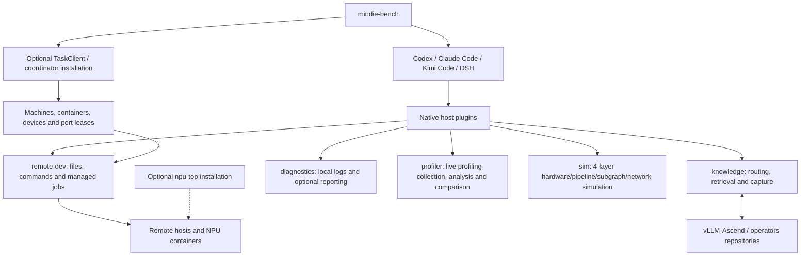

# MindIE Agent Architecture and Ownership

[中文](architecture.md) · [Documentation](README.en.md)

MindIE Agent adds Ascend knowledge, remote execution, resource coordination and diagnostics to existing coding agents. The `0.0.3` delivery scope prioritizes **vLLM-Ascend and operators** across model 0day development, performance optimization for a fixed model or operator case, and issue diagnosis. Broader inference infrastructure remains an extension path and must not be counted as completed coverage for this release.

This document describes ownership and implementation boundaries. [Release records](README.en.md) identify formal versions, exact sources and measured results. See [Knowledge](knowledge-system.en.md), [Harness Boundaries](harness-boundary-and-lifecycle.en.md) and [Design Principles](design-principles.en.md) for their respective contracts.

## 1. Native hosts and shared components

Each plugin preserves its host's sessions, tools, model calls and lifecycle. `/mindie-agent` provides an explicit domain entry point; Codex also supports `$mindie-agent`. Registered `remote-dev` tools can be used directly as the task requires. Configured current-task capture follows lifecycle events without a per-task activation ritual. Actual configuration and project consent determine capture and public contribution.

Plugins depend on `knowledge`, `remote-dev` and `diagnostics`. `coordinator` and `npu-top` are separate, optional installations. Host adapters own protocol compatibility.

## 2. Repository ownership

| Repository | Responsibility |
| --- | --- |
| [`mindie-agent`](https://github.com/mindie-agent/mindie-agent) | Architecture, domain boundaries, entry documentation, cross-repository contracts and release records; no runtime bootstrap, MCP server or dependency lock |
| [`mindie-agent-codex`](https://github.com/mindie-agent/mindie-agent-codex), [`mindie-agent-cc`](https://github.com/mindie-agent/mindie-agent-cc), [`mindie-agent-kimi`](https://github.com/mindie-agent/mindie-agent-kimi), [`mindie-agent-dsh`](https://github.com/mindie-agent/mindie-agent-dsh) | Native session identity, Hook bridges, public transcript projection, lightweight host model integration, installation and component pins |
| [`knowledge`](https://github.com/mindie-agent/knowledge) | Consent and capture state, redaction, task material blocks, structured knowledge units (`axiom`/`measurement`, `sop`, `workflow`, `mutator`), conditional retrieval, domain routing, exact references, feedback and publication queues |
| [`knowledge-vllm-ascend`](https://github.com/mindie-agent/knowledge-vllm-ascend), [`knowledge-operators`](https://github.com/mindie-agent/knowledge-operators) | Domain experience bodies, provenance, applicability, validated Feeds and derived routing indexes; content revisions are independent of runtime versions |
| [`remote-dev`](https://github.com/mindie-agent/remote-dev) | SSH file access, precise edits, search, patches, commands, managed jobs, cancellation and artifact synchronization |
| [`coordinator`](https://github.com/mindie-agent/coordinator) | Machine and container inventory, probing, NPU and port leases, shared queues, managed task identity, resource cleanup and execution endpoints |
| [`npu-top`](https://github.com/mindie-agent/npu-top) | Human-facing cluster observation and bounded history; reads machine inventory and does not schedule tasks |
| [`diagnostics`](https://github.com/mindie-agent/diagnostics) | Bounded structured logs, actionable fault identifiers, support bundles and authorized allowlisted reporting (`mindie_diagnostics`) |
| [`profiler`](https://github.com/mindie-agent/profiler) | Standalone Ascend profiling collection, in-place `inventory / analyze / correlate / compare / sql` artifact analysis, memory evidence and cross-run comparison CLI (`mindie_profiler`) |
| [`sim`](https://github.com/mindie-agent/sim) | Standalone Ascend 4-layer simulation and boundary solver (`mindie_sim` / `mindie-sim`): multi-SKU `DeviceCapabilityProfile`, 7-channel `D2D`/`H2D`/`D2H`/`RH2D`/`RD2H` transfer bounds, periodic microstage pipeline solver, Phase 0 subgraph fusion analyzer and whole-network parallel decomposition |
| [`mindie-bench`](https://github.com/mindie-agent/mindie-bench) | Fixed tasks and oracles, isolated host runs, actual outcomes and costs, component benchmarks, cross-task reuse and release verification |
| [`awesome-mindie-skills`](https://github.com/mindie-agent/awesome-mindie-skills), [`vllm-ascend-workspace`](https://github.com/mindie-agent/vllm-ascend-workspace) | Open-source Ascend NPU AI Infra Agent Skills catalogue and lightweight `vLLM` + `vLLM-Ascend` local workspace with isolated Git Worktrees |

The product release record aggregates versions, source SHAs and benchmark artifacts across code repositories (host plugins, shared runtime components and `mindie-bench`). Domain content has separate repository revisions. A new code tag does not prove that content was published or consumed. See [Paired Releases](release-compatibility-and-update.en.md#paired-component-and-plugin-releases).

`mindie_profiler` (live profiling collection and analysis), `mindie_sim` (4-layer simulation and boundary solving), and fault logging have orthogonal responsibilities and reuse existing remote execution and resource coordination. See the [Profiler design](profiler-system.en.md) for progressive queries, inference correlation, targeted capture, and benefit verification, and [NPU Simulation & Boundary Solver Design](simulation-system.md) for hardware spec resolution, periodic microstage pipeline solving, Phase 0 subgraph fusion analysis, and whole-network parallel decomposition. Proposed interfaces and acceptance criteria do not imply complete integration in installed plugins.

## 3. Remote task execution and completion

Native sessions attach to managed tasks through an explicit client, session identity and TaskClient. Tasks prepare their environment, select resources and acquire leases as needed, then execute through `remote-dev` on the declared host and container. Agents share queues and resource inventory. A3 physical-device and dual-Die mappings follow actual probe results; an arbitrary logical device number does not establish whole-card ownership.

Run Manifests record execution facts: source and configuration identity, environment, inputs, resources, steps, state, timing and artifact references. Hypothesis judgments, benefit attribution and knowledge conclusions are separate interpretations. A successful command supports that command's result. Process draining, lease release, port cleanup and workspace cleanup need their own outcomes.

After a connection interruption, query the original task ID first. Cancellation and recovery preserve that identity instead of replaying work that might still be running. Preparation, execution and cleanup have explicit budgets, with outer waits covering inner budgets and cleanup time. Preserve `completed`, `failed` and uncertain external writes as distinct outcomes. A local receipt failure must not erase a successful remote result.

## 4. L1–L4 Cognitive & Execution Architecture and the Knowledge Flywheel

For complex Ascend engineering tasks, MindIE Agent uses the **`L1–L4` 4-tier cognitive and execution architecture (dual-mode coordination of Hermes heuristic convergence + RSI de-biased exploration)**, backed by the `knowledge` **experience flywheel**.

> [!IMPORTANT]
> **Orthogonal Terminology Convention (Resolving `L1–L4` Ambiguity)**:
> - **`L1–L4` strictly denotes the 4-tier cognitive and execution architecture**: `L1` Hardware Constraints & Syntax Foundation, `L2` Profiling & Simulation Bottleneck Probe, `L3` Hermes Heuristic Convergence Mode, and `L4` RSI De-biased Exploration Mode.
> - **`knowledge` is an experience and domain knowledge flywheel, not an "L1–L4 graded knowledge base"**: `knowledge` stores redacted task blocks (`tasks/<hash>/blocks/`) and distilled engineering conclusions classified by **semantic `category`**—constraints and measurement baselines (`axiom` / `measurement`), diagnostic procedures (`sop`), decision workflows (`workflow`), and verified code transformations (`mutator`)—serving the `L1–L4` architecture layers as needed (the legacy `tier` field in the `knowledge` schema is merely an internal compatibility alias mapping to those four semantic categories).
> - **Other dimensions never overload `L1–L4`**: `mindie-sim`'s 4 simulation granularities are named **`hardware` / `pipeline` / `subgraph` / `net`**; Ascend on-chip memory tiers are always written in full (**`L1 Buffer` / `L0A` / `L0B` / `L0C` / `UB` / `L2 Cache`**); engineering test scopes use **`Tier 0 – Tier 3`**.

| Architecture Layer | Runtime Role & Responsibility | Coordination with `knowledge` / `profiler` / `sim` |
| --- | --- | --- |
| **`L1` · Hardware Constraints & Syntax Foundation** (Foundation, always mounted) | Enforces Ascend 910B / A3 / 950 physical topology and alignment invariants, `ACLGraph` static capture contracts, software interface contracts, and minimal compilable operator templates | Automatically mounts condition-matched `_common` baseline constraints (`axiom` / `measurement`) and parent premises |
| **`L2` · Profiling & Simulation Probe** (Probe, mandatory pre-edit step) | Follows "bound the bottleneck before editing code" via deterministic profiling intervals, Host-Device call correlation, and theoretical lower-bound checks | Invokes `mindie-profiler` (measured artifacts), `mindie-sim` (lower bounds & pipeline/subgraph simulation), and `diagnostics` alongside `sop` procedures |
| **`L3` · Heuristic Convergence Mode (Hermes Mode)** (Default working mode) | Covers 80% of routine model 0day adaptation, issue diagnosis, and optimization by retrieving established decision trees and transforms, then distilling verified milestones back into the flywheel | Queries `workflow` decision experience and `mutator` transforms from `knowledge`; distills incremental updates via `knowledge_distill` |
| **`L4` · De-biased Exploration Mode (RSI Mode)** (Controlled switch mode) | Triggered when `L3` stalls repeatedly while significant headroom remains against `L2` hardware lower bounds: **strips routine `L3` priors**, retaining only `L1` constraints + `L2` measured/simulated oracles + `L4` orthogonal transforms in isolated host sub-contexts and worktrees (parallel CPU compile → serial NPU timing → 4-gate & ablation verification) | Suppresses routine `workflow` bias to discover and verify novel `mutator` transforms or `measurement` findings, feeding validated breakthroughs back into `knowledge` for future `L3` reuse |

### How knowledge enters and returns from tasks

Structured knowledge units express constraints, procedures, decision workflows or code transformations; task materials (`tasks/<task_hash>/blocks/<block_hash>.md`) preserve redacted source context. Explicit domain configuration selects content. Retrieval checks every applicability condition and returns matched units and complete inherited rules within a body budget. Missing facts remain unknown, even when keywords look relevant.

This refactor simplifies knowledge references to unit IDs and revisions, reuses Git revisions for source and run IDs for experiments. Reference patch, oracle and measurement digests cannot be retrieval conditions. Content writes check actual references; queries use derived indexes that can be rebuilt from authoritative Markdown. Existing layers of digest validation are removed together with the runtime and consumers; completion requires actual acceptance.

Authorized public task projections are redacted before storage and navigation generation. Newly distilled conclusions retain provenance and require review. Public contribution follows the user's configuration. Domain registration, successful retrieval, capture and contribution are separate states; routing cannot copy consent or enable outbound publication.

## 5. Acceptance for the three scenarios

| Scenario | Objects to fix and verify |
| --- | --- |
| Model 0day development | Starting source, model and weight revisions, a compatible environment, the complete selected inference chain, an independent numerical reference and predeclared acceptance criteria; a CPU reference does not establish NPU acceptance |
| Fixed-case performance optimization | Fixed inputs and software/hardware conditions, correctness checks, a comparable baseline and optimized result; operator or component timings support only that measured scope |
| Issue diagnosis | A reproducible fault, diagnosis, behavior before and after the fix, and resource cleanup; source interpretation and actual runtime observations remain distinct |

Component tests check interfaces and local behavior. Live NPU runs check concrete tasks in concrete environments. Four-host acceptance checks formal plugin installation and native tool consumption. These forms of evidence do not substitute for one another or imply coverage of every host/device/task combination.

Version comparisons hold the model, task, environment, budget and benchmark revision constant across a no-plugin baseline, the previous formal release and the current formal combination. Record task success, completion time, model usage, human intervention and cross-task reuse. Reuse additionally retains the source task, frozen knowledge, an unexposed downstream task family and costs for each stage. Missing and unknown results remain visible; component microbenchmarks cannot be converted into overall productivity gains.

## 6. Releases, updates and diagnostics

Plugins pin actual dependency artifacts. Compatibility records identify the host and component objects that were verified. Formal publication, candidate tests, isolated installation and upgrades to a user's daily configuration are separate outcomes. Publishing a release does not make an existing user installation a verified instance.

`0.0.3` directly refactors development formats and internal interfaces. Both content domains use `main` without parallel old-format paths. Plugins adopt the current implementation through the existing background preparation and idle switch, preserving user bodies and consent. See [Release Compatibility](release-compatibility-and-update.en.md) for host interfaces and updater mechanics. Knowledge sharing and fault reporting follow the active installation's contribution settings. Disabling outbound reporting preserves local diagnostics and remote execution. Reports accept allowlisted facts only and exclude transcripts, command arguments, machine paths and credentials. See [Diagnostics](diagnostics-and-reporting.en.md).
