# MindIE Agent Architecture & Domain Boundaries

[中文](architecture.md) · [Back to Documentation Index](README.en.md)

Current design, revised 2026-10-16. The [Harness Boundary & Lifecycle Contract](harness-boundary-and-lifecycle.en.md) defines automatic task association, caller-owned execution limits, and bounded growth. The [Knowledge & Experience System](knowledge-system.en.md) specifies the current package, block-reading, and citation semantics. The [Nine Design Principles](design-principles.en.md) govern every adapter and runtime component. The [`0.0.1` Release Record](releases/0.0.1.en.md) documents the six-environment verification evidence, component release mappings, and known host limitations.

---

## Product Scope and Normal Usage

MindIE Agent enhances an existing AI coding Harness for Ascend NPU and inference engineering work. It does not supply its own foundation model, conversation harness, transcript hosting service, or online knowledge API. Users work directly inside their own business repositories and native agent tasks.

Installation establishes the persistent contribution choice, public destination, and project scope. Ordinary tasks use their native workflow: verified native task identity, transcript ownership, and current scope associate eligible work automatically without any daily activation command. Missing configuration, explicit disablement, and component failures remain distinct Agent-facing states. General `remote-dev` tools and optional knowledge reads do not require a capture lease.

Knowledge is optional reference material. Agents choose whether to query, read, or record usefulness feedback (`helpful` / `not_helpful`) after actual use. There is no mandatory retrieval, report, vote, or model-driven closing ceremony.

The initial domain is `vLLM` / `vLLM-Ascend`. A task uses its selected domain's knowledge and resources; additional domains retain independent content and indexes. Cross-domain assistance uses native tasks with bounded handoff when needed, without a mandatory router, global knowledge index, or custom conversation framework. Business source checkouts and native worktrees remain owned by the user and the Harness.

---

## Repositories and Component Ownership

| Component | Owns |
| --- | --- |
| [`mindie-agent`](https://github.com/mindie-agent/mindie-agent) (this repository) | Product semantics, domain boundaries, design principles, and cross-adapter release records |
| [`mindie-agent-codex`](https://github.com/mindie-agent/mindie-agent-codex), [`mindie-agent-cc`](https://github.com/mindie-agent/mindie-agent-cc), [`mindie-agent-kimi`](https://github.com/mindie-agent/mindie-agent-kimi) | Native task identity, explicit entry, onboarding, Hook translation, public transcript parsing, native model invocation, plugin installation, and updates |
| [`knowledge`](https://github.com/mindie-agent/knowledge) | Admission, bounded increments, redaction and organization coordination, retrieval, optional feedback, publication receipts, and cleanup |
| [`knowledge-vllm-ascend`](https://github.com/mindie-agent/knowledge-vllm-ascend) | Reviewed Markdown engineering knowledge packages, versions, and distribution through GitHub |
| Grok Bot application | Review proposed public content for sensitive or impermissible material and trigger appropriate merges, corrections, or removal |
| [`remote-dev`](https://github.com/mindie-agent/remote-dev) | Remote files, commands, background jobs, cancellation, and artifacts over SSH, independent of knowledge activation |
| [`diagnostics`](https://github.com/mindie-agent/diagnostics) | Bounded local logs, actionable fault references, and independently authorized, finite GitHub Issue reporting shared across all adapters |
| [`coordinator`](https://github.com/mindie-agent/coordinator) & [`npu-top`](https://github.com/mindie-agent/npu-top) | Bounded Ascend execution/resource coordination and read-only NPU fleet observation, invoked only when the task needs them |

Adapters reuse the same `knowledge`, `remote-dev`, and `diagnostics` implementations. Native task identity and transcript formats stay in the adapters. A shared runtime must never import a host-specific lease table or guess a task from the latest session or working directory. Adapter separation does not justify a second knowledge database or publishing protocol.

The first ordinary Release, [`0.0.1`](releases/0.0.1.en.md), covers Codex and Claude Code across macOS, native Windows, and Windows WSL (six distinct verification environments). Kimi remains outside the `0.0.1` release matrix. `coordinator` and `npu-top` are optional tools with their own execution and observation contracts; installing a product plugin does not implicitly start them.

---

## Contribution and Reuse Loop

```mermaid
flowchart LR
    A["Native business task"] --> C{"Existing contribution choice and scope apply?"}
    C -->|Missing| R["Agent-only configuration diagnostic"]
    R --> C
    C -->|Configured and enabled| H["Neutral Stop notification<br/>verified task increment only"]
    H --> L["Harness parser selects public messages<br/>local rules redact and save the body"]
    L --> M["LangMem through the native small model<br/>index complete new blocks and short navigation"]
    M --> P["Complete indexed package<br/>automatically propose a GitHub PR"]
    P --> B["Existing Grok Bot reviews and merges"]
    B --> K["Public Markdown domain repository"]
    K --> S["Local synchronization and rebuildable index"]
    S --> N["A new task optionally reads and uses experience"]
    N -.-> F["Optional helpful / unhelpful feedback"]
    F -.-> B
```

Missing configuration, explicit disablement, scope mismatch, and a component fault are distinct states—never conflated as successful alternative modes. Explicit disablement stops new collection, while retrieval and remote tools remain independently usable.

When enabled, only the verified native task and existing authorized project scope can contribute. Forks and new tasks have separate identities. Disabling cancels unsent work; re-enabling admits subsequent material rather than replaying historical transcripts. Raw transcripts remain local and never become GitHub content.

The Stop Hook durably admits a notification and exits with neutral protocol output without requesting another business-model turn. Required capture or startup failures surface a bounded native warning through the host's Hook output and remain queryable on subsequent capability calls. Healthy operations have no arbitrary default total execution deadline; only caller-requested limits end business execution. Failed or uncertain model calls are not automatically retried, and unknown publication outcomes are reconciled against the remote branch/PR before any new write.

### Deterministic Body Projection & Navigation Indexing

The saved body is the ordered, locally redacted public conversation: user input, public assistant progress, and final answers survive, while tool payloads, hidden reasoning, injected instructions, and duplicate native wrappers are excluded. Mechanical projection performs no semantic shortening. Gitleaks and explicit privacy rules run before storage, model input, or publication.

The complete mechanically redacted body is stored as immutable ordered blocks. An adapter-owned lightweight native model produces only each new block's fallible title/summary and current task navigation using prior navigation as context—it never rewrites body bytes or replaces the middle of a long task with an excerpt. Incremental indexing is required before public packaging; a failed index attempt preserves local material and reports the unfinished stage. Publication, synchronization, and retrieval invoke no model.

---

## Public Records and Authoritative Local State

Public material is stored as a complete `tasks/<task_id>/` Markdown package: a `mindie-material-task/1` manifest (`PACKAGE.md`) embeds a `mindie-entry/3` header and binds ordered `mindie-material-block/1` files under `materials/`. A block's body is immutable under its identity.

Markdown files are the authoritative body store. SQLite holds compact cursor, queue, authorization, and external-operation outcome records; ReMe maintains derived file/chunk/BM25 retrieval indexes in-process. Existing authoritative state is validated before initialization or recovery writes: a missing or corrupted database is reported as a visible failure rather than treated as a fresh first-time install, preserving all body files and uncertain operation receipts.

Reading a task reference returns current navigation; reading a block reference returns that exact member block, its file hash, and adjacent references. Literal citations in block bodies support retrieval grouping only when the current source body independently matches the query and covers the citing block's matched terms.

---

## Feedback and Maintenance

Usefulness feedback (`helpful` / `not_helpful`) is an optional, advisory signal recorded by a consuming task—not a certification of truth. Missing feedback is not a negative vote, and a producer's self-assessment does not count as independent reuse evidence. Negative feedback provides an exit path so maintainers or automated review can correct or remove unhelpful entries from the distributed corpus while preserving normal Git history.

---

## Task Association, Execution, and Silent Updates

Native task identity, authorization, an in-flight tool operation, an MCP connection, and a persistent remote job have distinct lifetimes. Explicit authorization persists across restarts and plugin updates until disabled or modified in scope.

The immutable adapter commit, its locked runtime dependencies (`uv.lock`), and its `product-contract.json` define one verified product combination, while `knowledge-vllm-ascend` declares its content schema, validator, and Bot rules in `publication-contract.json`.

Each plugin Release declares its supported Harness version range and directly used interfaces (`harness-compatibility.json`). More than 24 hours after the last successful check, natural use triggers one asynchronous compatibility check. The native plugin manager downloads and installs the selected immutable Release, and `uv` builds its locked, non-editable runtime outside the active runtime and business-operation lock. Once the existing service has no admitted work, the update acquires the exclusive lock, retires the old owner, verifies candidate readiness, and atomically switches the single canonical installation binding. See [Release Compatibility & Silent Update](release-compatibility-and-update.en.md), [Native Runtime & Process Reuse](native-runtime-reuse.en.md), and [Harness Boundary & Lifecycle](harness-boundary-and-lifecycle.en.md).

---

## Diagnostics and Fault Reporting

Component failures carry a local diagnostic reference and actionable recovery facts. Local structured logs enforce entry-size, segment-count, and retention bounds while protecting active writers and registered reader cursors.

Automatic tool-fault reporting is an independent opt-in user setting decoupled from knowledge contribution. One shared reporter publishes only allowlisted code and execution facts (component, version/commit, operation, stage, static error category, duration, exit code, and cleanup outcome) without transcripts, command arguments, raw output, or model analysis. Stable fingerprints deduplicate issues across tasks, and a finite persistent retry budget prevents reporting loops. See [Diagnostics & Fault Reporting](diagnostics-and-reporting.en.md).
