# MindIE Agent Architecture & Module Boundaries

[中文](architecture.md) · [Back to Documentation Center](README.en.md)

This document explains what MindIE Agent does, how its repositories are organized, and how remote Ascend execution, the knowledge & experience loop, NPU observability, and fault diagnostics work together.

- For task identity and lifecycle rules, see [Harness Boundary & Lifecycle](harness-boundary-and-lifecycle.en.md).
- For knowledge package format and search design, see [Knowledge & Experience System](knowledge-system.en.md).
- Every component is governed by the [Engineering Design Principles](design-principles.en.md).
- For verified host versions and paired component releases, see the [`0.0.1` Release Record](releases/0.0.1.en.md).

---

## 1. Product Scope & Trigger Modes

MindIE Agent upgrades your existing AI coding CLI (**Claude Code**, **OpenAI Codex CLI**, **Kimi Code**) into an Ascend NPU and LLM inference engineering powerhouse.

- **No reinvented wheels**: We do not ship a proprietary foundation model, replace your host's conversation UI, or take over your source code repository. You work naturally inside your existing terminal and business codebase.
- **Two clear trigger modes (Manual On-Demand vs. Default Auto-Triggered)**:
  - **Manual `/mindie-agent` Trigger (Knowledge, Experience & Skill System)**: When troubleshooting Ascend workloads, adapting operators, or tuning inference, type `/mindie-agent` (or `$mindie-agent` in Codex) followed by your problem description to invoke the Ascend Skill workflow, search verified historical experience packages, and bind the session's experience loop—staying completely out of the way during ordinary non-Ascend coding.
  - **Default Auto-Trigger for `remote-dev` (Remote Ascend Execution)**: `remote-dev` is registered as an always-ready MCP server. Whenever you mention a remote host, container, or NPU command in normal conversation, your Agent automatically invokes `remote-dev` for remote file I/O, patching, and background job execution without needing any slash command.
- **Configure once, persist across sessions**: After setting your contribution preference, public target repository, and project scope once, eligible tasks associate automatically. Historical experience is purely advisory reference material for the Agent—never a mandatory step.
- **Hard Prerequisite: Stable GitHub Channel (`gh` CLI) & Two-Stage Scoped Fork Policy**: Plugin marketplace fetches, locked release verification, `knowledge-vllm-ascend` sync, automated knowledge PR publication (via `gh api` and `!gh auth git-credential`), and opt-in fault reporting all rely on an authenticated `gh` (GitHub CLI) channel. Because the `@mindie-agent` organization hosts 10+ repositories, we enforce a **clean, on-demand Two-Stage Fork Policy**: (1) **Install Time**: After verifying `gh auth status` and `gh auth setup-git`, the Agent Auto-Install Playbook **Stars** and **Forks** (`--clone=false --remote=false`) **only** the main entry repository `mindie-agent/mindie-agent` (never mass-forking individual plugin or knowledge repos during installation); (2) **When Community Knowledge Contribution Is Enabled (On-Demand)**: Only when the user explicitly opts into contributing to a target public knowledge repository (such as `mindie-agent/knowledge-vllm-ascend`) does the Agent **Star** and **Fork** that specific knowledge repository on demand and bind `fork` (`<GH_USER>/<repo>`) for cross-fork PR publishing.
- **Domain focus**: Our initial focus domain is `vLLM` / `vLLM-Ascend` inference and operator engineering, designed so additional domains can plug in cleanly using the same package architecture.

---

## 2. Repository & Component Ownership

MindIE Agent uses a clean, decoupled architecture across **native Harness plugins**, **shared runtime components**, and **open Markdown knowledge repositories**:

| Component / Repository | Core Responsibility |
| --- | --- |
| [`mindie-agent`](https://github.com/mindie-agent/mindie-agent) (this repo) | Overall architecture, domain boundaries, engineering design principles, cross-component contracts, and unified release records |
| [`mindie-agent-cc`](https://github.com/mindie-agent/mindie-agent-cc), [`mindie-agent-codex`](https://github.com/mindie-agent/mindie-agent-codex), [`mindie-agent-kimi`](https://github.com/mindie-agent/mindie-agent-kimi) | **Native Harness Plugins**: Host task identity verification, first-time setup, Hook bridging, public conversation projection, native lightweight model invocation, plugin installation, and silent background updates |
| [`knowledge`](https://github.com/mindie-agent/knowledge) | **Knowledge & Experience Engine**: Durable admission cursors, deterministic privacy redaction, task package assembly, two-layer hybrid search (BM25 + semantic), usefulness feedback, and automated PR creation |
| [`knowledge-vllm-ascend`](https://github.com/mindie-agent/knowledge-vllm-ascend) | **Public Domain Knowledge Corpus**: Reviewed, redacted `vLLM-Ascend` Markdown knowledge packages distributed via GitHub for incremental client sync |
| [`remote-dev`](https://github.com/mindie-agent/remote-dev) | **Remote Ascend Execution Runtime**: SSH-based remote file I/O, patching, managed long-running background jobs, cancellation, and artifact syncing |
| [`diagnostics`](https://github.com/mindie-agent/diagnostics) | **Structured Diagnostics & Fault Reporting**: Bounded local structured logs, actionable fault IDs, and opt-in, deduplicated GitHub Issue reporting |
| [`coordinator`](https://github.com/mindie-agent/coordinator) & [`npu-top`](https://github.com/mindie-agent/npu-top) | **Multi-Card Scheduling & NPU Telemetry (On-Demand)**: Lease-based NPU allocation across concurrent tasks and read-only multi-host NPU status monitoring |

All three Harness plugins share the exact same `knowledge`, `remote-dev`, and `diagnostics` runtime packages; only host-specific session identity and transcript parsing live inside each plugin adapter.

---

## 3. The Knowledge Capture & Experience Reuse Loop

How does a hard-won Ascend debugging session become reusable community knowledge without leaking private data or slowing down your terminal?

```mermaid
flowchart LR
    A["Everyday Ascend Engineering Session"] --> C{"Experience sharing enabled for this project?"}
    C -->|Not configured or disabled| R["Return clear status only when queried"]
    C -->|Configured and enabled| H["Fast Stop Hook<br/>Commits task cursor in milliseconds"]
    H --> L["Extract public dialogue & run deterministic redaction<br/>Save immutable Markdown blocks"]
    L --> M["Host's lightweight native model generates block titles,<br/>summaries & short task navigation (PACKAGE.md)"]
    M --> P["Assemble complete task package<br/>Automatically open GitHub PR"]
    P --> B["Grok Bot reviews safety & compliance"]
    B --> K["Merge into public corpus<br/>(knowledge-vllm-ascend)"]
    K --> S["Clients incrementally sync & rebuild local search index"]
    S --> N["Future tasks search & read relevant<br/>historical blocks on demand"]
    N -.-> F["Optionally submit helpful / not_helpful<br/>feedback after real use"]
    F -.-> B
```

### Why This Loop Is Both Safe and Fast

1. **Honest, distinct states**: Unconfigured, explicitly disabled, out-of-scope project, and component fault are reported as four distinct states—never disguised as "succeeded with empty output."
2. **Millisecond Stop Hooks**: When a turn finishes, the Stop Hook simply records a lightweight durable admission cursor in SQLite and exits immediately with neutral output so it never blocks your terminal or triggers extra model turns.
3. **100% deterministic body redaction; small models only build the table of contents**:
   - Saved blocks contain only **user input**, **public assistant progress**, and **final answers** (stripping raw tool payloads, hidden reasoning traces, and system prompts). Before touching disk or any model, Gitleaks and deterministic privacy rules strip secrets, private IPs, SSH `user@host` strings, and local home paths.
   - The adapter's lightweight native model (via LangMem) **only generates titles, search summaries, and the `PACKAGE.md` outline—it never rewrites or truncates the primary conversation blocks**.

---

## 4. Knowledge Package Format & Local State Protection

Every task package is stored under `tasks/<task_id>/` using plain, readable Markdown:
- `PACKAGE.md`: Contains the overall task summary, applicability `conditions`, and an ordered table of blocks.
- `materials/0001.md`, `0002.md`...: Immutable, sequentially numbered conversation blocks. When searching, an Agent inspects `PACKAGE.md` first and loads only the specific block(s) it needs rather than flooding its context window with an entire transcript.

Under the hood:
- **Markdown files are the sole source of truth** for content;
- **SQLite** stores compact cursors, queues, consent bindings, and external operation receipts;
- **ReMe** maintains an in-memory search index that can be rebuilt from the Markdown files at any time. If SQLite is missing or corrupted, the runtime reports a clear error while preserving all existing Markdown files rather than treating the error as a "fresh install" and wiping local data.

---

## 5. Usefulness Feedback & Corpus Evolution

After consulting a knowledge package in a real task, an Agent can optionally submit `helpful` or `not_helpful` feedback:
- Feedback is an advisory signal, not a certification of absolute truth, and skipping feedback is completely fine.
- When `vLLM-Ascend` or CANN evolves and an older workaround becomes obsolete, `not_helpful` feedback gives maintainers and automated review a clear signal to update or retire that entry while preserving Git history.

---

## 6. Silent Background Updates & Fault Diagnostics

- **Compatibility-checked silent updates**: Each plugin Release declares its verified Harness version range in `harness-compatibility.json`. Once 24 hours have elapsed since the last check, routine use asynchronously prepares the highest compatible Release in an isolated `uv` environment and switches atomically when the service is idle—preserving your existing consent settings without manual reloads. See [Release Compatibility & Silent Update](release-compatibility-and-update.en.md).
- **Structured logs & opt-in fault reporting**: Components write bounded local structured logs. Users can independently opt into automatic tool-fault reporting, which uploads only allowlisted execution metadata (component, version, stage, error category, duration, exit code) and **never includes transcripts, command arguments, file paths, or credentials**. See [Diagnostics & Fault Reporting](diagnostics-and-reporting.en.md).
