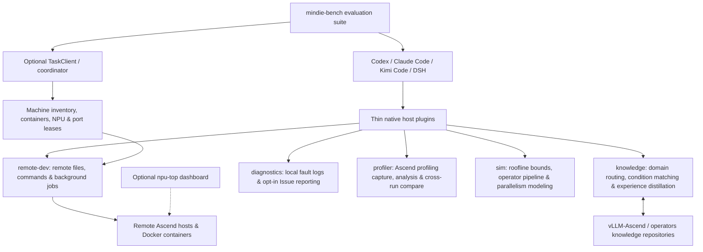

# MindIE Agent Architecture and Module Boundaries

[中文](architecture.md) · [Documentation](README.en.md)

MindIE Agent adds Ascend domain knowledge retrieval, remote container execution, multi-NPU resource coordination, and profiling tools to existing AI coding agents (Claude Code, OpenAI Codex, Kimi Code, and DeepSeek Harness). Current work focuses on **vLLM-Ascend framework development and Ascend operator optimization** across three core scenarios: **new model bring-up (0-day adaptation), model and operator performance tuning, and runtime fault diagnosis**.

This document describes component responsibilities and how they work together. See the [release records](README.en.md) for formal versions and benchmark results, [Knowledge System](knowledge-system.en.md) for how engineering experience is organized and retrieved, [Harness Boundaries](harness-boundary-and-lifecycle.en.md) for session identity and user consent, and [Design Principles](design-principles.en.md) for engineering guidelines.

## 1. Native Host Plugins and Shared Runtime Components

Each plugin preserves its host agent's native session loop, tool calling, and lifecycle:
- **On-demand domain guidance**: Invoke `/mindie-agent` (or `$mindie-agent` in Codex) to load Ascend domain knowledge and workflow guidance for your current task.
- **Agent tools exposed by default**: Remote-dev, coordinator probes and leases, profiler capture and analysis, sim calculations, and local diagnostics/status are discoverable and callable through MCP independently of knowledge activation, under their existing configuration, permissions and resource rules. Knowledge tool names, descriptions and schemas stay out of inactive chats' default tool catalogs. The human-facing `npu-top` dashboard is not an Agent tool.
- **Authorized experience capture**: A manual `/mindie-agent` entry enables the session's knowledge flywheel; capture and distillation additionally obey saved contribution consent and project scope.

Codex `0.1.8` implements this MCP discovery boundary. Other host plugins require their own implementation and acceptance against this contract; this release does not establish their acceptance. The [native acceptance record](releases/codex-0.1.8-native-acceptance.json) covers discovery, six MCP calls and a scheduled update check, and separately records the old `0.1.6` updater failure and one-time recovery.

By default, plugins use `knowledge`, `remote-dev`, and `diagnostics`. `coordinator`, `profiler`, `sim`, and `npu-top` can be installed standalone or combined as needed.

## 2. Repository Ownership

| Repository | Responsibility |
| --- | --- |
| [`mindie-agent`](https://github.com/mindie-agent/mindie-agent) | Product architecture, domain boundaries, documentation entry point, cross-repo specifications, and release records; contains no runtime bootstrap or MCP server code |
| [`mindie-agent-codex`](https://github.com/mindie-agent/mindie-agent-codex), [`mindie-agent-cc`](https://github.com/mindie-agent/mindie-agent-cc), [`mindie-agent-kimi`](https://github.com/mindie-agent/mindie-agent-kimi), [`mindie-agent-dsh`](https://github.com/mindie-agent/mindie-agent-dsh) | Native client plugins: session identification, lifecycle hooks, redacted session transcript capture, MCP bridges, and pinned component versions |
| [`knowledge`](https://github.com/mindie-agent/knowledge) | Knowledge engine: condition-matched retrieval, inherited premise expansion, redacted task blocks, experience distillation validation, and community PR publishing |
| [`knowledge-vllm-ascend`](https://github.com/mindie-agent/knowledge-vllm-ascend), [`knowledge-operators`](https://github.com/mindie-agent/knowledge-operators), [`knowledge-infer-core`](https://github.com/mindie-agent/knowledge-infer-core), [`knowledge-infer-distributed`](https://github.com/mindie-agent/knowledge-infer-distributed), [`knowledge-infer-observability`](https://github.com/mindie-agent/knowledge-infer-observability), [`knowledge-infer-ops-compat`](https://github.com/mindie-agent/knowledge-infer-ops-compat), [`knowledge-agent-engineering`](https://github.com/mindie-agent/knowledge-agent-engineering) | Seven public graded engineering knowledge corpora (`L1–L4`) covering `vLLM-Ascend`, Ascend operators, inference engine internals, distributed communication, observability, graph/operator compatibility, and Agent engineering governance |
| [`remote-dev`](https://github.com/mindie-agent/remote-dev) | Shared SSH authentication, user-scoped credential storage and public-key maintenance; file access, surgical edits, search, patch sync, container command execution, and background job management |
| [`coordinator`](https://github.com/mindie-agent/coordinator) | Remote Ascend environment and lease manager: machine and container inventory, NPU topology probing (including Ascend A3 dual-Die `Phy-ID` mapping), NPU and port lease arbitration, and managed task cleanup |
| [`npu-top`](https://github.com/mindie-agent/npu-top) | Human-facing NPU cluster dashboard: live web UI and 90-day utilization history (sharing `coordinator`'s `machines.json`) |
| [`diagnostics`](https://github.com/mindie-agent/diagnostics) | Bounded structured fault logs, offline redacted diagnostic bundles, and opt-in allowlisted GitHub Issue reporting (`mindie_diagnostics`) |
| [`profiler`](https://github.com/mindie-agent/profiler) | Ascend profiling collection and in-place trace analyzer (`mindie_profiler`): `inventory / analyze / correlate / compare / sql` commands, Host-Device correlation, memory breakdown, and cross-run comparison |
| [`sim`](https://github.com/mindie-agent/sim) | Ascend performance modeling and roofline simulator (`mindie_sim`): A2/A3/A5 hardware specs, `H2D`/`D2H`/`D2D` transfer bounds, Cube/Vector/MTE pipeline scheduling solver, subgraph fusion estimation, and distributed parallelism modeling |
| [`mindie-bench`](https://github.com/mindie-agent/mindie-bench) | Live Ascend NPU benchmark suite: real engineering tasks, accuracy/speedup verification, cross-task reuse evaluation, and release benchmark reports |
| [`awesome-mindie-skills`](https://github.com/mindie-agent/awesome-mindie-skills), [`vllm-ascend-workspace`](https://github.com/mindie-agent/vllm-ascend-workspace) | Open-source Ascend AI Infra Agent Skills catalogue and lightweight `vLLM` + `vLLM-Ascend` local workspace with isolated Git Worktrees |

`remote_dev.auth` is the sole SSH authentication implementation. `coordinator` and `npu-top` store endpoint details and `auth_ref`, reusing its authentication, password storage and public-key installation. Processes, chats and plugins running as the same operating-system user share credentials. The default file is `~/.mindie/ssh/credentials.json`, protected by user-directory and file permissions; no OS keychain or system login password is involved. Native Windows and WSL use their respective environment's user directory.

Development calls complete password recovery and key repair before business submission; submitted business commands are never automatically replayed. Read-only diagnostics and monitor probes may fall back to passwords within the same SSH handshake without modifying public keys. Release records state the published implementation and actual platform acceptance scope.

## 3. Remote Task Execution and Resource Cleanup

When running builds, tests, or benchmarks on remote Ascend servers:
1. **Topology probing and lease acquisition**: `coordinator` checks host and container readiness and acquires conflict-free NPU and port leases based on actual hardware topology (for example, mapping Ascend A3 910C dual-Die `Phy-ID` pairs accurately so two tasks never collide on sibling dies of the same physical card).
2. **Remote execution and background jobs**: `remote-dev` edits files and runs commands inside the target container, turning long compilation or benchmark runs into managed background jobs with live log streaming.
3. **Reconnect recovery and clean teardown**: After a network interruption, the client queries the existing task ID before taking further action so in-flight remote jobs are never blindly duplicated. On completion or cancellation, process trees, NPU leases, and ports are cleaned up explicitly. External operations distinguish `completed`, `failed`, and `unknown` outcomes so a local receipt-accounting timeout never overwrites a successful remote run.

## 4. Four Knowledge Roles & Dual-Mode Workflow (Routine Reuse vs. Fresh Exploration)

The context loading and experience loop in this section run only in a manually
enabled session. Deterministic tools such as profiler, sim and coordinator
remain independently available without knowledge activation.

To support complex Ascend inference adaptation and performance optimization, MindIE Agent organizes domain knowledge into four engineering roles (mapped to `category` and the legacy `tier: L1..L4` field in the schema) and supports both **routine workflow reuse** and **fresh-context exploration (`mode="explore"`)**:

| Knowledge Role & Category | Engineering Purpose | Runtime Coordination |
| --- | --- | --- |
| **`L1` · Hardware Constraints & Measurement Baselines** (`axiom` / `measurement`) | Captures Ascend 910B / A3 / A5 hardware limits, memory alignment rules, `ACLGraph` static capture invariants, and timing/accuracy measurement standards | Automatically mounted when hardware and repository conditions match (`foundation_baseline`), or injected in full as inherited premises (`inherits_from`) |
| **`L2` · Diagnostic & Operational SOPs** (`sop`) | Provides concrete diagnostic checklists, profiling capture/analysis recipes, and module adaptation steps so bottlenecks are measured before code is edited | Used alongside `mindie-profiler` (trace analysis), `mindie-sim` (roofline and pipeline bounds), and `diagnostics` |
| **`L3` · Troubleshooting & Tuning Workflows** (`workflow`) | Covers routine model bring-up, accuracy debugging, and standard performance tuning through multi-step decision trees with clear observation branches | Returned by default queries (`mode="standard"`); verified new troubleshooting paths can be distilled back into the corpus via `knowledge_distill` |
| **`L4` · Code Optimizations & Fresh-Context Exploration** (`mutator`) | Captures verified operator vectorization, pipeline scheduling, communication fusion, and graph capture optimizations; when routine tuning stalls while significant headroom remains against hardware roofline bounds, agents can switch to **fresh-context exploration (`mode="explore"`)** | Calling `knowledge_query(..., mode="explore")` **strips routine `L3` workflows** to prevent anchoring bias, mounting only `L1` hardware rules, `L2` bottleneck measurements, `L4` candidate transformations, and condition-matched negative results (`conditional_avoid`) so a fresh sub-session can run parallel CPU compiles, serial NPU timing, and 4-step verification (compile → accuracy → speedup → leave-one-out ablation) |

> [!NOTE]
> **Terminology Note**:
> - `tier: L1..L4` in the knowledge schema maps 1-to-1 to `category` (`axiom`/`measurement`, `sop`, `workflow`, `mutator`) and describes the engineering role of a knowledge entry, not its confidence level; evidence maturity is tracked separately in `evidence_strength` (`hardware_spec`, `reproduced_empirical`, `single_observation`, `hypothesis`).
> - `mindie-sim` modeling granularities are named **`hardware` / `pipeline` / `subgraph` / `net`**; Ascend on-chip buffers are written in full (**`L1 Buffer` / `L0A` / `L0B` / `L0C` / `UB` / `L2 Cache`**); test scopes use **`Tier 0 – Tier 3`**.

## 5. Verification Standards Across the Three Core Scenarios

| Scenario | Verification Requirements |
| --- | --- |
| **New model bring-up (0-day adaptation)** | Pin source, model config, and weight revisions; run the full target inference path on NPU; and verify numerical parity against an independent golden reference (CPU execution alone does not establish NPU readiness) |
| **Model & operator performance tuning** | Fix input shapes, dtypes, and hardware/software conditions; verify numerical accuracy alongside baseline vs. optimized NPU latency; and run leave-one-out ablation when combining multiple optimizations to confirm each change contributes net speedup |
| **Runtime fault diagnosis** | Record the reproducible fault symptom, root-cause evidence, before/after NPU behavior, and resource cleanup; clearly distinguish source-level analysis from live NPU runtime observations |

## 6. Releases, Silent Updates, and Privacy Redaction

- **Pinned releases and atomic updates**: Host plugins pin verified baseline runtime component versions (while [`channels/0.1.json`](../channels/0.1.json) records verified product release combinations). Runtime component updates discover formal GitHub Releases directly from each official component repository—taking `max(installed version, plugin baseline, formal Release version)` to prevent downgrades, verifying the immutable tag SHA, `pyproject.toml`, asset presence, and `benchmark-results.json`, installing from the exact Git SHA into an isolated `uv.lock` environment, and probing the native API—before switching atomically when idle without interrupting active sessions. See [Release Compatibility](release-compatibility-and-update.en.md).
- **Deterministic redaction and opt-in sharing**: Session transcript capture, experience distillation, and fault reporting pass through deterministic privacy rules and Gitleaks scanning to strip internal IPs, machine paths, credentials, and sensitive arguments. Disabling community sharing never affects local knowledge retrieval, diagnostics, or remote execution. See [Diagnostics and Fault Reporting](diagnostics-and-reporting.en.md).
