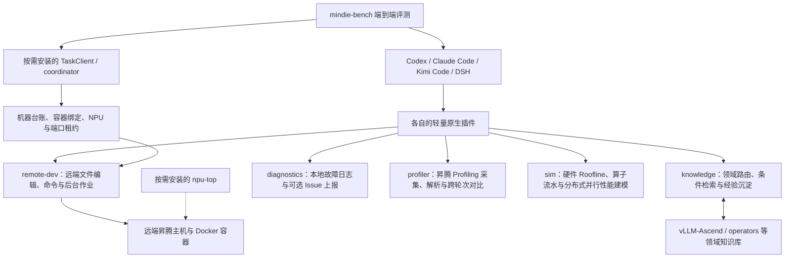

# MindIE Agent 系统架构与模块分工

[English](architecture.en.md) · [返回文档中心](README.md)

MindIE Agent 为主流 AI 编程客户端（Claude Code、OpenAI Codex、Kimi Code、DeepSeek Harness）提供昇腾领域知识检索、远端容器开发、多卡资源协调与性能剖析能力。当前版本围绕 **vLLM-Ascend 框架开发与昇腾算子开发**两个核心领域，重点服务于**新模型适配（0-day Bring-up）、模型与算子性能调优、运行时故障排查**三类日常研发场景。

本文介绍各组件的职责边界与协同方式。正式发布版本与实测数据见[版本发布记录](README.md)，知识组织与检索机制见[知识与经验系统](knowledge-system.md)，宿主会话与授权管理见[宿主边界与任务生命周期](harness-boundary-and-lifecycle.md)，工程准则见[设计原则](design-principles.md)。

## 1. 原生宿主插件与共享运行时组件

四个插件直接复用各宿主的原生会话、工具调用和生命周期机制：
- **领域知识按需激活**：输入 `/mindie-agent`（在 Codex 中也可使用 `$mindie-agent`）即可按当前任务加载昇腾领域知识与工作流引导。
- **Agent 工具默认暴露**：`remote-dev`、`coordinator` 资源协调与探测、`profiler` 采集解析、`sim` 显式输入计算、`diagnostics` 本地诊断和状态查询通过 MCP 可发现、可独立调用，不依赖知识会话启用；仍遵守各自的配置、权限和资源租约。`knowledge` 的名称、描述和参数不进入未启用聊天的默认工具目录；`npu-top` 是面向人的看板，不作为 Agent 工具暴露。
- **经验沉淀按授权运行**：当前 session 手动 `/mindie-agent` 后，宿主生命周期事件才可驱动会话采集与经验提炼；记录本地材料和社区贡献还需满足用户保存的授权与项目范围。

当前 Codex `0.1.8` 实现上述 MCP 发现边界；其他宿主插件仍需分别按此契约实现和验收，本次发布不代表它们已经完成验证。 [本机原生验收记录](releases/codex-0.1.8-native-acceptance.json)覆盖默认目录、六项 MCP 调用与周期更新检查；旧 `0.1.6` 更新器的迁移失败及一次性恢复单独记录。

默认插件依赖 `knowledge`、`remote-dev` 和 `diagnostics`；`coordinator`、`profiler`、`sim` 与 `npu-top` 可按团队环境独立安装或组合使用。

## 2. 仓库职责划分

| 仓库 | 负责内容 |
| --- | --- |
| [`mindie-agent`](https://github.com/mindie-agent/mindie-agent) | 产品架构、领域边界、入口文档、跨仓规范与发布记录；不包含运行时代码或 MCP 服务 |
| [`mindie-agent-codex`](https://github.com/mindie-agent/mindie-agent-codex)、[`mindie-agent-cc`](https://github.com/mindie-agent/mindie-agent-cc)、[`mindie-agent-kimi`](https://github.com/mindie-agent/mindie-agent-kimi)、[`mindie-agent-dsh`](https://github.com/mindie-agent/mindie-agent-dsh) | 各宿主客户端的原生插件：会话识别、生命周期 Hook、脱敏会话记录提取、MCP 桥接与组件版本锁定 |
| [`knowledge`](https://github.com/mindie-agent/knowledge) | 知识检索引擎：适用条件匹配、继承规则展开、脱敏任务切片、经验提炼校验与社区 PR 投递 |
| [`knowledge-vllm-ascend`](https://github.com/mindie-agent/knowledge-vllm-ascend)、[`knowledge-operators`](https://github.com/mindie-agent/knowledge-operators)、[`knowledge-infer-core`](https://github.com/mindie-agent/knowledge-infer-core)、[`knowledge-infer-distributed`](https://github.com/mindie-agent/knowledge-infer-distributed)、[`knowledge-infer-observability`](https://github.com/mindie-agent/knowledge-infer-observability)、[`knowledge-infer-ops-compat`](https://github.com/mindie-agent/knowledge-infer-ops-compat)、[`knowledge-agent-engineering`](https://github.com/mindie-agent/knowledge-agent-engineering) | 面向 `vLLM-Ascend`、昇腾算子、推理核心架构、分布式通信、可观测性、图编译/算子兼容与 Agent 工程治理的 7 大结构化分级知识库（`L1–L4`） |
| [`remote-dev`](https://github.com/mindie-agent/remote-dev) | 统一 SSH 认证、用户级凭据存储与公钥维护；远端文件读写、增量编辑、代码搜索、补丁同步、容器内命令执行与后台长任务管理 |
| [`coordinator`](https://github.com/mindie-agent/coordinator) | 远端昇腾环境与多卡租约管家：机器与容器台账、NPU 拓扑探测（含 A3 双 Die 映射）、NPU 卡与端口防冲突租约、受管任务清理 |
| [`npu-top`](https://github.com/mindie-agent/npu-top) | 面向开发者的 NPU 集群监控看板：实时 Web 界面与 90 天利用率历史（直接读取 `coordinator` 的 `machines.json`） |
| [`diagnostics`](https://github.com/mindie-agent/diagnostics) | 本地结构化故障日志、日志自动轮转、离线脱敏诊断包导出与可选的 GitHub Issue 上报（`mindie_diagnostics`） |
| [`profiler`](https://github.com/mindie-agent/profiler) | 昇腾 Profiling 采集与原地解析工具：支持 `inventory / analyze / correlate / compare / sql`，提供 Host-Device 关联、显存拆解与跨轮次耗时对比（`mindie_profiler`） |
| [`sim`](https://github.com/mindie-agent/sim) | 昇腾性能建模与 Roofline 仿真工具（`mindie_sim`）：支持 A2/A3/A5 硬件规格查询、`H2D`/`D2H`/`D2D` 传输耗时估算、Cube/Vector/MTE 算子流水线建模、子图融合收益预估与分布式并行拆解 |
| [`mindie-bench`](https://github.com/mindie-agent/mindie-bench) | 昇腾真机端到端评测套件：覆盖真实研发任务、精度与性能验证、跨任务经验复用评测及版本基准报告 |
| [`awesome-mindie-skills`](https://github.com/mindie-agent/awesome-mindie-skills)、[`vllm-ascend-workspace`](https://github.com/mindie-agent/vllm-ascend-workspace) | 昇腾 AI Infra 开源 Skills 目录，以及支持 Git Worktree 多任务隔离的 `vLLM` + `vLLM-Ascend` 本地开发工作区 |

SSH 认证的唯一实现归 `remote_dev.auth` 所有。`coordinator` 和 `npu-top` 只保存连接信息及 `auth_ref`，复用其认证、密码存储与公钥安装逻辑；同一操作系统用户下，凭据不按进程、聊天或插件隔离。默认凭据文件为 `~/.mindie/ssh/credentials.json`，由用户目录与文件权限保护，不调用系统钥匙串或要求系统登录密码。原生 Windows 与 WSL 各自使用所在环境的用户目录。

普通开发调用在业务提交前完成密码回退与公钥修复，已提交的业务命令不自动重放。只读诊断及监控可在同一次 SSH 握手中回退密码认证，但不修改公钥。共享认证的发布状态和真实平台验收范围以对应版本记录为准。

## 3. 远端 NPU 任务的执行与资源回收

在远端昇腾服务器上跑编译、测试或压测时，各组件按以下流程协同：
1. **环境探测与租约申请**：通过 `coordinator` 检查目标主机与容器状态，按实际物理拓扑申请空闲 NPU 卡与端口租约（例如在昇腾 A3 910C 上显式区分单卡双 Die 的 `Phy-ID` 映射，避免两个任务误绑同一物理卡的相邻 Die）。
2. **远端执行与后台托管**：通过 `remote-dev` 在目标容器中修改代码并拉起测试或压测作业；耗时较长的编译和基准测试自动转为受管后台任务，支持随时增量拉取日志。
3. **断线重连与状态保护**：网络抖动或客户端重连时，先查询原任务 ID 并恢复跟踪，避免重复拉起仍在运行的远端进程。任务结束或取消时，依次确认子进程树退出、NPU 租约释放与端口回收。外部操作严格区分已完成（`completed`）、已失败（`failed`）与结果未知（`unknown`），本地记账超时不会覆盖已成功的远端执行结果。

## 4. 四类知识协同与双模式工作流（经验复用 + 独立探索）

本节的知识上下文加载与经验循环只在手动启用的 session 内运行。`profiler`、`sim`、`coordinator` 等确定性工具可在未启用知识会话时独立使用。

在解决复杂的昇腾推理适配与性能优化问题时，MindIE Agent 将领域知识按工程用途分为四个层级（对应知识库 Schema 中的 `category` 与兼容字段 `tier: L1..L4`），并支持**常规经验复用**与**跳出既有思路的独立探索（`mode="explore"`）**两种工作方式：

| 知识层级与类别 | 工程用途 | 运行时协同方式 |
| --- | --- | --- |
| **`L1` · 硬件约束与测量基线** （`axiom` / `measurement`） | 提供昇腾 910B / A3 / A5 硬件规格、内存对齐要求、`ACLGraph` 静态图捕获约束以及标准计时/精度验证准则，避免低级硬件违规和伪性能收益 | 按当前任务的芯片型号与仓库条件自动挂载（`foundation_baseline`），或作为上层规程的前置依赖（`inherits_from`）完整注入 |
| **`L2` · 诊断与操作规程** （`sop`） | 提供具体场景下的定位步骤、Profiling 采集分析方法与模块适配操作指南，先用确定性工具定界瓶颈再改代码 | 配合 `mindie-profiler`（实测 trace 分析）、`mindie-sim`（Roofline 与流水线建模）和 `diagnostics` 定位具体根因 |
| **`L3` · 排障与调优工作流** （`workflow`） | 面向 80% 常见的新模型适配、精度排障与常规性能调优：提供带有观测分支和判断条件的排障决策流，帮助 Agent 快速收敛问题 | 默认检索模式（`mode="standard"`）直接返回匹配的工作流；任务验证通过后，可将新发现的排查分支经 `knowledge_distill` 沉淀回知识库 |
| **`L4` · 代码优化变换与独立探索** （`mutator`） | 记录经过验证的算子向量化、流水排布、通信融合与图捕获优化方案；当常规排障/调优连续受阻且距离硬件 Roofline 仍有明显空间时，可切换至**独立探索模式（`mode="explore"`）** | 调用 `knowledge_query(..., mode="explore")` 时，系统自动**屏蔽 `L3` 常规工作流**以打破思维定势，仅挂载 `L1` 硬件约束、`L2` 实测瓶颈、`L4` 可选代码变换及已证实无效的避坑条件（`conditional_avoid`），供独立子会话在隔离环境中并行编译、串行上卡实测，并通过“编译 → 精度 → 性能 → 留一法消融”四步验证 |

> [!NOTE]
> **术语约定说明**：
> - 知识库中的 `tier: L1..L4` 与 `category`（`axiom`/`measurement`、`sop`、`workflow`、`mutator`）一一对应，仅用于区分知识条目的工程角色，不代表结论的置信度；证据可靠程度由 `evidence_strength`（`hardware_spec`、`reproduced_empirical`、`single_observation`、`hypothesis`）独立标记。
> - `mindie-sim` 的四类建模粒度统一称为**硬件规格（`hardware`）/ 算子流水（`pipeline`）/ 子图融合（`subgraph`）/ 整网并行（`net`）**；昇腾片上存储统一写全称 **`L1 Buffer` / `L0A` / `L0B` / `L0C` / `UB` / `L2 Cache`**；工程测试分级统一使用 **`Tier 0 – Tier 3`**。

## 5. 三类核心研发场景的验证标准

| 研发场景 | 验收要求 |
| --- | --- |
| **新模型适配（0-day Bring-up）** | 固定起始代码、模型配置与权重版本，跑通完整推理链路，并与独立数值参考（Golden Reference）完成精度比对；CPU 跑通不能替代 NPU 实机验证 |
| **模型与算子性能调优** | 固定输入 Shape、数据类型与软硬件环境，同时给出精度对齐证明与基线/优化后实测耗时对比；多处改动组合优化需完成留一法消融（Ablation）确认每一项均贡献正收益 |
| **运行时故障排查** | 记录可复现的故障现象、根因定位依据、修复前后实机运行结果以及 NPU/端口资源清理情况；源码静态分析与真机复现结果需明确区分 |

## 6. 版本发布、无感更新与隐私保护

- **版本锁定与后台更新**：各宿主插件锁定经过配套验证的运行时组件基线版本（主仓 [`channels/0.1.json`](../channels/0.1.json) 记录经验证的产品版本组合）；运行时组件更新直接从各官方组件仓库发现正式 GitHub Release（按 `max(已安装版本, 插件基线版本, 正式 Release 版本)` 防止降级，校验不可变 Tag、`pyproject.toml`、构建资产存在性与 `benchmark-results.json` 后从精确 Git SHA 构建隔离 `uv.lock` 环境并通过原生探针），在后台服务空闲时完成原子切换，不影响正在运行的研发会话。详见[版本兼容与无感更新](release-compatibility-and-update.md)。
- **隐私脱敏与可控共享**：会话记录提取、经验沉淀与故障上报均遵循严格的本地脱敏规则（确定性正则 + Gitleaks 扫描），自动剔除内网 IP、机器路径、密钥凭据与命令敏感参数。关闭社区共享开关不影响本地知识检索、故障诊断与远端开发功能。详见[诊断日志与故障上报](diagnostics-and-reporting.md)。
