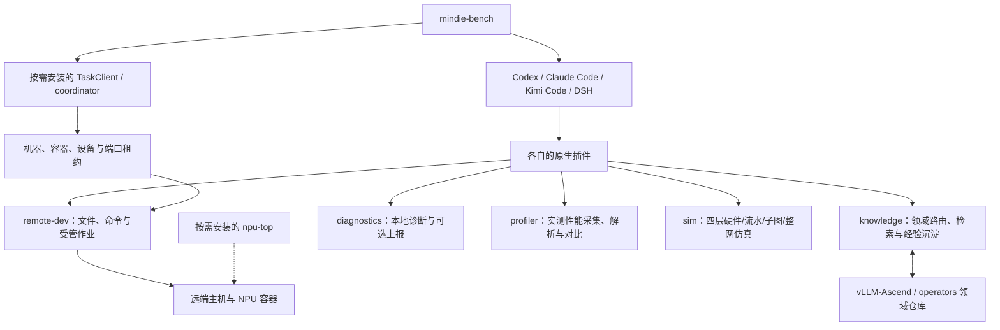

# MindIE Agent 系统架构与模块分工

[English](architecture.en.md) · [返回文档中心](README.md)

MindIE Agent 为已有的 AI 编程客户端提供昇腾领域知识、远端执行、资源协调与诊断能力。`0.0.3` 优先交付 **vLLM-Ascend 与算子两个领域**，围绕模型 0day 开发、固定 case 的模型或算子性能优化、问题定位三个场景完成闭环。更广的推理基础设施建设保留为后续扩展，不能计入本版已经完成的覆盖范围。

本文说明组件职责与实现边界。正式版本、精确源码与实测结论以[版本发布记录](README.md)为准；知识结构见[知识与经验系统](knowledge-system.md)，宿主身份见[宿主边界与任务生命周期](harness-boundary-and-lifecycle.md)，工程约束见[设计原则](design-principles.md)。

## 1. 原生宿主与共享组件

四个插件保留各宿主的会话、工具、模型调用和生命周期机制。`/mindie-agent` 是按需使用领域能力的入口；在 Codex 中也可使用 `$mindie-agent`。`remote-dev` 作为已注册工具可随任务直接使用。配置允许的当前任务采集由生命周期事件驱动，不要求每次手动激活；是否采集和是否公开贡献由实际配置与项目授权决定。

默认插件依赖为 `knowledge`、`remote-dev`、`diagnostics`。`coordinator` 与 `npu-top` 按需独立安装。协议兼容由各宿主适配器负责。

## 2. 仓库职责

| 仓库 | 负责内容 |
| --- | --- |
| [`mindie-agent`](https://github.com/mindie-agent/mindie-agent) | 产品架构、领域边界、入口文档、跨仓契约与统一发布记录；本仓不放运行时引导、MCP 服务或依赖锁 |
| [`mindie-agent-codex`](https://github.com/mindie-agent/mindie-agent-codex)、[`mindie-agent-cc`](https://github.com/mindie-agent/mindie-agent-cc)、[`mindie-agent-kimi`](https://github.com/mindie-agent/mindie-agent-kimi)、[`mindie-agent-dsh`](https://github.com/mindie-agent/mindie-agent-dsh) | 原生会话识别、Hook 桥接、公开对话投影、宿主轻量模型接入、安装与组件锁定 |
| [`knowledge`](https://github.com/mindie-agent/knowledge) | 授权与采集状态、脱敏、任务材料切片、结构化经验单元（约束/测量、SOP、决策工作流、代码变换）、条件检索、领域路由、精确引用、反馈与发布队列 |
| [`knowledge-vllm-ascend`](https://github.com/mindie-agent/knowledge-vllm-ascend)、[`knowledge-operators`](https://github.com/mindie-agent/knowledge-operators) | 领域经验正文、来源与适用条件，以及可校验的 Feed 和派生路由索引；内容仓独立于运行时代码版本 |
| [`remote-dev`](https://github.com/mindie-agent/remote-dev) | SSH 远端文件读写、精确编辑、搜索、补丁、命令执行、受管长任务、取消与产物同步 |
| [`coordinator`](https://github.com/mindie-agent/coordinator) | 机器与容器台账、设备探测、NPU 与端口租约、共享队列、受管任务身份和资源回收；向执行工具提供端点 |
| [`npu-top`](https://github.com/mindie-agent/npu-top) | 面向人的集群观测界面和有界历史数据；读取机器台账，不承担任务调度 |
| [`diagnostics`](https://github.com/mindie-agent/diagnostics) | 有界结构化日志、可定位的错误编号、支持包导出与经授权的白名单故障上报（`mindie_diagnostics`） |
| [`profiler`](https://github.com/mindie-agent/profiler) | 昇腾实测 Profiling 采集控制、`inventory / analyze / correlate / compare / sql` 原地解析、显存分析与跨 Run 事实对比 CLI（`mindie_profiler`） |
| [`sim`](https://github.com/mindie-agent/sim) | 昇腾四层仿真与边界求解组件（`mindie_sim` / `mindie-sim`）：多型号 SKU `DeviceCapabilityProfile`、7 类全路径传输（`D2D`/`H2D`/`D2H`/`RH2D`/`RD2H`）、算子微阶段周期依赖图求解、子图跨算子融合先行分析与整网并行推演 |
| [`mindie-bench`](https://github.com/mindie-agent/mindie-bench) | 固定任务与 oracle、预置零负担准入脚手架（Gate Runner）、隔离宿主运行、真实结果与成本记录、组件基准、跨任务复用及发行报告校验（100% 复用生产组件公开接口，不重复造轮子） |
| [`awesome-mindie-skills`](https://github.com/mindie-agent/awesome-mindie-skills)、[`vllm-ascend-workspace`](https://github.com/mindie-agent/vllm-ascend-workspace) | 面向昇腾 NPU AI Infra 的开源 Agent Skills 目录与支持独立 Git Worktree 隔离的 `vLLM` + `vLLM-Ascend` 本地开发工作区 |

主仓发布记录汇总代码仓（宿主插件、共享运行时组件与 `mindie-bench`）的版本、源码 SHA 和基准产物。领域内容另行绑定其仓库修订，不能把一个新代码标签当成知识内容已经发布或客户端已经消费的证明。配套规则见[组件与插件配套发布](release-compatibility-and-update.md#组件与插件配套发布)。

`mindie_profiler`（实测采集与解析）、`mindie_sim`（四层仿真与边界求解）与故障日志职责正交分开，复用现有远端执行与资源协调。面向 Agent 的渐进查询、推理调用关联与按需补采集见 [Profiler 系统设计](profiler-system.md)；硬件规格核查、算子微阶段周期依赖图求解、Phase 0 子图跨界融合先行分析与整网并行仿真见 [NPU 仿真与边界求解系统设计](simulation-system.md)。其中目标接口与后续验收不等于当前插件已完整接通。

## 3. 一次远端任务如何执行与结束

宿主原生会话与受管任务通过明确的 client、会话身份和 TaskClient 关联。任务按需要准备环境、选择资源并取得租约，再由 `remote-dev` 在声明的主机和容器中执行。多 Agent 使用共享队列和同一资源台账；A3 的物理设备与双 Die 映射必须按实际探测结果处理，不能把任意逻辑设备号当成整卡。

Run Manifest 记录执行事实：代码与配置身份、环境、输入、资源、步骤、状态、时间和产物引用。研究假设、收益归因及知识结论是基于这些事实的独立判断。命令成功只支持该命令的结果；还需分别确认子进程退出、租约释放、端口及工作目录回收。

连接中断后先查询原任务 ID。取消及恢复沿用原身份，避免重复发起仍可能运行的远端操作。执行、准备、回收各阶段有明确预算，外层等待覆盖内层预算及清理时间。`completed`、`failed` 与外部写入结果 `unknown` 分别保留；本地回执保存失败不能抹掉已经成功的远端执行结果。

## 4. L1–L4 四层认知与执行架构及知识飞轮

在复杂昇腾工程任务中，MindIE Agent 采用 **`L1–L4` 四层认知与执行架构（Hermes 启发式收敛 + RSI 去偏置探索双模协同）**，并由 `knowledge` **经验飞轮**提供跨任务知识支撑。

> [!IMPORTANT]
> **核心术语正交约定（消除 `L1–L4` 多义性）**：
> - **`L1–L4` 专指系统认知与执行架构层级**：`L1` 硬件约束与语法基座、`L2` 性能剖析与仿真定界、`L3` Hermes 启发式收敛模式、`L4` RSI 去偏置发散探索模式。
> - **`knowledge` 是经验与领域知识飞轮，不是“L1–L4 分级知识库”**：`knowledge` 存储脱敏任务切片（`tasks/<hash>/blocks/`）与结构化工程结论；知识条目按**内容语义类别（`category`）**区分——约束与测量基线（`axiom` / `measurement`）、诊断与操作规程（`sop`）、排障与适配决策经验（`workflow` / `decision`）、受控代码变换（`mutator` / `transform`），分别按需服务于 `L1–L4` 架构各层（当前 `knowledge` 内部 Schema 遗留的 `tier` 字段仅为对应这四类 `category` 的历史兼容别名）。
> - **其他维度严禁混用 `L1–L4`**：`mindie-sim` 的四级仿真粒度统一称为**硬件边界层（`hardware`）/ 算子微阶段流水层（`pipeline`）/ 子图融合层（`subgraph`）/ 整网并行层（`net`）**；昇腾片上缓存统一写全称 **`L1 Buffer` / `L0A` / `L0B` / `L0C` / `UB` / `L2 Cache`**；工程测试分级统一使用 **`Tier 0 – Tier 3`**。

| 架构层级 | 架构定位与运行时职责 | 与 `knowledge` / `profiler` / `sim` 的协同关系 |
| --- | --- | --- |
| **`L1` · 硬件约束与语法基座** （Foundation，常驻保留） | 守住昇腾 910B / A3 / 950 物理拓扑与内存对齐红线、`ACLGraph` 静态图捕获不变量、软件接口契约与最小可编译算子模板，从源头拦截低级语法与硬件违规 | 按当前任务硬件/仓库条件自动挂载 `_common` 底层约束基线（`axiom` / `measurement`）与父级前提 |
| **`L2` · 性能剖析与仿真定界** （Probe，动手改代码前置步骤） | 遵循“先定界瓶颈，再修改代码”，通过确定性工具获取实测耗时分解、Host-Device 调用链关联与理论下界对比，禁止凭猜测盲改 | 调用 `mindie-profiler`（实测解析）、`mindie-sim`（理论下界与流水/融合仿真）、`diagnostics`（故障日志）并参考 `sop` 诊断规程 |
| **`L3` · 启发式收敛模式（Hermes 模式）** （默认工作模式） | 面向 80% 常规模型 0day 适配、故障定位与常规性能调优：按需检索历史排障决策树与已知变换，快速复现并收敛问题；在达成已验证里程碑后将增量经验回流沉淀 | 检索 `knowledge` 中的决策经验（`workflow`）与已知变换（`mutator`），验证通过后经 `knowledge_distill` 更新知识飞轮 |
| **`L4` · 去偏置发散探索模式（RSI 模式）** （受控切换模式） | 当 `L3` 连续停滞且距 `L2` 硬件理论下界仍有显著可解释空间时触发：**剥离 `L3` 常规经验先验**，仅保留 `L1` 硬约束 + `L2` 实测/仿真裁判 + `L4` 正交变换空间，在独立子上下文与隔离工作区中执行“CPU 并行编译预筛 → NPU 租约串行计时 → 四道门禁（编译、数值、性能、消融）” | 屏蔽 `workflow` 常规经验防思维定势，探索并验证新的 `mutator` 变换或 `measurement` 发现，通过消融门禁后回流至 `knowledge` 供后续 `L3` 复用 |

### 知识如何进入与回流任务

结构化知识单元表达约束、操作规程、决策工作流或代码变换；原始任务材料（`tasks/<task_hash>/blocks/<block_hash>.md`）保留脱敏后的上下文来源。运行时通过显式领域配置选择内容，逐项核对适用条件，并在正文预算内返回匹配单元和完整继承规则。缺失事实保留为未知，不因关键词相似而自动视作适用。

本轮重构将知识引用精简为单元 ID 和修订号，源码来源复用 Git revision，实验引用复用运行 ID。参考补丁、裁判及测量摘要不能成为检索条件。内容写入时检查实际引用关系；查询使用派生索引，索引可以从权威 Markdown 正文重建。现有多层摘要校验随运行时和消费端一起删除，完成情况以实际验收为准。

经授权的任务公开投影先脱敏，再落盘和生成导航；提炼出的新知识需保留来源并经过审核。用户允许公开贡献时才进入发布链路。领域注册、成功检索、任务采集和公开贡献是不同状态，路由不能复制授权或自动打开外发。

## 5. 三个场景的验收边界

| 场景 | 需要固定并检查的对象 |
| --- | --- |
| 模型 0day 开发 | 起始源码、模型与权重修订、兼容环境、完整选定推理链路、独立数值参考和预先声明的通过条件；CPU 参考不能代替 NPU 验收 |
| 固定 case 性能优化 | 预先固定的输入与软硬件条件、正确性检查、可比较的基线与优化结果；单算子或局部计时只支持对应范围的收益 |
| 问题定位 | 可复现的故障、诊断过程、修复前后行为和资源清理；源码解释与真实运行观察分别记录 |

组件测试验证接口和局部行为；真实 NPU 运行验证具体环境下的任务；四宿主验收验证正式插件安装及原生工具消费。它们不能互相替代，也不意味着所有宿主、设备和任务的笛卡尔积均已验证。

版本收益使用相同模型、任务、环境、预算和评测工具版本，分别比较无插件基线、上一正式版本与当前正式组合。记录任务成功、完成时间、模型消耗、人工介入与跨任务知识复用。跨任务复用还需独立保留来源任务、冻结知识、未暴露的下游任务族以及各阶段成本。结果缺失或未知时保留该边界，不能用组件微基准换算整体生产力提升。

## 6. 发布、更新与诊断

插件锁定实际依赖产物；兼容性记录应指明经过验证的宿主及组件对象。正式 Release、候选源码通过测试、隔离安装成功和用户日常配置升级分别报告。用户原有安装不会因为发布完成而自动成为已验收对象。

`0.0.3` 直接重构开发期格式和内部接口，两域内容统一在 `main` 维护，不保留旧格式双轨。插件通过现有后台更新、环境准备及空闲切换采用当前实现，保留用户正文和授权设置；宿主接口及更新机制见[版本兼容与更新](release-compatibility-and-update.md)。知识共享和故障上报受当前安装的贡献配置控制；关闭外发不影响本地诊断和远端执行。故障上报只接受白名单事实，不能包含会话正文、命令参数、机器路径或凭据。详见[诊断日志与故障上报](diagnostics-and-reporting.md)。
