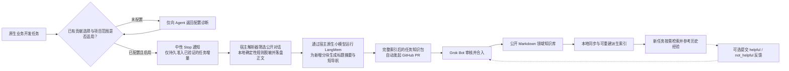

# MindIE Agent 系统架构与领域边界

[English](architecture.en.md) · [返回文档索引](README.md)

当前架构设计（2026-10-16 修订）。[Harness 边界与生命周期契约](harness-boundary-and-lifecycle.md)定义了自动任务关联、调用方拥有的执行期限与有界增长语义；[知识与经验闭环设计](knowledge-system.md)定义了当前的任务知识包、分块读取与引用语义；[九条设计原则](design-principles.md)约束所有适配器与共享组件；[`0.0.1` 发布记录](releases/0.0.1.md)记录了六环境组合的实机验收证据、配套组件发行映射与已知宿主限制。

---

## 产品定位与日常使用

MindIE Agent 旨在增强开发者现有的 AI 编程宿主（Harness），使其具备昇腾（Ascend）NPU 与推理基础设施工程能力。它不自建基座大模型、不替代宿主对话框架、不托管原始对话服务，也不强行接管用户的业务源码仓库。开发者始终在自己的业务仓库和原生 Agent 会话中工作。

插件安装后沿用持久化的贡献选择、公开目标仓库与项目授权范围。日常任务保持原生工作流：经核实的原生任务身份、Transcript 归属与当前项目范围会自动关联符合条件的工程任务，无需任何日常激活或收尾命令。未配置、显式停用与组件故障作为彼此独立的状态向 Agent 清晰报告。通用远端开发工具（`remote-dev`）与按需知识检索不依赖经验采集租约。

领域知识与历史经验均作为按需参考材料。Agent 根据当前任务需要自主决定是否检索、精读，或在真实使用后提交有用性反馈（`helpful` / `not_helpful`）。系统不设强制检索、强制汇报、强制投票或模型驱动的收尾仪式。

当前首个核心领域为 `vLLM` / `vLLM-Ascend`。每个会话聚焦其选定领域的知识与资源；跨领域协作按需使用同一宿主下的独立原生任务完成有界交接，不引入强制领域路由器、全局混杂知识库或私有对话框架。

---

## 仓库分工与职责边界

| 组件 / 仓库 | 职责边界 |
| --- | --- |
| [`mindie-agent`](https://github.com/mindie-agent/mindie-agent)（本仓库） | 产品整体语义、领域边界、九条设计原则、跨组件契约与统一发布记录 |
| [`mindie-agent-codex`](https://github.com/mindie-agent/mindie-agent-codex)、[`mindie-agent-cc`](https://github.com/mindie-agent/mindie-agent-cc)、[`mindie-agent-kimi`](https://github.com/mindie-agent/mindie-agent-kimi) | 原生任务身份识别、显式管理入口、首次配置、Hook 协议转换、公开对话投影解析、宿主原生小模型调用、插件安装与静默更新衔接 |
| [`knowledge`](https://github.com/mindie-agent/knowledge) | 准入账本、增量游标、确定性隐私脱敏与整理协调、双层检索、可选有用性反馈、外发回执与故障恢复 |
| [`knowledge-vllm-ascend`](https://github.com/mindie-agent/knowledge-vllm-ascend) | 经审核的 `vLLM-Ascend` 结构化 Markdown 知识包、版本历史与 GitHub 分发源 |
| Grok Bot 应用 | 审核拟公开知识包与材料的敏感信息及合规性，执行合入、纠错或撤下 |
| [`remote-dev`](https://github.com/mindie-agent/remote-dev) | 基于 SSH 的远端文件读写、补丁、受管后台作业、取消与产物同步（独立于知识采集激活） |
| [`diagnostics`](https://github.com/mindie-agent/diagnostics) | 有界本地结构化日志、可定位故障引用，以及独立授权、有限预算的 GitHub Issue 故障上报（三端适配器共用） |
| [`coordinator`](https://github.com/mindie-agent/coordinator) 与 [`npu-top`](https://github.com/mindie-agent/npu-top) | 按需介入的昇腾主机受管执行/NPU 绑定协调器与只读 NPU 集群状态观测工具 |

各宿主适配器复用同一套 `knowledge`、`remote-dev` 与 `diagnostics` 运行时实现；原生任务身份与 Transcript 格式解析留在各自适配器内。共享运行时绝不导入宿主私有的租约表，也不根据最新会话或工作目录猜测任务归属。

首发普通内测版本 [`0.0.1`](releases/0.0.1.md) 覆盖 `Codex` 与 `Claude Code` 在 `macOS`、`原生 Windows` 与 `Windows WSL` 上的六个独立验收环境。`Kimi` 适配器不在本次 `0.0.1` 首发矩阵内。`coordinator` 与 `npu-top` 为独立按需工具，安装产品插件不会隐式启动它们。

---

## 知识沉淀与经验复用闭环

未配置、显式停用、项目范围不符与组件故障是四种严格区分的状态，绝不混同为“成功但无输出”的替代模式。显式停用立即停止新材料采集，而知识检索与 `remote-dev` 远端工具始终可独立使用。

启用贡献后，仅有经过核实的原生任务且处于已授权项目范围内的增量材料才会进入采集闭环。子任务（Fork）与新任务拥有各自独立的身份。关闭贡献会取消尚未发送的工作；重新开启仅承接开启后的新增获准材料，不会自动回放关闭期间的历史对话。原始 Transcript 始终留在本地，绝不直接上传至 GitHub。

Stop Hook 仅做轻量同步持久准入并返回中性协议输出，不诱导业务模型继续开启新回合。若采集准入或后台启动失败，通过宿主 Hook 的安全警告字段返回有界提示，并在后续自然能力调用中保持可查询。正常运行的操作不设武断的默认总执行时限；仅有调用方显式指定的期限才会终止业务执行。失败或结果未知的模型调用不会自动重试付费，结果未知（`unknown`）的远端发布操作在下一次写入前必须先通过只读查询与远端分支/PR 对账。

### 确定性正文投影与轻量导航索引

落盘正文是由本地确定性规则筛选并脱敏后的有序公开对话：仅保留用户输入、助手公开进展与最终回答；工具调用载荷、隐藏推理链（Reasoning）、系统注入指令与宿主重复包装事件均被剔除。投影过程不调用大模型，也不对公开消息做首尾截断或语义改写。在写入磁盘、送入索引模型或外发之前，强制执行 Gitleaks 与显式隐私脱敏规则。

完整脱敏正文保存为不可变的有序 Markdown 分块（Block）。适配器调用自身托管的轻量原生小模型（配合 LangMem），仅为每个新增分块生成可纠错的标题/检索摘要及当前任务的短导航——小模型绝不改写正文字节，也不会用首尾摘录替代长任务的中间过程。公开发布前必须完成增量索引；若索引失败则保留本地正文并如实报告未完成阶段。发布、同步与检索过程均不调用大模型。

---

## 公开知识包格式与本地权威状态

公开材料采用完整的 `tasks/<task_id>/` Markdown 知识包布局：`mindie-material-task/1` 清单（`PACKAGE.md`）内嵌 `mindie-entry/3` 元数据头，并绑定 `materials/` 目录下有序的 `mindie-material-block/1` 分块文件。分块正文在其标识下不可变；若需替换正文字节，必须生成新分块标识并更新清单。

本地存储中，Markdown 文件是正文的唯一权威来源；SQLite 保存紧凑的游标、队列、授权关联与外部操作回执；ReMe 在进程内维护可随时从权威 Markdown 重建的派生检索索引（文件/分块/BM25）。在初始化或恢复写入前必须先校验权威状态：缺失或损坏的数据库必须作为可见错误报告，绝不能当作“首次使用”重建空库并误删既有正文或 `unknown` 回执。

读取任务引用返回当前任务的整体导航；读取分块引用精确返回该分块正文、文件哈希与相邻分块引用。分块正文中的字面引用仅在当前被引用源本身独立命中查询且覆盖匹配词项时参与检索聚合，引用计数不代表权威认证。

---

## 有用性反馈与语料演进

有用性反馈（`helpful` / `not_helpful`）是消费方在实际参考某条经验后自愿提交的松散信号，而非真理性认证。未提交反馈不视为差评，生产方任务的自我评价也不算作独立的复用证据。差评反馈为过时或误导性的条目提供了明确的退出通道，维护者或审核流程可据此修正或从分发语料库中移除对应内容，同时保留正常的 Git 历史。

---

## 任务关联、执行与静默更新

原生任务身份、用户授权、单次工具调用、MCP 连接与远端持久作业拥有各自独立的生命周期。显式保存的授权跨进程重启与插件升级持续有效，直至用户主动停用或修改范围。

适配器的固定源码提交、唯一运行时依赖锁（`uv.lock`）与 `product-contract.json` 共同定义一套经过验证的产品组合；公共领域知识仓在 `publication-contract.json` 中声明 Schema、校验器与 Bot 审核规则。

每个插件正式 Release 声明其支持的宿主版本区间与直接使用的接口清单（`harness-compatibility.json`）。距上次成功检查超过 24 小时后，自然使用会触发一次异步兼容检查：由宿主原生插件管理器下载并安装选中的不可变 Release，由 `uv` 在活动运行时与业务锁之外构建非 editable 的锁定环境；待现有服务确认无在途工作后，获取排他锁精确退役旧服务、校验候选就绪并原子切换唯一的安装绑定。详见[发布兼容与静默更新](release-compatibility-and-update.md)、[原生更新、Hook 与进程管理复用](native-runtime-reuse.md)与[Harness 边界与生命周期](harness-boundary-and-lifecycle.md)。

---

## 诊断与故障上报

组件在真实操作边界记录有界本地结构化日志，并在失败结果中附带本地诊断引用与恢复提示。离线维护在清理过期分片时严格保护活跃写入者与所有已登记读取游标；日志写入或上报失败绝不改变原业务结果或触发业务重放。

自动工具故障上报是独立于社区知识贡献的可选用户设置。三端适配器共用同一个上报器，仅上传白名单允许的代码与执行事实（组件名、版本/Commit、操作、阶段、静态错误类别、耗时、退出码与清理结果），严禁包含对话正文、命令参数、原始输出或模型分析。相同代码位置的故障通过稳定指纹跨任务去重，并受持久化重试预算严格约束。详见[日志、故障定位与自动 Issue](diagnostics-and-reporting.md)。
