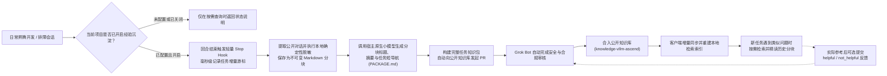

# MindIE Agent 系统架构与模块分工

[English](architecture.en.md) · [返回文档中心](README.md)

本文介绍 MindIE Agent 的整体设计定位、各子仓库职责边界，以及“远端开发 + 经验闭环 + 集群观测 + 故障诊断”是如何协同工作的。

- 任务身份与生命周期边界见：[宿主边界与任务生命周期](harness-boundary-and-lifecycle.md)
- 知识包结构与检索设计见：[知识与经验闭环设计](knowledge-system.md)
- 全部模块遵循：[工程设计原则与演进准则](design-principles.md)
- 首发验证矩阵与配套版本见：[`0.0.1` 版本发布记录](releases/0.0.1.md)

---

## 1. 产品定位与日常体验

MindIE Agent 的核心定位是**给开发者现有的 AI 编程客户端（Claude Code、Codex、Kimi Code）装上昇腾（Ascend）NPU 与大模型推理工程引擎**。

- **不另造轮子**：我们不自建底座大模型、不替代宿主本身的对话框架，也不强行托管用户的业务代码仓库。你依然在自己熟悉的终端和代码仓库里直接跟 Agent 对话。
- **配置一次，日常无感**：首次配置好知识贡献意愿、目标公开仓库与授权项目范围后，后续所有日常开发都会自动关联，不需要每次开工前敲激活命令，也不需要收工时跑总结脚本。
- **工具与知识按需调用**：远端 SSH 开发工具（`remote-dev`）和本地/社区知识检索完全独立可用，即使关闭了经验采集也丝毫不影响日常排障。历史经验仅供 Agent 按需参考，绝不强制检索或强制投票。
- **聚焦核心领域**：当前首发核心领域为 `vLLM` / `vLLM-Ascend` 推理与算子工程，后续可按相同知识包架构平滑扩展更多领域。

---

## 2. 仓库分工与职责全景

MindIE Agent 采用“**宿主原生插件 + 共享运行时组件 + 开放知识库**”的分层解耦架构：

| 组件 / 仓库 | 核心职责 |
| --- | --- |
| [`mindie-agent`](https://github.com/mindie-agent/mindie-agent)（本仓库） | 产品整体架构、领域边界、工程设计原则、跨组件契约与统一版本发布记录 |
| [`mindie-agent-cc`](https://github.com/mindie-agent/mindie-agent-cc)、[`mindie-agent-codex`](https://github.com/mindie-agent/mindie-agent-codex)、[`mindie-agent-kimi`](https://github.com/mindie-agent/mindie-agent-kimi) | **宿主原生插件**：负责宿主任务身份识别、首次引导配置、Hook 事件桥接、公开对话提取、调用宿主原生轻量模型、插件安装与后台无感更新 |
| [`knowledge`](https://github.com/mindie-agent/knowledge) | **知识与经验引擎**：负责准入游标管理、确定性隐私脱敏、任务知识包构建、双层混合检索（BM25 + 语义）、有用性反馈与自动 PR 提交 |
| [`knowledge-vllm-ascend`](https://github.com/mindie-agent/knowledge-vllm-ascend) | **公共领域知识库**：存放经过脱敏与合规审核的 `vLLM-Ascend` 结构化 Markdown 知识包，支持客户端增量同步 |
| [`remote-dev`](https://github.com/mindie-agent/remote-dev) | **远端昇腾开发运行时**：基于 SSH 提供远端文件读写、补丁应用、受管长任务执行、作业取消与构建产物同步 |
| [`diagnostics`](https://github.com/mindie-agent/diagnostics) | **结构化诊断与故障上报**：提供有界本地诊断日志、错误定位编号，以及独立授权、自动去重的 GitHub Issue 故障上报 |
| [`coordinator`](https://github.com/mindie-agent/coordinator) 与 [`npu-top`](https://github.com/mindie-agent/npu-top) | **多卡调度与集群观测（按需工具）**：分别提供多任务昇腾 NPU 独占租约协调与只读的跨节点 NPU 状态看板 |

各宿主插件共享同一套 `knowledge`、`remote-dev` 和 `diagnostics` 核心实现；只有与宿主强相关的会话身份识别和 Transcript 解析留在各自插件内。

---

## 3. 知识沉淀与经验复用闭环

当你在终端里带着 Agent 解决了一个棘手的昇腾工程问题后，经验是怎样沉淀并帮到下一个人的？

### 为什么这套闭环既安全又不拖慢日常开发？

1. **状态清晰，绝不假装成功**：未配置、主动关闭、不在授权项目目录内、以及组件异常是四种明确区分的状态，系统绝不会把报错伪装成“正常但没数据”。
2. **毫秒级 Stop Hook，不卡终端**：每次对话回合结束时，Stop Hook 只做极轻量的本地游标登记就立即退出，既不会阻塞终端，也不会诱导大模型死循环续跑。
3. **正文 100% 确定性脱敏，小模型只写目录导航**：
   - 落盘的对话正文只保留**用户输入**、**助手公开进展**和**最终回答**（自动剥离工具原始载荷、隐藏思维链和系统提示词），并在落盘前强制通过 Gitleaks 与隐私规则扫描（自动抹除密钥、内网 IP、SSH 账号和本地主目录路径）。
   - 宿主原生轻量小模型（配合 LangMem）**只负责给每个新增分块生成标题、摘要和 `PACKAGE.md` 导航目录，绝不篡改或缩写对话正文**。

---

## 4. 知识包存储与本地状态保护

每一个任务知识包都以清晰的目录结构保存在 `tasks/<task_id>/` 下：
- `PACKAGE.md`：记录任务整体摘要、适用条件（`conditions`）与分块导航表。
- `materials/0001.md`, `0002.md`...：按时间顺序切分的不可变脱敏对话分块。Agent 检索时可以先看 `PACKAGE.md` 目录，再按需精读某几个分块，避免把长篇历史对话一次性塞爆上下文窗口。

在本地存储设计上：
- **Markdown 文件是正文的唯一权威来源**；
- **SQLite** 仅保存游标、队列、授权绑定与外部操作回执；
- **ReMe** 在内存中维护可随时从 Markdown 重建的混合检索索引。如果 SQLite 发生缺失或损坏，系统会明确报错并完整保护已有的 Markdown 正文，绝不会把它当成“首次安装”去清空你的数据。

---

## 5. 有用性反馈与知识库新陈代谢

当 Agent 在新任务中实际参考了某条历史经验后，可以自愿提交 `helpful`（有用）或 `not_helpful`（无用/过时）反馈。
- 反馈只是辅助信号，不代表绝对权威；不投票也完全正常。
- 如果某条经验随着 `vLLM-Ascend` 或 CANN 版本升级已经过时，`not_helpful` 反馈会帮助维护者和审核流程及时修正或下架该条目，让知识库保持鲜活。

---

## 6. 后台无感更新与故障诊断

- **兼容性筛选与无感更新**：每个插件 Release 都会在 `harness-compatibility.json` 中声明经过实机验证的宿主版本范围。距离上次检查超过 24 小时后，日常使用会在后台异步拉取最高兼容版本并利用 `uv` 构建锁定环境，趁服务空闲时原子切换，全程无需手动重装或重新授权。详见[版本兼容与无感更新](release-compatibility-and-update.md)。
- **结构化日志与可选故障上报**：组件在关键操作边界记录有界本地日志。用户可以独立选择是否开启“工具故障自动上报”——开启后仅上传白名单内的代码错误事实（组件名、版本、阶段、错误类型、耗时与退出码），**绝不包含任何对话正文、命令参数、机器路径或凭据**。详见[诊断日志与故障上报](diagnostics-and-reporting.md)。
