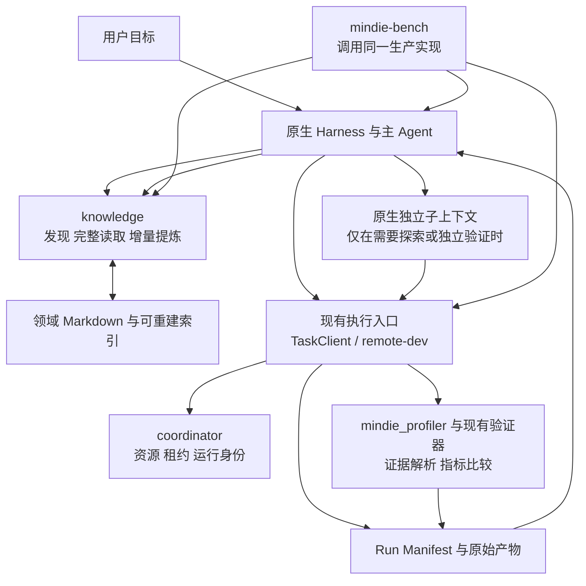

# MindIE Agent 核心实现评估与优化设计

状态：P0/P1 核心机制与四插件依赖已落地合入，P2–P4 真实任务与设备验收推进中。检查与落地日期：2026-10-20（北京时间）。

本文以 MindIE Agent [原始九项设计原则及后续工程准则](design-principles.md)为约束，对照 AMD-AGI/GEAK 的当前源码、指定 Antigravity session 的产出，以及 MindIE 各组件实际实现，给出后续核心工作的设计与验收方案。本文补充[上下文与经验设计](knowledge-context-and-exploration.md)和 [Profiler 设计](profiler-system.md)，不把其中的目标接口当作已交付能力。

## 1. 总体判断

当前 MindIE 已经具备可继续建设的执行基础和知识组件，后续应围绕实际任务把它们接通。最优先的工作是修正生产调用、评估实现和插件依赖之间的不一致。

指定 session 的工作有实际价值：补充了两域 L1 基础规则、L2 方法与 L3 决策单元，实现了完整依赖闭包读取、精确版本引用、提炼提案、使用事件存储和探索结果分类，并把相关改动合入多个仓库。但这些成果仍主要属于组件实现与本地契约验证，尚不足以认定 L3 经验演化、开放探索和真实任务收益已经闭环。

本次检查发现六个需要先解决的问题：

1. 四个插件已经描述新参数，但依赖仍锁定较早的 knowledge 提交；被锁定的 `explain` 只接受 `ref`。
2. 生产 `query` 仍返回截断正文，预算仍排除元数据；真实响应明显大于声明预算。
3. `mindie-bench` 使用自建检索器回放，不能证明生产检索器实现了相同行为。
4. `knowledge` 与 `mindie-bench` 保留两套探索评估；同样的有效小收益会得到不同结论。
5. 经验提炼和反馈具备接口，但默认旧知识对照、实际交付事件、原生上下文可见性尚未形成完整调用链。
6. 两个领域目前各有 8 个分级单元，覆盖仍集中在少量问题族；不能把这些样例的完整依赖关系视为普遍领域能力。

建议保留原生 Harness 的判断、会话和模型调用，强化四条可独立验收的路径：

- 正确发现并完整读取当前适用的知识。
- 在现有执行系统中取得可信、可比较的实验事实。
- 将有效事实增量写回已有知识，并在新任务中验证。
- 在常规经验解释不了问题时，进行有界的原生探索。

GEAK 最值得吸收的是上述路径中的具体机制：局部与端到端收益分离、实际执行证明、独立验证、按当前边际收益评价尝试、经验引用与结果关联、保留不受旧经验主导的探索方向。完整移植其编排运行时会偏离 MindIE 的原始边界。

## 2. 检查对象与证据范围

### 2.1 源码版本

以下是本次实际读取的版本。knowledge、coordinator、remote-dev、diagnostics 的远端 `main` 另经 GitHub connector 读取确认。其他条目为指定 session 对应的本地当前 checkout，不将旧目录名或旧工作树当作最新源码。

| 对象 | 检查版本 | 说明 |
| --- | --- | --- |
| AMD-AGI/GEAK | `08519ce4ee6f03023575fd1a50766cfeaa4b4708` | 先经 connector 确认，再读取该版本的 workflow、角色、知识写入与回收实现 |
| mindie-agent | `a1648d5` | 当前架构、设计原则、上下文与 Profiler 文档 |
| knowledge | `54b1c82` | `mindie-release-20261014/knowledge`，与远端 main 一致 |
| knowledge-operators | `119a2d3` | `/Volumes/data/code/knowledge-operators` |
| knowledge-vllm-ascend | `cc386c1` | `mindie-transcript-20261004/content` |
| mindie-bench | `cc5fcf6` | 检索回放、RSI 评估与已有测试；未使用未跟踪实验目录作为已合入能力 |
| coordinator | `14c3680` | TaskClient、Run Manifest、资源与运行边界 |
| remote-dev | `f441d52` | 阅读 main 指定版本；普通目录 checkout 另在修复分支 |
| diagnostics / mindie_profiler | `6460cde` | 阅读已提交版本；另有未提交 Profiler 改动，不计入该版本交付 |
| Codex 插件 | `392ece5` | 新工具目录与依赖声明 |
| Claude Code 插件 | `7e9b2b0` | 新工具目录与依赖声明 |
| Kimi 插件 | `c4e1fc4` | 新工具目录与依赖声明 |
| DSH 插件 | `88d405d` | MCP/Sidecar 契约与依赖声明 |

本次没有执行付费模型任务、远端 NPU 实验、正式安装升级或发布。实测结果来自临时本地 Store、真实领域语料、现有定向测试和纯逻辑探针。

### 2.2 指定 Antigravity session 的真实产出

检查的 session 为 `12807eab-3b33-4fc8-8b60-9a0088adf6d4`。其公开消息显示，工作经历了架构纠偏、两域知识与探索辅助函数建设、四插件接线，以及 Wave 3A/3B 的渐进上下文和经验回路实现。

最后一轮汇报的 9 仓合入版本与上述对应 checkout 一致。需要收窄的是验收结论：

- `p0-p4-acceptance-report.json` 确实记录 36 项通过。
- 同一报告明确声明没有执行模型、网络或 NPU 实验。
- 查询与读取验证主要直接调用 `RoutingIndex.query` / `Store.explain`；插件安装与宿主实际消费是另一层问题。
- 所谓约 66.6% token 节省来自离线 A/B/C 加载模拟，使用估算器和预设任务需求；不是模型实际 usage，也不是整体任务成本改善。

因此，可确认的是“相关功能与回放入口已实现并通过所选检查”，不能据此认定“四宿主完整交付、跨任务学习有效、真实开放探索有效、端到端任务提效”。

### 2.3 本次定向验证

现有测试执行结果：

| 范围 | 结果 | 支持的结论 |
| --- | --- | --- |
| knowledge 的 `test_context_progressive_loading.py`、`test_experience_and_exploration_loop.py` | 17 passed，3.03s | 现有组件契约在这些测试条件下通过 |
| mindie-bench 的 `test_rsi_explorer.py`、`test_knowledge_replay.py` | 40 passed，0.22s | 当前辅助函数及模拟器的所选行为通过 |
| 真实两域语料的临时 Store 查询与读取 | 见第 3 节 | 生产装配路径存在预算和事件接线缺口 |
| 两套探索评估器相同输入 | 结论不一致 | 共享语义尚未真正收敛 |

通过现有测试与存在这些缺口并不矛盾：测试覆盖的是所写断言，不能替代对真实调用路径和设计目标的检查。

## 3. 当前核心实现情况

### 3.1 组件成熟度

| 核心部分 | 已确认实现 | 仍需完成 |
| --- | --- | --- |
| 原生插件 | 四宿主有工具参数、领域路由和生命周期适配 | 新契约与锁定运行时一致；真实安装后消费新能力 |
| 远端执行与协调 | TaskClient 受管提交、原执行 ID 查询、资源声明；Run Manifest 执行事实与证据引用 | 将探索候选实际接入同一运行与租约路径；核查搜索结束后的资源交接 |
| 分级知识 | L1–L4、条件匹配、继承闭包、`id@revision`、状态和引用 | 全响应有界、导航与正文真正分离、依赖生命周期一致、语料覆盖 |
| 经验演化 | 显式提炼、前台 proposal、已有写入事务、修订与发布计划 | 默认旧知识对照、进行中里程碑、实际采用与验证关联、更新后真实可见 |
| 开放探索 | 停滞判断、上下文数据组装、候选评估、编译/计时计划 | 原生新上下文、实际派发执行、共享结果语义、多目标任务适配 |
| Profiler | 已提交的 DB/CSV 分析、显式窗口、部分跨 Run 对比与采集辅助 | 新设计中的渐进查询、关联和计量修正逐项验收；与运行证据接通 |
| 评测 | 固定任务、部分 oracle/测量约束、回放与结果记录 | 使用生产实现做机制评测，再做同条件真实任务对照 |

这里的“已实现”不等于所有故障路径都已审计，也不等于已经完成跨宿主或真机验收。

### 3.2 优先缺口一：插件参数与依赖版本不一致

| 插件 | 当前锁定 knowledge | 新增接口与旧运行时的差异 |
| --- | --- | --- |
| Codex | `4e328305…`，锁内版本 0.12.2 | 工具目录提供 `refs/known_refs/proposal` 等；旧 `explain` 只接受 `ref` |
| Claude Code | `4e328305…`，锁内版本 0.12.2 | 同上；且 `pyproject.toml`（`remote-dev@f441d52`、`diagnostics@6460cde`）与 `uv.lock`（`remote-dev@a664922`、`diagnostics@1b5a0eeb`）存在未校验漂移 |
| Kimi | `4e328305…` | 新 MCP 描述不能改变被锁定组件的行为 |
| DSH | `1bf5288f…`，锁内版本 0.13.0 | 该提交的 `explain` 仍只接受 `ref`；且 `dsh/scripts/knowledge_mcp.py` 转发 `knowledge_explain` 时丢弃了 `refs/conditions/known_refs/token_budget` |

两个旧提交的 `loop/transport.py` 都包含 `set(args) != {"ref"}` 的拒绝逻辑。新参数按当前声明传入这些运行时会被拒绝。此外，DSH 的 `scripts/knowledge_mcp.py:364` 在 `knowledge_explain` 分支中仅打包 `{"ref": args.get("ref")}`，即使升级后端也会丢失批量闭包参数；Claude Code 的 `scripts/product_contract.py` 只读取 `uv.lock` 而未校验与 `pyproject.toml` 的一致性。

修复落点是插件转发路径、依赖锁同步与公开协议验收，不是继续扩写 Skill。

### 3.3 优先缺口二：生产查询有界导航、截断标记与父单元生命周期缺口

在临时 Store 中安装当前真实语料，调用 `store.query(..., token_budget=800, limit=5)`，使用生产 `response_token_estimate` 对最终返回对象重新计量：

| 查询 | 正文估算 | 工具内部报告估算 | 最终 Store 响应估算 |
| --- | ---: | ---: | ---: |
| operators：`rmsnorm residual free` | 773 | 3,200 | 4,530 |
| vllm-ascend：`idle dp gdn state` | 800 | 3,415 | 4,596 |

这些数字都是一次本地探针的 `UTF-8 bytes / 4` 估算，不是模型 tokenizer 或付费 usage；最终 MCP 外层封装尚未计入。仅 Store 返回对象就已约为声明预算的 5.7 倍。

源码原因明确：

- `graded/index.py:172` 的 `query` 仍默认按正文预算组装 `results`，并对非 L1 调用 `_excerpt`。
- `index.py:299` 的 `ready_to_apply` 仅检查 `applicability[ident].status == "matched" and not omitted`，未检查 `truncated`（`excerpt_truncated`）以及依赖闭包中父单元是否已被 `superseded` 或 `archived`。operators 探针的三个结果均同时为 `ready_to_apply=True` 与 `excerpt_truncated=True`。
- `index.py:459` 的 `explain_closure` 只检查了被请求目标自身的 `status == "superseded"`，未检查 `self.closure[ident]` 中父单元是否已 `superseded`，导致被替代的旧父单元仍可能作为有效前提返回。
- `index.py:347` 的估算只覆盖 `cards/results` 子对象；`repository.py:330` 与 `repository.py:364` 追加 `ref`、`feedback`、`domain` 与兼容字段后未重算外层 `response_token_estimate` 与 `usage.estimated_tokens`。

### 3.4 优先缺口三：评测复制了一套产品实现

`mindie-bench/runner/knowledge_replay_index.py` 自行实现 `RoutingIndex`、条件匹配、导航和依赖读取。`knowledge_replay.py` 导入的是这个模拟索引。

与生产实现相比，它存在实质差异：

- 模拟 C 直接将任务里的 `required_refs` 送入精读，不依赖 `query` 导航卡片实际发现的引用。
- 预算使用正文估算与固定 `RECORD_OVERHEAD=24`，没有通过生产 `mindie_knowledge.graded.index.RoutingIndex` 计算。
- `known_refs` 去掉修订号后按裸 ID 去重，与生产的精确 `id@revision` 版本语义不同。
- 步骤和尝试次数由 `_simulate` 按“是否 ready”推算，未显式标注 `simulation_only: True` 与估算器名称。

应删除 `knowledge_replay_index.py` 中与产品重复的条件匹配、BM25 检索与闭包实现，直接委托 `mindie_knowledge.graded.index.RoutingIndex`，保持精确 `id@revision` 去重与导航发现链路，并将离线加载对比明确标记为模拟估算。

### 3.5 优先缺口四：探索语义重复且默认口径冲突

给两个评估器相同的纯逻辑输入：编译成功、正确性通过、测量有效、加速比 1.04、目标 1.05、变换保留：

| 调用 | 结果 |
| --- | --- |
| `knowledge.graded.explore.evaluate_exploration_candidate` | `subtarget_valid`，可复用观察 |
| `mindie_bench.runner.rsi_explorer.evaluate_rsi_candidate_gates` 的默认调用 | `refuted`，负面边界，不可提炼 |

`rsi_explorer.py` 文件头注释本身声明“valid sub-target speedups are not refutations; only supported and sub-target-valid candidates are `distill_ready`”，但实现中因 `should_escalate_to_rsi` 将 `verdict == "inconclusive"` 混同为执行未完成，把 `preserve_subtarget_evidence` 默认设成了 `False`。

此外：

- `should_escalate_to_rsi` 应按 `evidence_validity != "valid"`（编译失败、测量无效、消融未完成）识别执行未完成，而将已完成测量但未达目标（含噪声内持平与未达标正收益）计入 L3 目标未达成停滞判断，从而让 `preserve_subtarget_evidence=True` 成为唯一默认行为。
- `knowledge/mindie_knowledge/graded/explore.py:249` 在 `reusable_negative_boundary` 时会把 `target_tier == "L4"` 自动改为 `return_tier = "L1"`。单次条件化负结果只能默认回流为条件受限的 `L2` 观察边界，不能自动晋升为 `L1` 通用公理。
- 探索评估需支持非加速比目标（0day 正确性/首分歧定位、排障区分性观察、算子与模型性能），并由 `rsi_explorer` 复用同一三轴语义。

### 3.6 优先缺口五：经验回路仍存在默认路径断点

1. **自动旧知识对照被条件短路**：`graded/worker.py:123` 写成 `None if proposal is not None or not related_refs else _matching_related_units(...)`，导致调用方未显式传 `related_refs` 时完全跳过 `_matching_related_units`（尽管该函数内部已实现基于输入内容和证据引用的 Top-3 相关单元检索）。修复时应默认执行 `_matching_related_units`，同时按初始请求绑定已解析的 `related_units` 快照，保证同一 `(session_digest, task_state, inputs)` 重试时 `request_digest` 幂等不变。
2. **`task_state` 与里程碑语义对齐**：协议中 `task_state="verified_milestone"` 表示进行中任务到达已验证里程碑，`task_state="in_flight"` 表示未达里程碑的普通单轮中断（如 `Stop` hook）。`codex/plugins/mindie-agent/scripts/organizer_distill.py:32` 额外维护了 `_MODEL_STATES` 二次门控，应统一以 `mindie_knowledge.graded.distill.value_gate` 为准，不维护第二套状态机。
3. **服务端交付记录与宿主可见上下文分离**：`repository.py` 在 `query` 仅对 `results` 调用了 `observe`，未覆盖 `cards` / `foundation_cards`；且 `observe` 只写反馈资格。应在服务端记录可查询的交付计数（`query` / `explain` delivery），当调用方提供 `run_id` 时支持自动记录去重后的 `discovered` / `loaded` 事件，并在 `evaluated` 事件中保留 `evidence_source`（`agent_declared`、`run_manifest_verified`、`ablation_verified`）。
4. **公共单元的本地候选修订可见性**：`repository.py:77` 以公开 Feed 版本作为默认权威视图（防止未合入修订伪装成已发布公共事实），但在 `query` / `explain` 返回中应显式暴露 `has_pending_local_candidate` 与 `pending_local_revision`，使本地 `refine/merge_into_existing` 写入后调用方能明确看到待发布的本地候选版本。

### 3.7 知识覆盖与 Profiler 状态

当前有效分级单元计数：

| 领域 | L1 | L2 | L3 | L4 | 合计 |
| --- | ---: | ---: | ---: | ---: | ---: |
| operators | 3 | 2 | 2 | 1 | 8 |
| vllm-ascend | 3 | 3 | 2 | 0 | 8 |

operators 主要覆盖 RMSNorm 与 Triton 动态标量特化；vllm-ascend 主要覆盖 GDN/idle-DP、Qwen3.5 bring-up 和运行时验证。当前工作证明了这些问题族的知识结构可以表示，尚未证明对未知模型、算子和排障问题具有足够覆盖。

Profiler 的已提交版本具备分析与比较基础，但新文档列出的 `inventory/correlate/sql`、事件变体和计量修正不能整体计为已经交付。本地 diagnostics 工作树存在相关未提交开发，本方案按已提交源码评价，不干扰该工作。

## 4. GEAK 应如何借鉴

### 4.1 采用机制及其落点

| GEAK 机制 | 对 MindIE 的价值 | 建议落点 |
| --- | --- | --- |
| 全模型路径递归调用单算子优化 | 防止单点提速偏离真实用户目标 | Agent 维护端到端目标；Profiler 提供热点事实；算子候选回到原工作负载验证 |
| 先判断低成本配置/后端机会，再投入重型内核优化 | 降低无收益工程投入 | L3 决策经验，允许 Agent 根据现场证据调整顺序 |
| correctness、engagement、测量分别验证 | 编译或导入成功不代表候选实际进入被测路径 | 复用 Run Manifest 的实际执行证据与现有 verifier |
| 搜索者与验证者分离 | 防止候选作者修改参考条件后自证 | 固定必要参考输入；复杂实验可使用原生独立验证上下文 |
| 跨轮 blackboard 与 hypothesis ledger | 长任务可恢复，不重复跑已排除问题 | 原生任务笔记加已有 `run_id`；事实与判断分开 |
| episodic 与 persistent memory 分离 | 长日志不直接污染长期经验 | 原始材料保留为来源，知识正文只存条件化结论 |
| `learned_refs` 与独立验证结果关联 | 反馈来自采用后的事实 | 现有 `knowledge_feedback` 加真实调用/步骤关联 |
| 经验方向与冷启动方向并存 | 降低历史成功路径的锚定 | 只在有价值的探索阶段保留独立假设，不规定每任务固定分叉数 |
| milestone 后重新 profile | 优化后瓶颈可能转移 | Agent 在显著改变执行路径后选择重新采集 |
| final reserve 与设备交接 | 避免搜索耗尽预算，最终没有有效交付 | 现有执行预算、任务取消和租约释放路径 |

GEAK `kernel_lane.js:203` 附近已经实现知识方向额度与 cold direction 控制。其源码注释报告了自由读取索引后部分实验退化，这是检查锚定风险的线索，不是 MindIE 的收益预测，也不是应照搬固定额度的证据。

### 4.2 不直接复制的实现选择

1. **完整 workflow runtime。** 当前 GEAK 除 Claude 路径外还有 Codex 运行时，不能再简单描述为“仅支持 Claude”；但引入整套运行时仍会重复 MindIE 已有宿主、TaskClient 和远端执行能力。
2. **巨型编排模块。** 此版本 `e2e_workflow.js` 为 6,844 行，`interface/run_e2e.py` 为 7,577 行。MindIE 应按封闭操作拆分，继续遵循核心模块约 800 行以内的维护目标。
3. **把固定阈值变成普遍结论。** GEAK 的 noise band、方向数量、时间保留比例服务其任务分布。MindIE 应从自己的实测噪声和任务预算选择参数。
4. **全量索引注入。** GEAK learned README 仍有“小索引”的描述，但当前 `INDEX.md` 已为 326 行、65,581 bytes。MindIE 应按问题检索有界导航，避免把元数据当免费上下文。
5. **知识容量按固定条数淘汰。** `kb.py:46` 附近记录了从每类 8 条调到 32 条的原因。MindIE 采用重复合并、条件修订与归档，保留稀有但独有的知识，不先设全库或分类硬上限。
6. **用模型执行确定性清理。** GEAK 的 `finalPhaseFence` 通过 Agent 运行固定清理命令，且无结果时继续。MindIE 应直接调用已有受管取消/查询能力；交接不确定时保留原主结果，同时将新的性能测量标为不具备有效条件。

GEAK 的卡片也会随实测纠正，采用和结果计数已经交由 `kb.py drain` 聚合。应学习这一写入归属，而不是让模型同时维护正文、成功次数和索引。其项目自述的历史问题与实验结果均仅作为外部设计参考。

## 5. 原始设计原则如何约束方案

| 原始原则 | 本方案的具体约束 |
| --- | --- |
| 1 总成本优先 | 评价任务质量、时间、模型/NPU 消耗、人工介入和维护成本；不为每次查询增加审核仪式 |
| 2 只工具化封闭问题 | 工具处理检索、依赖装配、运行、解析和指标计算；假设选择、条件迁移与语义提炼由 Agent 判断 |
| 3 降低理解负担 | 用户继续通过 `/mindie-agent` 和自然语言进入；不增加 Hermes/RSI 专属控制命令 |
| 4 单一职责 | knowledge 不调度 NPU；coordinator 不判断知识真假；bench 不另写生产检索器 |
| 5 Skill 给地图 | 顶层说明能力与何时使用；具体决策树进入知识，低频细节按需读取 |
| 6 知识仅供参考 | 允许冷启动和推翻旧结论；不强制每个任务检索、反馈或提炼 |
| 7 按需介入 | 复用已有授权和 Stop 后台机制；简单任务不强制建实验账本或开启探索 |
| 8 复用宿主与系统 | 使用原生会话、压缩、模型调用和子上下文；使用已有 SQLite、运行 ID 和租约 |
| 9 透明可定位 | 区分执行、验证、记账、发布和清理；失败或未知不伪装成功 |

后续工程准则继续生效：保留用户正文与授权；内部开发期重复逻辑直接替换；未知外部写先对账；超时覆盖内层与收尾；SQLite 使用既有 WAL/合理锁等待；不新增跨仓 fallback、影子状态机和巨型内嵌脚本。

L1–L4 是知识用途，导航/正文/证据是阅读深度，复用/诊断/探索是工作模式。这三者独立。Hermes 指经验增量演化，RSI 在本文中指有证据反馈的迭代探索；它们不应成为必须按 L1→L2→L3→L4 升级的流程或独立产品运行时。

## 6. 目标架构与最小职责



主仓只维护设计、跨仓契约和交付记录。共享纯逻辑继续放在现有组件内，不增加“MindIE 大脑”服务：

- `knowledge.graded.index/repository/retrieval`：条件、导航、闭包、最终响应预算。
- `knowledge.graded.explore`：纯结果分类与上下文事实包，不启动模型或任务。
- `knowledge.graded.worker/distill/feedback`：增量提炼、局部写入与使用证据。
- `coordinator`：任务提交、资源分配、运行查询、取消和释放。
- `remote-dev`：实际远端操作与受管作业。
- `mindie_profiler`：指定产物的解析、分层查询与可比性检查。
- 四插件：公开协议、原生身份和宿主明确提供的上下文/usage 能力。
- `mindie-bench`：任务、独立参考、实验分组和评估，不维护第二套在线算法。

无需新增用户入口。只有某项重复机械操作确实跨多个场景复用，且现有接口无法表达时，才在对应组件增加一个小型 API。

## 7. 知识读取与上下文设计

### 7.1 统一真实读取路径

目标调用保持四个已有入口：

```text
knowledge_query(query, domain, conditions?, token_budget?, limit?, continuation?, navigation_only?)
    -> cards: 导航卡片（含 title, purpose, applicability, missing_conditions, body_token_estimate, closure_token_estimate, ref）
       foundation_cards: 本次依赖的去重 L1 基础卡片
       results: 兼容结果（当 navigation_only=true 时不内联正文）
       usage: 最终 Store/MCP 交付响应的完整估算

knowledge_explain(ref? 或 refs?, conditions?, known_refs?, token_budget?)
    -> requires: 完整共享前提（拓扑序去重）
       units: 完整目标单元（绝不截断步骤）
       unresolved: 未加载原因（condition_unknown / condition_mismatch / budget_excluded / removed_or_superseded / not_found）与必要成本
       usage

knowledge_feedback(ref, rating?, event_type?, run_id?, step_id?, outcome?, evidence_source?, reason?)
    -> 实际记录结果

knowledge_distill(inputs, task_state, related_refs?, proposal?)
    -> noop / 已应用局部修改 / 待语义审阅
```

`query` 的导航卡片（`cards` 与 `foundation_cards`）仅包含引用、标题、简短用途、适用状态、缺失事实和完整读取成本（`body_token_estimate` 与 `closure_token_estimate`），不含可误认为完整步骤的正文截断；支持 `navigation_only=True` 纯导航模式。在兼容 `results` 视图中，一旦非 L1 正文发生截断（`excerpt_truncated=True`）、存在缺失前提（`omitted` 非空）或依赖闭包中存在非活跃（`superseded` / `archived`）父单元，`ready_to_apply` 必须为 `False`。

### 7.2 闭包完整性

精读流程为：

1. 解析精确领域、ID 与 revision。
2. 求依赖闭包，检查每个前提（含所有祖先节点）的条件与生命周期状态。
3. 扣除当前上下文中完整可见的精确版本（`known_refs` 仅匹配精确 `id@revision`）。
4. 按依赖拓扑顺序组装完整单元，共享父正文在 `requires` 中只出现一次。
5. 生成最终响应并在外层统一计量；无法装入的目标返回明确原因。

父单元若已被替代（`status == "superseded"`），`explain_closure` 必须在 `unresolved` 中返回 `status="removed_or_superseded"`、`blocked_by` 与 `superseded_by`，不能仅因旧父单元仍可解析就继续当作有效前提返回。预算不足时整单元排除并标注 `budget_excluded` 与 `required_tokens`，绝不将 L3/L4 裁成半段后返回。

### 7.3 预算与可见性

预算计量覆盖最终交付的完整字典对象（包括 `repository.py` 追加的 `ref`、`unit_ref`、`feedback_ref`、`feedback`、`domain` 以及单引用兼容字段）。`GradedRepository.query` 与 `GradedRepository.explain` 在完成外层字段装配后必须重新计算 `response_token_estimate` 并同步更新 `usage.estimated_tokens`。

初始参数沿用已有设计的可调起点：导航约 1k、精读约 4k estimated tokens。近似估算显式注明 `estimator: "utf8_bytes_div_4_ceiling"`。

`known_refs` 由调用方显式传入，只表示当前可见的完整精确版本：

- 宿主能确认压缩后保留的单元时，使用其结果。
- 只有历史交付记录时，不能推断当前仍可见。
- 压缩只保留引用而未保留正文时，重新读取。
- 宿主没有精确余量接口时，使用声明预算并承认余量未知；不读取私有内部状态猜测。

不建设跨 Harness 的会话历史数据库。去重对象是一次响应与当前已知工作集，宿主仍负责长期上下文管理。

## 8. 经验演化与反馈设计

### 8.1 把已验证里程碑作为最小输入

整体任务未完成，不代表所有局部结论都未验证。协议中 `task_state="verified_milestone"` 表达进行中任务到达已验证里程碑，`task_state="in_flight"` 表达未达里程碑的普通单轮停止（如 `Stop` hook），`task_state="completed"` 表达任务完成。

输入沿用现有 `inputs`，提供选定来源、结果和已有运行引用。工具不再扫描整段历史寻找“可能有价值的东西”。各插件的 `organizer_distill` 统一消费 `mindie_knowledge.graded.distill.value_gate`，不额外维护第二套状态白名单。

前台 Agent 已有明确结论时可提交 `proposal`，以 `model_calls=0` 完成确定性校验、脱敏与本地写入。

### 8.2 默认对照旧知识

不论调用方是否显式传入 `related_refs`，`graded/worker.py` 在提炼准备阶段均默认调用 `_matching_related_units(store, inputs, related_refs)`，在当前领域索引中自动查找同机制、同条件的 Top-3 候选单元注入 `related_units`。为保证同一请求重试的幂等性（`existing_local_receipt`），首次准备请求时将解析出的 `related_units` 与基础请求摘要绑定存储，后续相同 `(session_digest, task_state, inputs)` 重试时复用同一 `related_units` 快照。

按语义选择：

| 新材料 | 默认处理 |
| --- | --- |
| 同条件重复成功，没有新机制 | 追加独立证据或 no-op，不创建同义单元 |
| 旧规则适用但缺少一个判断分支 | 修订原单元（`merge_into_existing`） |
| 新版本或新输入条件改变结论 | 收窄旧条件或建立明确分支 |
| 多条等价规则重复 | 合并为主单元，保留替代关系 |
| 可靠反证 | 修订条件/主张或退出默认检索；不自动形成永久禁令 |
| 只有环境故障或无效测量 | 留在任务事实中，不计作知识支持或反驳 |

对公共已有单元的本地修订，公开 Feed 保持公共基线权威，但 `GradedRepository.query` 与 `GradedRepository.explain` 在存在未合入本地候选时显式附加 `has_pending_local_candidate: True` 与 `pending_local_revision`，避免调用方误以为本地修订丢失。

### 8.3 四类事件及证据强度

| 事件 | 谁可以产生 | 说明 |
| --- | --- | --- |
| discovered / delivered | 查询/读取服务 | `observe` 覆盖 `results`、`cards` 与 `foundation_cards`，记录服务端交付计数；传入 `run_id` 时可自动记录去重后的 `discovered`/`loaded` |
| loaded | 宿主或明确的调用方确认 | 完整正文进入可见上下文 |
| applied | Agent 的简短采用声明 | 绑定使用的单元版本、`run_id` 和当前 `step_id` |
| evaluated | 已有验证结果加采用关系 | 区分 `supported`、`refuted` 与 `inconclusive`，并记录 `evidence_source`（`agent_declared` / `run_manifest_verified` / `ablation_verified`） |

优先利用已有调用 ID、步骤 ID 和运行 ID 去重。不能只按“单元+任务”永久压掉后续重新加载，也不能把轮询同一 run 计成多次验证。若宿主没有新事件 ID，使用已有范围内明确的组合键，不另建全链路追踪服务。

统计由事件计算。模型不填写累计成功次数。Agent 声明的 `supported` 与来自可读取运行结果的验证应保留来源差异；不为每次反馈启动远端复核，按需在验收或提炼时核对已有证据。

### 8.4 最小经验闭环

真实闭环必须跨任务：

```text
任务 A 获得已验证里程碑
  -> 创建或修订 U@1
  -> 任务 B 通过正常插件发现并完整读取 U@1
  -> B 声明某一步采用 U@1
  -> B 的实际运行支持或反驳该主张
  -> 增量修订 U@2，或保留未确认结果
  -> 下一次读取实际看到相应版本和条件
```

同一脚本手工构造 A/B 事件只能验证存储与版本流转。真实复用价值还需独立任务、未泄漏参考和实际成本记录。

## 9. 原生探索与统一结果语义

### 9.1 先统一纯逻辑，再接派发

将探索结果分类收敛到 `knowledge.graded.explore`，bench 和插件消费同一实现。删除 bench 中重复的条件、停滞和结果分类代码；保留其任务驱动和实验记录职责。

三个维度分别表示：

1. 证据是否有效：运行未完成、编译失败、数值不通过、测量无效、有效观察。
2. 当前目标是否达成：达到预先声明条件、尚未达到、目前无法判断。
3. 当前结论可否复用：可复用变换、可复用观察、有条件反证、没有新结论。

具体修正：

- 有效 1.04×、目标 1.05×：目标未达成，但不能判为机制被反驳。
- 候选数值错误：候选实现未通过；是否反驳整个假设需要额外判断。
- 单改动正确且改善：不强制为了进入 L4 做无意义的逐项删除。
- 多改动互相依赖：评价组合并验证最终组合，不能机械 LOO 后删除所有单独无收益因素。
- 负结果的回流层级由主张内容和证据决定，不自动晋升 L1。

### 9.2 面向不同目标

结果契约使用目标类型与已有证据，不要求所有问题提供 speedup：

| 目标 | 关键事实 | 可复用结论 |
| --- | --- | --- |
| 模型适配/正确性 | 参考一致性、首个分歧、所覆盖推理阶段 | 接口契约、适配分支、验证步骤 |
| 问题定位 | 原故障复现、区分性观察、修复后验证 | 决策树、条件边界、最小诊断方法 |
| 算子性能 | 正确性、真实加载、形状条件、时延分布 | 条件化变换或无收益边界 |
| 模型性能 | 真实请求指标、吞吐/时延约束、候选执行证据 | 系统配置或热点优化的端到端收益 |

工具计算指标与给出证据有效性；“这次观察是否排除了一个重要假设”等语义判断仍由 Agent 完成，必要时附引用供复核。

### 9.3 什么时候探索

探索由信息缺口驱动。连续无新事实可作为提醒，但不能写成“失败两次必须派发 K 个 Agent”。

进入探索前明确：目标、硬约束、有效基线、尚未解释的现象、已排除条件、可用资源和在途运行 ID。下一步优先选择成本最低且最能区分假设的检查。

如果需要控制旧经验锚定，使用宿主真正支持的新上下文，传入最小事实包。不得把继承完整历史的 fork 或 `native_subcontext=True` 的字典称为隔离成功。对不支持独立上下文的宿主，在原会话调整策略，明确其能力边界。

知识在探索中仍可参考。保留一个依据当前观测独立提出的候选，通常比强制清除所有 L3 更合理；是否增加分支取决于可能的信息收益与总成本。

### 9.4 实际执行

探索候选沿用 TaskClient 或现有 remote-dev 受管任务，返回实际执行身份。计划字典不能计作已派发。

编译分两类：确定不触碰设备的静态/主机编译可以使用 CPU 槽位；涉及设备探测、JIT、预热和测量的步骤必须声明实际 NPU 需求。不能从“compile”这个阶段名称自动推断 `npu_count=0`。

候选隔离使用已有工作目录/任务机制，不建立第二套资源管理器。按分配设备测量，禁止隐式落到 NPU 0。恢复先查询已有 run/execution ID；取消、结果保存与释放分别确认。

预留最终正确性、端到端复测和清理预算。串行阶段满足 `outer >= sum(inner) + cleanup`；并行阶段按实际关键路径加调度与清理时间计算，不把所有并发预算错误相加，也不忽略排队。资源状态不满足测量前提时，不接受新的性能结论。

## 10. 实验事实与性能闭环

### 10.1 复用现有运行身份

Run Manifest 记录执行事实，原生任务笔记记录目标与判断。二者通过已有 ID 相连：

| 信息 | 归属 |
| --- | --- |
| 命令、代码 revision、环境、设备、开始结束、退出与产物 | 现有执行记录 / Run Manifest |
| 为什么尝试、预期观察、支持或反驳哪个假设 | 当前任务笔记或已有 experiment ledger |
| 下一步、有效基线、在途运行 | 原生任务进度；长任务可用已有 PROGRESS.md |
| 跨任务可复用结论 | knowledge 单元 |

简单任务无需强制建立所有文件。复杂长任务沿用已有记录，避免再产生一份与执行状态竞争的总账。

### 10.2 采用 GEAK 的两层收益口径

同时保留两个基线：

- 初始有效基线：说明整项任务的累计改善。
- 本轮采用前有效状态：说明当前变换的边际贡献。

单算子验证支持算子范围内收益，端到端结论必须回到同一真实模型工作负载复测。即使候选文件已安装，也应通过已有加载路径、调用证据或对应 trace 确认实际执行；复用当前 `active_execution_proof`，不增造覆盖整个仓库的哈希链。

可用 Amdahl 关系粗估投入价值：

```text
S_est = 1 / ((1 - p) + p / s)
```

`p` 必须接近目标工作负载中可加速部分的有效占比。并发流上的 kernel activity 占比不一定等于请求关键路径占比；该公式是筛选假设的近似工具，最终以真实复测为准。

### 10.3 Profiler 作为封闭证据工具

沿用配套 Profiler 设计，按 Run/Step/Rank/语义块逐步下钻到 kernel variant。优先完成：

1. 设备事件跨度、查询窗口、请求墙钟分开。
2. device uncovered 区间不直接归因为 Host 慢。
3. 执行引擎与资源瓶颈分开。
4. 聚合保留 shape/dtype/layout；边界裁剪不污染单次调用分布。
5. 使用已有源定位符和有界读取，减少热路径全文件扫描。

对确定可用的数据源执行解析，坏数据显式报错；数据源不具备某字段时返回不可得及其影响，不以假零值补齐。采集与解析继续通过现有远端能力原地执行。

### 10.4 比较有效性

性能比较应声明指标名称、单位、统计口径和负载。区分 total tokens/s 与 output tokens/s、TTFT 与 TPOT/ITL、固定长度合成负载与 trace replay。

采用适合该任务的预热和交错 A/B；记录实际样本与波动。噪声内差异保留未确认，阈值按任务校准。Profiler 开销与无 Profiler 的最终性能结果分开。修改请求行为、输入或精度范围后应重新说明比较边界，不能直接沿用旧基线。

## 11. 内容建设与三个用户场景

内容扩展由真实任务缺口驱动，不以“新增多少单元”作为完成标准。

| 场景 | 近期要形成的能力 | 代表性检验 |
| --- | --- | --- |
| 模型 0day | 从模型接口、状态、图模式、分布式到数值验证的分支判断 | 新模型/新路径中能定位首个分歧，完成选定 NPU 推理链路 |
| 固定 case 性能优化 | 定基线、找真实瓶颈、选择变换、验证执行与组合收益 | RMSNorm 之外的独立算子族；模型级结果另行复测 |
| 问题定位 | 区分输入、状态、版本、编译和通信问题 | idle-DP 之外的独立状态/图模式/编译问题 |

两域内容优先补以下相邻问题族：

- operators：内存/对齐与数值边界、动态标量特化、归约、GEMM/布局、attention 或数据搬运。以当前任务涉及的族优先。
- vllm-ascend：模型执行与状态、图捕获/重放、分布式一致性、预填充/解码、内存与加载路径。

L1 应保留真正影响正确性和判断的条件、约束与原因，不以“每条必须小于 350 tokens”裁掉语义。过长时按独立约束拆分，解释为何必须继承；不把整个 `_common` 全挂到每项任务上。

每个 L3 要能回答“哪些观察区分哪些分支”，每个 L4 要说明变换前提、改变的机制和验证方式。具体题目的 gold patch、裁判答案和隐藏测试信息不得成为检索条件或知识正文中的捷径。

## 12. 验收设计

### 12.1 组件与宿主验收

遵循现有 Tier 0–3，测试直接验证业务行为：

| 层级 | 必须覆盖的行为 |
| --- | --- |
| Tier 0 | 条件匹配、依赖闭包、完整响应预算、精确版本去重、统一三轴分类、有效小收益不误判 |
| Tier 1 | 临时 Store 的真实 query/explain/feedback/distill；旧知识自动对照；版本冲突；按锁定依赖启动真实协议入口 |
| Tier 2 | A2/A3 隔离任务的资源绑定、真实候选执行、运行恢复和资源交接；保护现有工作负载 |
| Tier 3 | 原生宿主短 Canary：发现、精读、采用、得到实际结果；需要时验证新上下文和压缩后重读 |

短 Canary 遵守既有时间预算；完整模型适配和长时优化单独列预算，不承诺在 90 秒内完成。

新增测试优先覆盖本次暴露的缺口：

1. 实际工具最终响应在预算内，且没有“截断正文但可采用”的结果。
2. 索引已匹配、Store 追加字段、MCP 封装之后，计量仍一致。
3. 使用被发布插件的锁定组件，批量 explain/proposal 实际可调用。
4. 正常提炼未传 related_refs 时仍对照旧知识；已验证的进行中里程碑不被整体任务状态挡住。
5. 服务端 delivered 与宿主 loaded 不混淆；重复运行不放大验证数。
6. bench 与插件对同一观察返回相同结论。
7. 真实独立上下文确实未继承旧推荐全文，仍保留必要事实。
8. 未知外部执行不重交，清理问题不覆盖已完成主结果。

不新增文案 grep、静态枚举或人为构造硬件通过结果的测试。

### 12.2 三组真实任务对照

先分机制收益和产品交付两类实验，避免同时改变多个因素。

机制比较：

| 组别 | 配置 |
| --- | --- |
| A | 相同宿主、模型和执行工具，不加载领域经验 |
| B | 当前可运行的知识机制，固定组件与内容版本 |
| C | 本文修正后的知识机制，初始内容与 B 对齐 |

产品比较另行使用无插件、上一正式组合、新正式组合，纳入安装和真实原生入口。不能把源码注入的 C 与正式安装的 B 混为同一种交付。

初始先选每场景两个相互独立的真实任务实例形成小规模筛选集，再对有差异或高波动的任务增加重复；这只是工作安排，不是统计显著性的保证。固定模型设置、起始代码、设备条件、预算和 oracle，交错或随机执行；保留全部失败、超时和基础设施故障，不用成功替换样本。

记录成功、完成时间、实际 input/output/cache usage、后台提炼成本、NPU 占用、人工介入、重复无效尝试和知识实际采用。缺失 usage 保持 null，不填零。没有足够对照时不报告生产力百分比。

### 12.3 两种知识实验必须分开

**固定知识泛化实验**：初始语料冻结为一次实验输入；Dev 与 Heldout 按问题机制和来源划分，避免只是改题名或 shape。Heldout 不回写同轮知识库。必要的实验输入固定使用已有 Git revision，不增加日常开发快照仪式。

**顺序学习实验**：任务 A 的结论进入后续任务 B，再观察成本与质量变化。记录每一步实际可用的知识版本，计入提炼成本，并与不更新知识的匹配流比较。

增长回放直接调用生产写入和读取，包含重复成功、版本迁移、可靠反证、新机制和稀有条件。检查重复新建是否减少、独有覆盖是否保留、读取成本是否失控；不预设知识必须收敛到固定条数。

### 12.4 GEAK 的比较地位

GEAK 用作机制与外部架构参考。AMD 与 Ascend 不同硬件、软件栈上的绝对速度不构成公平 Agent 对照；若要量化某机制价值，应将该机制放入同一 MindIE/Ascend 环境做受控开关实验。

外部项目源码中的速度数字和收益比例不作为 MindIE 的目标承诺。

## 13. 分阶段实施与交付条件

| 阶段 | 主要修改 | 交付条件 |
| --- | --- | --- |
| P0 统一生产语义 | knowledge 最终响应预算、导航/精读；统一探索结果；bench 使用生产实现 | 本次预算、小收益与重复实现问题都有直接行为回归 |
| P0 插件依赖接通 | 四插件参数与目标组件版本一致；核对 pyproject/lock/requirements | 隔离环境按真实依赖启动，新工具参数实际可用；正式发布时按配套发布规则锁版 |
| P1 经验增量闭环 | 默认旧知识对照、进行中里程碑、事件来源、候选可见性 | 一条真实经验跨任务创建、采用、验证、修订与再读取 |
| P2 执行与 Profiler | 现有运行 ID、候选加载证据、测量比较、预算与资源交接 | A2/A3 上短候选链路与恢复/取消可用；局部和端到端结果分开 |
| P3 原生探索接入 | 按宿主能力建立新上下文，实际执行候选并消费统一评估 | 至少一个真实探索任务证明派发、验证和回流，其他宿主分别验收 |
| P4 覆盖与价值评估 | 扩展问题族，真实 A/B/C 与顺序学习 | 分场景给出质量、总成本、迁移范围和未解决问题 |

P0 的插件接通与核心修复可以独立推进，但不能先发布一个新工具目录、再等待运行时补齐。P1 不依赖大规模语料建设；P2/P3 优先围绕少量真实问题完成垂直路径。

仓库级工作包：

| 仓库 | 具体工作 |
| --- | --- |
| knowledge | 改 `graded/index.py`、`retrieval.py`、`repository.py`，统一最终装配；修 `worker.py/distill.py/publication.py` 默认路径与**后台静默防膨胀机制**（同主题负向分支折叠、等义重写收紧、单单元字节软硬门禁，对业务 Agent 零负担）；明确 `feedback.py` 事件来源；扩充共享探索纯逻辑 |
| diagnostics / mindie_sim & mindie_profiler | 独立抽离 `mindie_sim`（`mindie-sim`，见 [`simulation-system.md`](simulation-system.md)）提供四层仿真能力（硬件/热态规格、Karp 最大环均值微阶段流水求解、Phase 0 子图跨界融合与 $\max(P+C, Q+G)$ 关键路径核算、`msmodeling` 整网桥接），严格划清可编码 vs 不可硬编码边界；`mindie_profiler` 专注实测采集、解析与对比，通过公开接口调用 `mindie_sim` |
| mindie-bench | 替换 `knowledge_replay_index.py` 的重复实现；删除 RSI 重复分类；预置对业务 Agent 零负担的算子/模块 `G0–G3` 准入验证脚手架（Gate Runner）；落地 M1-01 ~ M6-01 决策回放；100% `import` 生产组件公开接口，严禁重复造轮子 |
| 四插件 | 核对工具参数到运行时的全路径，使用真实锁定依赖验收；按需参考补充 **Phase 0 子图跨界融合先行分析**（先定子图融合边界与 I/O 契约，再抠单算子流水）；按宿主能力提供可见性和独立上下文 |
| coordinator / remote-dev | 复用现有任务接口绑定候选与预置 Gate 脚手架执行；补实际资源交接与恢复路径的必要缺口 |
| 两个知识仓 | 按真实失败和迁移需求补充条件与分支；整理重复，不按条数填充 |
| mindie-agent | 在各阶段真实完成后更新架构与版本文档，分别列源码、安装、宿主、设备与收益状态 |

不建议本轮增加通用工作流引擎、全库向量重构、跨仓知识图谱、长期自主 Agent 集群或统一“智慧分”。这些方向应在当前闭环出现明确瓶颈后单独评估。

### 13.1 2026-10-20 第一批（P0/P1 + 相邻语料）代码落地与合入记录

围绕第 3 节识别的六项优先缺口，已完成代码修正、契约回归并合入各仓 `main`：

| 仓库 | 合入 PR | `main` 提交 | 本批已完成内容与验证结果 |
| --- | --- | --- | --- |
| `knowledge` | [#85](https://github.com/mindie-agent/knowledge/pull/85) | `b900f11ef6be1edfe54e3d739b10588bc0cb0fce` | `query` 支持 `navigation_only`；`results` 在 `excerpt_truncated=True` 或父单元非活跃时强制 `ready_to_apply=False`；`explain_closure` 检查祖先节点 `superseded` 状态；`GradedRepository` 在外层统一重算完整响应 `response_token_estimate`；`worker.py` 默认启用 `_matching_related_units` 并保持重试摘要幂等；`feedback.py` 记录 `query`/`explain` 交付计数与 `evidence_source`；`explore.py` 取消 `L4 -> L1` 自动晋升并支持多目标类型；`95 passed` |
| `mindie-bench` | [#13](https://github.com/mindie-agent/mindie-bench/pull/13) | `4a8b9a9e7b81d424062bc2079423ec1d2c9aff19` | `knowledge_replay_index.py` 直接委托生产 `mindie_knowledge.graded.index.RoutingIndex`，保持精确 `id@revision` 去重并显式标注 `simulation_only: True`；`rsi_explorer.py` 默认 `preserve_subtarget_evidence=True`，按 `evidence_validity != "valid"` 区分未完成执行与有效未达标结果；`41 passed` |
| `knowledge-operators` | [#3](https://github.com/mindie-agent/knowledge-operators/pull/3) | `755167140d2c4390aa042eb137ed89f3e2218376` | 新增归约 FP32 累加/UB 对齐（`L2`）与算子访存/计算瓶颈收敛（`L3`）单元，重建 `index/routing-index.json`（10 单元，0 lint 错误） |
| `knowledge-vllm-ascend` | [#55](https://github.com/mindie-agent/knowledge-vllm-ascend/pull/55) | `5a6a3844ef08c888128859888128859889bf527d` (`5a6a384`) | 新增 ACLGraph 捕获失效排障（`L2`）与 Prefill/Decode 瓶颈收敛（`L3`）单元，重建 `index/routing-index.json`（10 单元，0 lint 错误） |
| `mindie-agent-codex` | [#49](https://github.com/mindie-agent/mindie-agent-codex/pull/49) | `0a42ac5677f4d6df327e236689c59d87943f7d3a` | 锁版对齐 `knowledge@b900f11`、`remote-dev@f441d52`、`diagnostics@6460cde`；全量透传 `navigation_only/refs/known_refs/evidence_source/proposal`；`organizer_distill` 统一消费 `distill.value_gate`；`68 passed` |
| `mindie-agent-cc` | [#33](https://github.com/mindie-agent/mindie-agent-cc/pull/33) | `3f01c5e038439133f857ec0eb25a780e93a7543d` | 锁版对齐并消除 `pyproject.toml` 与 `uv.lock` 漂移；`product_contract.py` 校验两者一致性；MCP 透传新参数；`51 passed` |
| `mindie-agent-kimi` | [#35](https://github.com/mindie-agent/mindie-agent-kimi/pull/35) | `3e82f649f1baf9fbad461a6ff4fbe6ecc516703e` | `runtime-requirements.txt` 锁版对齐；`mcp_server.py` 透传完整渐进读取、反馈与 `proposal` 提炼参数；`33 passed` |
| `mindie-agent-dsh` | [#7](https://github.com/mindie-agent/mindie-agent-dsh/pull/7) | `16cffb812c62c79b9ecf2c3a5af2b9b1501b0300` | `pyproject.toml`/`runtime-requirements.txt`/`uv.lock` 锁版对齐；修复 `knowledge_mcp.py` 转发 `knowledge_explain` 时丢弃 `refs/conditions/known_refs/token_budget` 的问题；`34 passed` |

边界说明：上述合入完成了 P0/P1 组件生产语义统一、四端插件依赖锁对齐与两域相邻问题族首轮扩充（本地 Tier 0/1 验证通过）；P2–P4 的远端 A2/A3 真实候选执行、宿主独立子上下文 Canary 以及 A/B/C 真实模型工作负载收益对照仍按第 12、14 节标准独立验收，不将组件合入等同于端到端性能闭环。

### 13.2 2026-10-20 Transcript 机制吸收工作包

本批优先处理决策机制，A5/K3 具体知识延后。完整的 M1–M6 组件归属、已有基础、缺口及来源 T1–T5 见[详细设计第 15 节](knowledge-context-and-exploration.md#15-从真实-transcript-吸收机制)，逐个判分场景见[分级测试方案第 4.6 节](knowledge-tiered-testing-plan.md#mechanism-replay)。

本批从本地 `knowledge@02ccb63`、Codex `0a42ac5`、CC `3f01c5e`、Kimi `3e82f64`、DSH `16cffb8` 推进；以下记录本地改动，不沿用第 13.1 节的合入状态。

| 顺序 | 组件与改动 | 验收与剩余边界 |
| --- | --- | --- |
| 1. 对齐决策入口与 Phase 0 融合先行 | 四插件 `skills/mindie-agent/SKILL.md` 与现有参考：取消次数驱动的强制升级、固定 NPU 0 和诊断必经性能消融；按需加载 `references/diagnostic-reasoning.md`，覆盖 **Phase 0 子图跨界融合先行分析**（先定子图融合边界与 I/O 契约，再抠单算子流水）与六种机制 | 核对宿主特有入口、frontmatter 与引用完整性。真实上下文隔离、实验选择质量和资源调度仍需按宿主分别验收 |
| 2. 保留反证、阻止不完整改写与后台静默防膨胀 | `knowledge/graded/distill.py` 明确决策片段、观察扰动、历史状态、人工纠正、作废计划与同源证据边界；`worker.py` 将旧单元固定 1,200 字符摘录改为共享 16 KiB 旧正文预算，完整返回或显式省略；`body_complete` 为 false 时禁止直接 merge。**在 `knowledge` 后台 C6 链路（`worker.py`/`distill.py`/`publication.py`）内落地静默防膨胀机制**：自动将同算子/同子图多次负向尝试折叠进紧凑排除表，强制等义重写收紧与单单元字节软硬门禁，对前台业务 Agent 完全透明、零额外负担 | 检查尾部反证进入实际对照、超限/旧摘录无法覆盖原单元、连续里程碑修订下活跃单元数与单单元正文字节净增长自动收敛。16 KiB 是 UTF-8 正文预算，不是实测模型 tokens |
| 3. 独立抽离 `mindie-sim` 四层仿真组件 | `diagnostics/mindie_sim`（独立包与 `mindie-sim` CLI，见 [`simulation-system.md`](simulation-system.md)）：将原 `theoretical_model.py` / `modeling_inputs.py` / `tensor_cast_provider.py` 收敛升级为四层仿真组件（硬件规格/片上容量/热态频率、Karp 最大环均值微阶段流水求解、Phase 0 子图跨界融合流量与 $\max(P+C, Q+G)$ 关键路径核算、`msmodeling` 整网桥接），严格划清可编码 vs 不可硬编码边界；`mindie_profiler` 仅通过公开接口调用 `mindie_sim` | 通过 K3/A5 Golden 图定义（36 节点 FlashMLA `pv1`/`pv2`/`score2`、MLAPO `dcp1`/`dcp8` 子图）完成 Tier 0/1 确定性求解与未校准阶段 `null/unknown` 保护验证 |
| 4. 零负担准入脚手架与决策回放验收 | `mindie-bench` 预置对业务 Agent 零负担的 `G0–G3` 算子/模块准入脚手架（Gate Runner，自动封装 `MAKEFLAGS=-jN`、`native-gate-opp` 增量包、`.o`/AICPU JSON/`ldd -r` 符号检查与热态 ABBA 配对计时），100% `import` 生产组件公开接口；先按 M1–M6 做 exposed-dev 决策回放，再由 **DSH（`standard` 模式 + `reasoningEffort=max`）** 执行真实新会话和独立迁移验收 | 预写 proposal 回放仅证明接口串联。A2/A3 必要探针、无插桩复验、U@1→U@2 跨会话真实使用、后台静默防膨胀曲线和全成本对照均须单独给结果 |
| 延后 | 两个领域知识仓的 A5 参数、K3 专用布局/修复与大规模历史导入 | 本批不改知识语料，不将已作废的历史方案作为正确答案入库 |

本地验证结果：

- `knowledge` 的 `tests/test_experience_and_exploration_loop.py` 与 `tests/test_graded_units.py`：`38 passed`；`tests/test_graded_runtime.py`：`13 passed`。共 51 项，无跳过。新增回归检查尾部反证完整进入对照、超限/旧摘录禁止覆盖，以及原有 semantic review 保留当前单元；运行时测试继续覆盖真实本地存储、脱敏和 worker 进程边界，不是实际模型学习实验。
- 四插件 YAML 可解析、原生 frontmatter 与改动前一致、本地参考链接可解析；Codex 的通用 `quick_validate.py` 通过。通用校验器拒绝 CC/Kimi/DSH 原有的 `disable-model-invocation`、`disableModelInvocation`、`whenToUse` 字段，故不将另外三端写成该校验器通过，也不为迎合它而改变宿主激活语义。
- 已核对 T1 的 thread ID 与 10 个被引用文件，以及 T2–T5 的公开消息行号；`git diff --check` 通过。没有运行历史 NPU 任务、真实宿主决策回放或独立迁移实验。

以上是当前工作区的首批机制改动，未提交 PR、发布或更新安装中的插件。`task_state="verified_milestone"` 仍是当前进行中任务提炼子结论的显式入口，`in_flight` 自动识别里程碑尚未实现。不因规则增加或组件通过就宣布独立任务收益成立。

## 14. 核心完成的判定

只有以下链路经过真实调用，才应称核心闭环已经形成：

1. 从用户日常插件入口发现适用知识，以实际有界响应完整加载。
2. 在当前环境执行最小区分性动作，得到可追溯运行结果。
3. 根据结果选择复用、诊断或探索；必要时真实创建独立上下文。
4. 通过现有执行和资源机制验证候选，保留正确性、测量有效性与目标达成差异。
5. 将有效结论增量沉淀，在新任务中通过正常检索消费。
6. 真实任务对照能说明质量和总成本变化，或明确表明尚无改善。

组件测试通过、PR 合入、知识条目增加和某个算子加速分别是有用成果，但不能单独替代这条链路。

## 15. 来源与复核入口

### 15.1 本地证据

以下位置只作为本次复核入口；设计不依赖用户名或临时路径。源码判断以第 2 节版本为准。

- 原始原则：本仓 `docs/design-principles.md:15`，后续工程准则从第 49 行开始。
- 指定 session：`~/.gemini/antigravity/brain/12807eab-3b33-4fc8-8b60-9a0088adf6d4/.system_generated/logs/transcript.jsonl`；第 584 行为 Wave 3 汇报，第 606 行为最后的 9 仓合入汇报。只使用公开 content，不将模型内部推理视为证据。
- Wave 3B 报告：`/Volumes/data/temp/mindie-003-execution/agy-dsh-waves/wave3b/p0-p4-acceptance-report.json` 的 `limitations`、`summary` 和 `metrics.P4`。
- knowledge：`/Users/maoxx241/code/mindie-release-20261014/knowledge/mindie_knowledge/graded/`；重点为 `index.py:172`、`index.py:347`、`index.py:360`、`repository.py:325`、`worker.py:123`、`distill.py:146`、`feedback.py:305`、`explore.py:171`。
- bench：`/Users/maoxx241/code/mindie-bench/src/mindie_bench/runner/`；重点为 `knowledge_replay.py:96`、`knowledge_replay_index.py:100`、`rsi_explorer.py:223`、`rsi_explorer.py:277`。
- 插件锁定：Codex 的 `plugins/mindie-agent/pyproject.toml:13` 与 `uv.lock`；CC 的 `pyproject.toml:11` 与 `uv.lock`；Kimi 与 DSH 的 `runtime-requirements.txt`，以及 DSH 的 `uv.lock`。
- 执行身份：`/Users/maoxx241/code/coordinator/mindie_coordinator/task_client.py:171`、`run_manifest.py:123`。
- Profiler：diagnostics `6460cde` 的 `mindie_profiler/__main__.py`、`analyze.py`、`compare_acceptance.py`；不要用同目录未提交修改替代该版本。

查询探针的 observed conditions：

```json
{
  "operators": {
    "soc": "Ascend910B",
    "dtype": "bfloat16",
    "activation": "sigmoid",
    "target_file": "vllm_ascend/ops/layernorm.py"
  },
  "vllm-ascend": {
    "repository": "vllm-ascend",
    "npu_model": "Ascend910_93",
    "dp": 2,
    "affected_state": ["conv_state", "ssm_state"],
    "idle_rank_state": "no_scheduled_requests",
    "peer_rank_state": "active",
    "npu_count": 2,
    "model": "Kimi K3"
  }
}
```

### 15.2 GEAK 源码索引

所有条目均对应 `AMD-AGI/GEAK@08519ce4ee6f03023575fd1a50766cfeaa4b4708`：

| 文件 | 使用内容 |
| --- | --- |
| `README.md` | 全模型/单算子路径、真实验证、Claude 与 Codex 入口 |
| `kernel_workflow/kernel_lane.js:203` | 经验方向额度、独立方向与经验锚定；其余相关段落为跨轮历史和独立验证 |
| `kernel_workflow/knowledge/learned/README.md:16` | 算子与端到端知识边界、episodic/persistent 分离 |
| 同文件第 230 行附近 | 采用引用与结果计数、未确认和保留任务边界 |
| `kernel_workflow/knowledge/learned/INDEX.md` | 当前索引规模 |
| `kernel_workflow/roles/update_experience.md:130` | 并发提案入口、计数写入职责及历史问题说明 |
| `kernel_workflow/scripts/kb.py:46` | 分类容量参数及其调整说明 |
| `e2e_workflow/e2e_workflow.js:464` | Amdahl 近似筛选；结合实际指标解释 |
| 同文件第 6360 行附近 | final phase 资源交接调用及未取得结果时的行为 |
| `e2e_workflow/scripts/run_reaper.py` | 按运行归属清理进程 |

本次外部源码读取副本位于 `/tmp/mindie-geak-source-20261020`，仅用于研究；后续复核应使用上述固定提交，不依赖临时目录长期存在。
