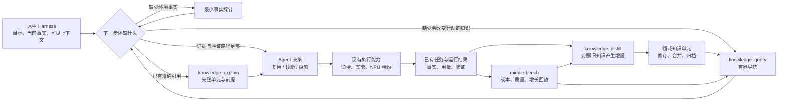

# 上下文分层、经验演化与开放探索详细设计

[English](knowledge-context-and-exploration.en.md) · [知识系统现状](knowledge-system.md) · [文档中心](README.md)

**状态：设计提案。** 本文定义后续实现的行为、数据口径与验收方式，不把设计写成已交付能力。基于 2026-10-20 的本地实现检查与开源资料，供 Gemini、DeepSeek 等实现方按模块落地；主仓库只维护设计。

核心目标是让知识提高下一次决策的质量，同时控制完成任务的总成本。为此需要同时闭合三个回路：

1. **上下文回路**：发现候选 → 按需加载 → 观察消耗和使用 → 调整工作集与加载预算。
2. **经验回路**：任务事实 → 可复用结论 → 更新已有知识 → 在后续任务中验证、修订或退出默认检索。
3. **探索回路**：识别常规路径的解释缺口 → 做有区分力的实验 → 判断结果 → 将适用范围明确的发现交回经验系统。

性能优化中的原始数据读取、按需采集、计量与对比由配套的 [Profiler 系统设计](profiler-system.md)定义；本文负责这些证据进入上下文与经验系统后的预算、采用和修订。

## 1. 设计决策与边界

| 决策 | 具体含义 |
| --- | --- |
| 系统架构层级、知识内容类别与上下文深度彼此独立 | `L1–L4` 表达系统认知与执行架构层级（`L1` 硬件约束基座、`L2` 剖析与仿真定界、`L3` Hermes 经验收敛模式、`L4` RSI 去偏探索模式）；`axiom/measurement`、`sop`、`workflow`、`mutator` 表达知识飞轮的内容语义类别（`category`）；导航、正文、证据表达阅读深度 |
| 完整规则按需加载 | 条件、约束、原因作为一个语义单元；不通过截断操作步骤来凑预算 |
| 知识可以增长，上下文必须有界 | 全库规模、检索候选规模、单次响应预算、当前可见知识工作集分别管理 |
| 增量更新已有知识 | 相同问题优先修订原单元；只有新增机制、条件或决策分支才值得新增内容 |
| 统计由事实产生 | 被返回、被加载、被采用、被验证分别计数；模型不能直接填写“累计成功次数” |
| 探索由信息缺口驱动 | 连续失败是检查信号；是否继续取决于新证据、未验证假设及剩余资源 |
| 复用原生 Harness | 宿主管理会话、压缩、子上下文和模型调用；MindIE 提供知识与执行能力 |
| 实现保持轻量 | 使用已有任务 ID、运行 ID、单元版本与结果；不增加 SHA 链、影子回执、通用工作流引擎或独立常驻调度器 |

用户仍从 `/mindie-agent` 和自然语言进入。预算、索引、经验整理都是内部能力；不要求每次任务先填表、冻结目录或确认一套维护流程。现有知识贡献授权、脱敏和公开边界继续生效。

## 2. 当前实现已经覆盖什么，还缺什么

本节是下列修订的实现快照，保留当时的问题定位，不代表后续修订仍有全部缺口。2026-10-20 的机制吸收复核与推进顺序见第 15 节；后续验收以对应组件的新代码与真实结果为准。

| 已有基础 | 当前缺口 | 本设计的改动 |
| --- | --- | --- |
| 结构化知识单元、条件匹配、`id@revision`、继承闭包 | 早期 Schema 将系统架构层级 `L1–L4` 与知识内容类别 `category` 混用为 `tier` 字段 | 正交拆分系统架构 `L1–L4` 与知识内容类别（`axiom/measurement`、`sop`、`workflow`、`mutator`），经验提炼可更新任意类别 |
| 查询正文预算、基础约束（`axiom`/`measurement`）整条保留 | 元数据未计入；非基础约束正文可能截断；共享父单元重复出现 | 全响应计费，导航与精读分离，按引用去重 |
| `_common` 基线 | 大型基础约束单元在默认预算下可能全部被排除 | 基础约束原子化，按当前子问题选择基础规则 |
| `knowledge_distill` 与 `reviewed_change` | 提炼前缺少已有知识对照，难以稳定形成增量更新 | 同主题检索、差量提炼、版本校验、合并优先 |
| 查询观察与反馈 | 观察不能证明采用，采用不能证明有效 | 将使用声明与真实验证结果关联 |
| RSI 停滞判断及候选评估 | 去掉对象中的 L3 不等于移除会话历史；未达收益目标可能被判成反证 | 使用宿主独立上下文；分开证据有效性、目标达成和可复用性 |

检查入口为 `knowledge` 的 [`graded/index.py`](https://github.com/mindie-agent/knowledge/blob/70ae51c/mindie_knowledge/graded/index.py)、[`graded/retrieval.py`](https://github.com/mindie-agent/knowledge/blob/70ae51c/mindie_knowledge/graded/retrieval.py)、[`graded/distill.py`](https://github.com/mindie-agent/knowledge/blob/70ae51c/mindie_knowledge/graded/distill.py)，以及 `mindie-bench` 的 [`rsi_explorer.py`](https://github.com/mindie-agent/mindie-bench/blob/3ca7343/src/mindie_bench/runner/rsi_explorer.py)。

本地只读探针还发现：

- 已检查的两个领域中，单条 L1 正文估算约 925–1,806 tokens，超过默认查询预算 800。条件匹配但无词面命中的查询可能得不到任何基础规则。
- 一个 Qwen 查询可返回 L3 摘录，同时将必需父规则标为预算不足；一个 RMSNorm 查询会在多个结果中重复展开相同父规则。
- 这些数值来自当前 `UTF-8 bytes / 4` 估算器，不是模型实际 usage，也不是 NPU 实验。

由此优先修正知识装配和计量，再讨论自动调预算；在错误计量之上做自适应只会放大偏差。

## 3. 三个正交维度：系统执行架构（`L1–L4`）、知识内容类别（`category`）与上下文深度

### 3.1 知识内容类别（`category`）：在 `knowledge` 飞轮中保存什么

> [!IMPORTANT]
> **避免把知识库称为“L1–L4 知识库”**：`L1–L4` 是系统认知与执行架构的四层分级（详见[系统架构 §4](architecture.md#4-l1l4-四层认知与执行架构及知识飞轮)）。`knowledge` 飞轮中的结构化知识单元按**内容语义类别（`category`）**划分，分别服务于 `L1–L4` 架构各层（现有 Schema 中的 `tier: L1..L4` 仅为对应下表四类 `category` 的历史兼容字段）：

| 知识内容类别（`category`） | 服务的系统架构层级（兼容字段 `tier`） | 保存内容 | 回答的核心问题 |
| --- | --- | --- | --- |
| **`axiom` / `measurement`**：约束与测量事实 | 服务 **`L1` 硬件约束基座 / `L2` 判据**（`tier: L1`） | 硬件约束、软件契约、条件明确的复现测量结论 | 当前路径必须满足什么底层前提？ |
| **`sop`**：诊断与操作规程 | 服务 **`L2` 剖析与仿真定界 / `L3` 执行**（`tier: L2`） | 可重复执行的诊断、采集、开发、测量步骤 | 怎样得到这个观察或完成这个动作？ |
| **`workflow`**：排障与适配决策经验 | 服务 **`L3` Hermes 经验收敛模式**（`tier: L3`，在 `L4` 去偏探索时剥离） | 观察如何区分分支，何时换方法，何时结束 | 下一步为什么应该这么走？ |
| **`mutator`**：受控代码变换 | 服务 **`L3` 复用 / `L4` RSI 变换空间**（`tier: L4`） | 有适用条件与验证证据的优化或适配变换 | 可以怎样改变实现？ |

受控代码变换（`mutator`）可以在 `L3` 常规任务中直接复用；`L4` 开放探索也可能产出一项新的 `sop` 诊断规程或 `measurement` 事实。经验提炼（`knowledge_distill`）可修订或新增任意类别的知识单元。

证据类型独立于知识类别。目标元数据区分 `hardware_spec`、`software_contract`、`reproduced_empirical`、`single_observation`、`hypothesis`。软件接口约定不能因为属于基础约束（`axiom`）就标成硬件规范；`axiom` / `measurement` 允许 `hardware_spec`、`software_contract` 与 `reproduced_empirical`。这里新增的 `software_contract` 是待实现的格式调整。

### 3.2 上下文深度：读到哪一步

| 深度 | 返回内容 | 何时使用 |
| --- | --- | --- |
| 导航 | 标题、简短用途、适用状态、缺失条件、正文成本、引用 | 发现是否有值得阅读的知识 |
| 正文 | 完整决策单元及必需前提；共享前提只出现一次 | 准备采用某条知识 |
| 证据 | 指定来源的相关片段、代码或运行结果 | 核查依据、解释冲突或跨条件迁移 |

导航摘要不承担执行契约。正文应能独立表达一个决策，长日志、完整代码与大量示例放在来源引用中。

### 3.3 工作模式：当前如何推进

| 模式 | 进入条件 | 退出条件 |
| --- | --- | --- |
| 复用 `reuse` | 已有方法与当前条件吻合，预期结果可检查 | 达成目标，或出现无法解释的偏差 |
| 诊断 `diagnose` | 需要区分代码、环境、测量或适用条件问题 | 找到原因并回到复用，或确认已有方法缺少解释 |
| 探索 `explore` | 存在尚无可靠路径的机制问题或优化空间 | 获得可验证方法、得到有价值的否定结论，或耗尽授权资源 |

模式绑定到子问题。例如模型 0day 的加载与通信仍按已有 SOP 执行，只有首个数值分歧的算子进入探索。整个任务无需一并切换。

## 4. 数据和职责如何流转



四个入口都允许零检索，但保留各自的原生调用协议。明确的文件名或堆栈位置是定位线索；只有当前代码、必要调用方、断言不变量和可执行验证足以支持下一步时，才直接修复。缺少会改变判断的机制或前提才加载知识；已取得准确引用可直接精读，不必先查询。读到足以行动就停止，验证失败或出现新证据时重新判断信息缺口。这个决策发生在原有工作流中，不增加分类模型、固定检索轮数或跳过反馈仪式。

| 归属 | 必须负责 | 不应接管 |
| --- | --- | --- |
| Native Harness / 插件 | 当前可见上下文、压缩通知、实际模型 usage、原生独立上下文；暴露已有能力差异 | 另建一套会话历史、模型路由或 Agent 运行时 |
| `knowledge` | 条件过滤、检索、完整装配、预算估算、单元版本、提炼变更与派生使用统计 | 决定用户任务成功、替代 Agent 选择开放问题的策略 |
| 领域知识仓库 | 条件明确的单元正文、必要引用、语义合并 | 放入每次运行的完整流水账 |
| `remote-dev` / `coordinator` | 运行身份、结果、资源和现有租约 | 以知识层级控制设备策略 |
| `mindie-bench` | 功能回放、配对任务实验、成本与知识增长评估 | 成为线上知识机制唯一实现位置 |

已有 RSI 中可复用的纯知识判断应归入 `knowledge`；基准执行与收益测量留在 `mindie-bench`。各插件调用同一实现，避免跨仓复制。

## 5. Token 预算：先定义口径，再决定额度

### 5.1 四种预算不能混用

| 预算 | 单位与作用 | 超出时的处理 |
| --- | --- | --- |
| 模型上下文容量 | 单次请求的完整输入与输出占用 | 交给宿主压缩、拆分或切换上下文 |
| 知识加载预算 | 本次工具响应和当前知识工作集的 tokens | 减少候选、延后证据、拆分独立单元 |
| 任务模型成本 | 全部前台、后台、重试、整理调用的累计 usage | 在现有任务资源约束内减少分支或结束探索 |
| 实验资源预算 | 墙钟时间、设备占用时间、实验次数 | 停止新增实验，保留已确认结果 |

知识工具返回 4,000 tokens 不代表任务只消耗 4,000 tokens。内容可能被后续请求反复携带；缓存命中也不意味着它不占上下文。

### 5.2 全响应计量

计量对象是实际交给模型的序列化响应，包括正文、条件、继承关系、来源摘要、导航字段和重复数据。工具内部的索引构建开销单独记录，不混入模型输入。

估算优先级为：

1. 宿主可提供的兼容 tokenizer 或精确请求计数；
2. 已有、与目标模型兼容的本地 tokenizer；
3. 明确标注方法的近似估算。

继续允许轻量估算，但不能把 `bytes / 4` 标成实测。中英文、代码和 JSON 分别检查偏差。只有取得同一负载的实际 token 计数时才校准估算器；不能用整次模型请求的 usage 除以其中一份知识响应来“校准”。

每次响应只需返回简短的 `usage`：预算、估算消耗、估算方法、是否仍有未返回内容。大体量诊断数据留在本地已有日志。

预算适用于实际响应，不仅是候选正文相加后的估算。装配后再对最终序列化结果计量；超出时移除最低优先级的可选完整单元并重算。连最小导航响应都放不下时，明确返回预算不足。真正需要完整读取的依赖不能被当作可选内容移除。

### 5.3 单次加载与工作集预算

若宿主提供当前输入计数，定义：

```text
C = 模型可用容量与宿主工作容量目标中的较小值
P = 当前完整输入，包括已经可见的知识
R = 为下一次输出和预期工具返回保留的空间
H = max(0, C - P - R)

B_new = min(H, 本次加载上限, 当前知识工作集的剩余额度)
```

`P` 只计算一次。已加载知识既属于输入，也属于知识工作集；不能重复从模型容量扣除。工作集额度只限制新增知识，并不假装能删除旧消息。

例如，一个纯说明性配置中 `C=32,000`、`P=20,000`、`R=6,000`，模型余量为 6,000。工作集还剩 3,000、本次上限为 4,096，则新增知识最多使用 3,000。两个候选的共享前提 700、正文分别 900/800，加上最终元数据和封装 300，共计 2,700，可以一并加载；把父规则重复展开后会变成 3,400，应通过去重解决，而非丢掉前提或上调额度。这是预算算例，不是实测数据。

宿主不提供当前计数时，明确标记容量余量不可得，直接使用工具调用声明的 `token_budget`（配合 `known_refs` 去重）并遵循宿主压缩信号。插件只消费宿主显式传入的余量（如可选 `host_headroom_tokens`），不靠扫描私有内部状态伪造精确余量。

首轮实现可用以下**可调起点**，随后通过第 13 节回放选择：

| 项目 | 起始值 | 含义 |
| --- | --- | --- |
| 一次导航 (`knowledge_query`) | 1,024 estimated tokens | 返回少量完整导航卡片与去重后的基础前提卡片；无需用满 |
| 一次正文精读 (`knowledge_explain`) | 4,096 estimated tokens | 包含共享前提（仅展开一次）和目标单元完整正文及封装开销 |
| 一次证据读取 | 2,048 estimated tokens | 按问题定位来源片段 |
| 当前知识工作集 | 8,192 estimated tokens | 作为加载目标，始终受宿主实际余量约束 |

这组数字不是模型通用最优值。大单元的完整依赖超限时，返回所需成本与未加载引用，由 Agent 选择扩大预算、缩小问题或先读前提。工具不偷偷截掉关键步骤。

### 5.4 实际模型用量

沿用宿主与后台摘要器的真实调用回执（如 `SummaryLedger` 与 `mindie-bench` 任务回执），至少能关联 `task_id`、原生调用 ID、模型、调用目的和 usage。调用目的区分任务推进、摘要、提炼、整理；它们属于同一个总成本口径。

适配器保存供应商原始 usage，并规范化 `input_tokens`、`cached_input_tokens`、`output_tokens`、`reasoning_tokens` 的统计关系。必须说明缓存字段是否已包含在输入中、reasoning 是否已包含在输出中，避免加两次。运行时只统计真实 tokens，不在 `knowledge` 内维护货币价目表；离线成本换算在基准分析层按明确标记的外部费率完成。

缺失 usage 为 `null/unavailable`，不能填零。一个主任务成功、后台提炼计量失败，应分别报告。相同调用回执只计一次；失败重试实际发生的额外调用仍计入成本。

不能将模型总输入成本全部归因于知识。在线记录提供“加载了多少”和“该任务总共花了多少”，知识是否降低总成本由匹配任务实验判断。

### 5.5 如何调整预算

在线只做有依据的局部调整：

- 卡片相关，但完整单元因预算未加载：允许在余量内扩大精读预算。
- 多次查询重复同一主题：合并查询意图，复用当前可见版本，避免继续堆结果。
- 正文已读但关键条件不明：补事实，不扩大正文数量。
- 工具响应经常大于声明预算：先修计量和装配，不上调额度掩盖问题。
- **保护宿主 Prompt Prefix Cache 的尾部阶段注入**：中途切换策略或注入分阶段收敛提示（[`stage_budget_guidance`](https://github.com/mindie-agent/knowledge/blob/main/mindie_knowledge/graded/explore_support.py)：`economy` 合并独立探针 → `convergence` 停止发散探索、仅验证存活假设 → `finalization` 预留收尾构建与契约核对）时，一律追加在当前工具返回末尾（`PreToolUse` `additionalContext` / Tool Result Tail），**严禁中途改写会话起始 System Prompt 击穿 KV Cache 前缀**。
- **工具输出连续重复行折叠与头尾有界回显**：`remote-dev` 在远端磁盘日志保持 100% 完整的前提下，通过 [`preview.py:fold_repeated_lines`](https://github.com/mindie-agent/remote-dev/blob/main/remote_dev/core/preview.py) 将 `> 2` 行连续相同输出折叠为 `[previous line repeated N more times]`，防止重复编译告警或进度刷屏挤占有效诊断上下文。

默认预算由离线回放调整。比较成功率、总 tokens、重读次数、上下文压缩次数和任务时长；选择质量相当时成本较低的方案。每轮只改变一个主要加载参数，不在任务中用噪声反馈反复重排系统提示。

## 6. 渐进加载、去重与上下文释放

### 6.1 发现：统一候选入口

`knowledge_query` 统一检索分级单元与原始材料，返回导航。先按领域和条件筛选，再做相关性排序；无需预先把预算一半分给材料、一半分给单元。

每张卡片包含足够的选择信息：`ref`、标题、用途摘要、适用状态、缺失事实、正文及必需前提的预计成本。来源明细留到精读。

条件未知的相关候选可以被发现，但必须说明缺失什么；不能被当作可直接采用。确定不匹配的候选默认不返回正文。显式调查冲突时仍可按引用读取，显示不匹配原因。

候选不足时扩大检索范围，不扩大上下文倾倒量。跨领域召回依赖机制、症状、算子类型等概念；单次 grep 未命中不等于没有经验。

### 6.2 精读：以依赖闭包作为装配单位

对选中的单元集合 `S`，取必需依赖闭包，扣除当前仍完整可见的同版本单元，得到本次需返回集合：

```text
needed = closure(S) - visible_complete_refs
```

装配顺序是必需前提、主单元、可选证据。共同父单元只返回一次，其他地方只保留引用。`inherits_from` 只表达真正的采用前提，普通背景关系使用普通引用。

单条 `ref` 与批量 `refs` 使用相同的闭包和最终响应预算；单条兼容字段 `content`、`frontmatter` 等也在装配前计入，不能在裁剪后追加正文。入口优先使用批量 `refs`，即使只选中一个单元。依赖精读使用运行时返回的准确版本引用，不把裸 ID 猜成 `@1`；仅完整可见的同版本引用可以加入 `known_refs`。

一个主单元的必需前提缺失、条件不符或未加载时，可以展示它的导航，但不能将其标为 `ready_to_apply`。当多个完整闭包都可选择时，按相关性和**新增成本**取舍，已经共享的父规则不重复收费。

这种装配不需要通用图调度器。小规模候选集、已存在的闭包和稳定的贪心选择足够；是否需要更复杂算法由回放证明。

### 6.3 基础约束单元（`axiom` / `measurement`，服务 `L1` 基座）原子化

每条基础约束单元只表达一项完整约束：

```text
条件：在某硬件、软件版本和执行路径下
约束：必须满足的关系或已经观察到的行为
原因：该约束影响哪个正确性或测量边界
依据：规范、源码位置或已有运行引用
```

广泛适用不等于所有任务都要加载。与当前子问题无关的量化规则，不因为位于 `_common` 就注入通信诊断。单条原子化 L1 正文目标控制在 `<= 450` estimated tokens 以内，确保在默认导航或精读预算下可按需组合加载，不会因把通信、图捕获、权重加载、量化混成一篇长文而整体超预算被拒。

拆分大型 L1 时保持条件和依据完整，不能只留下“必须这样做”的口号。软件版本变化优先重新检查软件契约；不因为时间过去就给稳定硬件事实机械降权。

### 6.4 “读过”与“仍可见”必须分开

`known_refs` 的含义是当前上下文中**完整可见**的精确版本，不是整个会话曾经打开过的集合。

- 原生压缩后，只有完整保留的规则继续算可见；仅留下摘要或引用的单元不在其中。
- 宿主不能报告保留范围时，清空可见集合，再按需读取。额外一次小范围读取优于误以为规则仍在。
- 规则版本发生变化，只重读相关版本及受影响前提；不逐轮重算全库摘要。
- 已完成分支压缩为结论、条件和证据引用；当前目标、关键事实、未决问题和下一步区分性实验保留。

从工作集移除一个引用不会减少已经发送的历史消息。实际释放上下文由宿主压缩或创建独立上下文完成，验收必须检查这一点。

### 6.5 缓存稳定性

顶层 Skill 和常用协议保持稳定，变化的任务事实与知识正文按需进入后续消息。索引更新只提示相关变化，不反复改写整个系统前缀。

单条源文可按 `id@revision` 缓存；条件匹配仍使用当前事实。缓存正文不等于复用过去的适用性判断。

调用旧版本引用时，只有能取得该版本正文才返回其内容；否则返回版本已变化及当前引用。合并后的旧 ID 返回替代指向。不能用当前正文冒充旧版本，也不为此新增全文历史快照服务；已有 Git revision 与来源记录负责必要的历史追溯。

## 7. 决策经验单元（`workflow`，服务 `L3` Hermes 收敛）：保存决策能力

### 7.1 一条决策经验单元应回答的问题

决策经验单元（`workflow`）的主体围绕以下内容组织，字段可融入自然语言，无需每条机械填空：

| 内容 | 作用 |
| --- | --- |
| 触发条件 | 哪类问题值得采用 |
| 首个区分性观察 | 用最小代价排开主要分支 |
| 分支与下一步 | 观察 A/B 分别意味着什么 |
| 真正的依赖 | 哪些前提缺少后不能采用 |
| 结束和探索出口 | 何时已足够，何时原流程不再解释现象 |
| 机制与实战陷阱 | 为什么有效，实际在哪一步失败过 |

目录名、文件名或一次任务中的操作顺序，只有影响机制时才进入规则。原始过程保留在任务材料；L3 不复制整篇复盘。

### 7.2 以 Triton 重编译问题说明结构

历史 indexer 案例适合提炼成以下决策结构：

1. 先区分同一长度重复运行仍编译，还是新长度触发新特化。
2. 前者检查缓存路径、进程边界与环境；后者检查特化 key 和随长度变化的参数。
3. 如果工作划分参数仍是 `tl.constexpr`，只增加 `do_not_specialize` 不足以达到目标；需要同时检查参数是否应变为运行时标量。
4. 保留现有 tile、数值运算与归属关系，先验证编译变体是否收敛，再测运行代价。
5. 有限的合法 tile 变体可以预热；无界长度派生标量不应靠枚举预热掩盖。
6. 若证据显示根因来自编译器内部或布局机制，离开该 SOP，针对新假设进入探索。

这一案例的价值在分支与机制。历史设备、特定 kernel 和收益只作为来源，不变成新任务的默认结论；本文没有重新运行该硬件实验。

### 7.3 任务进度与长期知识

任务记录可以保存“已经试了什么、目前停在哪里”；知识单元保存“下次遇到什么现象，应如何判断”。

一个完整任务未结束，也可能产生已经验证的子结论。允许从验证里程碑提炼；`Stop` 仅表示宿主交互边界，不自动等于任务成功。

因此 `task_state=inflight` 不应一票否决提炼：入口判断的是本次选中输入是否有已验证结论。未验证的同任务材料可以提供背景，但不能参与证据强度升级。

失败实验同样可能产生知识：发现基准无效、确认某前提不成立、区分了两种机制，都有复用价值。仅有失败日志、无可解释结论时保留材料即可。

## 8. 提炼与修订闭环

### 8.1 一次提炼的最小过程

1. 从已有任务结果选取新事实：观察、条件、验证结果和引用。
2. 依据主题查询少量旧单元，并读取相关正文。
3. 将旧知识作为比较材料，将本次运行作为新证据。
4. 形成 `noop`、修订、新建或合并提案；说明新增的是哪个条件、分支、机制或反证。
5. 通过已有 `reviewed_change` 路径校验引用、条件和目标版本，再写正文并更新派生索引。

原有单元不算本次实验的第二份证据；模型自己的摘要也不能把单次观察升级为独立复现。

### 8.2 避免每次再调用一个整理 Agent

前台 Agent 已具备上下文时，可以直接提交结构化提案，由 `knowledge` 做确定性检查与应用。后台接收任务材料时，复用已有摘要/提炼调用。

不为一次经验更新固定串联“生成、反思、审核、再审核”多个付费调用。角色可逻辑分离，是否需要独立模型取决于事实不确定性和验证收益。

提炼预算与任务预算统一记账。没有新增结论、重复触发同一里程碑、材料只包含未完成的运行时，优先返回无需更新；不靠生成一张新卡证明闭环运行过。

### 8.3 合并决策

| 新旧关系 | 操作 |
| --- | --- |
| 同机制、同条件、无新增事实 | `noop`，必要时关联新的有效使用证据 |
| 同机制，增加边界、坑点或更准确解释 | 修订原单元 |
| 同机制在新条件下得到验证 | 增加明确条件分支，保留各自依据 |
| 条件不同且结论不同 | 分支或拆分，不能混成普遍规则 |
| 两条内容等价 | 选定主单元合并，旧引用可定位到替代单元 |
| 新证据反驳某项旧主张 | 收窄、改正或退出默认检索，保留反证来源 |

语义相似度用于找候选，不直接决定合并。共享标题、算子类别或几个关键词不能证明两条机制相同。

### 8.4 写入与并发

模型推理在写锁之外完成。应用时使用现有单元 revision 检查是否仍基于当前正文；冲突则读取最新单元重新形成增量，不能覆盖另一任务的新增结论。

复用已有写入入口与 SQLite 的短事务，统一更新使用统计。正文使用原子替换，索引是可重建投影；正文已写入而索引刷新失败时分别报告，不制造新的永久故障状态。

来源复用任务 ID、运行 ID、Git revision 和文件位置。无需为正文、条件、闭包和每次读取再建立多份摘要清单。

## 9. 经验膨胀：控制读取和冗余，不抹平领域差异

### 9.1 分别度量四个规模

| 对象 | 需要观察的数据 | 控制方式 |
| --- | --- | --- |
| 原始任务材料 | 授权范围、字节数、保留时长 | 沿用已有存储与保留策略 |
| 长期单元 | 唯一单元数、正文大小、条件覆盖、重复主题 | 合并、修订、拆分、归档 |
| 导航索引 | 总规模与单次返回规模 | 领域路由、检索和分页，不全量注入 |
| 当前上下文 | 完整响应 tokens、重复加载、当前可见集 | 按第 5、6 节预算和装配 |

单元变多不必然退化；同一规则被重复写十次、查询成本随全库线性增长才是直接问题。少量长规则也可能比更多短单元更占上下文。

### 9.2 增长速度的口径

按领域和任务类型，在已有任务统计上计算：

```text
ΔU_active = 新建 + 重新启用 - 合并退出 - 归档
G_units   = ΔU_active / 已完成的可提炼里程碑数
G_body    = 正文估算 tokens 的净变化 / 可提炼里程碑数
G_read    = 相同任务集上的加载 tokens 变化
```

无里程碑时比率为不可计算。版本修订不计作新增单元。原始材料增长单独统计，避免将会话日志增长误认为知识增长。

另看修订/新建比例、相似主题候选、默认检索中的无采用比例，以及跨任务覆盖。无采用可能来自任务分布变化，不能单独证明内容无用。

最重要的判断是：知识增长后，在固定任务集上是否更容易找到正确方法，是否增加无效读取，是否损害少见场景的覆盖。

### 9.3 整理顺序

1. 写入时先更新同主题单元，减少重复源头。
2. 某主题重复增长或检索成本上升时，只整理该主题。
3. 合并等价规则，将长篇示例移回证据引用。
4. 对有新反证的条目修订适用条件；对已替代条目退出默认检索。
5. 预算仍不足时，缩小本次导航/精读集合，而非自动删除库内内容。

整理复用已有后台批处理，在任务边界或显式维护时运行，不新增轮询服务。整理调用也受模型预算约束；不能为了节省每次几十 tokens，持续花更大的整理成本。

### 9.4 归档与再次发现

归档表示退出默认检索，来源和引用仍可定位。硬件规范、低频但独有的正确性前提，不因为近期少用就被淘汰。软件契约的版本失配优先反映在条件中。

默认检索没有适用知识、版本迁移或调查旧结论时，可检索归档候选。恢复活跃需要新的适用性判断，不自动恢复过去的置信范围。

固定“全库 40 条”或“每类 8 条”不作为产品规则。若需要运维告警额度，应从检索质量与成本回放中获得；触发整理，不触发无条件删除。

## 10. 从使用数据判断知识是否有用

### 10.1 四个不同事件

| 事件 | 能说明什么 | 不能说明什么 |
| --- | --- | --- |
| `discovered` | 查询返回了卡片 | 模型阅读并采用了方法 |
| `loaded` | 完整正文进入可见上下文 | 它影响了下一步决策 |
| `applied` | Agent 声明某决策采用了该单元，并关联当前步骤 | 采用产生了收益 |
| `evaluated` | 当前步骤有真实验证结果，可关联该使用 | 单凭一次结果建立通用因果结论 |

只有宿主或调用方确认进入上下文，才计作 `loaded`；服务端只看到返回结果时，记录 delivered，不推断实际可见性。

事件复用已有任务、调用、步骤或运行标识，不新建一套全链路追踪协议。`applied` 可以随现有反馈或里程碑提交；简单任务无需另走一个工具流程。

### 10.2 结果归属

验证结果至少区分：支持、反驳、未获得有效结论。基础设施故障、测量污染和采用后未验证都属于未获得有效结论，不增加成功或失败证据。

对性能经验还要区分比较基线。一个方案相对最初基线仍有 2 倍收益，不能说明本轮新动作有贡献；本轮收益应对比采用前的有效状态。多个改动叠加时记录实测的组合效果，只有实际隔离测量过才能分配单项贡献。

一个 L3 帮助发现根因，即使最终性能没有改善，也可能在诊断目标上有效。有效性必须对应知识主张与当前目标。

### 10.3 计数、可信度与推荐顺序

计数从关联事件派生，按原生事件 ID 去重。相同实验的多次轮询、重放回执、多个模型重复总结，不能变成独立确认。

同一任务内的多次测量说明稳定性；跨任务、跨条件的验证说明迁移范围。两者保留各自口径，不把“两个 run ID”直接视为两次独立复现。

近期反证应促使检查条件和主张；低使用率只影响推荐顺序。初期采用可解释的排序：条件适配、问题相关性、有效验证、版本新鲜度、新增阅读成本。不要先做一个没有校准依据的综合“智慧分”。

在线使用统计用于筛选问题。知识是否造成收益，需要第 13 节的配对实验；没有反事实对照时只报告关联。

## 11. 开放探索的切换与回流

### 11.1 停滞是信息停滞

检查最近尝试是否产生新事实：

- 同一假设、同一方法、同类失败，没有新的区分性观察：可能停滞。
- 全局测试仍失败，但首次定位到数值分歧层：有进展。
- 设备暂不可用或测试入口错误：先修运行条件。
- 同一个长实验多次查询状态：仍是一次实验。

连续两次无进展可作为轻量提醒，不能成为自动启用大规模探索的门槛。Agent 简短说明尚未解释的现象与下一项区分性实验，即可进入针对性探索。

### 11.2 控制旧经验的锚定与 `subagent_fact_pack` 子上下文交接

探索上下文保留目标、硬约束、当前实现、观测结果、已排除条件、待验证问题和已有运行引用。暂时不加载旧 L3 的推荐步骤与论证，先独立形成假设，再将历史经验作为对照。

当通过 `knowledge_query(..., mode="explore")` 或 `knowledge_explain(..., mode="explore")` 进入去偏探索时，`knowledge.graded.explore.build_exploration_context` 会自动：

1. **剥离 `L3`（`workflow`）并向上提取 `L1/L2` 继承前提**：在剥离匹配到的 `L3` 经验单元（记录于 `stripped_l3_ids`）前，先递归提取其依赖闭包中的 `L1`（`axiom`/`measurement`）和 `L2`（`sop`）前提并去重保留，绝不因剥离 `L3` 而丢失底层硬件约束或测量守卫。
2. **注入条件化避坑清单（`conditional_avoid`）**：将近期未进展尝试转化为带明确条件边界（`unit_id`、`hypothesis`、`failure_reason`、`observed_bottleneck`、`conditions`、`scope_note`）的记录，防止重复踩坑而不构成跨条件永久禁令。
3. **生成原生子上下文事实包（`subagent_fact_pack`，`mindie-rsi-subagent-pack/1`）**：输出可直接投递给四大宿主（Codex / Claude Code / Kimi / DSH）全新原生子 Agent 的结构化 JSON 与紧凑 Markdown 简报（`prompt_brief`）。继承完整历史的 fork 不能称为去偏；仅从 Python 字典删除 `tier=L3` 同样不能移除当前主会话模型已经读过的内容，必须由宿主创建不继承旧 `L3` 会话轨迹的全新子上下文并仅注入 `subagent_fact_pack`。

宿主不支持新上下文时，设置 `native_subcontext=False`（`isolation_mode="in_session_warning"`），保留在当前会话执行并明确这是策略切换而非历史隔离。后续仍可按需检索 L2、L3 或 L4，探索并不要求人为失忆。

### 11.3 先验证最便宜、最有区分力的问题

候选通常经历：

```text
假设与预期观察
  → 静态检查 / 可用编译检查
  → 正确性
  → 有效测量
  → 必要的归因或组合验证
  → 可复用结论
```

这是一组证据依赖，不是所有任务强制执行的固定四门流程。单一改动与有效基线对比，可能已足够；多个相互依赖的变换需要验证最终组合，不能机械做逐项删除后误判。

只有已确认不需要设备的步骤才可按 CPU 任务并行。设备 JIT、编译探测、预热和计时继续使用现有 NPU 租约；计时按实际分配的设备隔离，不硬编码 NPU 0，不另建任务身份。

### 11.4 结果至少有三条轴

| 轴 | 例子 |
| --- | --- |
| 证据是否有效 | 编译失败、数值错误、计时污染、有效观察 |
| 当前目标是否达成 | 有效 1.04×，目标 1.05×，目标未达成 |
| 是否值得复用 | 证明了瓶颈、缩小了条件、得到有效变换，或没有新结论 |

有效的 1.04× 不能因为低于目标 1.05× 就被标为机制已反驳。低于噪声的结果属于未确认；数值错误说明该候选实现不正确，也不能不加分析就否定整个优化方向。

负经验保存为有条件的检查：在什么条件下尝试了什么、观察到什么、下次需要先验证什么。当编译器版本、形状、数据类型或瓶颈变化时允许重新评估，不形成永久禁止列表。

### 11.5 回流粒度

探索得出的硬件限制归 L1，诊断操作归 L2，区分分支的方法归 L3，代码变换归 L4。提炼使用第 8 节的同一入口。

资源耗尽时保存已验证子结论和未决假设，不强行宣布整个方向失败。后续任务能据此接续，避免从完整日志重新推理。

## 12. 借鉴开源方案：采用机制，也检查落地缺口

### 12.1 GEAK：最相关的工程参考

GEAK v4 将通用 Agent 运行时交给 Harness，将优化判断、实验与验证放在领域层。维护者在 [#355](https://github.com/AMD-AGI/GEAK/issues/355#issuecomment-5031276885) 明确解释了这一分工。MindIE 应沿用原生宿主，吸收闭合操作的确定性实现，而不复制完整 JS 优化工作流。

| 已核查来源 | 有价值的机制或问题 | MindIE 的落点 |
| --- | --- | --- |
| [GEAK learned 设计](https://github.com/AMD-AGI/GEAK/blob/main/kernel_workflow/knowledge/learned/README.md) | 区分任务过程与长期原则；区分算子收益与端到端收益；知识作为建议 | 第 7、10、11 节的内容和结果边界 |
| [经验更新角色](https://github.com/AMD-AGI/GEAK/blob/main/kernel_workflow/roles/update_experience.md#L130-L156) | 记录了并发索引写入和反馈计数未接通的问题 | 写入入口统一，计数直接消费真实使用与验证事件 |
| [`kb.py` 容量调整说明](https://github.com/AMD-AGI/GEAK/blob/main/kernel_workflow/scripts/kb.py#L46-L66) | 源码记录每类上限过小导致大量归档，并在对照中退化 | 不凭整洁偏好裁剪；先做领域覆盖回放 |
| [当前完整索引](https://github.com/AMD-AGI/GEAK/blob/main/kernel_workflow/knowledge/learned/INDEX.md) | 本次读取为 327 行、约 65.6 KB；全量阅读成本已不可忽略 | 对全库进行检索，向模型返回有界导航，不全量注入索引 |
| [#370](https://github.com/AMD-AGI/GEAK/issues/370) | 已关闭的问题报告：总 token 吞吐与仅输出吞吐混比，产生虚假增益 | 指标带名称、单位、比较基线和测量条件 |
| [#300](https://github.com/AMD-AGI/GEAK/issues/300) | 开放问题报告：启动拿到 task ID，后续无目录、无错误 | 原生任务 ID 只证明提交；启动、完成与结果分别检查 |

上述问题记录不是对当前版本故障的复现；源码中的实验叙述是项目报告，不能换算成 MindIE 的预期收益。索引大小是单次读取结果，不能据此推算其历史增长速度。

不照搬其全部内容限制。例如绝对时间可作为条件化测量事实保留；应防止把特定机器的数值当通用目标，而不是禁止知识出现任何绝对数值。性能经验也不应统一执行“只添加候选、从不降低优先级”：可靠负证据可以调整搜索顺序，但不能变成跨条件禁令。

### 12.2 Hermes：正文与参考资料分离

[Hermes Skills](https://hermes-agent.nousresearch.com/docs/user-guide/features/skills) 使用列表、完整 Skill、指定参考文件的渐进加载；同主题新材料优先并入原 Skill。MindIE 采用这一内容组织方式，将最短的判断结构放进正文，长证据按需读。

知识目录扩大后，列表本身仍需检索和预算；不能因为称作“元数据”就视为免费。对已经进入原生上下文的内容，仍由宿主负责压缩与缓存。

### 12.3 ACE：增量更新有价值，整理能力要查实现

[ACE 论文](https://arxiv.org/abs/2510.04618) 讨论了反复整体改写导致细节流失，提出以增量方式演化上下文。MindIE 因此以单元为修改范围，保留条件与机制，避免每轮重写整部经验手册。

同时，本次检查的官方 [`playbook_utils.py`](https://github.com/ace-agent/ace/blob/main/playbook_utils.py#L96-L143) 中，`UPDATE`、`MERGE`、`DELETE` 等仍列为未实现操作，实际分支主要实现 `ADD`。因此“采用 ACE 思路”不等于已有完整收缩机制；MindIE 必须用真实合并、替换、归档行为验收增长闭环。

### 12.4 Context engineering：按需获取与工作集维护

[Anthropic 的上下文工程实践](https://www.anthropic.com/engineering/effective-context-engineering-for-ai-agents) 提供了按需获取、压缩和结构化笔记的参考。MindIE 采用的是工作集管理原则：保留当前任务所需事实和可追溯指针，重复细节在需要时重读。具体预算和质量收益由自己的任务分布决定。

### 12.5 从 `AMD-AGI/GEAK` 与 `apple-aiml-research/ml-rsi-inference-bench` 吸收的八项 RSI 防踩坑机制

对 [`AMD-AGI/GEAK`](https://github.com/AMD-AGI/GEAK)（`kernel_workflow/kernel_lane.js`）与 [`apple-aiml-research/ml-rsi-inference-bench`](https://github.com/apple-aiml-research/ml-rsi-inference-bench)（`tasks/*/tests/_verifier_lib/`）的源码走查表明，工业界在落地 RSI 时已踩过八类典型陷阱。MindIE 将其对应防护直接内化入 `mindie_knowledge.graded.explore` 与 `mindie_bench.runner.rsi_campaign`：

| 编号与来源 | 外部已踩过的坑（源码证据） | MindIE 落地的防踩坑机制与代码入口 |
| --- | --- | --- |
| **坑 1：知识卡片过度引导挤占冷启动方向**（GEAK `kernel_lane.js:196-214, 1714-1735`） | GEAK 在 16-kernel 基准中允许 Planner 自由引用知识卡片指导全部方向，导致几何平均加速比退化 **22.7%（`4.45x → 3.44x`）**，单算子从 `25.77x` 跌至 `2.15x`（*"The KB must be an accelerant, not a cage"*） | `explore.enforce_direction_budget` 实施 `kb_dir_cap=1` 与 `require_cold_direction=True`：每轮最多 `kb_dir_cap` 个方向允许挂载历史卡片引用，且**至少保留 1 个仅从 `L1/L2` 硬件与剖析事实推导的冷启动控制方向（`learned_refs=[]`）** |
| **坑 2：反馈账本幸存者偏差与基线漂移误记功**（GEAK `kernel_lane.js:1737-1758, 1845-1875`） | ① 仅在 `finalPrimary > 1.0` 分支内写反馈导致负向实验被过滤（100% 虚高胜率）；② 前序轮次已达 `2.5x` 后，当前轮跑出 `1.5x`（相对本轮基线退化）仍因 `> 1.0` 被记为卡片正收益；③ 验证超时写成 `0` 误伤被引用卡片 | `explore.build_citation_feedback_record` 与 `rsi_campaign`：① 反馈账本独立于新卡提炼门禁（正负实验全量记录）；② 胜出判定锚定当前在位最优（`speedup >= incumbent_speedup * (1 + min_improve_delta)`）；③ 验证器超时或环境故障编码为 `cited_then_verified = None` |
| **坑 3：按子 Agent 返回值收割导致超时丢失落盘高收益补丁**（GEAK `kernel_lane.js:1560-1585`） | 工程师子 Agent 已将 `1.56x` Triton 补丁写入磁盘（`best_patch.diff`），但汇总返回超时；按返回值门禁直接丢弃了该胜出补丁 | `rsi_campaign.harvest_candidate_patch` 采用**测量锚定收割（Measurement-Anchored Harvesting）**：仅当子 Agent 正常返回有效且低于基线的测量结果时跳过验证；只要子 Agent 超时而磁盘存在候选补丁，仍移交独立验证器（`disk_patch_rescued`） |
| **坑 4：胜出合入后沿用陈旧剖析画像与未校准 Roofline 幻觉**（GEAK `kernel_lane.js:1456-1467, 1676-1683`） | 候选补丁胜出后硬件瓶颈已转移（如从访存合并转为计算受限），继续基于第 0 轮画像规划后续轮次；或 `roofline_status="unknown"` 时编造“冲刺 90% 峰值”方向 | `run_rsi_gate_campaign` 在 `became_winner=True` 时显式置位 `reprofile_required=True`；`enforce_direction_budget` 在 `roofline_status != "calibrated"` 时自动过滤依赖峰值 Roofline 百分比的假设 |
| **坑 5：仅改启动脚本参数或配置字面量刷榜**（Apple `ml-rsi-inference-bench` `category_gate.py:50-152, 234-237`） | Agent 通过修改 `launch_server.sh` CLI 参数（`pure_flag_flip`）、调整 `config.py` 默认常量（`config_default_flip`）或残留编译产物（`artifact_only`）骗取算子/引擎优化分数 | `rsi_campaign.classify_candidate_patch_shape` 将候选补丁分类为 `empty` / `artifact_only` / `pure_flag_flip` / `config_default_flip` / `source_edit` / `mixed`；开启 `reject_narrow_flips=True` 时对非实质源码修改在 G3 直接拒收 |
| **坑 6：新增未跟踪辅助源码遗漏与主从 JIT/编译缓存串扰**（Apple `candidate_capture.py`, `jit_cache_prune.py`, `_paired_helper.py:122-187`） | ① 新增 `.py`/`.cu`/`.asc` 文件未被 `git diff` 捕获，或误把 `.ssh`/`.env`/`__pycache__`/`.so` 打入补丁；② `pristine` 与 `candidate` 共享 `.so` 或 `TRITON_CACHE_DIR` / `ASCEND_CACHE_PATH`，导致基线加载候选已编译算子，AB/BA 比值抵消为 `~1.0x` | `classify_candidate_patch_shape` 显式剥离构建产物与敏感目录；`build_isolated_jit_cache_env(state_dir, side)` 为 `pristine` 与 `candidate` 生成严格隔离的 `TRITON_CACHE_DIR`、`TORCHINDUCTOR_CACHE_DIR`、`ASCEND_CACHE_PATH` 与 `MINDIE_JIT_CACHE_DIR` |
| **坑 7：投机解码（MTP/DSpark）靠关停草稿或降低采信率伪造低时延**（Apple `acceptance.py:135-205`, `equivalence.py:36-113`） | 在 DSpark/MTP 优化任务中，候选补丁使 `num_drafts <= 0` 或大幅拉低 `mean_acceptance_length`，表面单步时延下降但投机解码实质退化 | `rsi_campaign.evaluate_speculative_acceptance` 强制校验 `num_drafts > 0` 且 `cand_acceptance_length >= pristine_acceptance_length * (1 - rtol)`（默认 `rtol=0.05`），违反时标记 `no_drafts` 或 `acceptance_degraded` 并拦截 |
| **坑 8：均值之比扭曲与基础设施故障误判为负向结论**（Apple `regression_scoring.py:30-71`, `preflight.py:40-71, 227-249`） | 先分别求均值再相除易受离群值扭曲；`/dev/shm` 不足、驱动卡死或基线缺失若计为 `0` 分会污染实验账本 | 统一采用**同轮 AB/BA 配对比值 → 单负载中位数 → 跨负载几何平均**（且每个 guard 负载独立满足 `min_ratio`）；环境预检失败归入 `infra_failed` / `repair_execution_conditions`，绝不记为假设被反驳 |

### 12.6 OO-Harness：从执行记录学习专用策略及其选择条件

[Object-Oriented Harness，arXiv:2610.28380v1](https://arxiv.org/html/2610.28380v1) 固定执行模型，在 discovery 任务上按共同执行需求聚类，演化可继承的专用 Harness，并分别积累设计经验与路由经验；在独立测试任务上固定代码和经验，依据任务及基础执行轨迹选择一个 Harness。祖先类复用代码，不构成额外的 Agent 执行链。

MindIE 吸收的是**条件化策略复用、根据可见执行证据选择方法、保留适用的默认路径，以及固定经验后的独立评测**。论文的代码继承与 `inherits_from` 的知识前提展开用途不同；实现落在现有原生 Harness、`workflow` 和责任组件中，具体步骤见[第 16 节](#conditional-strategy)。

论文先执行基础 Harness，选中专用 Harness 时再执行；表 1 的 Steps 只计算最终选中轨迹，未计其他执行与辅助选择调用。因此其步数不能用来推断 MindIE 的总成本收益。迁移到 NPU 任务时，在已有执行的自然决策点选择后续方法，继续使用原运行身份；最小对照方案见[分级测试方案第 4.7 节](knowledge-tiered-testing-plan.md#strategy-selection-pilot)。

### 12.7 HarnessPro：成本感知的帕累托多档位筛选、尾部阶段预算与局部 Oracle 门控

[HarnessPro，arXiv:2610.26770v2](https://arxiv.org/abs/2610.26770) 针对递归自进化（RSI）因堆砌探索与验证导致执行成本暴涨的问题，引入了带初始通过率下界（$\text{PR}(h) \ge \text{PR}(h_0)$）的帕累托非支配筛选与归一化加权平方距离选择（保留 `lite` `(1,2)`、`medium` `(1,1)`、`heavy` `(2,1)` 三档代表点），并在进化出的 Harness 中沉淀了四项运行时降本机制。

MindIE 直接吸收其中四项经源码验证的高收益机制，同时显式剔除两项与工程原则冲突的做法：

| 机制维度 | 吸收的机制与代码落点 | 明确剔除的边界（遵守设计原则 1、5、14、16） |
| --- | --- | --- |
| **1. 工具输出连续重复行折叠 + Head/Tail 有界回显** | `remote-dev` 的 [`preview.py:fold_repeated_lines`](https://github.com/mindie-agent/remote-dev/blob/main/remote_dev/core/preview.py) 将 `> 2` 行连续相同日志折叠为 `[previous line repeated N more times]`，超长时保留 Head/Tail 并附带原始日志指针，消灭编译告警/进度刷屏导致的上下文线性膨胀 | 远端磁盘日志文件 100% 保持完整原文不截断；仅对返回给宿主上下文的预览文本做无损折叠与头尾切片 |
| **2. 保护 Prompt Prefix Cache 的尾部阶段预算提醒** | `knowledge` 的 [`explore_support.py:stage_budget_guidance`](https://github.com/mindie-agent/knowledge/blob/main/mindie_knowledge/graded/explore_support.py) 生成 `economy`（合并独立探针）→ `convergence`（停止发散探索、仅验证存活假设）→ `finalization`（预留收尾构建与契约核对）三阶段提醒，一律追加于工具结果尾部（`additionalContext`），100% 保护 KV Cache 前缀 | **交互式会话默认 `allow_hard_deny=False`**（绝不在用户日常开发中返回 `permissionDecision: "deny"` 硬锁工具绑手脚）；硬熔断仅用于 `mindie-bench` 无人值守评测或显式预算的 `L4` 子会话 |
| **3. 局部强 Oracle 与可区分假设门控** | `knowledge` 的 [`explore_support.py:enforce_direction_budget`](https://github.com/mindie-agent/knowledge/blob/main/mindie_knowledge/graded/explore_support.py) 增加 `oracle_strength` 与 `probe_cost_fraction` 门控：当缺少局部可重复验证器（`weak_e2e`）或单次验证占剩余预算 `> 25%` 时，自动将 `deep` 方向降级为 `standard_build_local_probe_first` | **不采用每轮任务前串行增加一次独立 `gpt-5.5` 路由分类器调用**（论文 Case 5 已证实前置分类器常高估难度且在简单任务上为净负收益；MindIE 在自然决策点按已观察证据选择） |
| **4. 帕累托前沿筛选、Cost-of-Pass ($\text{CoP}$) 与无泄漏测试合成** | `knowledge` 的 [`select_pareto_candidates`](https://github.com/mindie-agent/knowledge/blob/main/mindie_knowledge/graded/explore_support.py) 与 `mindie-bench` 的 [`summarize_arm_pareto_and_cop`](https://github.com/mindie-agent/mindie-bench/blob/main/src/mindie_bench/evaluation/knowledge_tiered_support.py) 过滤低于基线或被支配的方案，输出 `lite`/`medium`/`heavy` 代表点及单次成功成本 $\text{CoP}$；评测器严格区分 `infra_error` 与 `passed=false` | 合成验证用例只准从公开任务契约与独立参考推导，**严禁从被测候选产物中倒推期望常量、Hash 或容差**；`infra_error` / `unknown` 独立归入 `inconclusive_ids`，绝不伪装成 `0` 分有效负例 |

## 13. 接口设计与数据闭环验收

### 13.1 在现有入口上调整

以下签名为目标设计，兼容现有单引用与结果字段，避免调用方迁移断裂：

```text
knowledge_query(query, conditions, domain, domain_path,
                token_budget=1024, limit=8, continuation=None,
                include_unknown=True, include_archived=False,
                navigation_only=False, mode="reuse",
                ledger_entries=None, bottleneck_summary=None,
                native_subcontext=False, goal="")
  → cards, foundation_cards, results, continuation, usage, mode, exploration_context?

knowledge_explain(ref=None, refs=None, conditions=None,
                  known_refs=None, token_budget=4096, mode="reuse",
                  ledger_entries=None, bottleneck_summary=None,
                  native_subcontext=False, goal="")
  → units, requires, unresolved, usage, mode, exploration_context? (单 ref 调用同时保留顶层兼容字段)

knowledge_distill(inputs, task_state, domain, related_refs=None, proposal=None)
  → noop 或 reviewed_change 的实际应用结果

knowledge_feedback(ref, rating=None, reason="", event_type=None,
                   run_id=None, outcome=None, step_id=None)
  → vote / usage_event 记录回执
```

- `query` 默认返回有界导航卡片（`cards` 与兼容字段 `results`）以及去重后的基础前提卡片（`foundation_cards`）；全响应序列化字节/token 计入 `usage`。在 `navigation_only=True` 与常规模式下，`ready_to_apply` 均强制要求单元自身及其 `closure` 中所有继承祖先满足 `matched` 且处于 `active` 状态。当 `mode="explore"` 时，自动剥离 `L3`（`workflow`）单元（保留其匹配的 `L1`/`L2` 依赖前提），并返回包含停滞判定（`stagnation`）、`stripped_l3_ids`、`conditional_avoid` 与 `subagent_fact_pack`（`mindie-rsi-subagent-pack/1`）的 `exploration_context`。未知条件默认以 `match_status="condition_unknown"` 与 `ready_to_apply=False` 呈现（不直接展开正文），保留 `include_unknown` 过滤参数兼容既有调用。已归档或被替代单元（`status in {"archived", "superseded"}`）默认不进入常规检索，仅在 `include_archived=True` 或按引用查询时返回。
- `explain` 既支持单个 `ref`（兼容现有调用及原始任务材料读取），也支持批量 `refs` 统一计算依赖闭包 `needed = closure(S) - visible_complete_refs`：共享父前提在 `requires` 中按拓扑顺序只展开一次，主单元在 `units` 中返回完整正文（绝不截断步骤）。`known_refs` 仅指当前上下文中完整可见的精确版本（`id@revision` 或完整 URI）；`unresolved` 明确区分 `condition_unknown`、`condition_mismatch`、`budget_excluded`、`removed_or_superseded`（附带 `superseded_by`）和 `not_found`。
- `distill` 在 `task_state="in_flight"` 但 `inputs` 含已验证里程碑（`outcome="verified"`）时允许提炼；调用整理模型前自动从当前 `RoutingIndex` 检索同主题相关旧单元（`related_units`）作为差量对照；当前台 Agent 已形成符合 `mindie-distill-decision/1` 的 `proposal` 时，直接走确定性校验与 `apply_decision`（`model_calls=0`）。
- `feedback` 在保持既有 `rating="up"|"down"` 投票兼容的同时，支持显式记录 `applied` 与 `evaluated`（绑定 `run_id` 与 `outcome="supported"|"refuted"|"inconclusive"`），并在服务端区分 `query` 返回的 `discovered`（`delivered`）与 `explain` 完整读取的 `loaded`，按 `(root_opaque, unit_id, revision, event_type, run_id)` 幂等去重。
- 可复用的探索判断与三轴评估（`assess_stagnation`、`build_exploration_context`、`evaluate_exploration_candidate`）收敛于 `knowledge.graded.explore`，由 `mindie-bench` 的 `rsi_explorer.py` 与各插件共同调用。

`query` 和 `explain` 本身不调用模型；语义判断由当前 Agent 或已有提炼调用完成。首版继续复用本地检索和条件索引，是否增加 embedding 用实际召回缺口决定。

### 13.2 最小数据记录

信息分散在已有单元、调用与任务结果中即可，不要求额外生成一份总清单：

| 位置 | 必要信息 |
| --- | --- |
| 单元 | `id@revision`、层级、条件、来源、必需前提、正文；替代关系按需要记录 |
| 加载结果 | 单元版本、响应估算 tokens、计量方式、适用状态与未加载原因 |
| 使用反馈 | 任务/步骤、采用的单元版本、验证运行引用、支持/反驳/未确认 |
| 模型回执 | 原生调用 ID、模型、调用目的、原始 usage、规范化口径 |
| 任务结果 | 用户目标、成败、耗时、设备时间、人工介入、可复用里程碑 |

这些数据支持三个问答：“本次为什么加载这些内容”“这条经验后来是否被验证”“知识增长带来了多少额外读取成本”。无法回答的问题应显式留下缺口，不靠补造字段得到漂亮报表。

一个完整的最小回放应跨两项任务：任务 A 的已验证里程碑创建单元 `U@1`；任务 B 发现、加载并声明采用它，关联自己的运行结果；有效反证使 `U@1` 被修订为 `U@2`，下一次查询看到新条件。若 B 仅发生环境故障，则保持结论不变并记录未确认；重复提交同一运行也不增加证据。这个回放同时检查读取、使用、统计、修订和再次读取是否实际连通。

### 13.3 功能验收

遵循[分级测试体系](testing-architecture.md)，只验证真实行为：

各层知识的现有实现覆盖、具体用例、开源协议对照、评价指标与落地顺序见 [L1–L4 知识与系统能力分级测试方案](knowledge-tiered-testing-plan.md)。下表保留本设计的功能验收要求，真实任务收益与长期学习按该方案分别验证。

| 场景 | 验收重点 |
| --- | --- |
| 两个 L3 共享 L1/L2 | 全响应预算内，父正文只出现一次；无缺失前提却标记可采用 |
| 大单元、窄预算 | 返回完整导航和未加载原因；不返回被截断的可执行流程 |
| 事实缺失与条件冲突 | 导航可发现未知条件；正文不伪装为适用 |
| 原生压缩与重读 | 正文未保留时重新读取；仅在摘要里留下 ref 不算正文可见 |
| 同主题反复成功 | 优先修订/补证据，单元数不会随重复运行线性增长 |
| 两个任务并发修订 | 不丢失有效增量，不重复累计同一次验证 |
| 有效小收益未达目标 | 保留有效证据，正确标记目标未达成，不写成通用反证 |
| 探索中发现错误基准 | 修复基准后再评估；旧结果不计作优化证据 |
| 新版软件反驳旧结论 | 修改条件和推荐，保留旧环境可追溯性 |
| 整理退出旧单元 | 默认检索使用主单元，旧引用可定位，独有条件未丢失 |

Tier 0 覆盖条件、装配、统计去重与纯结果判断；Tier 1 覆盖实际存储和进程边界；Tier 2 检查实际 NPU 使用路径；Tier 3 用真实宿主做短 Canary。开放探索的长任务另列实验预算，不把长实验压缩成 90 秒验收承诺。

### 13.4 配对任务实验

先比较三个配置，避免一次引入太多因素：

| 配置 | 用途 |
| --- | --- |
| A：相同宿主与工具，不加载领域经验 | 原生能力基线 |
| B：现有知识机制 | 判断改动相对当前实现的影响 |
| C：本文加载与增量修订机制 | 检验设计是否降低总成本并保持质量 |

使用匹配的任务、模型配置、仓库状态和设备环境；执行顺序交错或随机化，记录环境偏差。0day、问题诊断、模型性能和算子性能分别报告。

同时观察任务成功率、完成时长、输入/输出/缓存 tokens、后台整理成本、NPU 时间、人工介入、重读和无效尝试。模型选择与加载策略不要同时变化后再归因。

初始知识固定用于组间比较；用于评价泛化的保留任务不在同轮实验中回写知识。在线学习能力另开顺序任务流，比较第 1、后续任务的成本与成功率曲线，并保留每步实际可用的知识版本。

先在小规模真实任务上选预算，再扩充任务类别。试验性预算网格可以采用导航 1k/2k、精读 2k/4k/8k，但仅在存在质量或成本分歧时继续扩展。

### 13.5 长期增长回放

回放需要同时包含：

- 同主题重复任务：应主要积累验证和修订，新增单元速度逐渐下降。
- 新领域或新机制：允许知识合理增长。
- 冲突与版本迁移：应出现修订、分支、替代和归档。
- 低频独有条件：整理后仍能被发现并正确使用。

检查的是在这些输入下的增长和质量曲线，而不是要求所有领域趋近同一单元数量。发现正文净增长、固定任务加载成本上升且覆盖不改善时，优先检查重复写入、错误拆分和检索退化。

## 14. 实施顺序与交付条件

| 阶段 | 工作 | 可以认定完成的依据 |
| --- | --- | --- |
| P0：统一计量与加载 | 全响应预算、导航/正文分离、共享依赖去重、可见引用语义 | 第 13.3 节对应行为通过；真实宿主压缩后重读正确 |
| P1：接通经验数据 | 旧知识对照、增量提案、采用与验证关联、确定性统计 | 一条经验经历创建、采用、正反验证、修订；重复事件不放大计数 |
| P2：收缩与覆盖 | 合并/替代/归档、增长统计、按主题整理 | 重复任务不无限新建；低频独有场景回放不丢失 |
| P3：探索与原生上下文 | 子问题模式、真实新上下文、按目标判断结果、回流任意层级 | 原生宿主与真实任务证明切换有效，资源与结果语义正确 |
| P4：成本与质量校准 | A/B/C 配对任务、预算选择、在线学习与增长曲线 | 分场景展示实测质量、总成本、适用范围和未解问题 |

P0/P1 可以先服务日常任务。P2/P3 在相同接口上迭代，不以新控制平面为前置条件。开源经验吸收优先落在可验证的行为上：完整读取、增量修订、真实反馈、有限加载和允许推翻旧结论。

实现方交付时，设计、代码行为、宿主接入、设备验证和基准收益分别列明。文档合入、组件测试通过或某个算子加速，均不能单独作为整个知识体系已经成熟的证明。

## 15. 从真实 transcript 吸收机制

### 15.1 本轮范围与已有基础

本轮优先吸收“遇到问题如何判断、如何选实验、如何推翻旧结论”，延后 A5/K3 的参数、特定布局、算子修复和大规模知识导入。历史任务用于说明机制从何而来，不把其中的配置或一次成功推广成默认答案，也不将已有 transcript 当作未暴露的迁移测试。

2026-10-20 晚间重新读取 GitHub `main` 与当前 checkout 后，基线更新如下。远端提交以 GitHub API 返回为准；本地 `origin/main` 可能滞后，不能仅凭 `ahead` 数量判断是否合入。下表不代表发布或安装状态。

| 组件 | 远端 `main` | 本地 HEAD | 本轮判断 |
| --- | --- | --- | --- |
| 架构文档 | `67d17d0`（#251） | `67d17d0`，另有工作区修改 | 机制设计已进入文档；本节补最新实施与验收边界 |
| `knowledge` | `a931b20`（#86；核心机制来自 #83–#85） | `433d70c` | 本地包含 `02ccb63`、`ac8d07a`、`433d70c` 的机制、预算及来源绑定补充；这些不能算作远端合入。远端 #86 为 live probe 环境配置补充 |
| `mindie-bench` | `4a8b9a9`（#13） | `ff540ab` | M1–M6 回放、Gate Runner、分级评测与多域运行等已在本地提交，尚未进入远端 `main` |
| 四插件（Codex / CC / Kimi / DSH） | `0a42ac5` / `3f01c5e` / `3e82f64` / `16cffb8`（#49 / #33 / #35 / #7） | `957d1d2` / `ee94204` / `34b586c` / `70f0414` | 远端已有新参数透传和依赖对齐；诊断机制参考与 Phase 0 指引在本地提交中 |
| `sim` | `d3d0456` | `d3d0456` | 已有独立仓库、包与 CLI，四层求解代码已实现；不能继续写成待抽离 |
| `profiler` | `1891821` | `1891821` | 已有独立仓库；建模模块委托 `mindie_sim`，安装依赖与实测校准仍需核对 |
| 执行基础 | `coordinator@14c3680`、`remote-dev@f441d52` | 本轮以远端职责及现有调用接口为准 | 复用运行、资源和回执机制；未提交的拓扑扩展不计作合入 |

已吸收的基础包括：

- `knowledge/graded/explore.py` 已按运行 ID 去重，用新观察和首个分歧判断进展，并分开证据有效性、目标达成与可复用性；它是纯判断逻辑，不执行实验或创建上下文。
- `knowledge/graded/worker.py` 已在提炼前查找相关旧单元；`distill.py` 已检查选中来源、证据强度和 L4 消融回执，支持前台提案的确定性应用。
- 本地 `mindie-bench/evaluation/knowledge_tiered.py` 已复用生产知识接口，具备运行回执到反馈的桥接和顺序 episode 的组件回放；`mechanism_replay.py` / `mechanism_replay_cases.py` 已提供六种机制的题面与结构化判分，`runner/qualification_gate.py` 已提供 G0–G3 验证入口。预写提案和结构化答案测试仍不证明模型学会了新方法。
- 独立 `sim` 已有硬件/容量与传输分析、周期流水求解、子图融合分析和整网建模接口；独立 `profiler` 已有 inventory、correlate、SQL 和实测分析能力。机制实现与数据校准分开：仍须防止案例数值成为未声明的默认输入。
- 领域中已有 hybrid bring-up、idle-DP 状态和验证一致性的 L2/L3 分支经验；Run Manifest、实验判断、恢复进度的职责也已有设计。缺口是稳定保留决策依据、在四端一致执行，以及在新任务中证明确实改变了决策。

吸收程度以三层证据报告：**规则/组件实现、真实宿主任务、独立任务迁移**。不能用前一层替代后一层。

### 15.2 机制、组件、缺口与验收

下列 M1–M6 与工程流程 W1–W6 仅是设计追踪编号，不新增运行时枚举或要求用户填写的表单。它们可以组合使用，不是固定阶段流程。来源 T1–T6 的身份和具体位置见第 15.5 节。

这些机制遵循[工程原则第 10 条](design-principles.md#10-按真实缺口自研以核心业务逻辑为唯一基准直接重构清理)：默认信任 Agent 和内部组件，直接复用已有运行结果。经验提炼、检索和报告不逐层重验事实，也不要求 Agent 为每项判断另交证明。评测器按题意做一次任务评价；真实任务出现矛盾时再做针对性定位。

| 机制 | 主责与配合组件 | 复核基线与缺口（本批状态见 15.4） | 实现工作 | 验收要求 | 来源 |
| --- | --- | --- | --- | --- | --- |
| M1 选择有区分力的实验与跨界融合先行 | 四个原生插件负责当前决策；`mindie_sim` 提供子图/流水边界仿真；`knowledge` 保存/检索决策经验；bench 衡量决策成本 | 本地四插件已取消次数驱动的强制升级并加入 Phase 0；M1 回放已有，重点是接通真实宿主并观察实验选择是否改善 | 复用现有指引与回放入口；按当前问题评价动作的区分力，接受有理由的新假设和等价策略，不增加假设 ID 白名单或事实证明协议。性能优化按任务检查上下游可融合边界 | 真实任务统计到根因/有效方案的时间、实验数、无信息重复和人工纠正；少做无效实验、遇到新信息能调整方向 | T1 周边预算/关键路径/负结果；T3:53、20178、20203；T4:24224；T6:29126、44044、134703 |
| M2 定位首个分歧、跨模块契约与四层仿真 | 领域仓保存方法/决策经验；插件选择探针；`remote-dev` 执行；独立 `profiler` 提供实测；独立 `sim` 提供四层求解 | `sim`/`profiler` 已拆仓并有代码；周期流水与子图边界已有本地测试。缺口转为独立安装依赖、案例参数与通用机制分离、真实输入校准 | 按逻辑 token/状态/阶段/rank 对齐 shape、dtype、stride、布局、所有权和生命周期；保留已有周期/关键路径求解。移除未声明的 A5 工作负载、频率与周期默认值，缺失校准输入时返回未建模及原因 | 首个等价边界定位正确；缺失输入不生成历史案例的数值预测；不同 SKU 不静默套用同一峰值；理论下界、模型预测、设备实测分列。详见 15.6 | T1 pipeline/quantized oracle/MLAPO 模型；T2:639、737、790、872；T3:20203；T6:66782、80008、145966 |
| M3 识别观察扰动并做因果对照 | 插件负责实验设计；`coordinator`/`remote-dev` 负责执行；bench/Profiler 消费已有结果 | 本地 Skill、提炼提示和 M3 回放已有；判分器有局部语义问题，真实任务中的对照选择仍待验证 | 默认使用已有题面和工具结果，不要求 Agent 复制计数再由多个组件复核。遇到观察动作改变症状时，由 Agent 按尚存解释选择必要对照 | 能区分插桩影响和修复作用，按结果保留未确认结论；修复验收复用必要的无插桩测试结果，不为普通任务增加固定对照矩阵 | T1 公共基线/ABBA；T3:3028、22797、22844；T3 因果 DFX 草案；T6:77114 |
| M4 复现历史依赖的故障 | bench 复用 TaskSpec、初始状态和执行入口；领域仓保存复现方法；插件/remote-dev 保留状态与顺序证据 | 本地已加入序列、reset、并发边界的结构化回放；仍缺由实际宿主执行的序列缩减与真实症状复验 | 复用现有案例接执行轨迹；最小复现包含输入、初始状态、请求/调度顺序及 reset 语义。保留必要并发，不以答案中的 `replayed=true` 替代执行结果 | 单请求正确而序列失败的案例必须保留；缩短后仍触发原症状，重置效果可重复；串行正确不推断并发通过。组件回放与设备复现分列 | T1 EPLB 共享内存最小复现；T3:1649、23706、23744、41851；T4:4793；T6:135347、141935 |
| M5 独立 oracle、实际执行路径与零负担准入阶梯 | bench 的 private judge 与 Gate Runner 主责；插件解释 oracle；执行组件保留实际路径证据 | 本地 `QualificationGateRunner` 已实现 G0/G1 执行及 G2/G3 输入评估；尚未接入实际宿主任务。G2/G3 评估已提供的观测，不自行完成热态配对采集 | 接通已有声明式入口、独立参考、实际分支计数和同一 run 的计时数据。区分 Gate Runner、产品对照组及拓扑分级，避免同名编号混用；无需重写一套 runner | 共同错误不能因 acceptance 高判正确；health/exit 0 不替代语义 oracle；分支零执行不得证明有效；证明业务 Agent 能直接使用入口，而非由测试预填成功结果 | T1 `FLASHMLA_C8_PLAN.md`、`experiment-journal.md`；T2:911、1067；T3:3028、20178；T5 修复记录；T6:90433、117389、120748 |
| M6 保存条件化反证、纠正与后台静默防膨胀 | `knowledge` 提炼、修订、检索主责；四插件恢复；bench 做反证/迁移回放 | 本地已有 16 KiB 完整对照、8 KiB 提案拒绝门禁和增长统计；负向折叠/等义压缩仍主要是提示要求，现有测试预写压缩后正文 | 在现有 C6 预算内完成整理，直接消费已有任务结果；正文预算由写入入口统一处理，下游不再核算或重复审核。不要求前台计算字数 | 实际 organizer 从多轮材料生成 U@2，新会话正常检索新分支，旧条件保留；重复任务观察增长。新增有效机制允许合理增长，不要求每次修订都缩小 | T1 `ACTIVE_STATE.md`；T3:41851；T4:11236、16041、17326、19868、24062、24224；T6:61084、96444、104814 |

#### 15.2.1 从 T6（`01a00f42`）提取的六条全栈工程与交付流程（`W1–W6`）

除局部排障推理机制（`M1–M6`）外，超长周期全栈迁移与特性交付会话 `T6`（`01a00f42-c273-7532-acf4-75e77f0a9267`）暴露了六个高频流程断点。以下六条工程与验证规程（`W1–W6`）直接沉淀入四端插件的 [`references/diagnostic-reasoning.md`](https://github.com/mindie-agent/mindie-agent-codex/blob/main/plugins/mindie-agent/skills/mindie-agent/references/diagnostic-reasoning.md) 及 [`knowledge-vllm-ascend`](https://github.com/mindie-agent/knowledge-vllm-ascend) 的现有 `L2/L3` 单元修订版中：

| 流程编号与名称 | 核心流程纪律与分支准则 | 宿主与知识库落点 | T6 证据行号 |
| --- | --- | --- | --- |
| **W1 多尺度分级验证阶梯与裁剪/全量权重边界** | 按 **`单算子 → 单机裁剪权重/双机最小拓扑 → 4 机全量权重 → 验毕立即释放集群`** 递进：<br/>1. **单机裁剪权重（如 16 专家）必验边界**：不看长文语义好坏，但必须在单机验完 ① 算子/权重加载无报错、② KV Cache 分组与 `build()` 次数符合预期、③ 最小 2 个边界档位 `ACLGraph` 捕获通过（调试期严禁一次编全档位空等半小时）、④ 旋转量化/投机分支**实际执行且采信率非零**、⑤ **峰值激活显存（Peak Activation）与旧基线水平一致**。<br/>2. **排障优先序**：`先单机/双机修卡死与崩溃 → 再单机对齐显存激活峰值 → 最后上 4 机跑全量精度与性能`。<br/>3. **4 机全量闭环与降维复现**：4 机依次完成 `历史已知错题集全量回归 → GPQA 等基准集 → 投机采信率 → 性能阶梯压测` 后立即释放机器；4 机长序列发现的问题优先排查能否降维至单机/双机复现后再插桩。 | 四插件 `diagnostic-reasoning.md` + `unit-vllm-ascend-0day-hybrid-model-bringup-hermes-workflow@3` | `T6:4154, 5027, 43539, 55094, 70941, 85437, 85533, 91462, 115450, 117389, 120748–120769, 134703` |
| **W2 跨版本/Rebase 回归的同拓扑基线 A/B 对照与三维守恒** | 1. **先锁基线锚点与冻结已验证层**：必先锁定最近一次指标正常的基线（旧分支如 `0.26.0rc` 或合入前 PR 评论快照 commit）；若算子源码与已验证分支一致，直接排除算子嫌疑，只对比框架胶水层（Runner / Metadata Builder / KV Spec / Loader）。<br/>2. **同拓扑/同分块受控对照**：优先双机或**单机 16 卡对半切分（前 8 卡跑旧基线、后 8 卡跑新分支，保持相同 `TP` 与 `block_size`）**加载同一份权重，在关键模块边界一次性全量插桩对比（不在调试 dump 开关上做无意义精细化控制）。<br/>3. **三维守恒验收**：同时对齐 **① 精度/历史错题集**、**② 显存激活峰值（如排查 `flashcomm` 切上游 `SP` 漏开导致多占 4 GiB）**、**③ 投机采信率**。 | 四插件 `diagnostic-reasoning.md` + `unit-vllm-ascend-0day-hybrid-model-bringup-hermes-workflow@3` | `T6:29126, 44044, 44705, 45032, 66782, 80008–82122, 107162, 130595, 134812` |
| **W3 上游/仓内标杆先行与评审前全景逐行清洗** | 1. **编码前“三看”**：一看配套上游 `vllm` 是否已原生支持并直接复用官方接口（如 `process_weights_after_loading`、`SituAndMul`），清理过时旧 patch；二看 `vllm-ascend` 仓内成熟同族标杆（如写 QuaRot 看已有旋转量化模型，写 GQA DSpark 对照 GLM，写 `FIA V2 Sink` 对照 `DSA V1` 的 Metadata Builder 落位）；三看继承基类（只继承 `common`，若继承 NV/AMD 专属类需反向打 patch 则直接独立实现）。<br/>2. **评审前“全景逐行自查”**：提审或大型 Rebase 后，按文件逐行梳理“改前逻辑 → 改后逻辑 → 修改原因”，剔除调试残留、死代码、`NotImplementedError` 假想敌防御与源码字符串匹配凑数 UT，并核查公共文件（如 `kv_cache_interface.py`）对 DeepSeek/Qwen 等存量模型的爆炸半径。 | 四插件 `diagnostic-reasoning.md` + `design-principles.md` | `T6:9, 58273, 58344, 61084, 62626, 66172, 93149, 96444, 97132, 101715, 115450, 124923, 128451, 145966` |
| **W4 投机解码（DSpark/MTP）入图、D2H 消除与长序列 SLA 阶梯评测** | 1. **入图与图外 Metadata 前置**：`K` 步投机解码的 `ACLGraph` 档位按 `K+1` 倍数（或与 `TP` 适配分档）对齐，首次选图按 padded `num_input_tokens`；固定 buffer 预分配与 Tiling/Sink Metadata 构造统一置于图外 `AttentionMetadataBuilder` / `ModelRunner` 阶段，顺带梳理并消除整条消费链路的 Host D2H 同步（如 `seq_lens`、Mamba `num_accepted_tokens`）；采样按 `greedy → probabilistic` 递进。<br/>2. **标准 SLA 阶梯压测**：95% 公共前缀数据集、固定输出 `1K`、输入按 `2K → 256K` 2 次幂递增、每 DP 并发 `1, 2, 4...` 倍增探测 `TPOT <= 30ms` 最大并发；**同表报告 `TPOT`、`ITL (p50/p90)` 与 `mean_acceptance_length`**（评估纯系统优化如 D2H 消除时，额外剥离对齐采信率下的纯 `ITL` 收益）。 | `unit-vllm-ascend-aclgraph-capture-invalidation-triage-sop@2` + `unit-vllm-ascend-prefill-decode-bottleneck-convergence-workflow@2` | `T6:89307, 89402, 90433, 113009, 141606, 141935, 145966, 149448, 153588` |
| **W5 巨型特性的“1 父集成 PR + N 原子子 PR 栈”与 CI 快烟测交付** | 1. **父子双轨结构**：维护 **1 个父 PR**（含全量代码 + 部署文档，供多机端到端验证），按正交特性（算子、KV Cache、Mamba、KDA、SiTU、Modeling、DSpark、PD 分离）拆分为有序 **原子子 PR 栈**；子 PR 合入后父 PR 自然收敛为部署文档修改。<br/>2. **PR 描述与评论净化**：描述只写当前 PR 职责与改动点，不堆砌历史过程；评论区按非旋转/旋转量化分条贴**干净表格 + 脱敏启动/压测命令**（禁贴内部哈希、路径或误报说明）。<br/>3. **超大模型 5 分钟 CI 快烟测**：在单文件中构造**减层 + 减专家 / Dummy 权重**用例覆盖核心特性组合拉起并推理 2 token，剔除重复 TP 组合与超大 config 管道序列化开销，总耗时 `< 5 min`。<br/>4. **真人检视意见闭环**：过滤 AI 机器人误报，汇总真人检视意见逐项实质修复、回归历史错题集、同步父子 PR 并逐条回复。 | 四插件 `diagnostic-reasoning.md` | `T6:51109–60014, 91899, 92466, 97419–102090, 126824–128451` |
| **W6 极简编译与拉起防呆清单（反重型门禁仪式）** | 严禁编写重型哈希/manifest 校验仪式，仅在编译与拉起前固定核对 4 项轻量不变量：① C++ 算子编译必带并行度（`-j` / `MAX_JOBS`）与 `.so` / `ASCEND_CUSTOM_OPP_PATH` 校验；② 显式核对 `VLLM_VERSION`（防止回落动态 commit）；③ 核对多机 `GLOO/HCCL_SOCKET_IFNAME`；④ 压测请求一律在远端容器内本地发起（禁从本机跨 VPN 狂发请求）。对外复现包仅含“启动脚本 + 压测脚本 + 构造数据集 + 精确 commit”（不含 `.so`）。 | 四插件 `diagnostic-reasoning.md` | `T6:15507, 65900, 103987–104814, 106880, 123985–124228, 144076` |

#### 15.2.2 从外部专项 Skill 仓库（`vllm-ascend-pd-disaggregation-skills`）蒸馏的 PD 分离四层资产

针对 [`nwpu-zxr/vllm-ascend-pd-disaggregation-skills`](https://github.com/nwpu-zxr/vllm-ascend-pd-disaggregation-skills)（源码审计基线 `vllm@7913c96894cacc348397a377411acde96b63e68a`、`vllm-ascend@b61c9b207f72e7765bf096a5dff2fc928a19b03f`），剔除独立命令包装后，按“通用排障心法进四端 `diagnostic-reasoning.md`、vLLM-Ascend 专有契约进 `knowledge-vllm-ascend` 分级单元、确定性输出形态探针进 `mindie-bench`”完成三层落位：

1. **`knowledge-vllm-ascend` 四条 `L1–L3` 分级知识单元（`vllm-ascend/distributed/pd-{layout,serving,accuracy}`）**：
   - `L1` [`unit-vllm-ascend-pd-kv-connector-layout-and-handoff-invariants`](https://github.com/mindie-agent/knowledge-vllm-ascend/blob/main/vllm-ascend/distributed/pd-layout/unit-vllm-ascend-pd-kv-connector-layout-and-handoff-invariants.md)：明确 `KVConnectorBase_V1` 钩子名不代表数据就绪位置（`AscendStoreConnector.wait_for_layer_load` 等待并搬移 Mamba 状态，`mooncake_layerwise_connector.wait_for_layer_load` 为空实现，`sfa_pd_rd2h` 仅做 P 侧块复用保护）、全命中 `N-1` 交接与滑动窗口前缀重算边界、跨块字节跨度公式 `(N - 1) * block_stride + valid_bytes`（严禁对 padding 页或 `layer_stride == 0` 共享物理页套用 `N * valid_bytes`），以及“HTTP 200 不等于完成远端 KV 传输（须排除拉取失败触发本地重算回退）”。
   - `L2` [`unit-vllm-ascend-pd-connector-layout-compatibility-audit-sop`](https://github.com/mindie-agent/knowledge-vllm-ascend/blob/main/vllm-ascend/distributed/pd-layout/unit-vllm-ascend-pd-connector-layout-compatibility-audit-sop.md)：覆盖 `CircularBufferSpec`（每请求仅 1 物理块、无普通线性块表）、`MambaSpec`（`align` 模式下块表随序列增长但仅有限物理状态槽有效）、`KVCacheTensor` 共享物理页（`layer_stride == 0`）、异构 `TP / PCP / DCP`（如 `DCP` 按 `cp_kv_cache_interleave_size` 块内交错存储 token 位置，不能整块直接拷贝到 `DCP=1`）与 Mooncake V2 / Hybrid stride 能力核查。
   - `L2` [`unit-vllm-ascend-pd-serving-launch-and-transfer-acceptance-sop`](https://github.com/mindie-agent/knowledge-vllm-ascend/blob/main/vllm-ascend/distributed/pd-serving/unit-vllm-ascend-pd-serving-launch-and-transfer-acceptance-sop.md)：规定 P/D 启动顺序、初始化后实际生效配置核对（`ascend_config.py:657` 的 `enable_fused_mc2` 与 `batch_invariant.py:102` 的权重/HCCL 覆盖）、代理层 `max_tokens=1` 只取 `kv_transfer_params` 而不把 P 生成的首 token 拼回 D prompt，以及单请求非零 KV 传输 + 零本地重算回退验收门禁。
   - `L3` [`unit-vllm-ascend-pd-accuracy-topdown-bottomup-diagnosis-workflow`](https://github.com/mindie-agent/knowledge-vllm-ascend/blob/main/vllm-ascend/distributed/pd-accuracy/unit-vllm-ascend-pd-accuracy-topdown-bottomup-diagnosis-workflow.md)：先按 D 侧 step-0 logits（`N-1` 交接点）与单机混部基线对比切分“首步传输错 vs 后续解码步状态错”，再用 `(单机混部 vs PD 分离) × (特性关 vs 特性开)` 的 `2×2` 对照表隔离特性耦合，最后在各层真实等待/状态搬移完成后、首个消费算子前做 tensor dump，并对**独占目标块**预填匹配 dtype 的哨兵值（浮点用 `NaN`、量化用有限极值，严禁污染共享前缀块或 `layer_stride == 0` 同页兄弟视图）定位漏写区间。
2. **四端插件 [`references/diagnostic-reasoning.md`](https://github.com/mindie-agent/mindie-agent-codex/blob/main/plugins/mindie-agent/skills/mindie-agent/references/diagnostic-reasoning.md) 同步**：在“首个分歧边界”与“独立 oracle”两节增补跨实例消费点抓取、独占目标块哨兵填充、拒绝 HTTP 200 重算回退假阳性及 `2×2` 特性隔离矩阵准则。
3. **`mindie-bench` 输出形态审计探针（`evaluation/output_morphology_audit.py`）**：沉淀零第三方依赖的确定性文本退化分类器（识别 `empty`、`repeated_char_run`、`repeated_ngram`、`punctuation_run`、`replacement_char`、`immediate_eos` 并对比单机基线与 PD 候选输出），供 PD 精度回归与评测用例直接调用。

#### 15.2.3 从本机 100 个 Codex NPU 真实开发会话（`T7`）蒸馏的四大跨域实战契约与框架能力（`C1–C4`）

扫描本机 `~/.codex` 全部 147 个会话（筛出 100 个 NPU 算子、模型迁移、精度排障、多机 PD/EP 与性能剖析真实会话，归档为 `T7`），将高频踩坑规律同时沉淀为 **四端推理指南**、**`knowledge-vllm-ascend` 10 条分级单元修订**与 **`diagnostics` / `coordinator` / `npu-top` / `mindie-bench` 确定性框架能力**：

| 维度 | 核心机制与实战铁律 | 知识与框架双层落位 |
| --- | --- | --- |
| **C1 自定义算子 ABI、符号隔离与计数域契约** | 1. **符号遮蔽与 `161001`**：`ACLNN_ERR_PARAM_NULLPTR (161001)` 除检查空指针外，优先排查 `opapi_math` 遮蔽 `libopapi.so` 符号或 `_C_ascend` / `libascend_kernels.so` 编译期/运行期 CANN ABI 失配。<br/>2. **张量维度与计数域绑定**：MTP（`step >= 1`）下调用 `npu_fused_infer_attention_score_v2`（`FIA`）报 `errcode 264`（`tiling offset out of range`）时，必须将 `actual_seq_lengths_kv` 计数域与张量维度对齐（3D `BSH/BSND` 传展平 token 数，4D `BNSD` 传序列数）。<br/>3. **昇腾 32B UB 对齐与缓存清理**：非 32B 对齐的 `head_dim`（如 `35 -> 70B`）必须在图外 Pad 至 `48`（`96B`）再切片回 `[:35]`；修改 C++ 自定义算子或图 Pass 后必须清理 `.torchair_cache` / `~/.cache/vllm/torch_compile_cache`（或设 `VLLM_DISABLE_COMPILE_CACHE=1`）。 | `knowledge-vllm-ascend`（`custom-aclnn-op-registration`、`custom-op-gates`、`operator-contracts`）+ `diagnostics`（`custom_op_abi_or_symbol_shadowing`）+ `coordinator`（`checkpoint_preflight` `unaligned_head_dim_32b`）+ `mindie-bench`（`conflicting_cli_flags_or_stale_compile_cache`） |
| **C2 多机/多线程运行时状态与真假挂死诊断** | 1. **`/proc/<pid>/wchan` 区分冷读盘与真死锁**：多卡拉起 `aicore_pct == 0%` 时，先采样 `/proc/<pid>/status`（`State`）与 `/proc/<pid>/wchan`；若处于 `D` 态（`lock_page_killable` / `nfs_*` / `folio_wait*`），属于冷存储/NFS 权重读取而非 HCCL 死锁。<br/>2. **`EngineCore` 共享内存/ZMQ 假活与 `camem` 吞错**：`/v1/models` 200 但 `/v1/chat/completions` 挂死时排查 `shm_broadcast` / `MessageQueue` 环形缓冲区帧损坏；`camem` 分配器吞掉 `207001` OOM 后会在后续 `H2D/D2D` 报 `107002/507001`。<br/>3. **多线程 NPU 上下文与异常 `device 0` 追踪**：`ThreadPoolExecutor`/ZMQ 异步线程必须显式调用 `torch.npu.set_device(device_id)`（防 `107003`）；用 `perf probe -x libascendcl.so 'aclrtSetDevice deviceId=%x0:s32'` 零侵入定位异常 `device 0` 显存占用。 | `knowledge-vllm-ascend`（`hccl-timeout-oom`、`pd-disaggregation-mooncake`）+ `coordinator` & `npu-top`（`disk_io_wait` / `wchan` 探针）+ `diagnostics`（`multithread_npu_context_or_rogue_device0`、`enginecore_shm_or_zmq_frame_corruption`） |
| **C3 权重 Safetensors 头部快检与线性注意力/DCP 精度契约** | 1. **零 NPU Safetensors 头部快检**：在申请 NPU 前仅读 `.safetensors` 8B 头部与 JSON 元数据，拦截“声明 W8A8 量化但 `routed_expert` 仍为 BF16”（如 K3 92L 隐性增加 `+8.80 GiB/card`）与分片截断。<br/>2. **线性注意力（GDN/KDA）与 Prefix Cache**：Chunked Prefill 下禁止对 query 重复乘 $1/\sqrt{d}$；MTP 下按 `actual_seq_lengths_q` 偏移读取末状态并禁止投机步原地覆盖持久状态。<br/>3. **DCP 在线 LSE 归约**：Ring/Ulysses/DCP 跨卡归约必须使用 `float32` 自然对数域 `lse = m + log(l)`，严禁将 $\log_2$ 域 `max` 与自然指数 `sum` 混算。 | `knowledge-vllm-ascend`（`kimi-k2-k3`、`bailing-linear-and-gdn`、`ring-ulysses-dcp`、`deepseek-v4-flash`）+ `coordinator`（`inspect_safetensors_checkpoint`） |
| **C4 混合架构（Dense + MoE + MTP）Profiler 层切分与主流选择** | 1. **主计算流判定**：按窗口累计执行时长 `argmax_s sum(duration_ns)` 选择主计算 `streamId`，禁取 `first_event`。<br/>2. **MLA 子算子内聚与混合层归并**：`MlaPrologV3` 与 `KvQuantSparseFlashAttention` 归属同一层内部；`3 Dense + 75 MoE + 1 MTP` 必须归并为单个完整 Step（79 层），禁拆为 3 个伪 Step。 | `docs/profiler-system.md`（5.3 节）+ `knowledge-vllm-ascend`（`sfa-layerwise`、`pd-hixl-mooncake`） |
| **W7 & C5 扩散模型（`Ascend/MindIE-SD`）与多阶段全模态（`vllm-project/vllm-omni`）全仓蒸馏与门禁契约** | 1. **两阶段集成（API 优先→`torch.compile`）与 DiT 少步探针（`W7`）**：融合算子/稀疏注意力/缓存在接入 DiT 时先验证 Eager API 替换与精度，再开启 `torch_npu._inductor` `PatternMatcherPass`（配 `_check_fn` 布局/对齐守卫与 `_pattern_pass=True`）；多卡并行（Ulysses/Ring/CFG）先跑 `3–5` 步 DiT-only 少步探针并以 $S_{\text{max}} \le 1/(1 - c/f)$（要求 $c/f \ge 10\%$）评估通信掩盖，排查 `FlashAttention + AllToAll` 并发触发的 A2/A3 芯片功耗墙降频（`seq_len/sp_size < 4096` 时降级 `AllToAll` 并发）。<br/>2. **窗口化交错 A/B/A 性能门禁与三级生成精度门禁（`W7`）**：探索态跑 1 轮 A/B，验收态跑 $\ge 2$ 轮窗口化 A/B/A 交错比对（`baseline_recheck <= 3%` 漂移、$\ge 1\%$ 净收益）；区分无损融合（`PSNR >= 35 dB`、`SSIM >= 0.98`、`LPIPS <= 0.02`）与有损缓存/稀疏/量化（`PSNR >= 26 dB`、`SSIM >= 0.88`），严禁对 50 步生成结果套用逐元素 `allclose`。<br/>3. **VAE 潜空间边界带状态切片、量化字节契约与多阶段流式全模态（`C5`）**：视频 3D 因果 VAE（`Wan2.2`/`TAEHV`）仅在潜空间时空边界切片并跨块传递 `feat_cache` 环形缓存；`MindIE-SD` 量化权重严禁用 `.numel() * element_size()` 估算打包/NZ 张量字节数并强制 `32/64` 对齐；`vllm-omni` `Thinker -> Talker -> Code2Wav` 拆解 `TTFP` 与 `RTF`，开启 `async_chunk: true`（`codec_chunk_frames: 25`、`codec_left_context_frames: 25`），并在 Talker/CodePredictor FIA Eager 解码中锁定 `max_num_seqs: 1` 静态 `[B, 1]` Shape。 | 7 大知识库新增 16 条 `L1–L3` 单元（总计 `450` 单元：`knowledge-vllm-ascend` 5 条、`knowledge-infer-core` 4 条、`knowledge-operators` 2 条、`knowledge-infer-distributed` 2 条、`knowledge-infer-observability` 1 条、`knowledge-infer-ops-compat` 1 条、`knowledge-agent-engineering` 1 条）+ `knowledge` 子词/双语别名检索 + 四端插件 `diagnostic-reasoning.md` |

不为上述机制与流程新建全局工作流引擎、原因分类器或长驻学习 Agent。诊断、Phase 0 与工程交付流程指导进入各宿主的按需参考；可复用机制进入现有方法/决策经验单元；四层仿真求解归入独立仓库 `sim` 的 [`mindie_sim`](simulation-system.md)，实测归入独立仓库 `profiler`；确定性证据、Gate 脚手架和预算检查继续使用现有组件。

### 15.3 经验的最小单元、反证处理与后台静默防膨胀

一段值得提炼的材料应能回答：当时知道什么、有哪些尚存解释、为什么选这一步、预期怎样区分、实际观察是什么、因此改变了哪个判断、结论受什么条件限制。源材料缺了某项就标明缺失，不由整理模型补写成完整故事。

这些内容放在现有选中证据、单元正文和 `provenance` 中，不增加强制 frontmatter 字段。新建 L3 不是默认动作：只增加证据时可 `noop` 或修订原单元；新的机制/条件分支才值得增加正文。历史模型总结和同一任务的提交复盘可用于定位原证据，不能当作独立实验。

旧知识对照也必须保留语义完整性。本批将 `worker.py` 固定截取前 1,200 字符改为在共享 16 KiB 旧正文预算内整条提供，`body_complete=true` 表示正文完整；超限保留导航信息并明确正文未提供。对照为不完整摘录（包括旧请求未声明完整）时，`distill.py` 不允许直接 `merge_into_existing`，可返回原有语义评审提案或 noop。这个检查保护可见性边界，不能证明模型一定保留了所有反证，语义质量仍需 M6-01 回放。

**后台静默防膨胀机制（Silent Background Anti-Bloat，对前台业务 Agent 零负担）**：
以下三项是目标行为。`knowledge@433d70c` 已有整理提示、8 KiB 准入拒绝和增长统计；尚不能据此认定自动重写、再次提案以及语义保留都已闭合，见第 15.6 节。

当支持长任务通过 `task_state="verified_milestone"` 实时沉淀中间结论（如某组子图融合边界判定、某次微阶段双缓冲反证）时，必须防止知识库随实验次数线性膨胀。防膨胀逻辑**完全内置于 `knowledge` 后台 C6 提炼与发布链路（`worker.py` / `distill.py` / `publication.py`）中静默执行**，前台业务 Agent 无需关心单元字数、合并策略或压缩指令：

1. **同主题负向分支静默折叠（Negative-Branch Folding）**：针对同一算子或同一子图的多次负向尝试（如先后排除 `PV2`、`Score2`、`S256`、`vmula`），后台 C6 整理器严禁逐次 `create` 新单元，而是通过 `merge_into_existing` 将其折叠进所属 `L3` 单元下的紧凑《已验证排除分支表（条件 + 1 行物理原因 + 配对数据摘要）》。
2. **等义重写收紧与单单元字节软硬门禁（Rewrite-to-Compact）**：后台修订既有单元（`U@k → U@k+1`）时，不是在旧正文末尾无脑追加（Append-only），而是对全文做去重收紧，将单单元正文控制在目标体量（推荐 `<= 4 KiB`，硬上限 `<= 8 KiB`）内；若合并提案导致同一主题单元无新增条件分支却大幅膨胀，`publication.py` / `distill.py` 自动触发紧凑重写或转入 `noop`。
3. **一次性工程手误静默过滤**：纯属当次拼写错误、临时路径缺失或未验证猜测的中间记录，由后台 `value_gate` 与整理器静默判 `noop` 丢弃，不进入索引。

反证分三类处理：

- **有效反驳**：在明确条件下与原主张冲突，修订或收窄原单元，并保留依据。
- **证据不足**：故障、测量污染、目标未达成但已有有效小收益、仍有竞争解释，保留未确认和已获得的子结论。
- **人工纠正或方案作废**：记录纠正对象及之后生效的约束；技术事实仍核对代码或运行证据。不得把“不要再按此方案推进”改写成跨环境技术定律。

完整任务仍在进行时，当前接口以 `task_state="verified_milestone"` 显式声明本次选中范围已有可提炼的里程碑；未验证材料仅作背景，不能升级证据强度。`in_flight` 的自动里程碑识别是第 13.1 节的目标行为，当前 `distill.value_gate` 仍会返回 noop。本批不通过放宽门禁把全局未完成误标为已验证。

恢复时继续使用当前任务记录和 Run Manifest。简单任务无需创建全套账本；长任务至少保留当前目标、有效约束、已作废方案、已排除条件、未决问题、下一项区分实验和已有运行引用。

### 15.4 最新优先级、工作包与退出条件

这里的优先级是第 14 节现有阶段内的工作安排，不另建产品 P 组。以真实任务接通和经验复用为主线；局部判分修正随对应任务完成，不另设全系统事实绑定或防伪建设阶段。

| 优先级 | 工作包与唯一权威组件 | 交付物与退出条件 | 状态 |
| --- | --- | --- | --- |
| 最高：接通真实任务与已有能力 | 四插件、`knowledge`、bench、独立 `profiler`/`sim` | 补齐实际依赖和入口；现有 Gate Runner、回放及知识读取用于真实宿主任务，直接复用执行结果 | 不重复建设已有库；优先消除阻断使用的缺口。发布、安装另列验收 |
| 随后：闭合实际整理与跨会话修订 | `knowledge` C6 + bench 顺序 episode + 一个真实宿主 | 实际模型完成负向折叠、压缩及语义保留；超限结果有明确处理；新会话消费 U@2 并回测旧条件，计入提炼成本 | 16 KiB 对照、8 KiB 门禁与统计已有；真实 organizer 与增长曲线待验收 |
| 随对应任务修正：判分和计算语义 | bench 的现有 evaluator；`sim` 的热态模型与 CLI | 判分直接使用已有题面/结果，评价动作是否有效；仿真按实际输入计算，未给数据不套用历史案例。只做负责组件内的必要修正 | 局部问题保留在待办，不扩展为重复检查、证明链或新的前置工程 |
| 再次：执行与独立迁移 | bench + 真实宿主；必要 A2/A3 实验由 remote-dev/coordinator 执行 | M2/M3/M4/M5 实际执行和无插桩复验；同模型同环境对照；知识固定后用未暴露任务验证，记录全部成本、人工纠正和负迁移 | 本轮没有新增这层证据；历史 T1–T5 与预写答案不可替代 |
| 延后：领域细节扩充 | `knowledge-operators`、`knowledge-vllm-ascend` | 按后续真实需求补 A5 参数、K3 具体状态布局/修复、专用 kernel 和性能数值；各自保留版本与设备边界 | 本轮不导入，也不作为机制工作完成的前置条件 |

具体判分场景见[分级测试方案第 4.6 节](knowledge-tiered-testing-plan.md#mechanism-replay)，首批记录见[核心实施设计第 13.2 节](core-implementation-and-geak-evolution-design.md#132-2026-10-20-transcript-机制吸收工作包)，最新反例与验证见本篇第 15.6 节。先证明过程能保留证据、改变错误决策，再评价总成本；不把多写了几条 Skill 或知识单元作为收益指标。

### 15.5 Transcript 来源与证据边界

以下本地路径仅供授权复核定位，产品运行不依赖这些路径。只读取公开 user/assistant 消息与列出的任务产物；不读取隐藏推理，不把原始历史直接复制或导入公开知识库。T2–T5 的行号是 `.jsonl.zst` 流式解压后的 JSONL 行号，时间为原事件的 UTC；行号不是压缩文件字节偏移。

| 来源 | Transcript 身份与定位 | 本轮采用的片段 |
| --- | --- | --- |
| T1 | `01a09c11-01b6-7ef2-bf23-6dae53e42dae`；导出根目录 `/Volumes/data/temp/codex-session-01a09c11-01b6-7ef2-bf23-6dae53e42dae`；`metadata/session.json` 可核对 thread ID。原文为 `transcript/rollout-part1-2026-09-13_ordinal-0-55335.jsonl`、`rollout-part2-2026-09-21_ordinal-55320-61523.jsonl`，并有公开消息摘录 | `work/c8-flashmla-0918/pipeline-microstage-README.md` 的依赖/队列/最后读者；同目录 `theoretical-expectation.md:124–145` 的负结果与改方向、`pipeline-experiments.md` 的公共基线和交错实验；`work/eplb-shm-0916/FINDINGS.md` 的最小共享内存复现；`work/FLASHMLA_C8_PLAN.md` 的量化 oracle/分层验收；`work/flashmla-repro-0921/ACTIVE_STATE.md` 的有效约束与作废方案；`work/c8merge-0921/RESULT.md` 的工作负载范围；`transcript/agent-final-messages.md:252` 的 graph fallback 局部反证 |
| T2 | **排查 K3 Allgather EP 精度问题**；`019f943a-6cf7-7e60-9e9a-ee6a7c5f1926`；`~/.codex/sessions/2026/07/24/rollout-2026-07-24T08-04-44-019f943a-6cf7-7e60-9e9a-ee6a7c5f1926.jsonl.zst` | `639`（2026-07-24 13:39:40.840Z）首个 MoE 分歧；`737` 部分结果求和对照；`790/872` 归约与 RMSNorm 顺序；`911` 首 token 修正后仍需持续 decode；`1067`（14:11:53.555Z）五层 TP8/EP8 范围内的历史报告 |
| T3 | **定位0.26.0rc精度问题引入点**；`019fcc53-1aa8-7641-aab7-fed74a4c808a`；`~/.codex/sessions/2026/08/04/rollout-2026-08-04T05-30-26-019fcc53-1aa8-7641-aab7-fed74a4c808a.jsonl.zst` | `53`（2026-08-04 10:32:46.274Z）人工要求用局部 forward 对照替代昂贵跨版本 bisect；`1649` 请求边界差异；`3028` 修复分支未执行；`20178/20203`（2026-08-05）竞争假设、共同错误 oracle、逻辑状态对齐；`22797/22844` dump 扰动和事件保护范围；`23706/23744` 历史污染与最短序列；`41851`（2026-08-06 11:43:42.992Z）旧候选仍未解决完整问题 |
| T4 | **系统解决 DSpark Prefix Cache 精度问题**；`019fd7e6-2407-7191-933b-e6fa78dc310a`；`~/.codex/sessions/2026/08/06/rollout-2026-08-06T11-26-51-019fd7e6-2407-7191-933b-e6fa78dc310a.jsonl.zst` | `9`（2026-08-06 16:28:24.546Z）要求系统化定位；`4793` 串行通过而并发死锁；`11236/24224` 已排除 zeroer 后仍重复怀疑；`16041` 对无依据改调度契约的纠正；`17326/19868`（2026-08-07）作废 4:1、parent/subslot 等中间方案；`24062` 对“旧基线”含义的纠正 |
| T5 | **整理PR13277精度修复记录**；`019fe991-9dbb-7ca3-9012-5702d6f83610`；`~/.codex/sessions/2026/08/09/rollout-2026-08-09T21-47-42-019fe991-9dbb-7ca3-9012-5702d6f83610.jsonl.zst` | `86/290` 的算子边界与精度/挂起/性能/CI 分项复盘；产物 `/Users/maoxx241/code/kimi k3/.codex_tmp/pr13277-commit-comments-20260809/01-637d49d0-gdn-replay.md:8–46`、`08-9998aa44-kda-operator.md:8–19,93–99`。它们是同一历史工作的复盘，不是新的独立实验 |
| T6 | **K3 0.26→0.27 全栈迁移、DSpark 入图、FIA Tiling 下沉与多子 PR 交付**；`01a00f42-c273-7532-acf4-75e77f0a9267`；`~/.codex/sessions/2026/08/17/rollout-2026-08-17T05-27-08-01a00f42-c273-7532-acf4-75e77f0a9267.jsonl` | `4154/5027/85533/91462` 单机裁剪→双机→4 机全量→验毕释放的多尺度分级验证阶梯；`29126/44044/66782/80008` 锁定已知基线、算子未变只查框架层、同机前 8 卡 vs 后 8 卡同 `TP` 对照及显存激活峰值对齐；`43539/89402/141606/145966/149448` 调试期最小图档位、DSpark `K+1` 档位步长、图外 `AttentionMetadataBuilder` 放置 `FusedInferAttentionScoreV2SinkMetadata` 与消除 `seq_lens`/`num_accepted_tokens` D2H 同步；`51109–60014/96444/97132/101715/126824–128451` 上游与仓内同族标杆先行、评审前全景逐行自查与跨模型爆炸半径核查、1 父 PR + N 原子子 PR 栈交付、超大模型 5 分钟减层/Dummy CI 快烟测；`89307/90433/153588` 95% 公共前缀 `2K→256K` 阶梯压测同时报告 `TPOT`/`ITL`/`mean_acceptance_length`；`15507/65900/103987–104814` 反重型哈希门禁的极简并行编译与环境变量防呆 |
| T7 | **本机 100 个 Codex NPU 真实开发会话语料库（2026-02 至 2026-04）**；`~/.codex/sessions/2026/{02,03,04}/rollout-*.jsonl` 与 `~/.codex/archived_sessions/` | `[018]/[040]/[041]/[068]/[082]/[099]` 自定义算子 `161001`（`opapi_math` 符号遮蔽）、MTP `FIA` `errcode 264` 3D/4D 计数域失配、`head_dim=35` 32B UB 对齐 Padding 与 `.torchair_cache` 失效清理；`[009]/[015]/[017]/[026]/[052]/[100]` `/proc/<pid>/wchan` `lock_page_killable` 区分冷 NFS 读盘与 HCCL 死锁、`EngineCore` `shm_broadcast` 帧损坏假活、`camem` 吞 `207001` OOM、多线程 `107003` `set_device` 与 `perf probe` 追踪异常 `device 0`；`[079]/[086]/[090]/[102]/[110]/[116]` 零 NPU Safetensors 头部快检拦截未量化 `BF16` 专家、GDN/KDA 双重缩放与 MTP 状态保护、DCP `float32` 自然对数 LSE 归约；`[108]` 混合架构（`3 Dense + 75 MoE + 1 MTP`）Profiler 层归并与 `argmax sum(duration_ns)` 主计算流选择 |

T3 的补充实验设计在 `/Users/maoxx241/code/kimi k3/remote-dev/pr13277-prefix-causal-dfx-r20-topology20-r2-draft/README.md:12–59` 和 `FIX_ACCEPTANCE_PLAN.md:3–44`：包含 reset/warm/hit、无 snapshot 基线、最小同步、仅观察对照和无 DFX 验收。该目录仍是草案（`R20_FROZEN=0`）；本设计吸收其对照思想，不声称矩阵已执行，也不继承其冻结/多份审计产物流程。

T4 提到的 Cursor 会话 `e1a48dc1-b970-4d07-b486-cd17400b19f4` 未直接读取，只作为后续可查线索。T1–T5 的历史设备结果本轮均未复跑；已被后续纠正的方案只用于检验修订机制，不能作为待灌入的正确知识。

### 15.6 2026-10-20 晚间源码复核与验收缺口

本次在 GitHub `main` 与第 15.1 节本地提交上分别核对；没有把本地提交、文档中的待办或测试名字当作远端交付。以下反例均在本地执行，未修改运行时代码，也未调用模型或 NPU：

| 缺口 | 源码与实际观察 | 修正与验收 |
| --- | --- | --- |
| 决策判分的局部语义问题 | `bench@ff540ab` 的 `evaluation/mechanism_replay.py:204` 只检查被区分假设数量；手工填入不存在的 ID 仍通过。`:287` 对手工改写、与题面矛盾的修复答案也判通过。这些观察只定位判分逻辑，不能推导出内部组件不可信 | evaluator 直接复用题面和已有结果，按题意评价决策；不要求 Agent 重复填报事实，不增加事实绑定协议、ID 白名单或逐层核验。按真实案例就地修正，不作为全系统最高优先级 |
| 题面已有后续解释，且未接真实宿主 | `mechanism_replay_cases.py:156–164` 把“dump 改变 stream timing”及观察对照的解释放入 M3 可见事实；字段/marker 检查不能证明时间隔离。`src` 中回放 evaluator 与 Gate Runner 尚无模块外的调用路径 | 按原 transcript 的决策点重新投影；解释在相应观察之后揭示。复用现有 task/runner 接入一个真实宿主，采集实际答案、工具轨迹和成本；不再以测试手填的答案充当 Agent 决策 |
| 案例参数进入通用仿真默认值 | `sim@d3d0456` 的 `thermal.py:109` 在无输入调用 `thermal_bounds()` 时返回 `modeled`、1250–1300 MHz 和 350 us 目标；`hardware.py:751` 对部分 workload 补入固定 FLOPs/周期，热态计算使用 A5 峰值 | 将这些值移入显式历史案例 fixture/profile；通用入口要求相应工作负载、设备规格与观测来源，缺失就未建模。跨 SKU、缺失输入和不同频率测试必须证明不会借用旧案例数值 |
| 独立组件依赖尚未闭合 | `profiler@1891821` 已导入 `mindie_sim`，但 `pyproject.toml` 的 `dependencies=[]`；仅暴露 profiler 源码的 `python -I -S` 导入报 `ModuleNotFoundError: mindie_sim`。四插件的 knowledge pin 仍是 `b900f11` | profiler 显式声明 sim 依赖；插件配套版本覆盖本批机制。按声明依赖可独立启动并调用新入口，再分别验证安装消费；多仓源码 `PYTHONPATH` 下通过不代表安装通过 |
| 防膨胀尚未证明实际整理 | `knowledge@433d70c` 的 `distill.py:209` 是折叠/重写提示，`:396` 是超 8 KiB 拒绝；`publication.py:307` 记录增长，不执行压缩。`test_negative_branch_folding_keeps_one_compacted_l3_unit` 预写了压缩结果 | 在既有 C6 预算内处理整理结果并复验，保留失败与未知语义；由实际 organizer 生成修订，检查稀有条件、反证、新分支和旧条件召回。字节变短和条目变少都不能单独证明语义保留 |

`tests/test_live_npu_gate_and_replay.py:387` 的 M6 用例虽然先读取远端 `npu-smi`，其正文、提案和决策仍由测试预先提供；它可以验证设备可达及本地生产接口串联，不能证明实际模型从精度定位中学会了机制。测试是否含 `live`、是否访问设备，与它究竟验证哪项行为应分别说明。

本次定向复验：knowledge 三个相关文件 **53 passed**；bench 的 `test_mechanism_replay.py`、`test_qualification_gate.py` **27 passed**；sim 的 `test_mindie_sim.py`、`test_modeling_inputs.py` **57 passed**；profiler 的 inventory/correlate、modeling、provider 相关文件 **33 passed、18 skipped**。合计 **170 passed、18 skipped**。provider 跳过项需要未配置的 pinned msmodeling/source、torch 或外部采集输入；没有补跑真实 provider、原生宿主、NPU 或独立迁移。

测试使用现有 Python 环境并显式指向当前组件源码，证明的是这一组 checkout 的局部契约。人工反例用于定位评测器问题，不成为增加系统核验开销的理由。当前推进原则为：**默认信任内部结果，优先接通真实任务和经验复用，在负责组件内修正影响业务的局部问题**；A5/K3 专用知识继续延后。

<a id="conditional-strategy"></a>

## 16. 条件化执行策略：吸收 OO-Harness 的实施设计

**状态：2026-10-22 已完成跨 5 仓端到端实现与 36-cell + 24-selector 对照实测并合入 `main`（`knowledge-vllm-ascend@7a61f81`、`knowledge-operators@a94db24`、`knowledge@a2cabc6`、`mindie-bench@386156d`，见[分级测试方案第 4.7.8 节](knowledge-tiered-testing-plan.md#strategy-selection-pilot)）。** 本节延续第 15 节的真实任务与经验复用优先级，不改写此前的交付记录。实验的唯一协议入口是[分级测试方案第 4.7 节](knowledge-tiered-testing-plan.md#strategy-selection-pilot)。

### 16.1 同一份经验回答两个问题

| 经验用途 | 应保存的内容 | 现有落点 |
| --- | --- | --- |
| 如何执行 | 共同故障机制、区分性探针、操作方法、结果解释和验证范围 | `sop` / `workflow` 正文；确定性解析、计量和设备动作由所属组件提供 |
| 何时采用 | 触发观察、必要环境事实、尚缺条件、不适用观察、退出或换路依据 | 已有 `triggers`、`conditions` 与 `workflow` 决策分支；证据沿用 `provenance` 和运行引用 |

两种用途分别评价，但不新增知识类别、强制 frontmatter、独立路由知识库或长期学习进程。先修改少量已有同主题单元；相同机制的新证据优先修订原单元。只增加支持证据、失败分支或适用条件时，不默认创建新 Skill。

建议的正文顺序是：**适用问题 → 当前可观察触发 → 缺失事实怎样补查 → 下一项区分性动作 → 根据结果转向 → 验证与退出 → 条件化反证和来源**。导航只提供选择线索，采用前按现有 `explain` 路径读取完整正文与前提。选择经验与执行方法共同版本化，避免新选择条件指向旧方法。

失败提案也有价值：有效实验否定某条路线时，保存相应条件和改路依据；编译错误、环境故障或测量污染先作为执行问题处理，不升级成机制反证。后续硬件、输入或版本变化时，可以重新检验旧负例。

### 16.2 根据执行机制选方法

领域和模型名用于检索定位；实际选择取决于当前问题及可见证据。同一模型可需要不同策略，同一策略也可用于多个模型。

| 当前已观察到的事实 | 可考虑的方法 | 尚不能推出的结论 |
| --- | --- | --- |
| 同一输入 eager 正确、Graph 路径错误 | 定位首个数值/状态分歧，检查捕获边界、状态所有权及生命周期 | 尚未定位便断定是单个 Kernel 精度问题 |
| 增加 dump 或同步后症状消失 | 设计最小干预和无插桩对照，区分观察扰动与修复作用 | 插桩后通过等于原路径已修复 |
| 局部 Kernel 变快、系统指标无收益 | 对齐相同 Run/Step/Rank 和负载窗口，检查通信、Host gap、调度及瓶颈转移 | 局部加速比等于整网收益 |
| 仅具备慢速端到端二值验证（单次验证占剩余预算 `> 25%`） | 先构造单算子、单层或单机裁剪权重（`S0/S1`）的快速局部可重复探针，再迭代验证竞争假设 | 缺乏局部 Oracle 时靠多轮全量启动深搜能提高收敛率 |
| 已有方法前提不匹配，或缺少必要设备事实 | 保留默认诊断路径，补足最小事实；存在解释缺口时再探索 | 关键词命中或模型自报置信度足以确认适用 |

这是候选选择方式，不是新的固定分类器。主 Agent 可以采用其他有依据的方法，也可以不采用任何专用策略；不按失败次数强制换路，不直接移植论文中未校准的自报置信度阈值。

### 16.3 原生执行与组件边界

在线由原生主 Agent 在首次有效报错、数值分歧或可比 Profiling 结果等自然决策点选择后续动作。继续使用当前任务、源码和 `run_id`；在途作业先查状态，不因换策略重新启动整个任务或重复外部写入。没有相应观察时，按默认路径推进。

策略只调整相关子问题。加载和通信已按既有 SOP 正常工作时，数值分歧子问题进入诊断/探索，不把全任务切换成一套新 Harness。需要去偏时仍按第 11 节使用宿主真正支持的独立上下文。

| 唯一主责 | 本批工作 | 保留的边界 |
| --- | --- | --- |
| 领域知识仓 | 整理少量同机制 `workflow` 的触发、分支、反证与来源 | 保存条件化经验；不放入每次运行的完整流水账 |
| `knowledge` | 复用条件过滤、完整闭包、精确修订及已有提炼路径；只修实际阻断上述内容使用的缺口 | 提供候选和依据，由主 Agent 决定当前行动 |
| 原生插件 | 在已有按需诊断参考中解释怎样选择、退出或换方法；保留宿主能力差异 | 不替换宿主采样循环，不逐轮追加独立路由模型或通用工作流引擎 |
| `profiler` / `sim` / `remote-dev` / `coordinator` | 继续提供本职的证据、建模、执行和资源管理 | 原有结果直接复用；共享逻辑在所属组件实现一次 |
| `mindie-bench` | 控制实验可见输入，调用真实宿主，记录选择、实际采用和业务结果 | 实验用隔离选择调用只服务机制对照，不变成产品常驻依赖 |

`inherits_from` 继续表达必要知识前提，不改造成可覆盖执行方法的类继承链。可执行共性用小而明确的现有工具实现，任务差异放在有条件的决策分支中；不为每个模型复制测量、恢复或判分逻辑。

### 16.4 按退出条件推进

| 次序 | 负责组件与具体步骤 | 交付及退出条件 |
| --- | --- | --- |
| 1. 选一类问题和少量策略 | 两个领域仓配合 bench，从已有可重复的 Graph/eager 数值分歧或状态生命周期问题起步；审阅题源谱系，选 2–3 个专用 `workflow` 和默认路径 | 生成/Dev 与评测题源分开；每个候选有可观察触发、停止条件与来源。未就绪题保持未就绪，不靠扩大全库补数量 |
| 2. 闭合内容与真实消费 | 领域仓修订原单元；`knowledge` 通过现有 `query/explain` 返回候选及完整前提；先在一个真实宿主读取并执行 | 匹配、缺条件、不匹配三种情况可解释；实际动作可观察。若使用真实 organizer 提炼，记录实际输出与成本；预写提案仅作组件测试 |
| 3. 接上三组机制实验 | bench 复用 TaskSpec、原生运行器和回执，增加任务单独可见与任务加执行前缀可见的选择输入投影 | B/C 选择调用具有真正独立上下文；相同 executor 输入、候选及预算；接口存在不等于这个实验已接通 |
| 4. 完成 Dev 后固定方案 | 在 Dev 上检查题面、参考解、已知错误解、预算和计量；固定候选、可见前缀、提示、分组与判据，再运行独立题源 pilot | 能报告实际选择、采用、失败、未知和全部调用成本；不根据评测答案改策略或只重跑输的一组 |
| 5. 判断是否继续投入 | 按第 4.7 节区分选择质量、下游任务结果和全成本；再决定扩族或接在线主 Agent 的自然选择 | 只有小样本迹象则保留为 pilot；无收益、额外成本或负迁移也形成有效结论。扩宿主、设备和产品默认行为分别验收 |

“固定方案”只是在现有实验计划中锁定版本和参数，不增加快照目录、影子回执或日常用户操作。知识修订与在线任务继续遵循已有授权范围，未评测的更新留到下一轮实验。

### 16.5 实现入口与证据边界

2026-10-22 只读检查的本地源码为 `knowledge@10ee85606aa43de7975e3c4542013be4c177730a`、`mindie-bench@994b48e410f8dec989e26130b6e52fc5a6b569d2`。这是源码定位，不声明远端合入、安装或硬件验收。

- `knowledge` 的 `graded/index.py` 已有 `query` 条件过滤、`reuse/diagnose/explore` 和 `explain_closure`；`graded/explore.py` 已有条件化负例装配。本批先复用，按实际缺口修改。
- bench 的 `evaluation/mechanism_replay.py` 已有 `run_host_mechanism_replay(runner=...)` 接口；固定 `decision_payload` 仍只属于组件回放。需接入真实模型选择与后续执行，不能把缺失 usage 被默认填零的回放字段当原生计量。
- `runner/mechanism_contracts.py` / `mechanism_ablation.py` 已有固定控制与配对汇总，但当前机制枚举不包含本节的策略选择。实施时在现有机制计划/轨迹中补这一项与输入投影，不冒用 `retrieval` 或产品 P/G 组。
- 实际执行复用原生 harness 与 `runner/orchestrator.py` 的 `run_trial`；源码、资源及终态回执仍由原组件负责。新增的选择事件作为原轨迹中的普通事件，记录候选修订、所选方法、已有观察引用、是否采用及原调用 usage，不新增强制的事实复述或证明链。
