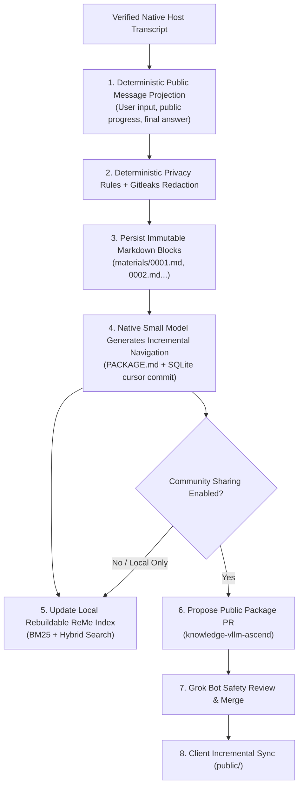

# Knowledge & Experience System Design

[中文](knowledge-system.md) · [Back to Documentation Index](README.en.md)

This document specifies MindIE Agent's public domain knowledge synchronization, local task experience projection, multi-stage privacy redaction, native small-model navigation indexing, two-layer storage, and community sharing loop. It follows the [Nine Design Principles](design-principles.en.md) and [System Architecture](architecture.en.md). The shared runtime implementation lives in [`mindie-agent/knowledge`](https://github.com/mindie-agent/knowledge), and the public `vLLM-Ascend` corpus lives in [`mindie-agent/knowledge-vllm-ascend`](https://github.com/mindie-agent/knowledge-vllm-ascend).

---

## 1. Core Design Goals

1. **Complete Primary Text, Never Replaced by Summaries**: Selecting and redacting public conversation turns is performed entirely by deterministic code and saved as immutable, ordered Markdown blocks (`materials/0001.md`, `0002.md`, ...). No LLM rewrites the body text or truncates the middle of long tasks.
2. **Lightweight Retrieval Navigation for On-Demand Reading**: Each adapter uses its lightweight native model (with LangMem) strictly to generate fallible block titles, summaries, and task-level navigation (`PACKAGE.md`), enabling Agents to inspect the task outline first and read specific blocks on demand.
3. **Two-Layer Isolation with a Unified Package Format**: Curated public domain knowledge (`public/`) and private local task records (`local/`) are physically separated on disk while sharing the same `mindie-material-task/1` package layout and rebuildable ReMe retrieval index.
4. **Fail-Closed Privacy & Consent**: No collection occurs without configured consent or when explicitly disabled. Deterministic privacy rules and Gitleaks scanning run before disk persistence, model indexing, and external publication.
5. **Advisory Knowledge & Independent Usefulness Feedback**: Retrieval hits or public merges never grant decision authority. Consuming tasks can independently record `helpful` / `not_helpful` feedback after actual use.

---

## 2. Pipeline & Lifecycle



### 2.1 Deterministic Transcript Projection

- The host adapter reads only the explicitly named, ownership-verified native task transcript.
- Only three categories of public messages survive projection: **User Input**, **Public Assistant Progress**, and **Final Answers**.
- Raw tool call arguments/outputs, hidden reasoning traces, system-injected instructions, and duplicate host wrapper events are deterministically stripped.

### 2.2 Privacy Redaction & Safety Gate

- Before any body bytes are written to disk, passed to the indexing model, or packaged into a public PR, `mindie_knowledge.redact` and Gitleaks scanning are enforced.
- Credentials, tokens, private keys, private IPv4 ranges, SSH `user@host` endpoints, local user home directory paths, and email addresses are detected and redacted or blocked.
- Rule-based redaction complements rather than replaces project-scope consent: only tasks within the user's explicitly authorized project scope are admitted.

### 2.3 Immutable Blocks & Small-Model Navigation

- Complete redacted turns are split sequentially into immutable `mindie-material-block/1` files (`materials/0001.md`, `0002.md`, ...).
- The adapter invokes its lightweight native model to produce titles and retrieval summaries for new blocks and update the task manifest `PACKAGE.md` (`mindie-material-task/1` embedding a `mindie-entry/3` header).
- Long tasks advance incrementally via durable cursors without arbitrary task-size truncation limits. If an indexing call fails, local blocks are preserved and the unfinished stage is reported honestly without faking completion or replaying uncertain paid calls.

---

## 3. Package Layout Specification

Both local experience packages and public packages in [`knowledge-vllm-ascend`](https://github.com/mindie-agent/knowledge-vllm-ascend) reside under `tasks/<64-hex-task-hash>/`:

```text
tasks/<task_hash>/
├── PACKAGE.md           # Task manifest (mindie-material-task/1 + mindie-entry/3 header, summary, and block table)
└── materials/
    ├── 0001.md          # Ordered redacted conversation block 1 (mindie-material-block/1)
    ├── 0002.md          # Ordered redacted conversation block 2
    └── ...
```

- **Task Navigation Read**: Reading `tasks/<task_hash>` returns the task summary, applicability `conditions`, and block outline from `PACKAGE.md`.
- **Block Read**: Reading a specific block reference returns that exact block body, its file hash, and adjacent block references so the Agent only loads the context it needs.

---

## 4. Authoritative State, Derived Indexes, and Feedback

- **Authoritative Store vs. Derived Index**:
  - **Markdown files** are the sole authoritative store for body text.
  - **SQLite** stores compact cursors, queues, consent bindings, and external operation outcomes (including `unknown` receipts).
  - **ReMe** maintains an in-process derived search index that can be rebuilt from authoritative Markdown files at any time. Missing or corrupted SQLite state fails visibly while preserving all Markdown body files.
- **Literal Citations**: Literal citations inside block bodies participate in search grouping only when the cited source independently matches the query terms; citation counts never confer truth certification.
- **Independent Usefulness Feedback**: After consulting an entry in a real task, the consuming Agent may optionally submit `helpful` or `not_helpful` feedback with a brief explanation to inform retrieval ranking and corpus maintenance.
