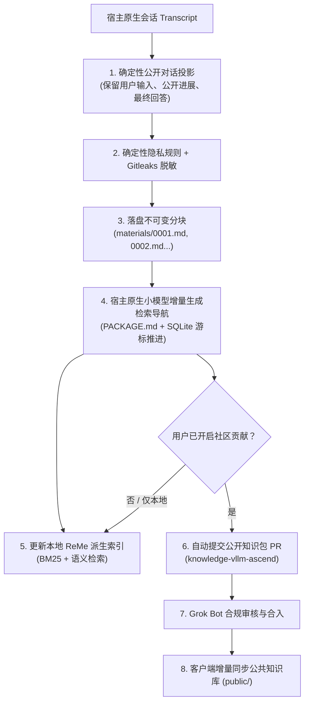

# 知识与经验闭环设计（Knowledge & Experience System）

[English](knowledge-system.en.md) · [返回文档索引](README.md)

本文定义 MindIE Agent 的领域知识同步、本地任务经验投影、多层隐私脱敏、原生小模型导航索引、双层存储与社区分享闭环规范。本设计遵循[九条设计原则](design-principles.md)与[系统架构](architecture.md)，具体运行时实现位于 [`mindie-agent/knowledge`](https://github.com/mindie-agent/knowledge)，首个领域公开语料库位于 [`mindie-agent/knowledge-vllm-ascend`](https://github.com/mindie-agent/knowledge-vllm-ascend)。

---

## 1. 核心设计目标

1. **正文真实完整，绝不用摘要替代正文**：公开对话的正文筛选与脱敏完全由确定性程序完成，保存为不可变的有序 Markdown 分块（Block），不调用大模型改写正文，也不对长任务做首尾截断。
2. **轻量检索导航，辅助按需精读**：通过宿主适配器自身的轻量原生小模型（配合 LangMem）为每个新增分块生成可纠错的标题、摘要与短导航（`PACKAGE.md`），帮助 Agent 先浏览任务脉络，再按需精确读取具体分块。
3. **双层物理隔离与统一检索格式**：公共领域知识（`public/`）与本地私有任务经验（`local/`）物理隔离存储，但采用统一的 `mindie-material-task/1` 知识包格式与 ReMe 派生检索索引。
4. **隐私安全默认关闭外发（Fail-Closed）**：未配置贡献授权或显式停用时不采集；落盘、索引与外发前执行确定性隐私规则与 Gitleaks 扫描，任何未通过脱敏校验的内容严禁外发。
5. **知识与经验仅供参考，独立记录有用性反馈**：检索命中或合入公开库不赋予条目决策权威；消费方任务在实际使用后可独立提交 `helpful` / `not_helpful` 反馈。

---

## 2. 数据流与生命周期



### 2.1 确定性公开对话投影（Transcript Projection）

- 宿主适配器仅读取当前已验证归属的原生任务 Transcript。
- 仅保留三类公开消息：**用户输入（User Input）**、**助手公开进展（Public Assistant Progress）** 与 **最终回答（Final Answer）**。
- 工具调用原始入参/返回载荷、隐藏思维链（Reasoning）、系统注入提示词以及宿主的重复包装事件全部在投影阶段剥离。

### 2.2 隐私脱敏与安全边界（Redaction & Safety Gate）

- 在正文字节写入磁盘、送入索引小模型或生成外发 PR 之前，强制运行 `mindie_knowledge.redact` 与 Gitleaks 扫描。
- 自动识别并拦截凭证、Token、私钥、内网 IPv4 地址段、SSH `user@host` 端点、本地用户主目录路径（如 `/Users/...`、`/home/...`、`C:\Users\...`）以及邮箱地址。
- 规则脱敏不能代替用户的项目范围授权：只有用户明确授权的业务项目范围才允许进入采集与外发流程。

### 2.3 不可变分块与小模型检索导航（Blocks & Navigation）

- 完整脱敏正文按序切分为不可变的 `mindie-material-block/1` 文件（`materials/0001.md`、`0002.md` 等），分块内容一经生成在其标识下不可变。
- 适配器调用原生轻量模型为新增分块生成标题、检索摘要，并更新任务级清单 `PACKAGE.md`（`mindie-material-task/1`，内嵌 `mindie-entry/3` 元数据头）。
- 长任务采用增量游标分段推进，无任务总长度截断阈值；若小模型调用失败，保留已落盘的分块正文并如实报告索引未完成阶段，绝不伪造完成或自动重放未知的付费调用。

---

## 3. 知识包结构规范（Package Format）

无论是本地经验目录还是 [`knowledge-vllm-ascend`](https://github.com/mindie-agent/knowledge-vllm-ascend) 中的公开任务包，每个任务知识包均位于 `tasks/<64位任务哈希>/` 目录下：

```text
tasks/<task_hash>/
├── PACKAGE.md           # 任务级清单（mindie-material-task/1 + mindie-entry/3 头、整体摘要与分块目录）
└── materials/
    ├── 0001.md          # 第 1 个有序脱敏对话分块（mindie-material-block/1）
    ├── 0002.md          # 第 2 个有序脱敏对话分块
    └── ...
```

- **读取任务导航**：读取 `tasks/<task_hash>` 返回 `PACKAGE.md` 中的任务摘要、适用条件（`conditions`）与分块导航列表。
- **按需读取分块**：读取具体分块引用（如 `tasks/<task_hash>#0001`）精确返回该分块正文、文件哈希及相邻分块引用，避免一次性将长任务的全部对话塞入上下文。

---

## 4. 权威状态、派生索引与反馈机制

- **权威存储与派生索引分离**：
  - **Markdown 文件**是正文的唯一权威来源。
  - **SQLite** 保存紧凑的准入游标、队列、授权归属与外部操作回执（包括 `unknown` 未决状态）。
  - **ReMe** 在进程内维护可随时从权威 Markdown 重建的派生检索索引。若 SQLite 权威库缺失或损坏，系统显式报错并保护既有正文文件，绝不将其当作“首次使用”静默清空。
- **字面引用与聚合**：分块中的字面引用仅在被引用源当前正文独立命中查询词项时参与检索分组展示；引用次数不作为真理性或权威性背书。
- **独立有用性反馈**：消费方任务在实际参考某条知识或经验后，可按需记录 `helpful` 或 `not_helpful` 反馈及简要原因，帮助后续检索排序与语料维护演进。
