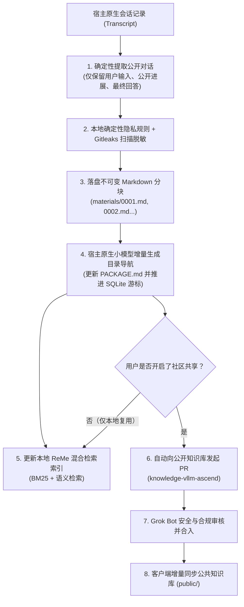

# 知识与经验闭环设计（Knowledge & Experience System）

[English](knowledge-system.en.md) · [返回文档中心](README.md)

本文介绍 MindIE Agent 如何将开发者在昇腾（Ascend）NPU 上的真实排障与开发过程转化为可复用的结构化知识包，同时保障本地隐私安全与检索效率。

- 遵循准则：[工程设计原则与演进准则](design-principles.md) · [系统架构与模块分工](architecture.md)
- 核心引擎仓库：[`mindie-agent/knowledge`](https://github.com/mindie-agent/knowledge)
- 公共领域语料库：[`mindie-agent/knowledge-vllm-ascend`](https://github.com/mindie-agent/knowledge-vllm-ascend)

---

## 1. 为什么这样设计？（五大核心理念）

1. **保留原汁原味的排障正文，绝不用摘要代替正文**
   - 很多经验系统喜欢让大模型把一次排障改写成几句话的“总结”，结果把最关键的报错栈、寄存器状态和排查转折点全丢了。
   - 在 MindIE Agent 中，公开对话的提取和脱敏完全由**确定性程序**完成，原样保存为不可变的有序 Markdown 分块（`materials/0001.md`、`0002.md`...），绝不让大模型篡改正文，也绝不对长任务做掐头去尾的截断。
2. **用原生小模型做“目录导航”，实现按需精读**
   - 为了不让 Agent 每次检索都被长篇对话撑爆上下文，宿主插件会调用自带的轻量原生小模型（配合 LangMem），专门为每个分块生成标题、检索摘要和一份任务总目录（`PACKAGE.md`）。
   - Agent 检索时先看 `PACKAGE.md` 了解来龙去脉，再按需精准读取某一个具体分块（如 `#0002`）。
3. **公共知识与本地经验双层隔离，一套格式通吃**
   - 社区公共知识库（`public/`）和本机私有排障经验（`local/`）在磁盘上物理隔离存储，但共享完全一致的 `mindie-material-task/1` 知识包结构与 ReMe 混合检索索引。
4. **隐私安全默认关闭外发（Fail-Closed）**
   - 未经用户明确授权项目范围，绝不采集；任何正文字节在写入磁盘、送给索引小模型或发起公开 PR 之前，都必须通过确定性隐私脱敏规则与 Gitleaks 密钥扫描。
5. **知识仅供参考，支持真实使用后的独立反馈**
   - 任何经验条目都只提供参考线索，不具备强制决策权威。Agent 在实际参考某条经验解决问题后，可以按需提交 `helpful` 或 `not_helpful` 反馈，推动知识库持续优胜劣汰。

---

## 2. 从一次对话到知识包的全流程



### 2.1 第一步：确定性提取公开对话（Transcript Projection）
- 宿主插件只读取已核实归属的当前任务 Transcript，绝不乱扫历史会话。
- **只保留三类公开内容**：用户输入（User Input）、助手公开进展（Public Assistant Progress）与最终回答（Final Answer）。
- **自动剔除内部噪音**：工具调用的原始大段输出、隐藏思维链（Reasoning）、系统注入提示词以及宿主的重复事件包装都会被干净剥离。

### 2.2 第二步：多层隐私脱敏与安全门禁（Redaction & Safety Gate）
- 在写入磁盘、送入小模型或外发 PR 前，强制执行 `mindie_knowledge.redact` 与 Gitleaks 扫描。
- 自动识别并抹除：API Key / Token、私钥、内网 IPv4 地址段、SSH `user@host` 敏感到端、本地个人主目录路径（如 `/Users/xxx`、`/home/xxx`、`C:\Users\xxx`）以及邮箱地址。
- **双重保险**：规则脱敏不能代替用户授权——只有处于用户明确授权项目范围内的任务才会进入采集流程。

### 2.3 第三步：不可变分块与小模型目录生成（Blocks & Navigation）
- 脱敏后的对话按顺序切分为不可变的 `mindie-material-block/1` 文件（`materials/0001.md`、`0002.md` 等）。
- 轻量小模型读取新增分块，生成简明标题、摘要与适用条件（`conditions`），写入任务清单 `PACKAGE.md`。
- 如果小模型调用因网络等原因失败，已落盘的正文分块完好保留，并如实记录“待索引”状态，绝不伪造完成，也不会盲目重复发起未知状态的付费调用。

### 2.4 第四步：基于 `gh` 通道与按需个人 Fork 的自动 PR 发布与只读对账
- 当用户已开启社区贡献时，发件箱统一通过已认证的 **`gh`（GitHub CLI）通道**（Git 推送绑定 `!gh auth git-credential`，PR 接口调用 `gh api`）将知识包分支推送到用户账号下的 `<GH_USER>/<repo>` Fork 仓库（如 `<GH_USER>/knowledge-vllm-ascend`），并向目标公开知识库（如 [`knowledge-vllm-ascend`](https://github.com/mindie-agent/knowledge-vllm-ascend)）发起或更新跨 Fork PR。
- **按需 Star 与 Fork 目标知识库**：安装阶段仅 Fork `mindie-agent/mindie-agent` 统一入口仓，不预置 Fork 任何知识库；当用户在首次引导或后续设置中明确开启社区贡献（`contribute`）并指定目标公开知识库 `<owner/repo>`（默认 `mindie-agent/knowledge-vllm-ascend`）时，Agent 按需执行 `gh api -X PUT /user/starred/<owner/repo>` 与 `gh repo fork <owner/repo> --clone=false --remote=false`，并将配置中的 `fork` 绑定为 `<GH_USER>/<repo>`，确保非组织成员也能开箱即用地推送贡献分支并发起 PR。
- 若网络超时导致 PR 写入回执未知（`unknown`），下次处理优先通过 `gh api` 只读对账远端 PR 状态，绝不盲目重推或强制覆盖（`--force`）。

---

## 3. 任务知识包长什么样？（Package Format）

无论是本机沉淀的经验，还是 [`knowledge-vllm-ascend`](https://github.com/mindie-agent/knowledge-vllm-ascend) 中的公开条目，每个任务知识包都存放在 `tasks/<64位任务哈希>/` 目录下：

```text
tasks/<task_hash>/
├── PACKAGE.md           # 任务总目录（含 mindie-entry/3 元数据头、整体摘要、适用条件与分块导航表）
└── materials/
    ├── 0001.md          # 第 1 个有序脱敏对话分块（mindie-material-block/1）
    ├── 0002.md          # 第 2 个有序脱敏对话分块
    └── ...
```

- **先看目录（Task Read）**：查询 `tasks/<task_hash>` 返回 `PACKAGE.md`，让 Agent 一眼看清这个任务解决了什么问题、适用什么软硬件条件、共有几个分块。
- **按需精读（Block Read）**：查询 `tasks/<task_hash>#0001` 精确返回第 1 个分块的正文、文件哈希与上下相邻分块编号，既拿到了完整上下文证据，又极其节省 Token。

---

## 4. 本地数据安全与派生索引

- **Markdown 正文是唯一权威**：
  - 磁盘上的 Markdown 文件是正文的唯一权威来源；
  - SQLite 只存轻量游标、队列、授权状态和外发回执；
  - ReMe 检索索引完全是派生数据，随时可以从 Markdown 正文一键重建。哪怕状态库损坏，系统也会立即显式报错并保护所有 Markdown 文件，绝不误删任何一篇经验正文。
- **字面引用与反馈演进**：
  - 分块中的引用仅在被引用源自身也匹配当前搜索词时参与聚合展示，引用次数不代表“官方认证”。
  - 消费方任务在实际用过某条经验后，可随时调用反馈接口标记 `helpful` 或 `not_helpful`，帮助后续检索排序与社区内容维护。
