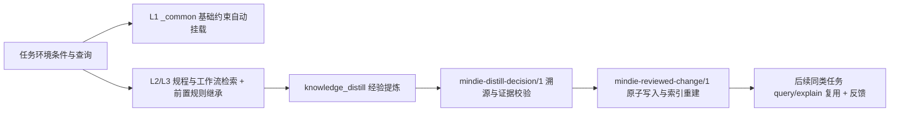

# 知识与经验系统

[English](knowledge-system.en.md) · [返回文档中心](README.md)

MindIE Agent 将可复用的昇腾研发经验组织为带适用条件、代码来源和版本号的结构化知识条目（Knowledge Units），同时支持在本地保留脱敏后的排障会话记录供溯源查阅。当前版本重点覆盖 **vLLM-Ascend 与昇腾算子**两个核心领域，并配套提供推理核心机制、分布式通信、可观测性与算子兼容性知识库，服务于**新模型适配（0-day Bring-up）、模型与算子性能调优、运行时故障排查**三类场景。

检索引擎与经验提炼运行时由 [`knowledge`](https://github.com/mindie-agent/knowledge) 维护；领域知识分别存放在 [`knowledge-vllm-ascend`](https://github.com/mindie-agent/knowledge-vllm-ascend)、[`knowledge-operators`](https://github.com/mindie-agent/knowledge-operators) 等内容仓库中。整体组件分工见[系统架构](architecture.md)，会话与授权管理见[宿主边界与任务生命周期](harness-boundary-and-lifecycle.md)，上下文预算与探索机制的扩展设计见[上下文分层、经验演化与开放探索设计](knowledge-context-and-exploration.md)。

知识检索遵循**按需信息缺口决策（Information-Gap Retrieval）**：当本地代码、调用栈与验证命令已经足以直接推进修复时，无需强制发起知识查询；当任务存在跨模块排障、硬件规范或架构选型缺口时，再按需调用 `knowledge_query` 检索候选，并仅对选中的高价值条目调用 `knowledge_read_ref` 精确展开，避免无关上下文挤占推理窗口（详见 [2026-10-29 按需知识检索验收记录](audits/2026-10-29-knowledge-p0.md)）。

本文说明当前已落地的三套核心机制：
1. **底层约束基线与前置规则继承（`L1/L2` Foundation & `inherits_from`）**：按芯片型号与仓库条件自动挂载 `_common` 硬件约束与测量规范，并确保上层规程所依赖的前置规则完整注入。
2. **经验沉淀与跨任务检索复用（`L3` 经验闭环）**：将实机验证通过的排障或适配结论经 `knowledge_distill` 校验后生成知识变更（`reviewed_change`），供后续同类任务检索复用与投票反馈。
3. **跳出既有思路的独立探索模式（`L4` 独立探索，`mode="explore"`）**：当常规调优连续受阻时，自动剥离常规排障工作流（`L3`）以避免思维定势，仅挂载底层硬件约束、实测瓶颈与候选代码变换，在独立子会话中执行“CPU 并行编译 → NPU 串行计时 → 四步验证（编译、精度、性能、留一法消融）”，并输出实验台账（`experiment-ledger.jsonl`）与进度摘要（`PROGRESS.md`）。

## 1. 结构化知识条目与脱敏任务记录

知识仓库中存放两类互补内容：

| 内容类型 | 工程用途 | 权威存储路径 |
| --- | --- | --- |
| **结构化知识条目**（`mindie-graded-unit/1`） | 表达带适用条件的硬件约束、诊断步骤、排障工作流或代码优化方案，支持按条件检索、规则继承与版本反馈 | 领域仓库内 `<domain_path>/<unit_id>.md` 的正文与 Front-matter 元数据 |
| **脱敏任务记录**（`mindie-material-task/1`） | 保存单次排障/调优任务的脱敏会话记录与关键过程，作为提炼结构化知识条目的原始依据 | `tasks/<task_hash>/index.md` 与只读分块 `blocks/<block_hash>.md` |

脱敏任务记录经确定性正则与 Gitleaks 脱敏后，按约 16KB 切分为数据块，由宿主轻量模型生成标题与目录索引，不篡改原始记录正文。结构化知识条目可由已审核的任务记录、源码提交、硬件文档或实机实验记录提炼生成，必须保留明确的代码或实验来源，且证据强度（`evidence_strength`）不得超出原始依据。

## 2. 知识类别（`category`）与工程层级（`tier: L1..L4`）

知识库中的条目按**工程用途（`category`）**分为四类（Schema 中的 `tier: L1..L4` 字段与四类 `category` 一一对应）：

| 知识内容类别（`category`） | 对应层级字段（`tier`） | 适用内容 |
| --- | --- | --- |
| **`axiom` / `measurement`**（硬件约束与测量基线） | `tier: L1` | 有硬件手册或框架契约支撑的硬性约束（如内存对齐、静态图捕获要求），或在声明条件下复现的性能测量规范 |
| **`sop`**（诊断与操作规程） | `tier: L2` | 具体场景下的故障定位步骤、Profiling 采集分析方法、模块适配或精度比对操作规程 |
| **`workflow`**（排障与调优决策流） | `tier: L3` | 包含多个观测分支、判断条件与收敛步骤的排障/调优决策流程（在 `mode="explore"` 独立探索模式下会自动剥离） |
| **`mutator`**（代码优化变换） | `tier: L4` | 带有源码定位、适用前提、回退保护（Fallback）与消融验证记录的算子/图/通信代码优化方案 |

- **证据可靠度独立标记**：`category` / `tier` 仅区分知识条目的用途，不代表结论置信度。证据成熟度由 `evidence_strength` 单独标记为 `hardware_spec`（硬件规范/代码契约）、`reproduced_empirical`（多轮复现实测）、`single_observation`（单次实测观察）或 `hypothesis`（基于源码推导的优化假设）；其中 `L1` 基础约束仅接受 `hardware_spec` 或 `reproduced_empirical`。
- **轻量身份与溯源引用**：每个知识条目使用稳定的 `id` 与递增整数 `revision` 标识；源码来源直接绑定仓库名、Git commit 与文件路径，实验来源绑定运行 ID。

## 3. 底层约束自动挂载与前置规则继承（`_common` & `inherits_from`）

### 3.1 路由索引构建、多级目录细分与继承图校验

`RoutingIndex.from_root(root)` 扫描领域仓库下的 Markdown 知识条目并构建检索索引，同时计算每个条目的 `inherits_from` 依赖闭包：
- **支持任意深度的层级目录细分（`<domain>/<subdomain>/<topic>/<subtopic>/<unit_id>.md`）**：随着冷启动语料与实战经验的持续增长，知识目录可按技术子域、算子族、编译器方言或故障机制向下无限细分；`query(..., domain_path=...)` 原生支持任意层级的目录前缀匹配（`preferred_domain` 加权），而分片拓扑规划器（`shard_plan`）按叶子目录直接父分支（`parts[:-1]`）独立评估容量（叶子上限 `25` 单元 / `25,000` 估算 tokens、直接父子树上限 `120` 单元、单仓联邦上限 `5,000` 单元），通过向下细分即可自然消解目录膨胀；
- **完整继承图校验**：父条目必须存在，缺失依赖或出现循环继承时立即报错；
- **前置规则无损注入**：继承关系以稳定拓扑顺序保存，检索时每个父条目**独立核对自身的适用条件**后，将完整正文注入结果的 `inherited_rules` 字段，绝不返回被截断的半条规则。

`inherits_from` 只声明执行本单元必需的前提，不表示主题归类或一般参考关系。
通用的主机侧解析、时间区间统计和通信日志排障规程，应依赖相应的软件与数据语义，
不因同属昇腾领域而继承特定 SoC 的对齐规则或某次采集的机器拓扑。涉及 UB/L1
对齐、设备计数器或特定互联行为的规则仍须满足其实际硬件条件。若一个规程同时包含
通用步骤和设备专用步骤，应拆分适用范围；不能由运行时按 `L2/L3` 层级忽略父条件，
也不能由调用方补造 `soc` / `npu_model` 来获得正文。

### 3.2 适用条件匹配与基础约束自动挂载（`foundation_baseline`）

调用 `query(query, conditions=..., domain_path=..., token_budget=..., limit=...)` 时，检索引擎对每个候选条目执行条件匹配（`match_conditions`）：
- 条目声明的所有硬性条件必须同时满足；需要绑定完整输入组合时使用 `exact_set`，防止把不同 Workload 的 Shape 与数据类型交叉错配；
- 当查询尚未观察到某项环境事实时，相关条目保留为条件未知，默认不注入上下文（仅在显式传入 `include_unknown=True` 时列出供参考）。

当查询传入了当前硬件与仓库条件（`conditions`），即使搜索关键词十分生僻，只要 `_common` 目录下的 `L1` 基础约束条目满足当前硬件/仓库条件，检索引擎就会以 `route == 'foundation_baseline'`（固定基线分 `0.05`）自动挂载它们：
- 例如在 `vllm-ascend` 下传入 `conditions={'repository': 'vllm-ascend', 'npu_model': 'Ascend910B4'}`，冷查询也会自动挂载底层运行时与精度门禁基线：
  - `unit-vllm-ascend-npu-runtime-and-graph-invariants`
  - `unit-vllm-ascend-verification-and-state-parity-gates`
- 在算子领域查询时，冷查询会自动挂载昇腾片上内存对齐与算子性能测量基线：
  - `unit-ascend-910b-a3-memory-alignment-and-tiling-axioms`
  - `unit-ascend-operator-roofline-and-four-view-measurement`

### 3.3 Token 预算分配、`known_refs` 去重与 `inherited_rules`

每条检索命中返回 `id`、`revision`、`tier`、`category`、`evidence_strength`、`conditions`、`provenance`（含 `affected_components` 受影响组件与 `rejected_history` 已排除负向尝试记录）、`applicability`、`route`、`score` 与 `inherited_rules`。Token 预算（`token_budget`）优先保障匹配的 `L1` 前置约束完整返回，再分配给上层工作流正文；超出预算的条目记录在 `excluded_budget` / `budget_excluded` 中，确保长工作流不会挤掉关键的硬件对齐或数值精度前提。

### 3.4 批量精确版本精读（`refs` / `known_refs`）、昇腾符号子词检索与声明式检索评测

`GradedRepository.query` 为每条命中生成精确引用（`ref`、`unit_ref`、`feedback_ref`），并通过 `feedback.observe` 记录本次实际返回的 `unit_id` 与 `revision`。调用 `explain`（或 MCP `knowledge_read_ref`）时支持单条或批量 `refs` 精确版本读取，共用完整的 `inherits_from` 依赖闭包与总响应预算（`token_budget`），并支持传入当前会话已完整加载的 `known_refs` 避免重复展开相同前置规则；执行任务后可通过 `feedback.record_vote` 提交 `helpful` / `not_helpful` 反馈，为后续修订提供依据。

为兼顾精确 API 匹配与跨概念召回，检索引擎吸收了 [CANNBot Knowledge](https://gitcode.com/cann/cannbot-knowledge) 与 `vllm-ascend` 生态的**昇腾标识符子词切分（Subword Tokenization）与声明式检索评测**机制：
- **复合符号与子词双轨索引**：针对 `DataCopyPad`、`PipeBarrier`、`SetFlag`/`WaitFlag`、`GatedDeltaNet`、`Ascend910B4`、`npu_fused_infer_attention_score` 以及 `npugraph_ex`、`torchair`、`msmodelslim`、`dspark`、`dflash`、`xlite`、`eplb`、`hixl`、`lmcache`、`mooncake`、`sfa_v1`、`dsa_v1`、`mla_v1`、`fa3_v1`、`quarot`、`teacache`、`mindiesd`、`vllm_omni`、`rainfusion`、`rf_v2`、`rf_v3`、`ada_bsa`、`eagleqbsa`、`ditcache`、`cache_dit`、`taylorseer`、`code2wav`、`token2wav`、`llm2tts`、`flashgen`、`taehv`、`yuanrong`、`msmemscope`、`msprof`、`msprobe`、`serving_cast`、`tensor_cast` 等复合标识符，在保留完整复合符号精确加权的同时自动拆分 constituent 子词，避免因大小写或复合词形态差异漏检；
- **声明式检索评测套件（`evaluate_retrieval_suite`）**：支持按声明式用例（查询词、环境 `conditions`、`mode="standard"|"explore"`、期望命中 `expected_unit_ids`、禁出条目 `forbidden_unit_ids`）确定性度量 **`Recall@K`**、**`MRR`（平均倒数排名）**、**`_common` 基础约束挂载率（`foundation_baseline_rate`）** 以及探索模式下 `L3` 常规工作流的剥离完备率。
- **七大领域知识库覆盖规模（450 个结构化分级知识单元）**：
  - `knowledge-vllm-ascend`（`91` 单元）：覆盖 `vllm-ascend` 15 篇架构设计、30 篇特性指南、45+ 官方模型教程、30+ 源码子系统、46 个 0-day 模型分支家族、PD 分离交接与精度验证（`L1–L3`），以及 `vllm-project/vllm-omni` 多阶段全模态流水线（`AsyncOmni` / `Thinker -> Talker -> Code2Wav`、`NPUARModelRunner`、TTS/Audio/Duplex 与 DiT 融合推理）；
  - `knowledge-infer-core`（`109` 单元）：覆盖 `cann-recipes-infer` 26 个模型家族优化 Recipe、16 个 `model-infer-*` Skill、公共加速模块、`Ascend/msagent` 量化/精度诊断工作流，以及 `Ascend/MindIE-SD`（`mindiesd`）扩散模型稀疏注意力（`RainFusion` / `Ada-BSA` / `EagleQBSA`）、跨步缓存（`DiTCache` / `CustomCache`）、3D 因果 VAE/TAEHV 状态切片解码与动态时步量化契约；
  - `knowledge-operators`（`105` 单元，含 `15` 个带消融回执的 `L4` Mutator）：覆盖 AscendC / Triton-Ascend / TileLang / PyPTO / Catlass 算子开发、`cann/ops-transformer` 融合算子契约、模型专属自定义算子，以及 `MindIE-SD` 自定义稀疏注意力/Catlass `matmul_add`/Triton 算子与子图融合流水收益分析；
  - `knowledge-infer-distributed`（`39` 单元）：覆盖 `Mooncake`、`dynamo`、HCCL 多机集合通信、SHMEM 对称内存、PD/EPD 分离传输，以及多机 `DP/TP/EP/PP/DCP/DSA-CP/PCP`、`MindIE-SD` / `vllm-omni` 混合序列并行（Ulysses + Ring + CFG）、FlashAttention + AllToAll 功耗降频治理、动态剪枝 EPLB、$c/f$ 通信掩盖评估与 `YuanrongConnector`；
  - `knowledge-infer-observability`（`39` 单元）：覆盖 `msmodeling`、`msprof-analyze`、`msmemscope`、`mskpp`、`ops-test-kit`（TTK）、服务级 Profiling，以及 `MindIE-SD` 窗口化交错 A/B/A 性能门禁（`perf-gate`）与三级图像/视频生成精度门禁（`accuracy-gate`）；
  - `knowledge-infer-ops-compat`（`34` 单元）：覆盖 AutoFuse、GE/TorchAir 图编译、SuperKernel、多流/预取、容器驱动安装、Volcano/MindIE Motor 部署，以及 `MindIE-SD` `torch_npu._inductor` Pattern Pass 开发与“先 API 替换、后入图编译”两阶段集成规程；
  - `knowledge-agent-engineering`（`33` 单元）：覆盖多智能体模型调优编排、SOTA 探索循环、`ais_bench` 核心集压缩、Git Bisect 自动修 Bug、安全审计，以及 `MindIE-SD` S0–S6 扩散模型端到端自动优化闭环与知识库自检（`kb-lint`）。

## 4. 经验提炼与跨任务复用闭环

### 4.1 触发时机与输入脱敏

`knowledge_distill(inputs, task_state, domain=...)` 仅在任务达到已验证里程碑（`verified_milestone`）或全部完成（`completed`）时触发。调用方传入经筛选的实验记录、运行清单、脱敏会话记录或源码引用（每项标明 `kind`、`outcome`、`source_locator` 与复现次数）。`prepare_request` 先执行确定性隐私脱敏与 Gitleaks 扫描，对尚未跑完（`in_flight`）或空输入直接返回 `noop`。

### 4.2 证据强度校验与本地准入

模型基于脱敏材料生成提炼提案（`mindie-distill-decision/1`）后，`validate_decision` 在本地执行严格校验：
- 条目的来源引用（`provenance.source_locator`、`source_digest`、`evidence_refs`）必须真实存在于本次提交的输入材料中，禁止凭空编造来源；
- `evidence_strength` 不得夸大：`L1` 仅允许 `hardware_spec` 或经多轮验证的 `reproduced_empirical`；`L4` 代码优化若标为实测复现，必须附带基线绑定且组合验证通过的消融实验记录（Ablation Receipt）。

审核通过的变更通过 `mindie-reviewed-change/1` 原子落盘并重建路由索引：新条目从 `revision: 1` 开始，正文实质更新时递增版本号，并在写入前再次校验整张继承图无缺失依赖或循环引用。

## 5. 独立探索模式（`mode="explore"`）与四步消融验证

当常规排障/调优工作流（`L3`）连续多次未能达成性能目标，而实测耗时距离硬件 Roofline 理论下界仍有明显优化空间时，系统支持切换至**独立探索模式**：
- 去偏置上下文构建集中在 [`mindie_knowledge.graded.explore`](https://github.com/mindie-agent/knowledge)（通过 `knowledge_query(..., mode="explore")` 暴露给各端插件）；
- 候选方案调度、多输入泛化校验与留一法消融验证位于 [`mindie_bench.runner.rsi_explorer`](https://github.com/mindie-agent/mindie-bench) 与 [`mindie_bench.runner.rsi_campaign`](https://github.com/mindie-agent/mindie-bench)。

### 5.1 常规调优停滞检测

`assess_stagnation` 与 `should_escalate_to_rsi(l3_attempts, max_stalled_attempts=2)` 根据实验结果判断是否需要切换至独立探索模式：只有连续多次有效实验未能通过精度、消融或目标加速比时才累计停滞计数；编译报错或测量异常会先引导修复当前实现，不计入策略停滞。

### 5.2 屏蔽常规工作流定势（`build_exploration_context`）

调用 `knowledge_query(..., mode="explore")`（内部对应 `build_exploration_context`）时：
- **彻底剥离 `L3` 常规工作流正文**（仅在 `stripped_l3_ids` 中记录被屏蔽的 ID），防止 Agent 沿着已经卡住的常规套路原地打转；
- **保留核心事实与变换空间**：自动挂载匹配的 `L1` 硬件约束基线、`L2` 实测瓶颈证据（含被剥离 `L3` 条目所继承的底层 `L1/L2` 前提）以及 `L4` 候选代码优化变换（`mutator`）；
- **按条件挂载避坑记录（`conditional_avoid`）**：仅提取与当前硬件、输入 Shape 和软件前提完全一致的已失败方案及其原因，供 Agent 避开无效尝试（当硬件或输入 Shape 改变时，允许重新尝试）；
- **生成独立子会话简报（`subagent_fact_pack`）**：输出结构化事实包与精简 Markdown 提示词（`prompt_brief`），方便宿主客户端开启不受历史对话干扰的独立子会话（Fresh Sub-Context）。

### 5.3 CPU 并行编译与 NPU 串行计时调度

为避免多个候选方案同时抢占 NPU 导致计时失真，`plan_rsi_compile_and_timing` 将验证分为两个阶段：

| 阶段 | 是否并行 | 申请资源 | 调度规则 |
| --- | --- | --- | --- |
| **编译阶段（`compile`）** | 并行 | `npu_count: 0` | 最多并发运行 `max_compile_slots` 个纯 CPU 编译任务，快速筛除语法与编译错误 |
| **计时阶段（`timing`）** | 串行 | `devices: [0]` | 仅对编译通过的候选方案逐一独占 NPU 卡执行精度比对与性能计时 |

### 5.4 四步验证标准与实验进度持久化

每个候选优化方案依次通过四步验证（`evaluate_rsi_candidate_gates` / `run_rsi_gate_campaign`）：
1. **编译与多输入泛化校验（Gate 1）**：不仅检查目标 Case 的编译与数值精度，还会用一组未在调优提示中暴露的泛化输入 Shape 与数值分布进行测试（`evaluate_hidden_input_generalization`）。任何泛化输入出现精度回退（`opt_regression`）或运行错误即判定不通过，防止针对单一 Shape 硬编码过拟合。
2. **测量有效性守卫（Gate 2）**：检查流同步、Warmup 预热、有效计时样本数以及额外 Workspace 显存开销是否在合理范围内。
3. **留一法消融实验（Gate 3，Leave-One-Out Ablation）**：当候选方案组合了多项代码改动时，通过 `verify_sequential_ablation` 逐项验证每个改动因子的独立贡献；若剔除某项改动后未经独立组合复验确认，默认保留原组合（`RETAIN`），避免误删相互配合的优化项。
4. **目标加速比与条件化归档（Gate 4）**：检查实测加速比是否达到目标阈值（默认 `1.05x`）；对于真实有效但未达目标阈值的小幅收益（例如 `1.03x`），作为带前提条件的有效观察归档保留，不误判为错误方向。

每次实验结束后，`append_ledger_and_render_progress` 会将结果追加写入 `experiment-ledger.jsonl`，并更新 `PROGRESS.md`（清晰列出当前最优方案 `Best Supported Candidate`、待验证假设 `Active Hypotheses`、已排除方向 `Refuted Directions` 与待完成实验 `Experiments To Complete`），方便长程任务随时断点续跑。

## 6. 领域隔离、隐私红线与社区贡献

- **显式领域路由**：各知识领域绑定独立的本地存储与配置；注册新领域不会自动开启会话采集或跨领域复制授权。
- **双层隐私脱敏**：所有任务记录切片、经验提炼输入与公开知识条目在落盘或外发前，均经过确定性隐私规则与 Gitleaks 扫描，确保内网 IP、本机路径、容器凭据与敏感命令参数零泄漏。
- **可控社区投递**：知识库正文以 Git 仓库中的 Markdown 文件为唯一权威来源，本地检索索引可随时从 Markdown 重建。仅当用户显式开启社区贡献开关时，发布器才会通过 `gh` 向目标知识库提交 PR。

## 7. 典型场景闭环示例

| 典型研发场景 | 知识检索、探索与沉淀闭环 |
| --- | --- |
| **`Qwen/Qwen3.5-0.8B` 新模型 0-day 适配** | 冷查询自动挂载 `_common` 底层 `L1` 运行时与精度门禁基线；定向查询返回混合线性注意力适配工作流（`workflow`）与 `GatedDeltaNet` 适配规程（`sop`）；实机跑通后经 `knowledge_distill` 生成新修订号并供后续任务复用 |
| **`GatedDeltaNet` 双卡 DP 空闲 Rank 挂死诊断** | 按 `DP=2`、`Ascend910_93` 与 `conv_state`/`ssm_state` 条件检索，直接命中多卡状态同步排障工作流与实机复现规程；修复验证后沉淀里程碑经验并记录投票反馈 |
| **`fused-rmsnorm-gate` 算子深度性能调优** | 常规调优连续受阻后切换至 `mode="explore"` 独立探索模式，自动剥离常规五阶段工作流，挂载 `L1` 内存对齐/Roofline 基线、`L2` 访存瓶颈证据、`L4` 向量化/零残差快速路径变换与已排除方向；经 CPU 并行编译、NPU 串行计时与四步消融验证后写入 `PROGRESS.md` 并回流知识库 |

## 8. 业界实践参考

本系统的知识组织与长程探索机制吸纳了以下成熟的社区工程实践：
- [CANNBot 仓群（`cannbot` / `cannbot-knowledge` / `cannbot-skills` / `cannbot-dsl` / `cannbot-sentry` / `cann-bench`）](https://gitcode.com/cann/cannbot)：昇腾算子与推理优化领域的知识卡治理（OKF v0.2 Profile、昇腾 API 子词分词、声明式检索评测）、Ascend C 同步审计（`ascendc-sync-audit`）、复杂算子 DSL 范式、Agent 轨迹双重审计（`sift` 过程合规 + 结果一致性）与硬件锚定性能评分（`HAP`）。
- [`vllm-project/vllm-ascend`](https://github.com/vllm-project/vllm-ascend)、[`vllm-project/vllm-omni`](https://github.com/vllm-project/vllm-omni)、[`Ascend/MindIE-SD`](https://gitcode.com/Ascend/MindIE-SD) 与 [`cann/cann-recipes-infer`](https://gitcode.com/cann/cann-recipes-infer)：昇腾大模型推理引擎架构（`ModelRunner V1/V2`、`ACLGraph`/`npugraph_ex`、MLA/DSA/SFA 注意力后端、ModelSlim 量化、MTP/DSpark 投机采样、动态 EPLB、PD/EPD 分离）、多阶段全模态（`Thinker -> Talker -> Code2Wav` 与 AR+DiT）流式推理、扩散模型加速（`RainFusion`/`Ada-BSA`/`EagleQBSA` 稀疏注意力、`DiTCache`/`Cache-DiT`/`TaylorSeer` 缓存、`torch_npu._inductor` 图模式与 S0–S6 自动调优门禁）及 45+ 模型家族与 Agentic 调优配方。
- [昇腾性能与诊断工具链（`Ascend/msmodeling`、`Ascend/msprof-analyze`、`Ascend/msmemscope`、`Ascend/mskpp`、`Ascend/msagent`、`Ascend/agent-skills`）](https://gitcode.com/Ascend)：解析性能与容量规划（`tensor_cast` / `serving_cast`）、15 类 Advisor 规则与集群快慢卡/慢链路归因、内存低效分配与单调泄漏取证、以及量化/精度/算子多智能体编排规程。
- [`kvcache-ai/Mooncake`](https://github.com/kvcache-ai/Mooncake) 与 [`ai-dynamo/dynamo`](https://github.com/ai-dynamo/dynamo)：以 KVCache 为中心的 PD 分离式服务架构、RDMA/HIXL 零拷贝传输引擎与前缀感知路由。
- [Hermes Skills](https://hermes-agent.nousresearch.com/docs/user-guide/features/skills)：按需加载领域操作规程，并在成功排障或纠偏后原地演进已有技能文档。
- [Anthropic Effective Harnesses for Long-Running Agents](https://www.anthropic.com/engineering/effective-harnesses-for-long-running-agents)：通过 Git 版本控制与结构化进度文件（`PROGRESS.md` + 实验台账）在多个独立上下文窗口之间接力推进长程研发任务。
- [AlphaEvolve](https://deepmind.google/blog/alphaevolve-a-gemini-powered-coding-agent-for-designing-advanced-algorithms/)：将候选方案生成与确定性实验评估解耦，依靠编译、精度与实机计时结果筛选下一轮演进方向。
