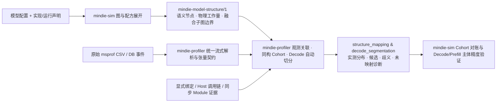

# Profiler 与 Sim 的结构复用和实测映射

[Profiler 系统设计](profiler-system.md) · [Sim 建模系统](simulation-system.md) · [系统架构](architecture.md) · [设计原则](design-principles.md) · [文档中心](README.md)

本文说明 [`mindie-profiler`](https://github.com/mindie-agent/profiler)（`v0.5.3`）与 [`mindie-sim`](https://github.com/mindie-agent/sim)（`v0.8.1`）如何共享模型结构声明、关联昇腾真机 Profiling 事件，并完成算子同构集合（Cohort）与 Decode / Prefill 主体的端到端精度对账。

模型与算子拓扑结构由 `mindie-sim` 统一维护并导出为 `mindie-model-structure/1`；原始 `msprof` CSV/SQLite 解析、张量契约提取与实测事件归因由 `mindie-profiler` 统一维护。两者通过结构化文件解耦协作，既不在 `profiler` 中维护第二套模型目录，也不在 `sim` 中维护第二套 CSV/SQLite 解析器。

---

## 1. 整体协作数据流

`mindie_sim.structure.export_structure` 复用 `target_graphs` 与 `RecipeBook.expand`，将模型调用展开为无时延的 `mindie-model-structure/1` 清单（不运行成本求解器、不加载权重或初始化设备上下文）；独立算子 DAG 则可通过 `export_op_structure` 导出相同契约。`mindie-profiler` 将原始事件解析为统一观测并关联到声明节点：



- **单向可选依赖**：`mindie-profiler` 直接读取 `mindie-model-structure/1` JSON 清单，无需导入 `mindie_sim`；`mindie-sim` 的普通仿真、图分析与结构导出同样不依赖 `mindie_profiler`，仅在调用显式 Profiling 观测导入接口时按需加载 `mindie_profiler`。

---

## 2. 结构声明与实测观测契约

| 契约对象 | 负责组件 | 核心内容与工程边界 |
| --- | --- | --- |
| **`mindie-model-structure/1`** | `mindie-sim` | 图身份（`graph_id` SHA256）、来源、阶段/范围（`phase / scope`）、节点身份、`replica / stage / layer / block / role / family`、张量契约、物理工作量签名（`physical_work / physical_signature`）与融合子图边界（`subgraphs`）；不携带预测或实测耗时 |
| **原始观测与 `observed_tensor_contract`** | `mindie-profiler` | 保留原始事件身份、`rank / device / stream`、时间区间、源文件行号/表定位符及实际导出的张量 Shape / Dtype / Format；缺失字段显式标记未知 |
| **显式绑定与 Scope 约束（`mindie-profile-bindings/1`）** | 调用方提供，`mindie-profiler` 解析 | `events` 关联具体 `event_id`；`host_scopes` 与 `module_scopes` 声明真实 Frame / Module ID 对应的节点或子图范围，并与独立事件证据求交集 |
| **同步 Module 观测（`mindie-module-trace/1`）** | `mindie-profiler` | 记录带 `npu_synchronize` 边界的模块级调用区间、原始 DB SHA256 与张量契约，用于确证单层/单模块归属 |
| **`structure_mapping` 与 `cohorts`** | `mindie-profiler` | 通过 `mindie-profiler analyze --structure`（MCP `analyze_profiling`）输出三态拓扑对齐（`aligned / declared_only / unattributed_observed`）、节点级绑定（`bound / candidate / ambiguous / unmapped`）、结构分组汇总（`structural_groups`）以及同构算子集合（`cohorts`）的调用次数、Mean/P50 与区间并集 |
| **`decode_segmentation`** | `mindie-profiler` | 基于 `ModelSpec.layer_plans` 拓扑引导自动切分完整 Decode 主体 Forward，输出 `body_forward_span_ms`（Mean/P50/P90）、分层耗时与边界剥离明细 |

### 节点归属与融合子图（Subgraphs）

- **真实组合归属（`layer / block / role`）**：每个节点的 `block`（如 `attention`、`ffn`）与 `role`（`body`、`residual`）直接由前端 Builder 组合边界生成，并随量化转换和 `RecipeBook` 展开自动继承，不靠算子名称猜测。
- **融合子图的语义与资源边界**：对于 `MlaPrologV3`、`LightningIndexer` 或显式启用 `native_fusion` 的融合子图，`mindie-model-structure/1` 在 `subgraphs` 中保留内部语义成员列表（`node_ids`）与统一的 `resource_boundary`。在 `mindie-sim` 中，融合子图投影为单个设备资源程序，消除重复 Kernel Launch 与片上复用的中间 HBM 读写；在 `mindie-profiler` 中，融合 Kernel 的实测耗时直接归属在该子图边界上，不人为拆分给内部成员节点。

---

## 3. 关联强度、同构集合（Cohort）对账与容差标准

### 3.1 六条关联与计量铁律

1. **张量匹配与实例归属区分**：Shape、Dtype、Layout 与算子角色匹配用于筛选候选节点；即使候选唯一，若无 Host 调用链或同步 Module 证据，仍标记为 `candidate` 而非 `bound`。
2. **重复同构层采用集合（Cohort）对账**：多层 Transformer 具有相同算子与张量几何时，保留全部候选层并按相同契约、相同 `physical_signature` 与相同并行分片聚合成 **同构集合（Cohort）**，直接统计整组实测调用次数、单次 Mean/P50 与累计耗时，无需按事件顺序硬猜层号。
3. **确切层绑定（`bound`）依赖事件级证据**：仅当显式指定 `event_id`、具备唯一 `PYTORCH_API -> CANN_API -> TASK` 调用链，或通过验证了 DB SHA256 的同步 `module_trace` 唯一包含时，才输出 `bound`。
4. **支持多对多映射**：一个声明节点可对应多个实测 Kernel，一个融合 Kernel 也可覆盖多个声明节点（子图）。
5. **耗时按时间区间并集（Interval Union）核算**：多个事件映射至同一节点、块或窗口时，先按事件去重再取时间区间并集（`busy_union_ns`），同时保留调用时长累加和（`activity_sum_ns`），绝不通过简单相加重叠流事件虚增耗时。
6. **分母清晰可核查**：分别报告窗口总事件数、形成 Cohort 的事件数、严格评分事件数与未映射原因（`capture_metadata_missing`、`contract_support_gap`、`declared_structure_mismatch`、`occurrence_evidence_missing`）。

### 3.2 单次调用精度分档标准（`mindie-sim.cohort-accuracy/1`）

`python -m mindie_sim.cohort_comparison CASE REPORT -o RESULT` 对所有 `status="compared"` 的同构集合按实测单次均值 $o$（微秒）与预测单次耗时 $p$（微秒）执行分档校验：

| 实测单次均值 $o$ | 通过判据 | 分档标识 (`accuracy_tier`) | 通过状态 (`accuracy_status`) |
| --- | --- | --- | --- |
| **$o > 50\ \mu\text{s}$** | $\lvert p - o \rvert / o \le 15\%$ | `relative_15pct` | `within_relative_tolerance` |
| **$o \le 50\ \mu\text{s}$** | $\lvert p - o \rvert \le 15\ \mu\text{s}$ | `absolute_15us` | `within_launch_floor_tolerance` |

每条记录完整保留 `observed_per_call_us`、`predicted_per_call_us`、`per_call_diff_us`、`abs_error_per_call_us`、`accuracy_tier` 与 `accuracy_pass`，确保长耗时计算/通信瓶颈与微秒级短 Kernel 各自按合理容差独立考核。

---

## 4. 拓扑引导的 Decode 主体自动切分（`auto_segment_decode_forwards`）

针对长稳态 Decode 采集无显式 Step 标记的问题，`mindie_profiler.decode_segmentation.auto_segment_decode_forwards` 直接结合统一解析器的事件流与 `mindie-sim` 的 `ModelSpec.layer_plans` 完成拓扑引导切分：

- **全层拓扑闭合匹配**：按模型声明的完整层序依次匹配每层的输入 Norm、Attention / GDN / KDA、FFN / MoE 及层内集合通信，并在末层闭合边界（如词表投影 `LMHead` 或 `mhc_final_norm` 的 `HcPost -> Cast -> Mul -> ReduceSum -> Cast -> RmsNorm`）处完成一次完整 Decode Body 切分，将 Embedding、输出头准备（`output_head_preparation`）与 MTP Draft 层独立分列。
- **跨流与尾等待精确剥离**：保留层内真实的 TP/EP 集合通信与数据依赖间隙，自动剥离跨 Step 调度空泡，以及 `AI_CPU` 通道越过下一层输入 Norm 的异步调度尾等待（如 `allreduceAicpuKernel` / `HcclLaunchAicpuKernel` 的尾部排队），保留真实 HCOM 传输完成时间。
- **真实执行 Batch 与序列并行恢复**：从 `PagedAttention` / `SparseFlashMla` / `KvQuantSparseFlashAttentionVllm` 的真实 Block-Table 行数或激活张量行恢复实际执行的 `batch` 与 `query`（在 FlashComm 序列并行下自动核对 `hidden_rows × sp_factor == query_rows`），不把预分配的 KV Cache 容量或客户端并发配置混同为单步活跃 Batch。
- **与 `mindie-sim` 端到端对账**：切分得到的 `body_forward_span_ms`（Mean / P50 / P90）直接与 `mindie_sim.predict(case, scope="body", phase="decode", ...)` 对账，保持相同的设备主体边界（包含层内计算、Padding 与 TP/EP/PP 通信，不含 Host 提交与跨 Step 等待）。

---

## 5. 标准调用流程与多集群验证汇总

### 5.1 CLI 与统一流水线调用示例

```bash
# 1. 从 mindie-sim 导出无时延模型结构清单
python -m mindie_sim.structure case.json \
  --phase decode --tokens 1 --scope body --output structure.json

# 2. 使用 mindie-profiler 执行结构关联与同构 Cohort 汇总
mindie-profiler analyze --root /path/to/capture --full-range \
  --structure structure.json --output analysis.json

# 3. 运行 mindie-sim Cohort 预测对账
python -m mindie_sim.cohort_comparison case.json analysis.json -o cohort-result.json

# 4. 或直接运行 profiler 仓库的一站式回放与验证流水线
python profiler/examples/structure/pipeline.py --stage all
```

### 5.2 多架构与大规模集群验证结果

通过 `mindie-profiler v0.5.3` 与 `mindie-sim v0.8.1` 的统一流水线（详见 `profiler` 仓库 `examples/structure/pipeline.py` 与 `docs/profiler-system.md`），系统已完成从单模块、单算子 Cohort 到跨集群整网前向的分层闭环验证：

| 验证维度 | 覆盖范围与数据规模 | 验证结果 |
| --- | --- | --- |
| **同步 Module 确切归属** | 昇腾 A2 完整 SQLite DB + `mindie-module-trace/1`（3 Steps，18,000 事件） | **18,000 / 18,000 事件 100% `bound`**，单次重放耗时 `3.96s`，峰值 RSS `189 MiB` |
| **Host → CANN → TASK 关联链** | Qwen3 全量 Host+Device 采集（1,551 个有效设备 Task） | **1,551 / 1,551（100%）** 建立唯一 Host 调用链，准确区分 `PYTORCH_API` 与 `CANN_API` 连接命名空间 |
| **13 类典型架构与子图映射** | GQA、MLA（含 `MlaPrologV3`）、DSA（含 `LightningIndexer`）、SharedKV、GDN、KDA、MoE、mHC 等（8 份全量采集，668,835 事件） | 完整生成节点级与子图级候选、同构 Cohort 及未映射分类诊断，峰值 RSS `<= 331 MiB` |
| **Decode 主体自动切分与预测收敛** | 覆盖 A3 / A5 集群的 **280 个真实 Decode 用例**（含 Qwen3.5/3.6/3.8、GLM5.3、DeepSeek V4/V4.1、Kimi K3，覆盖高低并发、TP/DP/EP、MTP 与 FlashComm） | **280 / 280 用例全部收敛在 `<= 15%` 误差容差内** |
| **Prefill 主体预测收敛** | **15 个完整 Prefill 用例**（含长序列 Chunked Prefill 与混合注意力） | **15 / 15 用例全部收敛在 `<= 15%` 误差容差内** |
| **DSH 集群大规模盲测泛化** | **856 个 DSH 集群真实采集用例**（其中 **561 个独立 Held-out 盲测用例**） | 端到端预测准确率达 **98.25%（误差 `<= 15%`）** |
