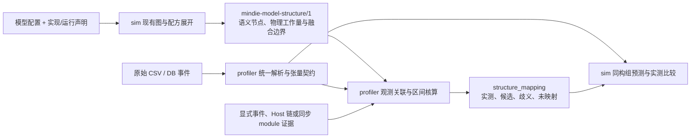

# Profiler 与 Sim 的结构复用和实测映射

[Profiler 系统](profiler-system.md) · [Sim 系统](simulation-system.md) · [设计原则](design-principles.md)

本文记录截至 2026-10-30 的开发接口与既有真机产物离线重放验收。实现分别位于 `profiler` 和 `sim` 重写工作树；本轮在本机重新解析历史原始采集，未启动新的 live 采集，也不表示已经正式发布。

模型结构由 `sim` 维护，原始 profiling 解析与实测关联由 `profiler` 维护。不新建组件，不在 profiler 增加第二套模型目录，不在 sim 保留第二套 CSV/DB 解析器。两者交换有来源的结构和观测，分别保留声明与实测的身份。

当前验收入口是[完整 family 回放](../../profiler/examples/structure/acceptance-20261029/cohort-full-family-replay.md)、
[全类型覆盖与误差表](../../profiler/examples/structure/acceptance-20261029/fusion-cohort-replay-top-errors.md)
和[长调用误差表](../../profiler/examples/structure/acceptance-20261029/fusion-cohort-large-call-errors.md)。
结果只以这些报告注明的完整回放、来源身份和限制为准；进行中的回放不提前计入。
本页末尾保留各轮历史结果，不将早期的能力缺口或旧预测数值当作当前结论。

### Decode 主体与层级计时

`auto_segment_decode_forwards` 的开发入口位于
`mindie_profiler.decode_segmentation`，直接消费统一解析器的 CSV/DB 事件与 sim
现有 `ModelSpec.layer_plans`。它按完整模型拓扑匹配各层的输入 norm、attention/
GDN/KDA、FFN 及通信，并用词表投影契约闭合一次调用，不要求调用方手写纳秒
边界。完整层组和短辅助层组分开；声明层数、混合 attention 序列和张量几何
共同约束分段，单个算子名称不建立层身份。

自动结果注明 `structure_guided_topology_alignment`，属于由声明结构约束的
事件序列推断，不能改写为 Host/module 的确定 occurrence 绑定。原始事件时间、
边界行号、匹配条件、不完整片段和尾等待剥离量保留，便于复核；其测得时长
不反过来选择模型结构或调节预测参数。

`body_forward_span_ms` 是每次完整主体的设备墙钟跨度，报告 mean/P50/P90。
层内通信和依赖间隙保留，跨调用调度空泡排除；跨后继依赖边界的 AICPU
调度尾等待单列，不把所有 `allreduceAicpuKernel` 当作无成本。`per_layer_ms`
按层与采集设备保存分布，不能把重叠层或副本跨度相加当作模型时延。
Dense/MoE 指 Transformer 层内的 FFN 类型，该层的 attention 仍归 attention。
Embedding、Final Norm、LMHead、MTP/draft 边界与主体分别记录。

对于声明了 mHC 的层，输入边界包含输出张量与后续 norm 输入一致的 `HcPre`，
跨流插入的 metadata 或 AICPU 调度事件不打断这条结构关系；搜索不会跨过前一
hidden norm 或 `HcPost`。主体在末层返回多流 residual 的
`HcPost` 完成后结束；后续 residual collapse、输出头准备与大张量复制单列为
`output_head_preparation`。原始 A3 V4 Flash 的完整 43 层样本验证了这一边界，
没有把输出头准备算进末层。新 GLM Flash 的 `SparseFlashMla` 和
`KvQuantSparseFlashAttentionVllm` 从各自真实 ABI 的 block-table 行数恢复 batch，
不把 KV cache 分配容量当作活动上下文。已观察到 query 超过 Decode 上限的片段
即使含 recurrent 算子也不计入 Decode。

部分原始采集仅覆盖返回 hidden states 的 `model.forward`，没有独立
`compute_logits` 的词表投影。A5 V4.1 DP8 的实际边界是完整 40 层后
`HcPost → Cast → Mul → ReduceSum → Cast → RmsNorm`。调用方可通过带来源的
`segmentation_options.forward_closure="mhc_final_norm"` 声明这一闭合方式；
切分器仍核对完整层序列、每层 FFN、末层多流 residual 与最终 hidden 张量几何。
Final Norm 和 residual collapse 单列，LMHead 时间保持空缺，不造一个输出头。
其 `MqsmlaKernel___call__` 的张量字段为 N/A，使用源码符号与实际事件名称一致的
`source_attention_anchors`，并保留源码版本尚未绑定采集二进制的条件。
无 MTP 的启动证据通过 `source_decode_query` 声明 q=1；batch 来自各层实测
hidden 行数，标记为“实测行数 / 源声明 query”，不冒充 block-table 观测。
这个通道仅提供结构对齐和实测时间，不生成缺失的 tensor contract。

A3 V4.1 DSpark7 的 TP4 FlashComm 路径显式声明
`sequence_parallel.factor=4`。切分器逐次核对实测 hidden shard 行数乘以该因子
等于 `SparseFlashMla` 的 query 行数，并由真实 block-table 恢复 batch。
40 层主体在末层 `HcPost` 完成后结束；随后 AllGather、mHC collapse 与
Final Norm 用于确认闭合，后续 3 层 draft 及选取 logits 的 q=7 不改变主体 q=8。
`DispatchFFNCombine` 的真实 8 输入 / 2 输出 ABI 确认 routed FFN 完成；
其后的 shared expert 仍属于当前层。专家缓冲容量和客户端并发均不能替代活动 query。

新 A5 导出的 `HcclLaunchAicpuKernel` 使用同一条规则：只有 AI_CPU 类型且
越过后继层输入 norm 的调度后缀才剥离，真实 HCOM 完成时间仍保留。重复导出的
同起止通信行不增加墙钟跨度。Qwen 混合模型另外按 48 个 GDN / 16 个 GQA
Transformer 层分组，分组数值包含这些层各自的 FFN 和通信，不冒充单个
attention kernel 的耗时。

预测复用公开 `mindie_sim.predict(case, scope="body", phase="decode", ...)`：
保留 padding、真实查询 token 行、层内 TP/EP/PP 通信，排除 embedding/head、
sampling、Host 提交和跨 step 等待。每序列 query 行包括全部 target verify
行，不能乘接受率缩小工作量。核对首个 kernel 的 invocation-ready 起点与
主体完成终点，不扣除 kernel 自身 startup。单卡实测对完整对称 cohort 的
比较会显式注明均衡假设；未采集的强制负载均衡、接收率及 Prefix Cache
命中信息保持未知，目录名不能证明这些运行条件。

实际执行的 query/batch 来自完整分段内的张量描述，允许包含图 padding；
客户端并发单列，不能用它覆盖观察到的执行 batch。上下文使用独立声明的
代表长度，注明窗口内 KV 增长尚未逐步恢复。Prefix Cache 命中率和聚合 draft
接收率读取服务计数，不能用配置目标 100% 或 0.8 替代。带 MTP 时，客户端
每输出 token 的 TPOT 与一次 target verify 主体 Forward 使用不同分母。

可复现多 Case 入口为 `profiler/examples/structure/replay_decode_forwards.py`，
使用 `decode-forward-auto-cases.json` 声明本地来源与独立模型配置，
结果见 [Decode 主体回放](../../profiler/examples/structure/acceptance-20261029/decode-forward-replay.md)。
主记分牌同时呈现算子分档达标率和主体对账，二者使用独立分母。
`priority_decode_scoreboard.py` 将 Body、Layer 0 / 稳态层组和算子族放在同页，
保留每行的来源、执行几何、声明变体与 runtime 身份。Body 按绝对毫秒差排序；
算子按单次误差乘以实测调用数、再除以完整 Forward 数进行优先级排序。
后者是 kernel activity 差，不是可直接相加的 Body 墙钟误差归因。
未匹配项按实际未评分活动量列出，不将预测填为零，也不宣称其对应程序一定漏算。
同一采集的不同 checkpoint / recipe 声明属于独立预测臂，不增加独立采集或
Forward 数。按样本量暂缓的小几何桶保留实测和 `prediction_deferred` 状态。
主表按输入回执顺序为每个来源/执行几何选取最后一个已完成预测，另保留所有
历史预测臂。当前达标率与历史臂达标率分开，暂缓结果不覆盖已完成结果。
算子主表同样按来源/几何选取当前回执，显式给出严格评分事件数占完整主体
事件数的比例；已匹配子集通过率不能充当整模型通过率。原生算子报告逐 case
流式读取，避免多份完整 ABI 报告同时膨胀为 Python 对象。

预测回执保留 Sim 实际解析得到的 `model_representation`。输入绑定存在缺陷时，
以原回执内容 SHA 标记 `superseded-input-binding`，保留原始实测与历史预测，
撤回其 Body/Layer 达标统计，再使用修复后的 Sim 解析器重新预测。Kimi 的
HF wrapper 外层量化被忽略问题按此处理；profiler 不增加一套量化解析器，
也不因纯算术复核通过而把错误模型声明视为有效。

对已被 Sim 计费、但实测缺少 tensor descriptor 的源码角色，可输出明确的
`source_role_reference` 数值。其完整程序或未融合子图边界、通信 peer-ready
假设与严格 tensor cohort 分开，不将其再次加进 Body 预算。未来的 Body
预测另保留有界的 family / recipe / program 调度统计及最长十个节点，便于
定位跨层共有程序的缩放异常；这些跨度仍不可相加代替调度器的完成时间。
`graph_execution_envelopes` 解析的 `MODEL_EXECUTE/MODEL_WAIT_COMPLETE` 是辅助
图执行证据，用于交叉核查；整个图包络不直接替代切出的模型主体时间。

2026-10-30 新增 A5 TP4 Qwen3.8（c4/c32/c128）和 TP8 Qwen3.6
（c4/c40/c128）的入口位于
`profiler/examples/structure/acceptance-20261030-high-concurrency/`，复用 sim 的
`examples/cases/high-concurrency-20261030/` 输入。各报告保留自己的 runtime
包身份；历史算子 cohort 与新版主体预测不能仅因显示在同一页就视为同次运行。
新输入使用独立的 Ascend950DT_9582 profile，避免继承旧示例的 TP1 或通用
MTE 速率覆盖。

该批次共 659725 条有效事件，自动提取 287 次完整主体，六组执行几何均为
query=4，每组按实际 batch 对账。`bc375e61` wheel 的六组主体预测全部产出
数值，但均未达到 15%：低估约 38%–66%。
[完整结果](../../profiler/examples/structure/acceptance-20261030-high-concurrency/decode-forward-replay.md)
保留 384 个层的对账；代表 context=4104，窗口内实际 KV 增长仍属未观测条件。
主体内部未覆盖事件间隙仅占 0.67%–3.62%，不能将全部预测残差归于 Host 空泡。
区间覆盖包含真实 HCOM 协议等待，不等同 PMU 有效忙时；单 rank 数据不能把
通信 elapsed 拆成有效搬运和 peer 等待，也不能据此反向调整链路带宽。

同批 1-token 微基准保留实际程序和采集边界。原始时间按整数 ns 解析；非空
kernel 的完整时间不能当作纯 launch floor，eager Python 提交间隔也不能写成
图模式每个算子的固定开销。算子分档容差只判定误差，不用于反向增加配方耗时。

## 1. 复用已有结构，补齐观测关联

`sim` 已有模型配置适配、`ModelSpec`、`LayerPlan`、block builder 和算子配方。`mindie_sim.structure.export_structure` 复用 `target_graphs` 与 `RecipeBook.expand`，将调用展开为无时延的 `mindie-model-structure/1`。它不运行成本求解，不加载权重或初始化设备上下文，也不以测量覆盖决定模型结构。

已有独立算子 DAG 可通过 `export_op_structure` 导出同一契约，复用相同节点、配方展开与哈希实现，无需构造硬件 Case。DAG 来自工作负载源码与显式参数，不能从实测 Shape、事件顺序或耗时反推模型。该入口没有另建 profiler 模型前端。

`profiler` 负责将原始事件转换为统一观测，再关联到声明节点。报告回答两个不同问题：声明的模型包含什么，以及当前采集中实际观察到了什么。没有关联到事件的节点仍是声明，不能补入预测时长或记成“实测为零”。



箭头表示数据流。`profiler` 消费 manifest，不导入 sim。只有 sim 的显式 profiling 适配入口延迟导入 profiler；`predict`、`graph`、普通算子分析和结构导出保持独立。缺少可选 profiler 安装时，该入口明确报错，不恢复旧解析器。

sim 的独立算子比较复用 profiler 的原始观测与张量契约；同构集合比较直接消费
`structure_mapping.windows[].cohorts`。集合级对账不要求为重复层分配具体事件，
也不会自动校准或写入训练样本。

这些共享观测 API 属于当前开发源码，已发布的 `mindie-profiler 0.5.0` 不包含它们。sim 的可选依赖声明 `mindie-profiler>=0.5.0` 不能单独保证此开发接口兼容；本轮验证使用相邻 checkout，在 sim 目录执行 `python -m pip install -e ../profiler` 可安装配套源码。本页不意味着已有配套正式版本。

## 2. 结构与观测契约

| 对象 | 负责组件 | 内容及边界 |
| --- | --- | --- |
| `mindie-model-structure/1` | sim | 图身份、来源、phase/scope、节点身份、replica/stage/layer/block/family、张量契约、依赖与实现声明；不携带预测或实测时长 |
| 原始观测与 observed tensor contract | profiler | 保留原始事件身份、rank/device/stream、时间区间、源文件/表/行定位符及实际导出的张量字段；未知字段保持未知 |
| 显式绑定与 scope 声明 | 调用方提供，profiler 解析 | `events` 关联具体 event_id；`host_scopes`、`module_scopes` 声明真实 frame/module ID 对应的节点范围，再与独立事件证据相交。scope 声明本身不是事件归属证明 |
| 同步 module 观测 | profiler | `mindie-module-trace/1` 的原始调用记录、同步边界、DB SHA256 与独立张量契约；不复用旧归因汇总 |
| `structure_mapping` | profiler | 按证据强度给出节点对应、覆盖率与实测区间，并保留候选、歧义和未映射事件 |
| 独立比较 | sim | 在同一实现、输入和计时边界上比较预测与观测；关联成功不自动触发校准或写入训练样本 |

图身份反映声明结构与实现，不包含设备事件时长。`graph_id` 是 manifest 除 `graph_id` 与 `source` 外内容的规范 JSON SHA256；profiler 校验该身份再使用绑定。节点保留 `operator`、`contract`、`contract_scope`、`boundary` 与 `lineage`；展开调用保留 `source_calls`，所选范围外的依赖列入 `external_inputs`。图身份校验用于确认绑定对应的声明图，不校验采集文件内容。

结构还可以携带 `subgraphs`：一个原生实现覆盖的既有语义节点集合、角色、
外部输入输出、契约及实现条件。成员来自同一次前端和配方展开，不在 profiler
复制模型结构，也不在导出图中增加一份重复计算。`node_ids` 保留语义成员；
`subgraph_id` 是该组合边界的匹配身份。节点的 `structure` 来自声明的层计划，
用于从模型、层和 block 逐级解释其角色。

节点自身的 `block/role` 来自 frontend 调用 attention、FFN、residual builder
的真实组合边界，分别记录所属块和 `body/residual` 角色。量化转换与
`RecipeBook` 展开的 children/join 继承该归属；不根据算子名称猜测。
这里的 `layer` 标识 Transformer block；该 block 包含 Attention 子层和 FFN 子层，
FFN 可以是 dense MLP 或 MoE。`structure.ffn_kind=moe` 或
`structure.residual_kind=mhc` 是所在 Transformer block 的上下文，
不表示 Attention 算子属于 MoE 子图，也不表示每个算子都执行 mHC。独立的 PP transfer、
Engram 等边界不强行归入 attention/FFN。归属 metadata 不改变工作量与依赖。

只改变采集时长或比较结果，不应改变候选集合或图节点身份。配置来源用于解释声明；它不能证明该配置就是采集时实际执行的分支。

Case 导出接受 `scope=body|model` 与 `phase=prefill|decode`，范围是首个独立 DP cohort。`export_op_structure` 接受已有 `OpSpec` 序列或显式 replica→DAG 映射，调用方声明 `model`、`execution.phase`、scope 与并行范围；不会套用 Case 导出的代表性分片假设。配置中存在 MTP/DSpark，不等于当前 trace 执行了它。Prefill、Decode、draft、verify 以及各 rank 的 PP 分片，必须与实际窗口和运行条件对齐后才能比较。

`analyze --phase`（Python 的 `scene.phase`）若与结构的 `execution.phase` 显式冲突，分析报错；未提供时不推断阶段。报告分别保留 `declared_execution` 和调用方提供的 `observed_phase`，后者不是从 trace 自动识别的阶段。已绑定节点保留 `contract_scope`，供后续比较检查边界。

## 3. 关联强度与计量规则

1. **唯一 Shape 匹配仍是候选。** Shape、Dtype、Layout 和算子角色用于缩小范围；即使只剩一个节点，也不证明模块来源、调用参数、缓存状态或厂商 tiling 相同。缺字段不填充成 sim 的声明值。
2. **重复层保留实例歧义，同时做同构集合对账。** 多层存在相同算子与张量形状时，保留全部适用候选；相同契约、物理工作量和部署范围的候选可形成 cohort，输出实测次数和耗时分布。不按事件时间排序、层数或周期性“凑齐”具体层映射，也不使用预测耗时接近程度挑选节点。
3. **确切映射依赖事件级证据。** 显式绑定须指定具体 event_id，Host 证据须定位到对应调用链；同步 module 路径须验证 DB 内容身份、唯一完整包含及张量契约。`ACLGraph` replay 中重复的 `globalTaskId` 不能单独充当事件身份。调用方提供的显式绑定标记为 `explicit_evidence`，不升级成自动识别结果。event_id 保留源定位与具体时间区间身份，不包含采集文件内容 hash；Host correlation 另核验源路径、大小与修改时间。
4. **允许多对多关系。** 一个声明节点可由多个实测 kernel 实现；一个融合 kernel 也可覆盖多个声明节点。保留这种关系，不把每个节点都宣称为一次独立 kernel 执行。
5. **耗时按区间并集核算。** 多个事件映射同一节点时取相关区间并集。旧的显式 `relation=fusion` 节点绑定保留共享事件视图；新的子图绑定将实测总耗时保留在 `windows.subgraphs`，不生成成员各自的耗时。层、块和窗口汇总必须先对事件去重再取并集，不能相加获得虚假的加速空间。层与块按 replica/stage 分组；单个融合事件不能跨 replica 或 PP stage。
6. **分母明确且有界。** 记录选中窗口及原始事件覆盖率。候选覆盖与确切映射覆盖分开，未映射事件和没有观测的声明节点分别可见。跨时钟域的 rank 不直接求全局时间并集。

这里的“未知”表示观测或字段不足，不是外部写操作的 `unknown` 回执，也不会阻塞后续只读分析。源文件读取或解析失败仍然是错误，不能当成空观测继续返回成功。

`structural_classification` 保留所有张量候选共有的 block、子图角色和层结构字段，
`windows.structural_groups` 汇总这些分类的事件数与区间并集。例如全部候选均为
MLA 前处理时，即使仍不能区分重复层，也可以报告这一结构归属。
该字段明确标记 `occurrence_binding_implied=false`，不增加 `bound` 覆盖率。
算子名称、事件顺序或相似耗时都不能反推重复层；源模型的整体结构、实际执行
条件和独立调用证据共同约束局部匹配。

### 同构集合级对账

结构导出新增 `physical_work` 和 `physical_signature`。前者保留 FLOPs、分精度矩阵
工作、vector work、MTE2/MTE3/HBM/link bytes 与 launch 数；后者忽略层号等实例身份，
保留物理实现、形状、资源工作和子图内部依赖。它们是声明量，不是预测时长，
导出仍不运行成本引擎。物理工作改变会改变图身份，来源说明本身不会。
其中节点的 `physical_work` 描述语义算子的工作量，不能直接当作已选资源程序的
全部搬运流量；分块程序可能增加 staging 或重复读取。成本比较实际执行所选
recipe，报告同时保留语义契约与实现选择，不把二者混成同一 HBM 流量口径。
完整 `kernel_bindings` 也进入图与物理身份；同名 recipe 改为另一种资源程序，
不能继续用旧 mapping 作为同一个实现。捕获 segment 编号属于实例身份，
不会拆分同构集合；是否处于图捕获模式仍保留为执行条件。
普通矩阵若没有显式 recipe/family 绑定，则先解析实际回退的资源程序；
仅语义名称不同、最终物理程序相同的节点可以同组。对于该通用矩阵路径，
`ffn_role`、`ffn_category` 等已解析为精度、layout 和工作量的选择标签，不再单独
拆分物理身份；Attention 与 FFN 中采用同一物理程序的矩阵也可进入同构集合。
语义归属仍留在结构中。此规则不删除显式 recipe、family 或 invocation 绑定，
也不合并精度、布局、依赖或资源工作不同的节点。显式实现选择和真实资源差异
继续进入物理签名。选定的原生程序先按相同设备几何完成 `RecipeBook.prepare`，
再导出工作量；几何进入图身份，硬件速率和实测时长不参与该准备过程。

SharedKV 在物理等价检查前，可以用原始 descriptor 缩小候选：完整原生 ABI 的
输入槽位 4 是 `cmp_sparse_indices`，明确的 undefined 空槽与
INT32/ND `[query_tokens, kv_heads, topk]` 分别对应不同接口条件。
profiler 将其 presence、token/head 轴、TopK、dtype 和 format，与 sim 独立声明的
`structure.indexer` 及 `indexed_attention_geometry.topk` 对照。
支持域还要求普通 sparse-index 槽位明确为空；缺槽、部分字段或不支持的描述不筛选，
未知的声明字段也保留候选。这样可以区分原先活动契约相同但物理工作不同的层集合，
而不是根据预测误差任选同构子集。该细化不推断压缩率、实际 context、phase、层号、
step、index 值或采集二进制身份，详见
[异构稀疏 attention 证据](../../profiler/examples/structure/acceptance-20261029/heterogeneous-sparse-coverage.md)。

`windows[].cohorts` 只接纳同契约、同物理签名及工作量、同 replica/stage/phase 的
候选集合。单 rank 采集也可保留所有完全对称的 DP replica 候选：相同 stage/phase、
每个 replica 的本地候选集合一致，且设备物理资源相同时，按单设备实例数计算
multiplicity，保留 `replica=null` 和完整 `replica_candidates`，不猜测 rank 对应
哪个 replica，也不把 DP 数量乘到实测调用数上。候选边界不能互相重叠。
已有 Host/module 证据冲突、不同物理工作量、
未知多 stage launch 或不完整原生边界另记排除原因，不根据实测耗时选择某个子集。
每条事件在该窗口最多进入一个 cohort。

每组给出完整 `target_ids`、声明实例数、声明 Transformer block 数、实测调用数、
完整事件的单次 Mean/P50/Min/Max、裁剪后 activity sum 和 busy union。
同一 block 可以包含多个实例，所以实例数与层数分别记录。
`activity_sum_ns` 是调用时长之和，`busy_union_ns` 是设备区间并集，两者不能当成同一指标。
跨窗口事件不进入单次时长分布；窗口或 step 标签本身不证明包含了几个完整迭代，
因此 `calls_per_declared_instance` 不自动转成 step 数。

`bound` 及原有映射状态保持事件级含义；`cohort_status`、`cohort_event_window_count`
和 `cohort_event_fraction` 单独表示集合级产出。没有具体层绑定仍能得到非零实测
统计；集合统计不会生成每层时间，也不会增加 `bound` 覆盖率。

### 融合的资源执行边界

语义子图描述包含哪些操作，融合资源配方描述这些操作如何执行。显式原生融合选择
复用同一前端与 lowering，将选定的完整子图交给一个设备资源程序，保留矩阵精度、
vector 工作、依赖及对外输出，减少重复 launch，并只消除源码确认在片上复用的
内部 HBM 读写。保留 GM workspace 的中间量仍计入资源需求；不能把所有内部边
一律当成零流量。未知 stage 的多 launch 算子不能折成一个完整 kernel。

导出保留语义成员，并用 `resource_boundary` 关联同一次 lowering 的物理程序。
选定融合后的子图物理签名和工作量来自该程序；未选融合的子图保留展开成员的
工作量。sim 的 cohort 比较将后者标为 `unfused_reference`，不作为已融合 kernel
的预测误差。单次预测与完整实测调用分布比较，整组预测按实测调用数累计；
声明实例数与调用次数差额单独展示，不用次数反推层序。

消费入口是 `python -m mindie_sim.cohort_comparison CASE REPORT -o RESULT`，
接受 `analyze` 的 C7 报告或其中的裸 `structure_mapping`。相同物理程序可以共享
一次成本计算，但报告中的代表节点和 resource boundary 始终来自本 cohort，
不会因缓存而引用另一个 Host scope 已绑定的层。

完整采集回放不按原生算子类型设置比较白名单：所有具备有效 contract 和
physical work 的 cohort 都进入消费端。Top 表覆盖原始窗口中的全部原生类型，
同时保留总事件数/累计活动耗时、已评分事件数以及未形成 cohort 或未评分的原因。
误差只对应已评分子集，多种声明共用一份采集时不重复增加硬件证据分母。

矩阵契约分别保留 dense 与 expert-bank 分组几何，V3 INT8、V3 MXFP8、V4
FP8/FP4 按各自的 scale 顺序与 NZ 轴校验。实际专家行分布仍是未观测条件。
几何匹配也不表示资源程序完整：当前 W4A8 grouped 缺 correction/rescale
epilogue 时，`prediction_coverage=partial_program`，保留集合统计和参考预测，
输出 `reference_only / quantized_epilogue_unmodeled`，不生成完整 native 误差。
子图继承成员缺失的物理工作。显式 MSD gate/up 和 grouped-down 源码程序实现
对应 correction/rescale 后，才解除这些具体限制；整数路由分布及硬件供给仍属于
独立声明条件，不是从采集恢复出的事实。
MXFP4 的矩阵/GroupedSiTU 契约与 native 执行成本分别判定；当前缺少完整 MX
转换和原生矩阵程序的路径输出 `mxfp4_native_execution_unmodeled` 参考预测。
单次 launch 本身不能解除这些不完整标记。当前 checkpoint 的独立精度声明与历史
采集配置身份也分开记录，不用实测 tensor 描述重写原 catalog 案例。
同构 routing 的 producer 引用按局部同源关系规范化，层级 ID 不应造成虚假的
物理工作量差异；原有 None、不同输入来源和真实资源差异继续保留。

### 单次调用精度与汇总分母

比较策略 `mindie-sim.cohort-accuracy/1` 按完整实测调用的均值选择容差，
仅用于 `status=compared` 的 cohort。设 `o` 为实测 Mean，`p` 为预测单次时长，
两者均以微秒计：

| 实测 Mean | 通过条件 | `accuracy_tier` | 通过状态 |
| --- | --- | --- | --- |
| `o > 50 µs` | `abs(p-o) / o <= 15%` | `relative_15pct` | `within_relative_tolerance` |
| `o <= 50 µs` | `abs(p-o) <= 15 µs` | `absolute_15us` | `within_launch_floor_tolerance` |

50 µs 属于绝对误差分档，容差边界包含等号。每行保留
`observed_per_call_us`、`predicted_per_call_us`、有符号的 `per_call_diff_us=p-o`、
`abs_error_per_call_us`、`accuracy_tier`、`accuracy_status`、`accuracy_pass`、
带单位和值的 `accuracy_tolerance` 及策略版本。超容差记为 `outside_tolerance`；
`reference_only` 和 `unscored` 的 `accuracy_pass=null`，不参与精度通过率分母。
轻量纯函数 `mindie_sim.cohort_accuracy.accuracy_fields` 可从已保存的 comparison 行
重算这些字段，不重新预测、不读取 raw capture，也不修改原始数值。

`within_launch_floor_tolerance` 是短调用容差标签，不给预测加 floor，
也不证明误差来自 launch 开销。模型内声明的 device completion minimum、
host launch 提交成本和这里的验收容差是三个独立概念，分别保留来源与计时边界。
family 的单次均值按调用数加权；长短调用的通过情况分别统计，不能让正负残差
抵消或用一个混合均值掩盖失败 cohort。

每份 Case 保留模型配置、checkpoint、实现 selector、执行几何和硬件参数的来源。
source-selected 或 current-checkpoint 条件变体不升级为 catalog 默认，也不证明
历史采集使用了同一实现。原始 Case 自身带 selector 时仍是条件声明，
不能因为它被用作某份报告的 baseline 就改称默认能力。

完整回放的 receipt 通过 `summary_identity` 绑定 summary 的文件、SHA256 和大小，
summary 再绑定 Case、mapping、comparison 和 family 产物；比较端重新导出并核对
`graph_id`。不得混合未完成回放或不同代产物。多份声明复用同一采集时，采集分母按
源内容身份去重；跨声明覆盖取原始事件身份的并集，或仅累加已证明互斥的契约分支。
不能相加各变体 cohort 数声称新增采集或完整覆盖。原始总事件、能形成 cohort 的事件、
可评分事件和参考事件分别报告。activity sum 仍是调用时长之和，不是端到端墙钟。

### 组合 recipe 与存储边界

回放 Case 可以同时选择 `programs.matmul.kind=steady_matmul` 和
`recipes.flash_attention_prefill.kind=staged_gqa_prefill`。前者用于独立投影，
后者拥有 attention 内部的 QK/PV 工作；同一节点只选择一个 recipe，不把内部矩阵
再按 steady 计算一次。组合只叠加指定选择，保留已有 GDN 源码实现、融合、
machine/device 覆盖和模型配置。通过率按组合 Case 的实际 cohort 重新计算，
不能拼接不同 Case 最好的数值。

张量接口仍需一致：`attention_paged_active_qkv` 与连续 Q/K/V 的
`attention_active_qkv` 分开匹配。Qwen3.8 的所选历史采集包含连续 prefill
和 paged decode；`kv_storage=auto` 在所声明的零 context prefill 导出连续接口。
requested paged prefill 即使选择相同资源 recipe，也不吸收连续接口的事件。
A3 Qwen3.5/3.6 的新组合从原 paged 声明复制，只加入 staged prefill 配方，
不会因源配方示例的文件名包含 paged 就替换其独立存储声明。

A3 SCFA 源码变体明确选择 offchip scratch、valid-prefix indices 和
one-query-per-core 等条件。新 A3 管道速率是带来源的名义分析参数，并不等于
已测峰值；原 Case 的 device 覆盖仍优先。SWA/CFA 和 SCFA 保持不同 cohort，
未证明的 context、index 值、dispatch 与层实例继续保留未知。

指定调用次数本身不能确定窗口。`replay_attnres_scope.py` 要求 source SHA 与
明确的窗口、CSV 行号或完整采集范围；`expected_events` 只验证该范围的计数，
不搜索恰好含该数量的事件。AttnRes 缺少逐事件 active view、stride 和 scalar
flags 时继续未评分；声明侧完整程序不能补造采集侧契约。

## 4. 调用闭环

宿主 Agent 按本次问题选择窗口和结构范围，流程为：

1. 对已有产物运行 `inventory`，确认源格式、rank 和可用窗口。
2. 用实际模型配置与实现声明导出 sim 结构。已有模型复用配置适配与配方；独立工作负载可从源码声明 `OpSpec` DAG，不能从采集结果补造层表。
3. 运行 `analyze --structure MANIFEST`；已有确切关联时增加 `--bindings BINDINGS`，有 Host 调用链时传入 `--correlation CORRELATION`，有同步模块原始记录时传入 `--module-trace TRACE`。
4. 先读取 `structure_mapping` 的覆盖率和歧义，再解释层、块和热点。需要更强关联时针对未决事件检查 Host 链或补充最小标记。
5. 如需评估优化，保持匹配条件与计时边界，独立比较实测与预测。原始采集继续由 profiler 读取，sim 不直接另写原始格式解析。

`analyze` 没有结构输入时仍执行原有窗口核算。已有 `module_trace` 与声明图是不同来源；模块记录通过 `module_scopes` 进入结构关联，报告保留独立来源，不能让声明图覆盖真实模块标记。

结构导出使用普通完整 Case，而非新增另一套模型输入。Case 中机器字段满足现有输入契约，但导出不计算其速率或时延：

```bash
python -m mindie_sim.structure case.json \
  --phase prefill --tokens 16384 --scope body --output structure.json
mindie-profiler analyze --root /path/to/capture --full-range \
  --structure structure.json --bindings bindings.json
```

Python 入口为 `export_structure(case, *, phase, tokens, context=0, sequences=1, scope="model", source=None, expand_calls=True)`，声明 DAG 入口为 `export_op_structure(ops, *, model, execution, kernels=None, source=None, expand_calls=True)`。`analyze_profile` 对应参数为 `structure`、`structure_bindings`、`structure_correlations`、`structure_module_traces`、`mapping_limit` 与 `max_mapping_events`。CLI 的 `--correlation` 和 `--module-trace` 均可重复提供。

绑定文件使用 `mindie-profile-bindings/1`，带同一 `graph_id`。`events` 的每项包含 `event_id`、`node_ids`、`evidence.source` 和 `relation`；`relation` 为 `direct` 或 `fusion`。Host 路径由 `host_scopes` 指定精确 frame 名称与节点范围，再与实际 correlation 中的事件和张量契约相交。

对已声明的组合边界，`events` 可用单个 `subgraph_ids` 代替 `node_ids`，
且实测与该子图的比较契约必须一致。`host_scopes` 和 `module_scopes`
也可使用 `subgraph_ids`；用节点范围声明父级 scope 时，必须包含组合边界
的全部成员才能关联整个融合事件，包含其中一个节点不足以绑定子图。
祖先与子级 scope 的约束继续取交集，不能忽略相互冲突的证据。

Host 自动绑定还要求该 `globalTaskId` 在完整 TASK 表只出现一次，且关联链唯一：Task 到 Host 可以是唯一直接 connection；经过 CANN 时，Task 到 CANN 必须是唯一 connection，CANN 到 Host 必须是唯一 connection，或同一线程内无等长/交叉冲突的严格包含调用链。仅设备时间区间包含、重复 replay ID 或多个可选连接都不足以确证层归属。报告保留未满足这些条件的候选与歧义，不取第一个 Host 匹配作为证明。

同一调用链的祖先/子 scope、多个 correlation 及同步 module scope 都保留为约束，与张量候选取交集；交集唯一时才绑定。祖先 `[A,B]` 与子 scope `[B]` 可收窄至 B，祖先 `[A]` 与子 scope `[B]` 则保持 `ambiguous`，不会只取最内层 scope 或丢弃冲突的一侧。

同步模块路径要求 `bindings.module_scopes` 中的 `module_id` 精确对应真实模块记录，并指定其 `node_ids`。`module_trace` 的 `source_identity.db_sha256` 必须匹配所选原始 DB，`instrumentation.npu_synchronize` 必须为 true，事件必须被唯一模块调用完整包含；存在 step 时还须一致。张量契约与该 scope 的交集唯一后，才输出 `bound`、`basis=synchronized_module_and_tensor`。重叠调用、跨边界事件和冲突 step 保持歧义；缺少契约不能靠 module ID 补造观测。

读取模块 trace 时流式扫描原始 `records`，仅保留所选事件完整区间可能涉及的记录；旧 `module_mapping` 等汇总字段被跳过，不作为新归因证据。保留记录预算 `max_records` 由 `max_mapping_events` 提供，跨所有 trace 累计，超限报错。完整包含不能只检查事件裁剪到窗口后的部分。

`rank_replicas` 与 `rank_stages` 分别由调用方声明采集 rank 到 sim replica、PP stage 的对应。不默认把物理 rank 编号当作 DP replica；未提供映射时保留所有适用候选，并在窗口标明 `rank_scope.basis=unspecified`。非平凡并行布局须从实际部署获得该关系，不能跨不同 PP 角色拼接结果。

结果中每个窗口单独记录计量与覆盖率。默认最多展示 200 个事件映射，最多处理 100000 个事件窗口实例；前者仅限展示，后者超限报错。单个事件的 `candidate_count` 保留完整边界候选数，`candidate_node_ids` 和 `candidate_subgraph_ids` 分别最多展示 64 项；组合边界不会按成员数重复计为多个候选。已绑定子图保留 `covered_node_ids`，窗口的同名字段包含单节点绑定及子图覆盖的语义成员，但这些成员不因此获得各自的实测耗时。缩小时间窗口或 rank 范围即可继续分析，无需创建新的任务状态或复制原始数据。

汇总状态 `mapped` 表示选中的事件窗口实例全部绑定，`partial` 表示部分绑定，`unresolved` 表示没有绑定；它们不证明声明图已被完整采集。窗口同时保留事件数覆盖率 `bound_event_fraction` 与忙时并集覆盖率 `bound_busy_fraction`，不能将二者混为一项。

未决事件同时区分 `capture_metadata_missing`、`contract_support_gap`、`declared_structure_mismatch`、`occurrence_evidence_missing` 与 `occurrence_evidence_conflict`。相近契约仅解释需要检查的字段，不升级为候选或映射；已有证据冲突不能被重写为“仅缺少采集”。

### Attention、cache 与 fused 的比较范围

契约继续由 sim 的现有 GQA/MLA/DSA/GDN/KDA 前端产生独立声明，profiler 根据原始导出的 ABI 规范化观测。两侧不读取对方的模型目录，不用观测 Shape 补齐声明。结构 metadata 本身不改变工作量；显式源码程序的资源变化由 sim 的实际 lowering 与配方表达。

| 范围 | 已实现的比较 | 保留的限制 |
| --- | --- | --- |
| Fresh-prefill dense FIA | GQA 的 Q/K/V/主输出 Shape、Dtype、Format；CP/PCP=1 | 不比较 mask/序列数组内容、scalar flags；prefix、paged、decode 不伪造为 dense |
| Paged FIA | 原生类型、Q/主输出描述、cache block size/packed row width/dtype/format、block-table batch 数 | cache capacity、表列数与内容、序列值及 KV-head 分解不在比较域；context、phase、verify/draft 角色须独立声明 |
| Scatter cache store | 当前 K/V 元素量与 dtype、slot 数 | 原生 NCL/NCHW 描述先校验；声明侧不猜 head 分解、layout、cache capacity、slot dtype/值 |
| GLM sparse attention | Q/Q-rope/O 与 K/V/rope cache 的 head 维度 | 保留 `SparseFlashAttention` 类型；不比较 cache capacity、index 内容或 dispatch |
| DeepSeek shared-KV attention | Q/O、cache head 维度与 compressed-cache presence；支持域内另用 index descriptor 细化候选 | 保留 `SparseAttnSharedkv` 类型；TopK 不等于压缩率，也不能证明 SCFA dispatch |
| Recurrent GDN | TND Q/K/V、beta、FP32 scalar gate、V-first state 几何与显式 state dtype、输入输出一致性 | BF16 与 FP32 state 是不同契约；不把 FP16 当作同字节数替代，也不从 token 数认定 draft/verify |
| Qwen GDN norm-gate | x/weight/gate 和输出/statistics 的完整记录槽位 | 不从 Shape 推定 epsilon、gate activation、norm 顺序 |
| Kimi KDA norm-gate | 经源码确认的末维行展开、weight、主输出 | 与 Qwen 原生 ABI 不同；未观察 mean/rstd 和 scalar flags |
| Qwen Gemma RMS | 独立模型类声明的 weight offset 与原生类型 | 不再等同普通 RMS；实际 weight 转换与 native lowering 需另外声明 |

分页 FIA 与 recurrent GDN 的声明和真实切片验证见
[paged/GDN 覆盖](../../profiler/examples/structure/acceptance-20261029/paged-gdn-coverage.md)。
分页路径保留其实际存储边界；另一个 rank-4 cache probe 不能任意压平成同一契约。
recurrent 的状态精度由声明和原始输入/输出共同约束。Chunk GDN 则仍需区分
采集的 BHTD/FP32-state、旧 9/10-input ABI 与通用 sim 的 TND/BF16-state wrapper。
[Chunk GDN 源码边界](../../profiler/examples/structure/acceptance-20261029/chunk-gdn-source-boundary.md)
已确认保留源码的一次 launch 覆盖整个 chunk core，且存在 GM 中间量；
gate/output layout 的版本差异尚未解决，不能按名字把完整 `gdn_chunk` 直接绑定。

MLA Prolog 与普通 LightningIndexer 已增加下文所述的显式子图契约，不能推广到其他 ABI。`source_call` 本身没有 kernel 契约；展开后仍保留 children 和 lineage。不能把融合 kernel 的总时长任意挂到某个子节点。

SCFA 的显式源码选择只适用于独立声明 compressed-index producer 的单序列、
连续 prefill 分支；SWA 和 CFA 保留自己的路径。既有 V4 两份采集的
141/292 条 SharedKV 事件 descriptor 与该分支相容，不是 292 条全部已证实执行 SCFA。
所选 `one_query_per_core`、`valid_prefix`、FP32 sinks、无 S2 split、无 LSE 输出、
off-chip scratch 均是调用方条件。当前 kernel-boundary 契约入口已修复并复验；
原硬件仍缺 `mte2_aic`、`mte2_aiv`、`mte1`、`fixpipe` 独立速率，
`mte3` 的资源单元声明也不满足该源码程序。它明确报缺参，不能补假速率取得通过，
也不能把其他 generic SharedKV 预测记成 SCFA 验收。来源与修复前后证据保留在
[同一稀疏覆盖报告](../../profiler/examples/structure/acceptance-20261029/heterogeneous-sparse-coverage.md)。

Kimi [AttnResFwd 边界](../../profiler/examples/structure/acceptance-20261029/kimi-attnres-boundary.md)
已由保留 image 确认六输入、三输出接口；未决项是完整源码资源程序和逐调用条件。
扁平 descriptor 不给出有效 bank 历史、prefix view/stride、write slot、
mix/add/materialization/output-norm flags 或 tiling。禁用分支也可传非空替代槽，
所以张量 presence 不能证明它执行了对应工作。该源码为 AIV vector 程序，
不能沿用语义 score GEMM 的 Cube 成本冒充 native 预测；不同有效历史与物化条件
也不能按耗时挑选。当前仍不生成该类型的可比契约或层绑定。

事件保留 `observed_contract_scope`；活动投影的样本同时保留 `observed_native_tensor_abi`，使被排除的原始描述可核查。`bound` 表示在该比较范围内由 occurrence 证据支持的结构关联，不证明所有执行参数或数值语义相等。Typed empty shape 只保留其原始编码，未经过算子专有校验时不能宣称它是真实标量。

`.csv.gz`、普通 CSV 和原生 `op_summary` 经过同一个流式 decoder。`OP Type` 优先于 `Task Type`，避免把 `MIX_AIC` 等执行核类型识别成算子。显式命名的 `pf4k_b1.csv.gz` 可单独 inventory/analyze，不把多个阶段文件合并成 rank。大采集结构回放可用 `StructureMapper.map_window(observation, events=iterator)`，仍受事件预算和区间核算约束；默认 C7 分析接口保持原有行为。每个窗口的 `operators` 汇总契约可用数、映射状态和诊断，便于定位具体算子缺口。

流式映射若同时使用 module 证据，窗口必须包含事件的完整时间范围。遇到跨窗口边界的事件会明确报错，要求先保留选中事件再加载模块证据；否则模块扫描可能漏掉窗口外与完整事件重叠的调用，错误地得到“唯一包含”。普通 `map_structure` 路径仍先按完整事件范围加载证据，支持裁剪窗口。

## 5. 验收案例与证据边界

| 案例 | 应验证的行为 | 证据强度 |
| --- | --- | --- |
| 真实 CSV/DB 切片经 profiler 解析、sim 导出图、profiler 关联 | 原始 Shape/Dtype、event_id、locator、区间完整传递，图不包含时长；原始文件不修改 | 离线真实采集回放 |
| 完整同步 module 采集经声明 DAG 重新关联 | 校验原始 DB SHA256、唯一完整调用包含及张量契约；不复用旧映射 | 历史完整真机产物的本机重新分析 |
| 多层重复形状 | 没有事件级绑定时保持歧义，不按时间顺序分配层号 | 真实观测配合受控结构的契约测试 |
| 一个节点对应多个 kernel | 节点实测并集等于独立区间运算，重叠不重复计算 | 区间不变量 |
| 融合事件对应多个节点 | 节点保留共享事件，层/块/图汇总只计一次，不分摊出虚构子时长 | 显式绑定契约与区间不变量 |
| replay 重复任务 ID | 区分具体事件；只给重复任务 ID 不可证明唯一对应 | 真实 replay 切片 |
| 仅修改时长 | 图身份和匹配候选不变，实测指标按新时间区间变化 | 非循环匹配检验 |
| 缺失张量字段或额外事件 | 未知字段、候选和未映射比例保留；不从模型配置补造观测 | 真实缺字段切片 |
| sim 不安装 profiler 的普通调用 | 普通仿真和结构导出可运行；仅显式 profiling 入口需要可选依赖 | 本地组件边界 |

受控复制层、改变区间或人工绑定用于检验算法不变量，不能作为这些组合实际在硬件运行的证明。默认单元/合同测试通过，也不代表新的 NPU 采集已经完成。

`profiler/tests/test_structure_sim_acceptance.py` 覆盖两个来源可追溯的离线切片：sim 保存的 A5 `operator-kernels.csv`，以及 profiler 保存的 GLM45 DB replay 切片。前者通过正式结构导出产生重复层候选，验证显式单节点/融合声明、展示限额和时长扰动；后者的同一 `globalTaskId=1132` 保留 26 个实际事件，仅绑定其中两个并验证多事件到单节点的计量。后者缺失的张量字段继续为未知，测试绑定只验证身份与核算，不宣称证明模型层。该测试在同时可导入 sim 源码与 profiler 时执行；缺少 sim 或源 fixture 时明确 skip。

### 2026-10-29 已完成的重放

以下报告位于当前 profiler 工作树的 `examples/structure/acceptance-20261029/`，均重新读取历史原始产物。结构重放报告保存来源身份、scene、窗口核算和 `structure_mapping` 的紧凑投影，标记 `kind=historical_capture_structure_replay`，保留原报告的 `report_schema_version`，不伪装成完整 C7 报告。未启动新 NPU 任务，不能标记为本轮 live 采集。

当前完整回放按本页开头的三个主报告读取：完整 family 报告说明来源、Case 条件、
全局分母与资源预算；全类型表同时展示评分与未覆盖原因；长调用表仅展示
已评分、实测 Mean 大于 50 µs 且超出 15% 容差的 cohort，不能用该表计算总体通过率。
[融合覆盖清单](../../profiler/examples/structure/acceptance-20261029/fusion-coverage-inventory.md)
另外区分声明边界、契约能力、真实 fixture 匹配、完整回放覆盖与层实例证据。
后续 source-selected、checkpoint 和稀疏/分页扩展不回写以下历史结果。

| 原始采集与报告 | 本轮实际结果 | 结论边界 |
| --- | --- | --- |
| A2 tiny MLP 完整 DB + 同步模块记录：[module-replay.json](../../profiler/examples/structure/acceptance-20261029/module-replay.json) | 18000/18000 个所选事件 `bound`；3 个 step 各 6000 事件，三个节点每 step 各 2000；事件与忙时覆盖率均为 1 | 验证真实模块归属闭环；不代表完整 LLM 层映射或应用吞吐 |
| Qwen3 Host/CANN/TASK 原始关联：[host-correlation.json](../../profiler/examples/structure/acceptance-20261029/host-correlation.json) | 完整 Host+Device 时间范围内 1551/1551 个有效 TASK 均有唯一 Host 链，独立 SQL 确认全部直接 CANN 关联；保留小窗口修复前后对照 | 验证连接命名空间与关联链，不凭 `aten`/CANN 名称证明模型层 |
| A5 真实 38 行切片：[a5-fixture-after.json](../../profiler/examples/structure/acceptance-20261029/a5-fixture-after.json) | 14 `ambiguous`、2 `candidate`、22 `unmapped`，没有 `bound` | 保留重复层和声明不一致；解析能力补齐不等于归属已确认 |
| A5 完整混合阶段 CSV：[a5-full-prefill-declaration.json](../../profiler/examples/structure/acceptance-20261029/a5-full-prefill-declaration.json) | 22486 个事件中 1116 `ambiguous`、47 `candidate`、21323 `unmapped`，没有 `bound` | 输入包含多个运行阶段，所给结构仅为主模型 prefill 声明；未完成完整 LLM 层映射 |

tiny MLP 结构直接来自 `profiler/tests/live_framework_capture_workload.py`：FP32 输入 `[8,256]`，`Linear(256,512,bias=True) → ReLU → Linear(512,256,bias=True)`。节点保留真实 module ID `0/1/2`，`layer=-1`，窗口不产生 `layers` 汇总，不把模块序号改称 Transformer 层号。Linear 使用带 bias shape/dtype 的 `matrix_bias` 契约。原始模块 trace 共扫描 24000 条记录，仅保留所选 3 个 step 的 18000 条；报告保留 DB SHA256 与同步开销说明。最终紧凑报告重放用时 3.96 秒，峰值 RSS 198230016 字节（约 189 MiB）；此前完整 C7 输出重放为 6.83 秒、约 220 MiB。这些只是本机分析进程的资源记录。

可复现入口是 `profiler/examples/structure/replay_module_capture.py`，参数为 `--db`、`--module-trace`、`--steps`、`--output`。它先从源码声明导出 sim DAG，再调用 profiler 重新解析原始 DB 和模块记录。`profiler/tests/test_structure_module_acceptance.py` 使用来源可追溯的真实 6 事件切片验证该路径，并检验重叠、跨 step、跨边界、错误 DB hash、旧汇总污染和记录预算；受控变更只用于验证拒绝条件，不冒充新采集。

Host 修复明确区分两种命名空间：`PYTORCH_API.connectionId` 引用 `CONNECTION_IDS.id`，而 `CANN_API.connectionId` 直接对应 `TASK.connectionId`，不能通用解引用。A5 的原生三维 NCL Slice 现在保留完整三维观测契约；与二维声明仍不相等，因此从“契约支持缺口”转为“声明几何不一致”，不会通过压平 Shape 强行绑定。完整 A5 报告也继续分别保留缺字段、契约支持缺口、声明不一致和缺少 occurrence 证据。

同步模块 hook 的 NPU 同步和计时开销已记录为 `throughput_evidence=false`；该路径证明模块归属，不能把这些窗口当作未插桩的应用吞吐结果。

常备 A2/A3 live 验收另行记录设备租约、运行身份、真实窗口和原始产物。只有实际执行完的采集与宿主分析闭环才能标为 live；已有真实切片的离线测试必须保持该名称。验收结论按已完成的范围记录，不把本页的目标矩阵写成已通过清单。

### 2026-10-29 第一轮 body 契约完整回放（保留历史结果）

新增八个完整保留窗口，共 **668835** 条有效事件；使用已有采集，不启动 NPU。详细来源、声明条件、原始 hash、可复现命令与样本见 [body 契约验收](../../profiler/examples/structure/acceptance-20261029/body-contract-replay.md) 和 [模型采集清单](../../profiler/examples/structure/acceptance-20261029/model-evidence-inventory.md)。

| 模型及采集 | 全部事件 | 本轮 attention/cache/fused 类型中的结构候选事件 |
| --- | ---: | ---: |
| A3 Qwen3.5，声明 8192-token chunk | 121802 | 101 |
| A3 Qwen3.6，声明 8192-token chunk | 40628 | 167 |
| A5 Qwen3.8，声明 16384-token prefill | 22486 | 82 |
| A3 GLM53，prefill/decode 两个窗口 | 168596 | 5850 |
| A3 DeepSeek V4 Flash，声明 prefill 4096 | 4064 | 44 |
| A3 DeepSeek V4 Pro，声明 1024-token chunk | 24271 | 244 |
| A5 Kimi K3，声明 8192-token chunk | 286988 | 276 |

表中只计本轮目标类型，不代表全部模型 body 覆盖率。在目标类型的 52263 条事件中，31127 条可构造比较契约，6764 条与声明结构匹配；这 6764 条全部仍是重复节点的 `ambiguous` 候选，没有自动变成层绑定。完整 CSV 缺少对应的 Host/module occurrence 证据，且多数混合多个阶段、chunk 或分支。

A5 Qwen3.8 的最终全文件结果为 1144 ambiguous、37 candidate、21305 unmapped。新增 attention/cache/gated norm 带来 82 条候选；同时 Gemma 语义修正撤销此前泛化 RMS 声明下的 10 条 RmsNorm 和 54 条 AddRmsNorm 匹配，净增加 18 条。不能只展示候选增加而隐藏被撤销的错误前提。新 metadata 使 graph_id 发生变化，旧绑定需要对应新声明重生成。

原来的 38 行切片也已用当前声明重跑，结果为 23 unmapped、14 ambiguous、1 candidate，见[当前切片报告](../../profiler/examples/structure/acceptance-20261029/a5-fixture-current-body-contracts.json)。增加的一条 unmapped 是此前普通 RMS 声明下的唯一候选；原来 14 条 occurrence 歧义保持不变。

该轮当时仍缺的能力与证据按来源区分；后续能力以主报告及覆盖清单为准：

- QKV+Norm+RoPE 原始导出只包含 Q/K/V/gate 四个返回值中的一个，不能根据相同 Shape 猜输出身份。
- Kimi norm-gate 的 5451 条记录中，只有 276 条字段可用，5175 条在原始文件中就是 N/A。
- Kimi 的实际 prefill FIA 使用未 absorb 的 Q/K 192、V/O 128 边界；当前通用 MLA 图使用 latent 512，需要独立的源码实现展开，不能把现有节点改名来匹配。
- 本轮当时尚缺 MLA Prolog、LightningIndexer 和 AddRmsNormBias 的显式融合/实现选择；前两项已由下一节的子图扩展补齐，历史报告不回写。
- V4 Pro 有 4 条 SharedKV 记录不含 compressed-cache 输入，与当前声明不同；保留不匹配，不按顺序猜层。
- 已检查的 A5 GLM/DeepSeek 目录和嵌套归档只有 serving 指标，Kimi A3 的现有证据是微基准；这些组合尚不能算完整模型 profiling 验收。历史 DB 中仅写 `Ascend910B` 的采集也不因目录包含 A3 就自动归为 A3。

完整回放按类型保留至多 64 个 body 样本，并保存全量计数，样本不重复加入分母。八组最终回放单次耗时约 0.39–22.51 秒，峰值 RSS 约 221 MiB。普通/压缩文件均流式解析；interval 状态受显式事件上限约束，不宣称恒定内存。

该轮本地验证：profiler 435 passed、26 skipped；sim 非 live 维护套件 1064 passed；并行 sim 引擎集成后，资源服务、结构与观测接口另行复验 56 passed。三仓 `git diff --check` 及该轮文本 LF 检查通过。这些是本地代码验证与历史产物回放，不是新 live 采集。

### 2026-10-29 MLA 前处理与 Indexer 语义子图（保留历史结果）

本轮复用同一前端、实现注册表、lowering 和 `RecipeBook.expand`，增加
`MlaPrologV3`、普通 `LightningIndexer` 与已有语义子图的对应。没有复制模型结构，
也没有把组合边界添加成第二份执行工作。详细结果、13 类典型结构的能力矩阵与复现
入口见 [结构与子图验收](../../profiler/examples/structure/acceptance-20261029/structure-subgraph-coverage.md)。

- `MlaPrologV3` 是 MLA attention 的前处理边界，覆盖 Q/KV 投影、归一化、
  RoPE、Q absorption 和 cache 写入等现有语义节点。通过
  `runtime.kernels.lowerings.mla_prolog=vllm_ascend_mla_prolog_v3` 显式选择独立
  源码实现，保留参数精度、cache heads、Q/Q-rope 及可选 Qnorm 输出契约。
  入口外的激活量化与内部 Qnorm 量化按实际依赖区分。
- 普通 `LightningIndexer` 对应 DSA 的 score + TopK 选择子图；Q/weight 投影和
  index cache 构建位于其外。GLM full/shared 计划决定哪些层执行并拥有 TopK，
  shared 层复用该结果，不为每层虚构独立 Indexer。
- 两种组合边界在最终展开图上解析成员、外部输入输出和 lineage。一个实测融合
  事件的耗时留在子图上，不拆给内部节点；父 scope 必须包含所有成员才能用其
  occurrence 证据约束整个事件。

本轮使用同样的八个完整原始采集，共 **668835** 个事件；Kimi 同一文件另做
decode 声明对照，因此有九份报告，但采集分母仍为八个文件。新增边界的完整
回放结果如下，候选数量不是层绑定数量：

| 原始采集 | MlaPrologV3 | LightningIndexer | 层/调用证据 |
| --- | ---: | ---: | --- |
| A3 GLM53 prefill，4096 tokens、TP8 | 78/78 有子图候选 | 21/21 有子图候选 | 全部保留重复层歧义 |
| A3 GLM53 decode，1 token、TP8 | 5772/5772 有子图候选 | 1554/1554 有子图候选 | 全部保留重复层歧义 |
| A5 Kimi K3，显式 Prolog decode 声明 | 1798 条原生描述可解析，声明不匹配 | 不适用 | 声明的 attention BF16 与实测 FP8 不同 |

A3 GLM 合计 **7425** 条目标事件均有对应子图候选，其中 Prolog 的 Qnorm-present
与 absent 分支分别匹配 full 21 层和 shared 57 层；不能根据这些计数或事件顺序
给具体事件赋层号。九份报告的 bound 子图、bound 层与 bound 忙时均为零，
因为所选 CSV 不提供足够的 Host/module occurrence 证据。

该轮 A5 Kimi 的独立 Case 是 dense attention BF16、routed experts MXFP4；采集中
Prolog 投影为 FP8。已有 serving 日志能确认 Ascend quantization 和 MLAPO，
但缺少本次 checkpoint 的逐模块量化配置/权重头身份。报告将其保留为声明与
采集配置不一致，不用实测 dtype 反写声明获取匹配。独立实现源码也不能代替
采集时实际二进制或 checkpoint 身份。

GQA、MLA、DSA、SWA/CSA/HCA、KDA、GDN、MoE、MLP、普通 residual、mHC 和
attention residual 均由已有 layer plans 和 builders 描述，该轮补齐其节点的
明确 block/role 归属；这不表示所有原生融合契约已经覆盖。量化
`VllmAscendQuantLightningIndexerV2`、Compressor、完整 KDA kernels、
grouped MoE/routing、HcPre/HcPost 和 AttnResFwd 当时仍有能力缺口，逐项列于该轮验收矩阵。
普通 LightningIndexer 不充当量化 Indexer 的别名。

最终维护套件：profiler **450 passed、26 skipped**，sim 非 live 套件
**1131 passed**。三仓 `git diff --check` 和 LF 检查通过。完整串行回放耗时
126.891 秒，峰值 RSS 346980352 字节（约 330.9 MiB）；修复量化 lowering
适用域后，在独立 Python 进程重新导出的九份 graph_id 均与报告一致。
本轮只重新读取既有产物，没有启动新 NPU 采集。
