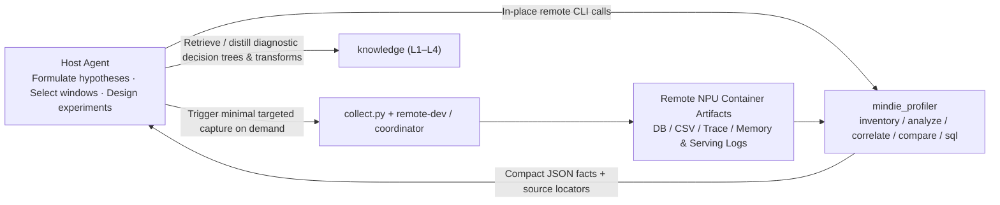
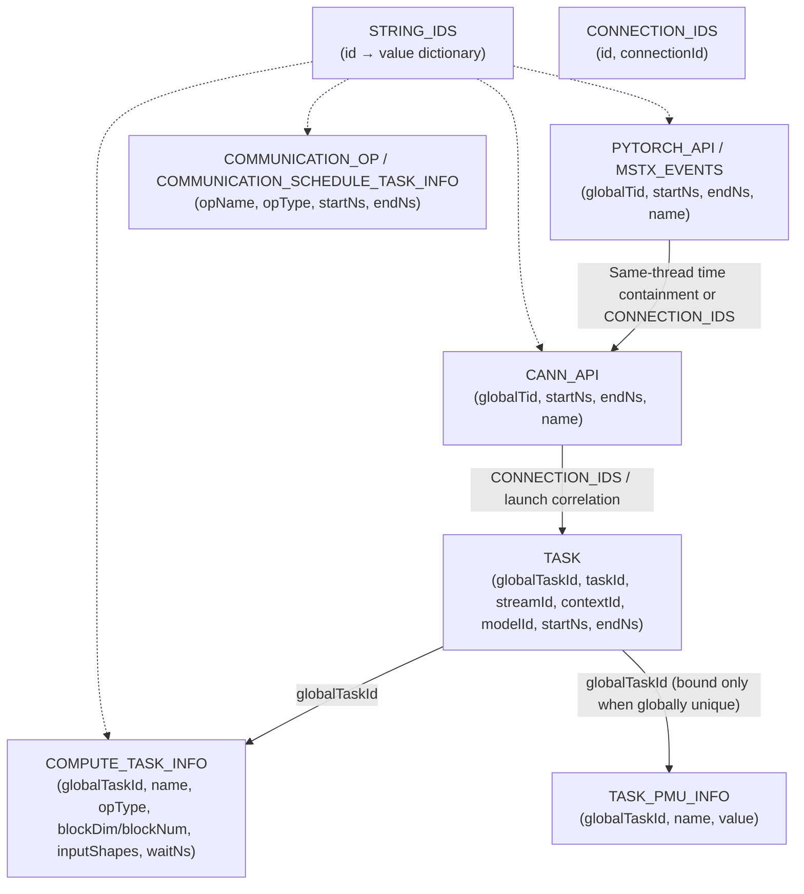

# Profiler System Design for MindIE Agent

[中文](profiler-system.md) · [Architecture](architecture.en.md) · [Design Principles](design-principles.en.md) · [Context & Experience Design](knowledge-context-and-exploration.en.md) · [Documentation](README.en.md)

`mindie_profiler` is a standalone Ascend NPU performance collection, in-place analysis, and comparison package maintained in [`mindie-agent/profiler`](https://github.com/mindie-agent/profiler) (exposing both the `mindie-profiler` CLI and Python APIs), orthogonal to [`diagnostics`](https://github.com/mindie-agent/diagnostics) and [`sim`](https://github.com/mindie-agent/sim).

Its core objective is to **codify Ascend profiling format adaptation, nanosecond interval accounting, Host-to-Device asynchronous call correlation, and cross-run comparability checks into a deterministic, low-overhead closed-problem tool—enabling general coding Agents to obtain traceable performance evidence and verify end-to-end optimization gains without transferring multi-GB raw files or rewriting ad-hoc parsing scripts.**

---

## 1. Engineering Background: Why Do General Agents Need a Dedicated Ascend Profiler Tool?

While general coding Agents can read CSVs, write SQL, and run Python scripts, inspecting raw Ascend profiling artifacts directly during real LLM inference tuning (such as 4-node `DP4 × TP16 × EP64` Kimi K3 DSpark/MLA profiling) and operator development repeatedly hits five high-cost traps:

1. **Multi-GB Artifact Volume and Expensive Transfers / Deserialization**
   - A single rank's exported `trace_view.json` frequently exceeds **1.1 GB** (using either a JSON array root or a `traceEvents` object root). Copying it across machines or calling `json.load()` into memory easily triggers OOMs and timeouts; computing a full-file SHA256 over multi-GB `.db` / `.json` files before every query wastes seconds of disk I/O.
2. **Fragmented and Version-Dependent Ascend DB Schemas**
   - `ascend_pytorch_profiler_*.db` files produced by `torch_npu` / CANN normalize strings into `STRING_IDS`, split device compute across `TASK` and `COMPUTE_TASK_INFO`, split HCCL collectives across `COMMUNICATION_OP` and `COMMUNICATION_SCHEDULE_TASK_INFO`, and store host calls in `PYTORCH_API`, `CANN_API`, and `CONNECTION_IDS`—with column aliases varying across CANN versions (e.g., `blockDim` vs. `blockNum`). Writing ad-hoc SQL from scratch in each session frequently misses joins or triggers repeated full-table scans.
3. **Interval Accounting Distortions from Multi-Stream Overlap, Fused Comm-Compute, and Window Clipping**
   - Under multi-stream concurrency, summing individual kernel durations (`activity_sum`) can exceed wall-clock span;
   - Fused communication-compute operators (such as `MoeDistributeDispatch` / `MoeDistributeCombine`) execute on AIV while performing collective communication—naively summing `TASK` and `COMMUNICATION_OP` double-counts exposed communication;
   - Clipping events to a filter window `[start_ns, end_ns]` splits boundary kernels in half, artificially skewing single-call P50/P90 latency distributions if clipped fragments are mixed with complete calls.
4. **Broken Attribution Under Asynchronous Launch and `ACLGraph` Replay**
   - Idle intervals on the device timeline (`device_uncovered_ms`) are frequently misdiagnosed as "Python or Host dispatch overhead" when they may actually be caused by collective stalls or stream synchronization;
   - Under `ACLGraph` (`torchair` / `FULL_DECODE_ONLY`) graph replay, `taskId` and even `globalTaskId` can repeat across replays, causing naive 1:1 ID joins to misattribute Host call stacks and `TASK_PMU_INFO` hardware counters.
5. **Shape Variant Erasure and Invalid Cross-Run Comparisons**
   - Grouping hotspots solely by `(rank, block, kernel_name)` merges Prefill and Decode calls or distinct batch/padding shapes into a single row and stamps the first event's `inputShapes` onto the entire group, misleading Roofline modeling;
   - Online profiling often captures short diagnostic windows (e.g., 8K input / 20 output). Directly comparing its TPOT against a long steady-state benchmark (e.g., 8K input / 1K output)—or conversely blocking valid single-node duration comparisons merely because `clock_domain` metadata is `"unknown"`—leads to flawed conclusions.

---

## 2. Architectural Boundaries and Component Responsibilities

Following the [Engineering Design Principles](design-principles.en.md) (Principle 2 "Turn Only Well-Bounded Closed Problems into Tools" and Principle 4 "Single Responsibility"), `mindie_profiler` is designed as a **stateless, deterministic CLI and library**:

| Component | Core Responsibility | Explicit Non-Goals (Boundaries) |
| --- | --- | --- |
| **`mindie_profiler`** (standalone package in `diagnostics`) | Artifact discovery, schema verification, nanosecond interval accounting, variant-aware aggregation, Host-to-Device correlation, cross-run factual comparison, memory attribution, online profile window control | Never tracks cross-turn LLM session state (`known_refs` or context compaction), never estimates host LLM token bills, never imports `torch_npu` on the CPU analysis path, and never makes open-ended bottleneck judgments on behalf of the Agent |
| **Host Agent + Skill** | Understand user targets (TTFT/TPOT/throughput/operator latency), invoke `mindie-profiler` subcommands progressively, formulate hypotheses, and run minimal verification experiments | Never hardcodes rigid troubleshooting pipelines into tool code; never pulls multi-GB raw traces to the local machine |
| **`remote-dev` + `coordinator`** | Execute `mindie-profiler` and managed offline export jobs (`torch_npu.profiler.analyse`) in place on the remote container; manage NPU and port leases | Never creates a separate performance job scheduler or duplicate run identity (reuses `run_id`) |
| **`npu-top`** | Provide time-aligned device temperature, power, AICore frequency, and HBM sampling series | Never declares thermal throttling from a temperature threshold alone (e.g., `>= 85°C`) without explicit hardware throttling signal bits |
| **`knowledge` (and domain repos)** | Store verified measurement axioms (L1), capture/correlation SOPs (L2), bottleneck decision trees (L3), and operator/graph code transforms (L4) | Never stores raw traces or one-off Top-K reports lacking cross-task reuse value |
| **`mindie-bench`** | Verify end-to-end numerical correctness and performance gains under matched inputs and hardware conditions | Never acts as the sole entry point for routine interactive profiling |

---

## 3. Existing Foundation and Five Core Semantic Corrections

### 3.1 Module Layout and Responsibility Convergence

`mindie_profiler` is organized into cohesive modules that follow the repository's Agent Invariant Header (`[Role]` / `[Invariants]` / `[Timeouts & Locks]` / `[Side-Effect Policy]`) and context-window size constraints:

| Module Group | Source Files | Responsibility and Evolution |
| --- | --- | --- |
| **Source Discovery & Scoping** | `segment.py`, `sources_db.py`, `sources_csv.py`, `sources_trace.py` (new) | Rank directory discovery, explicit time/step window parsing, read-only SQLite (`mode=ro` + `query_only=ON`) with `STRING_IDS` resolution, CSV scanning, and streaming JSON Trace sidecar indexing |
| **Interval Accounting & Classification** | `accounting.py`, `classify.py`, `cross_rank.py`, `events.py` | Integer-nanosecond interval union/subtraction, semantic block and execution engine classification, variant-aware (`shape`/`dtype`/`format`) hotspot grouping, cross-rank P50 and slowest-rank statistics |
| **Progressive Queries & Reporting** | `__main__.py`, `analyze.py`, `report.py`, `correlate.py` (new) | Expose `inventory`, `analyze`, `correlate`, and `sql` subcommands producing compact JSON with source table locators |
| **Anomalies, Memory & Modeling** | `enrichment*.py`, `memory_*.py`, `theoretical_model.py`, `tensor_cast_provider.py` | Unambiguous single-occurrence `waitNs` / `TASK_PMU_INFO` binding, P0–P4 HBM attribution, single-operator Roofline lower bounds, and optional injectable `msmodeling` (`tensor_cast`) predictions |
| **Cross-Run Comparison & Online Control** | `compare.py`, `cli_compare.py`, `collect.py`, `framework_capture.py` | Per-metric comparability checks and A/B diff reports; `/start_profile` and `/stop_profile` window control with `completed / failed / unknown` reconciliation |

### 3.2 Five Mandatory Accounting and Identity Corrections (P0)

Based on code audit and real profiling feedback, five semantic defects in the existing implementation are directly corrected:

1. **Separate Request Wall Time, Query Window Duration, and Observed Event Span**
   - The existing `wall_ms` field actually measures `max(end_ns) - min(start_ns)` across selected device events inside the window. Rename it explicitly to **`observed_event_span_ms`**, keeping it distinct from the caller's filter **`window_duration_ms`** and client/server **`request_wall_ms`**.
2. **Rename `host_gap_ms` to `device_uncovered_ms` (No Unsubstantiated Host Blame)**
   - `observed_event_span_ms - device_busy_union_ms` only measures intervals within the event span where no selected device activity ran. Rename it to **`device_uncovered_ms`**; compute `host_dispatch_gap_ms` only when `PYTORCH_API` / `CANN_API` launch correlation is present.
3. **Decouple Execution Engine from Resource Bottleneck**
   - `AIC`, `AIV`, `AICPU`, and `HCCL` derived from `core` / `taskType` strings in `classify.py` identify the **`execution_engine`**, not the limiting hardware resource. Replace misleading `cube_bound` / `vector_bound` labels with `execution_engine` (`aic`, `aiv`, `mix`, `aicpu`, `hccl`) so Agents do not confuse engine type with PMU-verified compute/memory bottlenecks.
4. **Group Hotspots by Shape/Dtype/Format Variants and Exclude Clipped Events from Latency Percentiles**
   - Group hotspots by `(rank_id, semantic_block, kernel_name, input_shapes, input_dtypes, input_formats)` by default; when rolling up by kernel name, report `variant_count` explicitly instead of stamping the first event's `inputShapes` onto the entire group.
   - Events clipped at `[start_ns, end_ns]` boundaries contribute to window `device_busy_union_ms` and `device_activity_sum_ms`, but are **excluded from single-call P50 / P90 / Max latency distributions** (reported separately under `clipped_event_count`).
5. **Drop Default Whole-File SHA256 Hashing and Unblock Single-Node Duration Comparisons**
   - Stop hashing multi-GB source files on every query (compute SHA256 only when `--hash` is explicitly requested for archival); use `(resolved_path, size_bytes, mtime_ns, schema_version)` for local cache invalidation. When multiple `.db` files exist in a rank directory, `inventory` lists all candidates rather than silently picking the newest `mtime`.
   - In `compare.py`, comparing local duration distributions (step, block, or kernel durations) no longer fails globally when `clock_domain == "unknown"`; `clock_domain` only gates cross-host/cross-rank timeline alignment and event ordering.

---

## 4. Ascend Data Source Model and Correlation Mechanisms

### 4.1 Multi-Source Priority and Streaming Sidecar Index for Large Traces

A single profiling directory often contains `ascend_pytorch_profiler_*.db`, `kernel_details.csv`, and `trace_view.json` simultaneously:

- **Single Source of Truth per Metric**: Select one authoritative source per metric in **`DB > CSV > JSON Trace`** order; never sum identical events across formats. Cross-format reads are used only for missing fields or cross-validation.
- **In-Place Read-Only SQLite**: Open existing `.db` files with `file:...?mode=ro`, `PRAGMA query_only = ON`, and a bounded `busy_timeout`. Enforce per-query wall-clock deadlines (default `20s`) via a SQLite progress handler and explicit row budgets (default `1,000,000` rows; over-budget queries raise an explicit error rather than silently truncating results).
- **Streaming Sidecar Index for Multi-GB JSON Traces**: When only `trace_view.json` is available (supporting both `[` array root and `{"traceEvents": [...]}` object root) and repeated drill-down queries are needed, stream-parse the file in chunks (never `json.load()` the entire file into memory) into a disposable, rebuildable sidecar SQLite index (`WAL` mode + `busy_timeout=5000`).

### 4.2 Ascend DB Table Joins and `ACLGraph` Duplicate-ID Protection

`sources_db.py` and `correlate.py` join verified CANN/PyTorch tables defined in [`db_source_mapping.json`](https://github.com/mindie-agent/diagnostics):

1. **String Resolution**: Cache `STRING_IDS` once per DB handle; unresolved IDs render explicitly as `<unresolved:id>`, never `"0"` or empty strings.
2. **Host $\to$ Runtime $\to$ Device Correlation**:
   - Within the same CPU thread (`globalTid`), reconstruct `PYTORCH_API` (model layers, modules, ops) and `MSTX_EVENTS` call stacks via integer-nanosecond interval containment (`parent.startNs <= child.startNs` and `parent.endNs >= child.endNs`);
   - Join `PYTORCH_API` / `CANN_API` (e.g., `aclrtLaunchKernel`) to device `TASK` rows via `CONNECTION_IDS`, attributing low-level kernels to high-level model blocks (`Attention`, `MLA`, `KDA`, `MoE`, or speculative `Draft` / `Verify` phases).
3. **Graph Mode (`ACLGraph` / `torchair`) and Duplicate-ID Protection**:
   - Under `ACLGraph` capture and replay, `taskId` and even `globalTaskId` can repeat across replays within a single capture, or a single host graph launch can dispatch an entire batch of device tasks.
   - Every **Event Locator** is uniquely identified by `(source_id, table, rowid, globalTaskId, startNs)`.
   - `COMPUTE_TASK_INFO.waitNs` and `TASK_PMU_INFO` are bound to an individual `TASK` event **only when that `globalTaskId` appears exactly once (`count == 1`) across the entire `TASK` table**; repeated IDs remain group-scoped and are flagged as `ambiguous_global_task_id` rather than summed, averaged, or arbitrarily picked.

---

## 5. Interval Accounting, Classification, and Inference Semantics

### 5.1 Core Time Metric Definitions

All timestamps are converted once at the boundary to integer nanoseconds (`ns`) using exact `Decimal` arithmetic to avoid floating-point subtraction precision loss; report outputs are milliseconds (`ms`, rounded to 6 decimal places):

| Metric Field | Exact Definition | Accounting Invariants & Anti-Misread Rules |
| --- | --- | --- |
| `request_wall_ms` | End-to-end request latency recorded by client or server | Must state observation side (Client / Server); never inferred from kernel span |
| `window_duration_ms` | Caller-specified filter window length (`window.end_ns - window.start_ns`) | Represents filter scope, not necessarily a full request or step duration |
| `observed_event_span_ms` | `max(end_ns) - min(start_ns)` of selected device events inside the window (formerly `wall_ms`) | Smaller than `window_duration_ms` when window edges contain no events |
| `device_busy_union_ms` | Length of the **interval union** of clipped device events in the window | Overlapping multi-stream intervals are counted once; `<= observed_event_span_ms` |
| `device_activity_sum_ms` | **Sum of individual durations** of clipped device events (called `kernel_sum_ms` when restricted to compute kernels) | Can exceed `device_busy_union_ms` under multi-stream overlap; never added to `device_busy_union_ms` |
| `comm_nonoverlap_ms` | Portion of the communication interval union **not covered by non-communication compute** (exposed communication) | Fused MoE communication kernels (`MoeDistributeDispatch` / `Combine`) are classified as `MoE` compute so their AIV work is not double-counted as exposed communication |
| `device_uncovered_ms` | `observed_event_span_ms - device_busy_union_ms` (formerly `host_gap_ms`) | Measures uncovered device timeline gaps only; confirming Host dispatch starvation requires `correlate` evidence |

**Coverage and Missing-Value Invariants**:
- When a window is confirmed captured and an enabled activity type has zero events, its count/duration is `0`;
- When tables are absent (e.g., communication or PMU not collected), the window is empty, or export is incomplete, affected metrics return `None` with explicit reason codes in `limitations` (`empty_window`, `optional_table_missing`)—**missing data is never fabricated as `0`**.

### 5.2 Three Orthogonal Classification Dimensions (Role × Engine × Bottleneck Evidence)

Each event carries three distinct dimensions:

1. **Semantic Block (`semantic_block`)**: `Attention` (including MLA / GDN / Mamba / Linear Attention), `MoE` (including GroupedMatmul, Router, and fused Dispatch/Combine), `Comm` (standalone HCCL collectives), `Norm`, `Copy_Layout` (TransData / Cast / D2D), and `Unclassified`. Host module correlation takes precedence when available; deterministic name-token matching serves as the fallback with an explicit `mapping_rule`.
2. **Execution Engine (`execution_engine`)**: `aic` (Cube), `aiv` (Vector), `mix` (Cube+Vector), `aicpu`, `hccl`, `host`.
3. **Bottleneck & Anomaly Evidence (`enrichment`)**: Emitted only when backed by measured `TASK_PMU_INFO` (`aic_mac_ratio`, `aiv_vec_ratio`, `mte2_ratio`), unambiguous `waitNs`, AICPU exposure ratios, or Host launch correlation.

### 5.3 LLM Inference Workload Semantics

- **Explicit Phase and Step Boundaries**: `inventory` extracts native `ProfilerStep#` and `MSTX_EVENTS` markers (`warmup`, `prefill`, `decode`, `draft`, `verify`, `graph_capture`) from the DB when present; otherwise the caller must supply explicit `--window START:END` or `--full-range` bounds—steps are never guessed from repeating kernel patterns.
- **Speculative Decoding (DSpark / MTP)**: Alongside `draft` and `verify` kernel timings, reports and comparisons track serving-side `mean_acceptance_length` and `acceptance_rate` to prevent false optimizations where a faster Verify kernel degrades acceptance length and hurts end-to-end TPOT.
- **Multi-Dimensional Parallelism & Cross-Rank Aggregation**: Group only homogeneous ranks (e.g., never average across distinct PP stages). Report both `median_rank_p50` and the **per-step slowest rank (`max_rank_per_step`)** distribution so rotating stragglers are not masked by per-rank medians.

---

## 6. Progressive CLI and Module Interfaces for Agents

`mindie-profiler` exposes five focused subcommands via a unified CLI (`python -m mindie_profiler <subcommand>`), requiring no background daemon:

### 6.1 Five Core CLI Subcommands

| Subcommand | Typical Agent Use Case | Key Inputs | Bounded Output |
| --- | --- | --- | --- |
| **`inventory`** | First look at a directory or file to discover ranks, tables, native steps, and time bounds | `--root <dir_or_file>` | Discovered ranks, DB/CSV/JSON paths and byte sizes, available tables (including `PYTORCH_API` / `TASK_PMU_INFO` presence), native Step/MSTX windows, capture time span |
| **`analyze`** | Compute windowed interval accounting, semantic block shares, and variant-aware hotspots | `--root`, `--step-window` / `--window` / `--full-range`, `--rank`, `--top 10`, `--group-by variant\|kernel` | Window metrics (`observed_event_span_ms`, `device_busy_union_ms`, `comm_nonoverlap_ms`, `device_uncovered_ms`), 6 semantic block shares, Top-K hotspots with Shape/Dtype and source Locators, cross-rank P50/straggler stats, AICPU/PMU summaries |
| **`correlate`** | Drill down into a specific device gap or hotspot kernel to inspect its Host call stack and launch chain | `--root`, `--window START:END`, `--rank`, `--kernel-name <pat>` or `--min-gap-ms <val>` | Matched `PYTORCH_API` / `MSTX_EVENTS` same-thread parent call stacks, `CANN_API` launch durations, Host-to-Device launch delay, and uncorrelated event ratio |
| **`compare`** | A/B comparison of structural changes and duration distributions across two runs | `<baseline_report.json> <candidate_report.json>` | Workload/environment comparability checks, operator sequence/fusion/shape diffs, aligned step/block/variant P50 deltas and confidence intervals |
| **`sql`** | Read-only SQL escape hatch for custom investigation of new operators or unmapped columns | `--db <path>`, `--query "<SELECT ...>"`, `--limit 50`, `--timeout-s 10` | Read-only (`mode=ro` + `query_only=ON`), row- and timeout-bounded query results with automatic `STRING_IDS` resolution helpers |

### 6.2 Online Capture Control, Memory Attribution, and Theoretical Modeling

1. **Controlled Online Capture (`collect.py`)**
   - Verifies that the target serving process was started with `--profiler-config` or `VLLM_TORCH_PROFILER_DIR` before sending requests; if absent, fails immediately with actionable configuration guidance and **never silently restarts a live serving instance**.
   - Distinguishes `completed`, `failed` (non-2xx HTTP or connection refusal), and `unknown` (timeout or lost response after sending `POST /start_profile` or `POST /stop_profile`). An `unknown` state blocks further start/stop calls until `reconcile()` verifies artifact state on disk.
   - Offline parsing (`torch_npu.profiler.analyse(profile_dir, max_process_number=...)`) runs as a managed job via `remote-dev`, tracked separately from the HTTP control receipt.
2. **P0–P4 HBM Memory Attribution (`memory_profile.py`)**
   - Combines five explicit sources in priority order: `P0` (`msprof` `npu_module_mem` component records), `P1` (whole-device runtime peak), `P2` (framework startup logs for weights / KV cache / graph pools), `P3` (`safetensors` header byte counts), and `P4` (`config.json` theoretical estimates).
   - Separates co-temporal additive components (`included_in_sum`) from non-coincident phase peaks, reporting unattributed `residual_bytes` honestly.
3. **Three-Way Separation in Theoretical Modeling (`theoretical_model.py` & `tensor_cast_provider.py`)**
   - Keeps **`measured_device_ms`**, single-operator Roofline lower bound **`ideal_hardware_lower_bound_ms`**, and external provider prediction **`model_predicted_ms`** (e.g., pinned `msmodeling` / `tensor_cast`) strictly separate. Missing shapes or unverified hardware mappings remain `unmodeled` (`None`).

---

## 7. Implementation Roadmap and Tiered Acceptance Criteria

### 7.1 Phased Delivery Order

| Phase | Core Deliverables | Completion Criteria |
| --- | --- | --- |
| **P0: Accounting & Identity Fixes** | Implement the five corrections in Section 3.2 (metric renaming, engine vs. bottleneck separation, shape-variant hotspot grouping, boundary clipping exclusion from percentiles, removal of default full-file SHA256 and silent `mtime` DB picking, per-metric cross-run comparability) | Existing unit tests and hardware Golden Capture replays pass under the updated schema with zero mixed-shape hotspots or false comparability blocks |
| **P1: Progressive CLI & Streaming Large Traces** | Ship `inventory`, `correlate`, and `sql` subcommands; implement streaming chunked ingestion and rebuildable sidecar SQLite indexing for 1GB+ `trace_view.json` (array and object roots) | On real 1.1GB Kimi K3 traces and multi-rank DBs, `inventory` finishes in `< 1s`, warm range queries finish in `< 5s`, and peak RSS remains bounded |
| **P2: Inference Call-Chain & Graph Correlation** | Extract native `ProfilerStep#` / `MSTX_EVENTS`; wire `PYTORCH_API` $\leftrightarrow$ `CONNECTION_IDS` $\leftrightarrow$ `CANN_API` $\leftrightarrow$ `TASK` joins with `ACLGraph` duplicate-ID protection; integrate speculative decoding acceptance metrics | A single `correlate` command attributes real inference gaps or hotspots to exact model layers and launch APIs, distinguishing Host dispatch starvation from collective stalls |
| **P3: Online Capture & Knowledge Loop** | Connect `collect.py` window control, `remote-dev` managed export, `compare` A/B verification, and `knowledge` `L1–L4` distillation | Complete end-to-end closed loops on at least one real operator/inference optimization and one refuted hypothesis revision |

### 7.2 Four-Tier Testing Pyramid Acceptance (Following [`testing-architecture.en.md`](testing-architecture.en.md))

All tests must verify genuine domain logic and failure boundaries (no filler type checks, prose grepping, or silent-fallback assertions):

- **Tier 0 (Pure In-Memory Core Logic Unit Tests, `< 5s`)**: Zero subprocesses, zero network, zero `sleep`. Backed by real A2 (910B) / A3 (910C) / A5 Golden Capture slices, verifying multi-stream interval union/subtraction, fused MoE comm deduplication, clipped-event exclusion from latency percentiles, shape-variant grouping, duplicate `globalTaskId` protection, and `None` reporting on missing tables/empty windows.
- **Tier 1 (Local Component Contract & Process Boundary Tests, `< 15s`)**: Verify real SQLite DB / CSV / dual-root JSON streaming ingestion, sidecar index reuse and invalidation, `sql` read-only enforcement (rejecting writes and extension loads), SQLite progress-handler timeout cancellation, and `compare` comparability gates.
- **Tier 2 (Standing A2/A3 NPU Non-Destructive Live Integration `@pytest.mark.live_npu`, `< 25s`)**: Connect directly to standing A2 (`173.125.1.2`) and A3 (`192.168.13.165` / `.156` / `.154`) clusters using isolated sandbox directories to verify in-place container `inventory` / `analyze` / `correlate`, A3 dual-Die physical device mapping, and online collection reconciliation.
- **Tier 3 (End-to-End Host CLI & Live Canary Acceptance, `< 90s`)**: Drive native host CLIs through the full "inventory $\to$ correlate $\to$ verify $\to$ compare" loop, ensuring every performance claim traces back to concrete source table locators and run IDs.
