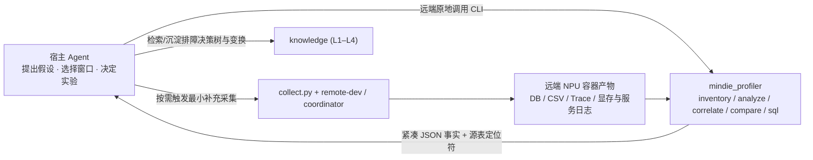
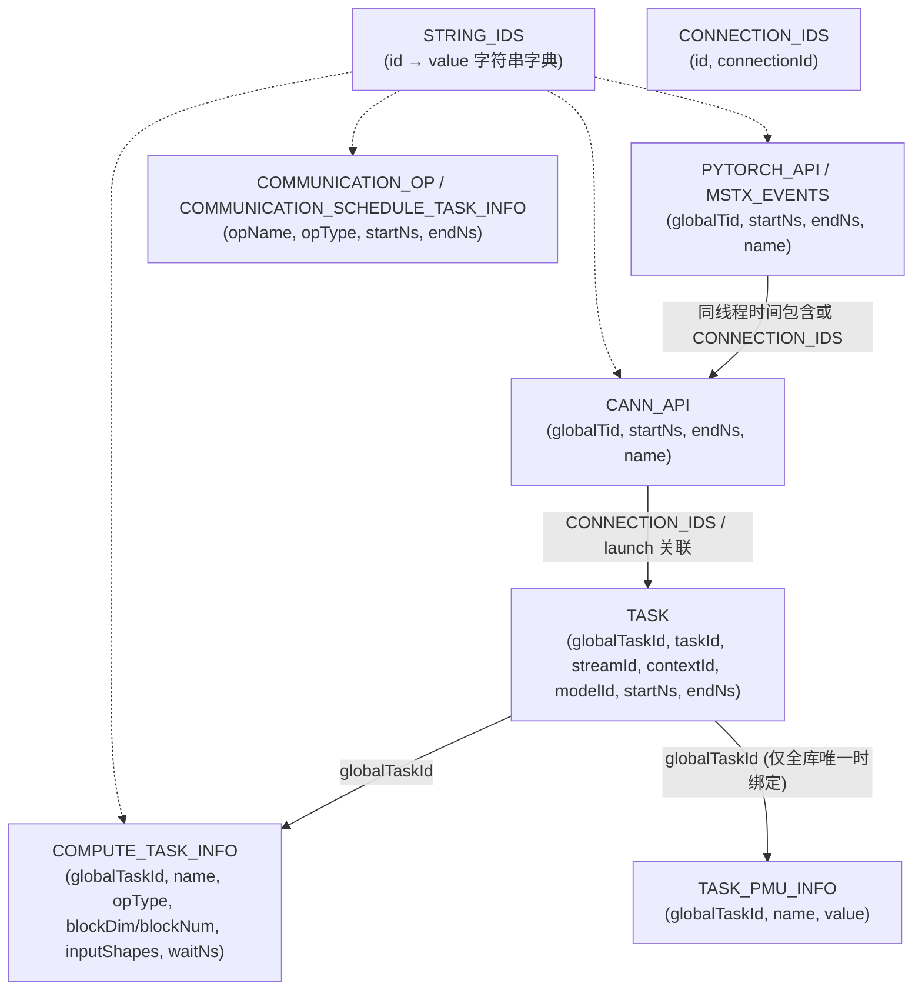

# 面向 MindIE Agent 的 Profiler 系统设计

[English](profiler-system.en.md) · [系统架构](architecture.md) · [设计原则](design-principles.md) · [上下文与经验设计](knowledge-context-and-exploration.md) · [文档中心](README.md)

`mindie_profiler` 是独立仓库 [`mindie-agent/profiler`](https://github.com/mindie-agent/profiler) 维护的昇腾（Ascend）NPU 性能采集、原地解析与对比组件（提供 `mindie-profiler` CLI 与 Python 接口），与诊断上报仓库 [`diagnostics`](https://github.com/mindie-agent/diagnostics) 和四层仿真求解仓库 [`sim`](https://github.com/mindie-agent/sim) 各自独立建仓、职责正交。

其核心目标是：**将昇腾 Profiling 产物的格式适配、纳秒级区间核算、Host-Device 异步调用关联与跨 Run 可比性校验固化为确定性、低开销的封闭工具；让通用编程 Agent 无需搬运 GB 级原始文件或重复编写底层解析脚本，即可快速获得可追溯的性能证据并验证端到端优化收益。**

---

## 1. 工程背景：为什么通用 Agent 需要专用昇腾 Profiler 工具？

通用 Agent 具备读写 CSV、编写 SQL 和执行 Python 脚本的能力，但在真实的昇腾大模型推理（如四机 `DP4 × TP16 × EP64` Kimi K3 DSpark/MLA 调优）与算子开发任务中，直接让 Agent 裸读原始 Profiling 产物会反复遭遇五类高成本陷阱：

1. **产物规模巨大，全量读取与跨机搬运开销极高**
   - 单 Rank 导出的 `trace_view.json` 常超过 **1.1 GB**（JSON 数组根或 `traceEvents` 对象根），直接传输回本地或调用 `json.load()` 全量反序列化极易触发内存溢出（OOM）与超时；每次分析前对 GB 级 `.db` / `.json` 计算全文件 SHA256 也会白白消耗数秒磁盘 I/O。
2. **昇腾 DB 表结构碎片化且随版本演进**
   - `torch_npu` / CANN 生成的 `ascend_pytorch_profiler_*.db` 将字符串字典拆在 `STRING_IDS`，设备计算拆在 `TASK` 与 `COMPUTE_TASK_INFO`，HCCL 通信拆在 `COMMUNICATION_OP` 与 `COMMUNICATION_SCHEDULE_TASK_INFO`，Host 调用拆在 `PYTORCH_API`、`CANN_API` 与 `CONNECTION_IDS`，且不同 CANN 版本存在列名差异（如 `blockDim` vs `blockNum`）。Agent 每次临时手写 SQL 极易漏表、写错关联键或重复扫描。
3. **多流并发、通算融合与窗口裁剪的计量失真**
   - NPU 多流并发下，逐事件耗时简单相加（`activity_sum`）可能超过实际墙钟跨度；
   - 通算融合算子（如 `MoeDistributeDispatch` / `MoeDistributeCombine`）同时涉及 AIV 计算与通信，若将 `TASK` 与 `COMMUNICATION_OP` 简单累加会导致通信暴露耗时被双重计数；
   - 按时间窗口 `[start_ns, end_ns]` 裁剪事件时，若把窗口边界被截断的“半个 Kernel”混入单次调用耗时分布，会人为拉低 P50/P90 统计值。
4. **异步下发与图模式（`ACLGraph`）归因断链**
   - 设备时间线上的空闲间隙（`device_uncovered_ms`）常被简单误判为“Python 或 Host 调度慢”，但实际可能源于多卡 collective 等待或同步事件；
   - 在 `ACLGraph`（`torchair` / `FULL_DECODE_ONLY`）图重放场景下，`taskId` 甚至 `globalTaskId` 会在多次 replay 中重复出现，直接按 ID 做 1:1 关联会错误绑定 Host 调用栈与 `TASK_PMU_INFO` 硬件计数器。
5. **同名算子多 Shape 混淆与跨运行条件误比较**
   - 仅按 `(rank, block, kernel_name)` 聚合热点会把 Prefill 与 Decode、不同 Batch 或不同 Padding 形状的调用混成一行，并错误地用第一条记录的 `inputShapes` 代表整个算子族去做 Roofline 建模；
   - 在线排障常用短输出窗口（如 8K 输入 / 20 输出）做轻量 Profiling，若将其直接与长稳态基准（如 8K 输入 / 1K 输出）混比 TPOT，或因 `clock_domain` 未标注就一刀切阻断单机耗时分布对比，都会导致错误结论。

---

## 2. 架构边界与组件分工

遵循[工程设计原则](design-principles.md)（原则 2“只把封闭问题做成工具”、原则 4“单一职责”），`mindie_profiler` 保持为**无跨轮会话状态、纯确定性计算的 CLI 与库**：

| 组件 | 核心职责 | 明确不做的事（边界） |
| --- | --- | --- |
| **`mindie_profiler`**（`diagnostics` 仓独立包） | 产物发现、Schema 校验、纳秒区间计量、变体聚合、Host-Device 关联、跨 Run 事实对比、显存归因、在线采集窗口控制 | 不维护跨轮 LLM 会话状态、不估算宿主模型 Token 账单、不在 CPU 解析路径 `import torch_npu`、不内置复杂流水周期求解或子图融合仿真（统一委托给同仓平级独立包 [`mindie_sim`](simulation-system.md)） |
| **`mindie_sim`（`mindie-sim`）** | 硬件规格与热态频率下界、算子内微阶段周期依赖图最大环均值求解、Phase 0 子图跨界融合流量/关键路径仿真、整网并行推演（桥接 `msmodeling` / `cannsim` / `npusim`） | 不解析实测 Profiling DB/CSV/Trace 原始事件表；仅接收结构化图/配置与 `mindie_profiler` 实测摘要进行仿真求解与三值对齐 |
| **宿主 Agent + Skill** | 理解用户性能目标（TTFT/TPOT/吞吐/算子时延）、按需调用 `mindie-profiler` 子命令、结合上下文提出假设并设计最小验证实验 | 不把死板的排查步骤写进工具源码，不在本地全量拉取 GB 级原始 Trace |
| **`remote-dev` + `coordinator`** | 在数据所在远端主机/容器内原地运行 `mindie-profiler` 及受管离线导出作业（`torch_npu.profiler.analyse`），管理设备与端口租约 | 不新建独立的性能任务队列或第二套运行身份（统一复用 `run_id`） |
| **`npu-top`** | 提供同时间窗口的设备温度、功耗、AICore 频率与显存采样序列 | 不脱离硬件降频信号位仅凭单一温度阈值（如 `>= 85°C`）直接宣判降频 |
| **`knowledge`（及领域知识仓）** | 存储经过验证的测量公理（L1）、采集与关联 SOP（L2）、瓶颈定界决策树（L3）与算子/图优化变换（L4） | 不收纳每次运行的原始 Trace 或无复用意义的单次 Top-K 报表 |
| **`mindie-bench`** | 在固定输入、精度裁判与同构环境下验证端到端性能收益 | 不作为日常线上 Profiling 工具的唯一调用入口 |

---

## 3. 现有实现基础与五项核心语义修正

### 3.1 模块全景与职责收敛

`mindie_profiler` 围绕以下核心模块组织，所有核心文件均遵循仓库的 Agent Invariant Header（`[Role]` / `[Invariants]` / `[Timeouts & Locks]` / `[Side-Effect Policy]`）与单文件体量约束：

| 模块分组 | 对应源码文件 | 当前职责与演进定位 |
| --- | --- | --- |
| **数据源与范围发现** | `segment.py`, `sources_db.py`, `sources_csv.py`, `sources_trace.py`（新增） | Rank 目录识别、显式时间/Step 窗口解析、只读 SQLite（`mode=ro` + `query_only=ON`）与 `STRING_IDS` 解析、CSV 及流式 JSON Trace 旁路索引 |
| **区间计量与分类** | `accounting.py`, `classify.py`, `cross_rank.py`, `events.py` | 整数纳秒区间并集/差集运算、语义块与执行引擎分类、按算子变体（Shape/Dtype/Format）聚合、跨 Rank P50 与最慢 Rank 统计 |
| **渐进查询与报告** | `__main__.py`, `analyze.py`, `report.py`, `correlate.py`（新增） | 提供 `inventory`、`analyze`、`correlate`、`sql` 子命令，输出带源表定位符（Locator）的紧凑结构化 JSON |
| **异常、显存与理论建模** | `enrichment*.py`, `memory_*.py`, `theoretical_model.py`, `tensor_cast_provider.py` | 单实例 `waitNs` / `TASK_PMU_INFO` 绑定、P0–P4 显存归因、单算子 Roofline 下界与可选 `msmodeling`（`tensor_cast`）注入式预测 |
| **跨 Run 对比与在线控制** | `compare.py`, `cli_compare.py`, `collect.py`, `framework_capture.py` | 按指标判定可比性的 A/B 差异报告；`/start_profile` 与 `/stop_profile` 在线采集控制及 `completed / failed / unknown` 状态对账 |

### 3.2 五项必须落地的计量与身份修正（P0）

基于现有实现审视与真实排障反馈，以下五处语义缺陷直接按新契约修正：

1. **区分“请求墙钟”、“查询窗口”与“设备事件跨度”**
   - 现有 `wall_ms` 实际计算的是窗口内选中设备事件的 `max(end_ns) - min(start_ns)`。将其明确更名为 **`observed_event_span_ms`**，与查询窗口长度 **`window_duration_ms`** 及客户端/服务端测量的 **`request_wall_ms`** 严格分开。
2. **将 `host_gap_ms` 更名为 `device_uncovered_ms`，禁止无证据归咎 Host**
   - `observed_event_span_ms - device_busy_union_ms` 仅表示所选设备活动未覆盖的时间间隙。将其更名为 **`device_uncovered_ms`**；仅当关联了 `PYTORCH_API` / `CANN_API` 下发时间戳后，才单独计算 `host_dispatch_gap_ms`。
3. **执行引擎（Engine）与资源瓶颈（Bottleneck）脱钩**
   - `classify.py` 从 `core` / `taskType` 字段提取的 `AIC` / `AIV` / `AICPU` / `HCCL` 仅代表**执行引擎（`execution_engine`）**。废弃直接把引擎名拼成 `cube_bound` / `vector_bound` 的命名，防止 Agent 误以为没有读取 `TASK_PMU_INFO` 就已经确认了算力或带宽受限。
4. **热点聚合保留 Shape / Dtype / Format 变体，且边界裁剪不污染分布**
   - 热点默认按 `(rank_id, semantic_block, kernel_name, input_shapes, input_dtypes, input_formats)` 聚合；按算子名汇总时必须显式输出 `variant_count`，绝不用首个事件的 `inputShapes` 填充整个聚合行。
   - 窗口边界被 `[start_ns, end_ns]` 截断的事件计入窗口 `device_busy_union_ms` 与 `device_activity_sum_ms`，但**剔除出单次调用的 P50 / P90 / Max 分布统计**（单独记录 `clipped_event_count`）。
5. **移除每次查询的全文件 SHA256，解绑单机时长对比的 `clock_domain` 硬门禁**
   - 默认不计算 GB 级源文件的 SHA256（仅在 `--hash` 显式归档时启用）；本地索引与缓存使用 `(resolved_path, size_bytes, mtime_ns, schema_version)` 校验失效。当 Rank 目录下存在多份 `.db` 时，`inventory` 显式返回全部候选列表，禁止按最新 `mtime` 静默选取。
   - `compare.py` 中，单机或同构 Rank 的耗时分布对比（Step、语义块、算子耗时）不再因 `clock_domain == "unknown"` 而全局阻断；`clock_domain` 仅作为跨机/跨进程绝对时间线对齐与先后顺序判定的门禁。

---

## 4. 昇腾数据源模型与关键关联机制

### 4.1 多源优先级与大文件流式旁路索引

同一 Profiling 目录常同时存在 `ascend_pytorch_profiler_*.db`、`kernel_details.csv` 与 `trace_view.json`：

- **单一事实源原则**：计算同一指标时，按 **`DB > CSV > JSON Trace`** 优先级选用单一权威源，严禁将同一次采集导出的 DB 与 CSV/JSON 重复累加。跨格式仅用于补充缺失字段或交叉校验。
- **SQLite 原地只读**：对已有 `.db` 文件统一以 `file:...?mode=ro`、`PRAGMA query_only = ON` 和受限 `busy_timeout` 打开，并在 SQLite Progress Handler 中绑定单次查询 Wall-Clock Deadline（默认 `20s`）与行数上限（默认 `1,000,000` 行，超限显式报错，绝不静默截断后伪装成全量结果）。
- **GB 级 JSON Trace 流式索引**：当现场仅有 `trace_view.json`（兼容 `[` 数组根与 `{"traceEvents": [...]}` 对象根）且需多次下钻查询时，采用流式分块解析器（禁止 `json.load()` 整文件读入内存）生成可删除、可重建的本地旁路 SQLite 索引（`WAL` 模式 + `busy_timeout=5000`）。

### 4.2 昇腾 DB 核心表关联与 `ACLGraph` 重复 ID 保护

`sources_db.py` 与 `correlate.py` 基于经真机验证的 [`db_source_mapping.json`](https://github.com/mindie-agent/diagnostics) 处理昇腾表关联：

1. **字符串解析**：启动时一次性缓存 `STRING_IDS`；缺失 ID 显式标记为 `<unresolved:id>`，绝不回退为 `"0"` 或空串。
2. **Host $\to$ Runtime $\to$ Device 关联**：
   - 同线程内（相同 `globalTid`），按整数纳秒区间包含关系（`parent.startNs <= child.startNs` 且 `parent.endNs >= child.endNs`）还原 `PYTORCH_API`（模型层、模块、算子调用）与 `MSTX_EVENTS` 的调用栈；
   - 通过 `CONNECTION_IDS` 将 Host 侧 `PYTORCH_API` / `CANN_API`（如 `aclrtLaunchKernel`）与设备侧 `TASK` 连接，从而将底层 Kernel 准确归属到高层模块（如 `Attention`、`MLA`、`KDA`、`MoE` 或投机采样的 `Draft` / `Verify` 阶段）。
3. **图模式（`ACLGraph` / `torchair`）与重复 ID 保护**：
   - 在 `ACLGraph` 图捕获与重放（Replay）下，`taskId` 乃至 `globalTaskId` 可能在单次采集内多次出现，或由单次 Host 图执行触发一整批设备 Task。
   - **唯一事件定位符（Event Locator）** 必须由 `(source_id, table, rowid, globalTaskId, startNs)` 共同构成。
   - `COMPUTE_TASK_INFO.waitNs` 与 `TASK_PMU_INFO` 属于全库级键绑定：仅当某个 `globalTaskId` 在整张 `TASK` 表中出现次数严格为 `1` 时，才将其 `waitNs` 与 PMU 指标绑定到该事件；若出现多次（`count > 1`），保持组级未决并标记 `ambiguous_global_task_id`，禁止跨 replay 求和、取平均或随机挑一行。

---

## 5. 时间计量、分类与推理语义契约

### 5.1 核心时间指标定义

所有时间戳在入口处使用 `Decimal` 精确转换为整数纳秒（`ns`），避免大时间戳转 `float` 相减丢失精度；报告输出统一为毫秒（`ms`，保留 6 位小数）：

| 指标字段 | 精确定义 | 计量约束与防误读规则 |
| --- | --- | --- |
| `request_wall_ms` | 客户端或服务端记录的请求端到端耗时 | 需注明观测端（Client / Server），不从设备 Kernel 跨度反推 |
| `window_duration_ms` | 调用方指定的分析窗口长度（`window.end_ns - window.start_ns`） | 代表筛选范围，不等于单次请求或单个 Step 的真实时长 |
| `observed_event_span_ms` | 窗口内选中设备事件的 `max(end_ns) - min(start_ns)`（原 `wall_ms`） | 若窗口两端无事件，小于 `window_duration_ms` |
| `device_busy_union_ms` | 窗口内选中设备事件（裁剪后）时间区间的**并集长度** | 多流重叠区间只计一次；`<= observed_event_span_ms` |
| `device_activity_sum_ms` | 窗口内选中设备事件（裁剪后）耗时的**逐项累加和**（仅含计算时称 `kernel_sum_ms`） | 多流并发时可大于 `device_busy_union_ms`；两者严禁相加 |
| `comm_nonoverlap_ms` | 通信区间并集中**未与非通信计算区间重叠**的部分（即暴露通信耗时） | 通算融合算子（如 `MoeDistributeDispatch`）归入 `MoE` 计算，不重复计入暴露通信 |
| `device_uncovered_ms` | `observed_event_span_ms - device_busy_union_ms`（原 `host_gap_ms`） | 仅代表设备空闲/未覆盖间隙；确认 Host 下发阻塞需进一步查 `correlate` |

**覆盖率与缺失值铁律**：
- 确认窗口已完整采集且某类活动真实未发生时，计数值为 `0`；
- 缺表（如未开启通信或 PMU 采集）、空窗口或导出未完成时，对应指标必须返回 `None`，并在 `limitations` 中记录原因代码（如 `empty_window`、`optional_table_missing`），**严禁将缺失数据填 `0`**。

### 5.2 三维分类模型（角色 × 引擎 × 瓶颈证据）

对每个事件分别维护三个正交维度，不混用：

1. **业务语义块（`semantic_block`）**：`Attention`（含 MLA / GDN / Mamba / Linear Attention）、`MoE`（含 GroupedMatmul、Router 及融合 Dispatch/Combine）、`Comm`（独立 HCCL 集合通信）、`Norm`、`Copy_Layout`（TransData / Cast / D2D）、`Unclassified`。优先采信原生模块调用链关联，名称前缀规则作为无 Host 关联时的确定性回退并记录 `mapping_rule`。
2. **硬件执行引擎（`execution_engine`）**：`aic`（Cube）、`aiv`（Vector）、`mix`（Cube+Vector 混合）、`aicpu`、`hccl`、`host`。
3. **瓶颈与异常证据（`enrichment`）**：仅当存在 `TASK_PMU_INFO`（如 `aic_mac_ratio`、`aiv_vec_ratio`、`mte2_ratio`）、`waitNs`、AICPU 暴露率或 Host 下发关联时，才输出可核查的实测证据片段。

### 5.3 大模型推理特有语义

- **显式阶段与 Step 边界**：`inventory` 自动提取 DB 中的 `ProfilerStep#` 与 `MSTX_EVENTS` 阶段标记（区分 `warmup`、`prefill`、`decode`、`draft`、`verify`、`graph_capture`）；若源文件无标记，要求调用方显式传入 `--window START:END` 或 `--full-range`，绝不靠 Kernel 周期性规律猜测 Step。
- **投机采样（Speculative Decoding / DSpark）**：不仅统计单次 `draft` / `verify` 的设备耗时，还在报告与对比中关联服务侧的 `mean_acceptance_length` 与 `acceptance_rate`——防止“单次 Verify Kernel 变快但接受长度下降，导致端到端 TPOT 劣化”的假优化。
- **多维并行与跨 Rank 统计**：按同质角色分组（例如不同 PP Stage 不混算均值）。同时报告 `median_rank_p50` 与**逐 Step 最慢 Rank（`max_rank_per_step`）**分布，防止慢 Rank 轮换时被单 Rank 中位数掩盖长尾。

---

## 6. 面向 Agent 的 CLI 与模块接口

`mindie-profiler` 通过统一 CLI（`python -m mindie_profiler <subcommand>`）向宿主 Agent 与插件提供五项内聚操作，无需常驻守护进程：

### 6.1 五大核心子命令

| 子命令 | 典型调用场景 | 核心输入参数 | 有界输出内容 |
| --- | --- | --- | --- |
| **`inventory`** | 首次拿到目录或文件，快速盘点有什么数据、能否回答当前问题 | `--root <dir_or_file>` | 发现的 Rank 列表、DB/CSV/JSON 路径与大小、可用表清单（含是否有 `PYTORCH_API` / `TASK_PMU_INFO`）、原生 Step/MSTX 窗口列表、采集起止时间跨度 |
| **`analyze`** | 计算指定窗口的时间线核算、语义块拆解与变体热点 | `--root`, `--step-window` / `--window` / `--full-range`, `--rank`, `--top 10`, `--group-by variant\|kernel` | 窗口时间指标（`observed_event_span_ms`, `device_busy_union_ms`, `comm_nonoverlap_ms`, `device_uncovered_ms`）、6 大语义块占比、带 Shape/Dtype 与源表 Locator 的 Top-K 热点、跨 Rank P50/最慢 Rank、AICPU/PMU 摘要 |
| **`correlate`** | 针对某段设备空隙或热点 Kernel，下钻追查对应的 Host 调用栈与下发关系 | `--root`, `--window START:END`, `--rank`, `--kernel-name <pat>` 或 `--min-gap-ms <val>` | 关联的 `PYTORCH_API` / `MSTX_EVENTS` 同线程父调用栈、`CANN_API` 下发耗时、Host 到 Device 启动延迟及未关联事件比例 |
| **`compare`** | 优化前后两次 Run 的结构差异与耗时分布 A/B 对比 | `<baseline_report.json> <candidate_report.json>` | 工作负载与环境可比性核查、算子序列/融合/Shape 结构变化、对齐 Step/语义块/算子变体的 P50 差值与置信区间 |
| **`sql`** | 标准视图无法覆盖的新算子或特殊字段自定义探索 | `--db <path>`, `--query "<SELECT ...>"`, `--limit 50`, `--timeout-s 10` | 强制只读（`mode=ro` + `query_only=ON`）与行数/超时受限的查询结果，支持自动关联 `STRING_IDS` |

### 6.2 在线采集控制、显存归因与理论建模接口

1. **受控在线采集（`collect.py`）**
   - 接入前先校验目标服务进程是否已注入 `--profiler-config` 或 `VLLM_TORCH_PROFILER_DIR`；未注入时直接报错返回缺失配置，**绝不静默重启线上推理服务**。
   - 发送 `POST /start_profile` 与 `POST /stop_profile` 时，严格区分 `completed`、`failed`（HTTP 非 2xx 或连接拒绝）与 `unknown`（请求已发出但读取响应超时）。处于 `unknown` 状态时拒绝盲目重发，必须先通过 `reconcile()` 核对目标目录产物状态。
   - 离线解析导出（`torch_npu.profiler.analyse(profile_dir, max_process_number=...)`）通过 `remote-dev` 受管作业在远端执行，与控制请求状态分别记录。
2. **P0–P4 显存归因（`memory_profile.py`）**
   - 按明确优先级整合五类来源：`P0`（`msprof` `npu_module_mem` 组件观测）、`P1`（整卡运行时峰值）、`P2`（vLLM 等框架启动日志中的权重/KV Cache/Graph Pool 报告）、`P3`（`safetensors` 头部精确字节数）、`P4`（`config.json` 理论估算）。
   - 严格区分同一时间点的可加组件（`included_in_sum`）与不同阶段的独立峰值，如实输出未归因残差（`residual_bytes`）。
3. **三值分离的算子理论建模（`theoretical_model.py` & `tensor_cast_provider.py`）**
   - 报告中严格并列区分三个数值：实测设备耗时 **`measured_device_ms`**、基于显式 Shape/Dtype 与硬件规格计算的单算子 Roofline 下界 **`ideal_hardware_lower_bound_ms`**、以及由固定版本外部 Provider（如 `msmodeling` / `tensor_cast`）给出的 **`model_predicted_ms`**。缺少 Shape 或硬件映射时保持 `unmodeled`（`None`），绝不用预测值冒充实测值。

---

## 7. 实施路线与分级验收标准

### 7.1 分阶段交付顺序

| 阶段 | 核心改造内容 | 完成判据 |
| --- | --- | --- |
| **P0：计量与身份纠偏** | 落地 3.2 节五项修正（指标正名、执行引擎与瓶颈分离、按 Shape 变体聚合、边界裁剪剔除出分布、取消默认全文件 SHA256 与多 DB 静默 `mtime` 选择、按指标判跨 Run 可比性） | 现有单测与真机 Golden Capture 回放全部切换至新字段契约，无混合 Shape 热点与误阻断对比 |
| **P1：渐进查询与大文件支持** | 新增 `inventory`、`correlate`、`sql` 子命令；实现 1GB+ `trace_view.json`（数组根与对象根）流式扫描与可重建旁路 SQLite 索引 | 在 Kimi K3 1.1GB 真实 Trace 与多 Rank DB 上，`inventory` 响应 `< 1s`，热索引范围查询 `< 5s`，内存峰值有界 |
| **P2：推理语义与调用链打通** | 自动提取 `ProfilerStep#` / `MSTX_EVENTS`；打通 `PYTORCH_API` $\leftrightarrow$ `CONNECTION_IDS` $\leftrightarrow$ `CANN_API` $\leftrightarrow$ `TASK` 关联与 `ACLGraph` 重复 ID 保护；关联投机采样接受率 | 给定真实推理空隙或热点，单次 `correlate` 即可定位到具体模型层与下发 API，准确区分 Host 下发慢与多卡通信等待 |
| **P3：在线采集与知识闭环** | 串联 `collect.py` 在线窗口控制、`remote-dev` 受管导出、`compare` A/B 验证与 `knowledge` `L1–L4` 经验提炼 | 完成至少一项算子/模型推理真实优化闭环与一项反证修订回放 |

### 7.2 四级测试金字塔验收（遵循 [`testing-architecture.md`](testing-architecture.md)）

拒绝编写检查类型/常量的凑数测试或替静默吞错背书的假阳性测试，按四级金字塔验收：

- **Tier 0（纯内存核心逻辑单测，`< 5s`）**：零子进程、零网络、零 `sleep`。基于 A2（910B）/ A3（910C）/ A5 真机 Golden Capture 最小切片，验证多流区间并集/差集、通算融合算子去重、窗口边界裁剪不污染单次时延分布、同名多 Shape 变体聚合、重复 `globalTaskId` 保护、以及缺表/空窗口返回 `None`。
- **Tier 1（本地组件契约与进程边界测试，`< 15s`）**：验证真实 SQLite DB / CSV / 双根 JSON 流式解析、旁路索引构建与失效重建、`sql` 子命令只读权限（拒绝写操作与扩展加载）、SQLite 超时中断（Progress Handler），以及 `compare` 跨 Run 可比性门禁。
- **Tier 2（常备 A2/A3 NPU 真机无损集成测试 `@pytest.mark.live_npu`，`< 25s`）**：直接连接常驻 A2（`173.125.1.2`）与 A3（`192.168.13.165` / `.156` / `.154`）集群的隔离沙箱目录，验证远端容器原地 `inventory` / `analyze` / `correlate`、A3 双 Die 物理设备映射，以及在线采集控制状态对账。
- **Tier 3（端到端宿主 CLI 与实机 Canary 验收，`< 90s`）**：驱动原生宿主通过 `mindie-profiler` 完成“产物盘点 → 瓶颈定位 → 最小验证 → A/B 对比”闭环，确保输出的每一项性能结论均可追溯到具体源表事件与真实运行 ID。
