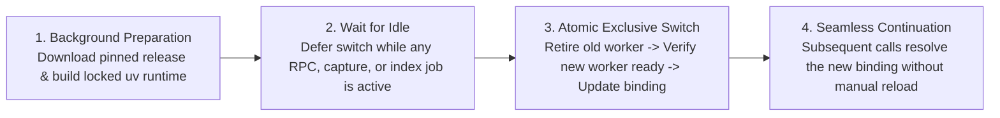

# Release Compatibility & Silent Update

[中文](release-compatibility-and-update.md) · [Back to Documentation Center](README.en.md)

This document explains how MindIE Agent coordinates paired component and plugin releases, matches plugin versions against your installed host CLI, and performs silent background updates without interrupting active engineering sessions.

- Governed by: [Engineering Design Principles](design-principles.en.md)
- Current Release Details: [`0.0.2` Release Notes](releases/0.0.2.en.md) (initial release: [`0.0.1`](releases/0.0.1.en.md))

---

## Paired Component and Plugin Releases

MindIE Agent ships **verified combinations of components and plugins**. Starting with `0.0.2`, the OpenAI Codex CLI, Claude Code, Kimi Code, and DeepSeek Harness (DSH) plugins align their version number with the main product. Shared runtime components (`diagnostics`, `knowledge`, `remote-dev`, `coordinator`, `npu-top`, `profiler`, `sim`) and `mindie-bench` maintain independent version sequences, and unchanged components reuse their existing formal Releases.

> **DSH `0.0.2` Same-Version Refresh Note**: DSH remains at `0.0.2` for this release as an authorized one-time replacement of the earlier `0.0.2` tag (`828c375...`). Existing installations of the earlier `0.0.2` require a one-time explicit refresh of both the runtime and plugin bundle followed by a full DSH process restart; see the [`0.0.2` Release Notes](releases/0.0.2.en.md#4-dsh-002-same-version-refresh-notice).

### Topological Release Order & Checklist

Releases follow a **bottom-up dependency order**:
1. Publish the base diagnostics library [`diagnostics`](https://github.com/mindie-agent/diagnostics) and 4-layer boundary solver [`sim`](https://github.com/mindie-agent/sim) first;
2. Prepare and publish [`remote-dev`](https://github.com/mindie-agent/remote-dev), [`knowledge`](https://github.com/mindie-agent/knowledge), [`profiler`](https://github.com/mindie-agent/profiler), and [`npu-top`](https://github.com/mindie-agent/npu-top), which depend on them;
3. Publish [`coordinator`](https://github.com/mindie-agent/coordinator) pinned to the formal `remote-dev` and `diagnostics` Releases;
4. Publish the four Harness plugins ([`mindie-agent-codex`](https://github.com/mindie-agent/mindie-agent-codex), [`mindie-agent-cc`](https://github.com/mindie-agent/mindie-agent-cc), [`mindie-agent-kimi`](https://github.com/mindie-agent/mindie-agent-kimi), [`mindie-agent-dsh`](https://github.com/mindie-agent/mindie-agent-dsh)) pinned to their runtime dependencies, followed by the main product release record.
   - The four host plugins bundle and register `knowledge`, `remote-dev`, and `diagnostics`; `coordinator`, `profiler`, `sim`, and `npu-top` can be installed standalone on demand or wired into plugins as they mature.
   - `mindie-bench` maintains its own version sequence and is referenced by immutable commit SHA in release workflows.

Before publishing any plugin Release, maintainers verify the following checklist:

| Pre-Release Check | Verification Standard |
| --- | --- |
| **1. Complete Dependency Inventory** | Extract direct first-party dependencies from the final `uv.lock` or pinned requirements and inventory transitive dependencies in the installed environment; record repository, package name, version, full commit SHA, and Release tag. |
| **2. Formal Component Releases** | Every first-party runtime dependency has a published GitHub Release (`draft=false`, `prerelease=false`). |
| **3. Exact Commit & Version Alignment** | The dereferenced Release tag matches both the declared source pin and installed `direct_url.json`; tag version, source package version, and artifact metadata agree. |
| **4. Published Package Contents** | Download the published packages from the GitHub Release and confirm their contents match the locked source tree. |
| **5. Documented Acceptance Scope** | Record verified host versions, OS platforms, exact tested source SHAs, and known boundaries accurately. |
| **6. Closed-Loop Combination** | Publish plugins only after all underlying component Releases are verified. |
| **7. Release Benchmark Delivery** | Every new code repository Release includes benchmark JSON and Markdown reports generated from the exact tagged commit on a clean checkout. |

### Benchmark Evidence on Every Release

Each code repository declares fixed workloads in `benchmarks/release.json`, executed by a pinned `mindie-bench` runner. The tag-triggered release workflow verifies source and package versions, installs declared dependencies, verifies formal Releases for first-party dependencies, runs local contract tests (excluding `live_npu`), and then executes the benchmark suite and builds release artifacts.

Every new code repository Release ships the following alongside its wheel/sdist or plugin archive:

- `benchmark-results.json`: repository, version, full source SHAs before and after measurement, clean-checkout status, suite digest, execution environment, repeated samples, iteration counts, units, case outcomes, and release gate decision;
- `benchmark-results.md`: human-readable workload summary, measurements, and scope;

Any failed, missing, or timed-out required scenario—or any checkout modification during measurement—blocks publication. Public reports contain synthetic workload descriptions, environment metadata, and numeric measurements only, excluding credentials, user transcripts, and local paths.

Product `0.0.2` and subsequent release records verify and aggregate the formal benchmark and real-task evaluation reports across all ten code repositories: `diagnostics`, `knowledge`, `remote-dev`, `coordinator`, `npu-top`, the four Harness plugins, and `mindie-bench` (see the [`0.0.2` Release Notes](releases/0.0.2.en.md#3-benchmark-results-and-003-roadmap)).

> **Note**: `knowledge` is a software runtime package governed by this release checklist, whereas [`knowledge-vllm-ascend`](https://github.com/mindie-agent/knowledge-vllm-ascend) and [`knowledge-operators`](https://github.com/mindie-agent/knowledge-operators) are domain content repositories updated continuously without requiring a new software release for every new knowledge unit.

---

## Host Compatibility Declarations & Deterministic Selection

Host CLIs evolve rapidly, and Hook schemas, MCP timeouts, or environment variable rules can differ across versions. To ensure an update never installs a plugin version incompatible with your installed CLI, MindIE Agent uses deterministic compatibility filtering:

1. **Machine-Readable Compatibility Manifest (`harness-compatibility.json`)**:
   - Each plugin repository maintains a `harness-compatibility.json` cataloging every host interface it touches (Hooks, MCP wiring, CLI flags, environment variables), production call sites, official references, tests, and verified SemVer support ranges.
   - Pre-release checks enforce that the plugin's declared support range lies strictly within the intersection of all required interface ranges.
2. **Highest Compatible Ordinary Release Selection**:
   - Both first-time installation and background updates evaluate the currently installed host CLI version using standard SemVer resolution and select the **highest compatible ordinary Release** (`draft=false`, `prerelease=false`).
   - The selector never downgrades automatically and never pulls unverified development branches (`main`).

---

## Silent Background Checks & Atomic Idle Cutover

Once more than **24 hours** have elapsed since the last successful update check, the next everyday invocation triggers an asynchronous background check:

- **Zero Hot-Path Latency**: Routine tool calls check only a lightweight local timestamp (in ~1–2 ms) and never block on network I/O, release scanning, or environment builds. Short Stop Hooks never access the network or run installers.
- **Zero User Interruption & Persistent Consent**: Silent updates never pop up confirmation prompts, inject update notifications into model context, or require manual session reloads—and they preserve your existing contribution, project scope, and fault-reporting settings.
- **Failure Backoff & Idempotency**: Network errors or rate limits trigger exponential backoff without resetting the last-success timestamp; already prepared candidate environments simply wait for an idle window without re-downloading.

### Four-Step Safe Cutover Lifecycle

1. **Background Preparation**: Download the selected release and build its isolated, non-editable `uv` environment (`uv sync --locked --no-editable`) outside the active runtime binding. Any failure during preparation leaves the existing version untouched.
2. **Wait for Idle**: As long as any MCP tool call, admitted capture, or indexing job is running, the existing service continues handling work and cutover waits patiently.
3. **Atomic Exclusive Cutover**: Once the active service is idle, the updater acquires the exclusive operation lock, cleanly retires the old worker, verifies that the new worker is ready, and atomically updates the single canonical installation binding (switching interpreter, scripts, and engine config together).
4. **Seamless Continuation**: During the sub-second switch window, incoming requests either wait briefly or receive an explicit `temporarily unavailable, not yet executed` status. Afterward, even already running sessions automatically resolve the new canonical binding on their next Hook or tool call.
