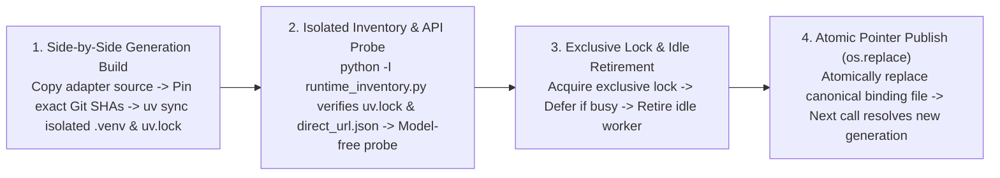

# Release Compatibility & Silent Update

[中文](release-compatibility-and-update.md) · [Back to Documentation Center](README.en.md)

This document explains MindIE Agent's two-tier release architecture (Feature Milestones and the `channels/0.1.json` product combination manifest), paired component and plugin release gates, deterministic host CLI compatibility matching, and independent runtime component Release discovery with side-by-side isolated `uv` environment builds and idle cutover.

- Governed by: [Engineering Design Principles](design-principles.en.md)
- Product Release Channel Manifest: [`channels/0.1.json`](../channels/0.1.json) (`schema: "mindie-release-channel/1"`, `track: "0.1"`)
- Release & Verification Records: [Release Records & Roadmap](README.en.md#release-records--roadmap)

---

## Two-Tier Release Evolution, Channel Manifest & Update Discovery Roles

MindIE Agent uses a two-tier **`0.Y.0` Feature Milestone + `0.Y.Z` Maintenance Patch / Independent Component Release** SemVer model and strictly separates the role of the **main repository's verified product combination manifest (`channels/0.1.json`)** from **client-side runtime update discovery (formal GitHub Releases in each official repository)**:

| Dimension | Version Pattern & Carrier | Actual Role & Selection Source | Host Plugin Republish Required? |
| --- | --- | --- | --- |
| **Feature Milestone Release** | `0.Y.0` (`0.1.0` → `0.2.0`) | Major feature additions or cross-component protocol evolution; ships with 12-repository benchmark verification and an updated [`channels/0.1.json`](../channels/0.1.json) milestone manifest | **Yes** (all four Harness plugins align on the new `0.Y.0` milestone baseline) |
| **Host Plugin Release Selection** | Formal GitHub Releases in each of the 4 plugin repositories (`mindie-plugin-release.json`) | Client selects the highest compatible formal plugin Release directly from the official plugin repository based on the installed host CLI version and `harness-compatibility.json` (`mindie_knowledge.releases` / `releases_io.py`) | Published independently when plugin code changes |
| **Independent Shared Component Update** | Formal GitHub Releases in each of the 8 component repositories (`knowledge`, `remote-dev`, `diagnostics`, `profiler`, `sim`, `npu-top`, `coordinator`, `mindie-bench`) | Client **discovers formal GitHub Releases directly from each official component repository** (`mindie_knowledge.component_releases` / `component_runtime.py`), builds a side-by-side isolated `uv` environment from the exact Git SHA, runs a native API probe, and cuts over when idle | **No** (a component bugfix Release can be discovered directly without republishing the four Harness plugins) |
| **Product Channel Manifest** | [`channels/0.1.json`](../channels/0.1.json) (`schema: "mindie-release-channel/1"`) | Records the product-verified 12-repository + 7-corpus version and immutable commit SHA combination for each product milestone (`0.Y.0`) or patch (`0.Y.Z`) for release pipeline gating and audit provenance; **not used by clients as the runtime update selection source** | Updated when assembling a main product milestone or patch record |

### 1. Role and Field Identity of `channels/0.1.json`

[`channels/0.1.json`](../channels/0.1.json) is the main repository's machine-readable record of **product-verified component and corpus combinations** (`schema: "mindie-release-channel/1"`):
- **Track & Patch History**: Declares `track`, `milestone_version`, `current_patch_version`, and the `patch_releases` ledger;
- **12-Repository Component Inventory (`components`) & 7-Corpus Snapshot (`corpora`)**: Records the verified `version`, GitHub `repository`, Release `tag`, and 40-character immutable `commit` (`revision`) SHA for `diagnostics`, `profiler`, `sim`, `npu-top`, `remote-dev`, `knowledge`, `coordinator`, the four Harness plugins (`mindie-agent-codex`, `mindie-agent-cc`, `mindie-agent-kimi`, `mindie-agent-dsh`), and `mindie-bench`. The main repository release collector (`collect_product_benchmarks.py`) enforces exact component, version, and SHA agreement between `channels/0.1.json` and `benchmark-manifest.json`;
- **Policy Metadata & Implementation Boundaries (`update_policy`)**: The manifest retains `independent_update_allowed`, `require_plugin_republish_on_component_patch`, and `implementation_status` (`verified_mechanism` and `known_boundaries`), explicitly documenting that clients do not download `channels/0.1.json` to select updates and removing earlier unconsumed hypothetical polling-interval and `< 500ms` full-cutover fields. Actual client-side discovery, HTTP cache TTLs, trigger schedules, and cutover mechanics are governed by the runtime and plugin updater source code described in Sections 2–3 below.

### 2. Direct Component Release Discovery & Verification (`component_releases.py`)

Rather than reading `channels/0.1.json` to select runtime updates, client updaters query each official component repository (`mindie-agent/{knowledge,remote-dev,diagnostics,profiler,sim,npu-top,coordinator,mindie-bench}`) directly via `mindie_knowledge.component_releases` and `runtime_inventory.py`:

1. **Monotonic Non-Downgrading Selection (`component_releases.select`)**:
   - Reads the active Python environment's installed first-party component versions and immutable 40-character commit SHAs (`direct_url.json`) via `python -I runtime_inventory.py` without importing runtime engines;
   - For each installed component, selects the **maximum** across the **currently installed version (`installed`)**, the **plugin's declared baseline floor (`baseline`, from `pyproject.toml` or `runtime-requirements.txt`)**, and the **component repository's latest formal GitHub Release (`latest`)**;
   - Never downgrades automatically, and rejects any candidate where the commit SHA changes without a version bump.
2. **Per-Component Release & Benchmark Verification (`Catalog.latest`)**:
   - **Formal Release & Asset Presence Gate**: Accepts only formal Releases (`draft=false`, `prerelease=false`) with a stable SemVer version (no prerelease or build suffix) and verifies that the Release assets include a matching `.whl`, `.tar.gz` (sdist), `SHA256SUMS`, `benchmark-results.json`, `benchmark-results.md`, and `benchmark-SHA256SUMS` (each with size `> 0`). The 8 runtime and evaluation components in the historical 0.1.1 acceptance (`knowledge 0.13.3`, `remote-dev 0.10.6`, `diagnostics 0.5.2`, `profiler 0.5.0`, `sim 0.7.1`, `npu-top 0.2.1`, `coordinator 0.6.3`, and `mindie-bench 0.4.4`) ship formal Releases passing the complete asset gate (whereas the older `mindie-bench 0.4.2` without wheel/sdist assets is automatically rejected).
   - **Immutable Tag Dereferencing**: Resolves `/git/ref/tags/<tag>` (peeling annotated tag objects up to 4 hops until reaching `type == "commit"`) to obtain the immutable 40-character commit SHA (`revision`), rather than trusting `target_commitish` (which often names a mutable branch).
   - **Source `pyproject.toml` Verification**: Reads `pyproject.toml` at that exact `revision`, verifies its Git blob SHA-1 digest and byte size, and confirms `project.name` and `project.version` match the Release tag.
   - **Benchmark Gate & SHA256 Verification**: Downloads `SHA256SUMS` and `benchmark-results.json`, confirms `SHA256SUMS` covers the wheel, sdist, and benchmark files and matches the SHA-256 digest of `benchmark-results.json`, and verifies that `benchmark-results.json` has `release_gate is True`, matching `version`, and clean `source` / `source_after` records (`revision == revision`, `dirty is False`).
   - **Exact Git SHA Runtime Installation**: Runtime preparation installs the verified component combination from the **exact Git commit SHAs** (`git+https://github.com/mindie-agent/<repo>@<revision>`) into an isolated `uv.lock` environment (without claiming that the client downloads and verifies every byte of the wheel/sdist archives).

### 3. Public Metadata `ETag`/TTL Cache & Host Updater Schedules

1. **Bounded Public Release Metadata Cache (`release_http.py` / `releases_io.py`)**:
   - Plugin and component updaters share `mindie_knowledge.release_http.read` (default cache directory `~/.cache/mindie-agent/releases` or `MINDIE_RELEASE_CACHE`, capped at `128` entries and `64 MiB`, with per-response caps of `2 MiB` for component catalog reads, `1 MiB` for plugin metadata, and `8 MiB` per release page), restricted to official HTTPS origins (`github.com`, `api.github.com`, `release-assets.githubusercontent.com`).
   - Cache entries store public response bytes and selected public headers (`ETag`, `Link`, `Content-Length`, `Content-Type`, `Last-Modified`). Immutable paths (`/git/`, `/contents/`, `/releases/download/`) use a `86400s` (24-hour) TTL; mutable Release endpoints use a `300s` TTL when a GitHub token is available or `900s` unauthenticated, sending `If-None-Match` (`ETag`) conditional requests once the TTL expires and reusing cached bytes on `304 Not Modified`.
   - **Fail-Visible Offline Behavior**: An expired cache entry never conceals a failed network read. Offline, rate-limited, or oversized responses raise explicit errors (`ReleaseFetchError` / `TimeoutError`) rather than silently reporting an up-to-date catalog.
2. **Actual Trigger & Cooldown Schedules Across the Four Host Plugins**:
   - **OpenAI Codex CLI (`update_trigger.py` / `harness_update.py`) & Claude Code (`release_update.py`)**: Coalesced into a cancellable background maintenance thread (`mindie-release-check`) inside the existing MCP server process without spawning a separate knowledge daemon, so foreground tool calls check only a local timestamp with zero network blocking. The cooldown after a successful check is `CHECK_INTERVAL = 300s` (5 minutes), with `FAILURE_BACKOFF = 60s` on errors and `ACTIVATION_BACKOFF = 5s` while a prepared candidate awaits idle handoff.
   - **Kimi Code (`updater.py` / `updater_check.py` / `updater_schedule.py`)**: Executed in the background every `INTERVAL_SECONDS = 300s` (5 minutes, `CHECK_BUDGET = 1200.0s`) via macOS `launchd` (`agent.mindie.kimi-update`) or Windows Task Scheduler (`MindIEKimiUpdate`) and switches `current.json` (`update_native=False` for component-only updates), with exponential failure backoff from `300s` up to `6 hours` (`next_retry_at`).
   - **DeepSeek Harness (`host.mjs` / `updater.py`)**: Triggered by a host timer `30s` after plugin load and every `interval_minutes` (default `5` minutes) thereafter whenever no agent session is in the `running` state, spawning a detached `updater.py check --silent` process; `entryFor()` in `host.mjs` prioritizes `package_dir` in `paths.configFile` (`config.json`) as the canonical adapter binding (`current.json` serves only as a legacy seed fallback when `package_dir` is absent) and co-generationally mounts `./host3.mjs` + `remote-dev`.
3. **Strict Separation from Manual `/mindie-agent` Knowledge Activation & Feed Sync**:
   - Public Ascend knowledge corpora (`knowledge-*`) are synchronized only on demand within sessions where the user has explicitly invoked `/mindie-agent`. **Background software update checks and component runtime builds never start a knowledge worker, create a session lease, or trigger corpus synchronization.**

---

## Paired Component and Plugin Releases

MindIE Agent ships **verified combinations of components and plugins**. The OpenAI Codex CLI, Claude Code, Kimi Code, and DeepSeek Harness (DSH) plugins align their version number with the main product at each feature milestone. Shared runtime components (`diagnostics`, `knowledge`, `remote-dev`, `coordinator`, `npu-top`, `profiler`, `sim`) and `mindie-bench` maintain independent version sequences, reuse unchanged formal Releases across milestones, and can both be discovered directly from their official component repositories as new formal Releases ship and be recorded in [`channels/0.1.json`](../channels/0.1.json) when main product releases are assembled.

### Topological Release Order & Checklist

Milestone or coordinated patch releases follow a **bottom-up dependency order** (whereas an independent single-component release only runs that component repository's release workflow and gates):
1. Publish the base diagnostics library [`diagnostics`](https://github.com/mindie-agent/diagnostics) and 4-layer boundary solver [`sim`](https://github.com/mindie-agent/sim) first;
2. Prepare and publish [`remote-dev`](https://github.com/mindie-agent/remote-dev), [`knowledge`](https://github.com/mindie-agent/knowledge), [`profiler`](https://github.com/mindie-agent/profiler), and [`npu-top`](https://github.com/mindie-agent/npu-top), which depend on them;
3. Publish [`coordinator`](https://github.com/mindie-agent/coordinator) pinned to the formal `remote-dev` and `diagnostics` Releases;
4. When host plugins are also being released, publish the four Harness plugins ([`mindie-agent-codex`](https://github.com/mindie-agent/mindie-agent-codex), [`mindie-agent-cc`](https://github.com/mindie-agent/mindie-agent-cc), [`mindie-agent-kimi`](https://github.com/mindie-agent/mindie-agent-kimi), [`mindie-agent-dsh`](https://github.com/mindie-agent/mindie-agent-dsh)) pinned to their runtime dependencies, followed by [`channels/0.1.json`](../channels/0.1.json) and the main product release record.
   - Host plugin runtime baselines include `knowledge`, `remote-dev`, and `diagnostics`; a packaged dependency does not imply public knowledge discovery. Codex `0.1.8` registers only remote-dev and deterministic component entries in default MCP discovery, with a private knowledge catalog loaded by the manual Skill. Independently installed `coordinator`, `profiler`, and `sim` can use these entries; `npu-top` remains a standalone human dashboard. Verify other hosts against their own release evidence.
   - `mindie-bench` maintains its own version sequence and is referenced by immutable commit SHA in release workflows.

Before publishing any plugin Release or updating [`channels/0.1.json`](../channels/0.1.json), maintainers verify the following checklist:

| Pre-Release Check | Verification Standard |
| --- | --- |
| **1. Complete Dependency Inventory** | Extract direct first-party dependencies from the final `uv.lock` / `runtime-requirements.txt` or `channels/0.1.json` and inventory transitive dependencies in the installed environment; record repository, package name, version, full commit SHA, and Release tag. |
| **2. Formal Component Releases** | Every first-party runtime dependency has a published GitHub Release (`draft=false`, `prerelease=false`). |
| **3. Exact Commit & Version Alignment** | The dereferenced Release tag matches both the declared source pin and installed `direct_url.json`; tag version, source package version, and artifact metadata agree. |
| **4. Published Package Contents** | Download the published packages from the GitHub Release and confirm their contents match the locked source tree. |
| **5. Documented Acceptance Scope** | Record verified host versions, OS platforms, exact tested source SHAs, and known boundaries accurately. |
| **6. Closed-Loop Combination** | Publish plugins or update `channels/0.1.json` only after all underlying component Releases are verified. |
| **7. Release Benchmark Delivery** | Every new code repository Release includes benchmark JSON and Markdown reports generated from the exact tagged commit on a clean checkout. |
| **8. Upgrade from Existing Installations** | Start with supported published plugins and their old updaters to verify candidate preparation, retention of the old generation on failure, and idle activation. Check that the final host package preserves MCP timeouts, environment variables, and user grants, and inspect the tool catalog and parameters actually loaded by the host. Label isolated candidate-feed evidence explicitly; after publication, verify normal background discovery and activation against the formal release source. |
| **9. Main Repo & Org Profile Version Sync** | Whenever `channels/0.1.json` is updated, run `python3 .github/scripts/sync_org_versions.py --write --org-profile-dir <path-to-.github>` (enforced by `--check --offline` in `pr-checklist.yml`) so `README.md`, `README.en.md`, [`mindie-agent/.github`](https://github.com/mindie-agent/.github), and the 21-repository telemetry dashboard stay in sync. |

Independent component updates cover component fixes that preserve the host plugin interface. Changes to native tool catalogs, host MCP timeouts, plugin environment variables, or resident launcher code require a plugin release carrying those changes. Update receipts must distinguish a prepared candidate, a switched installation binding, and host definitions actually loaded: an updated on-disk version or component pointer alone does not prove that a resident host exposes the new interface. Use the host's supported refresh boundary; when natural reload or a new process is required, preserve active sessions and record that boundary explicitly.

### Benchmark Evidence on Every Release

Each code repository declares fixed workloads in `benchmarks/release.json`, executed by a pinned `mindie-bench` runner. The tag-triggered release workflow verifies source and package versions, installs declared dependencies, verifies formal Releases for first-party dependencies, runs local contract tests (excluding `live_npu`), and then executes the benchmark suite and builds release artifacts.

Every new code repository Release ships the following alongside its wheel/sdist or plugin archive:

- `benchmark-results.json`: repository, version, full source SHAs before and after measurement, clean-checkout status, suite digest, execution environment, repeated samples, iteration counts, units, case outcomes, and release gate decision (`release_gate`);
- `benchmark-results.md`: human-readable workload summary, measurements, and scope;
- `release-notes.md` (when `release-notes-path` is supplied): repository-authored community release notes archived with the release assets and covered by `SHA256SUMS`.

Any failed, missing, or timed-out required scenario—or any checkout modification during measurement—blocks publication. Public reports contain synthetic workload descriptions, environment metadata, and numeric measurements only, excluding credentials, user transcripts, and local paths.

The main product repository supports two release gate modes: feature milestones (`release-kind=milestone`) aggregate and verify both the 12-repository component benchmarks and the end-to-end product value suite, whereas maintenance patches (`release-kind=patch`, requiring `PATCH > 0`) never relabel a historical milestone value report as a new experiment while still enforcing formal GitHub Releases, immutable tag SHAs, `mindie-release-benchmark/2` reports, and exact `channels/0.1.json` alignment across all twelve code repositories (see [Release Records & Roadmap](README.en.md#release-records--roadmap)).

> **Note**: `knowledge` is a software runtime package governed by this release checklist, whereas [`knowledge-vllm-ascend`](https://github.com/mindie-agent/knowledge-vllm-ascend), [`knowledge-operators`](https://github.com/mindie-agent/knowledge-operators), [`knowledge-infer-core`](https://github.com/mindie-agent/knowledge-infer-core), [`knowledge-infer-distributed`](https://github.com/mindie-agent/knowledge-infer-distributed), [`knowledge-infer-observability`](https://github.com/mindie-agent/knowledge-infer-observability), [`knowledge-infer-ops-compat`](https://github.com/mindie-agent/knowledge-infer-ops-compat), and [`knowledge-agent-engineering`](https://github.com/mindie-agent/knowledge-agent-engineering) are domain content repositories updated continuously without requiring a new software release for every new knowledge unit.

---

## Host Compatibility Declarations & Deterministic Selection

Host CLIs evolve rapidly, and Hook schemas, MCP timeouts, or plugin manifest rules can differ across versions. To ensure an update never installs a plugin version incompatible with your installed CLI, MindIE Agent uses deterministic compatibility filtering:

1. **Machine-Readable Compatibility Manifest (`harness-compatibility.json` / `mindie-plugin-release.json`)**:
   - Each plugin repository maintains `harness-compatibility.json` (and publishes `mindie-plugin-release.json` on each Release) cataloging every host interface it touches (Hooks, MCP wiring, CLI flags, environment variables), production call sites, official references, tests, and verified SemVer support ranges (DSH also verifies `peerDependencies["@deepseek-ai/dsh"]` in `package.json`).
   - Pre-release checks and client-side `validate_compatibility` enforce that the plugin's declared support range lies strictly within the intersection of all `used_interfaces` ranges, and `verify_release_source` confirms the immutable Git commit contains the exact same compatibility declaration.
2. **Coordinated Monotonic Selection for Plugins and Components**:
   - The plugin selector evaluates the currently installed host CLI version to select the **highest compatible ordinary plugin Release** (`draft=false`, `prerelease=false`).
   - When no newer plugin Release is needed, the host updater invokes component update discovery (`component_update.py`) to advance shared runtime components directly to any newer formal component Releases; when upgrading to a newer plugin Release, component discovery preserves the installed component floor (`max(installed version, new plugin baseline, formal component Release)`) so a plugin upgrade never downgrades a component that was already updated independently.

---

## Side-by-Side Runtime Preparation, API Probe & Idle Cutover

Instead of mutating the active virtual environment in place with single-package replacements, both plugin updates and independent component updates follow a four-step **side-by-side generation build + isolated subprocess probe + idle worker retirement + atomic pointer replacement (`os.replace`)** lifecycle:

- **Zero Hot-Path Network Blocking**: Routine tool calls and short Hooks read only the active local binding or check a local timestamp—never blocking on network requests, release scans, or `uv` builds.
- **No Unsolicited Knowledge Worker Startup & Preserved User Consent**: Release discovery, side-by-side runtime builds, candidate probes, and binding activation are completely model-free and **never start a knowledge background worker or create a session knowledge grant** (the knowledge flywheel remains strictly gated on explicit per-session `/mindie-agent` invocation), while preserving saved contribution, project scope, and fault-reporting choices.
- **Fail-Visible & Idempotent**: If the network is unreachable, a Release asset is incomplete, or a probe fails, the updater records the failure status locally (`status.json` / `release-update.json`) and enters backoff without touching the active runtime. Candidate generations are keyed by `generation_key` (computed from the adapter source digest, target component revisions, and Python/platform ABI) and coalesced under a non-blocking `prepare.lock` so verified generations are never rebuilt redundantly.

### Four-Step Safe Preparation & Idle Cutover Lifecycle

1. **Side-by-Side Isolated Runtime Build (`component_runtime.build`)**:
   - Creates a separate generation directory outside the active runtime (`component-runtimes/<generation_key>`), copies the verified adapter source files (`<= 16 MiB`), writes a standalone `pyproject.toml` pinning the selected component Git commit SHAs via `[tool.uv] override-dependencies`, runs `uv sync --project <runtime> --no-editable --no-dev` within a bounded budget (`420s` default) to create an isolated `.venv` and `uv.lock`, and writes `components.json` (`schema: "mindie-component-runtime/1"`, binding `adapter_source_sha256`, `runtime`, and `lock_sha256`). Any failure leaves the active installation untouched.
2. **Isolated Inventory Verification & Native API Probe**:
   - Runs `python -I runtime_inventory.py <components.json>` in the candidate interpreter to verify the SHA-256 of `uv.lock` (`verify_lock`) and every installed first-party package's `direct_url.json` commit receipt (`verify`), and confirms the retained adapter source bytes have not changed;
   - Executes the host adapter's model-free candidate validator and runtime API probe (`candidate_validate.py` / `runtime_probe.py`) to confirm compatibility before any live binding is touched.
3. **Wait for Idle & Bounded Worker Retirement**:
   - Once preparation and probing succeed, the activator acquires the exclusive operation lock (`update_lock` / `OperationLock`) and checks whether the knowledge service and domain workers are idle (`retire_service` / `stop_if_idle`). If any RPC, capture, or indexing job is active, cutover defers (`deferred` / `service_busy`) without interrupting active work; once idle, it cleanly stops the old background worker within a bounded control window (e.g., `30s`).
4. **Atomic Canonical Binding Publication (`os.replace`)**:
   - After the old worker is confirmed retired (or absent), the activator atomically replaces the canonical binding or generation pointer file (`codex.json`, `cc.json`, or `current.json`) via `os.replace`.
   - **Latency Boundary Note**: The binding cutover stage takes ~`10ms` on Codex (`unavailable_seconds`) and ~`15ms` on Claude Code (`activate_binding.seconds`), excluding prior runtime build, and publishes the canonical binding via `os.replace`; the end-to-end pipeline—including prior side-by-side `uv` environment building, isolated inventory checks, and candidate API probing—runs under bounded multi-second / multi-minute budgets and **is never promised as `< 500ms` end to end**.

### Missing remote arguments and agent correction, 2026-10-27

A direct SSH endpoint has always required both `host` and `port`. Installed remote-dev `0.10.6` and `0.10.7` reject the same missing-port request as caller/not_sent. Codex `0.1.0`, `0.1.2`, `0.1.8`, `0.1.9`, and `0.1.10` all lacked host/port property descriptions, while the adapter reduced the specific cause to a generic error. Earlier successful acceptance supplied the port explicitly and missed the agent-correction path; historical calls also show the same failure. The evidence does not support a newly introduced port requirement.

remote-dev `0.10.8` puts endpoint rules in model-visible tool and parameter descriptions and supplies bounded `input_repair.missing/action` for local caller failures confirmed as not submitted. Codex, Claude Code, and Kimi preserve that structure and readable guidance; DSH mounts the shared MCP directly. `port=22` is an example. Aliases, resolvers, and configured defaults with all endpoint selectors omitted remain supported. Correction is a new agent call, not automatic adapter replay; uncertain remote effects retain their original job-state handling.

All assets, SHA256 values, exact-source benchmarks, and packaged files were verified for these formal Releases. All 72 Codex wheel files, including the native MCP, Hook, and plugin manifests, match the tagged source; Claude Code wheel resources and source-package manifests were also compared. Plugins pin formal remote-dev `4b1c5ca`; Kimi updates its active override while retaining the original bootstrap dependencies.

| Repository | Formal version | Immutable source SHA | Verified assets |
| --- | --- | --- | --- |
| remote-dev | [0.10.8](https://github.com/mindie-agent/remote-dev/releases/tag/v0.10.8) | `4b1c5cab5d36cdaff79d27e4288c6d5f60667c72` | 7 |
| Codex | [0.1.11](https://github.com/mindie-agent/mindie-agent-codex/releases/tag/v0.1.11) | `ee9860ffa472599577fa77af9e591d48f663f8fe` | 8 |
| Claude Code | [0.1.7](https://github.com/mindie-agent/mindie-agent-cc/releases/tag/v0.1.7) | `e1ab115627c632654dc3e9e6db9a056a20280589` | 8 |
| Kimi | [0.1.6](https://github.com/mindie-agent/mindie-agent-kimi/releases/tag/v0.1.6) | `3813383c6b100294cb5ea4e9bd9d97a6ecfc1cae` | 7 |
| DSH | [0.1.5](https://github.com/mindie-agent/mindie-agent-dsh/releases/tag/v0.1.5) | `670b776b675c0b6dd93faef289e6538135e1f0db` | 6 |

Pre-release acceptance used private configuration, candidate production code, actual native clients, and real A3 SSH. In Codex CLI `0.164.0-alpha.11.1`, the model first omitted port, received `Missing input: port`, and added only `port=22` on its second call. The actual business result confirmed `exit_code=0` and a unique stdout marker in `34.672s`. DSH + DeepSeek Flash also added only port and succeeded in `10.323s`, with a succeeded job record. That client did not project RPC error.data or a success exit code, so the model's own exit-code claim was not used as evidence. These results establish the argument-correction path, not four-host upgrade acceptance or NPU performance.

After publication, the existing Codex installation upgraded from `0.1.10` to formal `0.1.11 / ee9860f` through its normal background check, without a forced update or manual binding edit. All 72 installed package files match the verified formal wheel, five Hooks remain trusted, and user configuration and community-consent bytes are unchanged. A native CLI using that installed runtime again completed missing port → add only `port=22` → real SSH `exit_code=0` and expected stdout in `37.382s`; actual MCP calls in the existing Desktop chat completed the same correction. That Desktop's tool description still awaits a natural host reload, so runtime dispatch cutover is not equated with refreshing a resident catalog. The [caller-repair acceptance record](releases/remote-caller-repair-2026-10-27.json) records scope, raw business-result summaries, and local receipt digests.

The existing Kimi `2.3.1` installation switched to formal `0.1.6 / 3813383` through its normal background task, with active remote-dev `0.10.8 / 4b1c5ca`, diagnostics `0.5.4 / 5ae643e`, and the already newer knowledge `0.13.4 / 6e921b2` retained. Active `mcp_server.py` matches the formal source byte for byte; no update was forced and no binding was edited manually. The receipt reports `current` and `needs_host_reload=true`. It establishes the new dispatch runtime, not refresh of an existing host's Skill, command, or tool catalogs.

### Independent component and plugin release verification, 2026-10-26

The following six formal Releases are published. Verification covered tags and version metadata, downloaded asset SHA256 values, exact-source benchmark provenance and admission, and packaged runtime source bytes. These are independent releases; the main product remains `0.1.1`, and the historical twelve-repository report is not relabelled as new acceptance. The component combination in `channels/0.1.json` is retained; only the newly observed update boundaries are added.

| Repository | Formal version | Tag source SHA |
| --- | --- | --- |
| diagnostics | [0.5.4](https://github.com/mindie-agent/diagnostics/releases/tag/v0.5.4) | `5ae643e19223f2181ecdbaa3edaf464137c4805e` |
| remote-dev | [0.10.7](https://github.com/mindie-agent/remote-dev/releases/tag/v0.10.7) | `4c40cb5d302ddb8400ff6abb7dc47873b931eaa9` |
| mindie-agent-codex | [0.1.10](https://github.com/mindie-agent/mindie-agent-codex/releases/tag/v0.1.10) | `3a6b84012c5c0cc0306bf06a1a236dd2638bd06f` |
| mindie-agent-cc | [0.1.6](https://github.com/mindie-agent/mindie-agent-cc/releases/tag/v0.1.6) | `92e5a0b11a8c0c186660825c4dc1598f7defb9c2` |
| mindie-agent-kimi | [0.1.5](https://github.com/mindie-agent/mindie-agent-kimi/releases/tag/v0.1.5) | `58d3cf95092d966617935815350f1e024ddaf607` |
| mindie-agent-dsh | [0.1.4](https://github.com/mindie-agent/mindie-agent-dsh/releases/tag/v0.1.4) | `ea7d2a327c74d5376c2a5adf5569436d4b304f83` |

- **Kimi 2.3.1 / macOS arm64**: the existing `0.1.2` installation discovered and switched to `0.1.5` through its normal 300-second background job. The next scheduled check repaired native fields omitted by the legacy package builder. Native registration readback and a newly started registered MCP launcher confirmed `29` tools, `toolTimeoutMs=660000`, `REMOTE_DEV_HARNESS_PROFILE=kimi`, and active `remote-dev 0.10.7 / 4c40cb5`, `diagnostics 0.5.4 / 5ae643e`, and `knowledge 0.13.4 / 6e921b2`. No update was invoked manually and no active configuration was edited. Definitions already loaded in existing host processes retain their natural refresh boundary. The independent `knowledge-vllm-ascend` corpus sync still reports a non-advancing semantic revision; it is neither a plugin installation failure nor claimed fixed.
- **Codex Desktop 0.164.0-alpha.11.1 / macOS arm64, release and migration mechanisms**: [PR #69](https://github.com/mindie-agent/mindie-agent-codex/pull/69) is merged and `0.1.10` is formally published. It fixes lifetime locking by idle `tools-mcp`, migration blocked by the old canonical binding, interrupted local activation receipts, and retirement of an old candidate after native installation evicts its cache. All eight release assets pass verification; 72 wheel package files match the tested source byte for byte, and the benchmark passes on the exact tag source. Dependencies remain formal `remote-dev 0.10.7`, `diagnostics 0.5.4`, and `knowledge 0.13.4`. The final local suite reports 598 passed and 26 skipped; three-platform CI passes. The release commit's first macOS run failed during test process-group cleanup after its business assertions passed. That failure is retained and its targeted retry passes; [PR #71](https://github.com/mindie-agent/mindie-agent-codex/pull/71) separately repairs the fixture.
- **Codex isolated native migration acceptance**: the actual Desktop host starts from published `0.1.8` with `0.1.9` already prepared, installs candidate `0.1.10`, and refreshes MCP connections in the same isolated session. In approximately 47 seconds it verifies the new binding, both MCP connections, 22 remote tools and five component entry points, normal background retirement of the old candidate, and release of the idle lock. A separate native probe verifies that refresh preserves an in-flight call until completion. This acceptance uses an isolated candidate source. A real diagnostics CLI supplies the component business probe; administrative API calls without native turn identity are rejected as required and are not counted as successful native business calls.
- **Codex existing user installation, activation verified on 2026-10-26**: a one-time recovery reused the native installer to install formal `0.1.10` and prepare its runtime, followed by a normal Desktop restart by the user. The active binding and actual MCP processes now use `0.1.10`; the candidate receipt is `active`, and normal background plugin and component checks both report `up_to_date`. The current host loads 22 remote tools and five component entry points. An actual `diagnostics_status` call reports a healthy `diagnostics 0.5.4` worker; `remote_probe` and the new `remote_exec_command` succeed on the standing A3 host, with the latter also verifying `workdir` mapping. The idle exclusive update lock is available, all five hooks are enabled and trusted, and consent bytes are unchanged. The initial diagnostics read was rejected because the caller set an insufficient 6,000-byte output budget; it succeeded with a larger read budget, and the failed result is retained. This first hop includes one-time native recovery and a user restart, so it is not claimed as an unassisted legacy-updater upgrade. These non-destructive control-plane calls are not NPU performance acceptance.
- **Claude Code 2.1.269 and DSH 0.2.0-rc.2**: their formal-source selectors can select `0.1.6` and `0.1.4`, respectively, and release tests and asset checks pass. This run observed neither a global Claude Code installation nor a running DSH user-plugin timer, so it does not claim automatic activation for either host. DSH's persistent `host.mjs` requires a natural host reload or new process. Earlier isolated native acceptance retains its original measured revisions.
- **Retained Kimi `0.1.4` release failure**: the tag was not moved and no formal Release was created. The release workflow's shallow checkout lacked the historical commits needed by old-controller regressions. `0.1.5` explicitly fetches the two immutable historical SHAs and passes an actual shallow-clone reproduction, CI, and formal publication, without changing runtime implementation or dependency pins.

### Historical 0.1.1 implementation and acceptance

- **Formally Published 8 Shared & Evaluation Components**: `knowledge 0.13.3` (`38a42f6f778cfa555d8918fdcacd12cee4a181f5`), `remote-dev 0.10.6` (`0463a13fce9618ec9a51904869d61acb0cdb8538`), `diagnostics 0.5.2` (`801a01b2789aed7f58e971a909205a7d40b61077`), `sim 0.7.1` (`15f93f3f0247b2653d0e9441eae56959e4d16d4e`), `coordinator 0.6.3` (`0ec71fb947ab24df8e543dcf056f4f06664baad8`), unchanged reused `profiler 0.5.0` (`4010d72f0b6950caf1425e3b683d495a6c76016a`) and `npu-top 0.2.1` (`6737925d0ebb39c1aefda2c933eae0486169333c`), and `mindie-bench 0.4.4` (`a36d8a5ae8633e560d19fee231179c3680149109`, including the `release-kind=patch` 12-repository formal report and `channels/0.1.json` alignment gate) are all formally published and verified on GitHub Releases.
- **Four-Host Plugin `0.1.2` Formal Releases & Closed macOS `arm64` Native Acceptance ([`releases/0.1.1/native-update-acceptance.json`](releases/0.1.1/native-update-acceptance.json))**: `mindie-agent-codex 0.1.2` (`0b3c690b95401631782a656d99f2b4487582636a`, 8 assets / 49 `.py` files), `mindie-agent-cc 0.1.2` (`edabca82e02fb313d734c699e75735095effebfd`, 8 assets / 34 `.py` files), `mindie-agent-kimi 0.1.2` (`7aecfd22857c313b52d6fe5923292f297884fec0`, 7 assets / 145 source files), and `mindie-agent-dsh 0.1.2` (`a38f1cb191f625905aace734e20a2ad196624b60`, 6 assets / 47 source files) are all formally published on GitHub Releases and verified byte-for-byte, with closed macOS `arm64` formal native acceptance covering installed component alignment (`knowledge 0.13.3`, `remote-dev 0.10.6`, `diagnostics 0.5.2`) and passive / explicit manual entry / same-session resume / fresh pre-execution rejection (automated contract CI runs across Ubuntu / macOS / Windows for Codex, Claude Code, and Kimi Code, and on Ubuntu `ubuntu-latest` for DSH). Specifically: on the existing Codex user installation, a one-time targeted migration via the native public `app-server` config API CAS plus `native_context` alignment to actual Codex Desktop `0.164.0-alpha.11.1` preserved `trusted` status across all 5 hook entries (`SessionStart`×1, `UserPromptSubmit`×1, `Stop`×1, `Interrupt`×2) on both CLI `0.153.4` and Desktop `0.164.0-alpha.11.1` (not automatic zero-intervention inheritance by the native plugin manager, with formal `0.1.2` native session admission verified via explicit manual Skill entry on Desktop `0.164.0-alpha.11.1`); Claude Code (`2.1.269`, `/mindie-agent:mindie-agent` entry) was verified in an isolated real native marketplace profile because the host has no global CC install; and Kimi (`2.3.1`) and DSH (`0.2.0-rc.2`) were verified in new native processes on the existing user installations while allowing already-loaded definitions in active user processes to reload naturally without terminating running hosts (see [`releases/0.1.1.en.md`](releases/0.1.1.en.md) and [`releases/0.1.1/benchmark-pilot.en.md`](releases/0.1.1/benchmark-pilot.en.md)).
