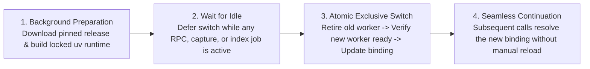

# Release Compatibility & Silent Update

[中文](release-compatibility-and-update.md) · [Back to Documentation Center](README.en.md)

This document explains how MindIE Agent coordinates paired component and plugin releases, matches plugin versions against your installed host CLI, and performs silent background updates without interrupting active engineering sessions.

- Governed by: [Engineering Design Principles](design-principles.en.md)
- Release Verification Details: [`0.0.1` Release Record](releases/0.0.1.en.md)

---

## Paired Component and Plugin Releases

MindIE Agent ships **verified combinations of components and plugins**. Each repository maintains its own independent version sequence (for example, plugin release `0.0.1` locks `diagnostics v0.4.1`, `remote-dev v0.9.5`, and `knowledge v0.11.0` without renumbering or rolling back component versions). Components with no code changes simply reuse their existing published Releases.

### Topological Release Order & Checklist

Releases always follow a **bottom-up dependency order**:
1. Publish the base diagnostics library [`diagnostics`](https://github.com/mindie-agent/diagnostics) first;
2. Prepare and publish [`remote-dev`](https://github.com/mindie-agent/remote-dev) and [`knowledge`](https://github.com/mindie-agent/knowledge) (which depend on `diagnostics`);
3. Publish the Harness plugins ([`mindie-agent-codex`](https://github.com/mindie-agent/mindie-agent-codex), [`mindie-agent-cc`](https://github.com/mindie-agent/mindie-agent-cc), [`mindie-agent-kimi`](https://github.com/mindie-agent/mindie-agent-kimi)) that lock those exact component releases, followed by the unified release record in `mindie-agent`.

Before publishing any plugin Release, maintainers verify and record the following checklist:

| Pre-Release Check | Verification Standard |
| --- | --- |
| **1. Complete Dependency Inventory** | Extract all direct and transitive first-party runtime packages from the plugin's final `uv.lock`; record repository, package name, version, full commit SHA, and corresponding Release tag. |
| **2. Formal Component Releases** | Every first-party runtime dependency must have a published GitHub Release (`draft=false`, `prerelease=false`); a Git tag, merged PR, or green CI run alone is never sufficient. |
| **3. Exact Commit & Version Alignment** | Dereferencing the component Release tag must resolve to the exact commit SHA pinned in `uv.lock`, and the tag version, `pyproject.toml` version, and built wheel/sdist metadata must match. |
| **4. Artifact Download & Checksum Verification** | Download the published wheel, sdist, and `SHA256SUMS` from the GitHub Release and verify digests and package contents against the locked source tree. |
| **5. Honest Acceptance Scope** | Record verified host versions, OS platforms, and any post-acceptance source deltas clearly; never claim un-run tests as fresh hardware evidence, and document known host limitations openly. |
| **6. Closed-Loop Combination** | Publish plugins only after all underlying component Releases are verified, preventing broken dependency locks in released plugins. |

> **Note**: `knowledge` is a software runtime package governed by this release checklist, whereas `knowledge-vllm-ascend` is a domain content repository updated continuously under `publication-contract.json` without requiring a new software release for every new knowledge package.

---

## Host Compatibility Declarations & Deterministic Selection

Host CLIs evolve rapidly, and Hook schemas, MCP timeouts, or environment variable rules can differ across versions. To ensure an update never installs a plugin version incompatible with your installed CLI, MindIE Agent uses deterministic compatibility filtering:

1. **Machine-Readable Compatibility Manifest (`harness-compatibility.json`)**:
   - Each plugin repository maintains a `harness-compatibility.json` cataloging every host interface it touches (Hooks, MCP wiring, CLI flags, environment variables), production call sites, official references, tests, and verified SemVer support ranges.
   - Pre-release checks enforce that the plugin's declared support range lies strictly within the intersection of all required interface ranges.
2. **Highest Compatible Ordinary Release Selection**:
   - Both first-time installation and background updates evaluate the currently installed host CLI version using standard SemVer resolution and select the **highest compatible ordinary Release** (`draft=false`, `prerelease=false`).
   - The selector never downgrades automatically and never pulls unverified development branches (`main`).

---

## Silent Background Checks & Atomic Idle Cutover

Once more than **24 hours** have elapsed since the last successful update check, the next everyday invocation triggers an asynchronous background check:

- **Zero Hot-Path Latency**: Routine tool calls check only a lightweight local timestamp (in ~1–2 ms) and never block on network I/O, release scanning, or environment builds. Short Stop Hooks never access the network or run installers.
- **Zero User Interruption & Persistent Consent**: Silent updates never pop up confirmation prompts, inject update notifications into model context, or require manual session reloads—and they preserve your existing contribution, project scope, and fault-reporting settings.
- **Failure Backoff & Idempotency**: Network errors or rate limits trigger exponential backoff without resetting the last-success timestamp; already prepared candidate environments simply wait for an idle window without re-downloading.

### Four-Step Safe Cutover Lifecycle

1. **Background Preparation**: Download the selected release and build its isolated, non-editable `uv` environment (`uv sync --locked --no-editable`) outside the active runtime binding. Any failure during preparation leaves the existing version untouched.
2. **Wait for Idle**: As long as any MCP tool call, admitted capture, or indexing job is running, the existing service continues handling work and cutover waits patiently.
3. **Atomic Exclusive Cutover**: Once the active service is idle, the updater acquires the exclusive operation lock, cleanly retires the old worker, verifies that the new worker is ready, and atomically updates the single canonical installation binding (switching interpreter, scripts, and engine config together).
4. **Seamless Continuation**: During the sub-second switch window, incoming requests either wait briefly or receive an explicit `temporarily unavailable, not yet executed` status. Afterward, even already running sessions automatically resolve the new canonical binding on their next Hook or tool call.
