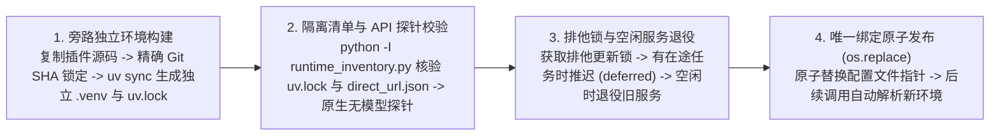

# 版本兼容与无感更新（Release Compatibility & Silent Update）

[English](release-compatibility-and-update.en.md) · [返回文档中心](README.md)

本文说明 MindIE Agent 的双层版本演进架构（特性里程碑与主仓产品组合清单 `channels/0.1.json`）、组件与插件配套发布门禁、宿主 CLI 兼容性筛选规则，以及共享运行时组件的独立正式 Release 发现、旁路隔离 `uv` 环境构建与空闲切换机制。

2026-10-29 的知识 P0 开发补充了独立组件绑定的更新覆盖与版本下限检查，具体实现和配对验证边界见 [P0 验收记录](audits/2026-10-29-knowledge-p0.md)。源码合入、正式发布和已安装用户的运行绑定切换分别记录；未发布的开发提交不能作为正式 Release 的升级验收证据。

该轮配套正式版本与四端实际安装结果见 [0.1.4 发布记录](releases/0.1.4.md)及[自动升级验收](releases/0.1.4/automatic-update-acceptance.json)。验收回读实际解释器中的包版本、提交与新进程工具目录；插件注册版本不代替运行时证据。发现的 DSH 发布失败与 Kimi 组件回退均保留原始结论，修复后的自动路径和一次性恢复分别列明。

- 遵循准则：[工程设计原则与演进准则](design-principles.md)
- 主仓产品组合清单：[`channels/0.1.json`](../channels/0.1.json)（`schema: "mindie-release-channel/1"`，`track: "0.1"`）
- 版本与实测记录：[版本发布记录](README.md#版本记录与路线图)

---

## 双层版本演进、产品组合清单与更新发现分工

MindIE Agent 采用 **`0.Y.0` 特性里程碑 + `0.Y.Z` 维护补丁/组件独立演进** 的双层 SemVer 机制，并将**主仓产品验证组合记录（`channels/0.1.json`）**与**客户端运行时更新发现源（各官方代码仓正式 GitHub Release）**的职责明确分离：

| 维度 | 版本号与载体 | 实际职责与选择源 | 宿主插件是否需重发 |
| --- | --- | --- | --- |
| **特性里程碑（Milestone Release）** | `0.Y.0`（如 `0.1.0` → `0.2.0`） | 重大功能演进或跨组件协议升级；配套十二仓全量基准验证与主仓 [`channels/0.1.json`](../channels/0.1.json) 里程碑清单 | **是**（四个宿主插件对齐升级至新的 `0.Y.0` 里程碑基线） |
| **宿主插件版本选择（Plugin Release Selection）** | 四个宿主插件仓正式 GitHub Release（`mindie-plugin-release.json`） | 客户端按本机宿主 CLI 版本与 `harness-compatibility.json` 直接从对应插件官方仓库筛选最高兼容正式版（`mindie_knowledge.releases` / `releases_io.py`） | 按插件自身变更独立发版 |
| **共享组件独立更新（Independent Component Release Update）** | 八个组件仓正式 GitHub Release（`knowledge`、`remote-dev`、`diagnostics`、`profiler`、`sim`、`npu-top`、`coordinator`、`mindie-bench`） | 客户端**直接读取各官方组件仓库的正式 GitHub Release**（`mindie_knowledge.component_releases` / `component_runtime.py`），在旁路独立 `uv` 环境中构建并通过 API 探针后等待空闲切换 | **否**（组件独立发版即可被发现，无需仅因单组件补丁连坐重发四个宿主插件） |
| **主仓发布通道清单（Product Channel Manifest）** | [`channels/0.1.json`](../channels/0.1.json)（`schema: "mindie-release-channel/1"`） | 记录主产品里程碑（`0.Y.0`）与维护补丁（`0.Y.Z`）经过验证的十二仓 + 七大知识语料库版本与不可变 Commit SHA 组合，供发布流水线门禁与审计溯源使用；**不作为客户端运行时更新的选择源** | 随主产品里程碑或维护补丁汇总更新 |

### 1. 主仓通道清单（`channels/0.1.json`）的定位与字段身份

[`channels/0.1.json`](../channels/0.1.json) 是主仓库用于登记**经过产品级验证的组件与语料组合**的机器可读清单（`schema: "mindie-release-channel/1"`）：
- **轨道与版本标识**：声明 `track`、`milestone_version`、`current_patch_version` 及 `patch_releases` 历史记录；
- **十二仓精确组件条目（`components`）与七大语料库快照（`corpora`）**：登记 `diagnostics`、`profiler`、`sim`、`npu-top`、`remote-dev`、`knowledge`、`coordinator`、四个宿主插件（`mindie-agent-codex`、`mindie-agent-cc`、`mindie-agent-kimi`、`mindie-agent-dsh`）与 `mindie-bench` 的验证版本号（`version`）、GitHub 仓库（`repository`）、Release 标签（`tag`）与 40 位不可变提交哈希（`commit` / `revision`），主仓发布流水线（`collect_product_benchmarks.py`）强制核对 `channels/0.1.json` 与 `benchmark-manifest.json` 完全一致；
- **策略元数据与实现边界说明（`update_policy`）**：清单保留 `independent_update_allowed`、`require_plugin_republish_on_component_patch` 与 `implementation_status`（`verified_mechanism` 与 `known_boundaries`），明确说明客户端不下载 `channels/0.1.json` 选择更新，且已移除早期无人消费的假想轮询间隔与 `< 500ms` 整包切换配置字段。客户端运行时的真实发现源、HTTP 缓存 TTL、触发周期与切换实现以各仓源码为准（见下文第 2–3 节）。

### 2. 共享组件正式 Release 直接发现与多重校验（`component_releases.py`）

客户端更新器不读取 `channels/0.1.json` 选择运行时组件，而是通过 `mindie_knowledge.component_releases` 与 `runtime_inventory.py` 直接查询各官方组件仓库（`mindie-agent/{knowledge,remote-dev,diagnostics,profiler,sim,npu-top,coordinator,mindie-bench}`）：

1. **单调不降级版本选择（`component_releases.select`）**：
   - 通过 `python -I runtime_inventory.py` 只读提取当前运行环境中各第一方组件的已安装版本与 `direct_url.json` 中的 40 位不可变 Commit SHA（不导入业务引擎）；
   - 对每个已安装组件，取 **已安装版本（`installed`）、插件声明基线版本（`baseline`，来自 `pyproject.toml` 或 `runtime-requirements.txt`）与组件仓最新正式 Release 版本（`latest`）三者的最大值**；
   - 绝不自动降级，且一旦发现相同版本号对应的源码 Commit SHA 发生漂移，立即抛出校验错误拒绝采用。
2. **正式 Release 与基准报告逐项核验（`Catalog.latest`）**：
   - **正式版过滤与资产完整性检查**：仅接受 `draft=false`、`prerelease=false` 且不含预发布/构建后缀的稳定 SemVer 标签；强制校验 Release 资产列表中同时包含对应版本的 `.whl`、`.tar.gz`（sdist）、`SHA256SUMS`、`benchmark-results.json`、`benchmark-results.md` 与 `benchmark-SHA256SUMS`（且文件大小均 `> 0`）。历史 0.1.1 验收中的 8 个运行时与评测组件（`knowledge 0.13.3`、`remote-dev 0.10.6`、`diagnostics 0.5.2`、`profiler 0.5.0`、`sim 0.7.1`、`npu-top 0.2.1`、`coordinator 0.6.3`、`mindie-bench 0.4.4`）的正式 Release 均满足完整资产门禁（而缺少 wheel/sdist 的旧版 `mindie-bench 0.4.2` 会被该门禁自动拒绝）。
   - **不可变 Tag 对象解引用**：通过 `/git/ref/tags/<tag>`（含 Annotated Tag 逐层解引用至 `type == "commit"`）获取真实的 40 位源码 Commit SHA（`revision`），不盲信可能指向分支名的 `target_commitish`。
   - **源码 `pyproject.toml` 一致性核对**：按解引用得到的精确 Commit SHA 读取源码中的 `pyproject.toml`，校验 Git blob SHA-1 摘要与字节长度，并确认 `project.name` 与 `project.version` 与 Release Tag 完全一致。
   - **基准门禁报告下载与 SHA256 校验**：实际下载 `SHA256SUMS` 与 `benchmark-results.json`，校验 `SHA256SUMS` 覆盖 wheel、sdist 与基准报告文件，核对 `benchmark-results.json` 的真实 SHA256 摘要，并确认报告内 `release_gate is True`、`version` 一致且测量前后工作区状态（`source` 与 `source_after`）均为同一 `revision` 且 `dirty is False`。
   - **精确 Git SHA 安装边界**：组件运行时安装直接锁定经过上述校验的**精确 Git Commit SHA**（`git+https://github.com/mindie-agent/<repo>@<revision>`），在隔离环境中生成完整 `uv.lock`（并不宣称在客户端下载并逐字节校验全部 wheel/sdist 归档文件）。

### 3. 公共元数据 `ETag`/TTL 缓存与各宿主实际触发周期

1. **有界公共 Release 元数据缓存（`release_http.py` / `releases_io.py`）**：
   - 插件与组件更新器共享 `mindie_knowledge.release_http.read`（默认缓存目录 `~/.cache/mindie-agent/releases` 或 `MINDIE_RELEASE_CACHE`，上限 `128` 个条目、`64 MiB`，单次响应上限在组件目录读取为 `2 MiB`、插件元数据为 `1 MiB`、Release 分页为 `8 MiB`），仅允许访问 `github.com`、`api.github.com` 与 `release-assets.githubusercontent.com` 官方 HTTPS 源。
   - 缓存保存公共响应体与公开响应头（`ETag`、`Link`、`Content-Length`、`Content-Type`、`Last-Modified`）：对不可变路径（`/git/`、`/contents/`、`/releases/download/`）采用 `86400s`（24 小时）TTL；对可变 Release 列表/最新接口采用 `300s`（有 GitHub Token 时）或 `900s`（无 Token 时）TTL，并在缓存过期后携带 `If-None-Match` 发起条件请求（命中 `304 Not Modified` 时直接复用本地响应体）。
   - **离线与故障显式可见**：过期的缓存条目绝不会掩盖网络读取失败；断网、超时或超限响应会显式返回失败状态（如 `ReleaseFetchError` / `TimeoutError`），不会伪装成“无更新”静默成功。
2. **四个宿主插件的实际触发器与冷却周期**：
   - **OpenAI Codex CLI（`update_trigger.py` / `harness_update.py`）与 Claude Code（`release_update.py`）**：复用常驻 MCP 服务进程内的可取消后台维护线程（`mindie-release-check`）异步触发（不拉起独立知识守护进程），日常工具调用仅检查内存/本地时间戳，零前台网络阻塞；成功检查后的常规冷却周期为 `CHECK_INTERVAL = 300s`（5 分钟），失败退避为 `FAILURE_BACKOFF = 60s`，待激活候选重试间隔为 `ACTIVATION_BACKOFF = 5s`。
   - **Kimi Code（`updater.py` / `updater_check.py` / `updater_schedule.py`）**：通过系统定时任务（macOS `launchd` `agent.mindie.kimi-update` 或 Windows 计划任务 `MindIEKimiUpdate`，默认 `INTERVAL_SECONDS = 300s` / 5 分钟，单次检查预算 `CHECK_BUDGET = 1200.0s`）在后台独立运行 `updater check` 并切换 `current.json`（仅组件更新时 `update_native=False`）；失败后按指数退避（`300s` 起，最高 `6 小时`）推迟 `next_retry_at`。
   - **DeepSeek Harness（`host.mjs` / `updater.py`）**：在插件加载 `30s` 后及随后每隔 `interval_minutes`（默认 `5` 分钟），当检测当前无 `running` 状态的 Agent 会话时，在后台启动分离的 `updater.py check --silent` 子进程；`host.mjs` 的 `entryFor()` 优先读取 `paths.configFile`（`config.json`）中的 `package_dir` 作为权威适配器绑定（`current.json` 仅在无该字段的 legacy seed 情形下作兼容回退），并同代挂载 `./host3.mjs` 与 `remote-dev`。
3. **公共知识流同步与手动会话启用门禁严格解耦**：
   - 昇腾公共知识语料库（`knowledge-*`）的拉取与热加载仅在用户已通过 `/mindie-agent` 显式启用的会话中按需执行；**后台软件更新检查与组件环境构建绝不会主动启动知识 Worker、创建会话租约或触发知识语料同步**。

---

## 组件与插件配套发布

MindIE Agent 对外发布的是**经过验证的组件与插件组合**。OpenAI Codex CLI、Claude Code、Kimi Code 与 DeepSeek Harness（DSH）四个宿主插件在每个特性里程碑版本跟随主产品统一版本号；底层共享组件（`diagnostics`、`knowledge`、`remote-dev`、`coordinator`、`npu-top`、`profiler`、`sim`）与评测工具 `mindie-bench` 保持各自独立的版本序列，未发生代码改动的组件直接复用已有正式 Release，并在补丁演进期间既可由客户端直接发现各组件仓的新正式 Release，也会在主产品汇总发版时登记至 [`channels/0.1.json`](../channels/0.1.json)。

### 发布顺序与依赖闭环

里程碑或成套补丁发版遵循**自底向上的拓扑依赖顺序**（单个共享组件独立发版仅需执行对应组件步骤并通过自身 Release 门禁）：
1. 先发布基础诊断组件 [`diagnostics`](https://github.com/mindie-agent/diagnostics) 与理论仿真求解组件 [`sim`](https://github.com/mindie-agent/sim)；
2. 并行准备并发布依赖它们的 [`remote-dev`](https://github.com/mindie-agent/remote-dev)、[`knowledge`](https://github.com/mindie-agent/knowledge)、[`profiler`](https://github.com/mindie-agent/profiler) 与 [`npu-top`](https://github.com/mindie-agent/npu-top)；
3. 发布锁定正式 `remote-dev` 与 `diagnostics` 版本的 [`coordinator`](https://github.com/mindie-agent/coordinator)；
4. 若需同步发布宿主插件，则发布锁定实际运行时依赖的四个宿主插件（[`mindie-agent-codex`](https://github.com/mindie-agent/mindie-agent-codex)、[`mindie-agent-cc`](https://github.com/mindie-agent/mindie-agent-cc)、[`mindie-agent-kimi`](https://github.com/mindie-agent/mindie-agent-kimi)、[`mindie-agent-dsh`](https://github.com/mindie-agent/mindie-agent-dsh)），最后更新 [`channels/0.1.json`](../channels/0.1.json) 并汇总发布主仓库版本说明。
   - 宿主插件运行时基线包含 `knowledge`、`remote-dev` 与 `diagnostics`，打包依赖不代表默认暴露知识接口。Codex `0.1.8` 的默认 MCP 仅注册 remote-dev 和确定性组件入口，知识目录由手动 Skill 私有加载；`coordinator`、`profiler`、`sim` 可独立安装并接入这些入口，`npu-top` 保持为面向人的独立看板。其他宿主按各自发布记录核验发现边界。
   - `mindie-bench` 版本独立演进，各仓发布流水线通过固定 Commit SHA 引用其运行器。

在发布任何一个宿主插件 Release 或更新 [`channels/0.1.json`](../channels/0.1.json) 前，维护者需核对以下清单：

| 发布前检查项 | 核对标准 |
| --- | --- |
| **1. 完整依赖盘点** | 从插件最终源码的 `uv.lock` / `runtime-requirements.txt` 或通道清单 `channels/0.1.json` 中提取直接第一方依赖，并结合安装环境盘点间接依赖；列出仓库名、包名、版本号、完整 Commit SHA 与对应 Release Tag |
| **2. 组件已正式发布** | 每个第一方运行时依赖均已发布正式 GitHub Release（`draft=false` 且 `prerelease=false`） |
| **3. 源码与标签严格对齐** | 解引用组件 Release Tag 后的源码 Commit 与插件/通道锁定的 Commit 及安装环境 `direct_url.json` 完全一致；Tag 版本、源码包版本与构建产物元数据一致 |
| **4. 发行产物下载校验** | 从正式 Release 页面下载构建产物，确认包内文件与锁定源码一致 |
| **5. 验收范围清晰记录** | 如实记录实机验收覆盖的客户端版本、操作系统平台、实测源码 SHA 与已知边界 |
| **6. 组合闭环复核** | 确认所有底层依赖组件 Release 均已就绪后再发布插件 Release 或更新 `channels/0.1.json` |
| **7. 发布 benchmark 随包交付** | 每个代码仓的新 Release 均附带基于该 Tag 精确源码、在干净工作区上运行通过的基准测试报告 |
| **8. 既有安装升级验收** | 从仍受支持的已发布插件及其旧更新器出发验证候选准备、失败保留旧代与空闲切换；检查最终宿主包保留 MCP 超时、环境变量和用户授权，并核对实际加载的工具目录与参数。隔离候选源验证须明确标注；正式发布后，再验证正常后台发现与激活路径 |
| **9. 主仓与组织主页版本表同步** | 更新 `channels/0.1.json` 时运行 `python3 .github/scripts/sync_org_versions.py --write --org-profile-dir <path-to-.github>`（并通过 `pr-checklist.yml` 中的 `--check --offline` 门禁），确保主仓 `README.md` / `README.en.md`、[`mindie-agent/.github`](https://github.com/mindie-agent/.github) 组织首页与 21 仓库统计看板版本完全一致 |

组件独立更新适用于宿主插件接口不变的组件修复。若变更涉及原生工具目录、宿主 MCP 超时、插件环境变量或常驻启动器自身代码，必须发布包含这些变更的插件版本。更新回执应区分“候选已准备”“安装绑定已切换”与“宿主已加载新定义”：磁盘上的版本或组件指针更新，不能单独证明常驻宿主中的新接口已经生效。沿用宿主支持的刷新边界；需要自然重载或新进程时，保留活动会话，并明确记录该边界。

### 每次发布的 benchmark 交付

各代码仓在 `benchmarks/release.json` 中声明固定工作负载，由固定版本的 `mindie-bench` 运行器执行。Tag 触发的发布工作流依次完成：版本与源码核验、实际依赖安装、第一方依赖正式 Release 校验、本地合同测试（排除 `live_npu`）、基准测试运行与产物打包。

每个代码仓的新 Release 随构建产物一并交付：

- `benchmark-results.json`：记录仓库、版本、测量前后完整 SHA、工作区干净状态、测试套件摘要、运行环境、每次重复样本值、迭代次数、单位、场景状态与准入结论（`release_gate`）；
- `benchmark-results.md`：便于直接阅读的测试工作负载、数据与范围说明；
- `release-notes.md`（配置 `release-notes-path` 时）：随包归档并纳入 `SHA256SUMS` 的社区版本发布说明。

若必选基准场景失败、缺失、超时，或测量期间工作区源码发生变化，发布流水线将直接拦截。公开报告仅包含合成输入描述、环境信息与测量数值，不包含凭据、用户对话或私有路径。

主仓库发布支持两种门禁模式：特性里程碑（`release-kind=milestone`）强制汇总并校验十二仓完整基准与端到端价值评测报告；维护补丁（`release-kind=patch`，要求 `PATCH > 0`）不将历史里程碑价值报告重标为新实验，但同样强制校验十二个代码仓的真实正式 GitHub Release、不可变 Tag SHA、`mindie-release-benchmark/2` 报告与 `channels/0.1.json` 完整一致（详见[版本发布记录](README.md#版本记录与路线图)）。

> **说明**：`knowledge` 是代码运行时组件，遵循上述软件 Release 规范；而 [`knowledge-vllm-ascend`](https://github.com/mindie-agent/knowledge-vllm-ascend)、[`knowledge-operators`](https://github.com/mindie-agent/knowledge-operators)、[`knowledge-infer-core`](https://github.com/mindie-agent/knowledge-infer-core)、[`knowledge-infer-distributed`](https://github.com/mindie-agent/knowledge-infer-distributed)、[`knowledge-infer-observability`](https://github.com/mindie-agent/knowledge-infer-observability)、[`knowledge-infer-ops-compat`](https://github.com/mindie-agent/knowledge-infer-ops-compat) 与 [`knowledge-agent-engineering`](https://github.com/mindie-agent/knowledge-agent-engineering) 是领域知识内容仓库，按固定的内容契约通过知识流持续合入更新，日常新增知识单元无需同步发布软件版本。

---

## 宿主兼容性声明与版本选择

不同版本的宿主 CLI（如 Claude Code、OpenAI Codex CLI、Kimi Code 或 DSH）在 Hook 参数、MCP 超时控制和插件清单协议上可能存在差异。为了防止“插件自动升级后在当前旧版宿主上跑崩”，我们采用确定性的兼容筛选机制：

1. **机器可读的兼容性清单（`harness-compatibility.json` / `mindie-plugin-release.json`）**：
   - 插件仓库维护 `harness-compatibility.json`（并在 Release 资产中发布 `mindie-plugin-release.json`），集中登记插件实际调用的所有宿主接口（Hook、MCP、CLI 参数、环境变量）、代码调用位置、官方依据、测试用例以及经过验证的宿主 SemVer 版本区间（DSH 同时核对 `package.json` 中的 `peerDependencies["@deepseek-ai/dsh"]`）。
   - 发布前门禁脚本与客户端 `validate_compatibility` 会自动校验：插件声明支持的宿主版本区间，必须完全落在所有被使用接口（`used_interfaces`）的支持区间交集之内，且 `verify_release_source` 会二次核对不可变 Git Commit 中的兼容性文件字节摘要。
2. **宿主插件与共享组件的协同单调升级**：
   - 插件选择器根据本机当前安装的宿主版本，选出**当前宿主能用的最高兼容正式版插件 Release**（排除 `draft` 与 `prerelease`）。
   - 当没有更高版本的插件 Release 可用时，宿主更新器直接调用组件更新流程（`component_update.py`），将共享运行时组件独立推进至各组件仓库最新的正式 Release；当升级到新插件 Release 时，也会继承当前已安装组件的版本下界（`max(已安装版本, 新插件基线, 组件正式 Release)`），防止新插件把已独立升级过的组件回退到旧基线。
3. **发版前自动更新就绪必检项（`check_auto_update_readiness.py`，原生支持灵活组件独立发版与全量同步发版双模式）**：
   - 任何共享组件、知识库语料、宿主插件或主版本发布前，必须执行 `python3 .github/scripts/check_auto_update_readiness.py --require-siblings --verify-local-hosts`（并在 PR 门禁 `.github/workflows/pr-checklist.yml` 中自动校验通道清单一致性），从三个维度杜绝因漏改或漏检阻塞自动升级：
     - **知识库语义版本单调性**：`mindie-knowledge` 的 `build_routing_index()` 在重建 `index/routing-manifest.json` 时自动将内容变更单元的 `revision` 递增 1，`publication_check.py` 在 `validate(..., base_revision=...)` 中强制拦截任何修改 `content_sha256` 却未推进 `revision` 的提交，且发版前脚本扫描全部 7 个 `knowledge-*` 仓库历史通道提交至 `HEAD` 的单调性及 `publication-contract.json` 的 `validator.revision` 对齐情况（允许 `validator.revision <= channel knowledge version`）；
     - **灵活组件独立升级下界校验（默认 `flexible-component-update` 模式）与锁步发版校验（`--strict-lockstep` 模式）**：
       - **日常独立组件/语料发版（无需重发 5 款宿主插件）**：默认模式下，`check_auto_update_readiness.py` 校验 5 款宿主插件（Codex、Claude Code、Kimi Code、DSH、Antigravity）锁定的每个组件 SHA 均对应官方组件仓库的正式 Release Tag 且满足 `plugin_baseline_version <= channel_component_version`，同时校验 `product-contract.json` 的 `verified_commit` 是通道语料提交的合法祖先，并执行跨版本 API 兼容性检查（`verify_flexible_component_compatibility`）。这样单独发布任意共享组件（如 `knowledge`、`remote-dev`、`diagnostics`、`coordinator`、`profiler`、`sim`、`npu-top`）或推送 `knowledge-*` 语料时，无需重发任何宿主插件，已安装的五端宿主即可通过各自的 `component_update.py`（`mindie_knowledge.component_runtime.discover` + `build`）独立发现并原地原子切换至最新组件正式版；
       - **插件同步重发（`--strict-lockstep`）**：当插件自身适配器代码、MCP Schema 或 `harness-compatibility.json` 发生变更需要重发插件时，传入 `--strict-lockstep` 额外强制插件源码基线 SHA 与通道最新版本完全相等；
     - **本机活跃宿主 CLI 兼容覆盖率**：自动探测本机已安装的 `codex`（含 ChatGPT Desktop 内置 `codex-cli`）、`claude`、`kimi` 等宿主版本，校验其均处于对应插件 `harness-compatibility.json` 的声明支持区间内，防止宿主自动小版本升级后出现 `"no_compatible_release"`。

---

## 旁路隔离环境构建、API 探针与空闲切换流程

不同于在活动虚拟环境中原地执行单包替换，MindIE Agent 的插件更新与共享组件更新均采用**旁路独立 Generation 构建 + 隔离进程探针校验 + 空闲服务退役 + 唯一指针文件原子替换（`os.replace`）**的四步安全流程：

- **日常调用零网络阻塞**：日常工具调用和短时 Hook 仅读取本地已激活绑定文件或检查时间戳，不在前台等待网络请求、扫描版本列表或运行 `uv` 构建。
- **不主动启动知识服务、不重置用户授权**：更新检查、旁路环境构建、API 探针与激活切换均在无模型（Model-Free）模式下运行，**绝不会主动启动知识后台服务或创建会话知识授权**（会话知识循环仍严格由用户在会话中手动输入 `/mindie-agent` 启用），并完整保留用户已保存的知识贡献开关、项目范围与故障上报设置。
- **失败可见与幂等复用**：若网络不可达、GitHub Release 资产不完整或探针校验失败，更新器将错误如实记录在本地更新状态文件（如 `status.json` / `release-update.json`）并进入退避窗口，绝不触碰当前正在运行的环境；同一组件组合（由插件源码摘要、目标组件修订集合与 Python/平台 ABI 共同计算的 `generation_key`）通过非阻塞 `prepare.lock` 去重，已完成校验的候选环境无需重复构建。

### 四步安全准备与空闲切换流程

1. **旁路独立环境构建（`component_runtime.build`）**：
   - 在活动环境之外创建独立的 Generation 目录（`component-runtimes/<generation_key>`），复制插件源码文件（上限 `16 MiB`），生成锁定目标组件精确 Git Commit SHA 的 `pyproject.toml`（通过 `[tool.uv] override-dependencies` 覆盖组件修订），并在有界超时预算（默认 `420s`）内执行 `uv sync --project <runtime> --no-editable --no-dev` 生成完整隔离 `.venv` 与 `uv.lock`，写入包含 `adapter_source_sha256`、`runtime` 与 `lock_sha256` 的 `components.json`（`schema: "mindie-component-runtime/1"`）。若准备失败，直接保留当前可用环境。
2. **隔离清单核验与原生 API 探针**：
   - 在候选解释器中通过 `python -I runtime_inventory.py <components.json>` 校验 `uv.lock` 的 SHA256（`verify_lock`）以及每个第一方组件实际安装的 `direct_url.json` 提交哈希（`verify`），并核对保留的插件源码字节未被并发修改；
   - 随后执行宿主适配器的无模型候选校验与运行时 API 探针（如 `candidate_validate.py` / `runtime_probe.py`），在接触任何活动配置前确认新组件组合与当前插件脚本接口兼容。
3. **等待服务空闲与有界退役**：
   - 准备与探针全部通过后，激活器尝试获取宿主排他操作锁（`update_lock` / `OperationLock`），并检查当前知识服务与各领域 Worker 是否空闲（如 `retire_service` / `stop_if_idle`）。只要存在正在执行的工具调用、经验采集或索引任务，切换立即推迟（返回 `deferred` / `service_busy`），绝不强行中断在途任务；确认空闲后，在有界控制窗口（如 `30s`）内干净停止旧后台服务进程。
4. **唯一绑定指针原子发布（`os.replace`）**：
   - 旧服务确认退役（或原本未启动）后，激活器通过 `os.replace` 原子替换唯一安装绑定或当前 Generation 指针文件（如 `codex.json`、`cc.json` 或 `current.json`）。
   - **耗时边界说明**：绑定切换阶段约 `10ms`（Codex `unavailable_seconds`）/ `15ms`（Claude Code `activate_binding.seconds`），不含前置构建，并由 `os.replace` 原子更新绑定配置；而包含前置旁路 `uv` 环境构建、隔离清单核验与候选 API 探针在内的完整流程运行在各自有界的秒级/分钟级超时预算内，**绝不将包含前置构建的全流程承诺为 `< 500ms`**。

### 2026-10-27 远端参数缺失与自纠正验收

直接 SSH 端点一直要求同时提供 `host` 与 `port`。已安装的 remote-dev `0.10.6` 与 `0.10.7` 对相同漏 port 输入均返回 caller/not_sent；Codex `0.1.0`、`0.1.2`、`0.1.8`、`0.1.9`、`0.1.10` 的工具目录均缺少 host/port 属性说明，适配器又把具体原因压缩为通用错误。此前正确传参验收没有覆盖 Agent 从缺参错误自行纠正的路径；历史调用也曾触发同类失败，因此不能归因于本次版本新增端口规则。

remote-dev `0.10.8` 将端点规则放入模型可见的工具描述和参数说明，并为确认未提交的本地 caller 错误提供有界 `input_repair.missing/action`。Codex、Claude Code 和 Kimi 的适配器保留该结构和可读提示；DSH 直接挂载共享 MCP。`port=22` 只是示例，alias/resolver/完整省略端点字段时的配置默认值继续有效。纠正是 Agent 的新调用，不是适配器自动重放；不确定的远端副作用仍需按原始任务状态处理。

下列正式 Release 的全部资产、SHA256、精确源码 benchmark 和发行包文件已核验。Codex 的 72 个 wheel 文件及原生 MCP/Hook/插件清单均与标签源码一致；Claude Code 同时核对 wheel 资源与源码包清单。插件锁定正式 remote-dev `4b1c5ca`，Kimi 通过活动覆盖层更新并保留原始引导依赖。

| 仓库 | 正式版本 | 不可变源码 SHA | 已核验资产数 |
| --- | --- | --- | --- |
| remote-dev | [0.10.8](https://github.com/mindie-agent/remote-dev/releases/tag/v0.10.8) | `4b1c5cab5d36cdaff79d27e4288c6d5f60667c72` | 7 |
| Codex | [0.1.11](https://github.com/mindie-agent/mindie-agent-codex/releases/tag/v0.1.11) | `ee9860ffa472599577fa77af9e591d48f663f8fe` | 8 |
| Claude Code | [0.1.7](https://github.com/mindie-agent/mindie-agent-cc/releases/tag/v0.1.7) | `e1ab115627c632654dc3e9e6db9a056a20280589` | 8 |
| Kimi | [0.1.6](https://github.com/mindie-agent/mindie-agent-kimi/releases/tag/v0.1.6) | `3813383c6b100294cb5ea4e9bd9d97a6ecfc1cae` | 7 |
| DSH | [0.1.5](https://github.com/mindie-agent/mindie-agent-dsh/releases/tag/v0.1.5) | `670b776b675c0b6dd93faef289e6538135e1f0db` | 6 |

发布前真实验收使用隔离配置、候选生产代码、真实原生客户端与 A3 SSH。Codex CLI `0.164.0-alpha.11.1` 的模型第一次漏传 port，收到 `Missing input: port` 后第二次仅增加 `port=22`，原始业务结果确认 `exit_code=0` 和唯一 stdout 标记，耗时 `34.672s`。DSH + DeepSeek Flash 同样仅补 port 后成功，耗时 `10.323s`，原始 job record 为 succeeded；该客户端未展示 RPC error.data 或成功退出码，因此不以模型自行声称的退出码作为证据。这些是参数纠正链路的实测，不代表四端宿主升级均已验收，也不计为 NPU 性能测试。

正式发布后，既有 Codex 从 `0.1.10` 通过正常后台检查升级至 `0.1.11 / ee9860f`，未强制更新或手工改写绑定。72 个实际安装包文件与已核验正式 wheel 一致，五个 Hook 继续受信任，用户配置与社区授权字节未变。使用该正式安装运行时的原生 CLI 再次完成漏 port → 仅补 `port=22` → 真实 SSH `exit_code=0` 和预期 stdout，耗时 `37.382s`；当前既有桌面聊天的实际 MCP 调用也完成相同纠正。既有桌面工具目录中的描述仍待宿主自然重载，不能把调用运行时已切换等同于常驻目录已刷新。完整范围、原始业务结果摘要与本地回执摘要见[参数纠正验收记录](releases/remote-caller-repair-2026-10-27.json)。

既有 Kimi `2.3.1` 安装通过正常后台任务切换至正式 `0.1.6 / 3813383`，活动依赖为 remote-dev `0.10.8 / 4b1c5ca`、diagnostics `0.5.4 / 5ae643e`，并保留已经升级的 knowledge `0.13.4 / 6e921b2`。活动 `mcp_server.py` 与正式源码逐字节一致，未手工触发更新或改写绑定。回执为 `current` 且 `needs_host_reload=true`；它证明新的调用分发运行时已切换，不证明既有宿主已刷新 Skill、命令和工具目录。

### 2026-10-26 独立组件与插件发布核验

以下六个正式 Release 已发布，标签、版本元数据、下载资产的 SHA256、benchmark 的精确源码与准入结果，以及发行包中的运行时源码均已核对。它们是本次独立发布记录；主产品仍为 `0.1.1`，此处不将历史十二仓组合报告重标为新验收。`channels/0.1.json` 的组件组合保留原记录，仅补充本次已知更新边界。

| 仓库 | 正式版本 | 标签源码 SHA |
| --- | --- | --- |
| diagnostics | [0.5.4](https://github.com/mindie-agent/diagnostics/releases/tag/v0.5.4) | `5ae643e19223f2181ecdbaa3edaf464137c4805e` |
| remote-dev | [0.10.7](https://github.com/mindie-agent/remote-dev/releases/tag/v0.10.7) | `4c40cb5d302ddb8400ff6abb7dc47873b931eaa9` |
| mindie-agent-codex | [0.1.10](https://github.com/mindie-agent/mindie-agent-codex/releases/tag/v0.1.10) | `3a6b84012c5c0cc0306bf06a1a236dd2638bd06f` |
| mindie-agent-cc | [0.1.6](https://github.com/mindie-agent/mindie-agent-cc/releases/tag/v0.1.6) | `92e5a0b11a8c0c186660825c4dc1598f7defb9c2` |
| mindie-agent-kimi | [0.1.5](https://github.com/mindie-agent/mindie-agent-kimi/releases/tag/v0.1.5) | `58d3cf95092d966617935815350f1e024ddaf607` |
| mindie-agent-dsh | [0.1.4](https://github.com/mindie-agent/mindie-agent-dsh/releases/tag/v0.1.4) | `ea7d2a327c74d5376c2a5adf5569436d4b304f83` |

- **Kimi 2.3.1 / macOS arm64**：既有 `0.1.2` 安装通过正常 300 秒后台任务发现并切到 `0.1.5`；下一轮自动修复旧构包器遗漏的原生字段。原生注册回读和新启动的已注册 MCP 入口确认 `29` 个工具、`toolTimeoutMs=660000`、`REMOTE_DEV_HARNESS_PROFILE=kimi`，活动组件为 `remote-dev 0.10.7 / 4c40cb5`、`diagnostics 0.5.4 / 5ae643e`、`knowledge 0.13.4 / 6e921b2`。未手工调用更新或修改活动配置；既有宿主进程加载的定义仍遵循自然刷新边界。独立的 `knowledge-vllm-ascend` 语料同步仍报告语义修订未前进，未把它计为插件安装失败或宣称已修复。
- **Codex Desktop 0.164.0-alpha.11.1 / macOS arm64，发布与迁移机制**：[PR #69](https://github.com/mindie-agent/mindie-agent-codex/pull/69) 已合并并正式发布 `0.1.10`，修复空闲 `tools-mcp` 生命周期持锁、旧绑定阻止新启动器迁移、中断后的本地激活回执，以及原生安装清理旧缓存后无法退休旧候选的问题。八项发行资产校验通过，wheel 中 72 个包文件与已测试源码逐字节一致，精确 Tag 源码的 benchmark 准入通过；依赖继续使用正式 `remote-dev 0.10.7`、`diagnostics 0.5.4` 和 `knowledge 0.13.4`。最终本地套件为 598 passed、26 skipped，三系统 CI 通过；发布提交的 macOS 首次运行在成功断言后的测试进程组清理阶段失败，保留原失败并完成定向重试，[PR #71](https://github.com/mindie-agent/mindie-agent-codex/pull/71) 单独修复该测试夹具。
- **Codex 隔离原生迁移验收**：真实 Desktop 原生宿主从已发布 `0.1.8` 运行时、已准备 `0.1.9` 的状态出发，安装候选 `0.1.10` 并刷新同一隔离会话的 MCP 连接，约 47 秒完成新绑定、两项 MCP 服务连接、22 个远程工具与 5 个组件入口、正常后台退休旧候选和空闲锁释放核验。独立原生探针确认刷新保留在途调用至完成。该验收使用隔离候选源；组件业务探针由真实诊断 CLI 完成，管理 API 缺少原生轮次身份时按契约拒绝工具调用，不将其计作已通过的原生业务调用。
- **Codex 既有用户安装，2026-10-26 完成生效验收**：一次性恢复复用原生安装器安装正式 `0.1.10` 并准备新运行时，用户随后正常重启 Desktop。重启后活动绑定与实际 MCP 进程均为 `0.1.10`，候选回执为 `active`，正常后台插件和组件检查均为 `up_to_date`；22 个远程工具与 5 个组件入口已由当前宿主加载。真实 `diagnostics_status` 返回健康的 `diagnostics 0.5.4` Worker，`remote_probe` 与新增 `remote_exec_command` 在常备 A3 主机成功，后者同时验证 `workdir` 参数。空闲排他更新锁可获取，五条 Hook 均为 enabled/trusted，授权内容保持不变。诊断读取首次因调用方设置的 6,000 字节输出预算不足被拒绝，调大读取预算后成功，未隐藏该失败。本次首跳仍包含一次性原生恢复与用户重启，不声明由旧更新器全自动完成，也不把这些无损控制面调用计为 NPU 性能验收。
- **Claude Code 2.1.269 与 DSH 0.2.0-rc.2**：正式源选择器分别可选择 `0.1.6`、`0.1.4`，发布测试与资产核验通过。本轮未观察到用户全局 Claude Code 安装或正在运行的 DSH 用户插件定时器，因此不声称这两端已自动激活。DSH 的常驻 `host.mjs` 仍需宿主自然重载或新进程；先前隔离原生验收保留其原始测量修订。
- **Kimi `0.1.4` 发布失败保留**：标签未移动，未生成正式 Release。发布工作流的浅克隆缺少旧控制器回归所需的历史提交；`0.1.5` 显式拉取两个不可变历史 SHA，完成真实浅克隆复现、CI 与正式发布，不改变运行时实现或依赖 pins。

### 0.1.1 历史实现与验收记录

- **已正式发布的 8 个共享与评测组件**：`knowledge 0.13.3`（`38a42f6f778cfa555d8918fdcacd12cee4a181f5`）、`remote-dev 0.10.6`（`0463a13fce9618ec9a51904869d61acb0cdb8538`）、`diagnostics 0.5.2`（`801a01b2789aed7f58e971a909205a7d40b61077`）、`sim 0.7.1`（`15f93f3f0247b2653d0e9441eae56959e4d16d4e`）、`coordinator 0.6.3`（`0ec71fb947ab24df8e543dcf056f4f06664baad8`）、未变更复用的 `profiler 0.5.0`（`4010d72f0b6950caf1425e3b683d495a6c76016a`）与 `npu-top 0.2.1`（`6737925d0ebb39c1aefda2c933eae0486169333c`），以及评测运行器 `mindie-bench 0.4.4`（`a36d8a5ae8633e560d19fee231179c3680149109`，含 `release-kind=patch` 十二仓正式报告与 `channels/0.1.json` 精确对齐门禁）均已完成正式 GitHub Release 发布与资产校验。
- **四端宿主插件 `0.1.2` 正式发布与 macOS `arm64` 原生更新/会话门禁验收闭环（[`releases/0.1.1/native-update-acceptance.json`](releases/0.1.1/native-update-acceptance.json)）**：`mindie-agent-codex 0.1.2`（`0b3c690b95401631782a656d99f2b4487582636a`，8 项资产/49 个 `.py` 源文件）、`mindie-agent-cc 0.1.2`（`edabca82e02fb313d734c699e75735095effebfd`，8 项资产/34 个 `.py` 源文件）、`mindie-agent-kimi 0.1.2`（`7aecfd22857c313b52d6fe5923292f297884fec0`，7 项资产/145 个源文件）与 `mindie-agent-dsh 0.1.2`（`a38f1cb191f625905aace734e20a2ad196624b60`，6 项资产/47 个源文件）均已完成正式 GitHub Release 发布与逐字节核验，并在 macOS `arm64` 完成正式包安装、组件版本对齐（`knowledge 0.13.3`、`remote-dev 0.10.6`、`diagnostics 0.5.2`）及被动/显式手动入口/同会话续轮/新会话拒绝闭环验收（自动化契约 CI 方面，Codex、Claude Code 与 Kimi Code 覆盖 Ubuntu / macOS / Windows 三平台矩阵，DSH 覆盖 Ubuntu `ubuntu-latest`）。其中：Codex 用户既有安装通过一次性公共 `app-server` config API CAS 与 `native_context` 对齐至实际 Codex Desktop `0.164.0-alpha.11.1`，使 CLI `0.153.4` 与 Desktop `0.164.0-alpha.11.1` 双端全部 5 条 Hook（`SessionStart`×1、`UserPromptSubmit`×1、`Stop`×1、`Interrupt`×2）均保持 `trusted`（非原生插件管理器自动零干预继承，正式会话门禁于 Desktop `0.164.0-alpha.11.1` 通过显式手动 Skill 入口验证）；Claude Code 因本机未全局安装而在独立真实原生 Marketplace Profile（`2.1.269`，`/mindie-agent:mindie-agent` 入口）中完成验收；Kimi（`2.3.1`）与 DSH（`0.2.0-rc.2`）在既有用户安装的新原生进程中完成验收，已运行宿主中的旧加载定义在下次自然重载或新进程中生效而不强杀活跃会话（详见 [`releases/0.1.1.md`](releases/0.1.1.md) 及开发试点报告 [`releases/0.1.1/benchmark-pilot.md`](releases/0.1.1/benchmark-pilot.md)）。
