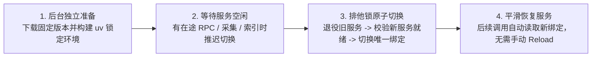

# 版本兼容与无感更新（Release Compatibility & Silent Update）

[English](release-compatibility-and-update.en.md) · [返回文档中心](README.md)

本文说明 MindIE Agent 的组件与插件配套发布规则、宿主版本兼容性筛选机制，以及后台静默更新是如何在不打断开发者日常工作的前提下完成无感切换的。

- 遵循准则：[工程设计原则与演进准则](design-principles.md)
- 首发验证详情：[`0.0.1` 版本发布记录](releases/0.0.1.md)

---

## 组件与插件配套发布

MindIE Agent 对外发布的是**经过实机验证的组件与插件组合**。各个子仓库独立维护自己的版本号（例如主产品与插件发 `0.0.1` 时，`remote-dev`、`knowledge`、`diagnostics` 保持各自独立的版本序列，不强行改号或回退）。未发生代码改动的组件直接复用已有 Release，无需陪跑发版。

### 发布顺序与依赖闭环

发版必须严格遵循**自底向上的拓扑依赖顺序**：
1. 先发布基础诊断组件 [`diagnostics`](https://github.com/mindie-agent/diagnostics)；
2. 再并行准备并发布依赖它的 [`remote-dev`](https://github.com/mindie-agent/remote-dev) 与 [`knowledge`](https://github.com/mindie-agent/knowledge)；
3. 最后发布锁定了上述组件版本的各宿主插件（[`mindie-agent-codex`](https://github.com/mindie-agent/mindie-agent-codex)、[`mindie-agent-cc`](https://github.com/mindie-agent/mindie-agent-cc)、[`mindie-agent-kimi`](https://github.com/mindie-agent/mindie-agent-kimi)）及主仓库版本记录。

在发布任何一个宿主插件 Release 前，维护者必须逐项核对以下配套清单，并在版本发布记录中留存证据：

| 发布前检查项 | 核对标准 |
| --- | --- |
| **1. 完整依赖盘点** | 从插件最终源码的 `uv.lock` 中提取全部直接与间接第一方运行时组件，列出仓库名、包名、版本号、完整 Commit SHA 与对应的 Release Tag |
| **2. 组件已正式发布** | 每个第一方运行时依赖都必须已有正式发布的 GitHub Release（`draft=false` 且 `prerelease=false`）；仅有 Git Tag、合并 PR 或 CI 通过不算组件已发布 |
| **3. 源码与标签严格对齐** | 解引用组件 Release Tag 后的源码 Commit 必须与插件 `uv.lock` 锁定的 Commit 完全一致；Tag 版本、源码 `pyproject.toml` 版本与构建产物（wheel / sdist）元数据必须一致 |
| **4. 发行产物下载校验** | 从正式 Release 页面下载构建产物与 `SHA256SUMS`，校验哈希值、包内文件列表与锁定源码完全对应 |
| **5. 验收范围清晰诚实** | 如实记录实机验收覆盖的客户端版本、平台与源码范围；未重跑的测试不冒充新 Tag 实机证据，已知限制明确列出 |
| **6. 组合闭环复核** | 所有依赖组件 Release 核对无误后才发布插件 Release，防止出现“插件已发、底层组件未发”的断链状态 |

> **说明**：`knowledge` 是代码运行时组件，遵循上述软件 Release 规范；而 `knowledge-vllm-ascend` 是领域知识内容仓库，按固定的内容契约（`publication-contract.json`）持续合入更新，日常新增知识包无需同步发布软件版本。

---

## 宿主兼容性声明与版本选择

不同版本的宿主 CLI（如 Claude Code 或 OpenAI Codex CLI）在 Hook 参数、MCP 超时控制和环境变量传递上可能存在差异。为了防止“插件自动升级后在当前旧版宿主上跑崩”，我们采用确定性的兼容筛选机制：

1. **机器可读的兼容性清单（`harness-compatibility.json`）**：
   - 每个插件仓库维护一份 `harness-compatibility.json`，集中登记插件实际调用的所有宿主接口（Hook、MCP、CLI 参数、环境变量）、代码调用位置、官方依据、测试用例以及经过验证的宿主 SemVer 版本区间。
   - 发布前门禁脚本会自动校验：插件声明支持的宿主版本区间，必须完全落在所有必需接口的支持区间交集之内。
2. **自动匹配最高兼容正式版**：
   - 无论是首次安装还是后续更新，共享版本选择器都会根据本机当前安装的宿主版本，利用标准 SemVer 规则选出**当前宿主能用的最高正式版（Ordinary Release）**。
   - 绝不自动降级，也绝不把 `draft`、`prerelease` 或开发中的 `main` 分支当成正式版本推送给用户。

---

## 后台静默检查与无感原子切换

距离上次成功检查更新超过 **24 小时**后，用户的下一次日常使用会在后台异步触发更新检查。整个过程遵循“**零打扰、零阻塞、空闲原子切换**”原则：

- **日常调用零网络阻塞**：日常工具调用和会话启动只做极轻量的本地时间戳判断（毫秒级），绝不在前台等待网络请求、扫描版本列表或构建虚拟环境；高频触发的短时 Stop Hook 更不会执行任何联网或安装动作。
- **不弹窗、不重置授权**：静默更新不会弹出确认框、不发打扰通知、不要求用户手动敲 Reload，并且完整保留用户已配置的知识贡献开关、项目范围和故障上报设置。
- **失败退避与幂等保护**：如果断网或遇到 GitHub 限流，检查失败会触发退避策略，不会在接下来的每次工具调用中疯狂重试；已经下载准备好的候选版本会直接等待空闲窗口切换，不会重复下载。

### 四步安全切换流程

1. **后台独立准备**：在当前运行环境之外下载目标版本，执行 `uv sync --locked --no-editable` 构建隔离环境并完成包校验。如果准备失败，直接保留当前可用版本，丝毫不影响正在进行的业务。
2. **等待服务空闲**：只要还有正在执行的工具调用、已入队的经验采集或摘要索引任务，就继续使用旧版本服务，绝不强行中断在途任务。
3. **排他锁原子切换**：确认旧服务完全空闲后，短暂获取排他操作锁，干净退役旧后台进程，确认新服务就绪后，将解释器、入口脚本与引擎配置作为一个整体原子更新到唯一安装绑定（Canonical Binding）。
4. **平滑承接后续请求**：在不到一秒的短暂切换窗口内，新进入的请求会短暂等待或收到明确的“暂时繁忙、尚未执行”提示；切换完成后，即使是不重启的老会话，下一次触发 Hook 或工具调用时也会自动读取新绑定，真正做到无感升级。
