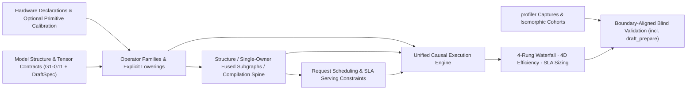

# General Performance Modeling System for Agents (`mindie-sim`)

[中文](simulation-system.md) · [Architecture](architecture.en.md) · [Profiler System Design](profiler-system.en.md) · [Shared Structure and Measured Attribution](archive/profiler-sim-structure.md) · [Design Principles](design-principles.en.md) · [Consumer Migration Guide](archive/simulation-consumer-migration.md) · [Documentation](README.en.md)

`mindie-sim` (Python package `mindie_sim`, current baseline `v0.9.19+`) is a hardware-neutral, mechanism-first performance modeling component built for coding Agents. Starting from declared model structure, operator implementations, and hardware resource specifications, it evaluates isolated operators, subgraphs, pure-model forwards, and serving workloads on **one unified causal execution engine**, providing a **deterministic Case synthesizer (`compose`)**, a **4-rung feature waterfall with dual PR ablations (`feature-tracks` / `feature_waterfall`)**, an **orthogonal two-layer compilation spine (`Software`)**, an **axiomatic `async_scheduling` delayed KV-release memory model**, **4D hardware efficiency attribution** (`Cube_MFU / Vec_MFU / MBU / Link_Util / CV_Overlap`), **SLA hardware scaling & exact topology/PD Pareto solvers (`sla` / `sweep`)**, **multi-DP context-skew / MoE EPLB / Chunked-Prefill interference mechanics (`skew`)**, and **duration-free `mindie-model-structure/1` export (including `draft_prepare=True` prefill draft-cache reconciliation)**.

Vendor and chip names (such as Ascend A2 910B, A3 910C dual-Die, A5 950 `DT` & `PR`, or GPUs) select hardware resource declarations and input adapters only—never hardcoded heuristic multipliers, `model_id` branches, or vendor-specific timing formulas inside the execution loop.

---

## 1. Objectives and Modeling Scope

`mindie-sim` provides reliable performance prediction and bottleneck attribution across shapes, models, hardware generations, and parallel topologies by cleanly decoupling three axes:

- **Structural Fidelity**: Preserves exact tensor shapes, dtypes, layouts, control branches, materialization copies, kernel boundaries, data/stream dependencies, per-core resource ownership (`ctx.owned(...)`), and on-chip SRAM limits (`L1 / L0A / L0B / L0C / UB / L2`). Consumer operators never start before inputs are ready, physical memory copies never vanish silently, and core-bound stages never borrow private pipes or SRAM from idle sibling cores.
- **Timing Fidelity**: Lowers every operator through work-conserving tiled pipeline classes (`Class A–E`) or source-audited `PlannedRecipe`s. `ResourceEnvelope` `1.0x` peak-division fallbacks are unconditionally banned (`resource_envelope_banned`), and unmodeled core structures raise `UnmodeledCapabilityError` carrying `mindie-unmodeled-structure-hint/1`. All granularities execute on the same causal engine without recreating a compiler or runtime inside the simulator.
- **Calibration and Independent Validation**: Measured profiling captures can calibrate bounded resource or primitive service curves within declared domains or grade accuracy on held-out sets; when no measurements are supplied, the simulator runs purely analytical mechanism models.

Hardcoding `model_id` operator branches, heuristic latency multipliers, whole-body residual patches, serving floors, or back-fitting operator parameters from end-to-end TTFT/TPOT is strictly prohibited. Physical work is derived forward from model structure, tensor contracts, and operator mechanisms.

---

## 2. Five-Layer Bottom-Up Composition Architecture

All five composition layers lower onto the exact same discrete-event causal engine:

| Layer | Inputs & Core Responsibility | Engineering Deliverables & Boundaries |
| --- | --- | --- |
| **1. Physical Resources & Services** | Capacities, work units, service rates, active unit counts, on-chip buffers (`L1 / L0A / L0B / L0C / UB / L2`, enforcing `buffer_units.l2 == 1` per physical Die), and interconnect links; models shared contention and bounded pipeline depth | Computes execution durations and overlap across Cube, Vector, split read pipes (`mte2_aic` vs. `mte2_aiv`), `fixpipe` (including A5 `l0c->ub`), `mte3`/HBM, and collective links from `Hardware` / `Device` / `Link` declarations |
| **2. Operator Families & Lowerings** | Semantic operators and explicit implementation selections (`runtime.kernels.lowerings`, tracking `caller` / `stack_profile` / `body_default` binding origins) lowered into `Class A–E` or source-audited `PlannedRecipe`s while preserving kernel call boundaries | Covers two-stage **`RecoverSSM`** speculative state recovery across all **7 rank-1 associative linear-attention families** (`kda`, `gdn`, `mamba`, `gla`, `deltanet`, `lightning`, `retnet`), plus CANN `9.3.0` `Arch35` recipes: `MegaMoE(enable_fused_mc2=3)` & `PR #22333` `situglu` MegaMoE, `fla_npu` `Chunk64` & `PR #22147` `Chunk32` (both enforcing `Hv/Hk <= 4`, falling back to Triton at `Hv/Hk=8`), `_C_ascend.npu_hc_pre_v3/v2`, `PR #21794` `text_gated_residual`, `PR #22385` `AllGatherMatmulV2`/`MatmulReduceScatterV2`, unified `GBSA`, `PR #22467` C8 `KvQuantSFA`, `MlaPrologV4`, `PR #22235` `msa_index_score_v2`, Step-5 `npu_indexer_region_score`, and `aclnnIndexerQuantCache` |
| **3. Structure, Subgraphs & Compilation Spine** | Composes projections, Attention, FFN/MoE, state updates, layout transforms, and `DP`/`TP`/`EP`/`PP`/`DCP`/`DSA-CP`/`PCP` collectives; `fusion_regions.py` maintains single-owner fused region lineage (`absorbed_source_ops` vs. `FusionBoundary`, unioning cross-group `structure_subgraph_memberships`); `Software` orthogonally separates outer `graph_capture_mode` from inner `enable_torch_compile` / `enable_npugraph_ex` / `enable_static_kernel` / `enable_super_kernel` | Evaluates subgraph critical paths, multi-stream overlap, SRAM feasibility, and fusion HBM savings via `graph_costs` / `graph`; `do_not_compile=True` preserves outer `FULL_DECODE_ONLY` `ACLGraph` (`graph_capture_mode="full"`) while disabling `torch.compile`/`npugraph_ex`, and `piecewise` disables all three inner flags |
| **4. Pure Model Forward & Generalized `DraftSpec`** | Expands **37 core catalog models + 4 distinct architecture presets (41 models across `G1–G11` families)** with full `LayerPlan`s and generalized `DraftSpec` (`independent_context`, `context_projection_mode ∈ {"none", "fused_kv_bank", "per_layer_qkv", "mla_prolog"}`, `dcp_sharded`, and `--draft-prepare` / `draft_prepare=True` prefill draft-cache preparation) | `operators --scope model` sums isolated operator programs; `graph --scope model` and `predict(scope="body"\|"model")` compute pure-model forward latency and 4D efficiency |
| **5. Serving Constraints & SLA Solver** | Layers request arrivals, Continuous Batching, KV cache capacity, shared-prefix L2 reuse, PD disaggregation, `DP × TP × EP × PP × DCP / DSA-CP / PCP` topologies, and host scheduling onto pure-model costs to evaluate TTFT / TPOT | Emits request-level serving metrics and solves minimum NPUs, feasible optimum concurrency `B* = min(B*_SLA, B*_VRAM)`, optimal parallel topology, and hardware scaling projections via `scale_case_hardware` / `solve_sla_sizing` |

---

## 3. Component Responsibilities and Public Interfaces

### 3.1 Cross-Component Division of Labor

| Component | Core Responsibility |
| --- | --- |
| **`mindie_sim`** | Model/operator structure expansion and duration-free export (`mindie-model-structure/1`), 5-layer causal performance prediction, 4-rung feature waterfalls (`feature-tracks`), 4D efficiency breakdown, SLA hardware scaling, comparative studies (`study`), and accuracy reconciliation against measured Cohorts and Decode bodies |
| **`mindie_profiler`** | Ascend `msprof` / CANN 9.x `MSPTI` capture control, streaming in-place read-only CSV/SQLite/Trace parsing, observed tensor contract extraction, `mindie-profiler analyze --structure [--sim-case]` 3-state topology attribution and bidirectional Case/`draft_prepare=True` Cohort comparison, topology-guided Decode segmentation (`auto_segment_decode_forwards`), and A/B run comparison |
| **Host Agent** | Chooses modeling granularity for the engineering task, invokes `sim` and `profiler` to isolate bottlenecks, ranks kernel fusions or open-PR speedups, and verifies gains on live NPUs |
| **`remote-dev` / `coordinator`** | Executes remote container commands, probes physical topology, and manages NPU/port leases; local analytical simulation requires zero NPU leases |

### 3.2 CLI and Python Core Entrypoints

Public Python entrypoints include `mindie_sim.predict`, `mindie_sim.operator_costs`, `mindie_sim.target_operators`, `mindie_sim.graph_costs`, `mindie_sim.target_graphs`, `mindie_sim.study`, `mindie_sim.feature_waterfall.compare_feature_tracks`, `mindie_sim.structure.export_structure`, and `mindie_sim.cohort_comparison.compare_cohorts`. The CLI is invoked via `mindie-sim <subcommand>`:

| CLI / Module Entrypoint | Purpose & Output Boundary |
| --- | --- |
| `catalog` / `inspect CASE` | Inspect model declarations or expand full layer structures with zero weight loading and zero NPU context initialization |
| `compose --model ... --hardware ...` | Deterministically synthesize a `Case` from the 41 built-in catalog models or a HuggingFace `config.json` and `a2/a3/a5` hardware aliases (supports `--feature-track {raw_eager,merged,unmerged_pr,expected_ideal}`, `--stack-manifest`, `--enable-opt`/`--disable-opt`, `--recover-ssm`, and `--async-scheduling`) |
| `feature-tracks --model ... --hardware ...` | Evaluate the 4-rung waterfall (`raw_eager` -> `merged` -> `unmerged_pr` -> `expected_ideal` -> `exact_target` hardware Roofline), auditing monotonicity and emitting both `single_pr_ablation` and `leave_one_out_ablation` |
| `operators CASE --phase ... --tokens ... [--draft-prepare]` | Compute isolated operator program costs under production recipes (`sum_of_isolated_device_programs` and family shares) |
| `graph CASE --phase ... --tokens ... [--draft-prepare] [--export-structure PATH]` | Compose data dependencies, multi-stream overlap, and EP collectives on the shared causal engine, optionally including host submission (`--include-submission`) and exporting the matching structure manifest |
| `predict CASE` | Run pure-model (`scope="body"\|"model"`) or serving-level simulation, returning end-to-end latency, 4D efficiency breakdown, and bottleneck regimes |
| `efficiency CASE` / `sla CASE` | Emit 4D efficiency breakdown, `0.80x MBU` counterfactual Roofline fits (`--mode {clamp_to_target,exact_target}`), and synchronous/asynchronous SLA concurrency ceilings and minimum NPU counts |
| `sweep CASE [--mode topology\|pd]` / `skew CASE` | Enumerate exact non-dominated Pareto frontiers across `DP/TP/EP/PP/PCP/DCP` shardings and PD ratios; quantify multi-DP AllToAllV skew barriers, MoE routing imbalance (including EPLB), and maximum safe Chunked-Prefill size $C_{\max}^*$ |
| `study MANIFEST` / `accuracy PACKET` | Rank explicit candidate configurations on matched boundaries or evaluate held-out error distributions and ranking fidelity |
| `mindie-sim structure CASE --phase ... --tokens ... [--draft-prepare]` | Export a duration-free `mindie-model-structure/1` JSON manifest (sanitizing CLI file paths to `source: {"kind": "case_file", "sha256": ...}`) for `mindie-profiler` attribution |
| `mindie-sim compare-cohorts CASE REPORT -o RESULT` | Reconcile `mindie-profiler` `mindie-profile-structure-mapping/1` isomorphic operator Cohorts (including `draft_prepare=True` prefill draft subgraphs) on single-call and cumulative durations |
| `calibrate` / `bind-profiler` / `fit-rate` / `fit-service` | Import identity-matched primitive observations or fit single-channel service curves with strict train/held-out separation |

### 3.3 4D Hardware Efficiency Breakdown, Counterfactual Roofline Fitting & SLA Scaling

Alongside predicted latencies (`TTFT`, `TPOT`, `body_forward_span_ms`), every model and subgraph evaluation reports interpretable architectural metrics:

1. **4D Efficiency Attribution & `0.80x MBU` Counterfactual Roofline Fitting**:
   - **`Cube_MFU`**: Effective matrix Cube utilization;
   - **`Vec_MFU`**: Effective Vector pipe utilization;
   - **`MBU`**: Effective HBM bandwidth utilization (paired with `0.80x MBU` multi-pipe Roofline target fitting to bound kernel fusion headroom);
   - **`Link_Util`**: Intra-/inter-node interconnect utilization (`HCCS / SIO / UB-Mesh / RoCE`);
   - **`CV_Overlap`**: Cube-Vector pipeline overlap ratio and dominant bottleneck regime (`memory_bound / cube_bound / vector_bound / link_bound / launch_bound`).
2. **SLA-Constrained Hardware Scaling & Throughput Solver (`scale_case_hardware` / `solve_sla_sizing`)**:
   - Under a target context length and latency SLA (e.g., Decode `TPOT <= 30ms`), applies non-mutating hardware scales (`hbm_bw_scale`, `cube_flops_scale`, `vector_ops_scale`, `link_bw_scale`, `hbm_capacity_scale`) and binary-searches `B*_SLA` alongside `B*_VRAM` to find `B* = min(B*_SLA, B*_VRAM)`, minimum required NPUs, optimal `DP × TP × EP × PP × DCP / DSA-CP / PCP` layout, and peak `tokens/s`.

### 3.4 CANN `9.3.0` + `vllm-ascend@405617bae` Provenance, Four-Rung Waterfall & `G1–G11` Structural Contracts

1. **Audited Stack Provenance & `_A5_PROFILE` Capability Truth**:
   - `mindie_sim/stack_sources/vllm_ascend_cann93.json` and `mindie_sim/va_stack_bindings.py` pin CANN `9.3.0-20261112_192141454` (`cann_ops_transformer 1.0.0`, `fla_npu 26.10.0+feature`) + `vllm-ascend@405617bae` mainline and 35 open optimization PRs with public `{repository, revision, relative_path, source_sha256}` provenance (audited via `audit_stack_prs.py --stack cann93`).
   - Captures exact `_A5_PROFILE` hardware flags: A5 `merged` includes `MegaMoE(enable_fused_mc2=3)`, `Chunk64` (`Hv/Hk in {1, 2, 3, 4}`), `_C_ascend.npu_hc_pre_v3/v2` (`C in {2560, 4096, 5120, 7168}`), unified `GBSA`, and `MlaPrologV4` while reflecting the omitted `GRAPH_QKV_NORM_ROPE_FUSION` flag (placing generic FX QKNorm+RoPE fusion in `expected_ideal`); `unmerged_pr` layers on `PR #22147` `Chunk32` (finer `Hv/Hk <= 4` tiling), `PR #21794` `text_gated_residual` (`M > 512`), `PR #22333` `situglu` MegaMoE, `PR #22467` C8 `KvQuantSFA`, `PR #22235` `msa_index_score_v2`, `PR #21449` `(1+w)` RMSNorm fold, `PR #22385` TP `MC2`, `PR #22342` Step-5 `@support_torch_compile`, `PR #22164`/`#22473` A5 `FA3`, and `PR #22184` DSpark Static Kernel.
2. **Four-Rung Waterfall (`stack_tracks` / `feature_waterfall`) & Orthogonal Compilation (`Software`)**:
   - Evaluates `raw_eager` -> `merged` -> `unmerged_pr` -> `expected_ideal` anchored against `evaluate_target_efficiency(..., mode="exact_target")` Roofline bounds, reporting both `single_pr_ablation` and `leave_one_out_ablation`.
   - `Software` orthogonally separates `graph_capture_mode` from `enable_torch_compile`, `enable_npugraph_ex`, `enable_static_kernel`, and `enable_super_kernel`: `do_not_compile=True` preserves outer `FULL_DECODE_ONLY` `ACLGraph` (`graph_capture_mode="full"`) while disabling `torch.compile`/`npugraph_ex`, and `piecewise` disables `npugraph_ex` and Static/Super Kernel.
3. **Generalized `DraftSpec`, 7-Family `RecoverSSM` & `G1–G11` Catalog Truths**:
   - Two-stage `RecoverSSM` spans all **7 rank-1 associative linear-attention families** (`kda`, `gdn`, `mamba`, `gla`, `deltanet`, `lightning`, `retnet`); `DraftSpec` preserves sparse attention, sliding windows, and `mHC` while explicitly modeling `independent_context`, `context_projection_mode` (`fused_kv_bank` / `per_layer_qkv` / `mla_prolog`), and `dcp_sharded`.
   - All 41 catalog models match upstream source truth: `Gemma-4` (`G10`) uses standard `RMSNorm` (`norm_weight_offset=0.0`, 4/7 norms, weight-free `v_norm`, `k_eq_v=True`); `MiniMax-M3` / `M3.1-Flash` (`G8`) uses `(1+w)` `GemmaRMSNorm` plus a 7-layer dense GQA DSpark drafter (`#20167`); `Step-5-Preview` (`G9`) uses native CSA `npu_indexer_region_score` + 3-layer `cyclic_nextn`; and `Kimi-K3` (`G5`) uses 5-layer GQA DSpark (`dcp_sharded=False`) vs. `Kimi-K3.1` 5-layer MLA DSpark.
   - Natively models fine-grained local projection sharding (`o_proj_tp`, `linear_proj_tp`, `lm_head_tp`), Paged/SWA/block-sparse GQA shared-prefix L2 reuse (`prefix_cache_mode` / `prefix_read_mode`), EPLB redundant expert slots (`redundant_experts_per_rank`), topology-aware collective startup (`collective_startup_mode`), and 4-clock Max-Plus exposed-time conservation (`exposed_breakdown_ms` / `exposed_breakdown_pct`).

---

## 4. Shared Structure and Measured Calibration with `mindie-profiler`

`mindie-sim` and `mindie-profiler` form a closed loop through duration-free structural declarations and measured cohort reports (see [Shared Structure and Measured Attribution](archive/profiler-sim-structure.md)):

1. **Unified Structure Export (`mindie-model-structure/1`)**: `mindie-sim` exports semantic nodes, `layer / block / role` scopes, tensor contracts, physical work signatures, and single-owner fused subgraph boundaries (`subgraphs` / `resource_boundary`), supporting `--draft-prepare` / `draft_prepare=True` for prefill draft-cache preparation.
2. **Bidirectional Case Ingress & Isomorphic Cohort Comparison**: `mindie-profiler`'s `sim_structure_ingress` (backed by `sim_draft_geometry`) accepts `mindie-model-structure/1`, a five-key `Case`, or a `mindie-sim.graph/1` summary, propagates `draft_prepare=True` through structure regeneration, groups equal-contract events into Cohorts, and reconciles single-call Mean/P50 and cumulative activity via `mindie_sim.cohort_comparison`.
3. **Topology-Guided Decode Body Segmentation**: `mindie-profiler`'s `auto_segment_decode_forwards` uses `sim` layer plans to isolate steady-state `body_forward_span_ms` directly against `mindie_sim.predict(..., scope="body", phase="decode")`.
4. **Unified Replay & Scoreboard Pipeline**: `profiler/examples/structure/pipeline.py` drives `--stage decode|prefill|operators|engine|generalization|all` replay and scoreboard verification.

---

## 5. Verification Architecture and Multi-Cluster Generalization

- **Bounded Memory & Zero-Weight Control Plane**: The simulation loop stays `O(Active State)` without loading model weights or initializing `torch_npu`/CANN contexts; peak single-process RSS across full-model graphs (Qwen3.8, Qwen3.6, Kimi-K3, GLM-5.3, DeepSeek-V4.1, etc.) is **`287.6 MiB`** (strictly below the `512 MiB` ceiling).
- **Lean 4 Mechanized Conservation Kernel (`formal/MindIESimSpec`)**: Proves 4-clock Max-Plus exposed-breakdown conservation, cross-operator weight-prefetch clamping and half-open HBM interval ledgers, local `TP` / EPLB / Ascend `FRACTAL_NZ` sharding isomorphisms, `RecoverSSM` rollback/prefix-replay equivalence, and `UB-Mesh` logarithmic collective round bounds with zero `sorry` and zero custom `axiom`s.
- **Live Multi-Chip, Multi-Model & 4-Rung Convergence**:
  - **CANN `9.3.0` A5 Dual-Silicon Matrix Closure**: Verified across all 41 models × 2 A5 SKUs (`Ascend950PR_958b` `1.4 TB/s, 112 GiB` and `Ascend950DT_9582` `4.0 TB/s, 96 GiB`) × 4 feature tracks (`1,312` cells) with zero exceptions and verified waterfall monotonicity, alongside **`7,337 / 7,337`** real A2/A3/A5 profiling captures (`436,412` step samples) within `100.0% <= 10%` error;
  - **Decode & Prefill Body Prediction**: **280 real Decode cases** and **15 full Prefill cases** on A3/A5 all converge within **`<= 15%`** error;
  - **Three-Chip In-Sample Multi-Regime Calibration (A2 + A3 + A5)**: Across **202 Cohort-Phases and 1,653 Golden Profiles** (`A2: 565/565`, `A3: 580/580`, `A5: 508/508`), achieves **`1,653 / 1,653 = 100.00% <= 10%`** convergence (`2.77%` MAE, `2.11%` median error);
  - **DSH Fleet Blind Generalization**: Achieves **`841 / 856 = 98.25%`** overall (`<= 15%` error) and **`546 / 561 = 97.33%`** on independent held-out fleet captures.
- **Seven-Host Zero-Binding Integration**: Exposed uniformly across all 7 native host plugins (`mindie-agent-codex`, `cc`, `kimi`, `dsh`, `agy`, `wb`, `oc`) via the `mindie-harness` zero-binding MCP gateway (`P2.7`) and verified continuously in `mindie-bench` (`sim-causal-modeling-boundaries`).
