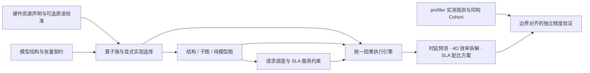

# 面向 Agent 的通用性能建模系统（`mindie-sim`）

[系统架构](architecture.md) · [Profiler 系统设计](profiler-system.md) · [结构复用与实测映射](profiler-sim-structure.md) · [设计原则](design-principles.md) · [消费者迁移指南](simulation-consumer-migration.md) · [文档中心](README.md)

`mindie-sim`（Python 包 `mindie_sim`，当前正式版本 `v0.8.1`）是面向编程 Agent 的硬件无关、机理优先（Mechanism-First）性能建模组件。它从模型结构、算子实现和硬件资源声明出发，用**同一个因果执行引擎**计算算子、子图、纯模型与服务场景的成本，并提供 **4D 硬件效率拆解**（`Cube_MFU / Vec_MFU / MBU / Link_Util / CV_Overlap`）、**SLA 硬件配比推演**与 **`mindie-model-structure/1` 结构导出**。

厂商与芯片型号（如昇腾 910B / A3 910C / A5 950、GPU 等）仅用于选择硬件资源声明与输入适配器，不在执行循环中硬编码专用的经验倍率或时间公式。

---

## 1. 目标与建模边界

`mindie-sim` 的核心目标是提供跨形状、跨模型、跨硬件与并行配置的可靠性能预测与瓶颈定界。系统将以下三个维度显式解耦管理：

- **结构正确性（Structural Fidelity）**：严格保留张量 Shape、Dtype、Layout、实际控制分支、物化拷贝、Kernel 边界、数据/流依赖、资源归属与片上容量。消费者算子不能在输入就绪前执行，真实发生的显存拷贝不能凭空消失，绑定在特定计算核或流上的任务不能借用其他核的吞吐供给。
- **时间建模精度（Timing Fidelity）**：按分析需求选择资源包络（Resource Envelope）、阶段/分块流水（Staged / Tiled Pipeline）或源码级详细程序。不同粒度共享同一套因果执行引擎，无需为了消除单个 Kernel 的微小残差而在模拟器中重写编译器或运行时。
- **校准与独立验证（Calibration & Validation）**：实测 Profiling 数据既可在声明适用域内校准资源或原语响应曲线，也可作为独立盲测集（Held-out Set）检验预测精度；没有实测数据时，系统直接运行解析机理模型。

系统严禁按模型名称硬编码经验倍率、整网残差回填、固定服务时间底板，或从端到端 TTFT/TPOT 反向拟合单算子参数。物理工作量始终由模型结构与算子契约正向推导。

---

## 2. 自底向上的五层组合架构

五层结构代表自底向上的组合层次，全部复用同一个因果事件驱动引擎：

| 层次 | 输入与核心职责 | 工程产出与边界 |
| --- | --- | --- |
| **1. 物理资源与服务** （Physical Resources & Services） | 容量、工作量单位、供给速率、参与核数、片上缓冲（`L1 Buffer / L0A / L0B / L0C / UB / L2 Cache`）与互联链路；处理共享资源竞争与有限流水深度 | 基于 `Hardware` / `Device` / `Link` 声明计算 Cube、Vector、MTE/HBM 搬运与集合通信链路的执行耗时与重叠率 |
| **2. 算子族与源码实现** （Operator Families & Lowerings） | 语义算子与显式软件实现选择（`runtime.kernels.lowerings`），生成资源包络、分块流水或源码级资源程序；保留真实 Kernel 调用边界 | 支持通用解析配方及 GDN Prefill、GQA、MLA Decode、MLA Prolog、LightningIndexer、RMSNorm、AddRMSNorm、Grouped GEMM、动态 INT8 量化等显式源码实现 |
| **3. 结构与子图** （Structure & Subgraphs） | 组合投影、Attention、FFN/MoE、状态更新、布局转换与 `DP`/`TP`/`EP`/`PP`/`DCP`（Decode Context Parallelism）/`DSA-CP`（DeepSeek Sparse Attention Context Parallelism）/`PCP`（Prefill Context Parallelism）通信；处理流间依赖、EP Rendezvous 与显式子图融合（`native_fusion`） | 通过 `graph_costs` / `graph` 计算子图关键路径、流间重叠、片上缓存可行性与融合前后 HBM 流量变化 |
| **4. 纯模型前向** （Pure Model Forward） | 完整模型层计划（`LayerPlan`）展开、算子重复次数、累计成本与设备图完成时间；不引入外部请求到达或服务排队 | `operators --scope model` 输出独立算子成本之和，`graph --scope model` 与 `predict(scope="body"\|"model")` 输出纯模型前向时延与 4D 效率拆解 |
| **5. 服务约束与 SLA 求解** （Serving Constraints & SLA Solver） | 在纯模型成本之上叠加请求到达、Continuous Batching、KV Cache 容量、PD 分离与 `DP × TP × EP × PP × DCP / DSA-CP / PCP` 并行拓扑及 Host 调度开销，评估 TTFT / TPOT | 输出请求级服务指标，并通过 `scale_case_hardware` / `solve_hardware_sla_throughput` 提供面向目标 TPOT（如 `<= 30ms`）的最小卡数、最大可行并发 `B* = min(B*_SLA, B*_VRAM)`、最优并行拓扑与硬件缩放推演 |

---

## 3. 组件职责与公开接口

### 3.1 跨组件分工

| 组件 | 核心职责 |
| --- | --- |
| **`mindie_sim`** | 模型/算子结构展开与无时延导出（`mindie-model-structure/1`）、五层因果性能预测、4D 硬件效率拆解、SLA 硬件配比推演、候选方案对比（`study`）以及与实测 Cohort / Decode 主体的精度对账 |
| **`mindie_profiler`** | 昇腾 `msprof` 采集控制、原始 CSV/SQLite 统一流式解析、观测张量契约提取、`mindie-profiler analyze --structure`（MCP `analyze_profiling`）三态拓扑对齐（`aligned / declared_only / unattributed_observed`）、拓扑引导 Decode 自动切分（`auto_segment_decode_forwards`）与跨版本对比 |
| **宿主 Agent** | 结合研发任务选择建模粒度，调用 `sim` 与 `profiler` 定位性能瓶颈、筛选算子融合或并行方案，并在真机上验证收益 |
| **`remote-dev` / `coordinator`** | 提供远端容器执行、物理拓扑探测与 NPU/端口租约管理；本地纯机理仿真无需申请 NPU 租约 |

### 3.2 CLI 与 Python 核心入口

Python 公开入口包括 `mindie_sim.predict`、`mindie_sim.operator_costs`、`mindie_sim.target_operators`、`mindie_sim.graph_costs`、`mindie_sim.target_graphs`、`mindie_sim.study`、`mindie_sim.structure.export_structure` 与 `mindie_sim.cohort_comparison`。命令行入口通过 `mindie-sim <subcommand>` 调用：

| CLI / 模块入口 | 核心用途与输出边界 |
| --- | --- |
| `catalog` / `inspect CASE` | 读取模型声明或展开完整层结构，零权重加载、零设备上下文初始化 |
| `operators CASE --phase ... --tokens ... --scope body\|model` | 计算生产配方下的独立算子成本，输出 `sum_of_isolated_device_programs` 及各算子族占比 |
| `graph CASE --phase ... --tokens ... --scope body\|model` | 在统一因果引擎中组合数据依赖、多流并发与 EP 集合通信，输出纯设备图或含 Host 提交（`--include-submission`）的完成时间与关键路径 |
| `predict CASE` | 执行纯模型（`scope="body"\|"model"`）或服务级请求仿真，输出端到端时延、4D 硬件效率拆解与瓶颈定界 |
| `study MANIFEST` | 在一致的结构、路由与计时边界下批量评估显式候选方案（如并行切分、算子实现、融合策略），输出可比候选排序 |
| `accuracy PACKET` | 对齐硬件、实现、阶段、Shape 与计时边界，在独立盲测集（Held-out）上输出误差分布、趋势一致性与配置排序准确率 |
| `python -m mindie_sim.structure CASE ...` | 复用 `target_graphs` 与配方展开导出无时延的 `mindie-model-structure/1` JSON，供 `mindie-profiler` 关联实测事件 |
| `python -m mindie_sim.cohort_comparison CASE REPORT -o RESULT` | 消费 `mindie-profiler` 输出的同构算子集合（Cohort）报告，按 `> 50 µs`（15% 相对容差）与 `<= 50 µs`（15 µs 绝对容差）完成单次与累计耗时对账 |
| `calibrate` / `bind-profiler` / `fit-rate` / `fit-service` | 导入显式身份匹配的原语样本或拟合单资源通道的服务速率曲线，严格隔离训练集与盲测集 |
| `migrate-case CASE` | 将旧版声明显式转换为当前 `Case` 结构 |

### 3.3 4D 硬件效率拆解、反事实 Roofline 拟合与 SLA 硬件配比推演

每次模型或子图仿真除输出预测耗时（`TTFT`、`TPOT`、`body_forward_span_ms`）外，还直接给出面向硬件架构师与调优 Agent 的可解释指标：

1. **4D 硬件效率拆解与 `0.80x MBU` 反事实 Roofline 拟合**：
   - **`Cube_MFU`**：矩阵计算单元（Cube Core）有效算力利用率；
   - **`Vec_MFU`**：向量计算单元（Vector Core）有效算力利用率；
   - **`MBU`**：高带宽显存（HBM）有效带宽利用率（并提供 `0.80x MBU` 反事实多管线 Roofline 目标拟合，量化算子优化上限）；
   - **`Link_Util`**：片间/机间互联链路（HCCS / RoCE）有效带宽利用率；
   - **`CV_Overlap`**：Cube 与 Vector 流水线并行掩盖率，以及主导瓶颈分类（`Cube / Vector / Memory / Comm / Schedule`）。
2. **面向 SLA 的硬件缩放与最大吞吐求解器（`scale_case_hardware` / `solve_hardware_sla_throughput`）**：
   - 给定模型配置、上下文长度、目标并发与延迟约束（如 Decode `TPOT <= 30ms`），支持对 `hbm_bw_scale`、`cube_flops_scale`、`vector_ops_scale`、`link_bw_scale`、`hbm_capacity_scale` 进行无损反事实硬件缩放，通过单调二分搜索联合求解 SLA 延迟上限 `B*_SLA` 与显存容量上限 `B*_VRAM` 的可行最优并发 `B* = min(B*_SLA, B*_VRAM)`，给出满足 SLA 的**最小卡数（`Min_Cards`）**、**最优 `DP × TP × EP × PP × DCP / DSA-CP / PCP` 并行配比**与**最大服务吞吐**。

### 3.4 算子族源码实现选择（`runtime.kernels.lowerings`）

通过 `runtime.kernels.lowerings` 可在普通模型前端显式启用特定算子族的源码级建模配方（未显式指定的算子族默认使用通用解析配方）：

| 语义选择器 | 已接入实现标识 | 适用域与建模边界 |
| --- | --- | --- |
| `gdn_prefill` | `gdn_prefill_arch35` | 覆盖 GDN 线性注意力 Prefill 的卷积与 Prepare/H/O 阶段、投影及分块流水 |
| `gqa_attention` | `vllm_triton_unified_attention_2d_pointer` | BF16/FP16 因果或非因果 GQA Attention，按 `compute_capability` 匹配源码分块几何 |
| `mla_prolog` | `vllm_ascend_mla_prolog_v3` | 覆盖 MLA 前处理（Q/KV 投影、归一化、RoPE、Q Absorption 与 Cache 写入）的融合子图边界 |
| `mla_decode` | `vllm_triton_mla_decode_tuple` | BF16 Dense Latent Decode，保留 Tuple Query 拼接、Zero Fill 与两阶段依赖 Kernel |
| `rmsnorm` / `add_rmsnorm` | `vllm_cuda_rms_norm` | 标准 RMSNorm 与残差融合 AddRMSNorm，保留完整行归约与下游消费者依赖 |
| `grouped_gemm` | `ascendc_grouped_nd_bf16` | MoE Gate/Up 与 Down 分组矩阵乘，支持显式整数路由（`runtime.routing.realizations`）或均衡活跃专家分布 |
| `quantize` | `cuda_dynamic_int8_quant_symmetric_no_azp` | 逐行 FP32 Scale 的对称动态 INT8 量化生产链，保留独立量化 Kernel 边界 |

---

## 4. 与 `mindie-profiler` 的结构对齐与实测校准

`mindie-sim` 与 `mindie-profiler` 通过声明结构导出与实测观测报告形成闭环，详见[结构复用与实测映射](profiler-sim-structure.md)：

1. **统一结构导出（`mindie-model-structure/1`）**：`mindie-sim` 从模型配置或 `OpSpec` DAG 导出包含语义节点、层/块归属（`layer / block / role`）、张量契约（`contract`）、物理工作量签名（`physical_work / physical_signature`）与融合子图边界（`subgraphs` / `resource_boundary`）的结构清单。
2. **同构算子集合（Cohort）对账**：对于模型中重复出现的同构层，无需强行猜测单个事件属于第几层；`mindie-profiler` 将相同契约、相同物理工作量的事件聚合成 Cohort，由 `mindie_sim.cohort_comparison` 直接比对单次耗时（Mean / P50）与整组累计耗时。
3. **拓扑引导 Decode 主体自动切分与端到端对账**：`mindie-profiler` 的 `auto_segment_decode_forwards` 利用 `sim` 层计划自动从完整推理 Trace 中切出每次 Decode 主体 Forward 的精确设备墙钟跨度（`body_forward_span_ms`），并与 `mindie_sim.predict(..., scope="body", phase="decode")` 进行端到端对比。
4. **统一的回放与验证流水线**：`profiler/examples/structure/pipeline.py` 提供覆盖 `--stage decode|prefill|operators|engine|generalization|all` 的一站式重放与记分牌生成。

---

## 5. 验证体系与多集群泛化实测结果

- **有界内存与零权重控制面**：仿真主循环严格保持 `O(Active State)` 内存占用，不加载模型权重、不初始化 `torch_npu`/CANN 上下文；在 Qwen3.8 / Qwen3.5 / Qwen3.6 / Kimi K3 / GLM5.3 / DeepSeek V4.1 等 14 个完整模型图基准上，单进程峰值 RSS 仅为 **`287.6 MiB`**（严格低于 `512 MiB` 目标红线），任务完成后存活对象清零。
- **跨芯片、跨模型的真实硬件收敛结果**：
  - **Decode 主体预测**：覆盖 A3 / A5 集群的 **280 个真实 Decode 用例**（含高低并发、TP/DP/EP、MTP 与 FlashComm 场景）全部收敛在 **`<= 15%`** 误差容差内；
  - **Prefill 阶段预测**：**15 个完整 Prefill 用例**全部收敛在 **`<= 15%`** 误差容差内；
  - **大规模集群盲测泛化（DSH Fleet Generalization）**：在 **856 个 DSH 真实集群用例（含 561 个独立 Held-out 盲测用例）**上，端到端预测准确率达到 **98.25%（误差 `<= 15%`）**。
- **四端宿主与评测套件全量集成**：`mindie-sim v0.8.1` 已通过 `mindie-agent-codex`、`mindie-agent-cc`、`mindie-agent-kimi` 与 `mindie-agent-dsh` 的 `components` / `mindie-tools` MCP 服务在四端统一暴露，并与 `mindie-bench` 的 `sim-causal-modeling-boundaries` 基准完成闭环验证（接口迁移说明见[消费者迁移指南](simulation-consumer-migration.md)）。
