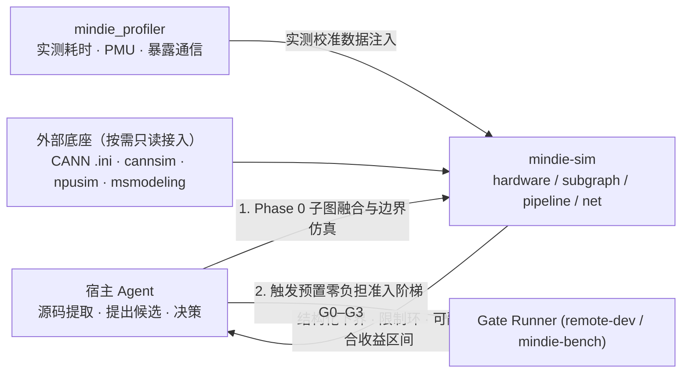
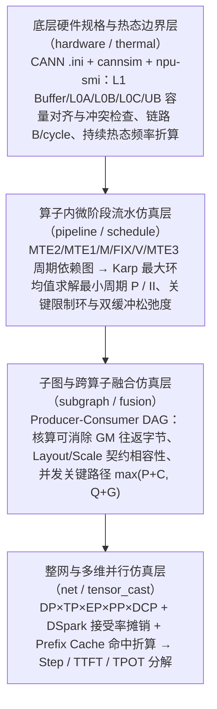
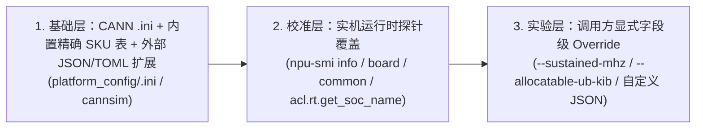
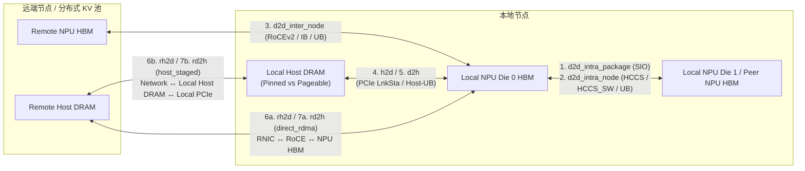

# 面向 MindIE Agent 的 NPU 仿真与边界求解系统设计（`mindie-sim`）

[系统架构](architecture.md) · [Profiler 系统设计](profiler-system.md) · [设计原则](design-principles.md) · [上下文与经验设计](knowledge-context-and-exploration.md) · [文档中心](README.md)

`mindie_sim`（独立仓库 [`sim`](https://github.com/mindie-agent/sim)，CLI 与包名 `mindie-sim` / `mindie_sim`）是与实测 Profiling 仓库（[`profiler`](https://github.com/mindie-agent/profiler)）和诊断上报仓库（[`diagnostics`](https://github.com/mindie-agent/diagnostics)）完全独立建仓的 **昇腾（Ascend）NPU 仿真、理论边界求解与跨算子融合分析组件**。

其核心目标是：**参考 `cannbot`（`ops/npu-arch`、`pipeline_schedule_model`、`ops-simulator`）、`cannsim` 与 `msmodeling`（`tensor_cast`），提供从底层硬件规格、算子内微阶段流水、算子间子图融合到整网多维并行的完整仿真建模能力；将可编码的数学求解与容量核算固化为确定性引擎，同时严格禁止将源码特化逻辑、未校准阶段耗时或模拟器标称值硬编码为伪实测结论。**

---

## 1. 为什么需要将 `mindie-sim` 独立为专用仿真组件？

在复杂的昇腾算子与大模型推理优化（如 Kimi K3 / A5 `DP4 × TP8 × EP64 × DCP8`、`FlashMLA C8`、`MLAPO` 与 `MoE` 融合调优）中，仅靠实测 Profiling（`mindie_profiler`）或单算子粗粒度 Roofline 公式存在三类明显局限：

1. **名称与职责正交**：
   - `modeling` 一词在 LLM 研发中极易与模型结构定义（如 `modeling_deepseek.py`）混淆；使用 **`mindie-sim`（`mindie_sim`）** 明确表达其**硬件约束仿真、流水线周期求解与子图/整网性能推演**职责。
   - `mindie_profiler` 负责**实测产物的采集、原地解析与 A/B 事实对比**；`mindie-sim` 负责**改代码前后的理论下界核算、可融合性预判、微阶段周期求解与敏感性分析**。两者职责正交，通过标准结构化 JSON 对齐，避免单一组件职责膨胀。
2. **粗粒度 Roofline 无法指导复杂流水与跨界融合决策**：
   - 单算子总 FLOPs / 峰值算力只能给出理想下界，无法回答“为什么放宽 `PV UB` 或 `Score L0C` 双缓冲后墙钟耗时毫无改善？”（需要 36 节点多 Pipe 周期依赖图求解最大环均值 `II`）；
   - 也无法在动手改代码前回答“当前应该抠单算子内部指令，还是先把上游 `MLAPO` 输出量化与下游 `pack` 融合掉？”（需要子图级 GM 往返流量核算与并发分支关键路径 $\max(P+C, Q+G)$ 仿真）。
3. **防止 Agent 陷入“捏造耗时填模型”或“拿模拟器/短采当持续实测”的陷阱**：
   - 平台 `.ini` 配置文件、模拟器（`cannsim` / `npusim`）天井、短采 Boost 频率与长稳态热降频（Sustained Thermal Clock）之间存在显著差异。必须由专用仿真组件显式管理输入证据层级与可信度边界。

---

## 2. 架构边界与四层仿真体系

### 2.1 组件协作关系

| 组件 | 唯一核心职责 | 明确不做的事（防重复造轮子边界） |
| --- | --- | --- |
| **`mindie-sim`（`mindie_sim`）** | 四层仿真与求解：硬件规格/片上容量核算、算子内微阶段周期依赖图求解、子图跨算子融合与关键路径分析、整网多维并行推演（桥接 `msmodeling` / `npusim`） | 不解析实测 Profiling DB/CSV/Trace 原始事件表、不管理远端进程或 NPU 租约、不维护跨会话知识库 |
| **`mindie_profiler`** | 实测 Profiling 采集控制、`inventory / analyze / correlate / compare / sql` 原地解析与跨 Run 事实对比 | 不内置复杂流水图求解器或子图融合推演逻辑；需要理论对照时直接调用 `mindie_sim` 公开接口 |
| **宿主 Agent + Skill** | 从 C++/Python 源码提取微阶段拓扑或子图结构，调用 `mindie-sim` 预判收益边界，先定跨算子融合边界再做单算子调优 | 不手写临时最大环均值求解脚本，不凭感觉捏造未测微阶段耗时 |
| **`mindie-bench`** | 评测驱动器、预置零负担准入脚手架（`G0–G3` Gate Runner）与独立裁判 | 100% `import` 调用 `mindie_sim` 与 `mindie_profiler`，严禁在评测仓内复制建模公式或求解器 |

### 2.2 自底向上的四级仿真粒度（避免与系统架构 `L1–L4` 及片上 `L1 Buffer` 混淆，统一按仿真粒度命名）

---

## 3. 多型号兼容架构（A2 / A3 / A5 全谱系 SKU 接口设计）

昇腾 **A2（910B 系列）**、**A3（910C / `910_93` 双 Die 系列）**与 **A5（950DT / 950PR 系列）**绝非三个固定常数的单一芯片，同一世代下包含大量具体 SKU（子型号），其 **Cube 核数、Vector 核数、各级片上与 HBM/L2 访存带宽、显存容量、持续热态频率以及封装拓扑（单 Die vs 双 Die 合封）**均存在显著差异：

- **A2 家族示例**：`Ascend910B1`、`Ascend910B2`、`Ascend910B2C`、`Ascend910B3`、`Ascend910B4`、`Ascend910B4-1` 等（例如 `24 AIC / 48 AIV` vs `20 AIC / 40 AIV`；`64 GiB` vs `32 GiB` HBM；不同频率与 HBM 带宽档位）。
- **A3 家族示例**：`Ascend910_9391`、`Ascend910_9392`、`Ascend910_9381`、`Ascend910_9382`、`Ascend910_9372`、`Ascend910_9362` 等（单卡双 Die 合封，`Phy-ID` 成对映射，需严格区分 **Per-Die 资源**与 **Per-Package 双 Die 聚合资源**，以及 Die 间 SIO/HCCS 与卡间互联带宽）。
- **A5 家族示例**：`Ascend950DT_9581`、`Ascend950DT_9582`、`Ascend950DT_9599`、`Ascend950PR_*` 等（例如同为 `950DT`，`9581` 与 `9582` 的 `.ini` 与实机 HBM 容量 `144 GiB` vs `96 GiB` 不同；`DT` 的 `4.0 TB/s` 与 `PR` 的 `1.6 TB/s` 访存口径不同）。

为此，`mindie-sim` 严禁将 `"A2"` / `"A3"` / `"A5"` 硬编码为三条静态规格常量，而是采用**“四维解耦 Schema + 三级动态解析与覆盖协议”**：

### 3.1 四维硬件能力解耦 Schema（`DeviceCapabilityProfile`）

将任意 NPU 子型号的硬件能力拆解为四个独立可参数化、可局部覆盖的结构体：

1. **`cube_spec`（Cube 计算与 L1/L0 存储规格）**：
   - `aic_count_per_die`：单 Die AIC 核数（如 `20`、`24`、`32`）；
   - `ops_per_cycle_per_aic`：按数据类型（`fp8_e4m3`, `fp8_e5m2`, `int8`, `bf16`, `fp16`, `fp32`）解耦的每周期每核理想 FLOPs/MACs；
   - `l1_kib`, `l0a_kib`, `l0b_kib`, `l0c_kib`：单 AIC 对应的片上各级容量与对齐粒度。
2. **`vector_spec`（Vector 计算与 UB 存储规格）**：
   - `aiv_count_per_die`：单 Die AIV 核数（如 `40`、`48`、`64`）及 `aiv_per_aic_ratio`（通常为 `2:1`）；
   - `simd_width_bytes`（如 `256B`）、各精度每周期向量算力；
   - `physical_ub_kib` vs `allocatable_ub_kib`（显式区分硬件物理 UB 与扣除系统保留后的可分配 UB，如 `256 KiB` vs `248 KiB`）。
3. **`memory_hierarchy_spec`（HBM / L2 / 片上 Pipe 访存与全路径通信带宽规格）**：
   - `platform_config_hbm_mib` vs `verified_runtime_hbm_mib`（显式并列配置显存与实机可用显存）；
   - `hbm_peak_bw_gbps` vs `sustained_hbm_bw_gbps`（支持区分白皮书/理论峰值与实测 sustained 带宽）；
   - `l2_capacity_mib`、单核/整 Die `GM/L2 Cache -> L1 Buffer`、`L1 Buffer -> L0A/B`、`L0C -> UB/FIXP`、`UB <-> GM` 的每周期字节上限（`B/cycle`）；
   - `transfer_channels`（全路径 7 类跨卡/跨机/主机-设备传输通道规格）：统一覆盖 **`d2d_intra_package`**（A3 双 Die `SIO`）、**`d2d_intra_node`**（机内 `HCCS` / `HCCS_SW` / `UB-Mesh`）、**`d2d_inter_node`**（机间 `RoCEv2` / `IB` / 跨节点 `UB`）、**`h2d`**（本地 Host $\to$ NPU）、**`d2h`**（NPU $\to$ 本地 Host）、**`rh2d`**（远端 Host / 分布式 KV 池 $\to$ 本地 NPU）与 **`rd2h`**（本地 NPU $\to$ 远端 Host / 分布式 KV 池）。
4. **`clock_and_topology_spec`（频率与封装拓扑规格）**：
   - `arch_family`（`"A2"` / `"A3"` / `"A5"`，仅决定指令集代际特性与片上 Pipe 拓扑类型，不绑定具体核数/容量）；
   - `soc_version`（精确 SKU 名，如 `"Ascend910B3"`、`"Ascend910_9382"`、`"Ascend950DT_9582"`）；
   - `dies_per_package`（A2/A5 为 `1`，A3 双 Die 为 `2`）；
   - `configured_clock_mhz`（标称频率）与 `sustained_clock_mhz_range`（长稳态热态频率区间，如 `[1250, 1300]`）。

### 3.2 三级动态解析与兼容覆盖优先级（Resolution Precedence）

1. **第一级（CANN `.ini` 原生解析 + 可扩展 SKU 注册表）**：
   - 支持直接传入远端或本地 CANN 路径下的 `<soc_version>.ini`（自动解析 `[SoCInfo]`、`[AICoreSpec]`、`[MemorySpec]` 中的核数、频率、各级缓存与显存大小），无需为每个新子型号修改 Python 源码；
   - 支持通过外部 `--sku-profile <custom_sku.json>` 零代码接入尚未发布的新硬件型号。
2. **第二级（实机探针自动修正与冲突留痕）**：
   - 当提供 `npu-smi info` 快照或在线探测结果时，自动用实机测得的 `verified_runtime_hbm_mib`、实机 `soc_version` 与物理卡/Die 映射覆盖静态默认配置，并在输出 `discrepancies` 数组中记录静态配置与实机值的偏差。
3. **第三级（未知或模糊型号的安全降级铁律）**：
   - 若调用方仅传入模糊大类（如仅指定 `"A2"` 或 `"A3"` 而无具体 `soc_version`、`.ini` 或 `npu-smi` 探针），**严禁静默假装成某一个具体子型号去计算算力/访存绝对耗时下界**！
   - 此时仅执行与具体 SKU 核数/容量无关的拓扑检查（或该世代公共的最小片上约束），而将依赖具体核数、带宽或容量的下界字段显式置为 `null`，返回 `unmodeled_reason="ambiguous_soc_sku_requires_exact_soc_or_ini_or_probe"`。

### 3.3 全路径通信与主机-设备传输建模（`D2D` 机内/机间 + `H2D`/`D2H` + `RH2D`/`RD2H`）

在多卡多机并行（`TP / EP / PP / DCP`）、PD 分离（Prefill-Decode Disaggregation）、分布式 KV Cache 池（如 Mooncake / Memcache）以及 Prefix Cache Offload/Prefetch 场景中，端到端性能不仅取决于算子计算与 `D2D` 集合通信，还高度受制于 **`H2D` / `D2H` / `RH2D` / `RD2H`** 链路瓶颈。`mindie-sim` 对七类传输链路进行完整建模：

| 传输类别 | 物理链路与拓扑层级 | 确定性求解模型（Codifiable） | 实机探针与严禁硬编码项（Non-Hardcodable） |
| --- | --- | --- | --- |
| **`d2d_intra_package`** | A3 双 Die 合封内部 `SIO` 总线（`Phy-ID 2k <-> 2k+1`） | $\alpha_{\text{sio}} + B / \text{BW}_{\text{sio}}$；分层集合通信中作为 Tier-0 规约/分发跳 | 单 Die 机型（A2/A5）无此层；由 `npu-smi info -t topo` 识别 `SIO` 拓扑矩阵 |
| **`d2d_intra_node`** | 机内 `HCCS` 全互联（A2）、`HCCS_SW` 交换网（A3）或 `UB-Mesh`（A5） | 支持 `ring`、`halving_doubling`、`mesh_direct`、`all_to_all` 数据量系数（如 $\frac{N-1}{N}B$、$\frac{2(N-1)}{N}B$）与单向/双向带宽求解 | 严禁把整机聚合带宽当作单卡单向有效带宽；区分单向峰值与全双工并发有效带宽 |
| **`d2d_inter_node`** | 机间 `RoCEv2` / `IB` / 跨机超节点 `UB` | 支持多层级分层集合通信（`intra_package` + `intra_node` + `inter_node`）及 MoE 跨机 `AllToAll` Dispatch/Combine 建模 | 区分单卡单 Rail 带宽与多卡并发网卡拥塞折扣；小包场景显式计入 $\alpha_{\text{roce}}$ 启动延迟 |
| **`h2d` / `d2h`** | 本地 Host DRAM $\leftrightarrow$ NPU HBM（PCIe Gen4/Gen5 或 Host-UB） | 区分 `pinned`（DMA 直传：$\alpha_{\text{pcie}} + B / \text{BW}_{\text{pcie}}$）与 `pageable`（叠加 Host 内存拷贝天井：$\text{BW}_{\text{eff}} = \min(\text{BW}_{\text{pcie}}, \text{BW}_{\text{dram\_stage}})$），以及 `H2D+D2H` 全双工与同 NUMA 多卡共享 Root Complex 争用 | **严禁硬编码白皮书 PCIe 速率**：如常驻 A2（`173.125.1.2`）实机 `lspci` 显示 `LnkCap: 32GT/s (Gen5 x16)`，但实际运行降级为 **`LnkSta: 16GT/s (Gen4 x16)`**，理论峰值相差 2 倍！必须支持解析 `lspci` / 实测带宽覆盖 |
| **`rh2d` / `rd2h`** | 远端 Host DRAM / 分布式 KV 池 $\leftrightarrow$ 本地 NPU HBM | 显式区分两条物理路径： 1. **`direct_rdma`（直通路径）**：$\alpha_{\text{rdma}} + B / \min(\text{BW}_{\text{rnic}}, \text{BW}_{\text{roce}}, \text{BW}_{\text{npu\_nic}})$； 2. **`host_staged`（本地 Host 跳板路径，$K$ 分块流水）**：$\alpha_{\text{net}} + \alpha_{\text{pcie}} + \frac{B}{K \cdot \max(\text{BW}_{\text{net}}, \text{BW}_{\text{h2d/d2h}})} + \frac{B}{\min(\text{BW}_{\text{net}}, \text{BW}_{\text{h2d/d2h}})}$，并计入对本地 `H2D`/`D2H` 通道的带宽占用 | 若未指定且未探测 `transport_mode`（`direct_rdma` vs `host_staged`），必须同时输出两条路径的上下界区间并标注 `transport_mode_unverified`，严禁静默假设零拷贝直通 |

---

## 4. 核心铁律：哪些必须编码固化？哪些绝不能硬编码？

`mindie-sim` 的设计核心在于严格区分**确定性数学/物理规则（必须编码固化）**与**源码特化/实测校准事实（绝不能硬编码）**：

| 仿真粒度 | **必须编码固化的部分（Codifiable Deterministic Engine）** | **绝不能硬编码的部分（Non-Hardcodable / Input & Calibration Driven）** |
| --- | --- | --- |
| **`hardware`：硬件规格、片上存储与热态/互联边界** | 1. **平台规格与拓扑读取核验器**：解析 CANN `.ini`、`cannsim` 链路常数表、`npu-smi`（含 `-t topo` 互联矩阵）与 `lspci` PCIe 协商速率（`LnkCap` vs `LnkSta`）。 2. **片上存储容量与对齐核算器**：校验 `L1 Buffer`、`L0A`、`L0B`、`L0C`、`UB` 分配总量、32B/256B 对齐规则、Ping-Pong 槽位及附加区域（如 `L1B` 中 MX Scale 偏移）是否发生地址覆盖。 3. **热态频率折算与 $(W-C)$ 敏感性矩阵**：给定算术工作量、PMU 计数周期 $C$、墙钟周期 $W$ 与持续热态频率区间 $[f_{\min}, f_{\max}]$，确定性计算参考下界、达标所需最小频率及敏感性表。 4. **全路径传输与分层集合通信求解器**：确定性计算 `d2d_intra_package` / `d2d_intra_node` / `d2d_inter_node` / `h2d` / `d2h` / `rh2d` / `rd2h` 的 $\alpha$-$\beta$ 传输耗时下界、`direct_rdma` vs `host_staged` 跳板流水耗时以及多卡共享链路争用。 | 1. **严禁将 `.ini`、白皮书 PCIe/RoCE 标称值或模拟器值硬编码为真机常数**：例如 `.ini` 标注 144 GiB HBM 但实机 `npu-smi` 为 96 GiB；`LnkCap` 为 Gen5 x16 (`32GT/s`) 但实机 `LnkSta` 降级为 Gen4 x16 (`16GT/s`)；标称 `1650 MHz` 但持续热态实为 `1250–1300 MHz`。 2. **严禁在未确认 `direct_rdma` 时把 `RH2D`/`RD2H` 硬编码为单跳网卡直通，或把短采高频外推为持续热态达标**。 |
| **`pipeline`：算子内微阶段流水** | 1. **多相位周期依赖图展开器**：支持将含奇偶翻转（如每轮 5 次 B-load 导致 Ping/Pong 互换）的单 Tile 微阶段定义自动展开为双相位（或多相位）超周期有向图。 2. **Karp 最大环均值求解器（Maximum Cycle-Mean Solver）**：对任意含周期距离 $d$ 的有向边 $u \to v$（满足 $\text{offset}(v) - \text{offset}(u) + d \cdot P \ge \text{service}(u)$），精确求解最小超周期 $P$、单 Tile 启动间隔 $II$、识别所有紧约束环（Critical Recurrence Cycles），并计算无量纲拓扑自检（`--self-check`）与缓冲槽位变体（如 `B=1 \to 2`）的理论松弛量。 3. **`npusim` 受控调用封装**：自动处理 `npusim record` 命令组装、指定代表核采样与单次调用边界。 | 1. **严禁在工具内硬编码特定算子的 C++ 发射顺序或隐式同步关系**：例如 FlashMLA 中 `v1_main`/`v1_sum` 的拆分边界、`P3` 无反向信号量而依赖 `V2(j)` 等待 `PV-FIX(j)` 的传递性安全证明，必须由 Agent 从源码提取为显式 Graph JSON 输入给求解器。 2. **严禁捏造未实测的微阶段服务时长或硬编码“经验效率折扣（如 $\times 0.7$）”**：未校准阶段必须保持 `null`（此时仅运行拓扑自检或符号化下界分析，拒绝输出伪造的周期预测值）；严禁将聚合 `PipeUtilization` 百分比简单除以微阶段个数填入模型；严禁假设“指令数减少 = 服务时间减少”。 |
| **`subgraph`：子图与跨算子融合** | 1. **子图中间流量与往返核算器**：给定 Producer-Consumer 子图 DAG 与张量契约（Shape/Dtype/Stride/Scale），自动计算合并相邻节点（如消除 `MM3 FP32 -> GM -> AIV Cast BF16` 或 `FlashMLA -> GM -> pack`）可消除的逻辑 GM 读写字节数与 Kernel Launch 次数。 2. **并发分支与通信掩盖关键路径求解器**：支持表达串行、多流并发与通信重叠关系（如 $\text{tail} = \max(P+C, Q+G)$），结合 `mindie_profiler` 实测节点耗时与 `comm_nonoverlap_ms`，直接算出优化或消除某节点 $X$ 的端到端净收益上下界 $[0, \Delta_{\max}]$。 | 1. **严禁将“逻辑 GM 请求字节数 / HBM 峰值带宽”硬编码为必省耗时**：当工作集（如 99% 共享前缀的 12.3 MiB 唯一物理页）可驻留于 128 MiB L2 Cache 时，HBM 增量流量可接近零。 2. **严禁将 `AICPU HcclLaunch` 下发耗时当作设备通信完成时间 $C$ 代入关键路径公式**。 3. 跨算子融合是否破坏特定路由/图捕获 Fallback（如 `ZeroExpertRouter` 或非对齐分支），必须结合框架源码契约判定。 |
| **`net`：整网与多维并行** | 1. **确定性并行切分与 `msmodeling`（`tensor_cast`）桥接器**：在锁定干净 Git commit 的前提下调用 `AnalyticPerformanceModel`，并计算 `DP/TP/EP/PP/DCP` 切分、投机采样（`DSpark` 平均接受长度 $\alpha$）与 `Prefix Cache` 命中率下的整网 Step 理论耗时分解。 | 1. 严禁在未校验 `msmodeling` 源码版本或算子不支持时用本地粗略公式伪造上游预测值（必须返回显式 `unmodeled_reason`）。 2. 真实负载下的 MoE 专家负载偏斜、EPLB 等待与动态接受率退化必须由真机 Profiling 回填。 |

---

## 4. 标准工作流：Phase 0 跨界融合先行分析 $\to$ 单算子微架构深挖

为避免“先在单算子内部耗费数天排流水、触顶后才无奈发现应该和上下游算子融合，导致原算子输入/输出布局推倒重来”，`mindie-sim` 与四端插件共同确立**“先看子图融合、再抠单算子流水”**的正向工作流：

### Phase 0：子图级可融合性先行分析（Upfront Subgraph & Fusion Triage）

在动手优化任何单个算子之前，先对目标模块（如整层 MLA/Attention 或整层 MoE）运行 `mindie-profiler analyze` + `mindie-sim subgraph`：

1. **扫描高价值跨界融合机会（可合项）**：
   - **生产者末端融合（Producer Output Fusion）**：上游算子写出 GM 前是否能直接完成下游所需的 Quant / Cast / Layout 打包？（如 `MLAPO` 末端直接产出 FlashMLA 所需 Q/KV 格式，或 `MM3` 通过 `FIXPIPE` 直出 BF16 省去 `9 MiB/call` 的 FP32 GM 往返与 AIV Cast 同步）。
   - **消费者前端/写回融合（Consumer / Writeback Fusion）**：核心算子写回 GM 时能否直接按最终 wire layout 落盘，从而消除独立的 `pack` / `concat` / `transpose` helper？（如 FlashMLA 直接输出 wire layout 消除 `21–23 µs` 的独立 `pack`）。
   - **轻量算子链合并**：如 `RMSNorm + Dynamic/MX Quant` 融合、`MoE Gating TopK + 逻辑转物理专家 ID 映射（log2phy）` 融合。
2. **明确不可融合的硬边界（不可合项）**：
   - 算子间存在跨卡 Collective 同步屏障且无独立分支可重叠；
   - 合并后片上 `L1 Buffer`（`512 KiB`）或 `UB`（`248 KiB`）驻留峰值超限，会迫使原有常驻张量（如 Resident-Q）退回 GM 重载；
   - 数学语义要求全归约完成后才能执行的步骤（如 `DCP merge` 的跨分片 LSE FP32 归一化，只能与下游消费者融合而不能省略）。
3. **核算关键路径兑现比**：
   - 通过 `mindie-sim subgraph` 代入 $\max(P+C, Q+G)$ 等并发拓扑，确认候选融合点是否位于未被通信掩盖的暴露关键路径上，优先实施端到端兑现比最高的融合方案并锁定新的算子 I/O 契约。

### Phase 1：在新 I/O 契约下进行单算子微阶段周期仿真（Intra-Kernel Pipeline Simulation）

当算子边界与 I/O 契约锁定后，针对耗时占比最高的核心算子运行 `mindie-sim hardware` + `mindie-sim pipeline`：

1. **先算热态算力/带宽必要下界与频率余量**：
   - 若在持续热态频率（如 `1280 MHz`）下，纯算术参考下界已逼近目标（如目标 `350 µs` 而纯 Cube 下界已达 `346 µs`、实测 MAC 计数折算已达 `372 µs`），立即明确**“仅靠加 Buffer 或排流水无法达标，必须同时减少实际算术/搬运服务量或调整模块级预算”**。
2. **构建微阶段周期依赖图并求解紧约束环**：
   - 将源码中的 `MTE2/MTE1/M/FIX/V/MTE3` 发射顺序与槽位复用边输入 `mindie-sim pipeline`，检查候选改动（如放宽某个槽位 `B=1 \to 2`）是否真正落在限制环上，以及是否会触碰 `248 KiB` UB 或 `256 KiB` L0C 硬上限。
3. **按需单次 `npusim` 指令级校准**：
   - 当聚合 PMU 无法区分纯算术周期与资源冲突阻塞时，调用受控 `npusim` 对单次调用的代表核采集指令起止 tick，校准微阶段服务时长后再求解。

---

## 5. CLI 与 Python 接口设计

`mindie-sim` 提供无状态 CLI（`python -m mindie_sim <subcommand>`）与类型化 Python API：

| 子命令 | 核心功能 | 关键输入 | 输出契约（JSON） |
| --- | --- | --- | --- |
| **`hardware`** | 核查目标板卡规格、片上存储分配方案、互联拓扑（`D2D`/`H2D`/`D2H`/`RH2D`/`RD2H`）与热态频率下界 | `--soc` / `--ini` / `--sku-profile` / `--npu-smi-file` / `--topo-file` / `--pcie-link-info`, `--buffers <alloc.json>`, `--workload <flops_bytes.json>`, `--transfers <transfer_plan.json>` | 板卡配置 vs 实机容量对照、7 类传输通道带宽/路径下界（含 PCIe 降级与 `RH2D`/`RD2H` 直通 vs 跳板对比）、各片上 Buffer 诊断、热态频率下界表与 $(W-C)$ 敏感性矩阵 |
| **`pipeline`** | 算子内微阶段周期依赖图构建、拓扑自检与最大环均值求解 | `--graph <microstage_graph.json>`, `--durations <measured_or_null.json>`, `--compare-variant <alt_graph.json>`, `--self-check` | 双相位/多相位展开图、拓扑合法性自检结果、`minimum_period_ns`、`minimum_tile_ii_ns`、关键限制环列表及变体松弛对比 |
| **`subgraph`** | 子图跨算子融合收益预判与并发关键路径核算 | `--dag <subgraph_dag.json>`, `--profile-report <analyze.json>`, `--candidate-fusion <fusion_spec.json>` | 可消除 GM 往返字节数、片上容量可行性、并发掩盖下的端到端理论省时区间 $[0, \Delta_{\max}]$ 与不可合原因 |
| **`net`** | 整网与多维并行理论预测（含 `msmodeling` / `tensor_cast` 桥接） | `--model-spec <spec.json>`, `--parallel <dp_tp_ep_pp_dcp.json>`, `--provider-source <msmodeling_dir>` | 三值分离报告（`ideal_hardware_lower_bound_ms`, `model_predicted_ms`, `measured_device_ms`）及 Step/TPOT 分解 |

---

## 6. 分级测试验收标准（遵循 [`testing-architecture.md`](testing-architecture.md)）

- **Tier 0（纯内存核心求解与核算单测，`< 5s`）**：
  - 使用 K3/A5 真机验证过的 Golden 图定义（如 C8 FlashMLA 18 微阶段 / 36 展开节点 `pv1`/`pv2`/`score2` 拓扑、MLAPO `dcp1`/`dcp8` 子图与 L1B scale 偏移配置），验证 Karp 最大环均值求解器精度、奇偶相位翻转、片上存储超限/覆盖拦截、热态频率敏感性矩阵及 $\max(P+C, Q+G)$ 关键路径核算；验证缺失阶段时长时拒绝伪造预测值。
- **Tier 1（本地组件契约与外部 Provider 边界测试，`< 15s`）**：
  - 验证 CANN `.ini` / `npu-smi` 快照解析、固定 commit `msmodeling`（`tensor_cast`）只读桥接与脏工作区拒绝契约、以及 `mindie_profiler` 调用 `mindie_sim` 对齐实测与仿真结果。
- **Tier 2（常备 A2/A3 真机硬件探测与轻量校准集成，`@pytest.mark.live_npu`，`< 25s`）**：
  - 在常驻 A2/A3 沙箱上采集真实 `npu-smi` 硬件信息与单算子/子图轻量 Profile，端到端跑通 `mindie-sim hardware` 与 `subgraph` 校准链路。
