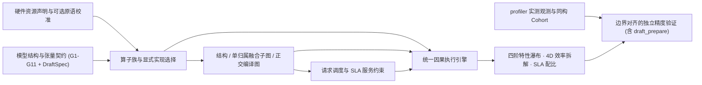

# 面向 Agent 的通用性能建模系统（`mindie-sim`）

[English](simulation-system.en.md) · [系统架构](architecture.md) · [Profiler 系统设计](profiler-system.md) · [结构复用与实测映射](archive/profiler-sim-structure.md) · [设计原则](design-principles.md) · [消费者迁移指南](archive/simulation-consumer-migration.md) · [文档中心](README.md)

`mindie-sim`（Python 包 `mindie_sim`，当前基线 `v0.9.19+`）是面向编程 Agent 的硬件无关、机理优先（Mechanism-First）性能建模组件。它从模型结构、算子实现和硬件资源声明出发，用**同一个因果执行引擎**计算算子、子图、纯模型与服务场景的成本，并提供**确定性 Case 合成器（`compose`）**、**四阶特性叠加瀑布与双视角 PR 消融（`feature-tracks` / `feature_waterfall`）**、**正交两层编译主干（`Software`）**、**`async_scheduling` 异步调度延迟释放 KV 显存公理模型**、**4D 硬件效率拆解**（`Cube_MFU / Vec_MFU / MBU / Link_Util / CV_Overlap`）、**SLA 硬件缩放与多维拓扑/PD 分离精确 Pareto 求解（`sla` / `sweep`）**、**多 DP 偏斜/MoE EPLB/Chunked-Prefill 干扰屏障物理力学（`skew`）**与 **`mindie-model-structure/1` 结构导出（含 `draft_prepare=True` 投机草稿预填充对账）**。

厂商与芯片型号（如昇腾 A2 910B / A3 910C 双 Die / A5 950 `DT` & `PR`、GPU 等）仅用于选择硬件资源声明与输入适配器，不在执行循环中硬编码专用的经验倍率、`model_id` 分支或时间公式。

---

## 1. 目标与建模边界

`mindie-sim` 的核心目标是提供跨形状、跨模型、跨硬件与并行配置的可靠性能预测与瓶颈定界。系统将以下三个维度显式解耦管理：

- **结构正确性（Structural Fidelity）**：严格保留张量 Shape、Dtype、Layout、实际控制分支、物化拷贝、Kernel 边界、数据/流依赖、每计算核资源归属（`ctx.owned(...)`）与片上容量（`L1 / L0A / L0B / L0C / UB / L2`）。消费者算子不能在输入就绪前执行，真实发生的显存拷贝不能凭空消失，绑定在特定计算核或流上的任务不能借用空闲兄弟核的私有管道或 SRAM。
- **时间建模精度（Timing Fidelity）**：统一采用守恒的分块流水配方（`Class A–E`）与源码级精确规划器（`PlannedRecipe`），全面禁用 `ResourceEnvelope` `1.0x` 峰值除法兜底（调用即抛 `resource_envelope_banned`），未建模核心结构显式抛出携带 `mindie-unmodeled-structure-hint/1` 的 `UnmodeledCapabilityError`。不同粒度共享同一套因果执行引擎，无需为了消除微小残差而在模拟器中重写编译器或运行时。
- **校准与独立验证（Calibration & Validation）**：实测 Profiling 数据既可在声明适用域内校准资源或原语响应曲线，也可作为独立盲测集（Held-out Set）检验预测精度；没有实测数据时，系统直接运行解析机理模型。

系统严禁按 `model_id` / 模型名称硬编码算子分支、经验倍率、整网残差回填、固定服务时间底板，或从端到端 TTFT/TPOT 反向拟合单算子参数。物理工作量始终由模型结构、张量属性与算子契约正向守恒推导。

---

## 2. 自底向上的五层组合架构

五层结构代表自底向上的组合层次，全部复用同一个因果事件驱动引擎：

| 层次 | 输入与核心职责 | 工程产出与边界 |
| --- | --- | --- |
| **1. 物理资源与服务** （Physical Resources & Services） | 容量、工作量单位、供给速率、参与核数、片上缓冲（`L1 Buffer / L0A / L0B / L0C / UB / L2 Cache`，强制每 Die `buffer_units.l2 == 1`）与互联链路；处理共享资源竞争与有限流水深度 | 基于 `Hardware` / `Device` / `Link` 声明计算 Cube、Vector、分裂读管道（`mte2_aic` vs `mte2_aiv`）、`fixpipe`（含 A5 `l0c->ub`）、`mte3`/HBM 与集合通信链路的执行耗时与重叠率 |
| **2. 算子族与源码实现** （Operator Families & Lowerings） | 语义算子与显式软件实现选择（`runtime.kernels.lowerings`，区分 `caller` / `stack_profile` / `body_default` 绑定来源），生成守恒分块流水（`Class A–E`）或源码级 `PlannedRecipe`；保留真实 Kernel 调用边界 | 覆盖两阶段 **`RecoverSSM`** 投机状态恢复（通用于 **7 类秩-1 结合律线性注意力家族**：`kda`、`gdn`、`mamba`、`gla`、`deltanet`、`lightning`、`retnet`），以及 CANN `9.3.0` `Arch35` 源码级配方：`MegaMoE(enable_fused_mc2=3)` 与 `PR #22333` `situglu` MegaMoE、`fla_npu` `Chunk64` 与 `PR #22147` `Chunk32`（同受 `Hv/Hk <= 4` 约束，`Hv/Hk=8` 回退 Triton）、`_C_ascend.npu_hc_pre_v3/v2`、`PR #21794` `text_gated_residual`、`PR #22385` `AllGatherMatmulV2`/`MatmulReduceScatterV2`、统一 `GBSA`、`PR #22467` C8 `KvQuantSFA`、`MlaPrologV4`、`PR #22235` `msa_index_score_v2`、Step-5 `npu_indexer_region_score` 与 `aclnnIndexerQuantCache` |
| **3. 结构、子图与正交编译主干** （Structure, Subgraphs & Compilation Spine） | 组合投影、Attention、FFN/MoE、状态更新、布局转换与 `DP`/`TP`/`EP`/`PP`/`DCP`/`DSA-CP`/`PCP` 通信；由 `fusion_regions.py` 统一维护单归属融合算子谱系（`absorbed_source_ops` vs `FusionBoundary`，求并集保留跨组 `structure_subgraph_memberships`）；正交拆分 `Software` 外层 `graph_capture_mode` 与内层 `enable_torch_compile` / `enable_npugraph_ex` / `enable_static_kernel` / `enable_super_kernel` | 通过 `graph_costs` / `graph` 计算子图关键路径、流间重叠、片上缓存可行性与融合前后 HBM 流量变化；`do_not_compile=True` 保留 `FULL_DECODE_ONLY` `ACLGraph`（`graph_capture_mode="full"`）而仅跳过 `torch.compile`/`npugraph_ex`，`piecewise` 自动关闭内层三项开关 |
| **4. 纯模型前向与泛化草稿头** （Pure Model Forward & Generalized `DraftSpec`） | 展开 **37 款核心目录模型 + 4 款独立架构预设（共 41 款，`G1–G11` 11 族）** 完整 `LayerPlan` 与泛化 `DraftSpec`（显式支持 `independent_context`、`context_projection_mode ∈ {"none", "fused_kv_bank", "per_layer_qkv", "mla_prolog"}` 与 `dcp_sharded`，以及 `--draft-prepare` / `draft_prepare=True` 预填充草稿缓存构建） | `operators --scope model` 输出独立算子成本之和，`graph --scope model` 与 `predict(scope="body"\|"model")` 输出纯模型前向时延与 4D 效率拆解 |
| **5. 服务约束与 SLA 求解** （Serving Constraints & SLA Solver） | 在纯模型成本之上叠加请求到达、Continuous Batching、KV Cache 容量、共享前缀 L2 复用、PD 分离与 `DP × TP × EP × PP × DCP / DSA-CP / PCP` 并行拓扑及 Host 调度开销，评估 TTFT / TPOT | 输出请求级服务指标，并通过 `scale_case_hardware` / `solve_sla_sizing` 提供面向目标 TPOT（如 `<= 30ms`）的最小卡数、最大可行并发 `B* = min(B*_SLA, B*_VRAM)`、最优并行拓扑与硬件缩放推演 |

---

## 3. 组件职责与公开接口

### 3.1 跨组件分工

| 组件 | 核心职责 |
| --- | --- |
| **`mindie_sim`** | 模型/算子结构展开与无时延导出（`mindie-model-structure/1`）、五层因果性能预测、四阶特性叠加瀑布（`feature-tracks`）、4D 硬件效率拆解、SLA 硬件配比推演、候选方案对比（`study`）以及与实测 Cohort / Decode 主体的精度对账 |
| **`mindie_profiler`** | 昇腾 `msprof` / CANN 9.x `MSPTI` 采集控制、原始 CSV/SQLite/Trace 原地只读流式解析、观测张量契约提取、`mindie-profiler analyze --structure [--sim-case]` 三态拓扑对齐与双向 Case/`draft_prepare=True` Cohort 对账、拓扑引导 Decode 自动切分（`auto_segment_decode_forwards`）及跨版本对比 |
| **宿主 Agent** | 结合研发任务选择建模粒度，调用 `sim` 与 `profiler` 定位性能瓶颈、筛选算子融合或未合入 PR 收益，并在真机上验证 |
| **`remote-dev` / `coordinator`** | 提供远端容器执行、物理拓扑探测与 NPU/端口租约管理；本地纯机理仿真无需申请 NPU 租约 |

### 3.2 CLI 与 Python 核心入口

Python 公开入口包括 `mindie_sim.predict`、`mindie_sim.operator_costs`、`mindie_sim.target_operators`、`mindie_sim.graph_costs`、`mindie_sim.target_graphs`、`mindie_sim.study`、`mindie_sim.feature_waterfall.compare_feature_tracks`、`mindie_sim.structure.export_structure` 与 `mindie_sim.cohort_comparison.compare_cohorts`。命令行入口通过 `mindie-sim <subcommand>` 调用：

| CLI / 模块入口 | 核心用途与输出边界 |
| --- | --- |
| `catalog` / `inspect CASE` | 读取模型声明或展开完整层结构，零权重加载、零设备上下文初始化 |
| `compose --model ... --hardware ...` | 从内置 41 款模型目录或 HuggingFace `config.json` 与 `a2/a3/a5` 硬件别名确定性合成 `Case`（支持 `--feature-track {raw_eager,merged,unmerged_pr,expected_ideal}`、`--stack-manifest`、`--enable-opt`/`--disable-opt`、`--recover-ssm` 与 `--async-scheduling`） |
| `feature-tracks --model ... --hardware ...` | 连续评估 `raw_eager` -> `merged` -> `unmerged_pr` -> `expected_ideal` -> `exact_target` 硬件 Roofline 四阶瀑布，审计单调性并输出 `single_pr_ablation` 与 `leave_one_out_ablation` |
| `operators CASE --phase ... --tokens ... [--draft-prepare]` | 计算生产配方下的独立算子成本，输出 `sum_of_isolated_device_programs` 及各算子族占比 |
| `graph CASE --phase ... --tokens ... [--draft-prepare] [--export-structure PATH]` | 在统一因果引擎中组合数据依赖、多流并发与 EP 集合通信，输出纯设备图或含 Host 提交（`--include-submission`）的完成时间，并可同步导出同几何结构图 |
| `predict CASE` | 执行纯模型（`scope="body"\|"model"`）或服务级请求仿真，输出端到端时延、4D 硬件效率拆解与瓶颈定界 |
| `efficiency CASE` / `sla CASE` | 输出 4D 硬件效率拆解、`0.80x MBU` 反事实 Roofline 目标（支持 `--mode {clamp_to_target,exact_target}`），以及同步/异步调度下的 SLA 并发上限与最小卡数 |
| `sweep CASE [--mode topology\|pd]` / `skew CASE` | 枚举 `DP/TP/EP/PP/PCP/DCP` 并行切分与 P/D 分离配比的精确无支配 Pareto 前沿；量化多 DP 上下文偏斜 AllToAllV 同步屏障、MoE 路由失衡（含 EPLB）与 Chunked-Prefill 最大安全块 $C_{\max}^*$ |
| `study MANIFEST` / `accuracy PACKET` | 在一致的结构与计时边界下批量评估候选方案排序，或在独立盲测集（Held-out）上输出误差分布与趋势一致性 |
| `mindie-sim structure CASE --phase ... --tokens ... [--draft-prepare]` | 导出无时延 `mindie-model-structure/1` JSON（CLI 自动将本地文件路径脱敏为 `source: {"kind": "case_file", "sha256": ...}`），供 `mindie-profiler` 关联实测事件 |
| `mindie-sim compare-cohorts CASE REPORT -o RESULT` | 消费 `mindie-profiler` 输出的 `mindie-profile-structure-mapping/1` 同构算子集合（Cohort）报告（含 `draft_prepare=True` 草稿预填充子图），完成单次与累计耗时对账 |
| `calibrate` / `bind-profiler` / `fit-rate` / `fit-service` | 导入显式身份匹配的原语样本或拟合单资源通道的服务速率曲线，严格隔离训练集与盲测集 |

### 3.3 4D 硬件效率拆解、反事实 Roofline 拟合与 SLA 硬件配比推演

每次模型或子图仿真除输出预测耗时（`TTFT`、`TPOT`、`body_forward_span_ms`）外，还直接给出面向硬件架构师与调优 Agent 的可解释指标：

1. **4D 硬件效率拆解与 `0.80x MBU` 反事实 Roofline 拟合**：
   - **`Cube_MFU`**：矩阵计算单元（Cube Core）有效算力利用率；
   - **`Vec_MFU`**：向量计算单元（Vector Core）有效算力利用率；
   - **`MBU`**：高带宽显存（HBM）有效带宽利用率（并提供 `0.80x MBU` 反事实多管线 Roofline 目标拟合，量化算子优化上限）；
   - **`Link_Util`**：片间/机间互联链路（HCCS / SIO / UB-Mesh / RoCE）有效带宽利用率；
   - **`CV_Overlap`**：Cube 与 Vector 流水线并行掩盖率，以及主导瓶颈分类（`memory_bound / cube_bound / vector_bound / link_bound / launch_bound`）。
2. **面向 SLA 的硬件缩放与最大吞吐求解器（`scale_case_hardware` / `solve_sla_sizing`）**：
   - 给定模型配置、上下文长度、目标并发与延迟约束（如 Decode `TPOT <= 30ms`），支持对 `hbm_bw_scale`、`cube_flops_scale`、`vector_ops_scale`、`link_bw_scale`、`hbm_capacity_scale` 进行无损反事实硬件缩放，通过单调二分搜索联合求解 SLA 延迟上限 `B*_SLA` 与显存容量上限 `B*_VRAM` 的可行最优并发 `B* = min(B*_SLA, B*_VRAM)`，给出满足 SLA 的**最小卡数**、**最优 `DP × TP × EP × PP × DCP / DSA-CP / PCP` 并行配比**与**最大服务吞吐**。

### 3.4 CANN `9.3.0` + `vllm-ascend@405617bae` 栈真源、四阶瀑布与 `G1–G11` 结构契约

1. **公开可审计栈真源与 `_A5_PROFILE` 能力真相**：
   - `mindie_sim/stack_sources/vllm_ascend_cann93.json` 与 `mindie_sim/va_stack_bindings.py` 锁定 CANN `9.3.0-20261112_192141454`（`cann_ops_transformer 1.0.0`、`fla_npu 26.10.0+feature`）与 `vllm-ascend@405617bae` 主干及 35 个活跃未合入优化 PR，全部条目附带公开 `{repository, revision, relative_path, source_sha256}` 溯源（可通过 `audit_stack_prs.py --stack cann93` 自动巡检晋升状态）。
   - 严格还原 `_A5_PROFILE` 真实硬件开关：A5 主干已合入 `MegaMoE(enable_fused_mc2=3)`、`Chunk64`（`Hv/Hk in {1, 2, 3, 4}`）、`_C_ascend.npu_hc_pre_v3/v2`（`C in {2560, 4096, 5120, 7168}`）、统一 `GBSA` 与 `MlaPrologV4`，同时如实反映 `_A5_PROFILE` 遗漏 `GRAPH_QKV_NORM_ROPE_FUSION`（通用 FX QKNorm+RoPE 融合归入 `expected_ideal`）；`unmerged_pr` 轨道精确叠加 `PR #22147` `Chunk32`（`Hv/Hk <= 4` 细粒度分块提速）、`PR #21794` `text_gated_residual`（`M > 512`）、`PR #22333` `situglu` MegaMoE、`PR #22467` C8 `KvQuantSFA`、`PR #22235` `msa_index_score_v2`、`PR #21449` `(1+w)` RMSNorm 预折叠、`PR #22385` TP `MC2`、`PR #22342` Step-5 `@support_torch_compile`、`PR #22164`/`#22473` A5 `FA3` 与 `PR #22184` DSpark Static Kernel。
2. **四阶特性瀑布（`stack_tracks` / `feature_waterfall`）与正交编译层（`Software`）**：
   - 四阶轨道 `raw_eager` -> `merged` -> `unmerged_pr` -> `expected_ideal` 锚定至 `evaluate_target_efficiency(..., mode="exact_target")` 物理 Roofline，同时输出正向单加 `single_pr_ablation` 与留一剔除 `leave_one_out_ablation`。
   - `Software` 将外层 `graph_capture_mode` 与内层 `enable_torch_compile`、`enable_npugraph_ex`、`enable_static_kernel`、`enable_super_kernel` 正交解耦：`do_not_compile=True` 保留 `FULL_DECODE_ONLY` `ACLGraph`（`graph_capture_mode="full"`）而关闭 `torch.compile`/`npugraph_ex`，`piecewise` 自动关闭 `npugraph_ex` 与 Static/Super Kernel。
3. **泛化 `DraftSpec`、7 族 `RecoverSSM` 与 `G1–G11` 结构真相**：
   - 两阶段 `RecoverSSM` 统一覆盖全部 **7 类秩-1 结合律线性注意力家族**（`kda`、`gdn`、`mamba`、`gla`、`deltanet`、`lightning`、`retnet`）；`DraftSpec` 完整继承稀疏注意力、滑动窗口与 `mHC` 属性，并显式建模 `independent_context`、`context_projection_mode`（`fused_kv_bank` / `per_layer_qkv` / `mla_prolog`）与 `dcp_sharded`。
   - 全目录 41 款模型严格对齐上游结构真相：`Gemma-4`（`G10`）为标准 `RMSNorm`（`norm_weight_offset=0.0`、4/7 Norms、无权重 `v_norm`、`k_eq_v=True`）；`MiniMax-M3` / `M3.1-Flash`（`G8`）采用 `(1+w)` `GemmaRMSNorm` 并配齐 7 层稠密 GQA DSpark（`#20167`）；`Step-5-Preview`（`G9`）采用原生 CSA `npu_indexer_region_score` + 3 层 `cyclic_nextn`；`Kimi-K3`（`G5`）采用 5 层 GQA DSpark（`dcp_sharded=False`），而 `Kimi-K3.1` 采用 5 层 MLA DSpark。
   - 原生支持局部稠密切分（`o_proj_tp`、`linear_proj_tp`、`lm_head_tp`）、Paged/滑窗/块稀疏 GQA 共享前缀池化与 L2 复用（`prefix_cache_mode` / `prefix_read_mode`）、EPLB 物理冗余专家驻留（`redundant_experts_per_rank`）、集合通信拓扑启动轮次（`collective_startup_mode`）及基于四时钟 Max-Plus 偏序代数的四象限暴露耗时守恒拆解（`exposed_breakdown_ms` / `exposed_breakdown_pct`）。

---

## 4. 与 `mindie-profiler` 的结构对齐与实测校准

`mindie-sim` 与 `mindie-profiler` 通过声明结构导出与实测观测报告形成闭环，详见[结构复用与实测映射](archive/profiler-sim-structure.md)：

1. **统一结构导出（`mindie-model-structure/1`）**：`mindie-sim` 从模型配置或 `OpSpec` DAG 导出包含语义节点、层/块归属（`layer / block / role`）、张量契约（`contract`）、物理工作量签名（`physical_work / physical_signature`）与单归属融合子图边界（`subgraphs` / `resource_boundary`）的结构清单，支持 `--draft-prepare` / `draft_prepare=True` 包含预填充草稿缓存构建子图。
2. **双向 Case 接入与同构算子集合（Cohort）对账**：`mindie-profiler` 的 `sim_structure_ingress`（及 `sim_draft_geometry`）直接消费 `mindie-model-structure/1`、五键 `Case` 或 `mindie-sim.graph/1` 摘要，透传 `draft_prepare=True` 完成结构再生，并将相同契约与物理工作量的事件聚合成 Cohort，由 `mindie_sim.cohort_comparison` 直接比对单次耗时（Mean / P50）与整组累计耗时。
3. **拓扑引导 Decode 主体自动切分与端到端对账**：`mindie-profiler` 的 `auto_segment_decode_forwards` 利用 `sim` 层计划自动从完整推理 Trace 中切出每次 Decode 主体 Forward 的精确设备墙钟跨度（`body_forward_span_ms`），并与 `mindie_sim.predict(..., scope="body", phase="decode")` 进行端到端对比。
4. **统一的回放与验证流水线**：`profiler/examples/structure/pipeline.py` 提供覆盖 `--stage decode|prefill|operators|engine|generalization|all` 的一站式重放与记分牌生成。

---

## 5. 验证体系与多集群泛化实测结果

- **有界内存与零权重控制面**：仿真主循环严格保持 `O(Active State)` 内存占用，不加载模型权重、不初始化 `torch_npu`/CANN 上下文；在 Qwen3.8 / Qwen3.5 / Qwen3.6 / Kimi K3 / GLM5.3 / DeepSeek V4.1 等完整模型图基准上，单进程峰值 RSS 仅为 **`287.6 MiB`**（严格低于 `512 MiB` 目标红线），任务完成后存活对象清零。
- **Lean 4 形式化守恒验证内核（`formal/MindIESimSpec`）**：以零运行时依赖的离线纯 Lean 4 证明内核对四时钟 Max-Plus 暴露拆解守恒律、跨算子权重预取钳位与半开生命周期区间显存账本、局部子图 `TP` / EPLB 冗余槽位 / 昇腾 `FRACTAL_NZ` 切分排布同构、`RecoverSSM` 投机快照回滚与接受前缀重演状态等价性、以及 `UB-Mesh` 对数集合通信轮次界完成机械化证明（零 `sorry` / 零自定义 `axiom`）。
- **跨芯片、跨模型与四阶特性轨道的真实硬件收敛结果**：
  - **CANN `9.3.0` A5 双硅基全矩阵闭环**：在 `Ascend950PR_958b`（`1.4 TB/s, 112 GiB`）与 `Ascend950DT_9582`（`4.0 TB/s, 96 GiB`）上完成全部 41 款模型 × 2 款 SKU × 4 条特性轨道（`1,312` 组矩阵）零异常扫描与单调性闭环，配套 `7,337 / 7,337` 份跨 A2 / A3 / A5 真实 Profiling 采集（`436,412` 单步样本）算子级与单步级 `100.0% <= 10%` 误差验证；
  - **Decode 与 Prefill 主体预测**：覆盖 A3 / A5 集群的 **280 个真实 Decode 用例**与 **15 个完整 Prefill 用例**全部收敛在 **`<= 15%`** 误差容差内；
  - **三芯片样本内多工况校准（A2 + A3 + A5）**：覆盖 A2（`565/565`）、A3（`580/580`）与 A5（`508/508`）共 **202 个 Cohort-Phase、1,653 份** 实测 Golden Profiles，实现 **`1,653 / 1,653 = 100.00% <= 10%`** 样本内误差收敛（平均绝对误差 `2.77%`，中位数 `2.11%`）；
  - **大规模集群盲测泛化（DSH Fleet Generalization）**：在独立的 **856 个 DSH 真实集群用例**上整体预测准确率达到 **`841 / 856 = 98.25%`（误差 `<= 15%`）**，其中 **561 个独立 Held-out 盲测用例**达到 **`546 / 561 = 97.33%`（误差 `<= 15%`）**。
- **七端宿主与评测套件全量集成**：`mindie-sim` 已通过 `mindie-harness` 共享网关在全部 7 款宿主插件（`mindie-agent-codex`、`cc`、`kimi`、`dsh`、`agy`、`wb`、`oc`）中零前置绑定（`P2.7`）统一暴露，并与 `mindie-bench` 的 `sim-causal-modeling-boundaries` 基准完成闭环验证（接口迁移说明见[消费者迁移指南](archive/simulation-consumer-migration.md)）。
