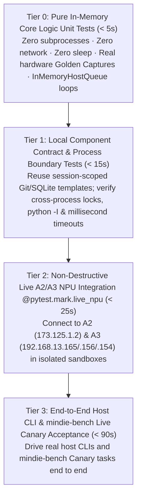

# Tiered Testing Architecture & Case Design Guidelines

[中文](testing-architecture.md) · [Back to Documentation Center](README.en.md)

This document defines the unified **Test Validity Redlines** and **Four-Tier Testing Pyramid (Tier 0 – Tier 3)** across all MindIE Agent repositories (`knowledge`, `remote-dev`, `coordinator`, `profiler`, `sim`, `npu-top`, `diagnostics`, `debugger`, native Harness plugins, and `mindie-bench`).

> **Note**: The four tiers and time budgets below are engineering design targets; the exact source SHAs, test scopes, environments, wall times, and known boundaries for each release are recorded in the corresponding [Release Records](README.en.md#release-records--roadmap).

- Governed by: [Engineering Design Principles](design-principles.en.md) · [Architecture & Module Boundaries](architecture.en.md)

Dedicated evaluation plans for the knowledge flywheel and `L1–L4` architectural capabilities are documented in the [L1–L4 Knowledge Flywheel Testing Plan](knowledge-tiered-testing-plan.md). Note the two orthogonal numbering schemes: `L1–L4` denotes cognitive and execution knowledge tiers (`axiom/measurement`, `sop`, `workflow`, and `mutator` units in `knowledge`), whereas `Tier 0–3` denotes engineering test execution scope; full-task net value, cross-task learning, and multi-round exploration experiments carry dedicated budgets rather than being approximated by short Canary runs.

---

## 1. Test Validity Redlines (Every Test Must Earn Its Keep)

A test is valuable only if it catches real production bugs or contract regressions at minimal time and maintenance cost. Across all repositories, the following five categories of filler or deceptive tests are strictly prohibited:

1. **No Defensive Paranoia Filler Tests**:
   - Never write tests that merely exercise Python type checks, trivial attribute assignments, defensive `ValueError` / `TypeError` branches, or repetitive `chmod 0o777` / `symlink` hypothetical scenarios without testing core business invariants.
2. **No Tests Ratifying Silent Fallbacks or Fake Success**:
   - Never write tests asserting that an underlying database failure, subprocess timeout, or binding error returns `exit 0` / `{}` / `status="active"`. Failure tests must verify that errors are surfaced honestly and that local bookkeeping timeouts never overwrite succeeded remote results.
3. **No Static Constant, Enum, or Signature Roll-Call Tests**:
   - Never write tests that simply assert the literal contents of static dictionaries, constant tables, enum string lists, `inspect.signature` parameter defaults, or schema field names.
4. **No Regex/Grep Tests Against Documentation or Prompt Prose**:
   - Never grep `README.md`, `SKILL.md`, prompt templates, or markdown headings in unit tests. Documentation is maintained through architectural review; tests must verify executable runtime behavior.
5. **No Production-Script Tampering or Unfaithful `MagicMock` Fabrication**:
   - Never overwrite production script files (e.g., replacing `admission_ops.py` with fake stubs) inside a test to force a pass;
   - Never use `MagicMock` payloads that diverge from real server/hardware responses to fake a passing test. Offline parser tests must run against real Ascend hardware **Golden Captures**, and state-machine tests must exercise real in-memory loops (such as `InMemoryHostQueue`) or real temporary SQLite/Git instances.

---

## 2. The Four-Tier Testing Pyramid (Tier 0 – Tier 3, Live A2/A3 NPU Ready)

| Tier | Time Budget | When to Run | Coverage Scope & Hard Rules |
| --- | --- | --- | --- |
| **Tier 0** Pure In-Memory Core Unit Tests | **`< 5s`** | Every save / Every commit | **Zero external subprocesses, zero network, zero `sleep`**. Covers parsers (backed by real A2 910B / A3 910C / A5 hardware Golden Captures), state-machine transitions (`InMemoryHostQueue` and real in-memory loops), deterministic privacy redaction, `TechnicalTokenizerV1` tokenization, and protocol translation. |
| **Tier 1** Local Component Contract & Process Boundary Tests | **`< 15s`** | Component changes / Pre-PR gate | **Reuses session-scoped pre-built Git/SQLite templates** (`shutil.copytree` in milliseconds). Verifies cross-process file locks, `python -I` isolated startup, MCP stdio framing, and millisecond injectable timeout reclamation. **Never run network `pip install` or 10MB+ `fsync` disk bombs inside tests**. |
| **Tier 2** Non-Destructive Live A2/A3 NPU Integration (`@pytest.mark.live_npu`) | **`< 25s`** | Routine gate for remote execution, probing, containers, leases, or NPU tools | Connects directly to the standing **A2 (`173.125.1.2`)** and **A3 (`192.168.13.165` / `.156` / `.154`)** clusters using isolated sandbox directories (e.g., `state_dir="/tmp/mindie-npu-test-<uuid>"`) without disturbing active workloads. Verifies live `npu-smi` probing, multi-Die `Phy-ID` mapping, Docker container pass-through, Linux `/proc` process-tree draining, and lease anti-preemption. |
| **Tier 3** End-to-End Host CLI & `mindie-bench` Live Acceptance | **`< 90s`** | Plugin releases / Cross-repo integration / Benchmark changes | Drives real host CLIs (Claude Code, Codex, Kimi Code, DSH) and `mindie-bench` Canary tasks through the full loop: prompt trigger, knowledge retrieval, remote NPU verification, and experience capture. |

---

## 3. Tier Design Rules & Best Practices

### 3.1 Tier 0: Hardware Golden Captures & In-Memory Loops Over `MagicMock`
- **Authentic Hardware Captures**: Parser tests for `npu-smi info`, `npu-smi info -t board`, `lscpu`, container mounts, and CANN stack traces must use verbatim Golden Captures collected from real A2 (910B), A3 (910C dual-Die), and A5 nodes.
- **Zero-`sleep` Time Advancement**: Test retry backoffs, lease expiration, incremental checkpoints, and sliding windows via injectable monotonic clocks (`clock` / `now_fn`), never `time.sleep(...)`.

### 3.2 Tier 1: Session-Scoped Template Fixtures & Injectable Timeouts
- **Pre-built Template Reuse**: Any test requiring a Git repository (`git init` + `commit`) or SQLite schema initialization must clone from a `scope="session"` template fixture via `shutil.copytree`, keeping per-test setup in the single-digit millisecond range.
- **Millisecond Process Lifecycle Verification**: Exercise subprocess cancellation, hang recovery, and `owner-pipe` / `systemd` / Job Object cleanup by injecting `50ms–100ms` timeouts rather than multi-second waits.
- **Zero Host Pollution (`conftest.py` Mandatory Isolation)**: Every repository's `tests/conftest.py` must define an `autouse=True` fixture redirecting `MINDIE_DIAGNOSTICS_ROOT`, `MINDIE_DIAGNOSTICS_CONFIG`, `HOME` / `XDG_CONFIG_HOME` / `XDG_STATE_HOME`, and component state directories to `tmp_path`, ensuring test runs never pollute host `~/.local`, `~/.config`, `~/Library/LaunchAgents`, or background user services.

### 3.3 Tier 2: Non-Destructive Live A2/A3 NPU Sandbox Rules (`@pytest.mark.live_npu`)
- **Always-On Cluster Access**: Standing SSH access to A2 (`173.125.1.2`) and A3 (`192.168.13.165` / `.156` / `.154`) is standard in our development environment. Changes touching hardware topology, remote file sync, or container execution must be verified with `@pytest.mark.live_npu`.
- **Strict Non-Interference & Sandbox Isolation**:
  - All remote state and scratch files must live inside an isolated `/tmp/mindie-npu-test-<uuid>` directory and be cleaned up on fixture teardown;
  - Never modify, restart, or preempt running production containers, training/inference jobs, or shared host configuration files;
  - Lease and process-tree drain tests operate strictly on self-spawned lightweight test processes and sandboxed lease namespaces.

### 3.4 Tier 3: Host CLI & `mindie-bench` Canary Loop
- In `mindie-bench`, the test suite focuses on recipe materialization, workspace isolation (source projection / worktree), verifier soundness, telemetry/cost settlement, and live Canary task execution—keeping the benchmark harness fast, deterministic, and free of dead-branch filler tests.
- **Hardware-Anchored Performance (`HAP`) & L1–L5 Complexity Grading** (distilled from [`cann-bench`](https://gitcode.com/cann/cann-bench)):
  - Alongside raw speedup, operator evaluations compute Roofline-anchored performance $\text{HAP}_i = \frac{T_{\text{baseline},i} - T_{\text{HW},i}}{(T_{\text{cand},i} - T_{\text{HW},i}) + (T_{\text{baseline},i} - T_{\text{HW},i})}$ against `mindie-sim` hardware lower bounds $T_{\text{HW}}$ and the composite score $\text{EachOperatorScore} = \left[w_c \delta_{\text{pass}} + \frac{1}{|\text{cases}|}\sum_i \delta_{\text{acc},i}(w_f + w_p \text{HAP}_i)\right] \times 100$ (default $w_c=0.2, w_f=0.3, w_p=0.5$), stratified across **L1 (Element-wise) $\to$ L2 (Reduction/Norm) $\to$ L3 (Matmul/MoE/Tiling) $\to$ L4 (Fused Attention/Sequence) $\to$ L5 (Sparse/Stateful/Lightning Indexer)**.
- **Sentry Dual-Verification Trajectory Audit & Swimlane Attribution** (distilled from [`cannbot-sentry`](https://gitcode.com/cann/cannbot-sentry) `sift` and `insight`):
  - **Process Compliance Audit**: Verifies whether the trajectory obeyed declared engineering gates (compile-before-timing, hidden-input generalization, leave-one-out ablation) with `step_index` evidence back-links;
  - **Result Consistency Audit**: Reconciles agent-reported accuracy and speedup claims against independent verifier receipts to prevent reward hacking;
  - **Six-Swimlane Attribution (`explore / design / code / compile / verify / distill`)**: Aggregates turns, token usage, and wall time per engineering phase for granular A/B comparisons.

---

## 4. CI Separation & Per-Release Benchmarks

1. **Separating Routine CI from Live Hardware Acceptance**:
   - Standard PR checks, branch CI, and pre-release local contract stages run `pytest -m "not live_npu"`, avoiding automatic connections to standing NPU clusters or paid host model calls.
   - All live NPU cases carry the `@pytest.mark.live_npu` marker. Direct calls to `mcp_server.handle()` in tests validate Tier 1 component contracts, whereas Tier 3 host acceptance drives the actual host CLI binary.
2. **Release Benchmark Verification**:
   - On formal product releases, a pinned `mindie-bench` runner verifies exact component source revisions alongside end-to-end engineering task comparisons, cross-task experience reuse, and component scenario benchmarks (see [Benchmark Evidence on Every Release](release-compatibility-and-update.en.md#benchmark-evidence-on-every-release) and [Release Records & Roadmap](README.en.md#release-records--roadmap)).
3. **Scope of Each Verification Layer**:

| Verification Layer | What It Establishes | Scope Boundary |
| --- | --- | --- |
| **Local Unit & Contract Suites (Tier 0/1)** | Consent state transitions, protocol translation, redaction, and error propagation obey code contracts | Does not replace runtime checks inside real host CLIs or on Ascend NPU hardware |
| **Live A2/A3 Integration (Tier 2)** | Real hardware probing, container execution, and lease coordination on standing Ascend clusters | Does not replace full host CLI conversation loops |
| **Native Host & Task Evaluation (Tier 3)** | End-to-end task completion, cross-task reuse, and multi-agent coordination on fixed benchmark suites | Reported per tested host, model, and experimental condition |
